## 2021-02-01 10:11

我给你们看一个数据，你们就知道我为什么不停的强调新朋友现在不要跟我，因为我的个人能力解决不了牛市中上车收益率不好的问题。

第一张图是截止到2019年末，中欧基金旗下基金涨幅与基民收益率的对比图。可以看出，基金涨59%，基民赚10%。

第二张图是2020年中欧基金的基民收益率的一个数据，注意，40%的人赚了10%以上。也就是说，60%的人连10%都没赚到。你也应该知道，2020年是权益类基金的大年。

你以为基金暴涨基民能赚钱吗？我只能说你太天真了。

这个问题现在看不算严重，因为毕竟还是赚钱的。问题在于，市场稍微一个波动或者下跌，就会出现大面积的亏损。大多数持仓的基民都会亏损，只要一个小幅下跌！如果熊市再来会怎么样？

这个问题我的智商、经验都解决不了。所以我一而再再而三的请新朋友不要跟车。熊市中我大力鼓吹让你进场，被很多人骂骗子。我现在跪求你不要跟我的车，因为我已经没有信心保证你赚钱了。

再次腔调：我没这个能力不代表别人没有！你可以去参考那些跟你说可以赚钱的人。
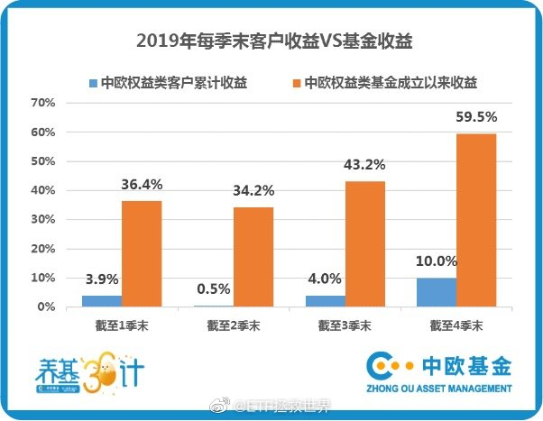 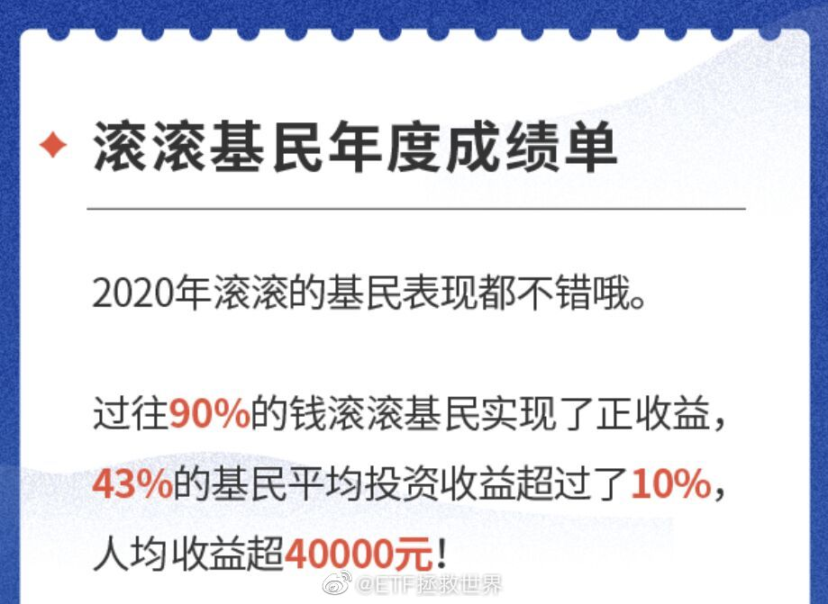

## 2021-02-01 10:33

在金融市场，一轮牛熊过后，散户投资者的状态其实是：

60%-70%的亏损者，喂养了：

5%的超级大赢家。这部分超级大赢家赚了很多很多很多钱。底部敢重仓，本金大，或者策略非常好。

5%-10%的一般赢家。这部分赢家也许本金略少，也许策略有一点问题，导致赚的不算多，但是赚的。

另外的百分之十几的人，大致处在不赚不亏的状态。胆子小，赚点就跑，赔点也跑。或者策略有大问题，导致一轮牛熊其实是白干的。

以上比例是结合我看到的各项统计数据瞎蒙而来，别杠，杠就是你赢。

## 2021-02-01 11:46

所以这玩意成本到底多少钱。

## 2021-02-01 17:28

给充满阳刚之气的猪猪男孩护肤小贴士：

推荐LAB的爽肤水。经常脸很干很难受的适用。

像我们这种年轻人用一百多两百块的蓝宝瓶就够了，他们年纪大的可以用锋范系列。

非广告，如果是广告那我今年赔大钱。 ​​​

## 2021-02-02 12:18

坐在阳光明媚的，有大窗户的，特别整洁的办公室里，

莫名其妙就有一种开心的感觉。 ​​​

## 2021-02-02 14:52

感觉7岁的儿子比我成熟 ​​​
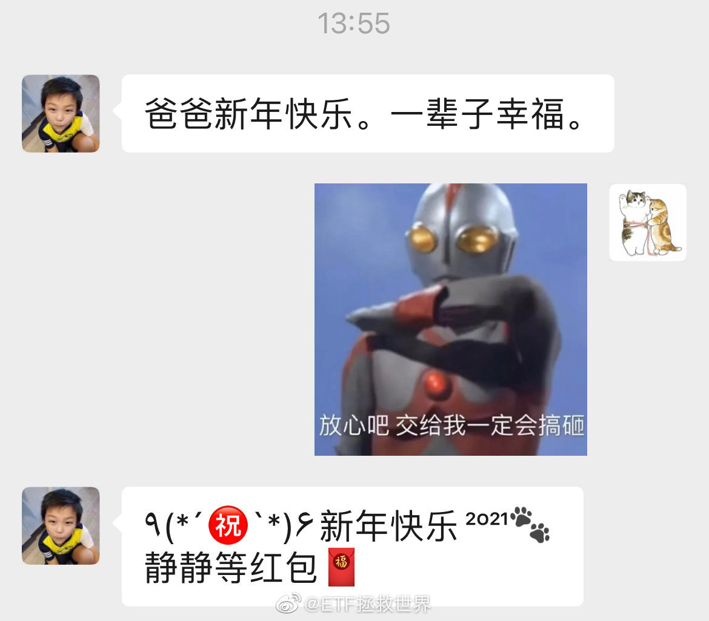

## 2021-02-02 15:39

平平淡淡的一天。明天见！

今天风很大！ ​​​

## 2021-02-02 18:57

我的建议你同意吗 ​​​
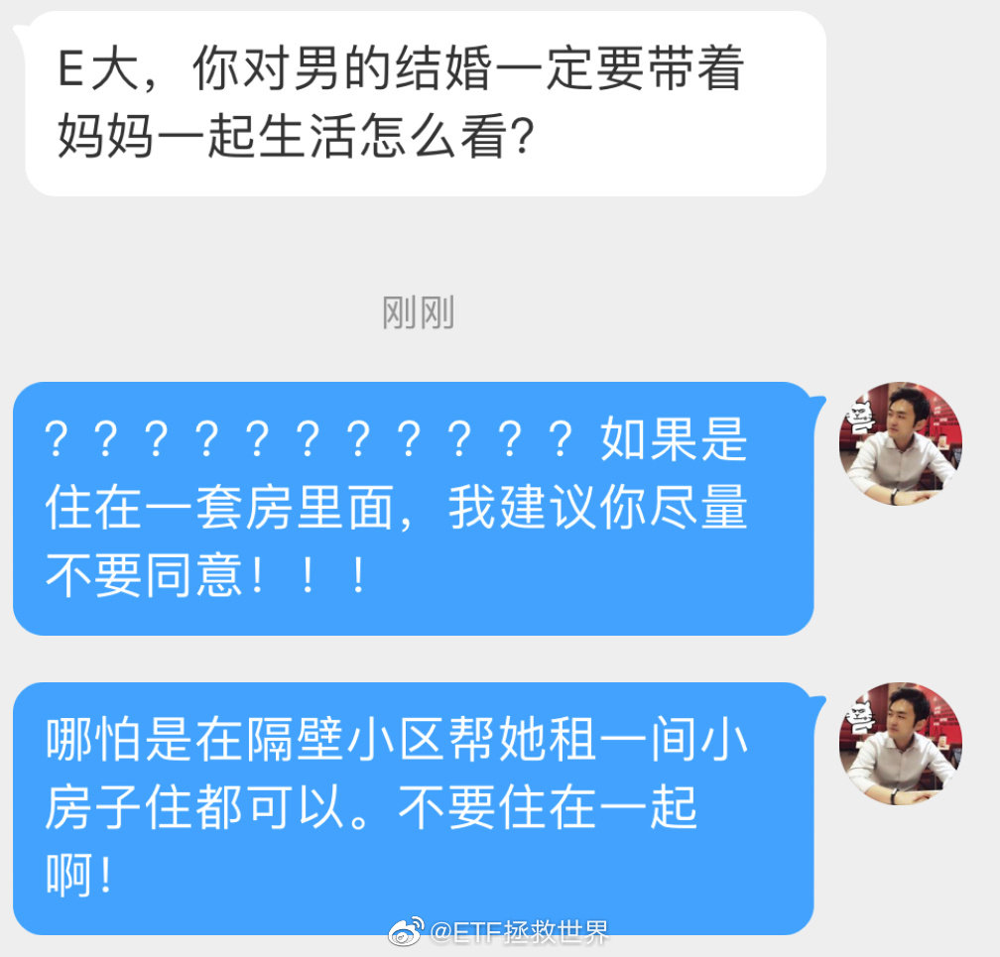

## 2021-02-02 19:23

有些朋友觉得不住在一起就是“不孝顺”，我不能同意这个说法。你住在一起孝顺什么了，还不是得长辈照顾你吃喝，难道你能给父母做饭吗。其实现在这个社会，绝大多数人除了最后那几年，即使年纪大了也都是比较健康的，生龙活虎，根本不需要你照顾。如果是因为不住在一起老人情感就没有寄托，那只能说

## 2021-02-03 16:11

至少一两年了吧，终于有一个买了浮亏的品种出现。

我看有些新朋友沉不住气了。虽然只是买了“一个月可投资的一半”，虽然加上今天只是跌了6%。但依然惴惴不安。又担心又想补仓又不敢补。

我也没什么好说的。总之就是未来当然还会继续买，最终也一定要像其它品种一样折腾盈利了。网格也可能开，150也一定会买。

但你要自己瞎折腾越来越多买成重仓最后跌的回不了本那可别骂我。

就这。

## 2021-02-03 16:26

写上一篇微博的时候突然感到特别幸福。

好久好久好久没有这种感觉了。

一个品种，买了，下跌。啪，一个补仓，很快啊，浮亏幅度减少了一半。啪，又一个补仓，还是很快啊，浮亏幅度又少了20%。

价格回到了原点，你猜怎么着？

赚大钱了！！！

太舒服了啊。 

效果如下 ​​​
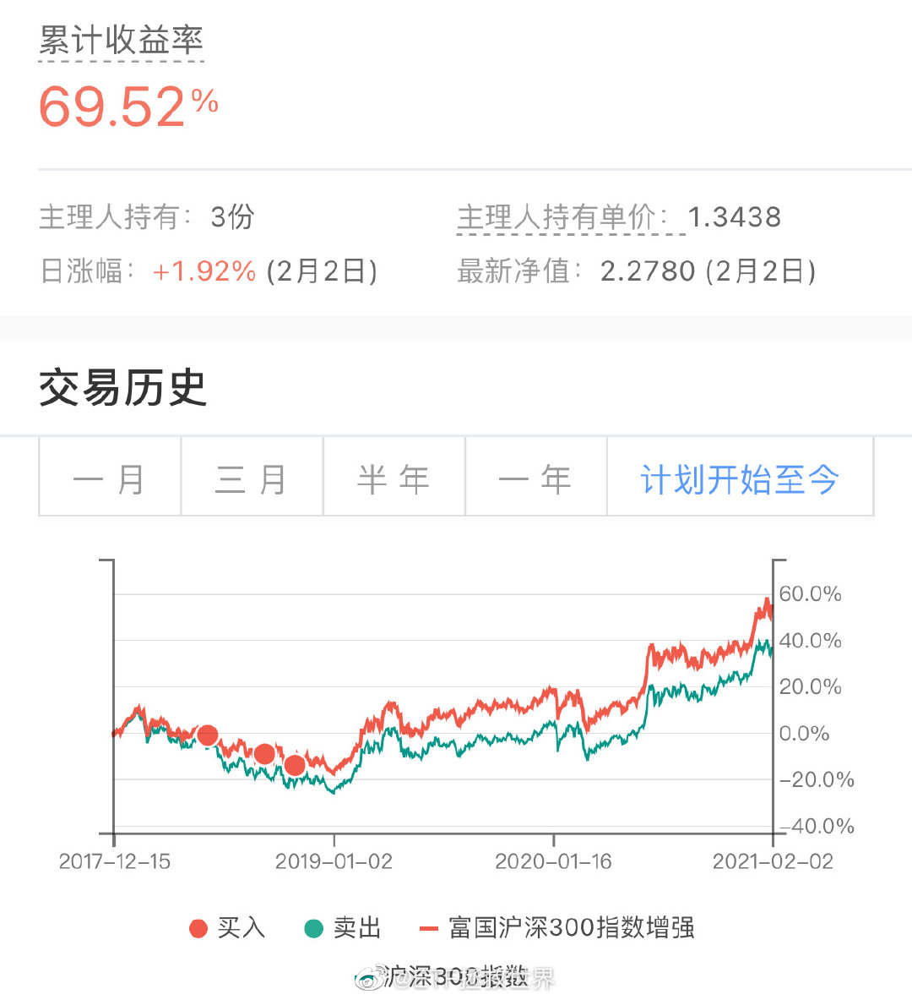 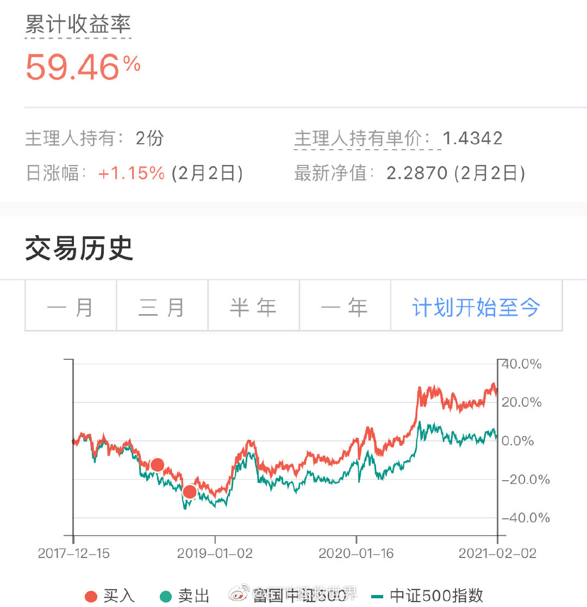 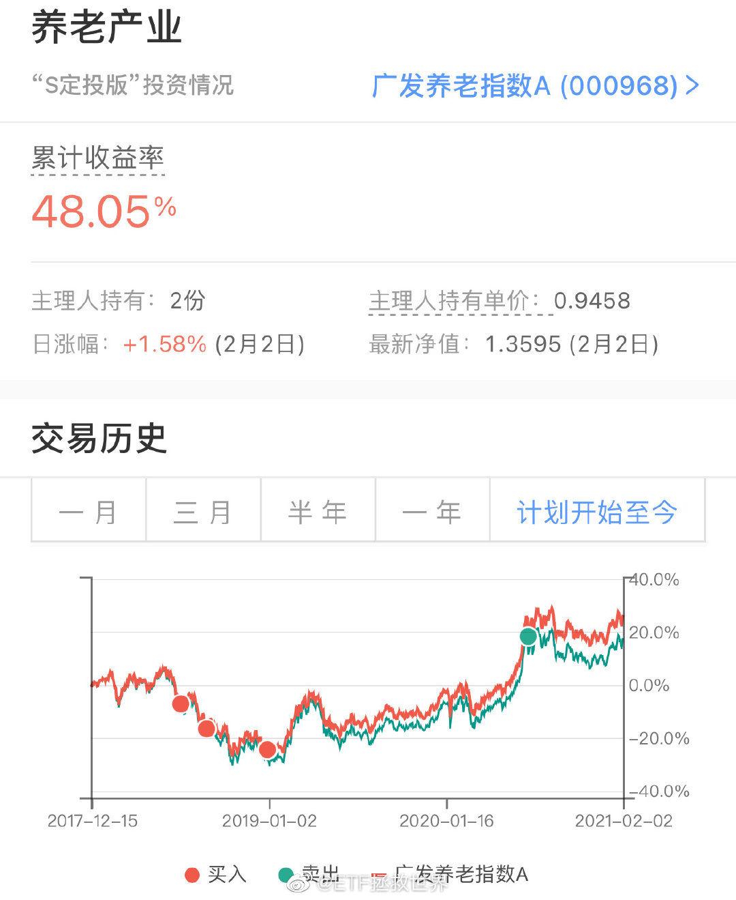 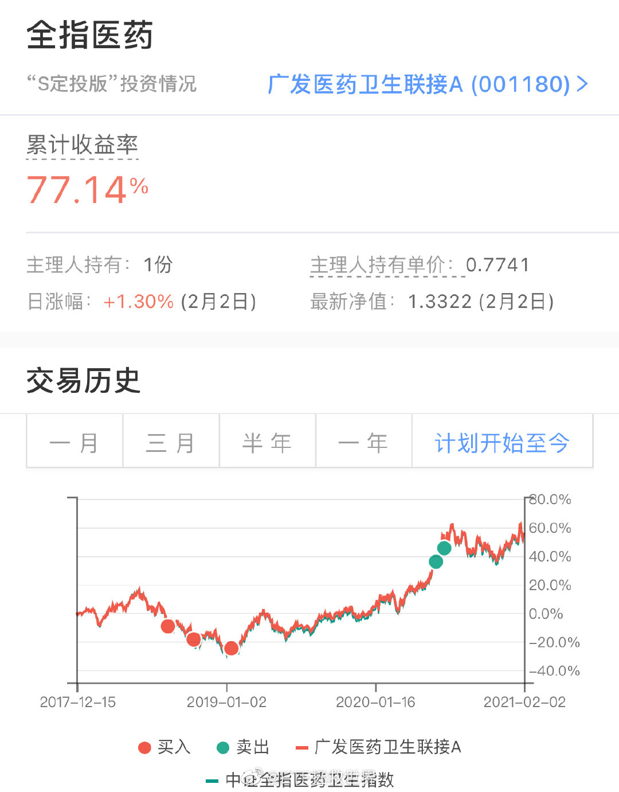 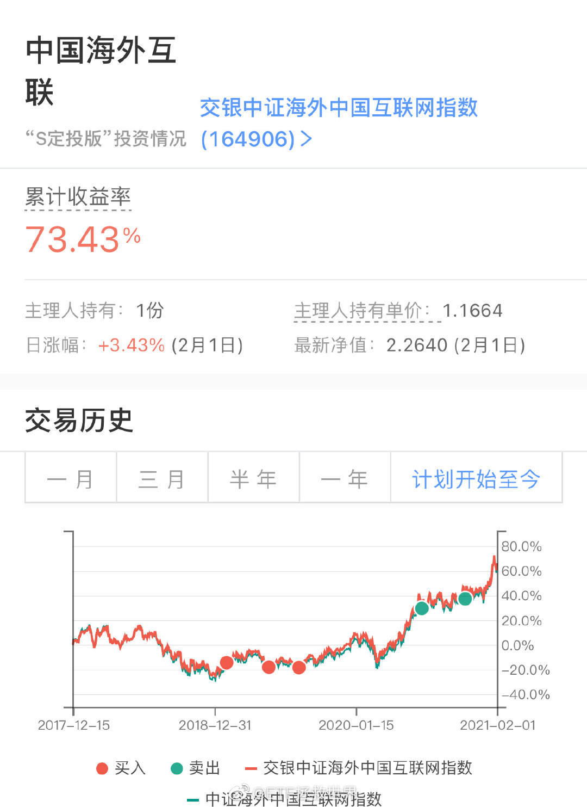 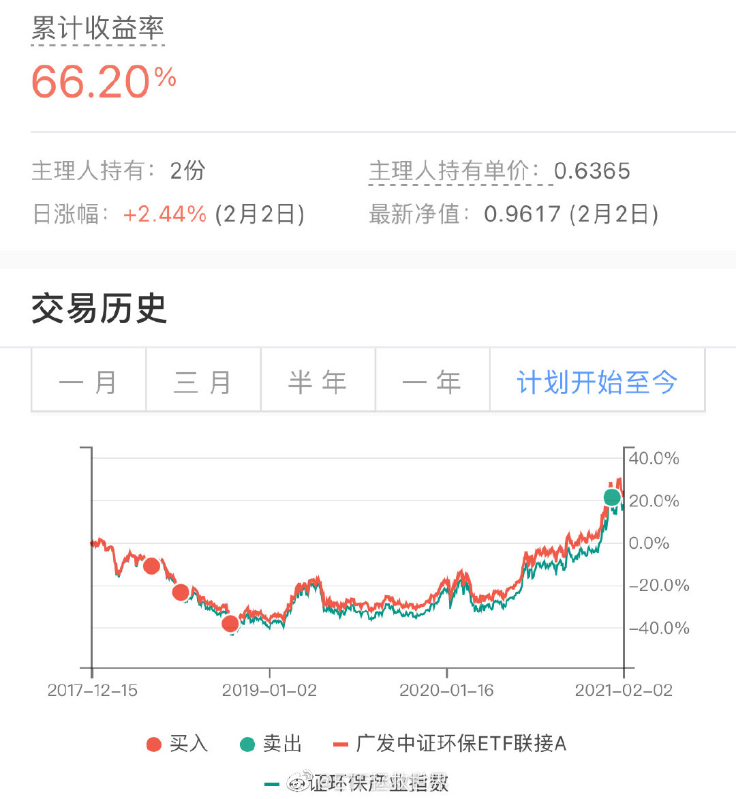

## 2021-02-03 17:55

你猜猜这起事故中责任是怎么划分的。

## 2021-02-03 20:20

说真的，我不怕花钱看影视作品。我是所有国内影视平台的付费vip和大会员。付费是太正常的事情了，大家都不付费最后就是没有东西看。

问题在于很多电影和电视剧我想掏钱看都看不到。比如前几天推荐的爱丽丝和甜蜜家园，挺好的啊，怎么就不能引进呢。

我都是人人下的，感谢他们为我提供了很多精神食粮吧。盗版确实不对，但人民群众是真的有需求啊。

## 2021-02-04 10:31

不用担心你的年终奖和之前没有投剩下来的钱没机会买了，

资本市场最不缺的就是

机会。 ​​​

## 2021-02-04 10:43

150之前连续减仓不是没有原因的。 ​​​

## 2021-02-04 16:48

翻译成数据表达就是这样： 查看图片

## 2021-02-04 17:00

今天收盘，上证指数3501点。

2年前的1月4日，上证碰到2440点。

那么，当时上市的3537只股票中，到今天有多少下跌呢。

答案是1466只。占比41%。

也就是说，有41%的股票比2400点还低。

跌幅最大的股票已经退市了，跌幅大于60%的有88只，跌幅大于20%的有759只。

你永远也不知道这两年很大一部分股民是怎么过的……

## 2021-02-04 17:05

还有一个数据。去年7月20日至今，有2811只股票是下跌的。占比73%。跌幅20%以上的股票是1650，占比43%。但是，当时是3300点。

## 2021-02-04 17:15

回复@死磕自己_永不放弃:所有下跌家数的股东总数是74,123,398人。上涨家数的总数是1.16亿。你要说7400万人占比确实少，但绝对数量可不少。再加上高买低卖，有几个挣钱的很难说。//@死磕自己_永不放弃:买这些股票的股民较少吧？

## 2021-02-04 17:34

回复@伪白鹅神社:只要净值不断新高它就是牛！//@伪白鹅神社:所以这到底是牛市还是熊市呢//@ETF拯救世界:还有一个数据。去年7月20日至今，有2811只股票是下跌的。占比73%。跌幅20%以上的股票是1650，占比43%。但是，当时是3300点。

## 2021-02-04 17:46

回复@ETF拯救世界:2019.1.4以来，500全收益上涨56%，两市涨幅比这个高的股票只有26%。//@ETF拯救世界:回复@iamkoest:500目前处在相对便宜的状态中，但不能说在黄金坑里。只要不跟大指数比，500其实表现并不差，富国500前几天刚创了新高。//@ETF拯救世界:回复@伪白鹅神社:只要净值不断新高它就是牛！

## 2021-02-04 18:23

传说中的“负资产”

## 2021-02-05 13:29

投资就像打猎，大多数时间安安静静的等待。等着猎物进入射程。

一枪没打中没关系，继续等。着急乱开枪只会把猎物吓跑，空手回家饿肚子。

有子弹你还怕没猎物？我怕你打光了子弹一回身后面一群狮子老虎大鳄把你拉回去当晚餐了。 ​​​

## 2021-02-07 11:55

红包预告：

除夕当天到初四，一共5天，每天发1000块红包。

不用评论，不用转发，不用点赞。我从去年的微博里找5条拿来抽奖。现在我也不知道是哪条……

5000块中有3888是去年底降体脂失败的红包，冬天降脂太难了！今年继续努力。

本来想拿这钱再去做一些手账，结果厂家涨价了。我不喜欢追涨，直接送钱吧。

500位朋友，人均10块起。发的不多，主要是我比较穷。等我发财了多发啊。

## 2021-02-08 07:17

一定要健身+保养…

## 2021-02-08 09:55

该涨的涨，该跌的跌，舒服。 ​​​

## 2021-02-08 10:05

传媒：

150仓位2.2%，浮亏4%；

S仓位2.94%，浮盈10%。

网格买了一格，死活买不进去第二格，大家都盼着多跌点。

传媒这么惨，上面的这三行字让你感到痛苦了吗。如果这样还痛苦，别投资了，真的。 ​​​

## 2021-02-08 10:22

我单方面宣布：

农历牛年会出现巨大的投资机会。

我珍藏已久的5768块现金终于要出手了！ ​​​

## 2021-02-08 10:31

发帖时间10:22。大盘？？？？

## 2021-02-08 10:38

现在这个时间点，但凡有点责任心的，有点能力的，懂点投资的基金经理，都不应该再一门心思去报团了。

我就不信几千家小一点的公司里面，找不到值得你买的好公司。

你知道大量小公司有多便宜了吗。 ​​​

## 2021-02-08 10:49

还是医药最香。 ​​​

## 2021-02-08 10:57

问你们一个问题，平心而论，这是不是一个牛股。

客观的人如果多了我公布代码。

知道是什么的不要说，乱说拉黑。 ​​​
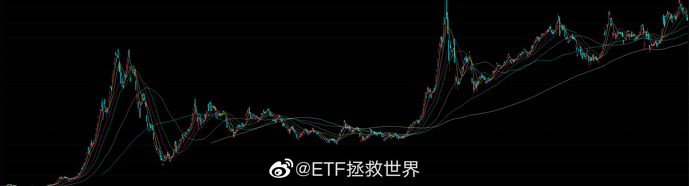

## 2021-02-08 11:12

回复@伴影yy:能干得过15年16倍医药的恐怕没几个…… 查看图片 //@伴影yy:全指医药

## 2021-02-08 11:57

现在买需要靠谱的东西还是JD。

但是很多随便用用的小玩意都是多多了。

只有JD和多多都没有才去TB看看。 ​​​

## 2021-02-08 20:04

回复@恺恺2019:我京东退换货点一下小哥很快上门拿走没有一句废话，你天猫退换货要不要找客服？我京东15天内降价可以点一下保价20秒退差价，你天猫有这个功能吗？呵呵。//@恺恺2019:天猫官方旗舰店不比你京东靠谱？

## 2021-02-09 08:03

什么叫钻石坑，很多人两年后才懂 ​​​
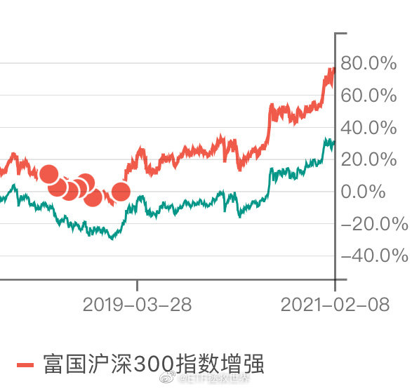

## 2021-02-09 09:49

投资是一种信仰。

信仰就是那种，别人都因为看不到利益而放弃，但你却在坚持的东西。 ​​​

## 2021-02-09 10:59

给小助理们送新年礼物都是京东E卡。

是JD真爱没错了。 ​​​

## 2021-02-09 11:02

二次元宅男偷个奥特曼能有什么坏心思呢。

## 2021-02-09 14:38

上次应聘兼职小助理的朋友，如果还有想做的，可以把之前的应聘邮件重新再发一次到那个邮箱。

要再增加1-2个人。 ​​​

## 2021-02-09 15:20

一个猛男朋友的杯子盖。

分享给你。 ​​​
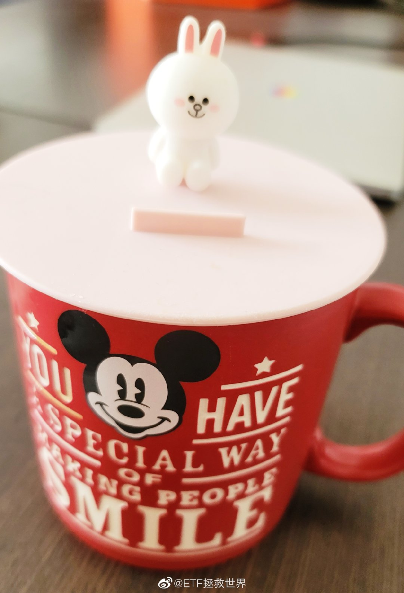

## 2021-02-09 15:57

身材、头发、皮肤；
有钱、有趣、有爱。

都齐了的话，就是个不错的男人了。（没有说头发少的男人不好的意思）

那位朋友问了：什么样的女人不错？

你是我的仇人吗让我在微博上说这个？！ ​​​

## 2021-02-09 18:15

今天应该还差不到一个点新高。

伐开心。 ​​​

## 2021-02-09 18:21

回复@栀子等花开:对不起，我不敢不分。对女性评头论足是不是物化女性，我不懂，不敢背这个锅。还是我们猛男之间交流交流得了。女性的话怎么样都特别好！//@栀子等花开:回复@Mona200911:确实是，只要是人达到这几点都算好，根本不需要分男女

## 2021-02-10 09:02

刚才看了一下自己的记账软件，还是有点感慨的。

十几年前刚入股市的时候，所有的投资资产加起来，没有现在一天的变动数字大。

所以我觉得对于刚开始投资的，本金比较少的人来说，不重要和重要的是什么呢。

不重要的

是你现在的本金让你赚了多少。因为本金不多，所以收益率是多少也不多。

重要的

是如何建立一套可以长期持续赚钱的、不大幅回撤的投资体系。我本人十几年投资经历中，只有3年发生了回撤，回撤幅度都小于15%，深知这一条的重要性。在你的资产越来越大后，一次致命回撤可能会导致你十几年的辛苦全部白费，可能就此一蹶不振。

重要的

是想办法增加本金。因为也许你随便多挣点本金放到账户里，可能都比你挣100%多。这一点在财富积累初期以及中期是非常重要的。到了后期，你的本金增加已经对账户波动起不到什么作用了。

很多年后，你会发现这条微博有多重要。

## 2021-02-10 10:07

每天看看跌幅榜真是惨不忍睹。

基本上都是第一次听说还有这个股票，然后打开走势动不动就是几个月内腰斩然后再腰斩…… ​​​

## 2021-02-10 10:23

泡沫就是要大到所有看空人的脸都被打肿，没有任何人敢再看空，甚至看空人开始怀疑自己而转身加入泡沫的时候，

才会破灭。 ​​​

## 2021-02-10 10:33

我一直有个疑问，就是那种垒的高高的、好多好多层的汉堡，

怎么下嘴。 ​​​

## 2021-02-10 11:19

今天下午两大疑问：

医药能不能新高；恒生能不能新高。 ​​​

## 2021-02-10 12:49

新业务有需求 ​​​
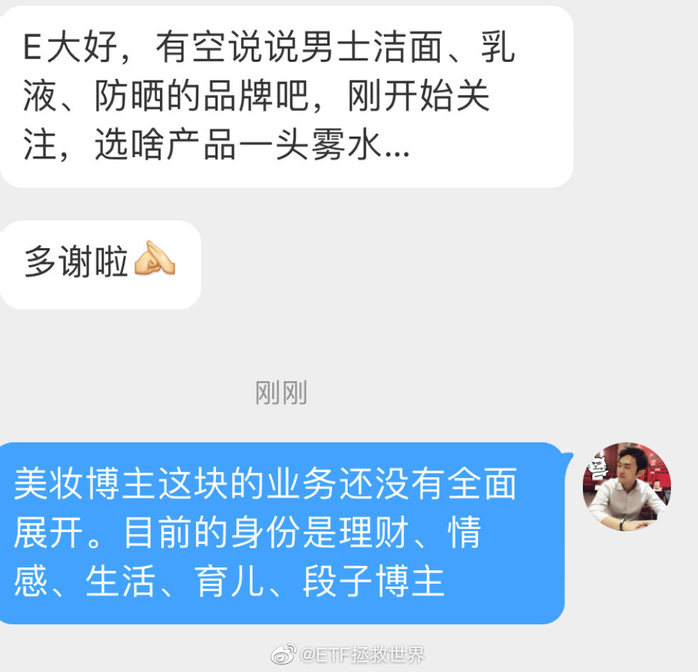

## 2021-02-10 13:06

我不希望自己，以及经常交流的各位是只知道挣钱的人。

我希望大家都能有钱、有趣、有爱。

钱很重要，但不是唯一。否则当你没钱了或者赔钱了，就会发现什么都没了。

可以，但没必要。 ​​​

## 2021-02-10 13:42

都支愣起来了。 ​​​
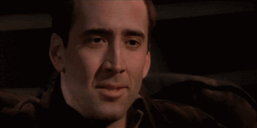

## 2021-02-10 14:48

刚才办公厅打电话来通知，班子会上决定了：

今天资产历史新高。 ​​​

## 2021-02-11 11:22

恭喜@学思悟践ing 等100名用户拼手气平分【1000元现金】。微博官方唯一抽奖工具@微博抽奖平台 对本次抽奖进行监督，结果公正有效。公示链接：微博抽奖平台

## 2021-02-11 17:43

哪位发个自己家的年夜饭照片让大家饱饱眼福。

大家除夕快乐！ ​​​

## 2021-02-12 09:49

好家伙，这么多。不比抖音红包香吗。

今天的一个多小时以后出结果，祝各位好运。 ​​​
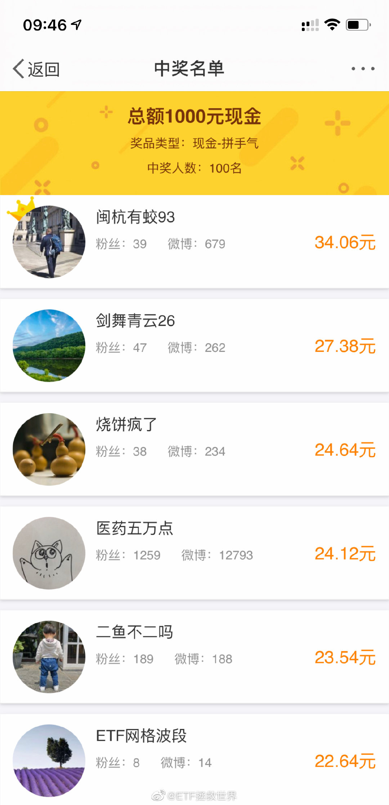

## 2021-02-12 11:20

恭喜@银雅璐 等100名用户拼手气平分【1000元现金】。微博官方唯一抽奖工具@微博抽奖平台 对本次抽奖进行监督，结果公正有效。公示链接：微博抽奖平台

## 2021-02-12 12:50

把手里的零食放下！摸摸你的腰！ ​​​

## 2021-02-12 15:33

回复@平衡0319:我会继续努力的，毕竟是个健身博主//@平衡0319:E大以后多发这种正能量的微博

## 2021-02-13 17:22

恭喜@bobbicoz 等55名用户拼手气平分【531.79元现金】。微博官方唯一抽奖工具@微博抽奖平台 对本次抽奖进行监督，结果公正有效。公示链接：微博抽奖平台

## 2021-02-14 00:19

节日快乐 ​​​

## 2021-02-14 13:31

昨天家族饭局上听到一个消息：

我的一个没见过面的姨，远房的，今年60多。跟一个30多的男人结婚了。

我看了两个人的照片，男的不用说挺精神的，但更令我震惊的是我这个姨，保养的状态、身材之好，如果戴上墨镜或者从后面看，你说她30出头毫不夸张，甚至正面远景照片也有一种少女感是怎么回事！

当然，不用说了，这个姨非常有钱……很多年前就在某华中城市开了出租车公司那种。

我想说什么呢，我想说很多事有当然好，没有急也没用……最重要的是多多的搞钱……有钱真的可以为所欲为……

## 2021-02-14 13:55

恭喜@Asura_PaperMoon 等100名用户拼手气平分【1000元现金】。微博官方唯一抽奖工具@微博抽奖平台 对本次抽奖进行监督，结果公正有效。公示链接：微博抽奖平台

## 2021-02-14 23:34

情人节要过去了，聊个感情问题 ​​​
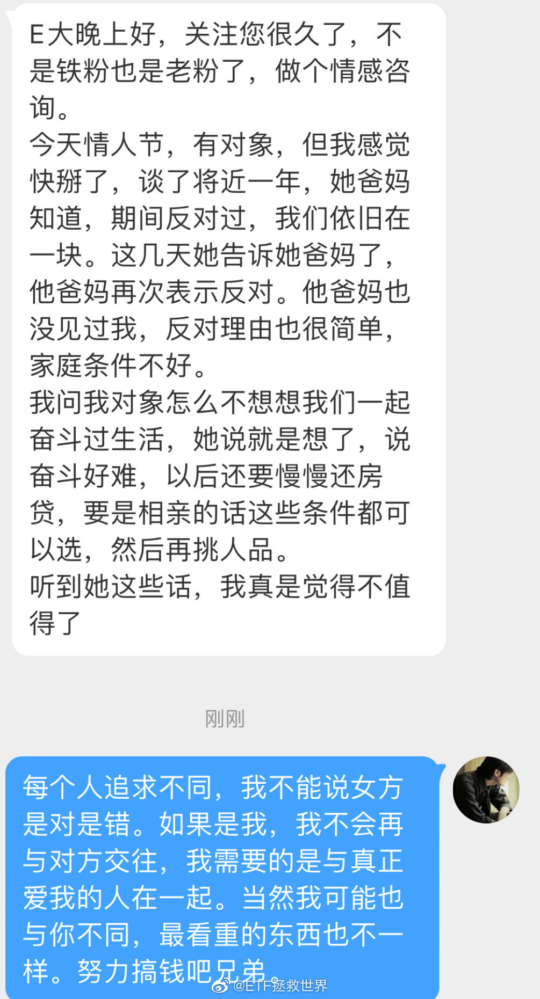

## 2021-02-15 00:30

这种男生只要人品没有大问题，没有什么不良嗜好，不要眼光太高，一般来说不会一直单身。

男性和女性在恋爱中的优势项目是不一样的。

另外看了相册，颜值也不减分。 ​​​
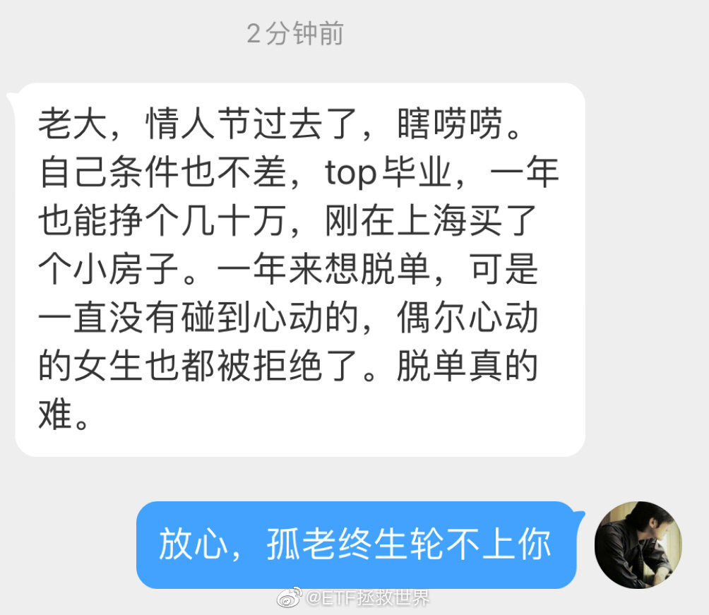

## 2021-02-15 08:18

不许女扮男装，不许违心投票。否则一年不顺。  ​​​

## 2021-02-15 08:35

不许男扮女装做伪娘，不许乱投票。否则一年不顺。  ​​​

## 2021-02-15 08:52

我来说一下我认识中的“性格、人品、三观”有什么不同。因为我看有些朋友觉得这几个都一样。

性格我认为是与人沟通的特质。比如暴躁或者温柔，比如外向开朗和内向文静，比如乐观或者悲观等等。

人品我认为本质上是如何对待自己与他人的关系。通常意义上来说人品差的人都是唯我独尊的。人品最差就是丝毫不考虑别人的利益、感受，为了满足自己的愿望可以牺牲任何人。

三观是认识世界、人生、价值的观点。很简单的例子，从最小的事情上说，比如之前说的绿灯过马路要不要谨慎的看看周围的车辆，比如女性深夜出门穿着是不是不要太暴露，比如买基金和理财产品是不是骗局，比如买房装修用哪种风格（对“美”的认识不同）等等。这些也许没有对错，但有不同答案。

这样你会发现，这几样是不同的。性格温柔的人也有可能人品很差。暴躁的人也许为了别人会奋不顾身。相对来说这两个特质都是比较大的范畴。而三观会更多的体现在很多小事上，这些日常小事反而是家庭生活中矛盾的导火索。其实三观一定程度上塑造了人品，但不等同于人品。

## 2021-02-15 09:13

这种选择题不会选的非常简单，就是把几项觉得拿不准的放在一起两两pk。比如把颜值、人品、经济实力放在一起。先pk经济实力和人品，哪个更重要。人品胜出，再pk人品和颜值，颜值胜出。好了，这下结果出来了，同时你也知道自己是个颜狗了。

## 2021-02-15 09:18

回复@改个昵称真费劲啊:说对了。有些朋友单身的原因就是因为“我都要”，然后自己的条件又不足以满足这个愿望……所以有时候还是要学会取舍。//@改个昵称真费劲啊:我们不做选择题，都想要，然后单身

## 2021-02-15 09:49

男女差异极大 ​​​
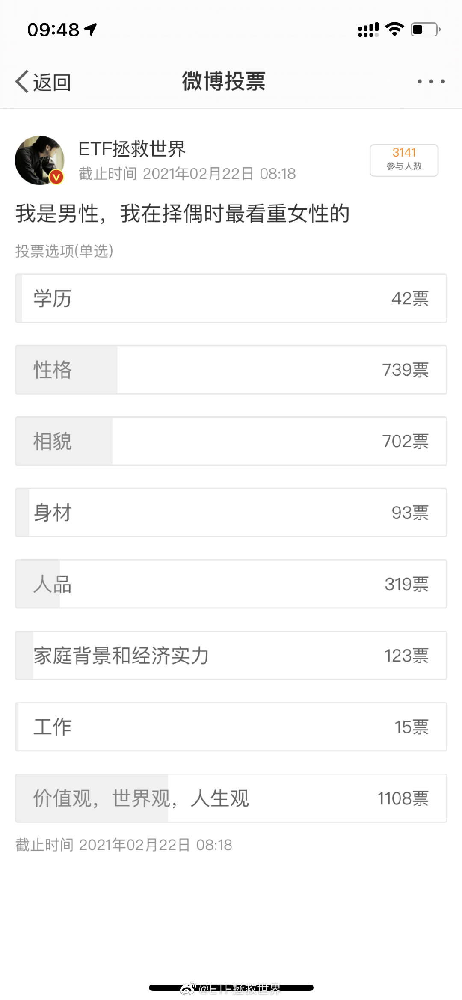 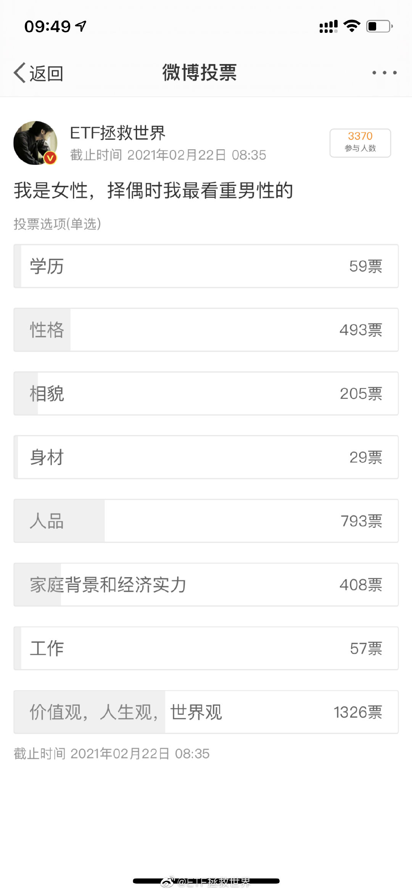

## 2021-02-15 09:57

回复@啊我什么时候才能养只狗:好，我会在公众号做一个多选的投票。敬请期待。//@啊我什么时候才能养只狗:或许再来一个做多选的投票

## 2021-02-15 10:16

原油30美元进场抄底，60美元还没涨回去，这个投资做错了吗。

我复盘了一下。

首先，30美元买错不错？

我认为没错。30美元的原油中长期看都是很便宜的底部区域，暴跌后入手没有错。

其次，做反弹思路错不错？

我也认为没错。我的思路就是吃反弹，并没有想长期拿。因为原油期货品种长期看会有损耗，不适合长期拿。但是短期博反弹没问题。实际上也确实是一个多月就反弹回成本价格以上了。现在投资标的距离成本价格已经涨了一倍。

那么，哪里出问题了？

出在极端情况下交易品种改变了持仓规则。导致下跌全部吃到，上涨只吃一部分。

那么，这个情况是投资之前可以把握的吗？不可以。当时不会预见到持仓规则变化。

但是，可以预见到的是期货品种会有损耗，所以有可能出现极端情况。那么，既要参与又要防范产品风险的做法是什么？

小仓位参与。

实际上，我们也确实是小仓位参与，只买了一份原油。之后的套利自救行为不考虑，只说买入行为。

所以，如果再来一次，我还会这样做。在肉眼可见的低位区域买入，同时控制风险。风险真的出现后积极通过各种方式自救。

复盘完毕。

## 2021-02-15 10:28

我发现有些女性真的太不了解男性了。是因为恋爱谈得少还是怎么样吗。评论里见到不止一个人说“身边的男性都是因为女方家庭条件或者经济条件好跟女性在一起的。”

我不能说没有，肯定有，但就我自己的认知以及常理推断，不会超过10%。绝大多数男性如果想要改变经济状况，都愿意通过自己的努力实现它。希望娶到一个白富美从此走上人生巅峰这样的事情发生了当然好，但大多数男人不会把这个当做择偶条件。属于有了更好，没有也无所谓的。

我真不知道那几位评论的女性朋友都是一个什么样的环境，身边都是什么样的男人……

## 2021-02-15 11:04

回复@丸了个球:我当然承认有。但我绝不相信这是大多数男人的想法。怎么了，我觉得你的想法偏激我不同意就是让你闭麦了？我拉黑你了还是删你评论了？//@丸了个球:你也承认有，但就是不能说。老爱问问题又逼女的闭麦，好玩吗？“高素质”男粉发言你就看不见了是不。

## 2021-02-15 11:14

回复@小莲子欢乐吃瓜哈哈哈:你可以说我交易做得差，但你说我不是情感博主我第一个掀桌子！太侮辱人了！//@小莲子欢乐吃瓜哈哈哈:你又不是情感专家，又不是情感博主，怎么成天问一些男女问题？问了之后还成天批判这个批判那个。好好做交易吧，术业有专攻，别什么流量都想蹭

## 2021-02-15 11:19

顺便预告一下，有些人这么不喜欢我说男女问题，我以后要更加大力度了。所以希望看不惯的这些人赶紧消失，你看我觉得讨厌，我看你也一样……我就纳闷了，点个“取消关注”又不需要冷静期，你跟我这儿耗什么呢？赶紧收拾收拾出门儿打个车走人好吗。

## 2021-02-15 15:53

写了点东西，大过年的，闲着没事儿就随便看看吧。

发早了一天  ​​​

## 2021-02-15 20:03

我发现自己能一个人在家喝的酒居然只有梅子酒和自己调的鸡尾酒。

白酒啤酒甚至红酒没事自己在家一口都不会喝，觉得不好喝。

是不是不够纯爷们儿。懂酒的说说。 ​​​

## 2021-02-16 10:35

继续不要停 ​​​
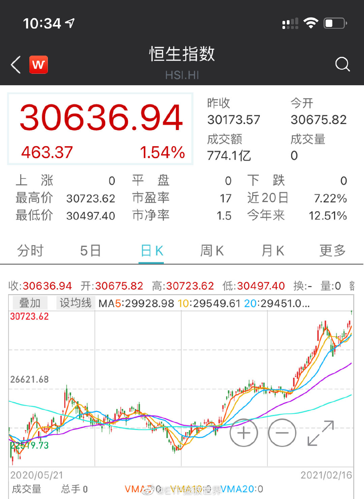

## 2021-02-16 10:55

大多数人只是初五迎财神。

我家书房就供着一尊财神像。

旁边还有一个华尔街牛。 ​​​

## 2021-02-16 11:15

我记得去年恒生表现不好，有人在评论里骂恒生。

今年一个多月就涨了十几个点，眼看着快历史新高了。

你持有的品种某个时间段有好的有差的，那又怎么样。只要东西好，早晚会涨啊。而且最近不涨的恰恰可能是未来别的品种表现不好，却能让你资产不断新高的那个功臣啊。

再说一次，不要嫌贫爱富，不要鼠目寸光。

花开有时，多大点事儿。

## 2021-02-16 11:41

回复@傅语馨08:工作就是出力，出力就是“穷”。投资就是有资产，有资产就是有田，有田就是“富”。只知道工作不知道积累资产，做一辈子也是个穷啊。

## 2021-02-16 19:10

涨是涨，新高是新高，心里对风险要清清楚楚明明白白。

不是不知道有泡沫，而是在享受泡沫吃大餐的同时，慢慢向门口挪。

留一分清醒留一分醉。 ​​​

## 2021-02-16 21:38

​​​
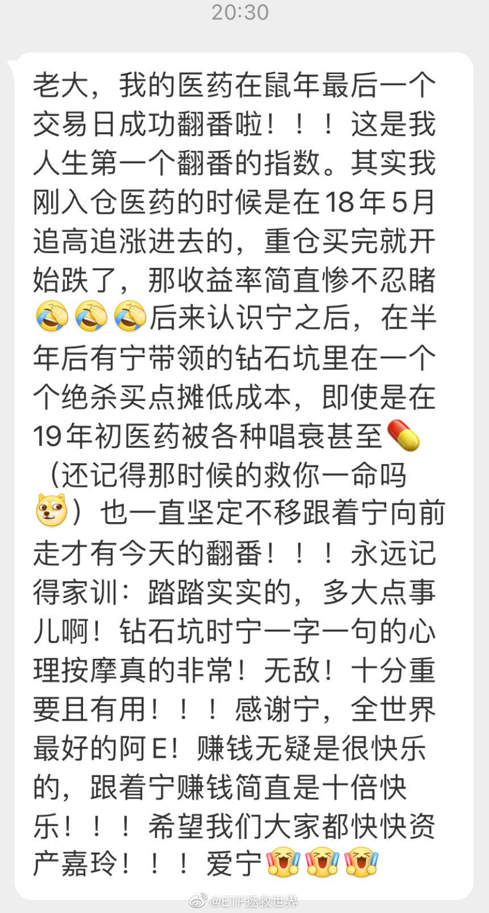

## 2021-02-17 09:14

## 2021-02-17 09:22

声明一下，我不是推荐京东股票，而是自己喜欢的公司涨了很高兴。我已经很多年不推荐股票了，你不要看我微博乱买//@ETF拯救世界:

## 2021-02-17 09:34

据说今天初六送穷鬼。

我打算系统性拉黑一批不顺眼的人。

免得他们优雅的负面气质影响我们赚钱。 ​​​

## 2021-02-17 09:41

以前你对节后第一个工作日誓死不从，上班如上F。

现在你对节后第一个工作日半推半就，有点期待又有点恐惧。

因为有了股市。 ​​​

## 2021-02-17 11:06

回复@我只是梅子:招行的羊毛真的顶。前几天送的一百多滴滴打车券，打了一个远程车只花了0.01元//@我只是梅子:我喜欢招商银行薅羊毛，一直想买点股票支持下

## 2021-02-17 12:00

沈腾是不可多得的喜剧人

## 2021-02-17 16:45

2019年确认的关键点位21000点，在2020年3月暴跌中最低是21139，就差了139点。谁说技术分析没有用，只能说他不懂。

## 2021-02-18 08:48

有朋友觉得，去年有人追涨进场买基金也赚钱了啊，你买了两年多才翻番没什么啊。

牛市追涨入场和熊市越跌越买当然不一样。熊市中的坚持能让你学到很多，这钱赚的运气成分就少。

还有，熊市中买入会买的非常多，赚的也就多。牛市中你追涨一开始敢买多少？买个几千块翻番又如何。等你下决心加大力度增加筹码，就已经是接盘侠了。

何况，我们现在已经开始慢慢撤退了，也就是说肉已经确认吃到了。追涨的怎么办，撤不撤呢。

下一轮牛熊，这些低买高卖的朋友可以复制胜利，钱越来越多。追涨的可以复制经验吗。
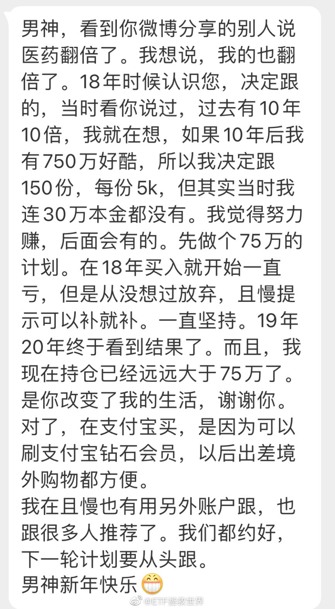

## 2021-02-18 09:39

第一天就提款怪不好意思的。 ​​​

## 2021-02-18 14:00

再次提示，条件单重新创立可以从

交易—条件单—历史记录里面找到，直接点击

重新创建

即可。 ​​​

## 2021-02-18 14:10

资金面有点紧 ​​​

## 2021-02-18 14:11

回复@我是真的虬髯客:你别玩了。你根本不知道这个策略是在干什么//@我是真的虬髯客:回复@小羊今日要暴富:我看了E大一网一万的数额，总感觉钱放在那里不如买了其他基金

## 2021-02-18 14:34

关于网格资金的利用率，我想这一年一直在做的朋友都会有体会。低不低，做了的人才知道。

一个品种的网格，只需要预留一份资金在里面，成交后才会再加下一份的。这个资金没有成交的话，每天收盘后会自动买入余额理财，目前的年化收益率是2.5%左右。

也就是说，你运气太差了，一年时间这个品种都没成交，你的收益率是2.5%。

那么，如果你成交了一笔呢？

你这笔钱的年度收益率就会飙涨至7%以上。（通常来讲一笔买入后并不需要太久就可以卖出）如果同一价位成交两次，那么年度收益率就是11%以上了。

各位可以看看每个品种的历史成交情况，就会发现这个资金利用效率太高了。恒生这样的奇葩品种可以在一个位置反复吃。你长期持有的部分可能一年下来一分钱没赚，但是网格部分已经吃了十几二十个点了。

当然，更关键的是心态的调整。从此你不会只盼着涨，你知道跌了你也可以赚钱，波动更能赚钱，你已经是一个全天候的收割者。

不认真看策略说明，不下场试试，就“觉得”资金浪费了。这恐怕并不足够理性。

## 2021-02-18 14:56

“而且最近不涨的恰恰可能是未来别的品种表现不好，却能让你资产不断新高的那个功臣啊。”说来就来。如果今天能继续新高，功臣是不是那几个前一段表现差的品种？

## 2021-02-18 16:39

今日数据：11个月过去，德国、日本已经进入相对高估区域，风险正在累积。相比当时，德国上涨63%，日本上涨85%。发帖当日是两国股市下跌最低点。

## 2021-02-18 20:06

知道我豆瓣用户名的朋友请不要随意传播，我会拉黑所有豆瓣关注者。如果我发现是谁在传播，也会拉黑您的微博。

我需要自由的空间。 ​​​

## 2021-02-18 21:10

不瞒你说，辣鸡红利还有1.3%就又要历史新高了。 ​​​

## 2021-02-19 08:20

开盘是最大的福报。 ​​​

## 2021-02-19 08:41

给关注我的男性朋友一点小建议：

有些话私底下可以说，跟男性朋友聊天时候开玩笑也可以说，在公共场合（比如我这里的评论里）就别说了。

因为有些话容易让一些女性朋友感到不适。可能你会觉得我也没说什么啊。因为男女是不同的，对很多事情感受都不同，男性觉得没什么，女性就会觉得不舒服。所以还是稍微注意点。

我一开始经常喜欢开个玩笑说个冷笑话什么的。后来发现面对的人多了，就会有人get不到你的点，甚至发生误会，所以我现在开玩笑也特别谨慎。

自己的幽默只能展示万中之二三，也有一种“难言处，良窗淡月，疏影尚风流”的落寞啊。

无论如何，谨言慎行总是没错的。

## 2021-02-19 09:08

回复@wolaile35:你可能2018年没在我这里混吧。当时我这里不能说每个人，只能说95%的人都不知道多开心啊…你去翻翻历史微博就知道了。//@wolaile35:回复@陌上花开nOri:如果来个像2018年的话还会这么想吗

## 2021-02-19 09:37

总是分析宏观数据的人做出的投资建议不要听。 ​​​

## 2021-02-19 09:54

别人跌就你涨，显得不太稳重。 ​​​

## 2021-02-19 10:17

很多人美其名曰叫做jjjl，其实就是追涨杀跌的烂赌鬼而已……

## 2021-02-19 14:07

谁涨谁跌都无所谓，最重要的是新高。 ​​​

## 2021-02-19 14:34

今天最后半小时不掉链子的话，红利就会突破历史新高，建信和富国500也会突破买入后的新高，开始冲击2015年6月净值最高的几个交易日。

新高以后，依然不贵。

当然，如果中小股票真的涨一波，那么A股整体估值就会大幅上升。具体怎么操作到时候再看吧，都有预案。 ​​​

## 2021-02-19 20:27

告诉你们一个好消息：

明天不开盘，但是要上班，你可以专心工作了！

加油(•̀ᴗ•́)و ̑̑ ​​​

## 2021-02-20 07:15

论交往时三观、人品及性格的重要性

## 2021-02-20 21:57

刚才看到两位举报的给我私信，都说是误解了微博抽奖的提示，举报我是误操作，也都撤销了举报。

既然举报撤销了，我也把之前发的微博改成自己可见。

以后该抽送红包还是送，实物尽量少送，太麻烦了。送红包主要是朋友间大家开心一下，过年过节，挣钱了，就送点。做人太抠门会出问题。

这事就这么过去吧，多谢大家的关心。出了事才能看出谁是朋友谁是围观看热闹的。

## 2021-02-20 22:26

回复@让我删掉名字的一个人:未经人苦，莫劝人善。我再说一次我的原则，说过好几次了：谁对我好我会涌泉相报，谁要想欺负我、害我，我死之前也要弄死他。好人不意味着就是被你们欺负的。//@让我删掉名字的一个人:回复 @ETF拯救世界:E大，你有没有想过，大家知道这两个人的ID后，粉丝会去骂他们？

## 2021-02-20 23:36

有些人好像总是希望我以“财经大V”的身份要求自己。

您可歇菜吧。

我就问你一句话，你看我的微博，有没有一点点“财经大V”应该有的样子？

我替你回答：一点都没有！

因为我根本就不是什么财经大V。做金融交易只是我非常喜欢干的一件事而已。所以我愿意聊聊它，就这么简单。有些朋友愿意听，有一些关注我的人，就这么简单。喜欢这件事也不是唯一，我还喜欢很多事，所以我也会聊很多别的事，简单不？

你觉得我是财经大V我就是了？你算哪根葱啊还给我起外号呢。

我愿意聊什么就聊什么，我愿意做什么就做什么。我不违法不违规，我爱国爱人民，我遵守公序良俗，遵守社区公约，不该说的不说，不该做的不做，不该看的不看。怎么，不符合您心中的形象了？那您还不赶紧走？

我送个礼物，被人举报，微博说要禁言或者封号，我不高兴，把警告信截了个图放上来，您怪我不给举报人打码。您可真善良，那您有没有考虑过我的感受呢？我做错什么了要被封号？？？不许人生气了呗。哪天您要是被别人陷害了，也别跟朋友说啊。不然朋友帮你出头那陷害你的那个人多可怜啊。

你别用你的标准要求我。我这样的“大V”你在微博找不到，在球球找不到，在公众号也找不到。你不能用任何标准定义我，因为这就是一个私人微博你随便贴什么标签？

xxx，烦死了。

## 2021-02-21 09:14

不瞒你说，今天最高24℃。一个半月，差了42℃。 查看图片

## 2021-02-22 08:58

偶然看到这个微博。内容我不评论。那些怪我没有给举报人打码的，怎么看这条？是不是老胡也应该被你骂为什么不打码？是不是所有被人骂，被人陷害的人都不能反击了？你们就是一群无耻的、披着圣母外衣的辣鸡。

## 2021-02-22 09:32

该来的总会来。

我就问你，坐轿子舒服不舒服。

一直舒服一直坐。 ​​​

## 2021-02-22 09:40

它被人骂，被人嘲笑，被人看不起……的时候。

你不放弃它，你跟它站在一起，你支持它，你继续买它……

它就带着你飞。

世界上已经那么多报团的、趋炎附势的、嫌贫爱富的人了，多我一个不多，所以我就不去凑热闹了。

但是雪中送炭的人这么少，我就显得比较重要了。我还是喜欢做比较重要的人。 ​​​

## 2021-02-22 10:03

再说一次：

你“盼着”某个品种涨或者跌，这个思维模式就是错的。

这个品种不会因为你的期盼就改变自己的走势。甚至进一步，你之所以盼着，就是因为你不舒服了。你不舒服就说明你做错了。

我从来不盼着什么涨跌，因为没用。我只做有用的事。

什么事情有用？

是设计符合这个品种各种走势的应对策略。无论它涨不涨，跌不跌，我都可以赚钱。或者说，都可以很舒服的应对，这才是有用的。

一个品种的走势你能改变吗？不能。所以躺下接受它。

你能因为一个品种的走势赚钱吗？能。所以努力完成它。

## 2021-02-22 10:09

“呵呵，还不是哪个涨了吹哪个。”

“对啊，我们持仓每天都有涨的，每天都新高，气死你。” ​​​

## 2021-02-22 10:23

还记得当年没有买成功的 有色金属ETF 吗 ​​​

## 2021-02-22 11:27

那天那几个圣母和理中客，“不无担忧”的表示，有朋友去帮我说话跟“粉圈”一样了。

你还是不是人？

你知道为什么你从没想过帮我说句话吗？因为你不是人。你知道为什么你要讽刺帮我说话的人吗？因为你是辣鸡。你知道你为什么是辣鸡吗？因为你根本没有同理心，也没有感情。

在你的眼中，任何事情发生了都不会触动你的感情。你见到有人为这个世界的不公、黑暗、陷害鸣不平时，你会笑着说一句，“至于吗？”

是的。在你的眼中，什么都不至于。因为你根本就没感情。你觉得自己是理中客，你觉得其他人的事儿再大也跟你无关，你觉得见义勇为是sb，你觉得人和人之间只应该有利益关系。

所以，你会污蔑别人。这样的事情，即使不关注我的人知道了也会觉得举报人是辣鸡。但你不会，你觉得是关注我的人“粉圈”了。

什么玩意儿？

这几年，微博上多少热点事件都是因为热心网友的“督办”才得以解决？如果都像你一样冷酷，多少人的冤屈能得到伸张？

“粉圈”，呵呵。一共才一百多人去帮我说话，就被你污蔑成粉圈，你们可真是不折不扣的大辣鸡。

50万关注？我心里跟明镜一样。放心，真关心我死活的不到万一。但就是为了这万分之一，我也会继续做我该做的事情。再说一次，我从来不对人类整体抱有任何幻想，只是因为其中有极小一部分值得爱而已。

我不是傻白甜，我也不会被虚幻的东西蒙蔽双眼。关注、虚名，甚至财富，都是过眼云烟。过眼云烟的特点就是随时会消失。你生命中很多引以为傲的东西随时都会无影无踪。

我比谁都门儿清。

但我依然相信爱。

## 2021-02-22 11:52

一句话总结：就因为你不具备同理心，你也没有对正义的追求，所以你会不理解具备这些特质人的行为，所以你会污名化他们。你没有同理心也没有正义感很正常，但你还污蔑有这些品质的人，你就是个大辣鸡！

## 2021-02-22 12:13

最近我会在公众号写一篇关于人与人关系的文章。

鞭辟入里，直击灵魂，引人深思，升华整个人生，是下一届茅盾文学奖和诺贝尔文学奖的不二选择。

没看到的人相当于损失了3000多万，美刀。 ​​​

## 2021-02-22 12:28

特别喜欢LV，因为它从不坑我这样的穷人

## 2021-02-22 13:10

说句你不相信的，很多研究员从来没有在市场上赚过钱

## 2021-02-22 13:15

车撞树上你知道拐了，股票涨了你知道买了 ​​​

## 2021-02-22 13:24

低位你为什么不买？
不涨我为什么买？

涨高了你为什么后悔？
如果我低位买了能赚好多啊！ ​​​

## 2021-02-22 13:35

被严重低估的一条微博。

## 2021-02-22 14:13

追热门的都是不理性的基民你知道吧。

不理性的基民看到净值持续下跌会赎回的你知道吧。

基民赎回基金经理就要卖出抱团股你知道吧。

基金经理卖出抱团股抱团股下跌净值又会跌你知道吧。

净值又跌了会有更多基民赎回你知道吧。

……

如果这一切发生，你猜最惨的是谁。 ​​​

## 2021-02-22 16:16

今天不会新高了，但是不会跌多少。

明日再战。 ​​​

## 2021-02-22 17:30

其他观众都是忍者。

## 2021-02-22 17:43

古古虽然持续犯案，但随着年纪增长下手没那么重了。喜妹就不同：不出手则已，出手必重伤。

## 2021-02-22 20:26

50和300今天跌了3个点以上。

看了看持仓比例，都没在怕的。这两个月一直在减持它们。 ​​​
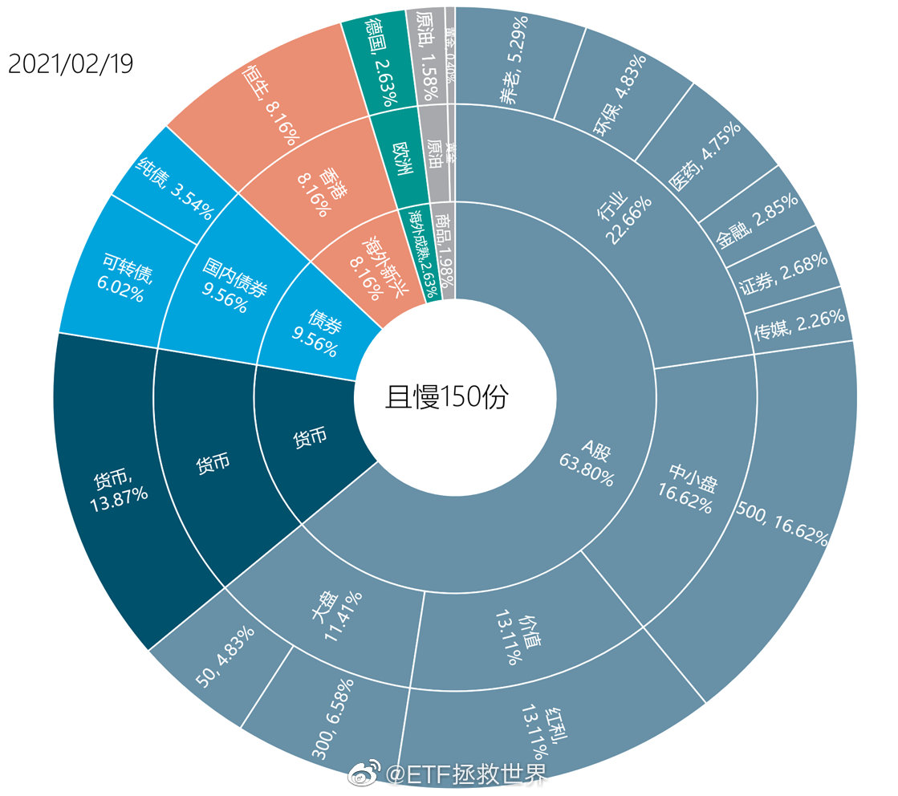

## 2021-02-22 20:57

利润60亿，市值6000亿。老哥，稳！

## 2021-02-23 08:09

去年底的判断，看看会不会再次成真 ​​​
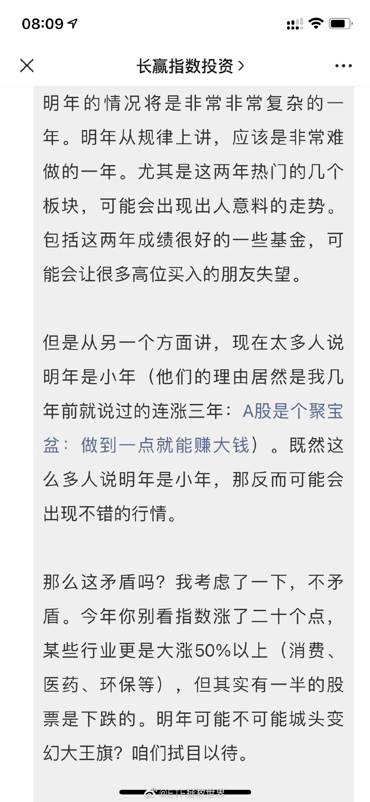

## 2021-02-23 08:36

多挣钱，多读书，多健身，不喷我，你绝对不会剩下

## 2021-02-23 14:36

卖出一份50已推送。 ​​​

## 2021-02-23 15:11

回复@yonah:错。你除了钱多，什么都不行，那也没人真的爱你，只会爱你的钱。即使勉强和你在一起，你也会被绿…//@yonah:多挣钱一条就够了//@ETF拯救世界:多挣钱，多读书，多健身，不喷我，你绝对不会剩下

## 2021-02-23 21:12

回复@一朵优雅的碧池:一群人遇到熊，你不需要跑的比熊快，只要比别人快就行了//@一朵优雅的碧池:但是男性比女性多了几千万，就算强行配对也会有几千万男的单身，这事真的可以用多挣钱健身就解决么……//@ETF拯救世界:多挣钱，多读书，多健身，不喷我，你绝对不会剩下

## 2021-02-24 09:07

美的这家公司非常有意思，这几年给我感觉特别害怕自己的股价跌。

这种情况在国内非常罕见，一般出现在美股公司那种治理结构中。 ​​​

## 2021-02-24 09:55

你知道打仗吧，古代冷兵器那种。

打仗的时候两边往前冲，你也在队伍里面。不考虑有没有监军的情况下，这种时候你面临两个选择。

一个是坚定不移的往前冲。结果就是，如果大家都跟你一样坚定，那你们有可能胜利。但是，如果队伍里有意志不坚定的，跑了。那么往后跑的人越来越多，你们必败。最后可能先跑的人活下来，你这样坚定不移的死了。

第二个就是你先跑。那么无论别人跑不跑，你们会不会赢，你都会活下来。而且可能就是因为你跑了，导致别人跟着跑，结果本来能赢也输了。当然这个跟你无关，你肯定活。

很多时候，很多人也面临这个选择。

大家说好了一起绝对不跑，那你发现敌人很强大的时候，你跑还是不跑？

## 2021-02-24 10:42

如果说牛市是屠宰场，那么热门品种就是绞肉机。 ​​​

## 2021-02-24 12:57

不要在评论和私信再问我什么基金要不要卖了，我这里不是支付宝或者天天评论区，也不是基金大V的微博，我不会对你的交易品种有任何意见和建议。

不是我不告诉你，而是两个原因：

第一，我能力不够，不可能知道所有品种什么情况。我只研究我关注的东西。

第二，你是什么情况我也不知道，没有任何建议是适合每个人的。本着负责的原则，我不可能给你建议。

再跟这些朋友说一句，你买任何投资品，后续如何操作应该是买之前就计划好的，而不是买完了再去着急该买还是卖。

## 2021-02-24 13:11

屋漏偏逢连夜雨。港交所也崩了。

热门基金重仓股之一。 ​​​

## 2021-02-24 13:52

以前我看到喷我的，我会特别生气。甚至一开始的时候心里郁闷的像快要生病了。

现在我是笑着看那些喷子的。

就刚才你们说的那个，我去看了。本来想拉黑他，结果一看，已经是黑名单了——他是前几天的圣母之一。

还有一个V也在那煽风点火，这个人我知道。以前总是在我的评论里做广告，我看了看他的微博，总是似曾相识，就顺手拉黑了。

收益率的问题非常有意思。有人说，我跑不赢一大半公募？

2015年6月，第二轮ETF计划宣布结束。为什么那个时候宣布结束呢，因为那时候计划已经基本清仓了。2015年6月是什么日子，大家都应该清楚吧。

在最高位清仓后，7月还是最高位开始了第三轮计划。这轮计划无论如何股灾，如何暴跌，净值从未跌破过1。也就是说，之前两轮超过10倍的利润，一分钱也没有回撤过。

我不知道有几家基金能做到这一点。

一直到现在，三轮计划的总收益率已经接近16倍了。当然，用的时间也比较长，18年。

其实一个产品净值多少并不重要，重要的是买了这个产品的人赚了多少。

哪怕只跟了一两年的朋友，也应该知道在我这里最重要的是什么。

你以为牛基的持有人就都赚钱吗？这个问题我们之前说过了。最热门的基金里面，真正赚大钱的基金投资人凤毛麟角。市场一个波动就有大量基民亏损。

而跟投计划的朋友，赚钱的比例是：97%。 剩下的3%要么是自己乱投，要么是一半走人了。

其实很多东西懂的自然懂，不懂的说了也没用。当然，有些人明明是懂的，为了黑也只好装成不懂的傻子了。

最后再次重复我的目标：

熊市不赔钱，牛市大致跟上。

一轮一轮，就这么数钱，这么枯燥无味。

## 2021-02-24 14:01

还看到有人说“关注了几天，没什么有价值的。应该是什么都不懂，就知道吹”

我笑了。

我有个80万字的投资笔记，你要不要看看？不好意思，您不配。

有些朋友看过，不少公募私募的朋友都在看，如果他们看到你的评论会笑尿。

你问我为什么不在微博说？

你怎么不问老巴为什么不在推上教你投资呢？？？ ​​​
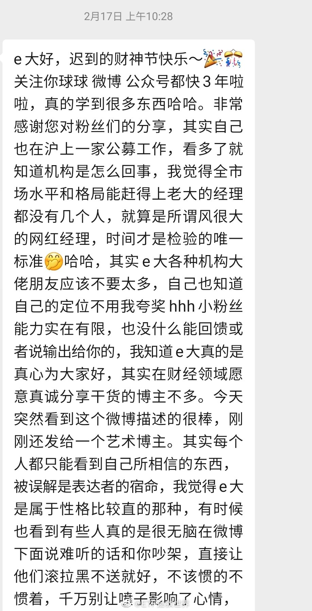

## 2021-02-24 14:14

几篇笔记标题。 ​​​
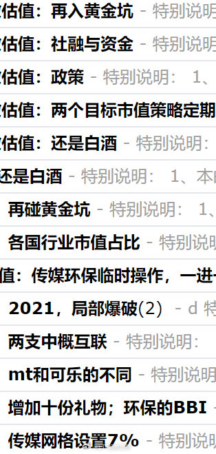 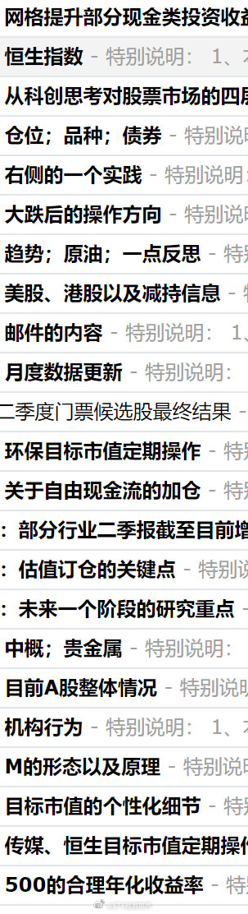

## 2021-02-24 14:36

再随便截几张。小学生的一点点作业。 ​​​
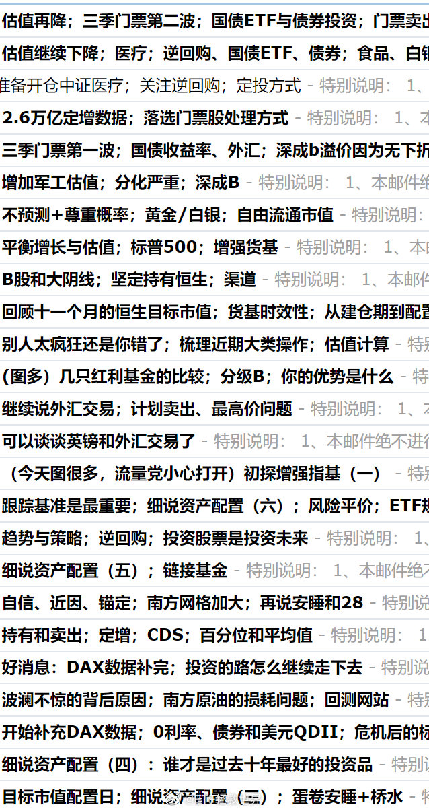 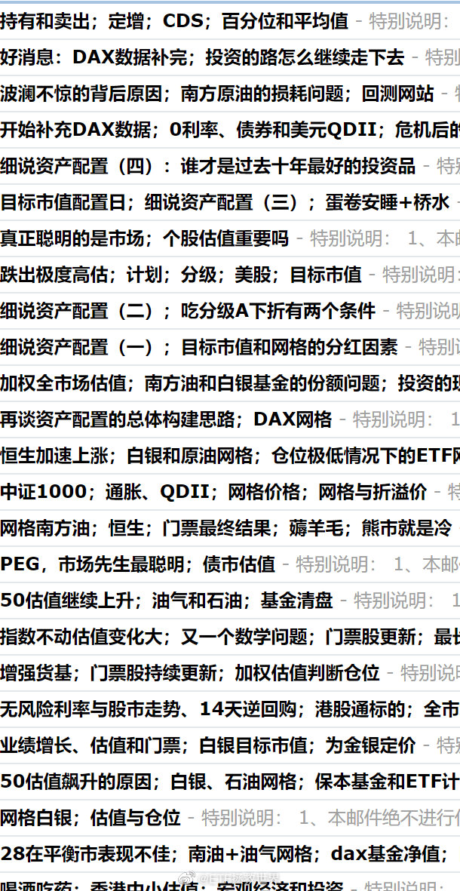 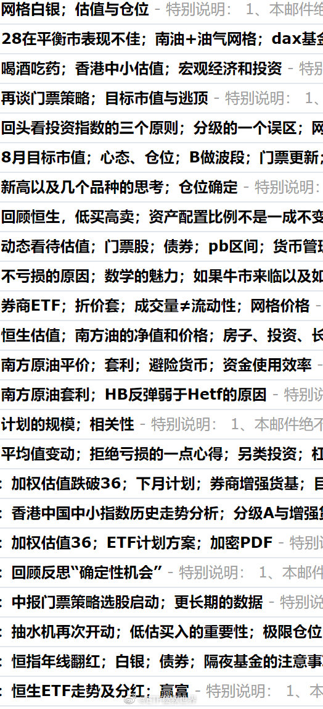 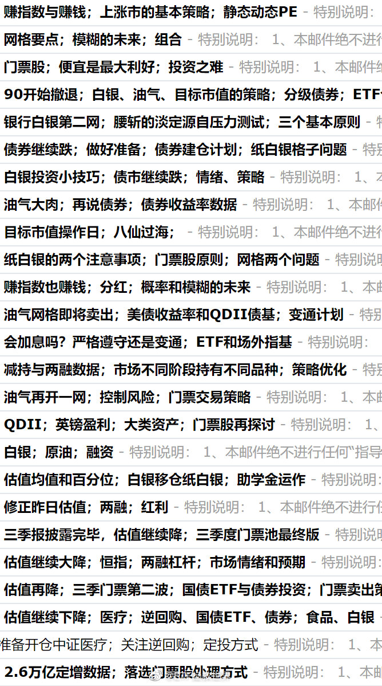 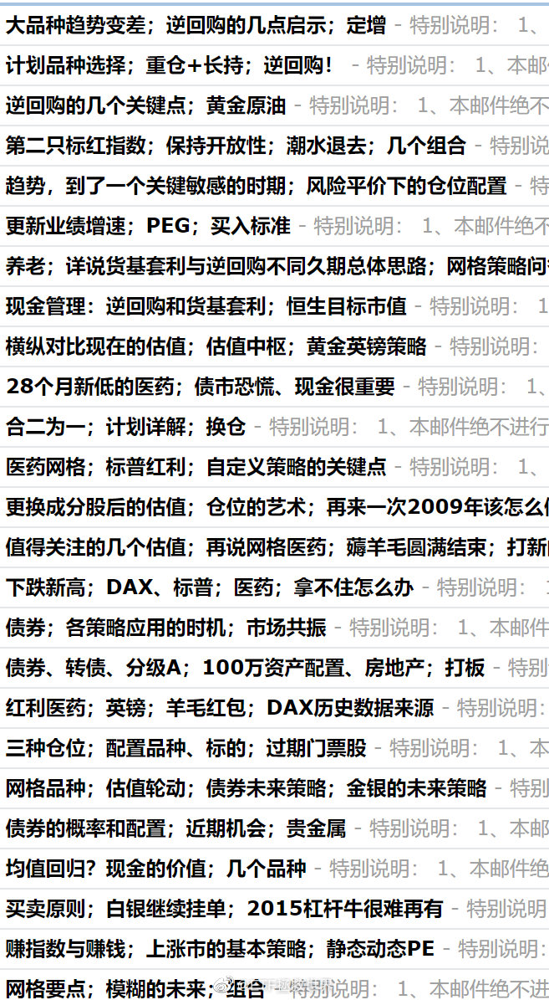 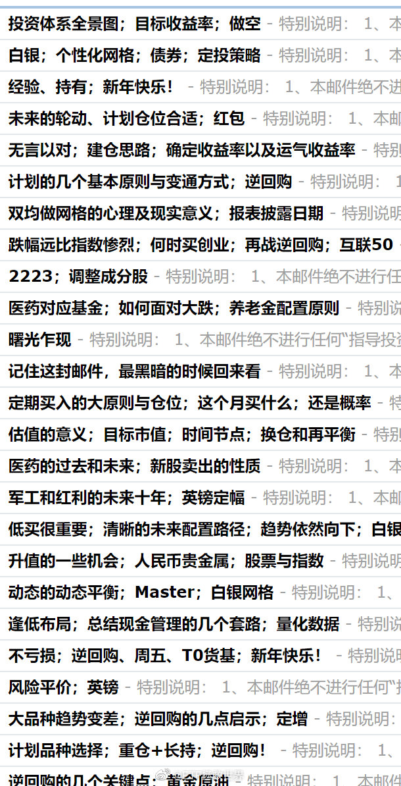

## 2021-02-24 16:54

退博几天。

就这样吧。大家都开心就好。

下个月见。 ​​​

