## 2021-04-01 14:37

S计划的信息产业再涨3个多点，就又可以实现所有24个品种全部盈利了。

在A股赔钱真的不容易。 ​​​
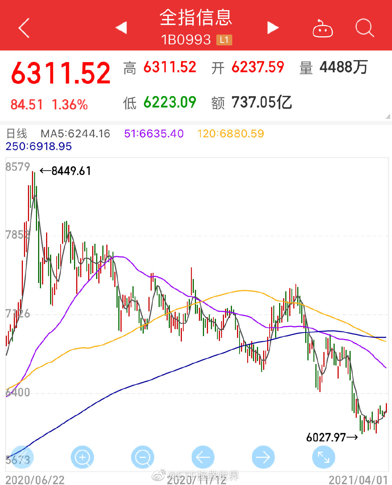

## 2021-04-01 15:51

今天是月初，开始更新我已经做了十年的估值数据图。

突然意识到一件事。

分析关于股市的数据对我来说是如此的有幸福感的一件事。每一个数据出来后，我把它放入表格，生成图像，是那么的让人开心的一件事。这种开心和幸福我不知道各位是否能体会到：就是这件事本身能带给你巨大的幸福感，与其他任何都没关系。

我知道这几年不少人在我的这几张图的启发下开始做类似的事情，也有不少人将它商业化。也许有人为了利益，也许有人为了知名度。为了利益和知名度，如果没有人需要，他可能就不会继续做下去了。

但对于我来说，这件事本身能带给我的幸福感，我估计一直可以让我做到八十年后去世的时候。

真幸福啊！

## 2021-04-01 21:42

买了一双国产跑鞋，试穿了一下很轻很软，不输之前说过的飞马。跑起来怎么样还没试，不过日常走路是完全够了。

我总认为日常穿的运动鞋没什么太大的科技含量。颜值高，轻，软，合脚，对我来说就足够了。所以不出意外以后买运动鞋的时候我会经常支持这些国内品牌。

能做的不多，做一点是一点吧。希望服装方面国内品牌能更加注重设计，未来也有能够替代的品牌出现，一定支持。

我们不能总是拿产业链上利润最低的那部分啊。

## 2021-04-02 10:44

再次回到3500。

你的钱比上次3500的时候又多了。 ​​​

## 2021-04-02 15:35

该给谁投你心里有数吧点链接进去看看

## 2021-04-02 18:37

排多少位无所谓，大家千万别刷票。做人比做大V重要。//@ETF拯救世界:该给谁投你心里有数吧点链接进去看看

## 2021-04-02 19:22

清华学霸征婚那个事情吧，我有两个想法，表达一下。又要说到男女问题了，别骂我太狠啊。

第一个。人家在网上征婚而已，干嘛侮辱人家啊。

不管是美的丑的，胖的瘦的，有钱的没钱的，谁都有资格征婚吧？你不喜欢，关页面就行了，干嘛侮辱人啊。没必要。

谁说只有高富帅白富美才能有一段好姻缘了？谁都有追求幸福的权利。

第二个。女性对男性颜值要求高，正说明了社会的进步！

你知道不知道什么样的社会才是那种只要男的有钱，有权就能追求到他想追求的女孩？

对，越落后的社会才越会发生这样的事情。那样的社会，女性没有办法养活自己，没有办法让自己活得非常好，只能依附男人，只能不顾其他条件先考虑经济条件。

但是越发达的社会是怎样？是女性独立了。我不靠你男人养了，所以我的要求不是说你有点钱就行了，我要求赏心悦目，至少要看着顺眼，我才愿意与你发展下去，你才有机会展示你的内在美。

你说你腹有诗书，你说你学富五车，你说你家财万贯？不好意思，我不喜欢你的样子，这些条件老娘根本不在乎。钱，我自己有，车，我自己有，房子，我自己也有……我就是要找个帅的，怎！么！了！

越发达的社会，越发达的地区，男女越平等就越会这样。

所以，单身的兄弟们啊，除了搞钱，一定要把自己搞得利利索索干干净净清清爽爽的。你别以为只有咱们是颜狗，妹子们也是啊！！！

## 2021-04-04 10:50

这三天你都干嘛了，不妨透露一二。 ​​​

## 2021-04-04 11:10

前几天我去扫墓，通过观察陵园的墓碑，发现一个秘密：男人的寿命远低于女性。我在此郑重呼吁：请各位猪猪男孩善待自己！

## 2021-04-05 14:08

做自己就好。 ​​​
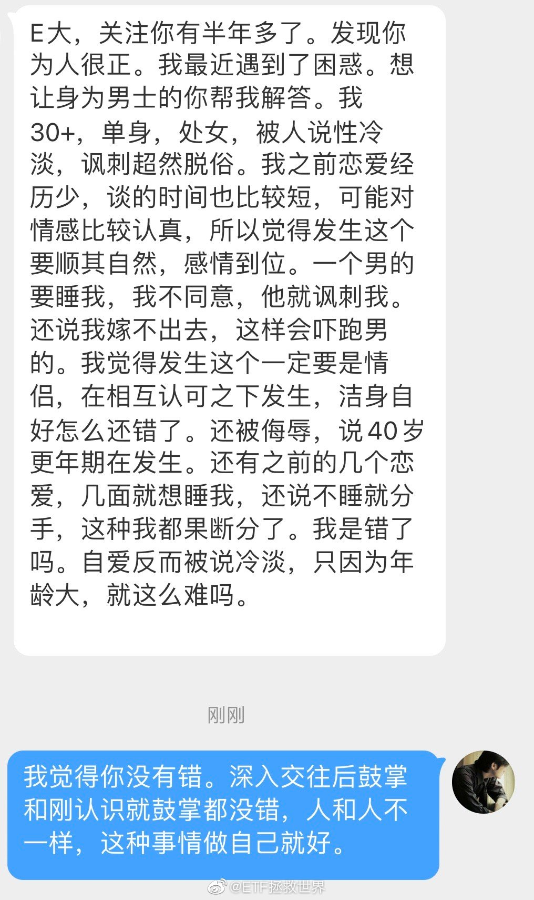

## 2021-04-05 18:13

这算不算自寻烦恼 ​​​

## 2021-04-05 18:23

回复@王胱腚:我刚回家，现在去放//@王胱腚:亲，昨天公众号留言还没放呢

## 2021-04-06 11:49

今天看了一个视频，说主人公去年失业，乱投资赔了几十万，家人生病又花了几十万，现在找了一个国企的工作，晚上送外卖。

我印象比较深刻的是，里面采访他，他说失业前花钱大手大脚，不仅月光而且借钱花。现在只要能活着，钱能不花就不花。

还是之前讨论过很多次的两个观点：

第一，有钱的时候不要乱花。或者说至少拿出收入的20%存起来，就当丢了。绝对不花，打死也不花。这个很多人觉得很难，其实不难。除非你真的收入特别低，否则存20%比你想象的简单很多。

你现在的好日子也许不会永远持续下去。未雨绸缪。

第二，不要乱投资。不懂不做，只做国家背书的标准型投资品种。否则有多少钱都可能雨打风吹去。哪怕再有钱，乱投资、黄赌毒，对于财富来说都是致命的。

值得赞赏的是主人公为了家庭在继续努力。会越来越好的。

（对了，还有，他与父母同住，家里特别乱，东西特别多，我想帮他扔东西……）

## 2021-04-06 15:50

回复@刘清风H:我家原来崇文的，家里的大杂院还没拆，但是已经没人住了。父母辈的长辈都自己买房了，家里孩子也都有自己的房子。院子里一大半人都买房搬走了//@刘清风H:回复@ETF拯救世界:是北京的么？  东西城和海淀区？

## 2021-04-07 10:01

最近的市场相当无聊，今天总算是有点意思。

美中不足的是恒生你就不知道努力上进冲一下吗。 ​​​

## 2021-04-07 10:20

儿子昨天回家跟我说，一个比较高级的文具让同学偷走了。

儿子：“有好几个人问我家里是不是还有，这个能不能送给他们。我说不能，那就等于我损失钱了。后来不知道被谁拿走了。”

我：“最好别提钱的事，就说这个是一套的，少一个就不好了。那东西拿回来了吗。”

儿子：“拿回来了。我翻了好几个人的位子，从xxx那翻出来了。”

我：“你去想想这件事让你学到了什么，一会跟我聊聊。”

（一会儿后……）

儿子：“我觉得有好东西不能让人知道。有钱也不能让人知道。”

我：“没错。穿的用的，和大多数同学一样，最多中上水平就很好。安全。另外，不要把那个同学拿你东西的事告诉老师和其他同学，不要到处宣传。跟那个同学还是像以前一样交往就可以，但你心里要知道他的品质有问题，交往的时候要小心一点。以前不让你拿到学校去你不听，明天你还拿吗。”

儿子：“不拿了。”

我：“如果明天同学问，今天你怎么没带，你怎么说？”

儿子：“我说……找不到了？”

我：“嗯。”

教育这件事啊，光靠说是不行的。要让孩子自己碰一碰南墙，他才能学到东西。

## 2021-04-07 13:34

我劝天公重抖擞，再助红利创新高。 ​​​

## 2021-04-07 13:56

回复@青海w:你这属于不属于挑拨是非？教育孩子不要拿自己的好东西出去嘚瑟，怎么上升到什么富了穷了，防备谁了，你这是什么意思？拉黑！

## 2021-04-07 15:04

我单方面宣布，今天红利新高。如果没有，那就明天。

## 2021-04-07 16:29

特别喜欢的几种电器：

打印机。打印文字、表格、照片都让我很开心。

碎纸机。把打印出来的文字、表格、照片碎掉让我很开心。

扫地机器人、洗碗机、洗衣机。喜欢它们把所有东西都弄得干干净净，香喷喷的，很开心。 ​​​

## 2021-04-07 18:28

我其实很少推荐东西，少有的推荐过几个，都是我用下来确实觉得适合大多数朋友的才会谨慎的说一下。一般来说我用300个东西，可能会找1个最适合绝大多数人的说说。

为什么，因为即使再好的东西，也不可能所有人都觉得好。人家相信你，买了，回家试试，不喜欢，这钱不是白花了吗。

还有一个问题，就是具体的产品。我说具体产品吧，成了做广告。不说吧，有朋友买了性能没这么好的，用了就会觉得很辣鸡。

比如扫地机器人，早年的扫地机器人是乱扫的，扫到哪里是哪里，也扫不干净。你要买了那种肯定觉得是辣鸡。那现在的都是有路线规划的，先把你家情况扫描一遍，画个地图，然后规划路线。现在还加个拖地，一下子就能弄干净，我觉得绝大多数人都会满意。因为又不用动手，干净程度也可以，就够了。那有些人还是觉得不行，因为有点洁癖，或者觉得累点无所谓，一定要每天亲力亲为弄的一尘不染，那就会觉得机器人白买了。

洗碗机也是，台式的和柜式的好像也差不少，反正型号不一样好多东西都差好多。感受不一样就不奇怪了。

还有一个问题，是很多不做家务的人会觉得，干嘛又浪费钱买东西？比如洗碗机，有的人在家根本不洗碗，他也不知道洗碗的累，就觉得以前你们洗的不是好好的吗，干嘛又花钱，最后又闹矛盾。还有人会觉得就两个碗我干嘛弄个洗碗机啊，顺手洗了就完了。

所以人和人真的千差万别，没有什么东西是能满足所有人喜好的。反正你以后要看我说什么东西好，如果挺贵的或者占地儿的，还是先去有这个东西的朋友家看看，是不是真的适合你。

说那么多，我就是怕你因为我白花钱。

## 2021-04-07 19:21

去打疫苗，护士说，小伙子这边走。

嘿，今天又是18岁的一天呢。 ​​​

## 2021-04-07 20:35

平史高。可以，一厘都不多给，有你的。//@ETF拯救世界:我单方面宣布，今天红利新高。如果没有，那就明天。

## 2021-04-08 11:47

听说有人把我们的网格品种，价格在大V群里共享一起摘桃子。

我想说：坏人还有底线吗！

怪不得每次买卖那么费劲。 ​​​

## 2021-04-08 13:26

永远不要对人类整体抱有什么希望，

但其中总有一小部分让你感动，

愿意为之努力。 ​​​

## 2021-04-08 15:39

买了个高级防晒乳，还没用就被剥夺了使用权。

通俗来讲就是被抢走了。

千防万防，家贼难防。 ​​​

## 2021-04-09 09:57

其实投资赚钱很简单。四个字，低买高卖。

那么怎么才能做到低买高卖呢。

四个字，做个善良的人。

那么怎么才能做个善良的人呢。

买点特别惨的东西，卖点众星捧月的东西。

它有难了，你伸手帮一把送个馒头。它出人头地了，还给你两个馒头你挥一挥手道声江湖再见。

做个善良的人，想赔钱，很难的。

反之，谁得势你就往谁身边凑，你不倒霉谁倒霉？

## 2021-04-09 11:46

不知道为什么，这种小便宜我就特别喜欢占。

占了就很开心。

可能是因为我穷… ​​​
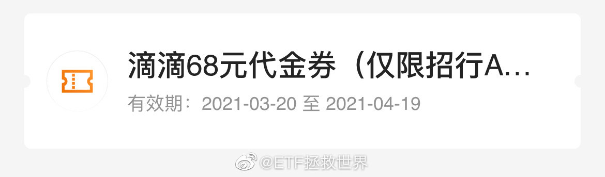

## 2021-04-09 11:54

如果今天红利历史新高，

发666🧧。 ​​​

## 2021-04-09 17:25

有句话不知当讲不当讲。

小姑娘你们要注意了。有些男人对外谎称自己是gay或者yw，让你放下戒心，把他当成男闺蜜，最终达到不可告人的目的。

套路非常深。 ​​​

## 2021-04-09 17:39

回复@钍氧钍砷钋:99%男方不主动或者女方主动男方“不懂”的，都是一个解题思路：他对女方兴趣不大…//@钍氧钍砷钋:借楼问问，相亲一男的，见面的时候感觉还好，但下来后就感觉对我爱搭不理的（不会主动找我聊天，但我找他聊天的时候又能聊），是不是就是没那意思啊？

## 2021-04-09 18:18

男方看不上女方，女方看不上男方，太正常了。就单纯的只是这个人看不上你而已，说明没有缘分，不在一个channel，不是你的菜。

ta看不上你，不代表别人看不上你。你想想，是不是绝大多数异性你都看不上，为什么ta们都能找到另一半？而且爱的死去活来？你有没有纳闷过“这样的人也能找到另一半？”

情人眼里出西施啊！你觉得别人不好，别人觉得你不好，但终究有觉得你好或者觉得别人好的人出现啊！区别就是你各方面条件好的话，觉得你可以尝试交往的人多一点，反之少一点而已。

情况就是这么个情况。别人看不上你不代表没人看得上你，也不代表你有什么问题，就是频率对不上而已。

## 2021-04-12 00:41

完整版。你能学到什么

## 2021-04-12 09:58

本来又想发个666红包的微博，后来一想，算了，为了大家，别奶了。 ​​​
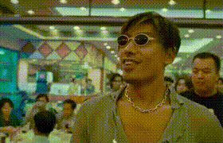

## 2021-04-12 10:09

不按常理出牌？ ​​​
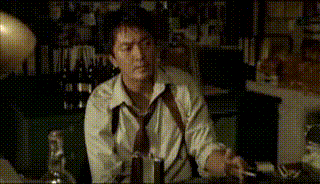

## 2021-04-12 10:41

既然大家喜欢，就再来最后一张吧。喝水的时候别看。 ​​​

## 2021-04-12 10:56

最近我的微博很少说市场。

为什么呢，因为现在的市场没什么好说的。

鸡肋，了无生趣，boring，つまらない。

你能对一个无聊的东西做出什么有趣的评价吗，不能，完全不能。

所以这几天就是做研究，然后投入有趣的生活。

等市场变得有趣了，我又会不停的说了。 ​​​

## 2021-04-12 11:12

目前全指医药全收益指数与2015年6月点位几乎一致，但估值下降了59%。

目前全指医药全收益指数与2012年6月估值几乎一样，但指数上涨了212%。

这就是投资一个好指数赚钱的秘密。 ​​​

## 2021-04-12 12:15

你今天中午吃什么。

我吃这个。

味道如何稍后为您带来。 ​​​
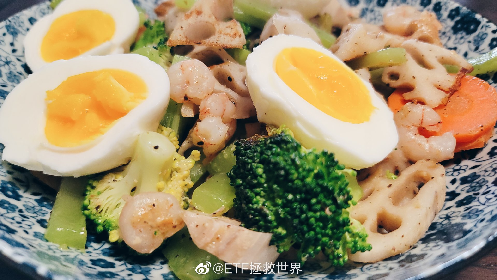

## 2021-04-12 12:35

吃完了。味道不能说美味，但绝对算不错，比一般的蔬菜沙拉好吃很多。这一盘吃完很饱，热量估计300-400多卡。只放盐和黑胡椒，极少油略炒后加盖焖三分钟即可。 查看图片

## 2021-04-12 13:42

现在懂了吧

## 2021-04-12 14:40

不发车是因为不赔钱才能赚钱。 ​​​

## 2021-04-12 15:08

这样的天气适合穿风衣。

但知名风衣品牌的男款普遍没有女款设计用心。 ​​​

## 2021-04-12 15:46

有人私信问我，这个是餐前吃还是餐后吃//@ETF拯救世界:吃完了。味道不能说美味，但绝对算不错，比一般的蔬菜沙拉好吃很多。这一盘吃完很饱，热量估计300-400多卡。只放盐和黑胡椒，极少油略炒后加盖焖三分钟即可。 查看图片

## 2021-04-12 16:30

再跌下去就要随时发车了。 ​​​

## 2021-04-13 12:05

为什么明明是杂粮饭结果全黑了 ​​​
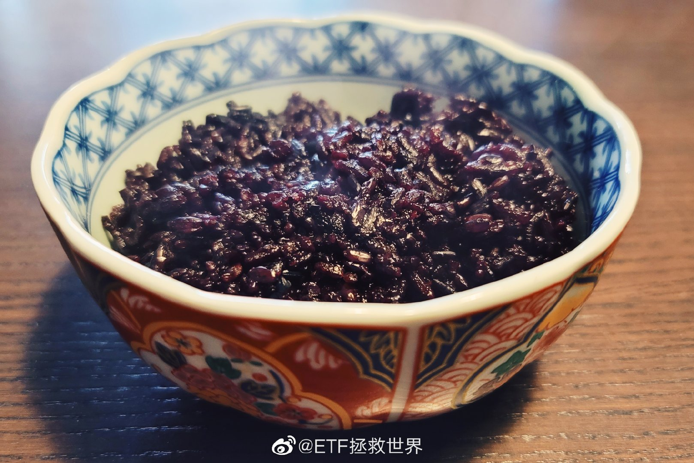

## 2021-04-13 14:10

这两年大家又攒了不少钱吧。 ​​​

## 2021-04-13 14:31

你有没有爱上金融交易。

市场上不知道在哪儿，有一大群人，在价格很低，很便宜的时候呼的一下把手里的筹码全都廉价卖给你；

然后又不知道哪儿来一群人呼的一下在很贵的时候把你的筹码接走。

根本就不知道为什么你的钱越来越多，手里的筹码也越来越多。

太享受这种感觉了。钱不钱的倒是其次，看着那么多人跑来跑去一直送钱就感觉很舒服。

## 2021-04-13 16:49

人生在世，很难快乐和开心。

所以要做让自己开心的事，用能让自己开心的东西，和逗自己开心的人在一起。

当然很难全部达成。但是进一步有进一步的欢喜，能有多少是多少吧。

一辈子啊，开心最重要。 ​​​

## 2021-04-13 19:34

人类的很多痛苦来源于：

自身能力的不足与对自己预期之间的落差；

无法正确定义自己在这个世界上应该扮演的角色；

幻想改变他人。 ​​​
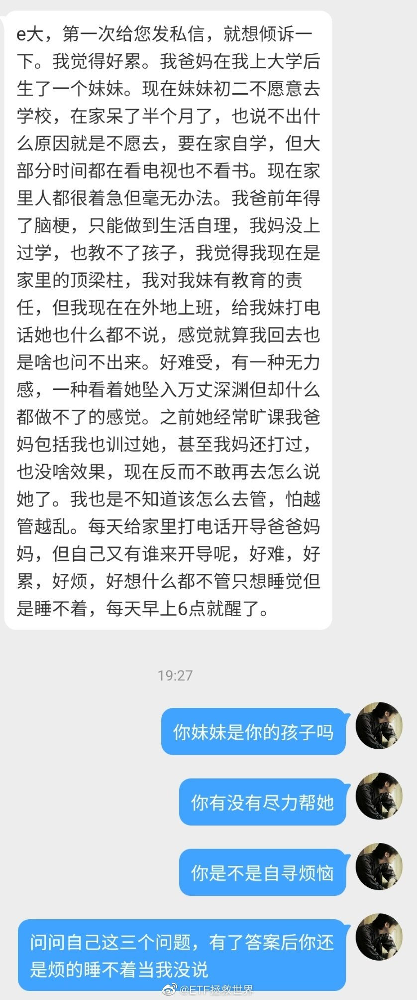

## 2021-04-13 20:18

有没有想过是自爆呢。

## 2021-04-14 11:46

什么是开心呢。

第一种是肉体的。

广义来说，比如物质、比如身体的（食色等等）。这些都是能让肉体感知到的开心。

第二种是精神的。

这里说的是与物质无关的精神，严格来说甚至不包括恋爱。精神的开心是一种满足物质开心后的升华。

举个例子来说，我之前在评论里看到各位说赚钱了，我就很开心。看到有人抱怨赔钱了，我就不开心。实际上你赚钱不赚钱会影响我什么呢，其实没有影响。但对我来说，就是会因为这个影响心情。这种就是精神上的开心。

再举个更通俗的。比如你扶老太太过马路，或者你下水救了落水儿童，又或者捡到钱包还给失主……所有这些即使没有任何第三者知道，你也得不到什么，甚至可能有损失，但你做了依然很开心。为什么呢，因为你升华了，实现了自我价值。

第三种实际上是对美的感受。

比如你看到了马尔代夫的海，比如你看到了阿尔卑斯山下瑞士的村庄，又或者在路上看到了惊为天人的帅哥美女。这种时候你感受到的是美，美就能让你很开心。这个既没有物质和肉体上的享受，又没有自我实现的充实，但你依然很开心。因为你感受到了美。

所以想要开心就要从这三个方面下手：

身体上的感受：多搞钱；吃能让自己感到快乐的东西；找个喜欢的人谈恋爱，然后拥抱，然后感受ta；

精神上的感受：与身边的人和谐相处；力所能及的情况下帮助该被帮助的人。

提高对美的感受：睁开眼睛，认知美，感受美，创造美。包括但不限于文字之美、音乐之美等艺术的美，以及大千世界的自然之美，哪怕是小区里的一朵花；或者把自己住的地方收拾收拾，重新布置一下等等等等。

在没有病痛的时候，从肉体、精神、对美的感知这三个方面努努力，没准你就没那么丧，会变得稍微开心一点。

## 2021-04-14 12:51

看完《银元》和《抗战》，虽然没有证据，但我的直觉告诉我，

作者很多人际交往的内容是在吹牛*。

当然，瑕不掩瑜，从金融和社会角度还是两本不错的书。 ​​​

## 2021-04-14 18:08

今晚吃这个，第一次吃，怎么吃。直接吃还是走程序。 ​​​
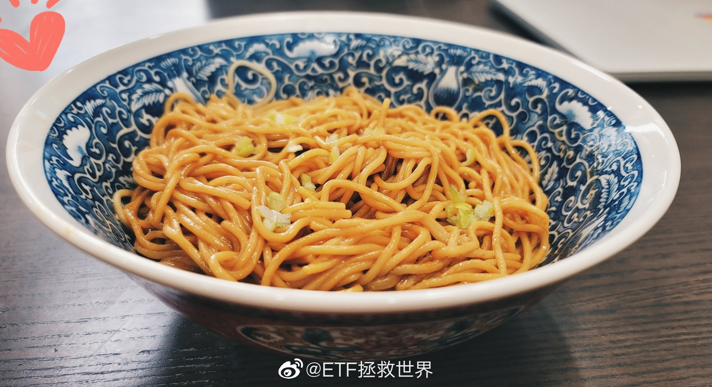

## 2021-04-15 09:26

有些父母的存在就是为了让孩子过得更艰难 ​​​
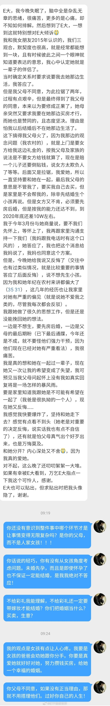

## 2021-04-15 09:50

到底绝大多数父母什么时候才能认识到孩子是独立的个体，不是他们的附属品？

最关键的问题在于，大多数父母本身这辈子就没做出过几个正确的决定，自己的婚姻也过得浑浑噩噩，却总想着指导下一代应该怎么做。

收手吧，阿祖。 ​​​

## 2021-04-15 10:20

我自己也是父母，现在能够深刻的理解到做父母的不容易。所以我不是什么“父母皆祸害”豆瓣小组的小屁孩。

但是我有一个认知越来越强烈，那就是，孩子是不可能按照你设计好的路线前进，不会按照你幻想的样子被塑造。

他有自己的人生，有自己的路。

这种时候就需要父母做个选择：是坚持自己的设计，当孩子与自己的预期偏离则大力“纠错”，还是与孩子一起尝试未知，引导孩子认识自己，走一条对孩子最好的路。

无论如何，有一点是明确的：

孩子的工作也好，与谁结婚也好，我不会给他增加障碍，平添烦恼。因为这个世界本身已经自带太多烦恼了。最多提出自己的意见和看法，采纳不采纳他自己决定。否则，你把他逼急了做点不理智的事情，或者精神上出点问题那这辈子就毁了。

当然，除非是经过缜密调查，发现这个工作或者那个人真的是个巨坑，潘金莲、马蓉、翟欣欣、醒醒那种坑，那我就只能断绝经济支持作为最后通牒……

## 2021-04-15 10:31

不懂的又被套了。//@ETF拯救世界:现在懂了吧

## 2021-04-15 13:32

刚才吃了一会PPT的瓜。吃完了以后想了一会，竟然发现无法从中学到什么东西。

也就是说，男主换做是我，我也无法用什么方式避免这种事情的发生。

防不胜防啊。 ​​​

## 2021-04-15 14:13

说明一下，类似的推广以前没做过，以后也不会做。请机构的朋友或者推广的朋友以后不用问了。

不好意思啊。 ​​​
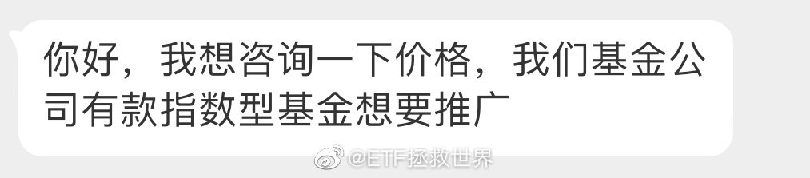 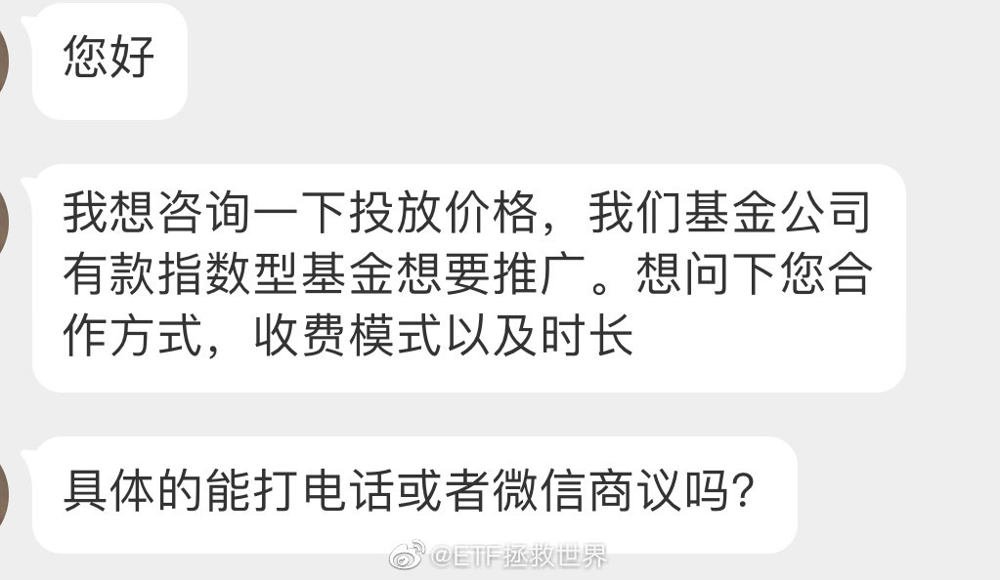

## 2021-04-15 14:32

“别人不要你就买点，别人抢你就卖点。做个好人没错的。” ​​​
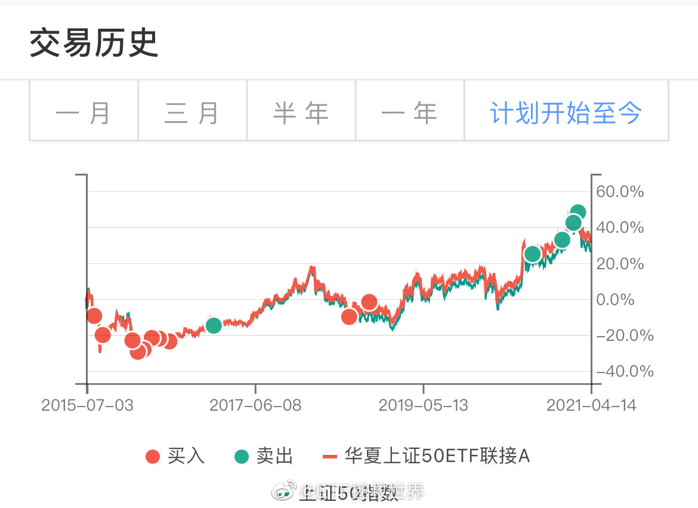

## 2021-04-15 14:52

有些人天生攒不下钱。

过年的时候给了亲爹几万块红包，刚才问了一下，果然，

又换了一套相机，一分没剩。 ​​​

## 2021-04-16 10:12

你造吗，看着小红这么顽强的在风雨中努力往上飞，就感觉很感动。

其实小红是个好孩子，过去8年涨了6年不说，以前的成绩也是很不错的。但是就因为过去两年成绩有点落后，有些目光短浅、鼠目寸光的势利眼就嘲笑她，侮辱她。

好在我们不会放弃这样的好孩子。我们不根据一两年的成绩判断一个孩子是不是有出息。我们持续给她鼓励，相信她最终会继续优秀。

小红是好样的，我们也是好样的。

一起加油吧。

## 2021-04-16 10:44

你是什么样的人，你就会做什么样的投资。

投资说到底，是性格和对世界认知的体现。 ​​​

## 2021-04-16 11:44

​​​

## 2021-04-16 13:27

​​​
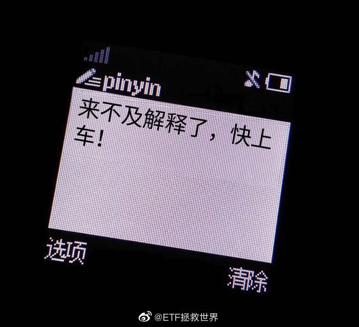

## 2021-04-16 14:57

​​​

## 2021-04-16 17:29

灯塔在1932年的军事实力 ​​​
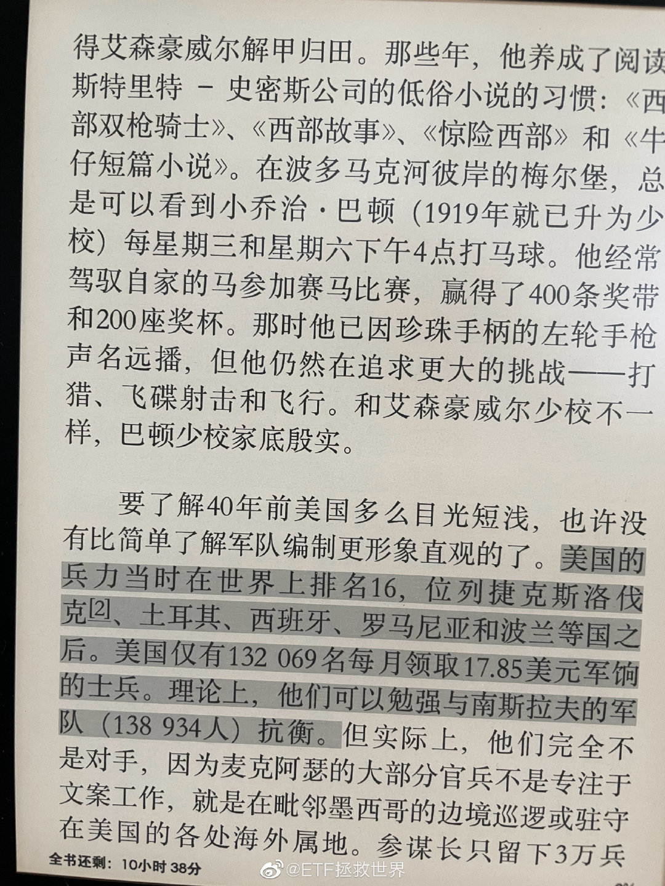 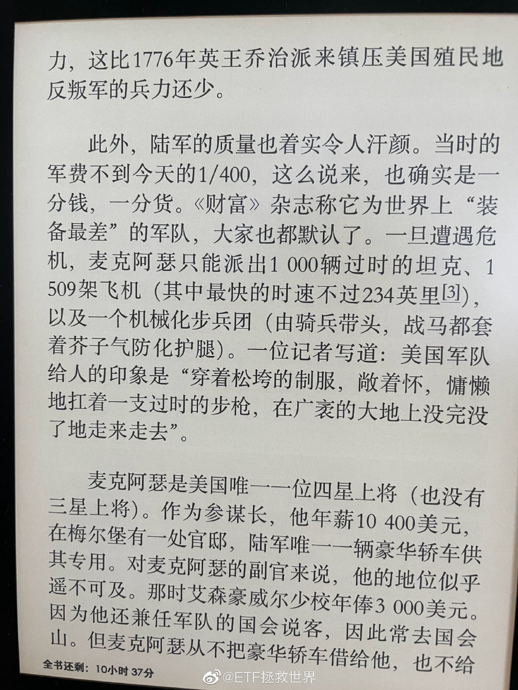

## 2021-04-18 12:06

正经的没学到，就学到用狗头挡脸这种歪门邪道了 ​​​
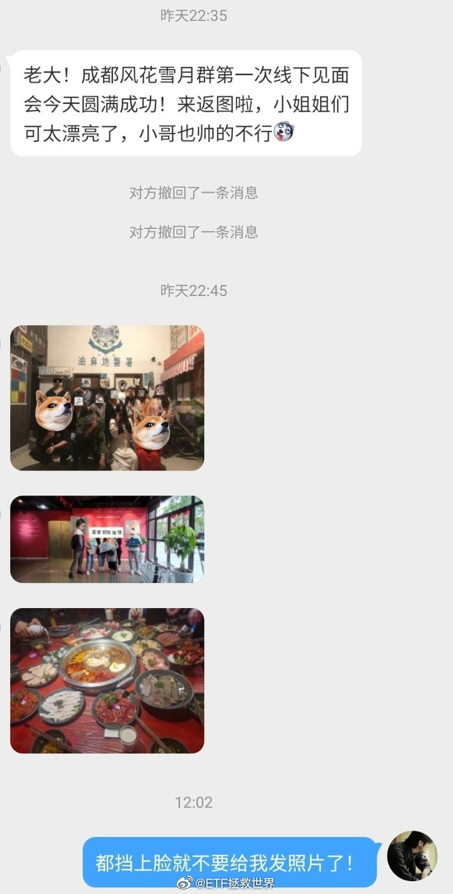

## 2021-04-19 09:58

再次触发，等提款。

如果今天提不了，就明天。 ​​​

## 2021-04-19 10:19

什么也不用做，咔咔自动提款的感觉。

金融投资的乐趣，钱不钱的是次要的，最重要的是一次次成功的成就感。

一切按照规划运行的成就感。 ​​​

## 2021-04-19 10:43

S除油气外最后一个浮亏品种即将回本 ​​​
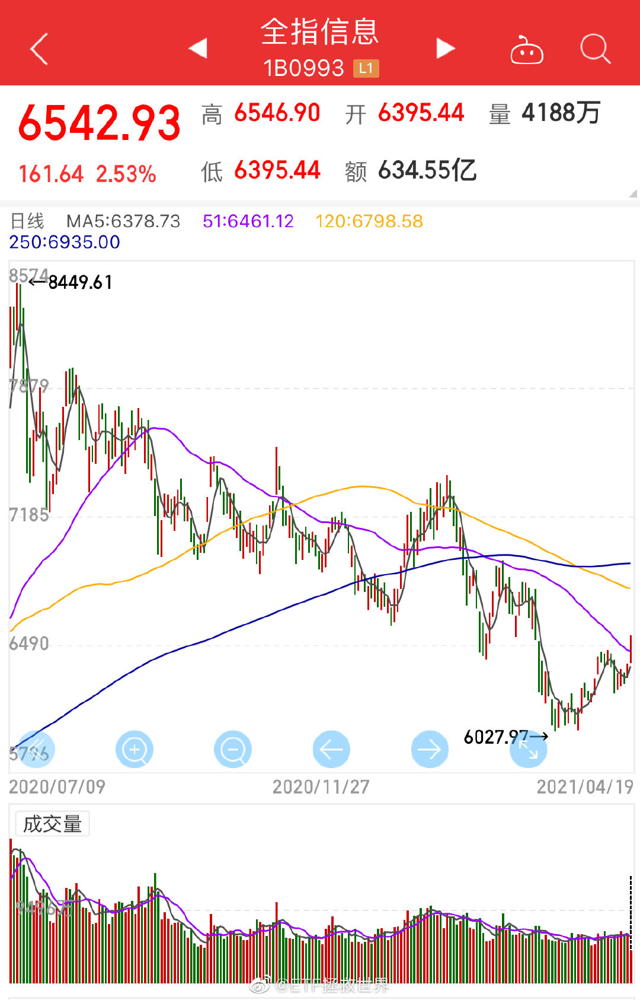

## 2021-04-19 11:17

回复@不会取昵称的刹那:错了。如果你是我的专属条件单创建，触发后不成交会自动创建。说明你不是专属条件单创建的。//@不会取昵称的刹那:回复@沸点Alone:原来申报之后没能提款的要重新创建！多谢告知

## 2021-04-19 15:31

虽然没什么钱，但是心情好就想发红包。

这个病去医院挂哪个科。
  ​​​

## 2021-04-19 15:40

回复@这个叔叔不太冷:如果微博有这个选项，我会选前1000//@这个叔叔不太冷:敢不敢互动前200

## 2021-04-19 23:02

5个月过去，跌了56%//@ETF拯救世界:崩盘不远了

## 2021-04-20 10:00

不要涨停

要不停涨 ​​​

## 2021-04-20 10:35

真的吗，我不信。

## 2021-04-20 10:41

支棱7%就好。要求不高吧。 ​​​

## 2021-04-20 11:59

新高不卖。

好久没有机会提醒各位了。 ​​​

## 2021-04-20 12:16

闭上眼睛，空气中有夏天和你的味道。 ​​​

## 2021-04-20 12:32

直男冷知识：

女性身上并没有“体香”。你闻着她香是因为女性洗澡的时候用了香香的沐浴液，洗完了抹香香的润肤乳。

你抹你也香。 ​​​

## 2021-04-20 12:50

冷知识：吴尊已经41岁了。

## 2021-04-20 13:21

最近经历了一些事，感悟更深。

愿意无偿帮助你的人，是真的对你好的人。要珍惜，记得常联络，也对他们要更好一点。

我说的不是那种对谁都好的人，而是不计回报就对你这个人好的人。特别难得，珍惜啊。 ​​​

## 2021-04-20 16:55

分享图片 ​​​
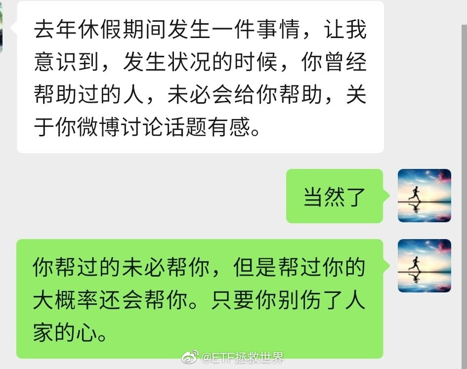

## 2021-04-20 22:02

有些人外红内黑。

非常有意思，看他表演就像在看谍战片。 ​​​

## 2021-04-21 08:13

拒绝浮于表面，直击问题本质 ​​​
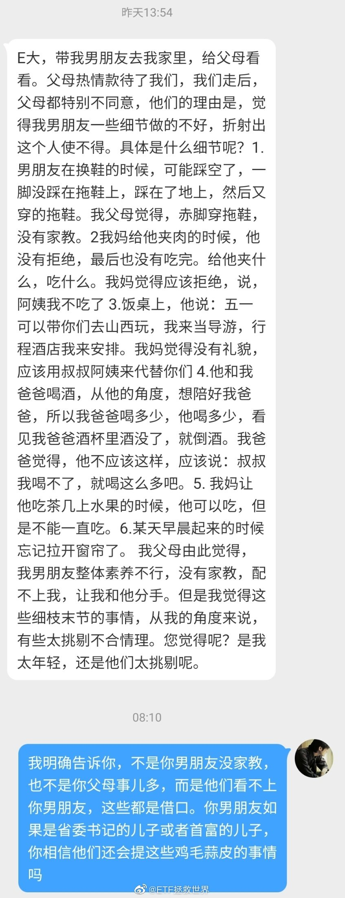

## 2021-04-21 08:48

有人在评论里说就是因为这些细节父母看不上。我这么说吧：如果是因为条件不好，拿这些做借口还好说。如果是真的挑这些东西，比如换拖鞋不小心踩地板，那你们结婚后将永无宁日。

## 2021-04-21 09:01

我们才买了一份就自闭了吗，太脆弱了吧 ​​​
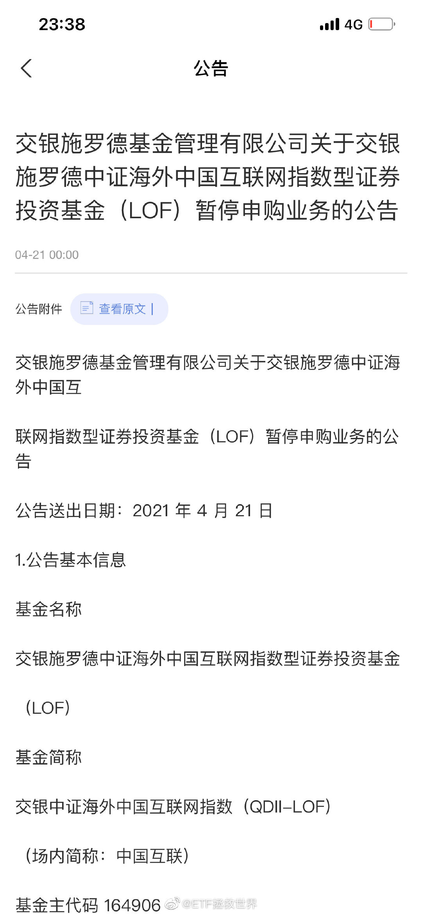

## 2021-04-21 09:33

限购也好，关门也好，都不是事儿。

没有解决不了的问题，现在又不便宜，着什么急？等便宜的时候再急不迟。

该是你的就是你的，不是你的急也没用，踏踏实实的，一切尽在掌握。 ​​​

## 2021-04-21 09:40

前天下车的品种，下车价格距离最高价就差3厘。

指数拉上去就是为了让我们提款？ ​​​

## 2021-04-21 09:52

中概真正的好买点在目前价格下跌20%+的地方。之前买的一份是加个底仓试试水而已。 ​​​

## 2021-04-21 09:56

朋友们，身体健康最重要，大家保重身体。

尽量不要情绪激动，除非辅导孩子功课忍不住的时候。 ​​​
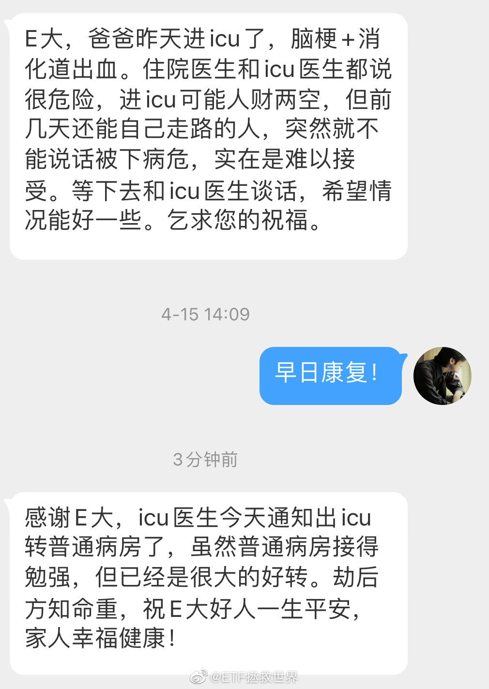

## 2021-04-21 13:06

要是你讨厌一个人，就争取比ta活得长&amp;活得开心。

（如果你讨厌我就别妄想了） ​​​

## 2021-04-21 13:51

这种天气必须去湖边看书。

明天见。 ​​​

## 2021-04-21 19:54

你们可能看了这个视频觉得人大附孩子英语好，但他们的课外和社团活动会更让你吃惊

## 2021-04-22 09:35

其实做财经博主很难的。

说少了不务正业，群众不满意；说多了影响市场，老爷不满意。

还是做个情感博主吧：

风轻云淡，岁月静好。 ​​​

## 2021-04-22 09:49

这样一个品种，难道不算长牛吗。

为什么有人会骂它。 ​​​
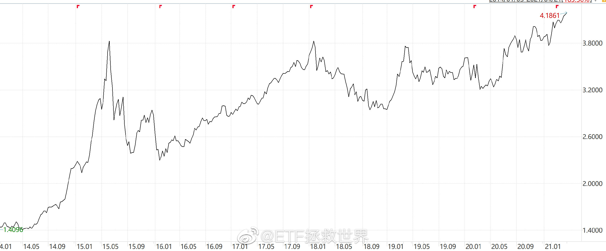

## 2021-04-22 10:24

我特别特别希望大家明白的一件事，

是做投资，不是说你买完了过一段时间去看是赚了还是赔了。

不是这样的。

而应该是你买的那一刹那，就应该知道自己会赚还是会赔。

当你知道你买的这个东西不会死，买的价格也便宜，即使未来还有下跌，无非是因为货币或者情绪的原因，那你就知道极大概率自己一定会赚。

这样，未来跌了你心里会毫无波澜。因为你已经知道终点的风景很美，又怎么会在意路途上的颠簸。

相反，你买的时候乱买，买完了一个波动你就懵了。不停的到处找人问：赔钱了，我该怎么办？割肉还是持有？

当你进入这个状态，基本上已经可以判定：这个牌桌上，你就是送钱的那个人。

我自己买的东西，我都很有信心。当然不能保证100%每个品种都一定会赚钱，但绝大多数品种会赚钱这个没有任何问题，更何况后面还有一整套交易体系在支撑。

无非就是时间问题，早涨晚涨而已。

所以，那些质疑我买的品种不涨的人，在我看来都挺可笑的：门儿都没入。

## 2021-04-22 10:37

谁支持，谁反对 ​​​
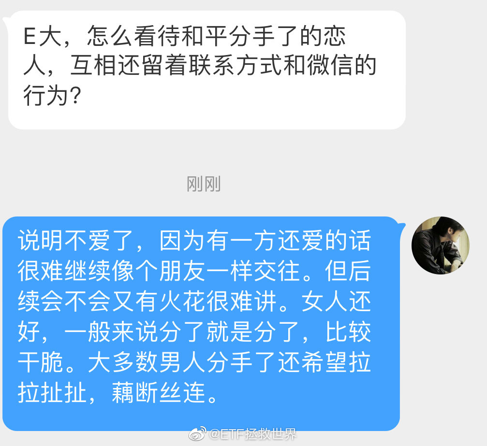

## 2021-04-24 12:10

每天都有寻求合作的。这位是少见的从关爱博主的角度入手，给人不一样的温暖感觉… ​​​
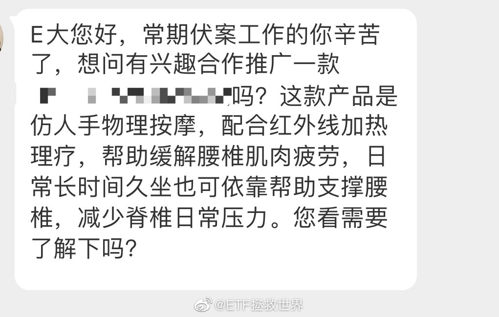

## 2021-04-25 10:23

使用面积70大概是建筑面积90多平米，23区均价370万人民币。东京职员人均年收入30万人民币//@日经中文网:【摘】按使用面积70平方米换算，大阪市二手房环比上涨0.3％，达到3524万日元（约合人民币212万元），连续5个月上涨……

## 2021-04-25 13:55

今天上班的聊聊现在的感受。 ​​​

## 2021-04-25 14:49

回复@Three求不同Well:买股不看比每天交易的高了一个档次。但是每天看又不交易的比你又高了一个层级。然而最高层次是每天看交易是自动运行的//@Three求不同Well:大家都看股市吗？我都很少看，我想我买股就是放着，儿子长大再说。

## 2021-04-25 16:04

不同生物之间也有异性相吸吗。

我家的小猫猫——招财，我几年前在车库捡的流浪小奶猫——总是喜欢跳到我身边撒娇。

我也不喂饭，也不喂水，也不是铲屎官，她却只是喜欢跳到我身边喵喵喵，瞪着大眼睛看着我。

是因为我撸猫策略好吗。 ​​​

## 2021-04-26 09:33

舒服。 ​​​

## 2021-04-26 09:40

希望本周传媒不要拉一根超过2%的日线带量大阳。 ​​​

## 2021-04-26 09:47

说个严肃的事儿：

你觉得我有什么需要改正的地方吗，或者你对我有什么意见，不妨在评论里大声说出来，不要怕。

让群众说话，天不会塌。 ​​​

## 2021-04-26 10:32

医药即将再次碰到16100高位压力线。 ​​​

## 2021-04-26 11:14

最近四次买入。第一次信息虽然是用环保换仓，但终究是买的高了… ​​​
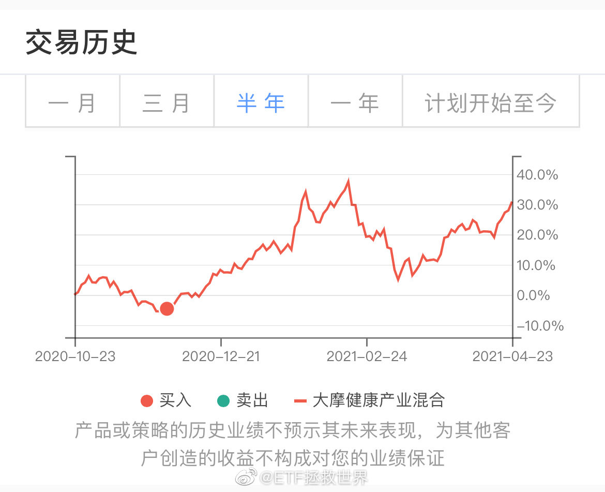 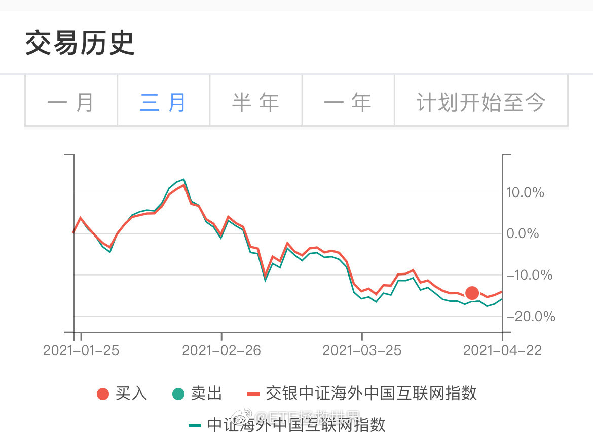 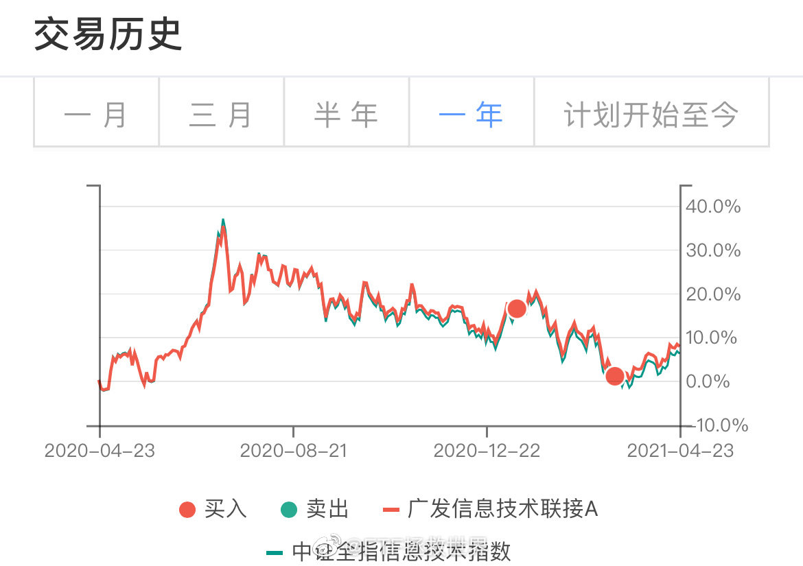

## 2021-04-26 11:39

刚我看那个评论里很多朋友说让我介绍点好用的东西，我再介绍一个吧。

这个东西我真的很喜欢，一直没说是因为好像市场上这个东西牌子不多，要说就大概率知道是某家的产品了，有广告嫌疑。

喜欢《老友记》的朋友应该对乔伊和钱德勒的懒人沙发有印象吧，我记得有一集专门说这个，哥俩躺在上面一集都不起来……

很多年前我看过之后就对这个有兴趣了，然后去年我就买了一个，一个字：舒服。每天躺在上面看会书是我的乐趣来源之一，真的舒服。

我买的是头等舱那个牌子，皮面的，1000多块，我觉得你感兴趣不要着急买，先去坐一下躺一下体验一下再买。

类似于图中这种。不同的是几乎能全部放倒可以睡觉了，扶手也宽大许多。

（绝非广告，如果是广告今年赔大钱）
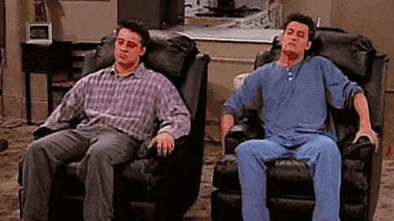

## 2021-04-26 13:55

让你不要大涨没有让你绿啊！衰仔！

## 2021-04-26 16:15

全指医药，已公布的报表：

去年四季度169家，业绩下降的只有55家；

今年一季度80家，业绩下降的只有10家。

不愧是医药啊。 ​​​

## 2021-04-26 16:44

资产每天新高的秘诀：

下跌的日子不更新理财软件的股票/基金净值。

不看＝没亏。（量子力学，薛定谔的股票，说多了你也不懂） ​​​

## 2021-04-26 19:17

男人天生都是海王

今天儿子跟我说，一个女生拿一张纸让他回答纸上的三个问题，第一题是

“你喜欢什么性格的女生”

我问儿子，你写了什么

他说，我直接写了那个女生的名字

我非常惊讶：你不是说你喜欢xxx吗？

儿子想了想：两个都可以

我：[费解][费解][费解][费解][费解][费解][费解]

是不是辅导班报的不够多？

## 2021-04-27 07:03

片酬1.6亿却还伪造机票报销，超市喝饮料不给钱你们会感觉吃惊吗？我不会。

因为之前就知道她把二手东西闲鱼高价卖给粉丝…就感觉很贪钱。不顾一切捞钱的人我都敬而远之。

君子爱财取之有道。太贪婪的人总是给人感觉哪里有点问题，交往起来让人不放心。 ​​​

## 2021-04-27 16:25

根据我的数据，我越来越有信心的是，A股会出现真正的长牛。

之前A股暴涨暴跌，大多数人很难赚钱的根本原因在于A股钱太多，股太少，导致A股二十多年恒时高估，所有人都在买很贵的东西，这样赚钱的概率就非常小。

但2018年底的钻石坑至今2年多接近3年，很多朋友已经赚了很多，然而A股整体还在黄金坑里，你能相信。注册制真的改变了整个系统的生态。

只要不是全市场高估，行情就不会结束，行情不结束，长牛就继续。

还是那句话，大多数指数仓位踏踏实实拿着，小部分仓位等机会或者做波段，舒舒服服，别瞎操心这个操心那个。

## 2021-04-28 09:33

有一件事我觉得很奇怪，不知道为什么。当然只是我的个人经历，可能大家都不这样。

我清晰的记得人生中第一次吃麦当劳。是哪年，什么样的天气，我的一个表姐带我走进去，给我点了一个汉堡，我们说了什么。

我的一个大学同学，到今天每次见到我都会说，他人生的第一次肯德基是我请他吃的。

我是说，为什么吃麦当劳和肯德基会给人留下如此深刻的印象。没有任何其它餐饮会让我留下这种印象。

## 2021-04-28 10:56

目前的仓位略微有一点点结构性不舒适，

考虑明天动一动。 ​​​

## 2021-04-28 17:43

环球影城什么时候开啊，希望人别太多。 ​​​

## 2021-04-28 19:03

我还是建议没有恋爱过的朋友，如果有机会，不妨跟觉得还行的人恋个爱。

不要把恋爱看的过于神圣，增加点与异性交往的经验也好。

看某些私信有感。 ​​​

## 2021-04-28 19:17

还有，某些朋友喜欢“暗恋”，甚至暗恋好几年，等人家找到另一半了自己又痛苦。暗恋很爽吗？喜欢就去试探一下，行就得寸进尺，不行就断了念想，没完没了的折磨自己有意思吗

## 2021-04-29 08:50

谁能找出我种族歧视的证据，第一个找出来的，我转1688给他。

现在栽赃已经不要证据了吗？ ​​​
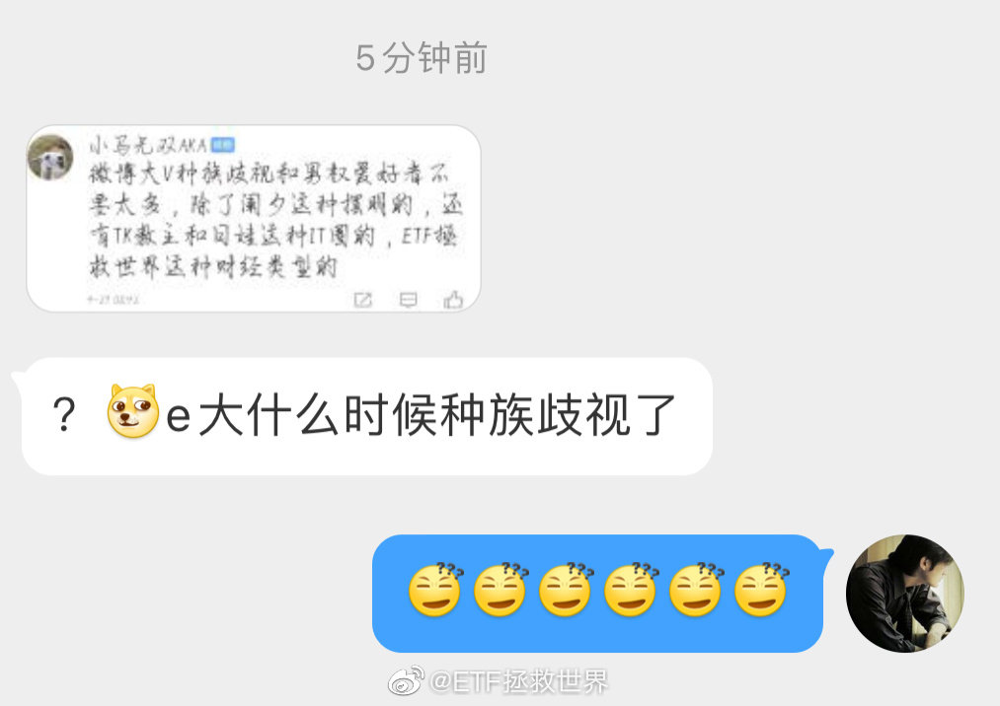 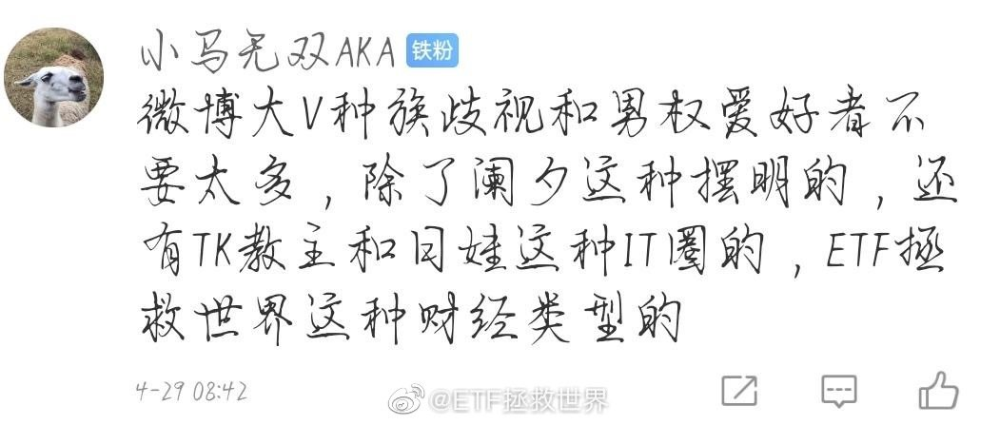 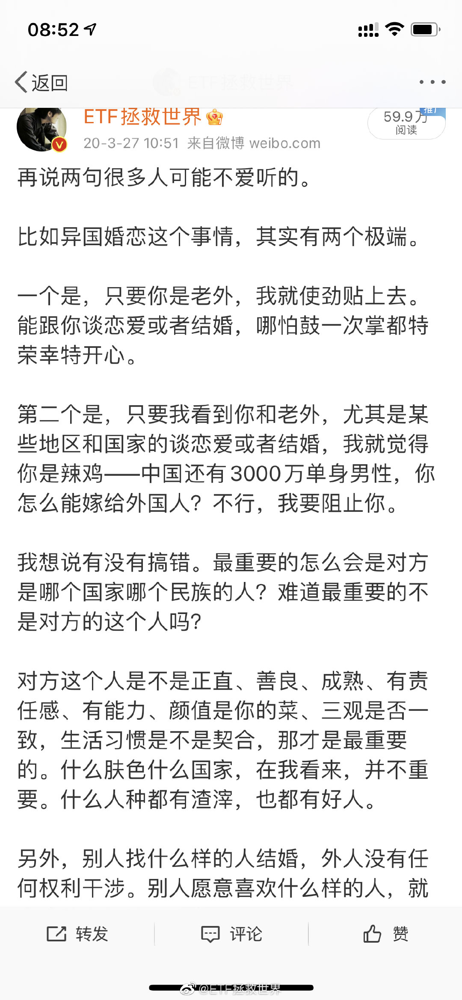 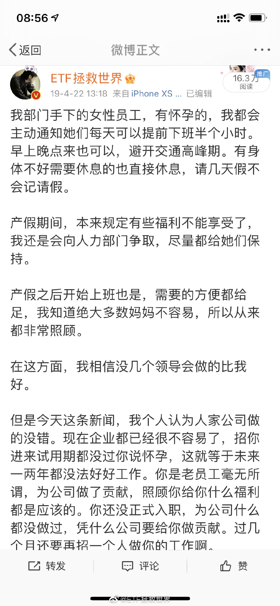 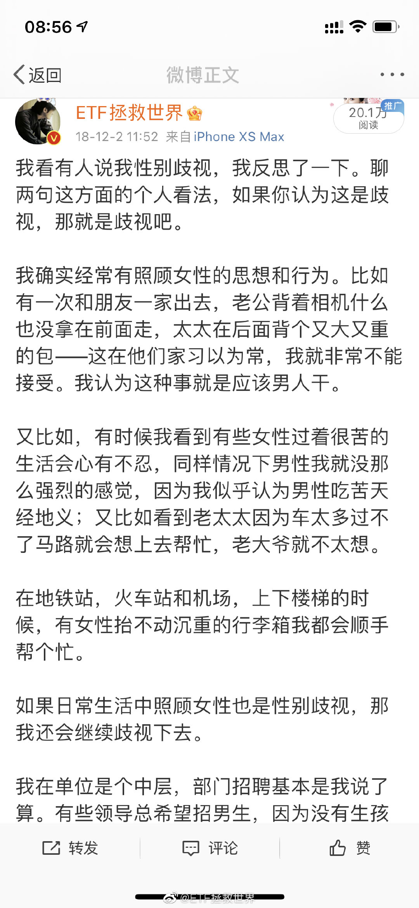 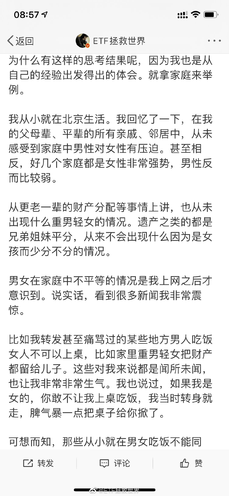 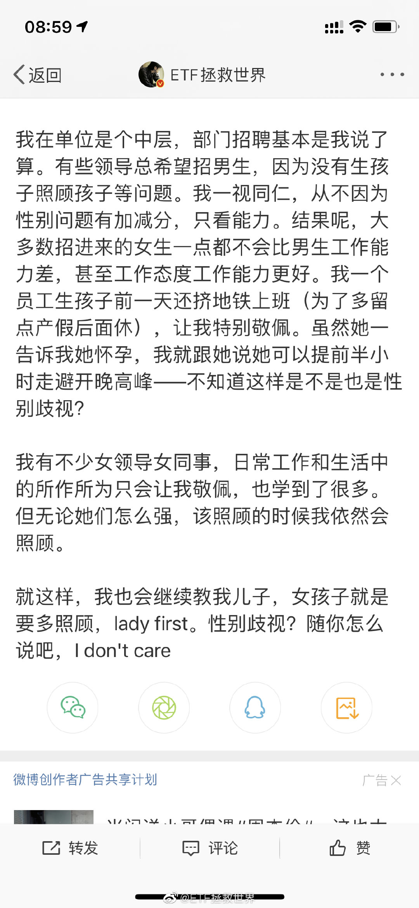

## 2021-04-29 09:22

刚才看那些截图，又想起一件事。

之前的单位，我手下有一个女生怀孕期间请假比较多。但是发奖金的时候我还是给定了不少。流程走到人事那边，人事不干了，说请假太多，奖金为什么不扣。

我就去人事那边帮这个女生争取。后来还把人事主管说哭了[悲伤]

我跟人事说，我是觉得女孩子怀孕本来就各方面压力大，经济上没必要扣的太狠。你对员工好一点，她回来上班后也能努力工作，没必要因为一点钱太计较。

这个事情只有我和人事部门的人知道，这个女生自己也不知道我为她争取奖金这件事。后来奖金定的比我提的低了一点点，但比别的部门相同情况那高的太多了。

我现在已经不在那家单位，跟那个女生也没有任何联系。她不知道这件事，也从没感谢过我。

但我依然觉得这件事我做的没错，再来一次的话我还会这么做。

PS，这件事后人事的同事对我很好，因为人事主管也是个女的。

我很少在微博发火，仅有的几次骂人，大多数都是因为看到女性受到不公平的待遇。比如宅基地没有女孩的，比如过年吃饭不让女孩上桌什么的。如果我家发生这种事情，我会直接掀桌子，我不允许。

男女是平等的。

说我性别歧视？是因为我说女孩子深夜出门不妨多穿件衣服吗？是因为我不同意所有男人都没底线吗？

如果是因为这些，那我也无话好说。

## 2021-04-29 09:56

我去准备发车了。

造谣的人原地飞升。 ​​​

## 2021-04-29 10:51

券商就像渣男

你对他好，他肉了吧唧不理你

你放弃他了，他挣扎着说：再扶我起来试试 ​​​

## 2021-04-29 14:19

有人叙事总是非常宏大：国家啊，民族啊。其实你要问他为国家民族做了什么，可能也没做什么，弄不好现在上班还在划水。

空谈大义之前，还是踏踏实实把自己能做的事情做好。努力工作，让自己和家人过上好日子，再尽量惠及更多的人，这才是为了国家和民族做的最实实在在的事情。

至于宏观的、历史的、趋势的，岂是你我小民可以改变。时势造英雄，英雄是造不了时势的。

每个人都应该谦卑一些，也许多年以后大家看自己当初的想法会觉得很二很可笑。当然，我也是。

## 2021-04-29 14:37

今天的BGM适合你们两个点上蜡烛，喝着红酒听。 ​​​

## 2021-04-29 14:47

不说你不知道，

调整了几天以后，

红利今天又要历史新高了。 ​​​

## 2021-04-29 16:14

2013年4月至今的8年中，全指信息估值低于目前的只有2018年8-2019年2月这7个月。

所以也许还会跌，但你心里清楚这个地方你没有高位接盘就够了。

你敢跌，我就敢接。 跌吧。 ​​​

## 2021-04-29 19:52

第一篇5小时内10w+的公众号文章……虽然很有成就感，但更多的是压力。

无论如何，会尽我所能做得更好一点。 ​​​

## 2021-04-29 20:24

果然如约新高。我看评论里有不少朋友卖出了。可能你有自己的策略啊，但是从我的角度呢，其实红利目前可能不太适合大幅减仓。拿一拿也挺好的。

## 2021-04-29 21:10

虽然不知道是不是因为喝酒，但为了身体健康，各位还是少喝点吧。

不喝更好。

 ​​​

## 2021-04-30 16:10

有朋友发私信问我怎么看军工，便宜不便宜，能不能买。

我送大家一张图，放假没事儿自己研究研究吧。 ​​​
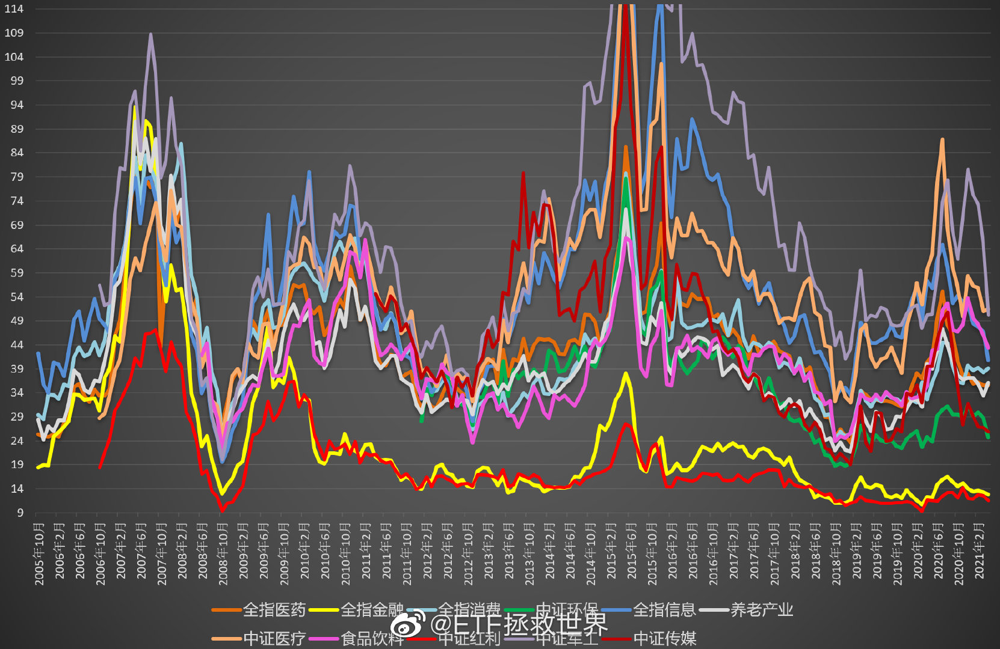

## 2021-04-30 16:52

回复@ETF拯救世界:其实你想，260倍最高，那么130倍买入的人一两个月也能赚一倍。这时候你说他买是对是错呢？130倍不敢买的人，看到胆子大的人一两个月赚了一倍，应该羡慕嫉妒吗？投资这件事非常有意思。

## 2021-04-30 17:04

大家看这个图的时候要注意：不是说绝对值便宜的指数就一定比贵的指数有前途。没那么简单。如果投资那么简单，所有人买最便宜的股票就好了。这个还要结合行业前景，利润增速，市场喜好等因素。但这张图可以告诉你一件事：想要不翻船就永远不要买太贵的东西。一次两次没事，但总有一次会让你十年白干

## 2021-04-30 17:20

回复@鹏城烟的枪:股票的估值可以没有上限，甚至可以亏损都没关系。但一个指数不可能所有成分股都是那么NB的成长股，如果一个指数那么贵了，说明已经疯狂了。//@鹏城烟的枪:回复@ETF拯救世界:这个也适用于新能源车、芯片吗？

