## 2021-05-01 17:59

大家节日快乐！

外面怎么样，堵不堵，景区人多不多。期待你的第一手消息。 ​​​

## 2021-05-05 19:45

请在评论贴出假期中你最满意的照片 ​​​

## 2021-05-06 09:34

红利疯了吗 ​​​

## 2021-05-06 09:37

关于中概互联，正在向我中意的价格靠近。

我只有一个要求，

答应我，不要再买一份就自闭好吗。 ​​​

## 2021-05-06 09:42

上个交易日最高15895，就差1.2%。如果不是灯塔疫苗这个事情，有机会碰一下的。结论：我不承认错了！

## 2021-05-06 10:22

你有没有这种经历：

排队的时候 ，你找了一个比较短的开始排。结果自己这个队前进得很慢，旁边的队虽然长但是特别快。

你下了半天决心，终于决定换到那个队里面。谁知道刚换完，以前的队开始加速，本来排在你后面的人已经到了你的前面。

你欲哭无泪，想了半天，终于又换了回去。没想到，悲剧又发生了一次。

其实投资也是。你总是盯着谁这一两年表现好，左右横跳，最后可能终于发现，

小丑竟然是自己。 http://t.cn/A6ceKUGw

## 2021-05-06 10:41

男生年轻的时候大多都喜欢玩游戏（没有歧视女性的意思）。我也喜欢玩，然后想着玩也是玩，不如一边玩一边写点游戏的文章去发表，然后想不如索性做个游戏网站。然后做了两年卖掉了，也算是第一桶金。

当然我要说的不是这个，我想说的是人生其实就是一个游戏。不同的是电子游戏可以S&amp;L，又或者是重新开始一局。但人生不可以，就这一局，好不好就是它了。

这种一局的游戏容错率就很低。所以如果你不是天生入场的时候就是人民币玩家或者有GM帮你修改初始数据，那么还是应该谨慎一点，尤其是做一些重要的大选择时。

好在这种一次性的游戏中，会有无数可以重复玩的小游戏。为什么股市这么好玩，因为它就是可以无数次重新开始玩的小游戏。你今天赚了赔了，明天它依然重新开始。大概率你挂了它都不会挂。然后每年，甚至每个月，每天都有无数机会让你成功。这个机会抓不到也没关系，以后还有无数次。

但是这种游戏也有一个要求，就是你不能死。什么是这种游戏的死，就是你伤筋动骨了，积累了很多年的筹码输了个7788，甚至输光了，更可怕的是还欠钱了。一般来说，这种情况发生一次，你在这个游戏里就死了。虽然游戏不死，机会无数，但跟你没关系了。

所以玩这种游戏，计算概率特别重要。计算的底线就是：我怎么才能不死，更进一步才是计算我怎么从这机会里赚大钱。而不是说上来就是我怎么赚大钱，根本就没想过我怎么才能不死这件事。这从一开始就错了。

记住，只要你不死，只要你的财富不大幅回撤，你就永远有机会。股市的机会无穷无尽，

这里不缺机会，缺的是钱。

所以，第一步，守护好你的钱。

## 2021-05-06 14:16

不患寡而患不均 ​​​

## 2021-05-06 14:43

恭喜@T就是TT 等100名用户拼手气平分【666元现金】。微博官方唯一抽奖工具@微博抽奖平台 对本次抽奖进行监督，结果公正有效。公示链接：微博抽奖平台

## 2021-05-06 15:26

不瞒你说，曾经有一段时间我是真的非常喜欢静香

## 2021-05-07 09:40

正所谓塞翁失马焉知非福，又所谓祸兮福之所倚。

之前棉花这件事，让很多人开始尝试国产运动品牌，然后发现也非常好穿。更重要的是，打破了很多人N和A穿起来更有面子的固有思维。

上次说了，买的那双国产跑鞋很满意。以后别人我管不了，我自己以后肯定优先考虑国货，也会给儿子灌输国货运动品牌很不错的思维。当然，以后他愿意穿什么是他的自由，我不会干涉，但是会潜移默化的引导。

## 2021-05-07 10:43

这种天气难道不应该在小岛度假吗？

为什么我还在拿着手机看着红利新高？

衰！ ​​​

## 2021-05-07 11:08

为什么我认认真真写微博只有30/40万阅读，表达了一下对日本女艺人曾经的爱就有153万阅读？

这世界对认真的人不友好！ ​​​
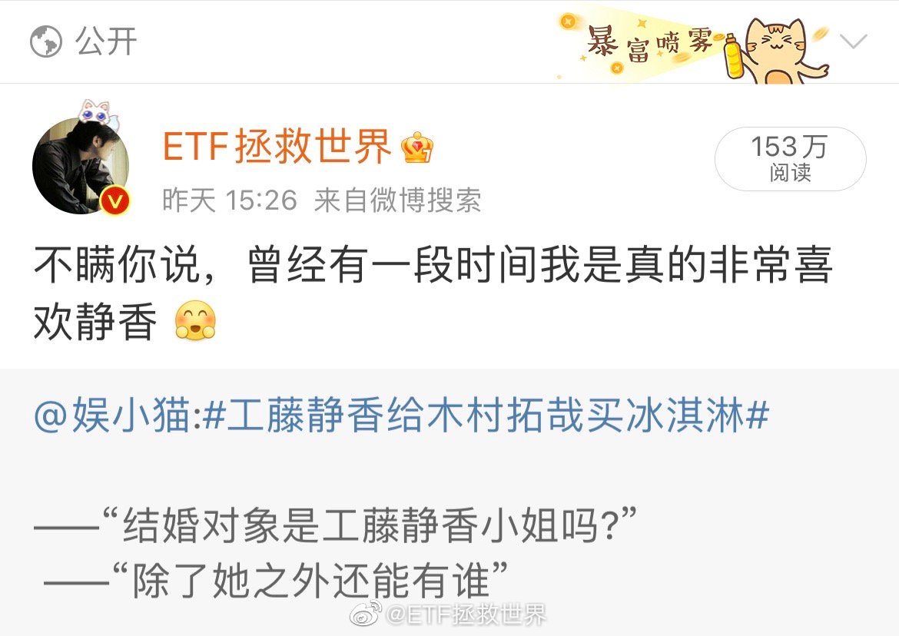

## 2021-05-07 11:39

潮汕地区的吃货请进：

正宗的潮汕牛肉锅小料怎么调？

（一个人吃点多了，有没有人一起吃） ​​​
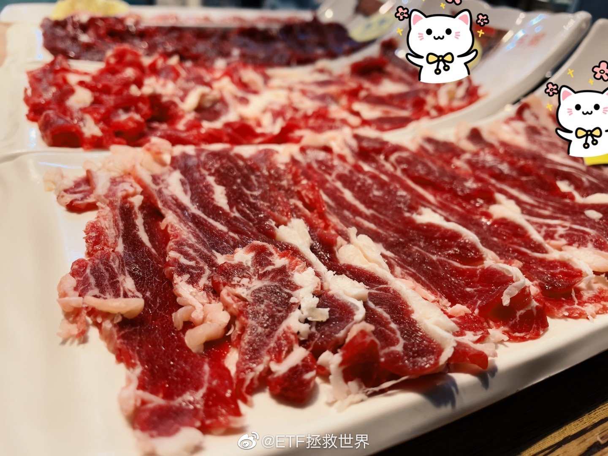

## 2021-05-07 14:32

攒了两年的钱终于又快要有机会买了吗？ ​​​

## 2021-05-07 15:08

18年底19年初后，我们的长期策略几乎没有买过什么东西了。你去看任何一个品种，会非常惊讶的发现：绝大部分最后一次买入居然是两年多前。

最近几个月零星的买了几份，完全是开胃菜级别。

最近这几个月，卖出比买入多太多了。

网格开了6个品种，有4个品种卖光了，一个持有一份，一个持有两份。

你自己说说，你该盼着下跌还是盼着上涨？

我虽然涨跌都舒服，但是手里现金越来越多，所以如果跌回钻石坑意味着又能抄底，更开心啊！
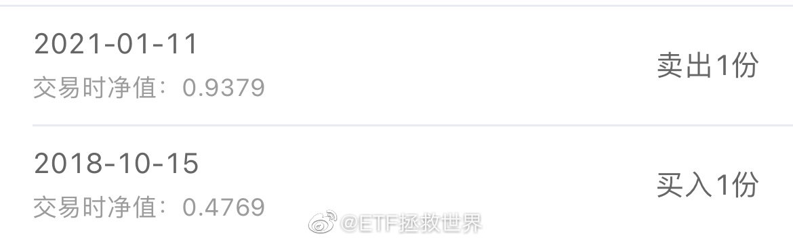 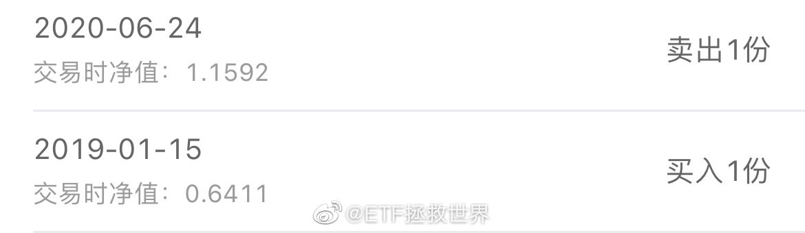 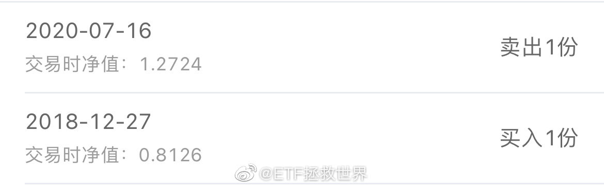

## 2021-05-07 15:25

小红努力挣扎保持红色收盘的样子让人心疼 ​​​

## 2021-05-08 16:35

今天有多少人闲得发霉了，站出来让我康康。 ​​​

## 2021-05-08 17:54

刚看到这条新闻。看了一下当事女生还关注了我。性骚扰本来就是很辣鸡的事情了，骚扰关注我的人简直就是辣鸡中的极品辣鸡，不可饶恕！

## 2021-05-08 18:15

什么是骚扰，什么不是；

什么是开个玩笑而已，什么不是？

只有一个标准：一方的“骚扰”和“玩笑”是否让对方感到不适。

如果对方感到不适，那就是骚扰，那就不是开玩笑而是侮辱或者冷暴力。 ​​​

## 2021-05-08 18:22

回复@旺财的训导员:其实很多人没有意识到这个问题：开玩笑的尺度非常难以把握，尤其是网上。在网上开玩笑，无法表现表情、语调等，很容易让人误会。另外就是人和人的亲疏远近，也决定了有些玩笑不能乱开。平常我都是忍着不敢乱开玩笑，只敢拿出10%的幽默感发言，忍得相当辛苦。

## 2021-05-08 22:09

看来看去还是PONY和三石最稳，

一个谨言慎行，一个游戏人间。 ​​​

## 2021-05-09 10:02

今天各位妈妈要开心呀。 ​​​
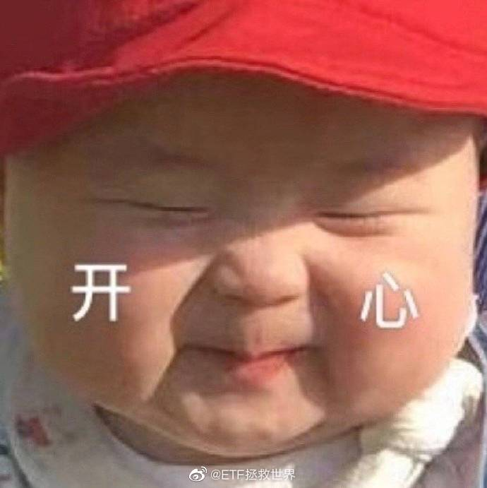

## 2021-05-09 11:04

最近挺爱听今天的BGM

适合一个人的时候听 ​​​

## 2021-05-10 09:25

又要回购50亿。股价跌了25%，股东从22万增加到了40万，继续观察。这些就是经验的积累。

## 2021-05-10 09:31

公司回购是维持股价非常非常重要的一个点。

美股好像最近这个季度回购又到了2000多亿美元。过去若干年是持续回购，绝大多数回购后注销，等于是市场流通的股票不断减少，这样股价就会不断上涨。

这跟美股大多数公司的治理结构有关。大多数公司都是雇佣职业经理人做高管，让股东开心的办法就是让股价不断涨，所以经理人一方面要做好业绩，一方面回购股票，股东开心了，多发奖金，管理层也就开心了。

A股是炒高一波，大多数公司大股东=管理层就减持然后改善生活去了。

如果A股能有大量公司回购，那就是真的利好啊。

## 2021-05-10 09:45

有时候我会在微博记录一些实时的市场状态，公司动向等等。

很多很多时候并不代表我有什么明确的看法，如果我有，我一定会明确的说出来。你去翻翻我的微博，我看多，看空，我会旗帜鲜明的说，看我的微博，不要想得太深。

如果我没有明确说，说明我只是记录一下。

股票也好，市场也好，是一个非常非常复杂的系统。并不是说利空出来就要跌，利好出来就要涨。股票市场不是线性的，而是一个变量特别多的体系，你很难根据一个点就判断未来。

所以我经常记录一些东西，事后再回头看，当时这样的信息最终引起了什么样的变化，这样的变化是否能与当时的那些东西建立明确的联系。这就是所谓的“经验”。这样的经验越多，未来判断的准确性就越高。

因为一个消息，动不动就判断涨还是跌，那不是我的风格，我也不认为那样能长期赢下去。

## 2021-05-10 10:21

不看不知道，两个多月时间，A股港股很多热门股已经腰斩了…… ​​​

## 2021-05-10 10:51

我相信很多朋友开始真正认识到我的几个策略是如何相辅相成了。

如果没有网格吃波段的加成，80%的人在上涨中拿不住赚钱的长期筹码。对于利润回撤的恐惧，是人类的天性。

如果没有长期仓位的支持，网格波段也会变成痛苦的根源。当你看着吃了几个点的品种一骑绝尘，就会痛苦不已。

很多时候你事后看，能够清楚的说出什么时候应该满仓坚定持有，什么时候应该全仓吃波段。但当你再次处于交易过程中，才发现依然一片茫然。

那你就不如将交易决策交给体系中的各个策略，让它们帮你完成。从此你不再患得患失，不再永远沉浸在悔恨中，从此日日新高，夜夜笙歌。

## 2021-05-10 12:02

近则不逊，远则生怨 ​​​

## 2021-05-10 13:16

条件单挂好吃喝玩乐的单子了。

股票，不能说品种。

买得到是命，买不到也是命。认命，开心。 ​​​

## 2021-05-10 13:57

下次回顾文章题目已经定了。但是下下次的还没定，两个选项：

不死品种的极限跌幅计算or关于投资的一些意想不到的有趣数学题。

你选哪个。 ​​​

## 2021-05-10 14:49

其实你不知道，今天涨跌家数差不多。

除了赛道股和核心资产，大家过得还不错。

（红利yyds！) ​​​

## 2021-05-10 15:10

下班，回家

 ​​​

## 2021-05-10 16:43

不知道各位是否还记得之前有位朋友年初发私信骂我，说我为什么不买军工，说他是军事论坛资深网友，军工行业有大前途，重仓了。

那时候军工14700。

现在军工跌到了9921，跌幅33%，今日估值跌破50倍。（年初最高80倍）

我说这个事情没有别的意思，就是说我不可能买到所有大涨的品种，有些品种太贵我真的不敢买。尤其是很多朋友的心理承受能力极差，我怎么可能跟大家去买80倍的东西。

我不知道这位朋友是否还持有他那么看好的军工。如果高位买了，现在卖损失也确实惨重。好消息是，从估值/走势看，9000点附近有个很强的支撑。

我说这个的意思不是我要买，也没有建议任何人买。只是刚才看军工的走势，想起了这位朋友，就多说一句看法而已。

无论如何，希望以后不要有人因为我没买什么而骂我了。

## 2021-05-10 18:36

刚才看评论！

有个人问！

你会不会出轨！

看到这个问题！我陷入了深深的思考！

首先我要说！不管婚前怎么样！婚后绝没有发生过这种事！

其次我要说！我是正常男人！男人喜欢的我都喜欢！比如金钱和美女！

第三我要说！与对待金钱一样！对任何事情我都有底线！不是喜欢就不顾一切的去得到！你看我有多少机会赚钱而没有去赚就应该懂！美女怎么样！我是读书人！

第四最重要！美女再美又能怎样！能比儿子的妈妈美吗！不存在的！[怒]

## 2021-05-11 08:02

安全小贴士：不要跟电瓶车共乘电梯。

## 2021-05-11 08:50

我发现自己的味觉可能并不是非常敏感，因为我尝不出胶囊咖啡和星巴克以及麦咖啡到底有多大区别……

高手可以说说，这三个区别大吗。 ​​​

## 2021-05-11 09:25

说点正经的。

我希望各位明白，红利虽然现在每天新高，但并不代表它是最好的、全天候的品种。

实际上也没什么全天候的好品种，每个品种一定都有自己的高光和至暗时刻。

它有自己的特点，比如估值低，比如长期比较稳，比如成长性不行，比如分红高等等。你明白一个品种的特点，才能通盘考虑，看看怎么利用它的特点为自己的组合发挥更好的作用。

当然，长期看，只有消费和医药两个才是yyds

（wind真是越来越不上心了，几个品种叠加的话图形就会出问题，只能分开展示，服了。）
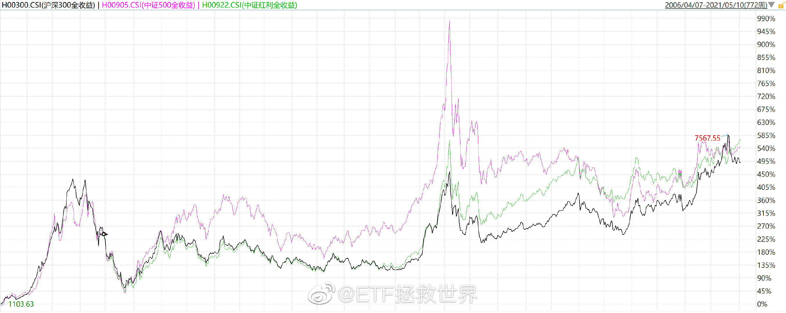 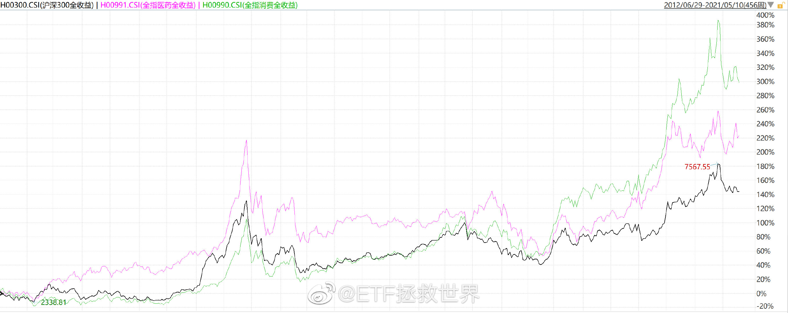

## 2021-05-11 09:31

回复@ETF拯救世界:叕接回来了。市场竟然明目张胆的送钱//@ETF拯救世界:本次提款17个交易日。效率低了点。

## 2021-05-11 09:44

回复@ETF拯救世界:所以我真的不明白总是有人在评论里说，网格更多是“心理作用”。我看了看网格账户，赚的那么多钱都是假的吗……//@ETF拯救世界:回复@冬季的秋名山:一年时间做了9个5%的网//@ETF拯救世界:回复@ETF拯救世界:叕接回来了。市场竟然明目张胆的送钱

## 2021-05-11 10:13

有钱的不用急，有钱你还怕买不到东西？

有筹码的不用慌。问自己两个问题：我买的东西会死吗？我买的价格贵吗？

答案都是否的话，慌什么，波动是利润来源。 ​​​

## 2021-05-11 10:50

表格已更新。

更新一个价格，增加一个品种，去掉一个品种。 ​​​

## 2021-05-12 14:02

客观

理性

独立思考

同理心

善良

并不矛盾 ​​​

## 2021-05-13 08:45

其实我最感到奇怪的，是居然还有人在我评论里说我“蹭流量”。

？？？？？

我又确认了一下，确实是100天才能评论没错啊。那你100天过去了，还不知道我是什么样的人吗？

那我就明确告诉你一下：

对很多人来说，流量越大越好。因为这些流量也许可以给他带来金钱、名誉、地位。

但我是这种人吗？

当然，我不是说我不喜欢被更多的人关注。有人关注你，有人喜欢你写的东西，有人愿意打赏等等，都是对自己的极大肯定，会有一种自我实现的满足感，这个当然让我很开心。

但是，在我的人生观中，与任何事物都一样，流量这个东西绝对不是越多越好。

绝！对！不！是！

古语说眼见他楼起楼塌，盛极而衰，过犹不及。又有云木秀于林风必摧之，无一例外。人生在世，必须问自己的问题是，你是希望轰轰烈烈笑傲江湖，然后如流星陨落，还是效仿范蠡急流勇退三散家财，与西施一起同泛五湖而去，快活一生，游戏人间？

不用问，我当然选择后者。

流量，流量就是一把双刃剑，谁爱抢谁就抢。我还是在我自己的微博上想说什么说什么，不圈人，不带标签。不舒服了就继续换个地方玩。当年在球球这么大流量我都说走就走，多大点事儿啊。

做人呐，开心最重要。名也好，利也好，不是说不应该追求，但是身外之物，看得太重会出问题。

## 2021-05-13 09:48

刚才评论里有位朋友说，这个世界上没有人不缺钱。

我不同意这个观点。

一个人缺钱还是不缺钱，很大程度上与这个人的欲望多寡有关系。

在能够保障基本的生活水平前提下，每个人的“缺钱”程度是不一样的。

同样有一套100平米房子，1000万存款。对两个不打算结婚，只想自己一个人过一辈子的人来说，是不是“缺钱”，答案是不一样的。

一个人粗茶淡饭，生活简朴，也许对他来说，有的住，还有不少存款，这辈子踏踏实实就能过完了，那么他也许就不缺钱。不愿意为了挣钱委屈自己做不愿意做的事。

而另一个人生活水平要求高，想换别墅，想买保时捷，想锦衣玉食，想莺歌燕舞，那他当然永远在缺钱。

你说比尔盖茨、马斯克缺钱吗。从相对意义上来讲，他们当然不缺了。他们的钱按照穷奢极欲的方式去花都花不完。但绝对意义上来讲，他们要真想移民火星，恐怕那点钱真是不够，还是缺。

所以，这个与你的欲望有关。你拥有的欲望比拥有的财富少，那当然就不缺钱。

就好像你的欲望比你拥有的东西少的时候，你更容易快乐一样。

欲望如果太多，无论你拥有多少，你都是缺乏的、焦虑的。

## 2021-05-13 10:38

无聊的市场只能靠扯淡才能维持的了生活这样子。 ​​​

## 2021-05-13 11:58

不知道各位有没有想过，与他人交往过程中遇挫后自我伤害到底是一种什么样的心理。

我想过。

试图代入后，我认为相比于释放痛苦，更有可能是想要在道义上打击对方，让对方内疚或者承受舆论压力。

当然，这只是我的瞎想，与你分享一下而已。对不对的，随便看看。

不过至于最终是否有效，我觉得是无效的。这样做，恐怕只会让对方觉得你更加麻烦以及更加讨厌。

所以，永远不要伤害自己，没用。让自己变得更好，让对方后悔去吧。

## 2021-05-13 12:47

这件事就此结束，我这里不会再提。

不过还是像之前所有的事情一样，咱们都应该想想能从中学到点什么。

包括理性、独立思考、同理心、善良、追求正义和公正。

包括如何更好的处理爱情、亲子等等各种关系。

包括应该如何对待生命。

等等。 ​​​

## 2021-05-13 13:08

今天看了几只大牛股，共同特点是一季度股东人数暴涨，基本都是接近翻番。

然后股价是从一季度最高点到现在基本腰斩。

其实股东人数在持续上涨的过程中并不会大幅增长。很多人买入是因为看着这只一路大涨的股票终于有一点点回调了才会蜂拥而入。

就是说从1-100的过程中，是不敢买的。但是从100跌到90的时候，胆子就会大。原因没有别的，就是因为：

曾经到过100，现在90，打折了，便宜，买！

## 2021-05-13 13:49

家里有矿吗？有无限现金流吗？

没有？那就别急着梭哈。

如果还没到钻石坑，那就慢慢买，踏踏实实的。

空间，时间，至少给一个。 ​​​

## 2021-05-13 14:59

该涨的不涨，该跌的不跌，大家都挣不到w。

无耻！

明天见…… ​​​

## 2021-05-14 09:48

快到我的碗里来 ​​​

## 2021-05-14 11:48

下手很快 ​​​
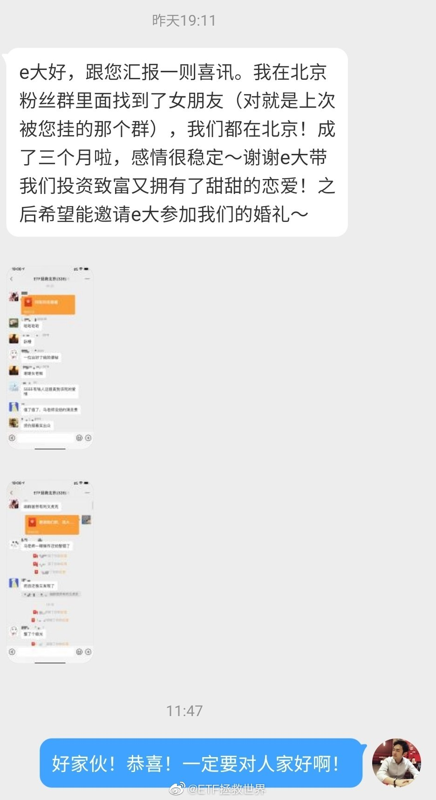

## 2021-05-14 12:41

怎么还有人私信我加群的。

我没建立过任何群，也不在任何粉丝群里。可能有一部分关注我的朋友自发建了几个，具体情况我不清楚，没法帮你拉进去。

顺便再提示一下各位，网络水很深，所以除非你真的了解对方，否则不要轻信任何人，以免人财两空。

尤其是关于投资，一定要擦亮双眼，最好只投国家背书监管的标准化产品，否则弄不好你想要他的高收益，他拿走了你的本金。

被骗色的话单身男性朋友虽然喜闻乐见甚至可以说渴望被骗，但女性朋友们就要小心，除非对方是吴彦祖。

## 2021-05-14 13:16

知道券商为什么不能给5%了吧 ​​​

## 2021-05-14 14:05

券商买入价格比最低价高了3%，主要是这个位置随时爆，所以只能尽快上车。

是我学艺不精，我有罪。 ​​​

## 2021-05-14 14:16

你们误会我了，我真的无E凡

## 2021-05-15 15:02

自从开始投资搞钱，其他的兴趣爱好减少了77.88%。

钱嘛搞到了一点点，但是花在哪里都没意思。

不得不说也是一种悲哀吧。

早晚有一天你会懂。 ​​​

## 2021-05-16 08:46

回复@J9120:我们买的是指数基金，基本不会出现基金经理个人的道德风险。//@J9120:E大，叶飞指控公募基金，公募基金到底可信吗？可以给我们个定心丸吗？谢谢

## 2021-05-16 10:36

今天看了两个私信，特别巧，是这样两个人发的。

说实话，我想了半天，也不知道对第一位朋友说什么。也不知道怎么劝，有些话也不好直说。

我只是希望，关注我的朋友里面，男的，咱们尽量有点担当，有点责任感。

媳妇怀孕了，人家本来身体上就已经很难受了，不要做这些让人生气的事情。对双方和孩子都不好。

你要真的不爱了就直说，就分手就离婚。没必要天天这么打击人家，这是属于冷暴力了。这样打压人家的自尊有意思吗。

我谈的恋爱次数不少，有些谈的过程中发现自己不爱对方，那也真是看什么都不顺眼，最后分手了觉得特别轻松。但是真爱的话就觉得对方特别好每天在一起很舒服。

所以要在一起咱们就别折磨别人，开开心心的。不想在一起了就直说，好聚好散，放过彼此。
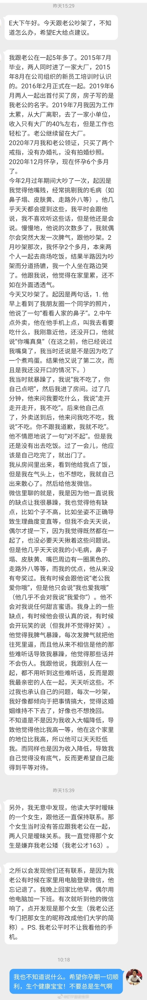 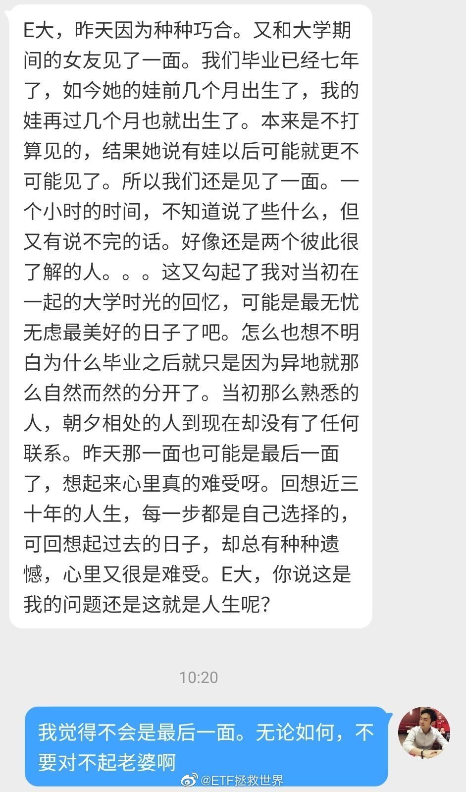

## 2021-05-16 11:00

对没有结婚的朋友们说句推心置腹的话：

结婚，就一定一定要跟自己喜欢的，觉得特别好的人结。对，很多事情都会变，感情可能也会变。结婚的时候信誓旦旦相守一生，可能几年后就变了。

但是，至少要在领证的那一刹那真的喜欢，真的爱。不要凑合！你想想，天天面对的一个人，如果不是全方面的满意，那得多痛苦啊。

最后痛苦的不止你一个人，对方也会很痛苦，然后互相伤害。

要我说，单身没什么可怕的。单身怎么了，多好啊，要比随便找个不喜欢的人天天难受好多了吧！

当然，碰到真的喜欢的，对方也喜欢你的就赶紧在一起……

## 2021-05-16 21:46

三年前，那时候真有毅力啊！

## 2021-05-17 09:24

日经和台湾加权都曾经是疯狂之后长期低迷的教科书案例。

但实际上，只要你不在疯狂的牛市中买入，收益率是可以的。

另外，长期横盘买入中短期看起来拿到好收益遥遥无期，实际上三年不开张，开张吃三年，几年的时间就能让长期收益变得好看。

再另外，不涨的那十几年，如果吃网格……不涨，不代表没有波动。有波动就能提款。
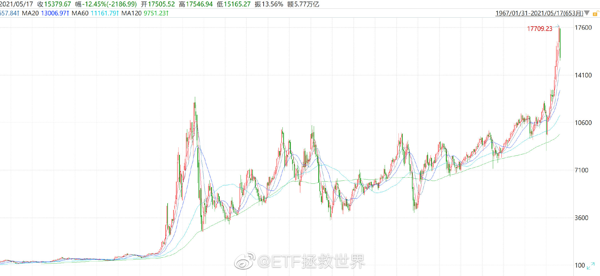

## 2021-05-17 09:45

很多人问，怎么把握长线仓位和波段仓位的比例呢。

这个问题我没法直接回答你，因为每个人的情况不同。但我有个小经验愿意与你分享：

我自己会把至少3-5年绝对不会用的钱拿去投资长线仓位。所以它才叫“长线仓位”。

会把1-2年用不到的钱去投资波段仓位。这里面的小技巧是：

比如网格，第一网用到的钱一定是2年不用的，第二网也许是一年半不用的，第三网也许是一年不用的……到了5、6网，可能半年内用不到的。因为这个钱很可能几天就会回来。

甚至说到了钻石坑的波段仓位，我可能会用后备的“储蓄资金”去买。因为这个回款时间和安全垫已经非常棒了。

这就是我的一个大思路，希望对你有用。

## 2021-05-17 09:51

回复@oooly:你哪部分钱是用来养老的、子女教育的、买房的……自己应该能分的清楚吧？//@oooly:回复@ETF拯救世界:那么对于款项可用时间的把握就是下一个问题了

## 2021-05-17 10:16

网格账户是不是又新高了？

买了20多次，还持仓4次，只有一次目前低于买入价……剩下的十几次全部提款走人。

这游戏太好玩了。 ​​​

## 2021-05-17 11:27

我说个可能会被骂的想法。

就咱们不是经常在网上看到说讨论外国和中国在某些东西上价格不一样那种帖子吗。

有人就会把国外的价格换算成人民币说一下，比如说，美国的房租一个月400美元，合2800人民币之类的。

然后就有人回复“挣美元花美元，为什么要换算”。

这种回复还特别多。我就觉得这些人脑子里的逻辑线条特别简单……

首先，不换算成人民币你怎么知道是多少啊？比如我说这个东西3万日元，那个东西10000新元、5万台币、2万泰铢、20第纳尔、50卢布……你有概念吗？当然要换算成人民币让你有个大概的印象啊。

然后，你再大概了解一下人家说的那个地方人均收入是多少本币/人民币。这样四个象限统一对比一下，才能知道这个东西占当地人收入的多少，和我们国家的物价水平比差距多少。

“挣美元花美元，为什么要换算成人民币”这句话真的太可笑了……所以了解类似的事情需要了解的四个数字：

这个东西的当地本币物价

当地人的本币收入

这个东西的当地人民币物价

当地人的人民币收入

这样才能全面啊。或者简单点，知道这个东西当地人民币物价和当地人的人民币收入就够了。无论如何，都得换成人民币才有直观的感受啊！度量衡都不统一你怎么知道跟我们有什么不一样啊！

## 2021-05-17 15:03

相当无趣的下午。

枯燥且乏味。

还有点热。 ​​​

## 2021-05-17 22:21

你疫情严重的时候，人家第一时间一声令下严禁给你出口口罩，没事，都是中国人。

现在那是全世界唯一口口声声wh肺炎的地方，没事，都是中国人。

你上赶着给人家疫苗，我就担心一点：

万一打了疫苗出一两例问题，你猜会怎样？

当然，人家也根本不会要你的，看不上。想到这个我又放心了。 ​​​

## 2021-05-18 11:49

大梦谁先觉

平生我自知

草堂春睡足

窗外日迟迟

 ​​​

## 2021-05-18 13:27

走出多少阳线，牛夫人才能变成小甜甜 ​​​

## 2021-05-18 13:38

世人都晓抄底好，熊市煎熬几人受得了；

世人都晓牛基好，去年冠军不知哪去了。 ​​​

## 2021-05-18 16:10

为什么还没有基金公司发走港股通通道的中概场外基金呢。

基金公司是真的看不到这个需求有多大吗？ ​​​

## 2021-05-18 18:37

有空就读一读历史 ​​​
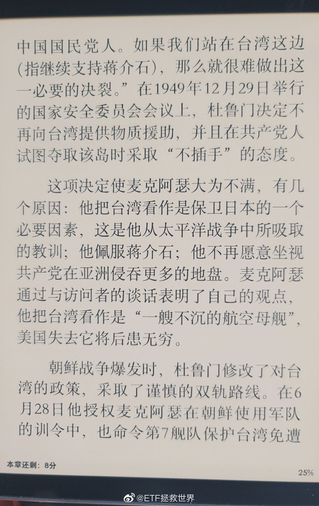 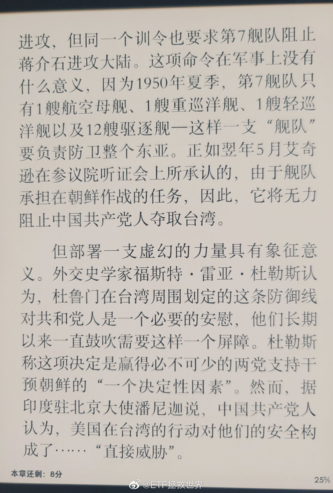

## 2021-05-18 21:06

好家伙，我直呼好家伙！ ​​​
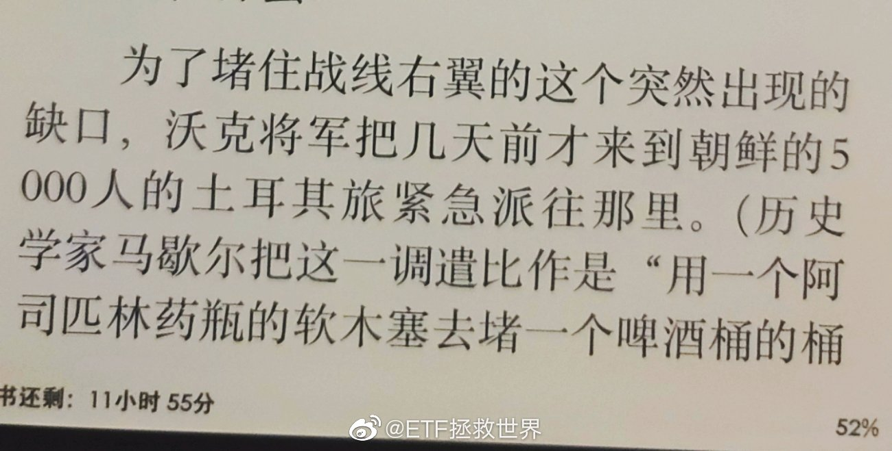 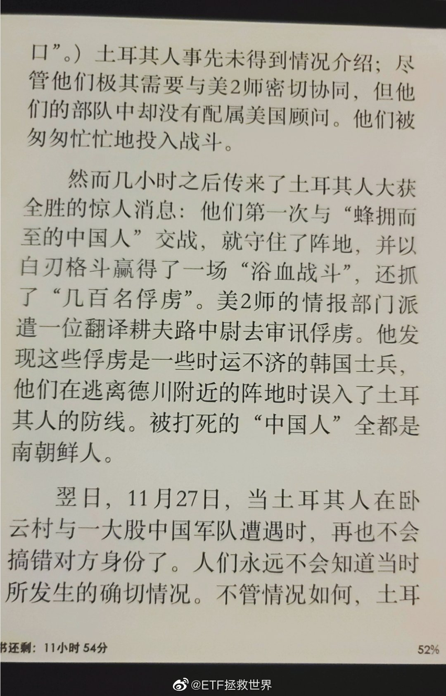 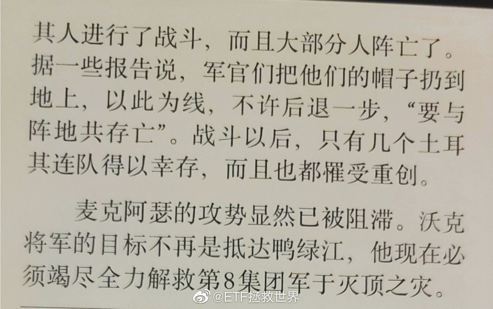

## 2021-05-19 11:18

没有新高，又不能买买买的人生，和咸鱼有什么区别？ ​​​

## 2021-05-19 11:45

出门记得防晒，回家记得做面膜。 ​​​

## 2021-05-19 21:05

s的dax还有一份，我考虑是不是无论涨跌就不卖了。 ​​​
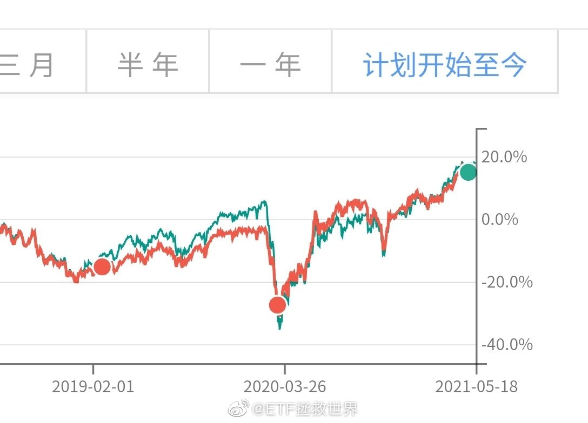

## 2021-05-19 21:12

截屏留念 ​​​
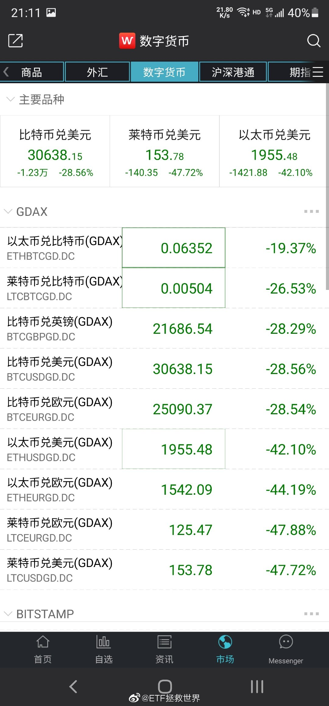

## 2021-05-19 22:57

钱多 没事 不上班最好

## 2021-05-20 09:02

## 2021-05-20 10:39

我觉得纯爷们儿其实也应该稍微护理一下皮肤。

第一当然是运动。其实如果不怕掉头发，无氧运动是特别好的。不仅让肌肉变得结实，身材有型，流汗对皮肤也好，脸也比较有棱角。非要跑步的话夜跑好一点，否则容易跑得很憔悴……

第二是清洁。好好洗脸，干干净净的。

第三是保湿。这个不是为了别的，我估计很多男性朋友经常会觉得脸上很难受，说不出是怎么难受，洗把脸就好，一会又难受了。那就是太干了。早晚抹点保湿再抹点面霜就好了。

第四是防晒。不是说黑了白了的，主要是太阳容易晒出皮肤癌。

说白了就很简单，早晚好好洗脸，1分钟抹点保湿，出门抹点防晒，齐活了。时间长了，你比同龄人能显得年轻不少。

当然你要说就喜欢显老，当我没说……

## 2021-05-20 14:20

回复@上树考拉waj://@上树考拉waj:一看你就是垃圾，一天到晚开交友贴，教男的勾勾搭搭

## 2021-05-20 14:28

最后一个辣鸡也支愣几天了。

要支愣你就坚持7%。给哥一个面子，让兄弟们提个款。 ​​​

## 2021-05-20 14:47

告诉你一个真相：

如果一个人做什么事，说什么话你都觉得很不好，那么大概率是因为你讨厌这个人，而不是他做的事说的话有问题。

就像喷子喷我，大概率不是因为我做的事说的话惹人讨厌，而是因为他恨我。 ​​​

## 2021-05-20 15:05

同理，刚开始恋爱的时候对方哪哪都好，结婚几年后觉得ta浑身毛病，怎么都不顺眼。其实对方没变，变的是你自己

## 2021-05-20 15:27

大家520快乐！不管是有对象的还是单着的！

每天都快乐！ ​  ​ 抽奖详情 ​​​

## 2021-05-20 15:40

恭喜@若若儿___516 等100名用户等额平分【520元现金】。微博官方唯一抽奖工具@微博抽奖平台 对本次抽奖进行监督，结果公正有效。公示链接：微博抽奖平台

## 2021-05-20 22:05

截在最低点，24小时反弹40%

## 2021-05-22 15:29

人生一世，也许钱多一点，也许钱少一点，也许房子大一点，也许小一点，其实最后都是一场空。

不同的是，有人在别人的心里会留下一些美好的印记，当他离去，有人会怀念他。

而有些人则没有。

我会感谢并记住每一个让我们过得更幸福的人。

谢谢你，袁老。 

一路走好。 ​​​

## 2021-05-22 15:43

有一件事很不合理，就是绝大多数不懂某个品种的人都能赚钱。

这次会有什么不同吗。30000多抄底能赚大钱吗。

看看结果。 ​​​
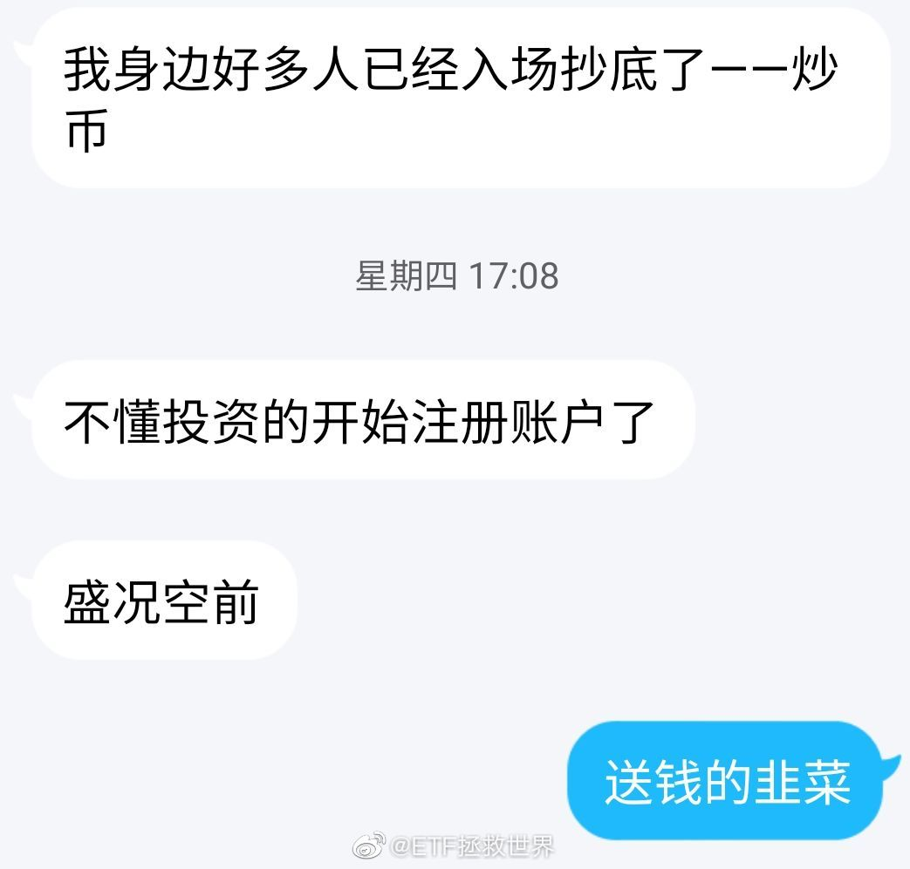

## 2021-05-23 08:19

看看自己是不是，身边有没有这种人。你认识100个人里面就会有4个。

当心点。 ​​​
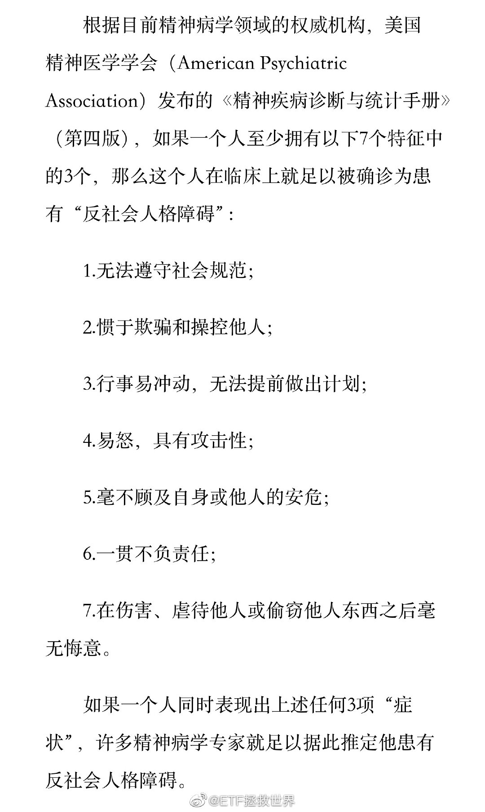 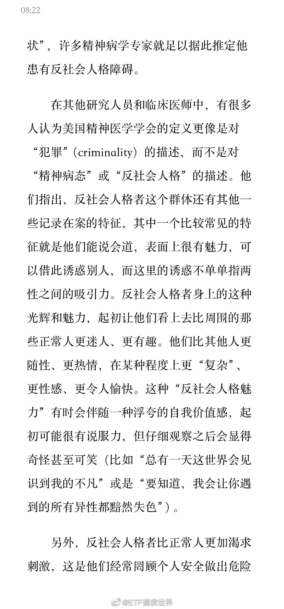 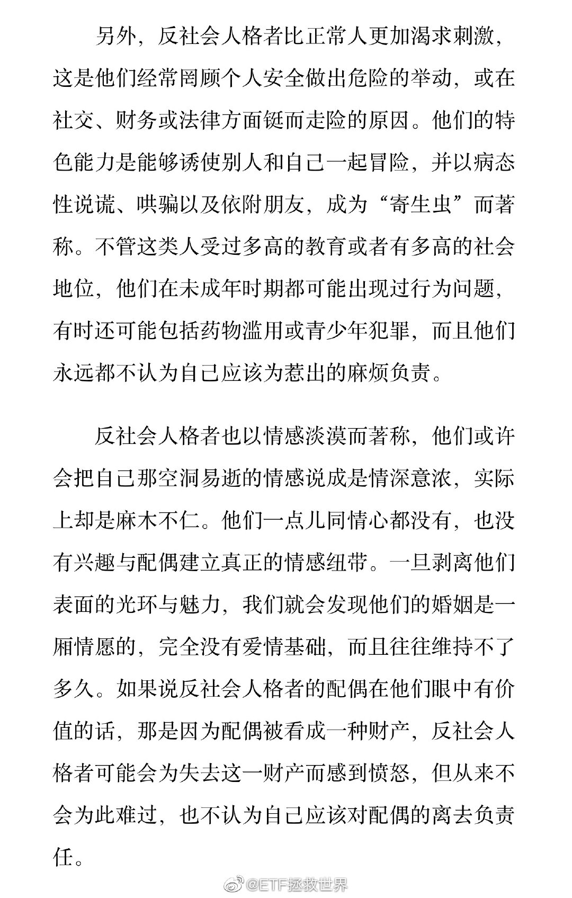 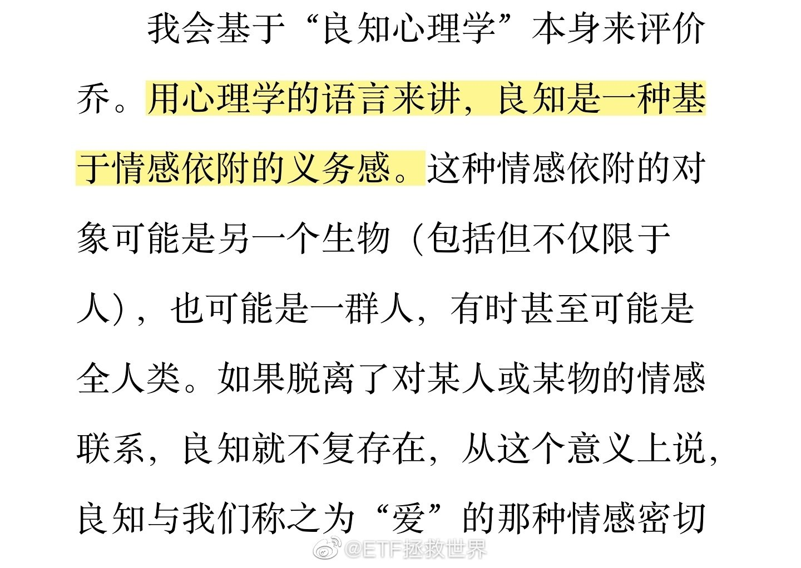 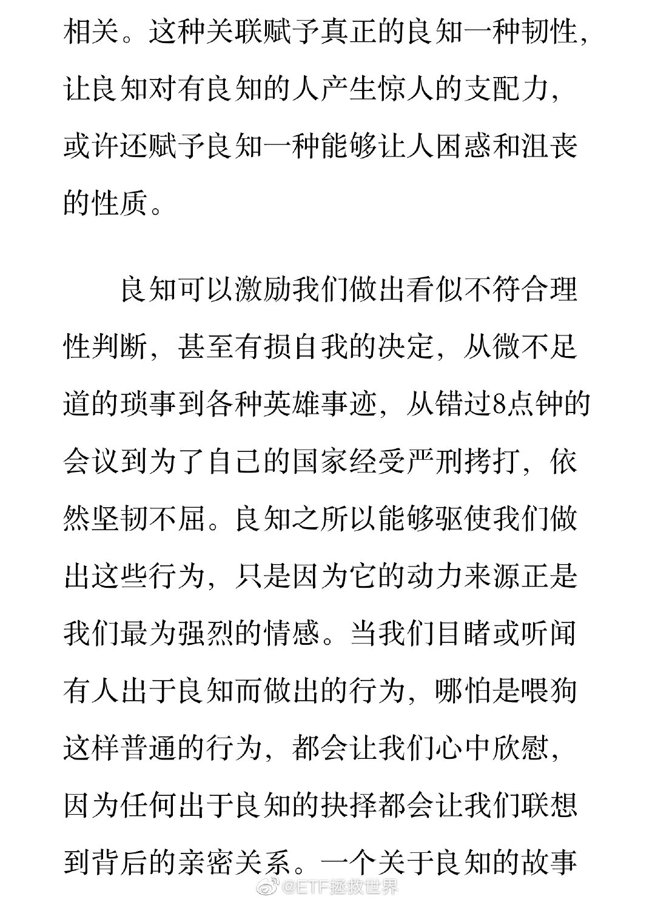

## 2021-05-23 19:33

看看大连那个通报出来了：高风险投资， 然后13457。请枪毙一百次吧

## 2021-05-23 23:52

这六个人，每个月分别给这位牧羊人卡里打2000块钱，打十年，不过分吧

## 2021-05-24 07:21

昨天晚上看到那条牧羊人救了6位越野跑跑者的新闻，我说了一句“六位跑者每个月每人给牧羊人打2000块钱，打十年，应该不过分”。

本来觉得是非常正常的一个思路，没想到很多朋友非常反对。

第一个是说很多人收入不高，2000负担太重。

其实我当时说2000是大概考虑了一下中国人均可支配收入，以及有钱有闲参加这种运动的人大概在一个什么收入阶层上，随口说了这样一个数字。当然，你要说实在困难，1500、1000、500，也都不是问题。每个人的经济情况不同，感谢金不同也很正常。

有人说不能用我的标准定义所有人？我笑了，如果有人救了我一命，你猜我会每个月给多少？2000？还没我给大家发的红包多。就我来说，拿不出手。

第二，有人说奖励应该主办方和当地zf给，被救的人不应该给。

我谢谢你了，这是一回事吗？

是你的命被人家救了。你给人家酬金，是表达你的感恩之情。懂吗？感恩。感谢人家对你的大恩。

就好像你的手机丢了，别人捡了给你送回来。你是不是拿了手机说声谢谢转头就走？是吗？如果是，那我就理解你为什么会说被救的人不应该给了。因为你是个不懂感恩的人。你的内心深处，别人对你再好也是应该的，你是天选之子，没必要感恩。

如果我的手机丢了，首先我会主动给捡手机的人酬金。如果他不要，我会买点礼物送给他。无论如何，我希望他在做了好事之后感受到被帮助人的感激之情。嘴炮之外的感激之情。不希望像很多人会对恋人说，我爱你一辈子，结果买点礼物心如刀割。

总而言之，别人该奖励的是别人给他的，我要通过我的方式让他知道，我一直在记着他，念着他的好。

第三，为什么说给酬金而不是别的表达方式。

因为我觉得那位牧羊人可能手头比较紧。一位善良的，没什么钱的人，值得活得更好。

我还是那句话，当你生命垂危的时候，别人跟你要未来十年的收入救你一条命，你可能想都不想就会答应。但是，当你躺在床上拿着手机刷微博的时候，让你掏点钱感谢你的救命恩人，可能就真的会要了你的命。

## 2021-05-24 07:46

我这一辈子，该感谢的人从来没有亏欠过。只有一个人我经常会想起来，会觉得没能表达对她的感恩之情过意不去。我家曾经有一位亲戚出过一次车祸，肇事司机逃逸了。找不到人，一大家族的人都很着急。有一天去饭馆吃饭，大家说这个事情，好巧不巧服务员正好是目击人。她提供了肇事车的信息后很快找到。

## 2021-05-24 08:46

开盘之前开心一下

## 2021-05-24 09:58

回复@燃烧的M豆:我可以打啊。你把那位牧羊人的信息找到给我，我先打6666。立帖为证。//@燃烧的M豆:还以为e大自己打钱呢 结果是让被救人...

## 2021-05-24 10:16

其实我也非常不理解我的这种思维模式到底是怎么形成的。

就是，做了好事，为大家做贡献的人就一定要受到赞扬，得到奖励。做了错事的人就一定要受到惩罚。

比如我看到什么列车上霸占别人的座位，从楼上往下扔东西，高速公路上突然停车，甚至排队的时候乱插队等等这些事情得不到应有的惩罚，我就特别特别生气。

再比如那些做了好事，为大家做贡献的人反而过得很苦，付出的没有得到任何补偿我就特别心酸，心里特别难受。而且我特别希望的是做好事的人能让大家都知道，物质、精神双丰收。

我没有绑架任何人的意思，我只是说如果被救的人能给救人的人一些报答，我，以及我估计很多朋友心里会觉得有一些暖意。就会觉得这个世界也不是那么s*，会觉得大多数人是知道感恩的，做一个对别人好的人不吃亏。

就特别朴素的一些想法，就仅此而已。凭什么杀人放火金腰带，修桥补路无尸骸。凭什么没有底线的人反而能活得更好，善良有良知的人就要吃亏。

我不能接受。

## 2021-05-24 10:40

一个字可以形容券商：

贱。 ​​​

## 2021-05-24 11:16

你肯定不相信，有只鸡在我身边睡觉。 ​​​
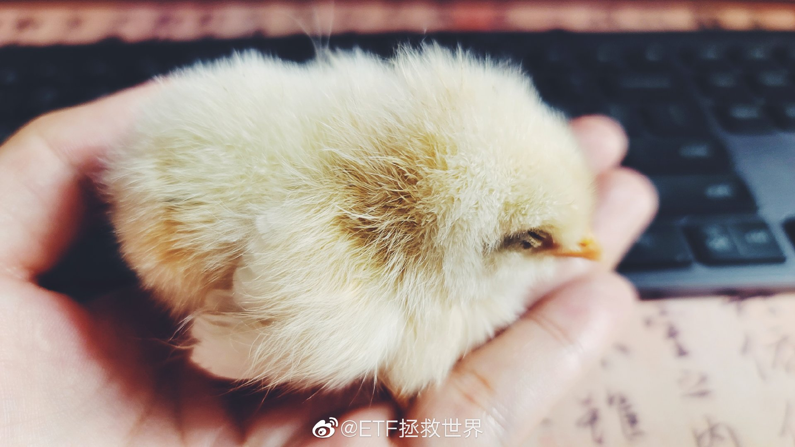

## 2021-05-24 14:43

再说一次，这是我的个人微博。遵纪守法、遵守社区规定的前提下，我愿意说什么就说什么。

我喜欢搞钱，也喜欢和大家一起搞钱，我也愿意说搞钱的事情。

但我的生命中不止有搞钱，所以我不可能一天到晚都只想着，说着搞钱，我也有别的东西愿意记录和分享。

你愿意看就看，不愿意看就赶紧取关。你关注我我谢谢您慧眼识英雄，你取关我我拍着手说一声走好不送。就这么简单。

有些人您别怪我没提醒您，哪天把您拉黑了可别到处去喷我。这是我家，不欢迎您做客您还委屈了？

下次到人家做客讲点礼貌，你又不是财神爷，我没必要供着您，初一十五还得给您上香。

## 2021-05-24 16:41

刚才有朋友给我发了一张西安聚会的照片，好家伙我一看不用问都是高素质人才啊。

我感觉当代互联网，关注我这个微博的人群，总体平均素质应该是排在前0.05%个巴仙了。 ​​​

## 2021-05-25 10:00

是不是贱。不骂不行。

## 2021-05-25 10:05

很多朋友看我写的东西，或者品种的交易设置，会有一些将信将疑的感觉。

没关系，自己经历一次，你再回头去看那些东西，就会有新的感受。 ​​​

## 2021-05-25 10:11

只要能顺利突破1.117，那么提款就是探囊取物了。 ​​​

## 2021-05-25 10:24

情绪不稳定的人适合在压力位先撤。也能给上面的兄弟减轻一点负担。

## 2021-05-25 10:59

有些朋友提到了，有些朋友差一厘。

要相信一切都是最好的安排。

最起码，你的账户又新高了。 ​​​

## 2021-05-25 11:22

红利指数又历史新高了。

但是富国红利最近一个阶段表现很差，我很不满。 ​​​

## 2021-05-25 11:37

今天聊了那么多投资，接下来的几天聊风花雪月的额度就有了吧？ ​​​

## 2021-05-25 14:04

先说一个好消息：

一切都是最好的安排，恭喜各位提款。

30多个交易日，十个点，效率不高。

再说一个坏消息：

希望🐥宝宝在另一个世界开心奔跑吧。

早上还好好的，说走就走了。 

上午我就预感要有什么不好的事情，原来是这个。 ​​​

## 2021-05-25 15:06

表格已更新。 ​​​

## 2021-05-25 15:27

特别好。 ​​​
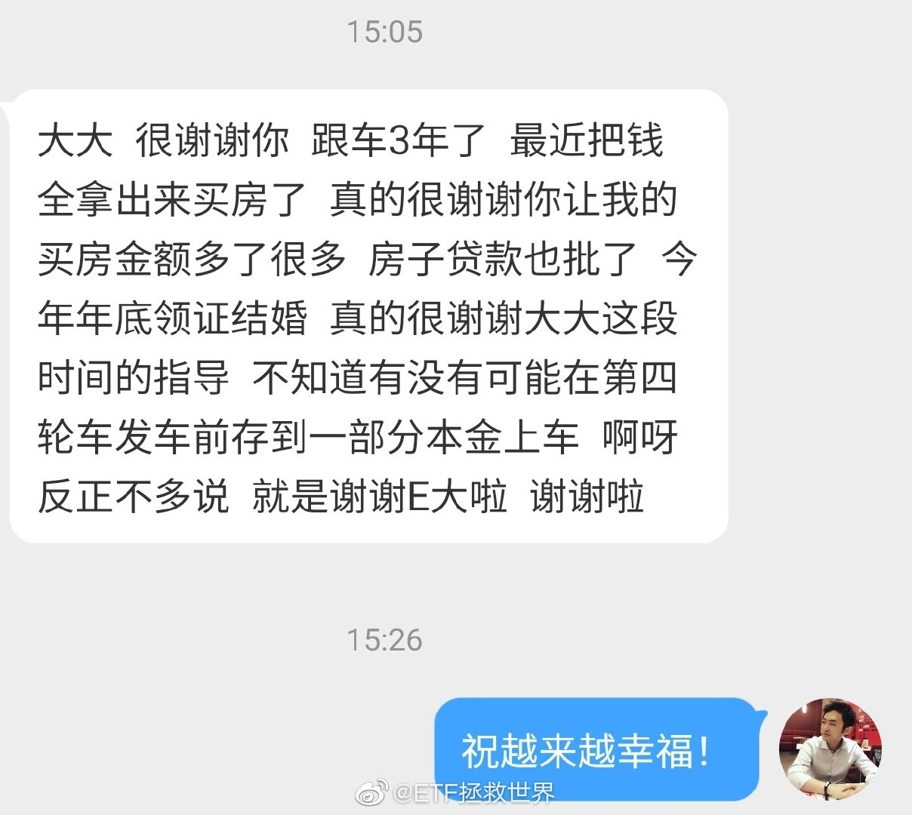

## 2021-05-25 17:18

最后一切都会变好的。如果没有，就是还没到最后 查看图片

## 2021-05-25 18:01

之前评论里还有朋友不懂，现在应该懂了。通俗来说就是，你不能用吃烤鸭的方式去吃鱼子酱。每一种食物都有自己的食用方法，用一种方法吃也不是不行，口感终究是会差了一丢丢。

## 2021-05-26 09:09

拥抱是感受幸福不可缺少的环节。 ​​​

## 2021-05-26 09:30

回复@ETF拯救世界:这么听话的吗//@ETF拯救世界:回复@Asaco5871:我觉得有。因为下一个大的压力位在1.137

## 2021-05-26 09:38

有时候波段提款做多了你就会产生一种疑问：

既然自己能够一年时间里面在价格不变的情况下提款几十次，低买高卖，那就一定是有人赔了才对啊。钱又不可能凭空冒出来。

那么，到底是谁在高买低卖不停反着做呢…… ​​​

## 2021-05-26 09:56

我的一个门票股，大概是17还是18年开始买。最大跌幅曾经到过腰斩，补过一次，持续低迷到今年4月。

这一个多月涨了将近200%。

再一次见证了什么叫三年不开张，开张吃三年……

很多时候之所以能扛得住，我想大部分原因是它在你的资产中占比不高。如果满仓扛，别说3年，就是一年，别人涨的风生水起，你也得心如刀割。

## 2021-05-26 10:17

回复@皮格马利翁harry:这个奇葩不必多讲。//@皮格马利翁harry:小红又冲起来了

## 2021-05-26 10:27

回复@gcn点的天空:再说一次，用我的专属条件单才可以挂单失效后自动重新创建。//@gcn点的天空:老大，我的没有成交的，怎么不能自动恢复呢

## 2021-05-26 12:06

我的股市依赖症甚至已经发展到，中午休市的一个半小时都很难受的地步了。

简直是无药可救。

不挣钱就相当于赔钱的感觉。 ​​​
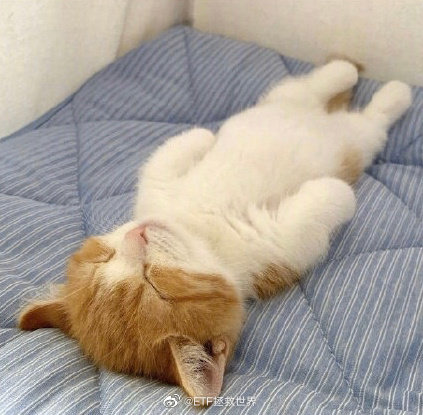

## 2021-05-26 12:28

有人说看盘不交易忍得很难受。我：？？看盘和交易是两回事好吗。就好比我有个朋友喜欢看美女，不意味着他想跟那些美女发展出什么人与人连接的关系啊

## 2021-05-26 14:06

我相信你一定想过一件事：

“如果我财务自由了，我就要_____。”

那么，如果你财务自由了，你会做什么呢。

我先提示一下，

想说什么都不干每天躺着刷剧的你就不用说了，因为你刷不了几个星期几个月就会烦；

想说买房买车的也不用说了，我们假定的是你有房有车然后正常条件下钱花不完；

想说周游世界什么的，先看看你有没有孩子，如果有孩子也不用说了，你走不了；

你就好好想想，到底干什么能让你几十年持续干而不腻的。

## 2021-05-27 10:37

花开四季。 ​​​

## 2021-05-27 10:56

不要抱怨博主为你做了什么，问问你为博主做了什么。 ​​​

## 2021-05-27 11:06

起床，喝杯咖啡，然后去office转转。 ​​​

## 2021-05-27 13:14

你手中有某个品种的时候，希望它涨；

当你卖掉它，你会希望它跌。

就像你与某人谈恋爱的时候，你希望ta健康帅气美丽幸福，

但是你们分手后，你又希望ta快点倒霉。

人类啊，

你不是真的爱它，

你只是想赚钱罢了。

（券商为什么还不暴跌？？？） ​​​

## 2021-05-27 13:38

经常在网上看到有人说什么奢侈品值不值，说买的人是被人收了智商税。

其实你想一想，很多问题没那么简单。

比如说吧，一辆车可以便宜到几万块，也有几十万的BBA，也有上百万的保时捷，也有几百万的迈凯伦和兰博基尼。

你说都是四个轮子两个沙发，怎么价格就能差100倍呢。不可否认，几百万的车一定比几万的好，但是好了100倍吗。

再比如说吧，一瓶茅台几千块，一瓶二锅头几十块。茅台肯定比二锅头好啊，但真的好了100倍吗？多了1000多种微量元素吗？致癌性只有二锅头的1%吗？也不是吧。

还有，爱马仕，LV，一个包几万块，比几十块的环保袋好了几百倍吗。百达翡丽，宝珀，劳力士，真好，但是比一千多块的六局电波石英表好了上百倍吗？

很多事情它根本就不是一个值还是不值的事情。

你以值，还是不值，去考虑，就说明一件事，那就是你还没有到那个消费层级。我不是说奢侈品消费是对的或者好的。我是说很多消费那些你眼中不值商品的人，根本就没有考虑它值还是不值。

因为在他眼里，奥迪和奥拓，茅台和二锅头，爱马仕和环保袋……从价格上讲，没什么区别。他们买它，只是因为喜欢，或者懒得去在千万种商品中挑选，索性买个价格高的品质大概率有保障而已。

当然了，只有一种人是真的被消费主义洗脑后做傻事的：那就是那些费劲力气，甚至不惜借钱去消费奢侈品的人。

## 2021-05-27 13:59

另外我有一个生活理念：你过得比自己“应该”在的生活水平低一档，就会生活得非常惬意。跟“应该”在的生活水平一致，那就会总要努力不能出岔子。如果你非要拼命够着比自己“应该”在的生活水平高，那你可能会经常捉襟见肘，有点狼狈，风险承受能力也会特别低。

## 2021-05-27 14:59

红利这个小甜甜是什么天使！ ​​​

## 2021-05-27 15:10

东边日出西边雨，道是无晴却有晴 ​​​

## 2021-05-28 09:45

今天应该跪舔还是PUA小红，有点拿不定主意。 ​​​

## 2021-05-28 09:59

实话实说，如果说医药、创业、中概、50、300、500这样品种我们买的早，没机会上车，那么环保、红利这些品种，一直到去年3月都有机会补足。那时候没补的，那你真怪不得别人。

当然了，你要说你是最近一年刚知道这事儿，那确实没办法。

正所谓：

还君明珠双泪垂，恨不相逢未嫁时。 ​​​

## 2021-05-28 13:00

你有没有感觉，稍微饿着点比吃撑了舒服。 ​​​

## 2021-05-28 13:12

回复@女神经病出没请注意:150和S卖了吗。利润留了吗。总不能又不坐过山车又不丢筹码吧。//@女神经病出没请注意:看到前天下车的那个谁飞了，我就是这样安慰自己的，过犹不及

## 2021-05-28 13:21

我理想中成功的，金融投资，最终目的就是把自己的钱越搞越多，筹码也越搞越多。

拿券商来举例。

150和S的长期持仓一直没动，筹码不丢。然而从最高点跌了25%。

你的券商资产从最高点回撤了25%（虽然依然盈利50%）。这就是事实，这就是客观世界，这就是不可改变的。

什么是可以改变的？

是你可以利用这次回撤增加自己的小钱钱和筹码——接受不能改变的，努力让能改变的变得更好。

一轮下跌，你做了一个10%的网格，留了10%的利润。钱全回来了，手里多了筹码。或者说，你的券商持仓成本又下降了。

你用一个操作，让资产回撤变成了好事——风险完全没有增加，因为钱全都回来了——筹码增加了，成本又降低了。

你太成功了，你达到了金融投资的最终目的。

有人说了，为什么不能最高位卖掉，低位买回来长期仓位？

为什么不能低位重仓买？

笑话，当时你干嘛去了？看后视镜飙车？先问问自己命硬不硬吧。

## 2021-05-28 14:47

如果涨上去的时候你觉得自己卖错了，半小时后跌回来你又觉得自己卖对了，那就说明：

你还没入门儿。 ​​​

## 2021-05-29 07:48

有个问题我之前说过很多次了，不厌其烦再说一次。

有些朋友在我这里遇到了一些志同道合的朋友，也有些有了进一步的发展，成为了男女朋友之类的。总体来说我觉得是个好事。但是，我再次提醒这些朋友注意：

知人知面不知心。在你没有对对方有深入的了解前，请不要与别人发生金钱、情感与人身方面的瓜葛。

绝大多数人都是自私的。不同的是一部分人会用法律、道德、良知约束自己，但另一些人不会。我这里58万多名义上的粉丝，扣除机器粉僵尸粉也就5800真人。但即使5800人里面，哪怕有10%的坏人，也是580人。不要小看580人，他们的破坏力会非常强，造成的危害会极大。

所以，请各位，尤其是涉世未深的朋友，更尤其是涉世未深的姑娘们，如果你要与什么人有进一步的交往，请留意ta的一言一行，敏感一点，聪明一点，不要被坏人欺骗。一定要做好背景调查，不要糊里糊涂的轻信任何人。

有些朋友建了群，虽然这个跟我无关，但我觉得各位建群的群主、管理员，负起责任。如果群内有任何可疑的人，骗财骗色，你们有义务第一时间提醒所有人注意，第一时间把可疑的人踢出去。宁可错杀一千，不可放过一个。

最后对图谋不轨的人说两句：天网恢恢疏而不漏。你在别的地方做坏事我不管，你通过我这里做坏事我不能当做没看见。如果有人举报，你对我这里的朋友做任何不道德的事情，我一定会把你挂出来。哪怕我这个号不要了我也要把你挂出来让你社死，死得透透的那种。好自为之。

## 2021-05-29 09:45

回复@风翼霜刀:喷我可以，喷我的人多了，我连看都不看一眼。喷我家人必须死，因为他根本连个人都不算。//@风翼霜刀:真牛逼 被人喷一下家人就让人家社死，没那个度量 当什么大V啊

## 2021-05-29 09:57

回复@Johnny哥认赌服输换发型:如果一个人连自己爱的家人都保护不了，那他活着还有什么意义？//@Johnny哥认赌服输换发型:支持，人生唯一一次打架就是对方骂我妈//@ETF拯救世界:回复@风翼霜刀:喷我可以，喷我的人多了，我连看都不看一眼。喷我家人必须死，因为他根本连个人都不算。

## 2021-05-29 10:17

有一个词，叫做“无欲则刚”，特别好。

就是当你承受一些不好的事情，却不能、不愿改变，大概率是因为你有利益在里面。比如说，如果我在球球开了个基金组合或者发个私募，那当时有人污蔑我我就不容易说走就走，可能还要在那里忍着。

微博也是。如果我开了个V+或者其他的什么，每年挣好多钱，我就可能舍不得离开，即使被喷也得忍着。

如果我每天发公众号文章，肯定特别害怕被微信封号。那样我可能广告费或者打赏就没了。

好了，那么当我什么都没有的时候，没有从这些地方获得任何利益，那我就刚了。另一个角度说，就是自由了。玩得开心就继续玩，玩得不开心我就换个地方玩——我又没有任何欲望和利益，走了就走了，号没了就没了，多大点事儿啊。

所以你敢骂我家人或者你在我这里骗财骗色，我就要挂你。无非是做点技术处理，不至于让我进局子。但我还是会技术性的挂你，因为你碰我的底线了。最惨能怎样，最惨不就是号没了吗？有什么啊到底。人都会死，一个号算什么啊？

事情就是这么个事情。什么狗屁大v，我从来没当回事。把这个当回事的脑子都有包。

## 2021-05-30 03:59

我康康谁没睡⚽️ ​​​

## 2021-05-30 10:16

与什么人生活在一起，最重要的不是ta多么有钱还是ta多么漂亮，最重要的是要弄清楚这个人的品质和性格。否则一生痛苦，弄不好人财两失

## 2021-05-31 08:21

说起躺平，我想起十多年前鼓吹不买房的那帮人了。

你以为房价是这些年才被吐槽高，不是，很多年前大家就说高了。还有个电视剧叫蜗居，知道吧。

当时很多人说不买房，等崩盘，以牛某为代表。结果很多年轻人信了，不买。后来全都蒙圈了，人生和买了房的同事朋友完全不同了。

结果你猜怎么着，牛某后来说自己早就买了两套。

当年都骂丈母娘逼自己买房，结果是每个人都说真香。让你别买的，自己买了。

躺平，也不是不好。想清楚了你就踏踏实实躺。别躺一会坐起来看看别人怎么样了。别看，看了伤心。

## 2021-05-31 08:30

回复@是阿显的快乐吖:不用蹲，给你看一个 查看图片 //@是阿显的快乐吖:真心对你好的人才会苦口婆心地用真实案例替你分析利弊。但是不是所有人都能体会到这一层的，这个话题下蹲一个喷子先。

## 2021-05-31 09:09

成都，吃喝玩乐的休闲之都。还是要控制一下规模，三桌了… ​​​
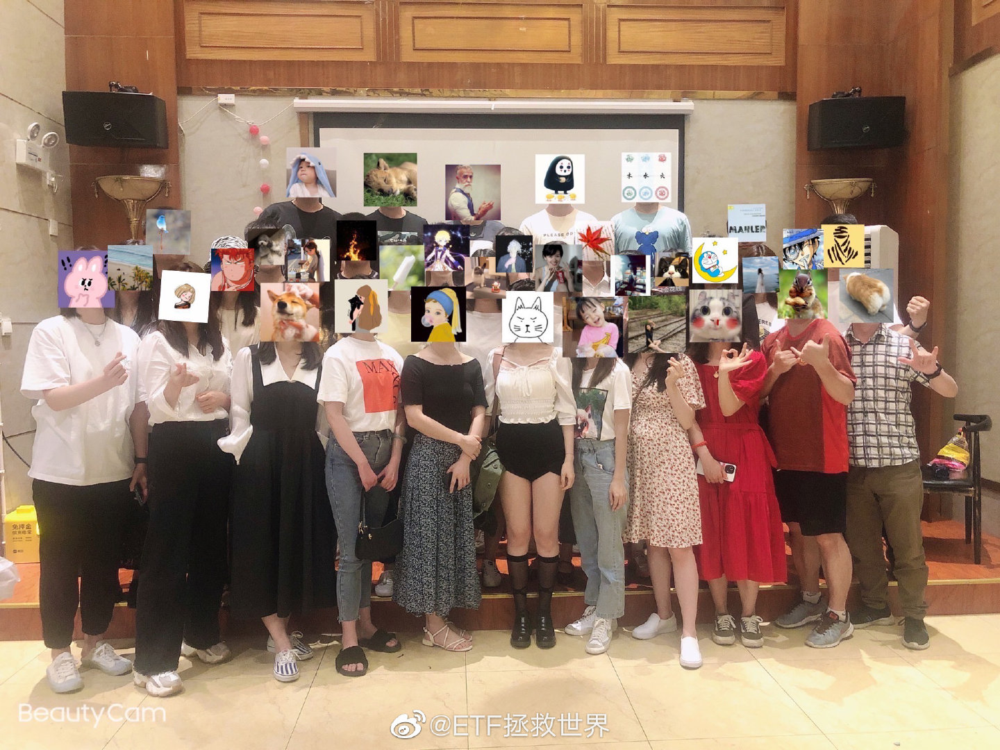

## 2021-05-31 11:33

500看起来想支棱又有点犹豫的样子。 ​​​

## 2021-05-31 11:48

回复@不说话的背影:今天申购，实在想买就买点，我估计会抽签，即使买到了也没多少。自己要买的，建议在券商场内申购，一个多月上市后就能交易了。//@不说话的背影:益达可以说一说reits吗？

## 2021-05-31 12:52

你永远也不知道别人有多敏感 ​​​
 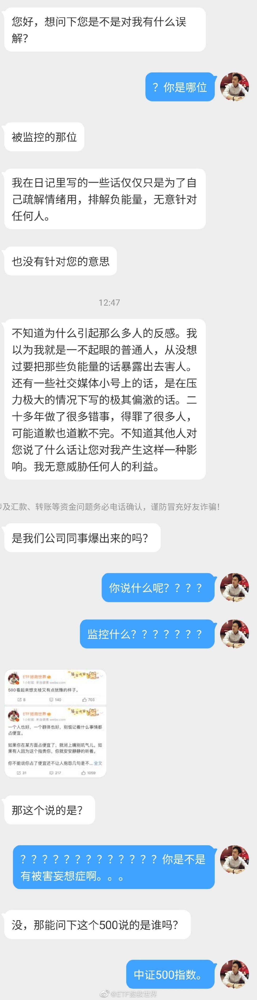

## 2021-05-31 13:04

刚才那条微博虽然很让人迷惑，但不禁又让人对人生有了进一步的思考。

那就是，如果你想做一些不想让别人知道的事情，那最好就是不要做。甚至一个人的时候也不要做，就是所谓“慎独”。

如果一定要做，那就尽量隐藏好，争取不要留下任何痕迹。

正所谓 若要人不知，除非己莫为。

做了，就会被发现。即使不被发现，你内心中的惶恐和焦虑也会时时刻刻折磨你，会让你每一分钟处在疑神疑鬼中，非常痛苦。

不该做的少做，不做；不该说的少说，不说。

## 2021-05-31 13:14

世上没有不透风的墙。“我跟你说个秘密，你一定不要告诉别人”。放心，他一定会告诉别人的。

## 2021-05-31 14:42

我对小红①的爱得到了回报！

①小红：指红利指数，以及富国红利基金，非特指任何人。 ​​​

## 2021-05-31 15:17

别说那么多，发个5月🧧先  ​​​

## 2021-05-31 17:02

又到618了，想给东哥贡献点利润，翻了翻也不知道买什么。

好像也没什么想买的，没什么意思。 ​​​

## 2021-05-31 20:46

这一生，你总要为自己活几年 ​​​

