## 2021-06-01 07:12

要多生，这个问题是不是也得解决一下 ​​​
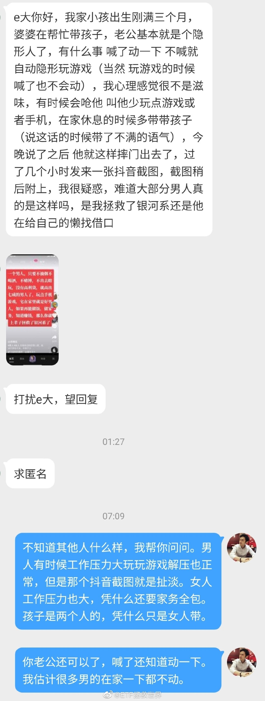 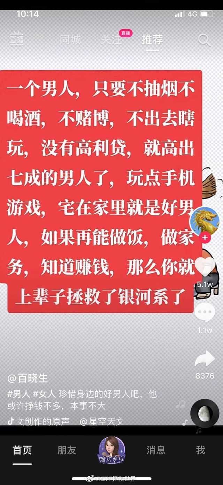

## 2021-06-01 07:32

说实话，家务谁都不想做。因为做不完。我的建议：能让机器干的都让机器干，能外包的外包。剩下的，工作累的少做点，全职在家的或者工作轻松的多做点。但工作累的千万不要觉得带孩子和做家务比工作轻松，其实这两项比大多数工作累多了。最主要是双方互相体谅，都要有责任心。这是双方的家和孩子。

## 2021-06-01 07:53

其实家务这件事，我分解过，最后发现除了做饭这件事无法解决外，其他的都很容易将工作强度降到很低。

有人说找个保姆不就完了吗。这里面一方面有经济的问题，不考虑经济的话，也其他的问题。比如，对方值得信赖吗，比如，喜欢在家里穿的比较清凉一点会不会很尴尬？

所以绝大多数人来说，自己做家务还是主流。

家务也就那么几大类，做饭，洗碗，收拾屋子，扫地，拖地，擦各种东西等等。

洗碗不用说，洗碗机。人多的话一顿饭洗一次，人少的话一两天洗一次。有不同意见的保留，懂的都懂。这个平均每天耗时绝不会超过5-10分钟，包括放进去拿出来。

扫地拖地，扫拖机器人。除非你对环境要求极高，洁癖，否则也够了。每天你上班的时候让它自动定时在家扫两次，还不够干净？

收拾屋子。收拾屋子最关键的是：东西少+物归原位。不需要的东西扔掉，卖掉。然后用完了什么马上放回原位。然后每周用很少的时间巩固一下。这段话字数很少，意义很大。觉得每天收拾东西收拾不完的，好好想想这段话。

最难以解决的是做饭。外卖不是不行，主要是脏和不健康。北京请阿姨每天来家里做顿饭的价格是每个月3000左右。

油烟机啊，窗户玻璃啊这些，一个月弄一次，自己弄也行，找小时工也行，这不是大问题。

孩子的话就另说了，我只是说家务。再说一次我的理念，体验生活，享受生活，而不是被生活奴役。想办法让自己轻松快乐起来。

拥有的东西不是越多越好，要少，要高级，精致。自己体会。

## 2021-06-01 09:23

别说那么多，集中精力搞钱的时间又到了。 ​​​

## 2021-06-01 10:18

券商暴跌博友竟开心不已，背后原因令人暖心。 ​​​

## 2021-06-01 10:25

发现自己东西买贵了一点简直心如刀割。 ​​​

## 2021-06-01 13:11

​​​

## 2021-06-01 13:31

回复@艺徒弧光:图片评论 查看图片 //@艺徒弧光:医药怎么这么猛

## 2021-06-01 13:45

关于医药这一波，有做的对的地方，有不足的地方，我也时常复盘，可以把一些大的思路简单分享一下。

首先，当然是对行业的成长性定义。医药和消费还能再玩30年，这个毋庸置疑。

其次，对于医药的交易，从价值和技术形态上判断依然绝对有效。

第三，对于品种方面，没有必要执着于个股，也没有必要一定要买指数。这两年我的认知是，在行业基金方面，被动+主动未必不是一个好的选择。去年底我结合价值和趋势，在医药内部第一次选择了主动医药大摩，几个月的时间涨了50%，算是一次成功的尝试。

未来，行业内的基金选择，会逐步扩大指数+主动。这里的关键在于是行业基金。因为主动基金最难把握的地方在于你不知道经理会怎么调仓，但是如果限制于一个行业内，那么出错的概率就小了很多，大差不差。

一点点思考。不同意的话保留意见，我不care。

## 2021-06-01 14:00

不知道各位是否思考过一件事，那就是固步自封与坚定信仰，勇于接受新鲜事物与左右摇摆做墙头草之间的界限如何界定。

我个人认为，坚定保持信仰，守住正道。然后根据客观世界的变化，积极接触新的东西，把有益的抽丝剥茧找出来，融入自己的体系，完善自我，恐怕是不断进步的不二之选。 ​​​

## 2021-06-01 14:07

日本人很有意思，特别喜欢在这种小东西上脑洞大开……

## 2021-06-01 14:30

红利连涨8天，结果仔细一看涨幅还不到4%。

呵呵，辣鸡。过几天一根阴线全部吃掉，嘚瑟什么。 ​​​

## 2021-06-01 15:35

不出意外的话，今天所有长期和波段账户全部会历史新高。

而且97%的品种和95%的车友都是盈利的。 ​​​

## 2021-06-01 16:57

价值。 ​​​
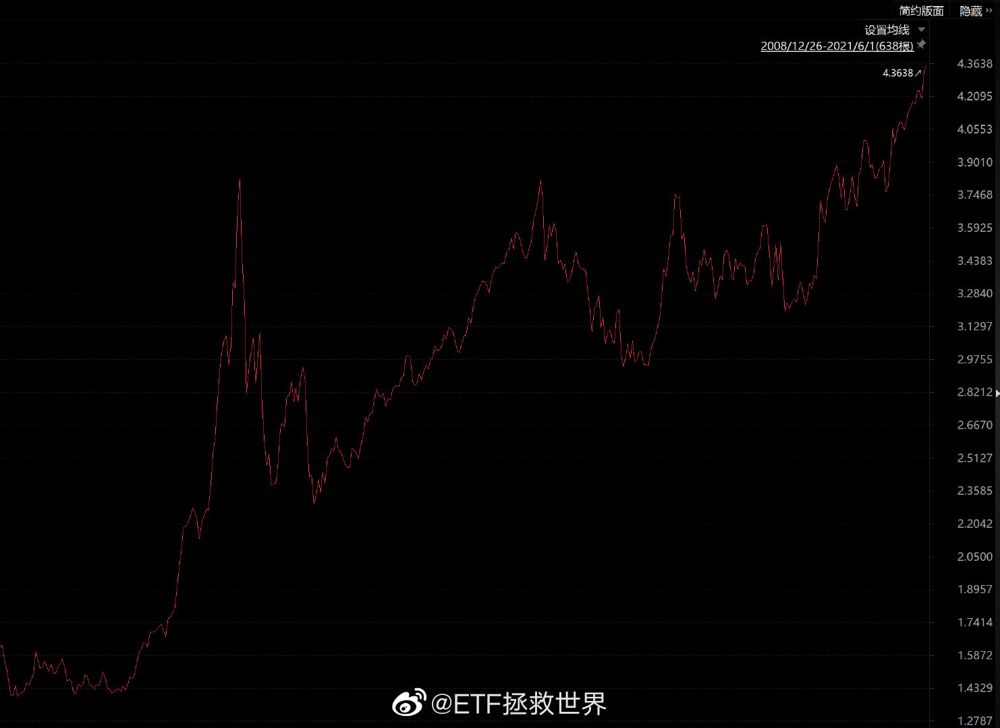

## 2021-06-03 10:34

每个月总有几个不想说话的日子。 ​​​

## 2021-06-03 14:00

新高不卖。 ​​​

## 2021-06-03 14:11

曾经让你浮亏最多的不死品种，最终让你赚了big money。

如果还未发生，有一天终会发生。 ​​​

## 2021-06-03 17:51

希望每一位看我微博的朋友都感受不到焦虑。

如果能帮各位将自带的焦虑属性减轻一些那就更好。

这也是我在这里存在的主要原因之一。 ​​​

## 2021-06-04 10:58

经常有人给我发私信，问我信不信算命的。有好多都是男女谈恋爱，一方算命说不合，两人就分了。

我旗帜鲜明的说，我不信算命的。我不相信人类能算出自己的和其他人的命运。

但我相信一点：人类自以为什么都知道，其实依然是很愚蠢的阶段。很多东西你以为自己看不见听不见就没有，其实不是。只是我们太愚昧。

我的意思是，我相信有一些能左右我们命运的东西，但我们现在还不知道是什么。所以我应该算是个“理性玄学信徒”。

就是说，很多东西，宁可信其有不可信其无。

比如我只要路过寺啊庙啊都会去拜拜，比如有时候中午没事就遛弯去白云观拜拜之类的。我得到的正反馈就是，人生至今为止，在很多重大的关键节点上都是顺利的。这又反过来让我更加相信玄学。

我并不真正研究或者信奉什么宗教，只是相信玄学。

相信玄学还有两个好处，这两个好处也非常重要：

第一，心安。比如很多朋友考试啊家人生病啊面试啊都会私信给我图个吉利，你说真的100%能成功吗，也未必，但这些朋友心里会安定很多。玄学对我来说，也有这样的效果。

第二，有所畏惧。既然相信玄学，有些坏事就不敢去干，也会有意识的多做点好事。真正大奸大恶之人，是没有畏惧，不相信因果报应的。相信的人就会收敛很多，至少太坏的事情不敢干。

为什么想起来说这个呢，因为我人生中第一次尝试玄学，是高考前搞到了一个护身符，每场考试前都会拜拜。结果状态大勇，考出了最好成绩，一分不差踩着线进了理想的学校。

又快到高考了，是以为记。

## 2021-06-04 14:29

这一天天上蹿下跳的什么玩意儿你说。 ​​​

## 2021-06-04 15:03

Epic，今次免费游戏是我之前强力推荐的《冰汽时代》

有图为证：我现在很少玩游戏，但这个游戏依然玩了50多个小时。

反正免费的不下白不下。 ​​​

## 2021-06-07 00:27

谢谢各位的光临。 ​​​

## 2021-06-07 01:18

## 2021-06-08 10:13

我感觉人生达成三个方面的目标就算成功，也会相对快乐的过一辈子：

第一，相对富足的物质。

第二，健康的身体。

第三，良好的人际关系。

至于说财务自由、模特一样的身材、学富五车、高屋建瓴的思维见识，都属于更高一层次的追求了。有更好，没有也不算失败，但对于个人来说，积极追求这些也是人生的乐趣来源啊。

## 2021-06-08 10:34

有一个问题：

如果因为贪婪，而投入显而易见的，风险巨大的投资活动中，然后赔了钱，

那么，这样的人值得同情吗。 ​​​

## 2021-06-08 14:49

建议每个人过生日的时候送自己一样自己非常喜欢的礼物。

首先你要对自己好一点。 ​​​

## 2021-06-09 09:36

华宝油气，我愿称之为波动界的卡丽熙 ​​​

## 2021-06-09 09:40

当然，我要再说一次，卡丽熙不是每个人都能驾驭的。下次油价低点不妨考虑160416，波动也不小，基本面稳很多。

## 2021-06-09 10:32

你说人瘦了为什么就显得很时尚，胖了就显得土土的。 ​​​

## 2021-06-09 11:02

问你们个问题：

如果一个女孩说：

我觉得有腹肌/穿白衬衣/穿修身西服/倒三角/爱运动很阳光的男生很帅啊。

或者她说：

我觉得男生也不是非得一身肌肉才好看啊，肉肉的也很可爱啊，我就很喜欢肉肉的。

另一个男孩对她说：

你是不是有病啊，谁管你觉得什么样的男生帅啊，男生又不是为了你才健身和运动的，男生根本不在乎你的想法，你先把你自己收拾利索吧！

你会不会觉得这个男的是神经病。

我觉得是。而且是病入膏肓那种神经病。

## 2021-06-09 12:32

知我者莫过于博友也。

看了看，原来疫情过去后这一年都几乎没玩游戏了。 ​​​
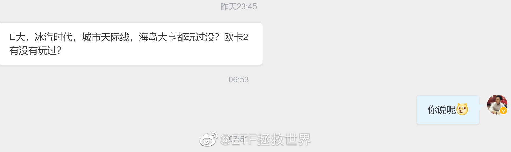  

## 2021-06-09 13:26

有空可以看一眼微信。 ​​​

## 2021-06-09 15:55

情义两心知。 ​​​

## 2021-06-09 20:22

“我的投资水平足够，现在就差***万的本金了。如果有了这些本金，一切都会不同。”

这么想的人有很多吧。 ​​​

## 2021-06-10 07:03

人生充满希望 ​​​
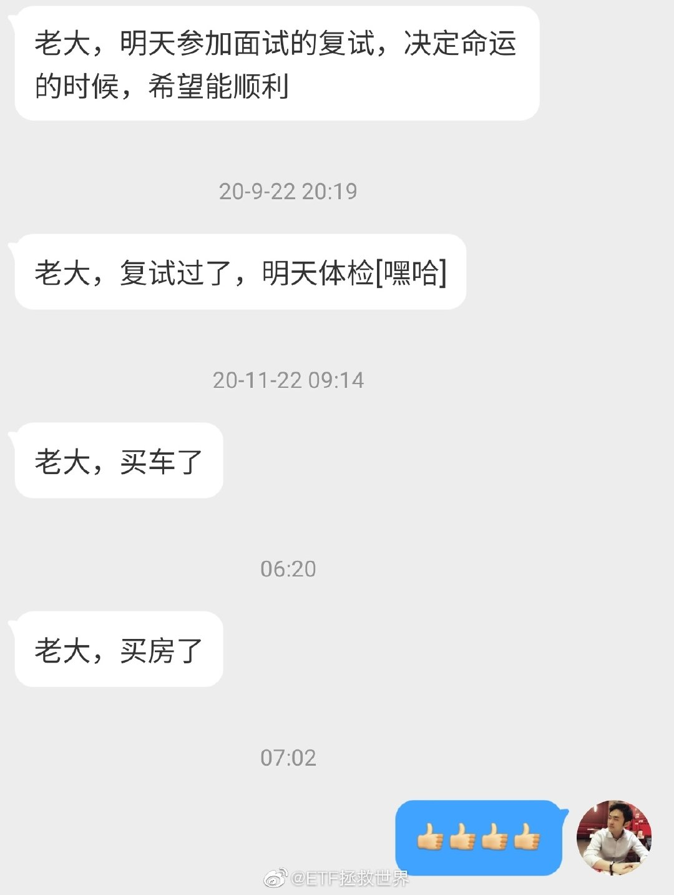

## 2021-06-10 08:37

父母要掌控孩子的生活，夫妻要掌控对方的行为。

大多数家庭痛苦无非来源于此。 ​​​

## 2021-06-10 09:15

有人说失败者才会在被家人控制中感受到痛苦，成功的人反而会感谢家人：正因为有家人的控制自己才会成功？

首先，什么是成功什么是失败？

挣了几个破钱吗？当上了处长科长吗？考上了一本吗？娶了地主家的闺女吗？

如果哪个都没做到，是不是就是失败了？人生白走了一回？那么14亿人里面，大部分都是失败的了？

大错特错。

什么是成功，成功就是以自己希望的方式度过一生。有相对富足的物质，做着自己喜欢做的事情，生前有人惦记，走了有人怀念。

其次，如果用家人的控制换来你说的成功，那么会幸福吗？

孩子要上哪个学校，学什么专业，做什么工作，与什么人结婚，买什么房，生了孩子叫什么，姓什么，怎么养，你样样都要插一手。即使你给安排了科长，你给安排了地主家的闺女，考上了一个你喜欢的学校，你觉得你孩子真的幸福吗？

也许你孩子就根本不喜欢机关里的生活，看到地主家的闺女就烦，大学四年学不喜欢的专业生不如死。在你看来，你孩子“成功”了。你有问过他开心不开心，幸福不幸福吗？

他想做的事业，他爱的女孩，他想钻研的学科，全被你否定了，他多痛苦你知道吗？

你的老公或者老婆，要买个自己真心喜欢的东西，被你横加指责，被你念叨10年；穿衣服没品味、化妆不好看、行动说话没气质、身材不好，你极力控制对方的时候，对方痛苦不痛苦，你知道吗？

成功，呵呵。什么狗屁成功。你说的成功就是挣几个破钱当个破官让大家知道吗？这样的成功，太二了。

## 2021-06-10 09:30

回复@didi跟车:介绍和引导怎么算控制。你把一头牛拉到草地边是介绍和引导，按着它的头吃草才是控制。//@didi跟车:儿子今天高考结束。配好手机，准备给他推荐E大，及微博、且慢。开户给他小一二十万开始培养理财观念，少走弯路做韭菜。这算控制吗？

## 2021-06-10 09:40

时间到。

情感博主下线，搞钱博主归位。 ​​​

## 2021-06-10 10:09

发个涩图不会被封号吧 ​​​
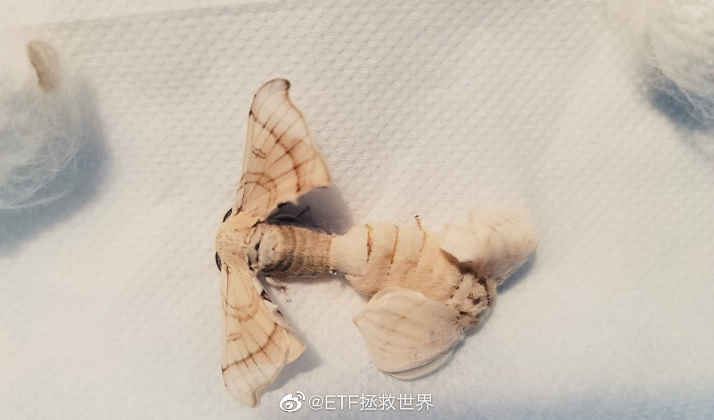

## 2021-06-10 10:27

刚看了一眼，原来s计划所有23个品种全部盈利，150计划35个只剩一个浮亏了。

方法对了，在A股赔钱不能说很难，只能说是几乎不可能。 ​​​

## 2021-06-10 13:07

如果到收盘不掉链子，建信500和富国500将齐创历史新高。

此起彼伏。 ​​​

## 2021-06-10 13:15

这条微博其实很重要。等到所有情况都变好，那凭什么你能抄到底别人不能？当你听到知更鸟叫，春天已经快过去了。

## 2021-06-10 13:19

回复@草木云心:环保、传媒、红利这三渣里面，环保居然是最强劲，这是我没想到的……//@草木云心:环保突然突突突了。。。

## 2021-06-10 13:23

做投资不能太悲观。太悲观虽然不会赔钱，但挣不到什么大钱。

做投资要乐观，又不能太乐观。

太乐观容易忘记这是个弱肉强食的残酷世界。 ​​​

## 2021-06-10 15:21

要不今天就到这儿吧。先告辞了。

大家一起挣钱就很开心。 ​​​

## 2021-06-10 21:30

计算失误，两只基金都没有突破2015年6月的那十几天最高点，大意了！继续努力吧。（但是都创了持仓以来新高）

## 2021-06-11 09:14

宏观的东西少想一点也没事。 ​​​
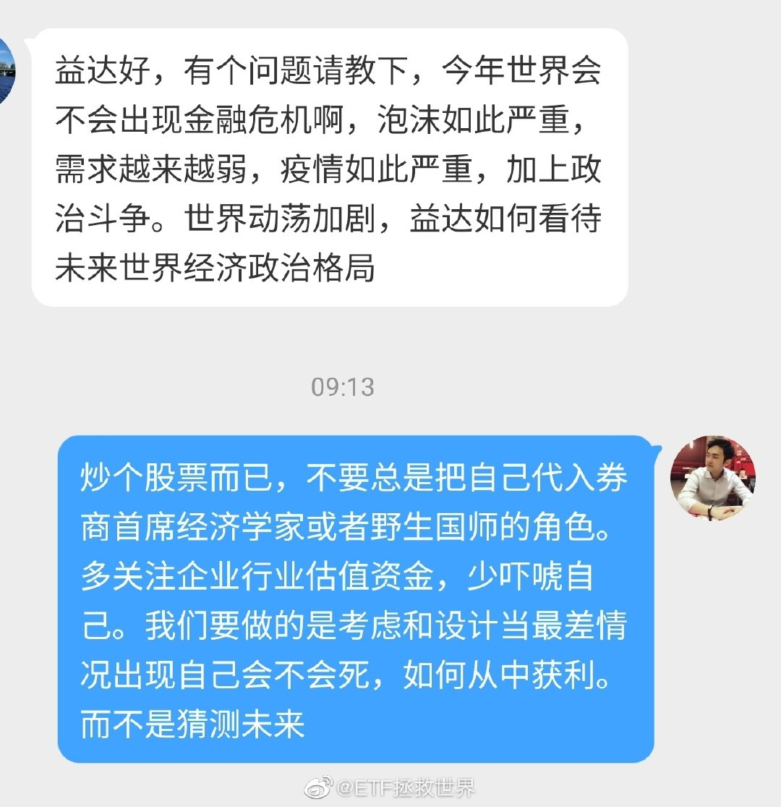

## 2021-06-11 09:36

很多朋友其实对金融市场的资产积累并没有一个合理的认识。

如果你能持续在资本市场赚钱，无论年化收益是8%还是15%，你的账户资产绝不是线性增长的。也许你的第一个10万用了3年，第一个100万用了5-10年，但第二个十万或者100万就绝对会快很多。

一方面是经过一两轮牛熊，你已经有了足够的经验，错误会变少。一方面是你的本金大了，一年的收益可能是过去3、5、10年的。

越往后，这个效应越明显。很少有工作是没有上限越往后收入越高的，而且这个增长是几何级指数级的上升。金融市场算是其中一个了。

你永远不要把积累金融资产理解为线性的。从中周期来看，它是一个脉冲式的上涨，也就是三年不开张，开张吃三年。长期来看，它是一个几何级别的增加。

如果你把每年的金融资产做一个表格，多年以后你就会发现，你投资的前几年，在你的图形上几乎是平的，无论当时增长多高。

## 2021-06-11 09:53

回复@Sonny_CY:羡慕你们。我3年前买的上学的房子到现在一分钱都没涨。放到股市上这几年至少可以增值小8位数。//@Sonny_CY:回复@贺骁武:结果发现房屋增值速度远超股票市场

## 2021-06-11 10:03

回复@知礼平安:我一点点都没有后悔失望什么的。我掏钱买的是个消费品，是解决我问题的。就类似于我怎么可能后悔昨天吃了潮汕火锅，浪费了几百块钱，不能拿这个钱去投资呢？它解决了我的问题就达到了我的目标，钱花的就很成功。

## 2021-06-11 10:39

我看有朋友说，17倍涨幅羡慕什么的。我觉得这些朋友的认知有点错误。

什么值得羡慕呢，是涨了17倍卖掉变现，那算一点点成功。

但你涨了17倍，卖掉后还得加钱去买面积差不多大的房龄差不多大的房子怎么能算成功？除了你住的区域好了，能上个好点的学校了，根本没有任何区别，你还少了几百万，从钱的方面看，怎么值得羡慕呢。

房子，无论涨多少，只要你不卖，这个涨幅就跟你没关系。都是账面资产，都是虚的。你的房子值100万还是1000万，你住在里面都没有任何变化，这才是真相。

哪怕涨再多，你没卖掉，或者卖掉后还要加钱去改善，那这个房子涨多少能让你受什么益了？

## 2021-06-11 12:49

一个气球，你不停的吹，不停的吹，不停的吹，最终结果是什么呢。

不用我说了吧。

同样一个气球，吹啊吹，吹啊吹，吹到一半，有人说你这个太大了，你是违规抱团吹气球，我要去告你。那反而这个气球有可能就没人吹慢慢撒气反而不会爆（只是有这种可能性而已，而且可能性不大）。

这种情况就很尴尬。你有人站出来说抱团吹不合规矩会爆，反而不会爆。大家都不说，看着一群人玩命吹，居然是更危险。

那到底是警告好还是不警告好呢。

我倒是觉得，金融市场大多数事情，自然有金融市场的自身规律去解决。食得咸鱼抵得渴，人各有命，看热闹多好玩啊。

## 2021-06-12 23:28

看了同学群里他们聚会的照片，女生身材基本没变，男生全都不可描述。

于是我做了个违背祖宗的决定：重新开始每天打卡keep。

确实，在我国，女人真的是整体来说在这方面比男人更努力更优秀。 ​​​

## 2021-06-14 19:34

如果谁总是让你想起不开心的往事，

那么最好的做法就是在你的生命中屏蔽ta。

通俗的说就是让ta从你的生命中滚出去。 ​​​

## 2021-06-15 09:59

第一个交易日就玩这么刺激吗。

全世界都在新高啊喂。 ​​​

## 2021-06-15 10:34

之前有朋友问买房贷款没贷款的问题。

就像金融投资你该买余额宝、指数基金、主动基金还是股票或者期权一样，你买房贷款还是不贷款没有一个千篇一律的回答。

你得考虑利率：3.x%的公积金和6.x%商贷能一样吗

你得考虑首付：你首付3成跟首付9成，要不要贷款能一样吗

你得考虑贷款的资金占你资产的多少：你不贷款就没钱买房，和你要贷款的金额与你的金融资产比非常非常小能一样吗。

你得考虑难易程度和个人愿意付出的精力：有人愿意花费很大精力去办这些事情，还有人觉得很麻烦不想去跑这些事情能一样吗。

每个人的情况不同，要好好考虑自己属于哪种。很多问题没有唯一的答案，别人选的你不理解，很可能是因为你不是他。

## 2021-06-15 10:58

在A股玩，是一个一将功成万骨枯的事情。

你在没有成为一将的时候，最好先确保自己不会成为枯骨。

只要命还在，一步步爬上去就有希望。命没了就什么都没了。

不赔钱，对方就赢不了。对方赢不了，你就有机会赢。

就像踢球一样，对方如果永远也无法把球踢进你的球门，你还怕没机会赢吗。

一定要确保中长期不赔钱。

## 2021-06-15 13:28

信息7000点左右压力位，能有效冲过去就能爽一波。 ​​​

## 2021-06-15 13:38

听话的券商，按照剧本表演。 ​​​

## 2021-06-15 13:51

转发微博

## 2021-06-15 13:53

一开始我看这个品牌这个价格的反应这是智商税。后来我想，凭什么哈根达斯可以收智商税，国产品牌不能收？于是就很能接受了。当然，这个税我是不缴的……

## 2021-06-15 14:02

其实我特别支持特别希望国内各行各业都出一批售价高质量好的商品和品牌。

很多人是价格不敏感的消费者，卖给他们高价商品，品牌和厂家利润高了，国家税收多了，员工也好歹能多喝点汤。员工有钱了消费就增加了，然后好的循环就起来了。

凭什么中国只能卖一些利润低的商品？

当然，我不是说所有产品都要高价。最好的情况就是低价产品不减少，高价产品从国外品牌手里抢蛋糕。

别老一说国产品牌卖点高价产品就恨之入骨，能卖出高价，还有人买那就挺好的。你觉得贵你不买不就完了吗……

现在最关键的就是要提高国货质量，提高工业设计能力，以及用国货自豪不丢脸有面子很fashion这样的社会氛围。毕竟对国人来说，面子是很重要的……

## 2021-06-15 14:21

你的长线仓位盼着涨，你的波段仓位盼着跌。

你改变不了市场的涨跌，但你可以改变自己持仓结构带来的全天候利润和愉快心情。 ​​​

## 2021-06-15 15:21

当时我就震惊了。

## 2021-06-15 15:50

不知道为什么就是觉得那时候的男星帅，而且帅的完全不同。现在的，颜值我真的get不到

## 2021-06-15 16:47

今日各大指数更新了成分股。

全市场来看，目前A股整体处在不贵也不便宜的中间状态。大指数，50-300，创业板指、科创50等由于调入了一些涨幅巨大的牛股，导致估值大幅上升。

中小指数还好，变化不大。

整体不贵的前提下，有几个板块是已经很贵。

情况就是这么个情况，目前的状态下大幅加仓恐怕未必明智。已有的仓位只要不贵拿一拿也无妨。

具体我的思路体现还请参考长线计划和短期波段操作。

## 2021-06-15 17:29

几年前看过一个报告，说气候变化有可能导致西北变江南，江南变沼泽……

## 2021-06-15 18:49

几个小时后能不能干掉🇸🇾。 ​​​

## 2021-06-15 18:56

反正我现在帮人就不会期待回报。

因为据我观察，会回报的大概能有5%。

期待太多只会让你自己失望。 ​​​
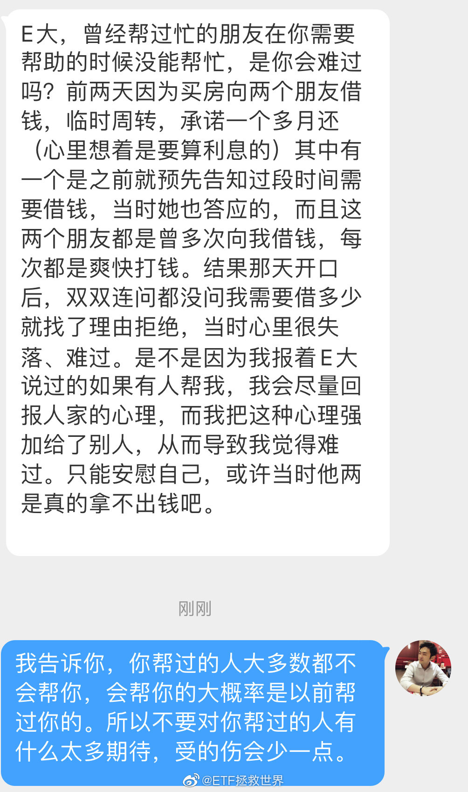

## 2021-06-15 20:40

事实证明，

钱，不是什么都可以买到的！ ​​​

## 2021-06-15 20:45

回复@白瘦好看头发多:你今天好怪。怎么怪。怪可爱的。//@白瘦好看头发多:我在吃面，什么面， 想见你一面

## 2021-06-16 02:45

👏 ​​​

## 2021-06-16 13:26

当年震荡你很烦，现在震荡你很甜。 ​​​

## 2021-06-16 13:45

金融投资整体上来讲，不是你割他，就是他割你，就这么回事。

有人说企业价值成长，对，没错。但能一个伟大企业拿50年的人，屈指可数。大多数人就是割来割去，你割我一下，我割你一下。

有人越割越有钱，有人越割兜越干净。

有一个难点在于你不知道这个时间点该不该挥镰刀。割的早了错失几倍大牛品种，割的晚了一个电梯全都白干了。你回头看历史k线感觉好像把金融投资整得清清楚楚明明白白，第二天开盘上手一做又懵圈了。

所以你的赚大钱体系设计重点就应该是关于什么时候割，怎么割的课题。当然，研究这个课题前，当然得先研究不被别人割的保命课题。

至于现在，我只是觉得券商跌得太慢。

## 2021-06-17 14:02

看你冲。

## 2021-06-17 17:43

人气确实不行了。

好气。 ​​​

## 2021-06-17 20:19

人生很多不能改变的，比如年龄会越来越大，现在的每一天都是你未来人生最年轻的一天。

也有很多能改变的。比如可以让自己的身体状态越来越年轻。35岁的你可以比30岁的你还要健康，还要有活力，还要帅气和美丽（如果你的头发还在）。

市场怎么走你改变不了，但你能改变自己的投资方式和策略，尽量让自己每一次交易都是正确的，市场新高不新高无所谓，你可以永远在新高的路上。你可以涨跌都舒服，你可以全天候提款。

你也改变不了别人对你的态度，但你可以改变自己对别人的态度。离负能量的人远一点，对值得爱的人付出更多的感情。

我们改变不了春夏秋冬，改变不了下雨还是烈日当空。但我们可以在四季中发现不同的美，也可以体验每一种天气带来的不同感受。

我们都会碰到很多bull shit的人和事。如果已经碰到了，就先接受，再想办法解决掉它们。如果不能，就先睡个好觉，明天再说。

每个人都有自己的命运。财运、桃花运、事业运、贵人运。没有人是完美的，也没有人能一直走运。“为什么我会这么倒霉？”。不是这样的，大家都曾经倒霉，只是别人倒霉的时候你不知道或者并没有在意而已。

人生不就是这样。几十年，一下子也就过去了。有事就认真解决，解决不了就接受。没事就好好享受生活。多看看美景、美女、帅哥，多跟朋友聊聊天，吃顿好的。一顿解决不了，就吃两顿。

除了生死，都是小事。别想那么多，踏踏实实的。

## 2021-06-17 20:51

真心希望黄金这一波能到我的预设价位，给它一个机会为大家多维度提款。 ​​​

## 2021-06-18 09:49

买什么什么有，除了神品种（ ）（ ）。 ​​​

## 2021-06-18 10:01

第一波最高冲到7023，压力位就是压力位，不是那么好冲的。看打仗。

## 2021-06-18 13:32

红利跌了是好事还是坏事。

坏事吧，利润回撤了。

那我过几天把网格买入价格改一下，再吃第三次波段利润——

那么下跌是好事还是坏事？

除了传媒这样油盐不进、软硬不吃、死活不涨、连一点汤都喝不到的品种，其它的，无论涨跌，咱们都让它变成好事。 ​​​

## 2021-06-18 19:47

你感到无聊的时候会去做什么？ ​​​

## 2021-06-19 10:26

作为家长，我表达两个意思：

第一，我支持校外辅导。尤其是线上的，方便又不贵，也有效果。除了对眼睛不好是个缺点。

如果全部硬性取缔，我只有第二点问题：

第二：到时候要请各位给我推荐靠谱的1v1老师了。

补是一定要补的，无非是掏钱多少线上线下的区别。

不补？不好意思，我真的没精力辅导。

不辅导呢？不好意思，我儿子真不是什么绝顶聪明的天才。

别人躺不躺我不知道，反正我不躺。孩子也不能全天候参加艺术、体育活动吧。玩完了回家干嘛啊，玩乐高看动画片吗。

还有一点，孩子上得挺开心啊。前几天还跟我抱怨报的班太少了呢。

## 2021-06-19 12:19

所有问题的根源在于蓝领和白领的收入水平、福利待遇、社会地位差距过大。

这个根本性的问题解决不了，从教育本身去解决是不可能的。 ​​​

## 2021-06-19 14:47

最近在RR看到一个十几年前的日剧，不能结婚的男人，

看了三集觉得挺有意思，一边keep一边看看老灵额。 ​​​

## 2021-06-20 11:44

什么玩意儿啊。

前几天练了一次胸，结果胸没事，三头肌疼了3天。 ​​​

## 2021-06-20 12:02

父亲节送给自己一份大礼。

男人，要对自己好一点。

没人送礼就自己送自己。 ​​​

## 2021-06-20 12:48

大过节的我在工作，伺候各位大爷。

一会公众号会营业。 ​​​

## 2021-06-20 14:29

有些人就特别逗。

今天我不是赞赏提示语是“这么好的文章不打赏良心很难不痛”。

本来就是小幅度幽默一下，结果有人又看不惯了，说看到这个不舒服，打算取关我。

我谢谢您了，您的关注这么重要，取关我我多伤心啊。还是我先拉黑您吧。

还有上次，我不是发过仅有的一篇3块钱的付费文章吗。有个人说，居然发付费文章，你变了，对你很失望！

我一看，好嘛，这位看了好几年一分钱也没打赏过，结果我发了一篇付费文章就让这位爷失望了！

要搁以前我肯定觉得好气，现在我只会觉得好笑……

见得多了，你才会发现，什么人都有……

## 2021-06-20 15:42

冷知识：2020年中国进口石油5.4亿吨。

## 2021-06-20 17:21

男人也不容易，请关爱我们！ ​​​

## 2021-06-21 09:53

是不是除了白酒，很多传统意义上的白马股都跌了很多了。

不知道现在抱团是怎么抱的。 ​​​

## 2021-06-21 10:12

信息，S只买了2.83%。150更少。

我现在越来越坚定的一个思考，就是要说到做到，加大S的风险偏好。不能再总是考虑照顾所有人情绪而过于保守。

不能再总是考虑让100%的人都赚钱，结果使得所有人的收益率都下降。

平衡一下，90%，甚至85%的人赚钱，收益率上升很多我想可能是更合适的。 ​​​

## 2021-06-21 10:19

500就是内种被人看不起又不甘躺平努力挣扎着往上拼的孩子。

它的内心os：我就是资本市场的土猪也要拱了jjjl的白菜！

（喂，我说那位私信我的朋友，我说的可真的不是你啊！） ​​​

## 2021-06-21 10:30

双创ETF，冒险家的乐园，梦想家的乌托邦，超级成长草原上的卡丽熙。

你问我买不买，我不能说，说就是小马过河。 ​​​

## 2021-06-21 11:07

昨天那篇文章后面有人问，如果最大跌幅是70%或者80%，那么没跌到是不是不能投了。

那当然不是！

有这样一个70%或者80%的计算，是为了让你知道最坏的情况可能会坏到哪里。这样，你就可以根据这个数据来进行配置。

比如你有100万，你最多能接受80万的损失，那你就可以在新高的时候冲进去。

但是你最多只能接受损失8万，那么你这个时候就买10万。

这只是一个最简单例子。其它还包括网格压力测试位置等等等等。可以应用的范围很广。

很多人把自己的金融资产看做一个整体，他们的脑子里只有要么买，要么卖。依然没有形成一个“买多少合适”的思维模式。

## 2021-06-21 16:22

发现一个现象：埋怨华为对员工不好的都不是华为的员工，埋怨大厂996的都不是大厂的。

## 2021-06-21 16:50

人家博主自己的微博，对一件事谈谈自己的看法，只要不违法，不违规，不违背公序良俗，遵守社区规定，没有收黑钱做坏事……

想说什么你管得着吗？说得对你点个赞，说错的你指出来。什么玩意儿一上来就：你别说这个了，你别说那个了。

你谁啊？关注别人就像你在一个单位工作一样，你觉得好就继续干或者继续看，觉得不好就辞职走人或者取关消失。

我寻思现在也没立法说你必须关注某个人或者必须在某个单位干一辈子吧？觉得别人说的你不爱看你走人不完了吗？你管得了别人说什么？

你先试试你回家管管你家里人，不让他们说什么他们能不能听你的。

好嘛，全世界都得跟你想的一样是吧。跟你想的不一样就让人闭嘴是吧。您到底哪位啊！

## 2021-06-21 18:01

本月不送红包了。

抽个苹果耳机。

你意下如何。 ​​​

## 2021-06-21 18:30

看到朋友们这么踊跃，我就想到一件事

其实我有很多电子产品都闲着，但是因为开封了，我也不好意思送（这次的苹果耳机是全新未开封）。

光无线耳机我就有很多。苹果和三星所有无线耳机我都有，但好几款使用根本不超过10次。

如果朋友们不嫌弃不是全新的，我就找机会都送了。到时候看吧，送给不嫌弃99成新的朋友…

## 2021-06-22 10:00

//@怂的载体: 这应该是“春苗行动”的一部分，目前已有超过100多万名海外中国公民在150多个国家接种了来自祖国的新冠疫苗。

## 2021-06-22 10:25

行吧，还是转为自己可见了。

当时为什么想起来买它呢，因为我当时看见一个大V骂它，我就去买了。港币2块多，人民币1.952，当收利息了。

持仓中涨得更好的有很多，贴这个只是想说，同一个股票，有人赚有人赔，最大的因素就是成本。

所以我对成本特别重视，这也是为什么所有计划99%品种都赚钱的原因。 ​​​

## 2021-06-22 10:34

重视成本，不追涨非常安全，熊市买到好东西牛市也能赚很多。

但是，有个最致命的问题，就是牛市中就不会再买很多了。

所以我从去年这个时候就开始说，不建议新关注我的朋友对我希望太大，因为我对你们已经没有什么用了。在上涨的时候，我不可能再买很多。

我建议你们去关注那些敢于在上涨中买入的人。我不行，我认怂。我只敢熊市买，牛市不敢追。

低买和追涨没有什么谁好谁坏，谁对谁错。只有适合不适合而已。

我只适合低买——等待——高卖。没什么技术含量，赚点认知内的钱而已。

## 2021-06-22 10:39

回复@溜溜哒库库:只要自己的、大多数是权益资产的组合不断新高，对于我们每个人来说就是牛市。不知道各位意下如何。//@溜溜哒库库:有博主说现在是熊市，e大怎么看

## 2021-06-22 13:32

股市是一个让人心情极度舒畅的地方。 ​​​

## 2021-06-22 17:26

我的两个表妹，一个大牌奢侈品店店长，一个北大MBA外企高级白领，为什么会买这种东西，还妄想戴着跟我出去玩？？

我一定会装做不认识她们。

搞不懂女人… ​​​

## 2021-06-23 08:29

生活小贴士：

贪小便宜吃大亏 ​​​

## 2021-06-23 09:40

如果一个不死品种跌了70%以上，有人开始给你解读它为什么不行，以后会更差，

那么，

不能说他大概率是个水货，只能说他一定是个会写字的韭菜。 ​​​

## 2021-06-23 10:36

环保叕新高了。

一年前它还是个被人嘲笑的股渣。 ​​​

## 2021-06-23 15:11

今天的悬念是有几个品种新高。

我在看展，勿念。 ​​​
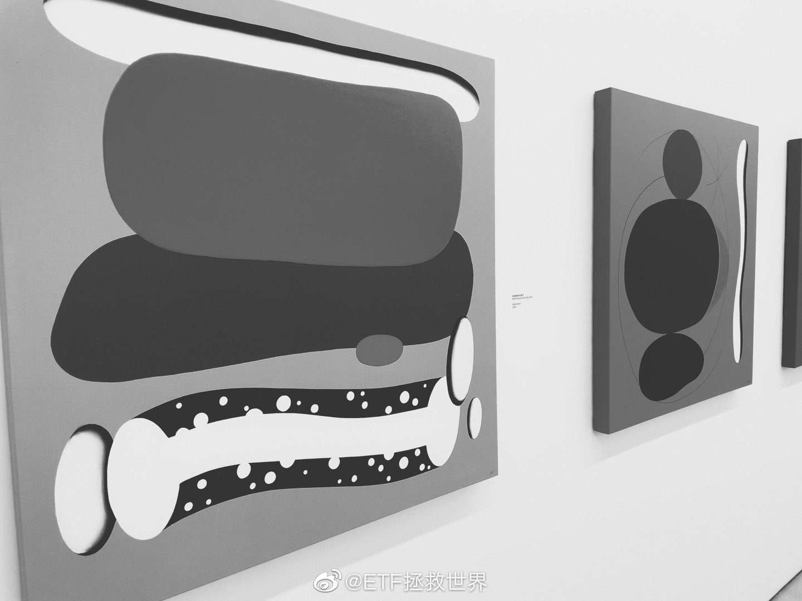

## 2021-06-23 16:48

什么样的人让人一眼就能看出是个卢瑟呢。

比如有人发个微博，评论里夸夸群的朋友捧场说真好看，真好啊，真不错。

甭管真的假的，这样的回复一看就是生活幸福，心态良好的人。就像你去朋友家串门：哎你这装修真不错，哎你孩子真好看，哎你这杯子哪儿买的真有品位。

这种人就总能看见别人好的地方，也不吝惜说出来。不用说假话，只要发现好的说出来。

然后就有人回复：这也要舔？

看见没，一个“舔”字，就让所有围观的人知道，这位杠精生活不如意，心态扭曲，人际关系极差。在他的世界里，人们互相夸奖就是舔，人与人之间只有上下没有平等。看见别人好就生气，看见别人倒霉就开心。

遇到这样的我会第一时间让他圆润的从我这儿出去。

## 2021-06-23 19:24

儿子说上体育课头上出汗了，有个女生拿着纸跑过去给他擦汗。

体育老师发火了：“他自己不会擦啊，要你给他擦！”

喷了，我二年级的时候还跟女生们打群架呢。 ​​​

## 2021-06-23 20:45

最终结果是富国500、建信500、华夏500、环保、信息技术建仓后新高。红利差0.4%，要努力啊。500开始输出了。

## 2021-06-23 22:13

有经验的进来答题了 ​​​
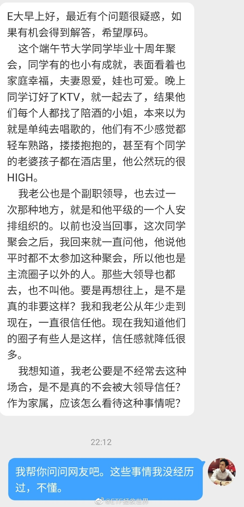

## 2021-06-25 08:50

一天不见，还好吗，

日子还过得下去吧。 ​​​
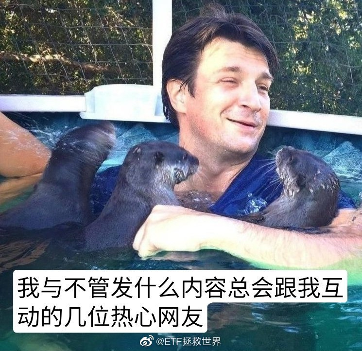

## 2021-06-25 10:44

steam夏促，再推荐一次之前推荐过的《Stellaris》

28块钱买不了吃亏买不了上当。不喜欢可以试玩后退款。 ​​​

## 2021-06-25 13:59

每个人脸上都洋溢着幸福的笑容。 ​​​

## 2021-06-25 14:20

死死咬住，没咬死前一口都不松。

你可能没发现，

有些品种我们买完两年多后一分钱也没卖过。即使它们不断的新高。

买入后，赚钱后好几年不卖，仅是这份毅力和定力，

就足以配得上赚钱这两个字。

赚钱，你值得拥有。 ​​​

## 2021-06-28 09:23

相爱总是简单，相处太难。

一定要幸福啊。 ​​​
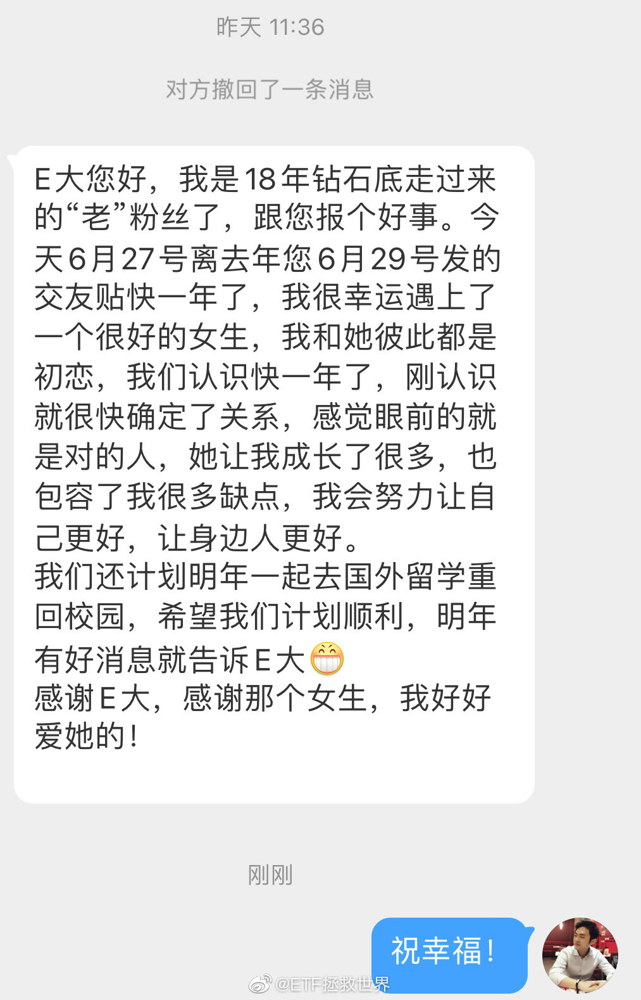

## 2021-06-28 10:01

基金经理抱团了自己没有的股票：基金经理，祸国殃民！

基金经理抱团了自己持有的股票：基金经理，专业！ ​​​

## 2021-06-28 10:16

北京已经一周多阴天了，看天气预报还要阴至少一周。

虽然没有太阳晒不会太热挺好的，但是每天阴沉沉潮乎乎的也让人心情抑郁。 ​​​

## 2021-06-28 13:49

有些人到处嘚瑟，各个群里传播价格，最终的结果就是所有人都成交不了。

这种人原地飞升不好吗。

大家以后去庙里拜拜的时候别忘了也关心一下这些人。 ​​​

## 2021-06-28 16:35

这个月送一个全新未开封的苹果airpods二代无线蓝牙耳机。

我考虑也不用抽奖了，就是互动第一这位“Edaqii”吧。也经常看到，不是陌生人。

如果这位不要，会送给第二位，依此类推。

抽奖不是不行，但我真的不想抽到一个不知道是哪里来的都没见过的抽奖专业户。

还有两个其它品牌的过几天再送。

没拿到的朋友别生气，祝下次好运。
 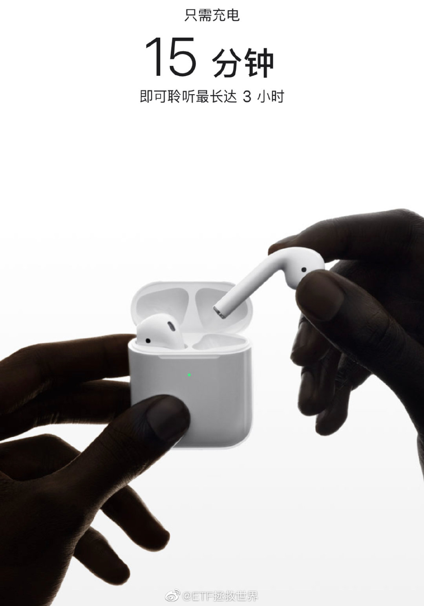

## 2021-06-29 01:50

值了 ​​​

## 2021-06-29 07:56

尽人力，听天命。

如果做一件事总是盯着结果，过程中痛苦不堪，那就意思不大。

就像投资，只是盼着一百万一千万，而不能享受投资的过程，就未免得不偿失。

因为结果只是一个点。且不说达到目标后是否真的快乐。就说以时间多少来看，用很多年的痛苦换一时的快乐，它就不值。

所以最重要的就是持续的努力并且乐在其中，而非为了目标忍受痛苦。

就像一场比赛，出局固然是坏事，但是尽了全力，享受了过程，这就很好了。

因为冠军只有一个，如果其他人都算失败，那么整件事就是哪里不对了。

## 2021-06-30 13:13

信息涨了2%，半导体涨了5%。

你看着半导体的5%后悔为什么买了信息没买半导体。

但是平行宇宙中，你可能连信息都没买。 ​​​

