## 2021-08-02 10:05

瞄准的猎物正在一步步走进我的射程。

不急，稳住，继续锁定。 ​​​

## 2021-08-02 11:10

总觉得券商贱贱的。 ​​​

## 2021-08-02 11:27

你有没有想到3个多月时间，它价格没动，你这一份盈利居然快到15%了。

A股提款机名不虚传。 ​​​

## 2021-08-02 13:38

交易让平淡的日子有了生机。 ​​​

## 2021-08-02 14:18

很多人刚刚含泪从旧赛道切到新赛道就遭到了重击。 ​​​

## 2021-08-02 18:07

上蹿下跳，一通折腾，回到原点。

有的人钱变多了，有的人钱变少了。 ​​​

## 2021-08-02 19:14

最后一定会变好的，如果还没变好就是还没到最后。

不要放弃希望。 ​​​
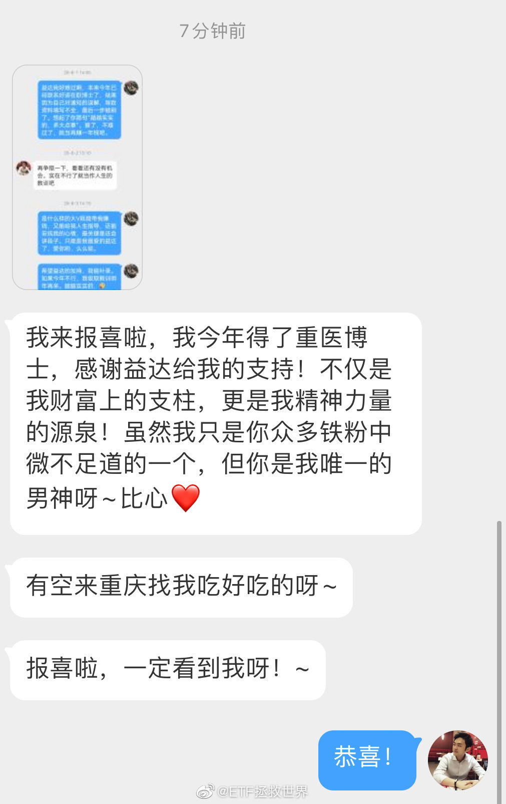 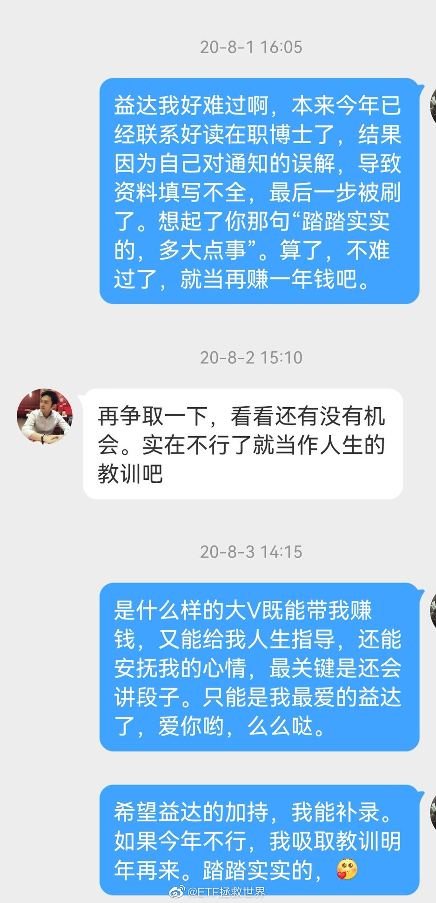

## 2021-08-02 20:44

感觉自己好节俭，

不禁想要奖励自己一件礼物。 ​​​

## 2021-08-03 11:06

刚有博友问我支撑的问题。

一般来说所谓“支撑”，是从高位跌下来后的各种技术形态构成的一个个支撑点。支撑的形成有心理因素，有资金因素等等。

如果一个品种依然是强势的，那必然会在某个支撑止跌。然后继续强势。

但是，如果跌破了最后一个支撑，那么就不能再用支撑的理念去考虑它了。因为下面已经没有什么可以支撑它的价位。

这个时候如果它还能东山再起，就要等它自己走出形态反转，也就是说只有左转右的时候才能在事后知道它什么时候反转了。

简单来说，支撑点可以提前预测阶段低位。我的微博上虽然不说股票，但各种指数的支撑点位说过不知道多少了，绝大多数都奏效了。你可以在我的微博搜“支撑”。

一旦跌破所有支撑，就不能提前预知底部了。这个需要市场自己走出来。

意思就是这个意思，理解不了就多看两遍。多看两遍还是不懂的话也没办法了。

## 2021-08-03 11:09

支撑破不破，不是看盘中，而是看收盘。另外，确认撑不住是连续三天以上无法回到支撑之上。

## 2021-08-03 11:17

另外，可能是我在某个品种上与一些朋友仓位不同。某些品种大跌我真的有点开心。

这样我就能更低的价格买了。

美股2010年之前，30年以上涨幅最大的股票是一只叫做“菲利普莫里斯”的股票。

没听说过吧。它是一家烟草公司。

为什么持有它的收益率最高呢。一方面当然是它业绩增长好，另一方面是它的价格持续被打压。

因为它是烟草公司，所以总是面对很多诉讼和zf的打压。这就导致它的估值总是上不去。

结果，它成了收益率最高的股票。利润增速高+估值低。

我喜欢总是被打压的好公司。

## 2021-08-03 11:26

别说那么多，贱贱的券商又来了。 ​​​

## 2021-08-03 13:04

我觉得吧，虽然我现在一点都不care歪果仁怎么看中国。但可能还是有很多国人希望歪果仁觉得中国好。

你想让别人觉得你好，天天给别人展示高铁啊，高楼大厦啊，共享单车啊什么的可能效果并不好。

我觉得文化输出，软实力展示才是上策。有多少年轻人为什么觉得日本还行，还不是从小看日本动漫玩日本游戏机长大的。韩剧也是，之前那么多女孩喜欢韩国人，还不是因为看了几部韩剧。这种输出不是仅对东亚，而且是整个亚洲整个世界的输出。

想让歪果仁喜欢你，就得发展文化产业，百花齐放，游戏动漫网络小说全给它弄上。真弄出NB的东西，歪果仁的青年一代自然喜欢你了。有了文化输出，什么都好说了。

我这个想法很不成熟，还请轻喷。

## 2021-08-03 18:11

集美们，给你们推荐梅乃宿的柚子酒。

我最近的新宠，夏天喝点乐无边。 ​​​

## 2021-08-04 09:56

越有价值的微博评论越少。//@ETF拯救世界:支撑破不破，不是看盘中，而是看收盘。另外，确认撑不住是连续三天以上无法回到支撑之上。

## 2021-08-04 10:02

别人还在争论游戏好不好，你已经悄咪咪的提款了。 ​​​

## 2021-08-04 11:02

能让大家快乐，我也很开心。 ​​​
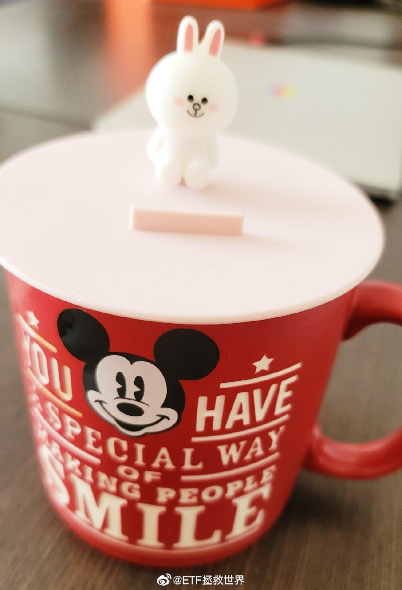

## 2021-08-04 14:21

昨天刚卖出一份碳龙头的博友： ​​​

## 2021-08-04 14:30

碳龙头（环保/新能源）市值前三十位股票平均市盈率105倍，前五十位平均80倍。

记录一下。 ​​​

## 2021-08-04 20:15

回复@罗斯福58:？？？？？？？？？？？？？？？？//@罗斯福58:他怎么没向徐晓峰，麦克陈一样被禁

## 2021-08-04 20:26

刚才那条评论并不是唯一。这几天有人私信我表达过类似的意思，甚至更加恶毒。

江湖传言，有人因为自己开发了ETF期权软件然后让人交易，出事了。这件事跟我们买指数基金本来一毛钱关系都没有，但就是有人盼着殃及池鱼。

这样，请所有能发言的朋友在这条微博下面留言，我绝不删评论：

如果有任何人觉得被我坑了，请留言。别人不要骂他，我也不会删。

如果有任何一个人觉得被我坑了，并且说出我是怎么坑你的，我将永远不在微博发言。

够不够狠？来吧。

只要一个人我就离开。只要一个。

## 2021-08-06 10:14

10个月前到底是怎么蒙中它的。 ​​​
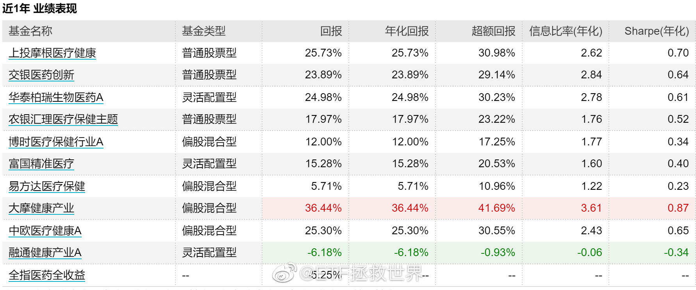

## 2021-08-06 10:52

之前那个帖子，虽然阅读量有近40万，但评论的只有4400。我看了一遍，至少评论的人里面没有人说被我坑了。

我最怕有人说因为我赔钱。所以我做了很多事防止这种情况出现，列举如下：

第一，我从不接任何广告。包括金融业与非金融业的任何广告。我非常害怕任何一家公司出问题坑了大家。

第二，为了方便交易，我有两个合作伙伴，场外场内各一家。这两家公司都很有实力，场外的且慢是与腾讯、阿里同时入选第一批仅有三家的第三方投顾试点的机构，目前资产管理规模为全国三方投顾第四位（前三位是蚂蚁天天腾讯）。场内是华宝证券，央企，非常规范。我与这两家机构的高层能非常有效的沟通，相信各位也能感受得到。我当然是会一直监控它们的情况。

第三，我从来不谈论股票。极个别极个别时候会不小心说两句，也绝不是推荐买入或者卖出，只是聊聊公司。股票牵扯到的问题非常多，比指数基金又多了道德风险，所以绝不说。

第四，我很少谈论主动基金，基本不说。主动基金也牵扯到人的问题，为了避嫌，我不说。当然，最根本的是我认为主动不适合我。

第五，我谈指数基金，但我不会简单推荐。我不会说某个基金好你买买买，我会把自己如何交易的完全公布出来。包括买卖的时间、价位、仓位等等。就是因为我知道再好的品种也会有人给玩儿亏损了，所以我把一个交易的全部信息写出来。我希望的是你的成本一定比我低，不要出现我赚钱你赔钱的事情。

第六，我与基金公司的高层以及基金经理、研究员经常有业务交流。但我绝对不会让我交易的品种与任何利益有关系。不会收钱把什么品种放入组合。我所有交易的品种，成功的、失败的，都是我自己完全独立的决定。

第七，我会把自己的长期、波段交易思路和原理全部写的很清楚。一篇写不下就写三篇。我希望你完全了解是怎么回事后再参考。

第八，在市场低位、熊市中，我会鼓励你坚持，鼓励你买入。因为我知道那时候虽然很难，但赚钱的概率非常大。但是涨起来以后，我会跪着求新朋友不要再参考我的操作。一方面是你的问题，你不懂投资，你只是看别人赚钱了才来凑热闹。另一方面是我的问题，我只会低位买入高位卖出。你让我高位买入更高位卖出我不会。所以我解决不了牛市买入的问题。高位我可以卖出高的买入低的保持仓位平稳，但我不懂怎么新加仓。别人希望跟买的人越多越好，我不是。不欢迎新朋友我已经说了一年多。

我想，我已经把能想到的，尽量不要让你因为我赔钱的事情做到极致了。我看不到任何另一个人会这么做。我希望你知道，我是真的真的真心希望你能赚钱，才会做这些事情。对我来说，这是最最最重要的事情。

我不是神，我是个人。我不能保证自己买的所有东西都能挣钱，我也不能保证自己的长期和波段计划能挣多少钱，但我能保证的是不忘初心，希望你好。我的能力也许有限，但我希望你不要侮辱我的精神。

我当然喜欢钱，但我没那么缺钱，不会为了挣钱做我认为不对的事情。

就是这样。

（我还会继续看那个帖子的评论，如果真的有人被我坑了，我依然会头也不回的离开。）

## 2021-08-08 15:01

所谓的“酒桌文化”就是糟粕。

强制劝酒、灌酒的都是辣鸡。

你爱喝就喝，非得强迫别人喝你就是辣鸡。

不接受反驳。 ​​​

## 2021-08-08 16:04

我再说几句可能很多朋友觉得三观不正的吧。

这件事是不是如女方所说，我先不评论，等警方的通报。我就说说如果是真的，我觉得那这个男的就真的特别low。

你把人家灌醉，然后做一些龌龊的事情，除了触犯法律这一点外，这样做本身就特别低级。

男欢女爱，本来就是你情我愿才有意思。喝酒也不是不能喝，两个有情人花前月下，借酒助兴，那是什么氛围，什么感觉，什么意境，什么高度，什么档次，什么情调？

你给人灌醉了，完全就是满足兽性，这人就特别特别的low！法律也许只能判决你是犯罪，但在我看来你这个人就特别低级。不仅是罪犯，而且是个特别低级的罪犯。

## 2021-08-08 17:53

为什么评论里很多人害怕中概下跌？

一天提款没有很舒服吗。 ​​​

## 2021-08-09 10:18

贱贱的，又不是很贱，只是有点贱。 ​​​

## 2021-08-09 14:25

周日吓得哭唧唧，

周一乐得笑嘻嘻。

你是来投资的还是来考北京电影学院的。 ​​​

## 2021-08-09 14:36

勇敢，不是鲁莽；

谨慎，不是胆怯。 ​​​

## 2021-08-09 14:40

有些北方人不喝酒不办事，是不是北方经济越来越不如南方的原因之一。 ​​​

## 2021-08-09 14:55

曾经的渣男建信500还有不到0.5%就又要新高了。 ​​​

## 2021-08-09 17:47

白酒终于快回到正常区间了

70倍到40倍也很快…… ​​​
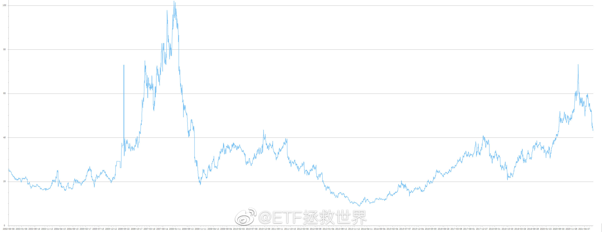

## 2021-08-10 09:33

强支撑是不是有点强，你客观评价一下。 ​​​

## 2021-08-10 09:38

之前说过很多次，利空未必是坏事。取决于利空出现在哪个区域。看见利空就哆嗦，看见利好就兴奋，只能说还处于小韭阶段。

## 2021-08-10 09:57

前几天说喝酒的那个帖子下面，有人评论说，现实就是能喝酒会来事儿的吃得开，不愿意委曲求全的大部分都是失败者。

这个意思我想了好几天。

然后我就得出两个结论：

第一，我这样的性格，如果在那样的单位，会很快离开。我适应不了，我讨厌那种氛围，会生活得很压抑，会不幸福。

第二，还是投资适合我。这里不需要跟谁喝酒换取资源，只要有独立思考的头脑就能赚钱。多好。

## 2021-08-10 14:07

挣钱了不用太高兴，赔钱了也没必要太苦恼。

虽然少了很多乐趣，但也少了很多痛苦。 ​​​

## 2021-08-10 14:18

可以再贱4个点吗？

不可以？

那我明天再来问。 ​​​

## 2021-08-10 15:52

不出意外的话今天建信500买入后新高，历史第二高。

但账户并没有新高，很惭愧。 ​​​

## 2021-08-10 21:12

关注我的朋友平均素质全网最高

不小心评论抽到礼金的非河南网友把钱执意转给河南网友。 ​​​
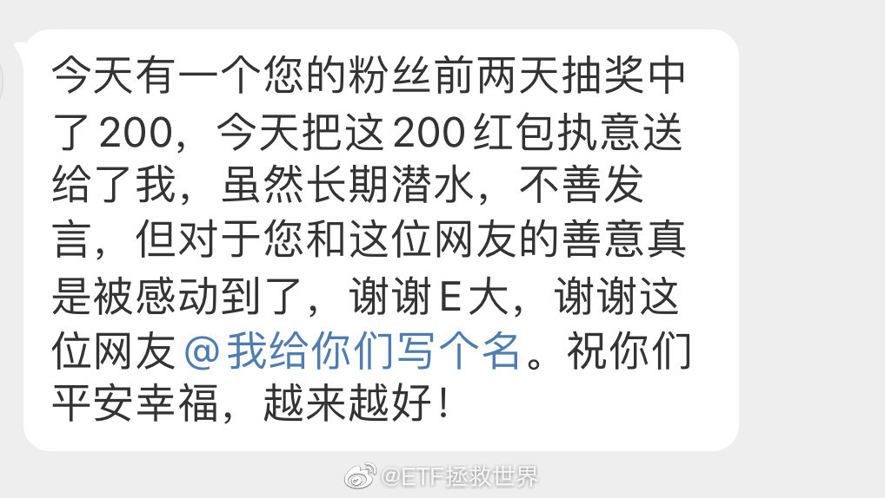

## 2021-08-11 10:19

人生虽然不过一场游戏一场梦

但在梦中也要认真把这局游戏玩好 ​​​

## 2021-08-11 11:13

最近吹500的人越来越多了。

我感觉对我们来说是好事。

你意下如何。 ​​​

## 2021-08-11 15:51

回复@历史的车轮滚滚滚:如果你不知道什么时候卖，至少要做到新高不卖//@历史的车轮滚滚滚:老大，近期新高了，可以卖了吗？

## 2021-08-12 13:28

谁能想到，钻石坑里补车的朋友已经有500品种收益率超过75%了。 ​​​

## 2021-08-13 18:13

今年中秋节前我要送大家十份美心流心奶黄月饼。

如果快到节日了我没送记得提醒我啊。 ​ 抽奖详情 ​​​

## 2021-08-13 20:23

有没有要找工作的

## 2021-08-13 21:38

第一，第二大仓位的品种继续历史新高 ​​​

## 2021-08-13 22:30

娱乐圈的瓜终于开始吃到我完全不认识的艺人身上了。 ​​​

## 2021-08-14 00:31

节日快乐。

单身狗来这里集合互相取暖了。 ​​​
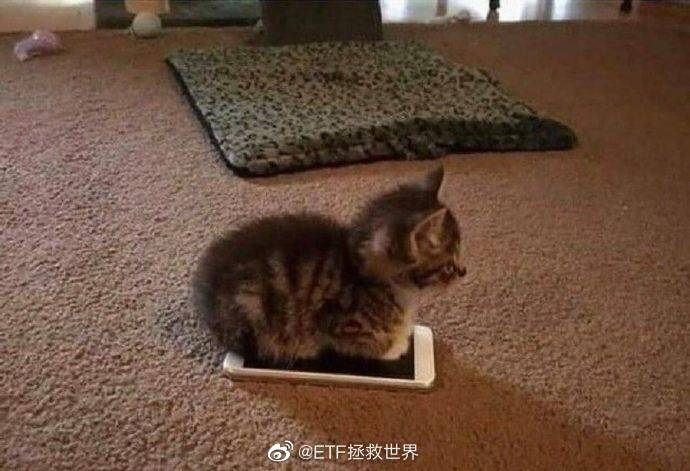

## 2021-08-14 23:09

酒是穿肠毒药，色是刮骨钢刀

## 2021-08-15 00:53

我发个声明：

以后在我这里动不动就莫名其妙的把男女矛盾，男女问题拿出来说的，我第一时间拉黑！

我对女性朋友是怎么尊重的，对女性受到不公正待遇是怎么义愤填膺，发声谴责的，是个人就有目共睹。我是怎么支持男女平权，并且实践的，关注我几个月的朋友有几个不知道？

咱们能不能就事论事，不要一有点事情就是男女问题？你是不是有病？？？

我现在越来越怀疑，网上有一帮人打着女权的旗号，搬弄是非，挑拨对立情绪，唯恐天下不乱！

再说一次，我坚决支持男女平等，坚决反对任何形式的对女性的不公平！但是，如果脑子有病的这帮人再在我这里出现，我绝对不会让你把我这里弄得乌烟瘴气！

我的话说完了，来吧。

## 2021-08-15 09:15

回复@静火:这就来了。张嘴就妈啊爸啊，你是缺哪个？我看看微博怎么处理这种生物。//@静火:回复 @ETF拯救世界:反串女拳是说你自己吗？在这服你妈呢

## 2021-08-15 10:46

自爆一下，我有个不良癖好：

我喜欢看美女。

对了，还有一个，

还喜欢看帅哥。

 ​​​

## 2021-08-16 09:35

两融规模变化。 ​​​
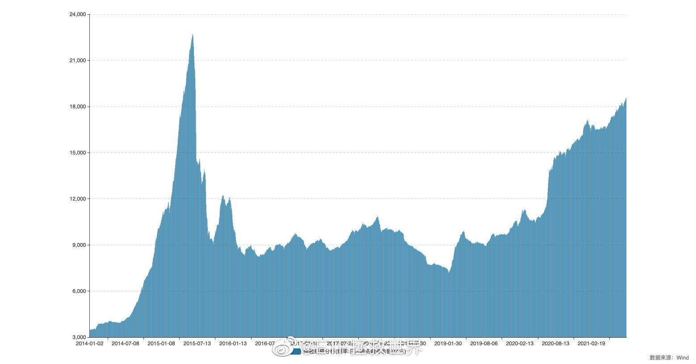

## 2021-08-16 14:20

涨也行，跌也行，

没有波动不行。 ​​​

## 2021-08-17 09:52

有些品种你希望它跌一点点；

有些品种你希望它涨一点点。

今日份的乐趣莫过于此。 ​​​

## 2021-08-17 10:48

哈哈哈哈哈哈哈哈靠 ​​​

## 2021-08-17 11:49

医药和消费都有目标价，别急。 ​​​

## 2021-08-17 12:05

明白了，在微博骂别人“你妈”不会有任何问题。

也就是说，微博认为这个不属于侮辱别人。

懂了。微博，好样的👏 ​​​
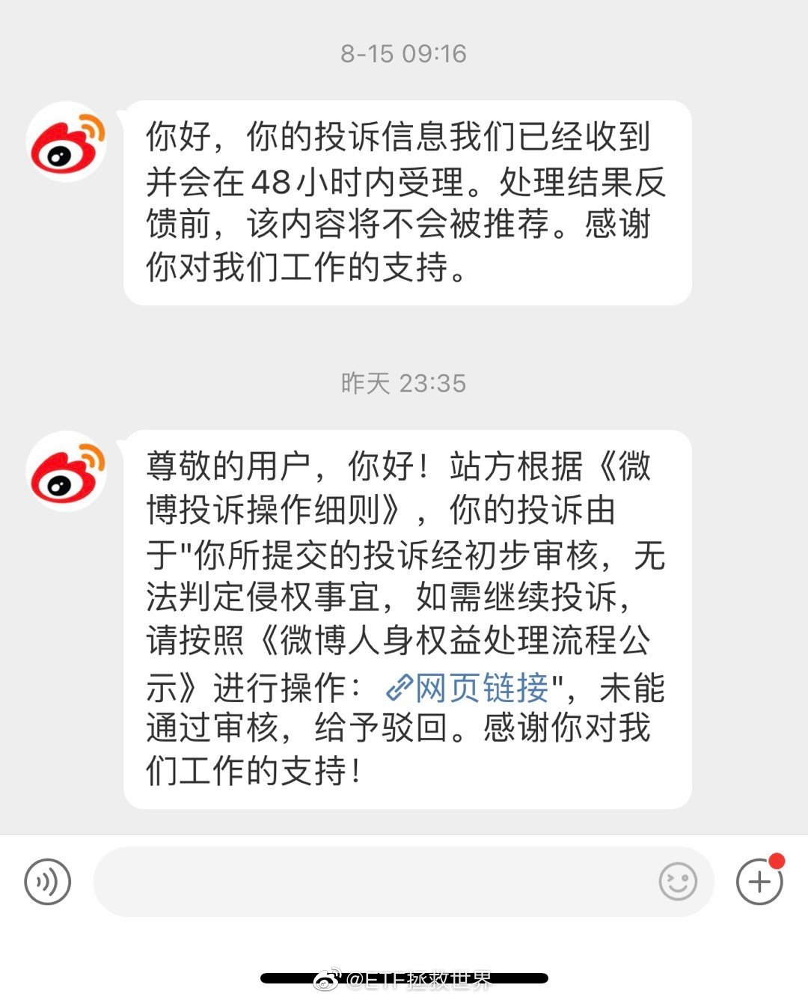 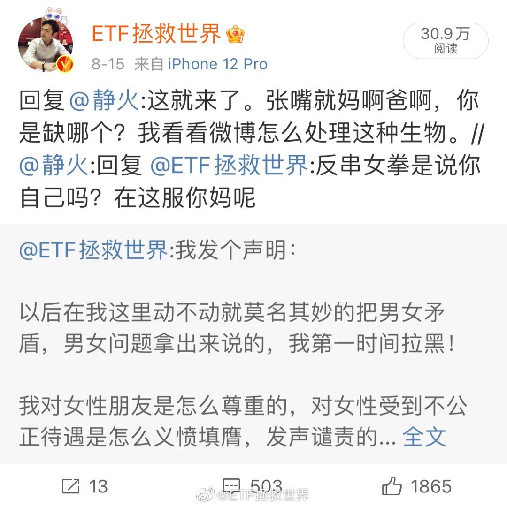

## 2021-08-17 13:51

表格已更新。

上次是一个交易日。这次会是多少个。 ​​​

## 2021-08-17 14:02

好吧，给想买医药的朋友说个我自己准备加仓的点位。

12600-12900或者13000之间。 ​​​

## 2021-08-17 14:09

不说你不知道，全指消费/食品饮料板块到现在为止已经公布的公司二季报，利润增长是负的。

当然大部分还没公布。月底看吧。 ​​​

## 2021-08-17 14:21

我想了一下，我到底希望什么样的朋友留在我这里跟我沟通。

我希望你是那种已经过了投资小白兔的阶段，已经有了几年投资经验，但是遇到了瓶颈，无法突破。那我觉得如果我能给你一些我的思考，帮你突破瓶颈，能提供自己的一些经验和思路就最好了。

我真的不喜欢投资小白兔，什么都不懂，也不知道市场是什么样，也不知道自己是什么样，也不知道别人是什么样。优势是什么，劣势是什么一概不知。涨了担心，跌了害怕。除了知道自己想挣钱，其它什么都不知道的小白兔，我就不喜欢。

你没有错，我也没错。错的是咱们在不对的时间空间相遇了。也许是对的人，但却在错误的时间相遇，或者根本连人都错了，不如拥抱一下说再见。

男的直接说再见就好，可别凑过来。

## 2021-08-17 15:00

遵守男德保平安。

兄弟们，切记。 ​​​

## 2021-08-17 16:07

回复@2016年2月20新昵称:我不同意。如果男的遵守男德，无论如何也不会有这些破事儿。所以男的自己守身如玉最重要。//@2016年2月20新昵称:我不喜欢的是，就因为她女性，她先爆出来就站在她那一边！希望大家能就事论事。不人身攻击，凡事讲证据。让子弹多飞一会儿。

## 2021-08-18 09:34

最近看新闻，觉得有些事情很有意思。

比如塔利班占领首都后，很多人仓皇逃跑，还有挂在飞机上从天上掉下来的。

这时候就不禁觉得有点纳闷：

早干嘛去了。

连我一个万里之外的人，都知道这十几天塔利班风卷残云的攻势，想跑，为什么要到最后才跑。灯塔总统下令撤军，是一个月前。而公布要撤军的决定，甚至是一年前。

这一年，有无数机会跑，早干嘛去了。

就像教辅行业，这一年多多少消息动向都是利空，最后这一下只是最终的结果而已，不应该早点跑吗？

这是历史，观察，反思，指导未来的行动。

那么，现在又有什么动向刚刚开始萌芽？这个动向会不会影响自己？自己应该有什么提前的准备？

别又等到最后一刻从飞机上掉下来，或者持有的股票跌95%才明白过来。

## 2021-08-18 10:12

时代的洪流，你我草芥小民根本无法改变。能改变的只能是自己的应对方法。

前一段时间我看陈存仁的《抗战时代生活史》有一个细节很有意思。

说的是日军占领上海后，租界虽然还算安全，但是缺物资。于是就有一批人开始跑单帮。就是从绍兴等地运送生活物资进上海租界，赚取差价。

很有一批人干这个赚了大钱。

我不评价这种类似于发国难财的做法是不是正确合理，我是说这样的国难中，就有这么一批人干了一些灰色的事情反而赚了大钱。这种行为肯定有问题，但确实是一定程度上解决了物资紧缺的问题，也算救了不少人的命。

所以我经常会想，在巨大的灾祸面前，如何才能趋利避害。

当然，第一步肯定是看历史。毕竟，历史总是在重复的。

## 2021-08-18 11:07

邻居家的小女孩来找儿子玩，结果儿子一直在给她讲奥特曼的区别和怪兽的战斗力。

像极了恋爱中给女朋友讲国际形势的直男。

我实在看不下去了，为他们打开了马里奥派对。 ​​​

## 2021-08-18 11:27

贱贱的，我喜欢。

 ​​​

## 2021-08-18 12:13

回复@痛苦的驴:我家肯定要有女性在啊。而且全程开摄像头录像。放心，这种事情我不会大意。//@痛苦的驴:怎么说咧！也许我多虑了！小女孩最好和他家人一起来

## 2021-08-18 13:19

今天大家提款提得很开心，但终有一天提款的品种涨得更高，有些人又会后悔为什么早早卖掉。

然而当你下次打定主意不再提款等着赚大钱，却发现它起起伏伏再也不涨了。

白玫瑰就是白玫瑰，红玫瑰就是红玫瑰。白玫瑰给过你快乐，但它不能给你永远的快乐。红玫瑰也是一样。

也许每一个男子全都有过这样的两个女人，至少两个。娶了红玫瑰，久而久之，红的变了墙上的一抹蚊子血，白的还是窗前明月光；娶了白玫瑰，白的便是衣服上沾的一粒饭黏子，红的却是心口上一颗朱砂痣。

所以，不要要求帮你提款的白玫瑰可以为你赚十倍，也不要要求可以帮你赚十倍的红玫瑰可以帮你度过难熬的震荡期。

我的话很深奥，你忍一下。多看看就懂了。

## 2021-08-18 13:50

蜜雪冰城连红豆款都没有，凭什么那么火？

气愤。 ​​​

## 2021-08-18 18:58

看了一集荣耀，准备脱粉热巴了。

第一次看热巴的电视剧，发现演技加成对演员来说太重要了。

当然，感觉不止她，好像是全员演技不在线，一集弃。

只代表我个人观点，对于磕颜值磕CP的人来说，应该是觉得这剧不错的。 ​​​

## 2021-08-19 09:38

偶尔翻到老照片，原来一直最爱蓝色 ​​​

## 2021-08-19 10:01

我今天的心情 ​​​

## 2021-08-19 10:49

说实话，房产税我能接受。但是资本利得税我真的很难接受。 ​​​

## 2021-08-19 11:03

做投资，最怕的就是不确定性。

随机游走的不确定，真的很可怕。 ​​​

## 2021-08-20 09:06

儿子：能不能请邻居小朋友过来跟我玩奥特曼卡牌。上次没玩好。

我：？？？ ​​​

## 2021-08-20 09:38

我感觉现在是提倡“共度时艰”。

市场化的、利润率很高、赚钱很多的企业和行业，都要留点神了。 ​​​

## 2021-08-20 10:48

2021年了，我是不可能再为你按摩了。

多大岁数了还干这个。 ​​​

## 2021-08-20 11:31

这估值，看起来这公司要挂了的感觉。 ​​​
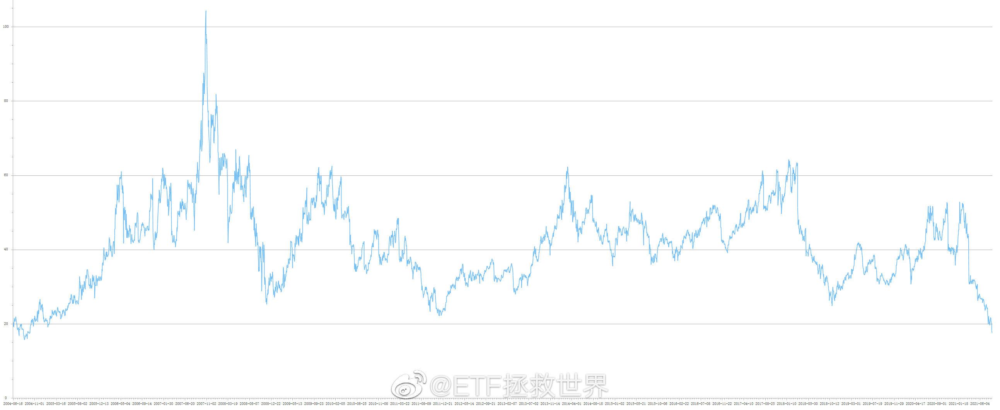

## 2021-08-20 14:38

150上次买入医药是2018年10月。

下次会是什么时候呢。

👏 ​​​

## 2021-08-20 16:32

其实这几天心里一直在反复思考这件事。

首先我绝对认同并且支持共同富裕这件事，贫富差距过大对于所有人来说都一定是灾难。

但另一方面，又担心实现过程中方式方法过于简单直接，引发各种矛盾。

短期影响已经在股价上有所体现了，看起来担心的不止一个两个人。

衷心希望国泰民安，所有人安居乐业。

“民之为道也，有恒产者有恒心，无恒产者无恒心。苟无恒心，放辟邪侈，无不为已。”

## 2021-08-20 17:26

截至今日：

全指消费44家公司公布半年报，26家二季度利润下降。

食品饮料30家公布，16家下降。

全市场去除创业板946家公布，301家下降。

消费板块利润增长非常罕见的大幅落后全市场。 ​​​

## 2021-08-20 17:42

截至今日，中概互联指数估值进入历史最低区域（非历史最低值）。

该指数第一大成分股腾讯TTM PE是18倍，其上市近20年来PE估值最低位是2004年的15倍。之后从未跌破过20倍。今年2月10日为52倍。

TTMPS市销率6.21，为2004年上市以来最低。

以上仅为客观数据，并非推荐指数、股票。请勿过度解读。如果有人过度解读我以后再也不放客观数据了。

## 2021-08-20 19:29

平心而论，言承旭44，状态保持得算是很不错了。

李承铉没听说过，但舞台上最有范儿。

但我其实还是很喜欢张智霖的。 ​​​

## 2021-08-22 09:25

其实很多时候聪明人会过得比较痛苦。因为聪明，所以容易想得多，想得深。

想得多就容易杞人忧天，想得深而不得答案就容易钻牛角尖，脑子有快要炸掉的感觉。

所以智商高的人反而不容易快乐。

但还在这个阶段的高智商痛苦，只是天生的、原始的高智商带来的痛苦。一般来说，之所以会有这样的痛苦，是因为还没有更上一层楼。

在我看来——当然未必正确——，想要到达更高级的层次，有两个点是务必要真正理解的。

第一个是难得糊涂。第二个是乐观。

糊涂有什么难的呢，很多人开开心心糊里糊涂过一辈子一点都不难。但对于总是想太多的聪明人来说，糊涂就很难。怎么样才能让自己糊涂一点，要好好想想。

人生不过一场旅行，一场游戏一场梦。何必斤斤计较，何必事事都要弄得清澈见底。

乐观就更不用说。这是一个非常可贵的素质，非常重要。很多朋友因为先天或者家庭以及成长的因素，不具备乐观的性格，那就应该有意的自我培养。乐观、积极、向上的人运气不会差。

## 2021-08-22 10:19

白嫖十几年，补票。 ​​​

## 2021-08-23 10:02

周五一个差三厘，今天一个差三厘。 ​​​

## 2021-08-23 17:26

刚才有人告诉我，有一位一直喜欢我的博友不幸得病去世了。

听到这个消息我真的非常难过。特别希望这是假的，是造谣或者开了一个不恰当的玩笑。

虽然我不认识关注我的每个人，但我真心实意的希望关注我的朋友们都健康快乐幸福。听到你们好我会开心，听到你们不好我会难过。

如果这个消息是真的，希望这位朋友在另一个世界过得好。感谢你几年来的欣赏和支持，我会记得你。

祝大家身体健康。请大家一定要健康。

[悲伤]

## 2021-08-24 09:07

守男德，保平安。 ​​​

## 2021-08-24 10:25

咱们讨论事情，能不能就事论事，不代入任何立场去思考去沟通？

你先设定了结论，怎么理性？还是说，你根本不想理性，只是想发泄？ ​​​

## 2021-08-24 10:48

恭喜@不言春风 等10名用户获得【美心流心奶黄月饼一盒】。微博官方唯一抽奖工具@微博抽奖平台 对本次抽奖进行监督，结果公正有效。公示链接：微博抽奖平台

## 2021-08-24 13:37

如果不是差三厘，已经提款了 ​​​

## 2021-08-24 15:04

今日红利和500将携手再次共创历史新高。

一分钱都没卖过。 ​​​

## 2021-08-24 17:47

团伙警告⚠️ ​​​
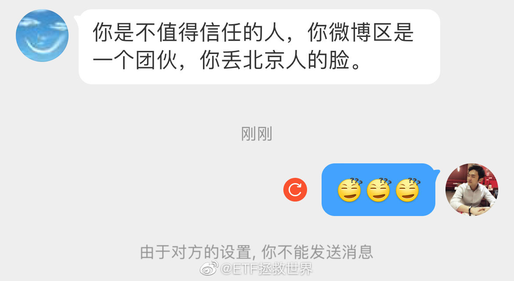

## 2021-08-24 18:40

如果前几天大跌的时候你也跟别人一样觉得这个产业完蛋了，

今天大涨你又觉得什么事都没有一定越来越好，

那你大概率是_____。（2分） ​​​

## 2021-08-24 19:42

好家伙，说时迟那时快，又爆了一个

## 2021-08-24 20:04

虽然我买了所有视频网站的会员，

但不花钱看提前点播是我做人最后的底线。 ​​​

## 2021-08-25 08:50

谁都不傻 查看图片

## 2021-08-25 09:23

我可能说的也不对，一家之言吧。 ​​​
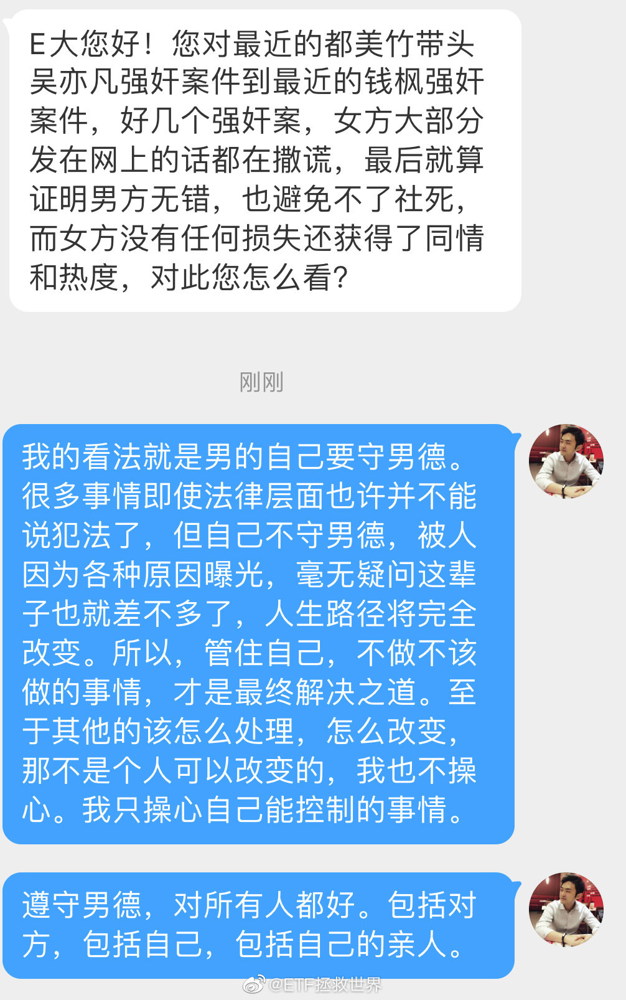

## 2021-08-25 10:09

我一直有一个观点：

真话可以不说，但尽量尽量不要说假话。

一方面是说一句假话就要用很多假话去圆谎，很累，也很容易出破绽。

另一方面是当别人发现你喜欢说假话，信任也就没了。因为从我自己来说，只要我发现有人骗我，那么这个人在我心中也就信用破产了，他说的话我很难再信了。

这个世界上人和人的差别，有时候比人和动物的差别都大。理性并不是每个人都能拥有的素质。所以有的人可以被同一个人骗很多次，因为他与这个人的交往过程中，感情战胜了理性。这感情力量之大，足以让他失明到忽视了这个人说的谎话。

而有的人绝不会被同一个人骗，因为他够理性。

有些假话是犯罪，有些假话则无伤大雅，不影响什么。但只要这个人说谎，他就很难再次取得我的信任。

## 2021-08-25 10:32

不守男德，活该。兄弟们引以为戒，不做不应该做的事情。

## 2021-08-25 11:56

为什么我说的是“男德”，而不是“守法”或者“道德”？

为什么不是守法：

守法是最低的底线。很多行为虽然不违法，但也是不应该做的事情，应该提高对自己的要求，不去做。不做不应该做的事情，既包括了不做犯法的事情，也包括不做虽然不犯法但是违反道德的事情。

法律也许不会让你死，但是很多事情会让你社死。

为什么不是遵守道德：

因为我不敢对女性朋友指手画脚，只能建议兄弟们遵守男德。兄弟们不会因为这个骂我，他们知道我是真心为他们好。

守男德，保平安。保自己的平安，保亲人的平安，保他人的平安。

## 2021-08-25 12:19

生活小贴士：

被头屑困扰的朋友不妨试试康王。

（绝非广告，如果是广告今年赔大钱） ​​​

## 2021-08-25 14:41

新高不卖。

## 2021-08-25 16:49

吃瓜只是副业了啦，今天有在努力工作哦。

哪只消费会脱颖而出被选中呢 ​​​
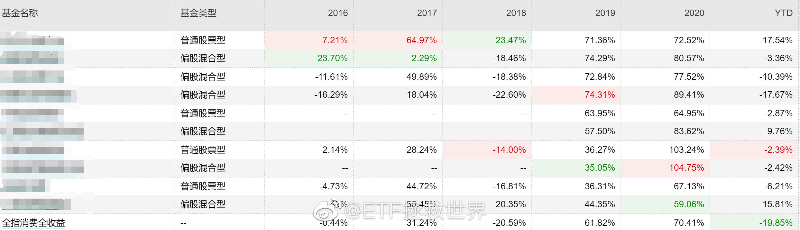

## 2021-08-25 17:50

很多朋友觉得不工作是最舒服的，

其实做自己喜欢的工作是最开心第三位的事。 ​​​

## 2021-08-26 10:34

小红又新高了。

上次新高还是在遥远的昨天。 ​​​

## 2021-08-26 11:34

红利再涨，S持仓就超过20%了，违背了我的配置原则，必须减仓。

但是又不想减，只能加仓别的了，好烦。 ​​​

## 2021-08-26 12:49

保护私人合法财产，做大蛋糕，共同富裕～

## 2021-08-26 17:26

儿子说，他说我不好，我根本不在乎。我自己知道我是什么人。（比我的觉悟不知道高到哪里去了）

儿子又说，我希望自己长大后是个普通人，普通人就挺好的。（大多数人三十岁以后才认识到这个吧）

二年级。

不知道长大会变成什么样。

希望不会遁入空门。 ​​​

## 2021-08-26 19:44

宁波现在安全吗，

有什么推荐的美食好店吗。 ​​​

## 2021-08-27 10:37

实在忍不住了，买点消费吧。 ​​​

## 2021-08-27 13:48

有些瓜我愿意跟大家一起吃，

有些瓜我想自己吃。

瓜这个东西不能乱吃，吃错了容易闹肚子。

也不是说害怕闹肚子，是没必要，你说对吗。 ​​​

## 2021-08-27 15:44

新高不卖，周末愉快。 ​​​

## 2021-08-27 18:17

早干嘛去了。原贴时间，赛道股崩塌的前夜。 查看图片

## 2021-08-27 21:44

开始买了啊，别急，过节前都能吃上 ​​​
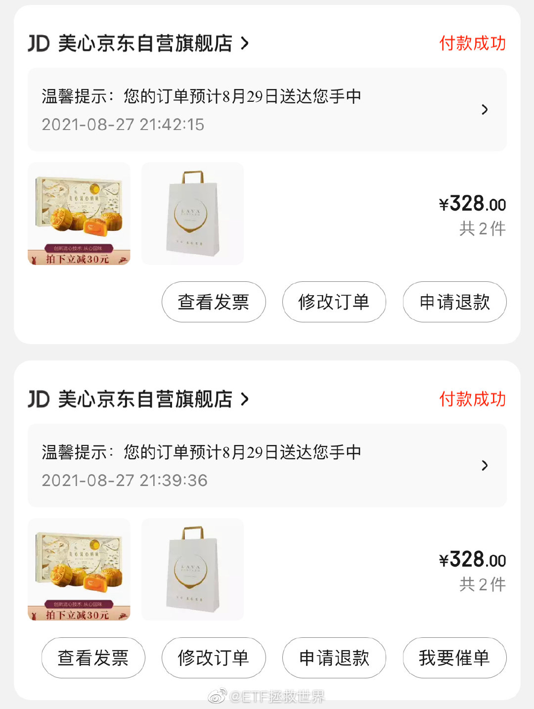

## 2021-08-27 23:20

回复@如果可以我想做条咸鱼:我不会提前说哪条微博抽奖。我不希望有人为了抽奖而评论。只想把礼物送给真正想评论的朋友//@如果可以我想做条咸鱼:回复@不上BNU不改名:每次抽奖微博都没有，然后突然就开奖了，不懂微博怎么搞的

## 2021-08-28 13:11

我在办公室996

爷爷奶奶妈妈儿子在家里斗地主

男人哭吧不是罪 ​​​

## 2021-08-28 22:21

京东YYDS。

月饼寄完了，降价后一键保价退款～ ​​​

## 2021-08-30 10:59

500，这些年你受委屈了。 ​​​

## 2021-08-30 11:17

时隔两年回头看“低调”二字，不禁又有了新的感悟。朋友们，踏踏实实活着，别嘚瑟。

## 2021-08-30 15:15

今天文章留言有两个埋怨这几个月开始参考我的计划没赚钱的人。

两三年前我看到这样的人心情会特别沮丧，

今天我笑着拉黑了他们，内心毫无波澜。

我都跪下求你别参考了你一定要参考，然后来埋怨我？

我还能怎么做你告诉我？

活该。你这种看别人赚钱就来凑热闹，又不好好了解就参考别人投资逻辑的，活该赔钱。

## 2021-08-30 15:28

牛市进来的人，和熊市开始投的人，从根上他就不是一路人。牛市进来的是赚快钱的，你跟他说春播秋实，你跟他说种了种子耐心等发芽，你跟他说越跌越买以后能赚大钱不然你买一点翻番也没用，他当你是放屁。我真的真的不想跟这种人一起做事情啊！

## 2021-08-30 15:36

回复@X1234567秃噜皮:2018年最黑暗的时候，公众号留言都几乎没有埋怨的。这就是我说的，熊市一起打仗的兄弟是值得信任的战友，牛市进来摘桃子的都是投机分子。//@X1234567秃噜皮:这种拉黑数/月，也是牛熊情绪的一种反映。

## 2021-08-30 18:16

目前市场有非常有意思的现象，需要各位留心观察并记录，我相信，对你我未来几十年的投资生涯有很大帮助：

目前市场有些行业，由于各方面的压力，当然最主要是ZC方面的压力，导致行业估值比较低。当然没到最低。

这个时候，我会观察，到底是“便宜”最终会赢，还是“跌幅巨大后的新利空”会赢。

在我以往的观察中，绝大多数情况是便宜会赢。跌幅巨大后的利空通常会砸出一个结结实实的钻石坑。在这种时候，会有无数人告诉你：

这次不一样；这个公司/行业彻底完了……

我不能确定这次是否还像以前一样，但我选择经验主义，也就是说，我愿意用一点筹码赌一赌便宜更重要。

目前来看，被打压的比较凶的是医药、传媒、中概互联网。

这三个行业，互联网最近几个月开始买，传媒最近一个月在买，医药前一波减持后还没开始买回，但最终会买。

便宜还是暴跌后的利空，谁会胜利？

几年后，这将是一条值得回味的微博。javascript:void(0)

## 2021-08-30 18:23

我要向谁投诉，我的每条微博后面都会跟一个不知道谁创建的“ETF拯救世界铁粉”的链接。这是谁弄的，是什么意思。如果有人被骗了这个责任谁来负？

## 2021-08-30 18:40

可能有人不相信，可能有人不理解，

但是看到这样的消息我真的真的特别高兴，心情特别好。

能帮上信任你的人一点忙，真的高兴。 ​​​
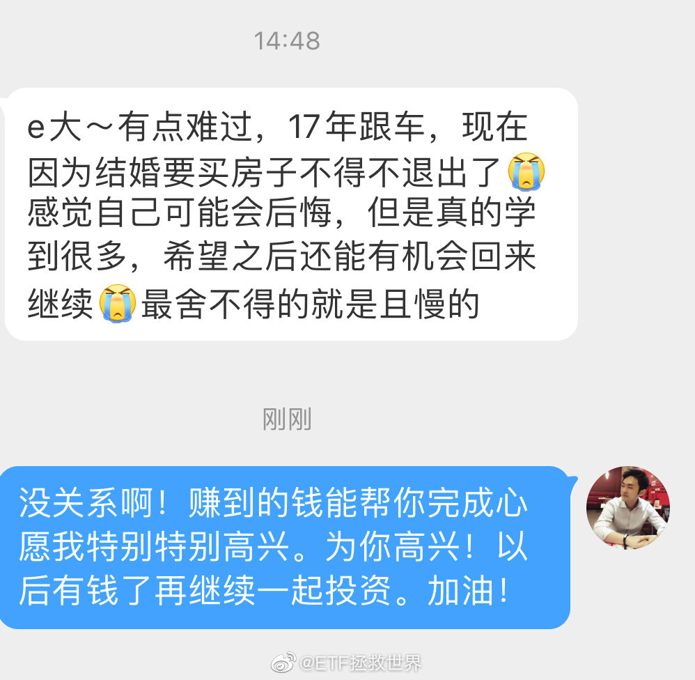

## 2021-08-31 10:15

经常在评论里看到有朋友说，某某品种涨得真好，可惜，“买少了”。

为什么会买少了呢。

一方面当然是看到大涨的品种，贪念起来了，觉得自己少赚了。这是一种思维上的问题，不深究。是属于本来就不应该买到的意念盘。

主要是第二方面，为什么没有在底部买到应该买到的份额呢。

很简单。一个品种低迷的时候，很容易让人看不到希望。

就是别的品种都在涨，只有它一动不动，时不时的还跌一下。就是你的钱已经沉淀在里面了，你要说服自己再沉淀一些，为了那根本看不到希望的上涨，很难。

然后，某一天，它涨起来了，你就会抱怨，“买少了”。

只有解决两方面的问题，才能让自己敢于在低迷、看起来毫无希望的情况下买入和持有。

第一，信念。坚定的信念，不可摧毁的意志。坚信一定会赢，再黑暗的世界，伸手不见五指，依然相信光明一定会到来，胜利一定属于自己。这个信念不需要任何人打气，不需要任何加持，是从骨子里坚信一定会赢。

第二，配置。在一部分持仓低迷的时候，另一部分已经开始赚钱，甚至赚了大钱。一般人是绝对扛不过满仓低迷的状态。所以一般人应该选择相关性低的品种做配置，一部分配置坚守信念，另一部分已经开花结果。心态就会好很多。

总体来说，我的投资世界观就是平衡。我相信80%的普通人都是一样的，在资本市场上会有恐惧和贪婪，会有迷茫，会有不知所措。所以我们应该做的是设计出平衡的体系，保证自己在极端的情况下心态不崩，收益不崩，然后取得长久的、持续的胜利。

今天，或者昨天为我们赚大钱，甚至还在持续不停新高、赚大钱的品种，无一不是曾经让很多人绝望的品种。一次次的胜利，会让你真正理解投资的真相。

你不是基金经理，没必要为了业绩、为了规模、为了奖金在赛道上搏杀。低买高卖等他们给你抬轿子才是最佳选择。因为他们搏杀输了，只是排名低了，奖金少了。而你如果输了，你的血汗钱就没了。

## 2021-08-31 10:32

原贴与评论一起食用味道更佳。

## 2021-08-31 10:50

再说一次：

我以前绝不，现在绝不，未来也绝对不会推荐自己持有的，已经涨起来的品种。

我绝对不可能在自己赚钱的情况下把任何品种推荐给你。

我在微博上跟朋友们聊我们共同持有的，已经赚钱的品种，是因为我们赚钱了，一起开心一下。从来也没有说可以追这样的意思。我也从未表达过这样的意思。

我只有一个原则：

你的成本一定要比我低。你不赚钱，我一定也没赚钱。你赚钱了，我还未必能赚钱。

某个品种我赚钱你赔钱，这种事情我干不出来。

## 2021-08-31 11:24

11500的消费不是梦

## 2021-08-31 11:29

今天更新的表格品种，会把买入和卖出股数去掉，只剩下买入和卖出金额。

因为我发现在条件单内直接设置买入卖出金额比较好。

修改：

根据大家的提议，决定不去掉股数，但是加入“卖出金额”一项 ​​​

## 2021-08-31 12:29

我的时间比较自由，所以是欢迎820到校的。

这个时间到校你支持不支持，会对你造成什么不便吗。 ​​​

## 2021-08-31 13:45

很多话你觉得很平常

岁月会告诉你它值几个亿

“新高不卖” ​​​

## 2021-08-31 14:04

有些品种是无论长线短线买到就是赚到；

有些品种是无论长线短线买到就是套到。 ​​​

## 2021-08-31 14:22

机构几个月前追逐，现在抛弃消费的行为，让我想起了一个成语：

始乱终弃。 ​​​

