## 2021-09-01 07:50

本来500已经很强了，建信三个月还跑赢了7%。 ​​​

## 2021-09-01 10:00

其实我是个特别狭隘的人。

我从来也没希望过什么所有人幸福，因为我觉得很多坏人根本就不配幸福。

我也没希望过所有人都在股市赚钱。我只希望那些喜欢我，信任我的朋友赚钱。他们赚钱了我会高兴，赔钱了我会难过。

至于其他人，他们赚钱不赚钱我管不着，我也不关心——甚至极端点来说，如果大多数人都赚钱了，我赔钱的概率就大了，不是吗。

对，我就是个相当狭隘的人。不装了，摊牌了。

## 2021-09-01 10:11

回复@ETF拯救世界:好消息，科创50终于从100倍降到70倍了！//@ETF拯救世界:小贴士：目前科创板整体市盈率100倍。//@ETF拯救世界:公募基金整体仓位进一步升高，幅增持创业板、科创板，仓位水平处于历史高位，而对于主板进一步冷淡，仓位跌至历史低位。

## 2021-09-01 10:29

关于行业，免费送你。 ​​​
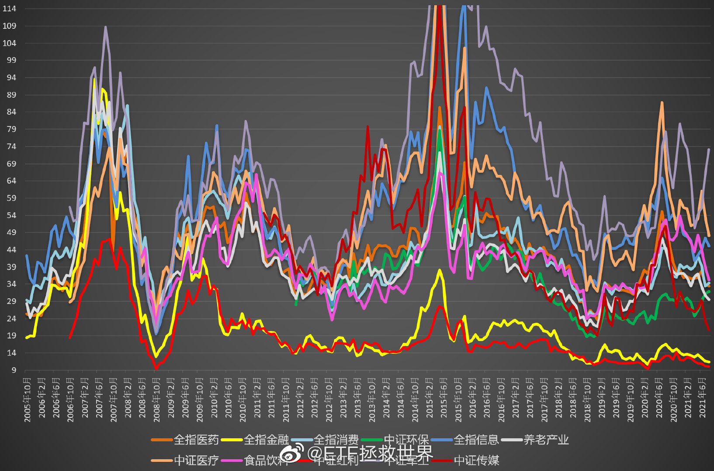

## 2021-09-01 11:14

消费涨了！
你没买吗？

医药涨了！
你没买吗？

传媒涨了！
你没买吗？

买了啊。
那你慌什么。 ​​​

## 2021-09-01 11:27

S上个月还买过一个叫证券保险的，都忘了吧…… ​​​

## 2021-09-01 14:46

关于一只很辣鸡的品种的持仓成本。 ​​​
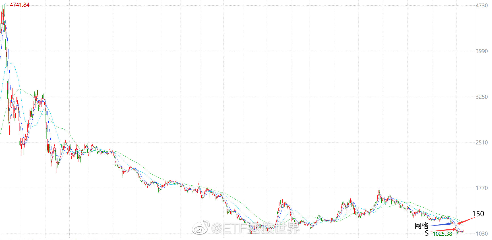

## 2021-09-01 15:12

今天就到这儿吧。

记得要享受生活。

哪怕遇到了一些困难。它终究会过去的。

明天见。 ​​​

## 2021-09-01 22:30

## 2021-09-02 08:52

好消息，环球有速通卡。

但是鉴于首都人民群众的消费能力，我决定先观察一下速通会不会变成慢通。 ​​​

## 2021-09-02 09:48

巴适。 ​​​

## 2021-09-02 12:20

现在500和红利每天新高，你肯定以为我要吹他们有多好。

你错了，我并没有认为他们有多好。

我不会因为他们涨得好就认为他们特别好，也不认为现在跌的品种就很差。

其实非常简单，就是风水轮流转，轮动而已。

但是很多人始终不明白这个道理。只要你看到那些，见到一些品种涨得不好就嘲笑，甚至鼓动别人底部清仓；或者看到某些品种大涨就极力吹嘘这个品种特别好永远好不买就吃亏……的人，我建议你取关。他们连投资的门都没入。

所以在我这里，涨得好不代表好，相反我会慢慢卖它。跌得多也不代表不好，我反而会慢慢买它。投资不就是低买高卖吗。

那你说东西真的没有好坏之分吗，那肯定有。但是，在股市上，好一点差一点是一个问题，还有一个问题是价格。值1块钱的东西卖5毛，值100块钱的东西卖1000块，该买哪个，脑子清楚的人不会弄错。

只有脑子有毛病的，才会觉得值100块钱的东西卖1000是合理的，未来十二个月目标价还要调高到3100。

涨了不趋炎附势往上凑，跌了不嫌贫爱富反而要帮助它。这很难说是投资观，还是世界观。总而言之，我喜欢这样做投资。

## 2021-09-02 12:31

一句话告诉你我没什么钱：

隐形眼镜我不舍得用日抛。 ​​​

## 2021-09-02 14:26

奇怪，昨天红利500跌消费医药涨，资产增加了。今天红利500涨消费医药跌，资产还能增加。

搞不懂。 ​​​
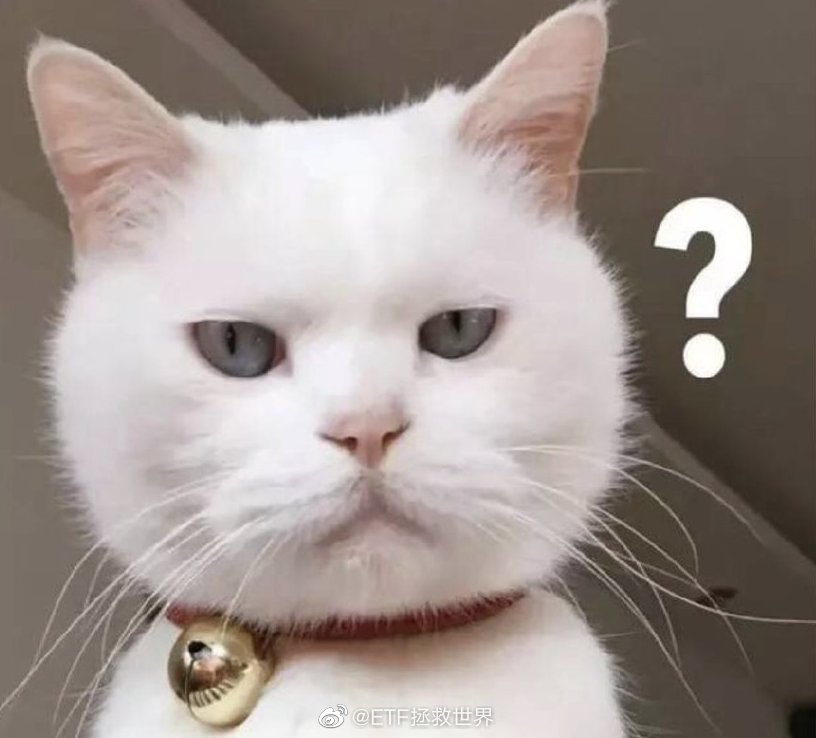

## 2021-09-02 14:51

有些朋友在评论里或者私信我，问我对于西安地铁的事情怎么看。

我首先说啊，我不是学法律的，具体保安的做法是不是犯法了我是真的不知道。这个要等官方或者法律界的人士解读。

从我个人的，朴素的，普通市民E先生的角度来看，这个保安明显是太过分了。我感觉他的个人素质以及业务能力都非常有问题。

往上捋，当然是保安公司的锅。业务培训不到位，招人也有问题。

希望依法从严处理保安以及保安公司。在保安行业内树立起尊重女性，尊重乘客，在职权范围内使用合理合法以及必要的手段维持公共交通工具秩序的新时代风貌。

这就是我的看法，再说一次，我不懂相关法律，支持相关人士拿起法律的武器捍卫自己的权利，为自己讨回公道！

说完了。

## 2021-09-02 15:07

历史新高，光头收盘，该不该卖，拿不定主意，有朋友给个建议吗。 ​​​

## 2021-09-02 15:17

想买个flip 3尝尝鲜，又觉得肯定玩不了多久就腻了。

第一次买手机有点纠结。 ​​​

## 2021-09-02 15:52

你有没有想起一个人心里甜甜的感觉。 ​​​

## 2021-09-02 18:14

小预告：

如果全指医药能够到11700左右，将进行一次较大力度的买入。

比较强的支撑。 ​​​

## 2021-09-02 22:21

一波流，不要想太多。 ​​​

## 2021-09-03 02:00

👏 ​​​

## 2021-09-03 10:05

每天这么涨好吗，

不好。

赚钱赚得没有腔调。 ​​​

## 2021-09-03 10:12

很多朋友喜欢涨，不喜欢跌。

我就不同了，我都喜欢。

你得明白几件事：

第一，机会是跌出来的，风险是涨出来的。

别看你今天，这个月，今年赚没赚，赚了多少。你只要一天没离开赌桌，就都不算数。所以今天赚了赔了，毫无所谓，要为未来着想。

跌了就是机会，涨了就是风险。这个不要弄反了。

第二，今天给你赚大钱的品种，是不是都是你在跌的时候买的。是不是买完了还让你浮亏了不少。

你今天赚钱了，很快乐，你还记得当初的痛苦吗？可能有点印象，但极有可能已经忘了那种感觉了。

所以，现在痛苦的感觉重要吗？一点都不重要。因为未来的快乐才是持久的，绵绵不绝的。

我说的很多东西，没经历过你根本不知道是什么意思。几年后回头再看，你才会恍然大悟。

## 2021-09-03 11:11

昨天犯了一个错，

大意了，没有闪。 ​​​

## 2021-09-04 12:05

天下本无事，庸人自扰之。 ​​​
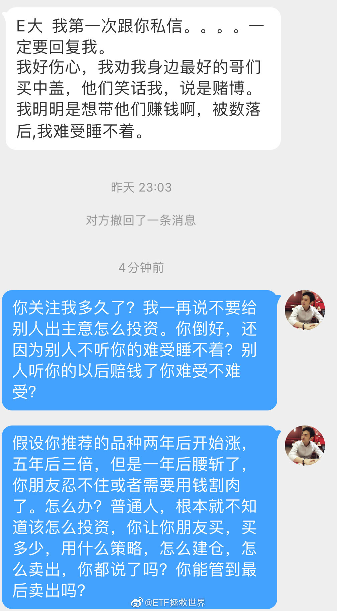

## 2021-09-06 08:55

借钱不是不行，但绝对不要去借超过自己还款能力的钱。

否则早晚出大事。 ​​​
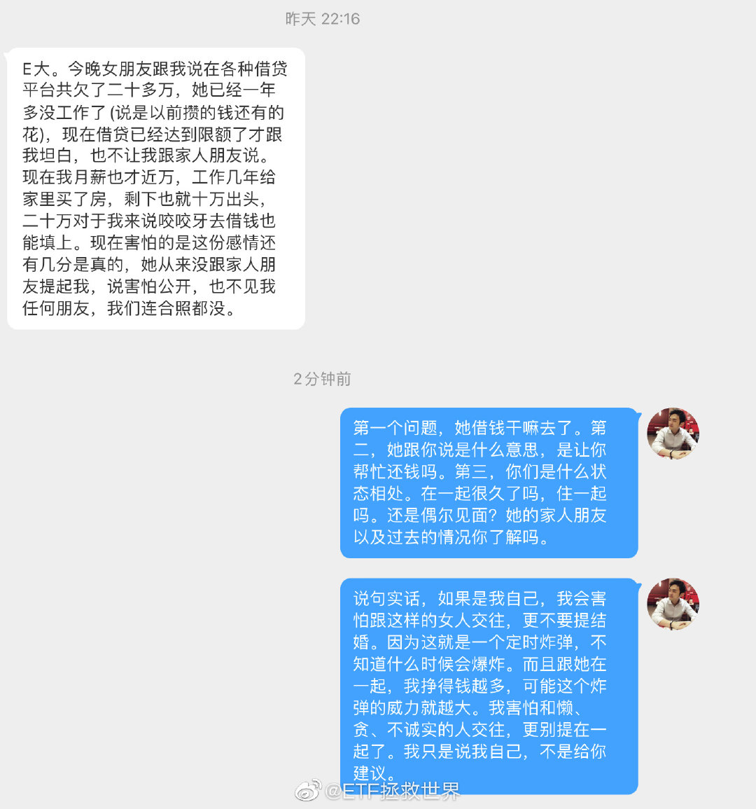

## 2021-09-06 09:23

推荐给不爱喝水的朋友一个好东西。

拿着这个在办公室，不敢说你会变得爱喝水，但你一定是整栋大厦最拉风的仔。

绝非广告，自费网购。几十块。 ​​​
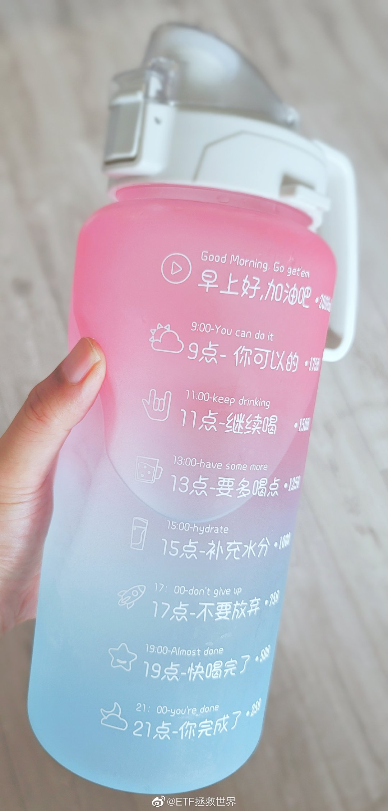

## 2021-09-06 10:11

市场的轮动让人着迷。 ​​​

## 2021-09-06 10:36

回复@不可以犯拖延症哟:能到就大手笔买，不能到就先吃波动提款先//@不可以犯拖延症哟:那医药还要等11700么

## 2021-09-06 10:56

看了几个化妆的帖子，我只想说一句：

我再也不相信网上的美女了。 ​​​

## 2021-09-06 11:19

今天又是空气中充满快乐的一天。

再见，我要出去看云了。 ​​​

## 2021-09-06 12:47

我发现有些人的幽默感是负数。

要么就是智商是负数。

又或者两者根本就是一回事。

每当我想到，没有跟不在一个频道上的人结婚，就万分庆幸。 ​​​
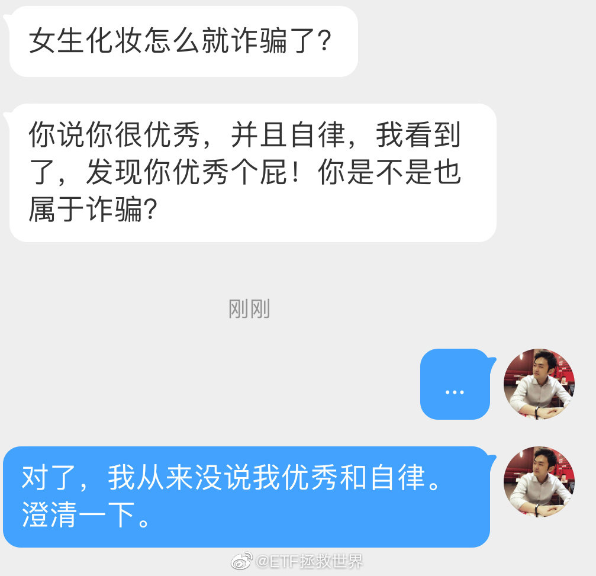

## 2021-09-06 14:47

对于幸福，我有个不成熟的想法。

两个条件必不可少：

钱大致够花；周围的人际关系大致不差。 ​​​

## 2021-09-06 15:23

辣鸡消费，涨幅还不到3%。

终究是错付了。 ​​​

## 2021-09-06 16:27

今天看云的时候，想了一些事情。因为是个情感博主，所以经常有情感类的私信问题。看多了，就会发现基本也就那几种情况。

我想了想。应该跟什么样的人交往和结婚我不知道，但不应该跟什么样的人基本有点数了。

以下谈到的都不涉及感情。只说人本身。

第一个，不诚实的人。

相信这个世界上，没有任何人敢说自己没说过谎。所以你不能要求别人一句瞎话都没有。但是，谎言跟谎言是不一样的。有些无伤大雅，有些性命攸关。

比如有严重的财务问题，交往的时候不说，婚后不说，最后爆雷了才说。而且只说一部分，解决了再说一部分，最后弄得倾家荡产。

第二个，过分自私的人。

绝大多数人都自私。有句老话叫人不为己，怎样怎样，对吧。但是人不能过于自私，不能以伤害亲人、朋友，爱自己的人的利益为代价，满足自己的私利私欲。

扩展到情侣夫妻，就是什么事情都是以自己为优先考虑，缺乏责任感，体现在方方面面。不展开说，自己想。总之就是只要自己舒服，自己的利益得到保障，其他人怎么样毫不在意。这种人交往的时候要谨慎，结婚更要谨慎。

第三个，相互之间没有感情的人。

听人说有些人相互之间没有感情，婚后能培育出来。也许吧，但我觉得概率太低。为了结婚而结婚走到一起，搭伙过日子，感情基础薄弱，只是觉得各方面都比较合适，其实对对方并不真的从心里有爱，这种也会出现各种问题，出轨啊什么的恐怕难免。

第四个，家里人事儿过多，而当事人自己又没有主见，不独立的人。

无论是公公婆婆，老丈人丈母娘，又或者七大姑八大姨，又或者兄弟姐妹，各种错综复杂的人里面，只要有那么一两个让人不省心的，而男方或者女方又是妈宝之类的没有主见，经济以及其他事情不能独立的人，就会非常麻烦。与之生活在一起会有无穷无尽的烦恼。

最后，就是三观要一致。对一个事情的看法，错也好对也好，没关系，只要你们差不多一致就会很和谐。就怕对什么事情看法都不一致，方向也不一样，最终就会很难受。

跟谁生活在一起，最重要的其实并不是ta的能力有多强，而是ta的人品，以及对你的感情。如果ta的人品差，那么，能力越强，你会越惨。当ta真要跟你分开的时候，你会发现ta的钱再多，资源再多，也跟你无关。

那怎么才能知道一个人的人品呢？很简单，恋爱的时候，不要看ta对你怎么样，而是观察ta对别人怎么样。对别人是不是能基本保持诚实、不过分自私、与周围大多数人关系良好。

基本我觉得就是这样。相爱总是简单，相处太难，祝各位幸福。  http://t.cn/A6IB0Jfu

## 2021-09-06 20:51

今日情感&amp;神奇后续私信合集 ​​​
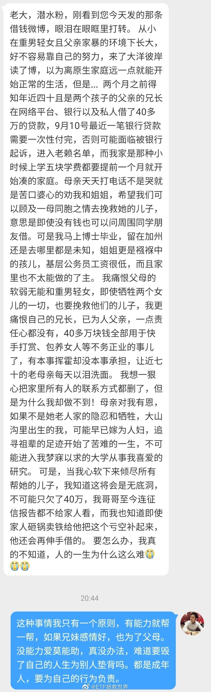 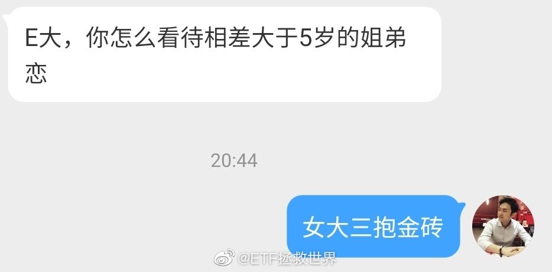 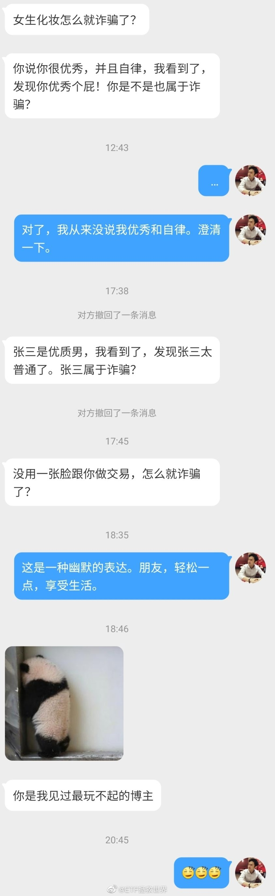 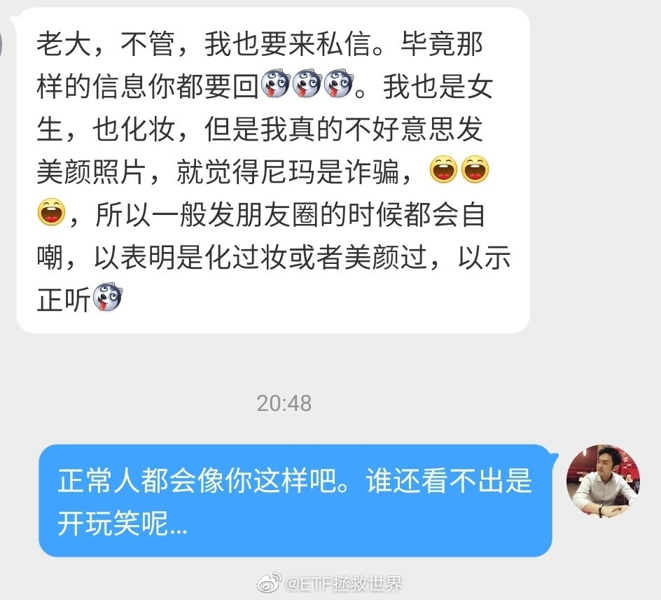

## 2021-09-07 08:14

当你的持仓收益率越来越高的时候，你就越来越淡定，不会担心坐电梯怎么办。 ​​​

## 2021-09-07 10:01

又新高了。你以为我很高兴，其实没有。

我不太喜欢这样每天咔咔往上涨的形态，因为我们不是来赚快钱的。

我喜欢进二退一，拿一座城就完全站住脚，再拿下一座。

如果这么涨不回调，明年就不乐观了。 ​​​

## 2021-09-07 10:07

有一说一，有这样的一个媳妇算是这哥们的福气了。（我没说王某文犯没犯法，做的事对不对，我只是说他媳妇为了自己的丈夫做的事情值得欣赏。有勇气，有智慧。）

## 2021-09-07 10:18

看完*厂的走势，还有人相信技术完全无用吗。 ​​​

## 2021-09-07 10:26

有时候看球球上有些人不停的吵来吵去就觉得好笑，

为什么价值派趋势派就互相瞧不起，为什么价值投资成长投资热点投资就互相瞧不起，为什么大盘股赛道股中小盘股就互相骂，甚至**银行和**银行，**地产和**地产互相也能骂起来。

为什么不能把所有投资方式的优点结合起来呢？每一种方式之所以存在，就必然有它的道理，何苦一定要否定别人呢。

人，只要能接受新事物，愿意以开放的心态去接纳新的观点，取其精华为我所用，就是年轻有活力的。

无法接受新的事物，固步自封，就说明这个人老了。无论他的年龄是多大。

## 2021-09-07 10:43

数学小贴士：

如果你在某个品种上赚了100%，那么当它再涨1%，你的收益率就会变成102%。

如果你在股市上赚了10倍，那么当你再赚60%，你的收益率就变成了16倍。 ​​​

## 2021-09-07 11:06

今天中国队如果能干掉日本队，我发999红包。

 ​​​

## 2021-09-07 13:02

刚才那个说中国队赢了就发红包的帖子，你看评论就很有意思。

比如有人说，你这分明就是不想发啊。

这什么意思，意思是中国队必败，我这红包发不出去，我是哗众取宠。

好，那你反过来，让他拍999，说中国队赢了就分给大家，你看他愿意不愿意？

这时候他心里就开始嘀咕了，万一赢了呢，这999可不是小数，就这么扔了吗……然后你再加码，说中国队赢了你掏9999,99999，999999，因为你认为肯定赢不了啊，就算把房子拿出来也无所谓啊。那他肯定就不敢了。

因为这时候，涉及到他自己的钱了，他就没那么肯定了，开始考虑概率了。但是如果这钱是别人的，他就可以叉着腰说你这是没诚意，你这是哗众取宠，你这是在100%不可能的事情上发红包。

体会一下，这就是人性。

## 2021-09-07 13:40

其实我特别想客观理性的讨论一些问题。

比如有些事情站在男性的角度看是怎样的，比如男性的特有的生理、心理、基因等在碰到某些事情的时候是如何反应，如何思考的。

我没有任何为谁开脱之类的意思，我只是想谈一谈客观存在的东西。因为很多东西你不是男性，你根本无法体会男性到底是怎么回事。

但我绝对不会说了。因为很多人根本就不能站在一个客观的角度上思考问题。

从什么时候决定不说了呢，从我上次说“有一部分男性会因为女性的某些穿着引发欲望”被骂那时候。

从那时候我就知道，什么客观理性的讨论，去他大爷的吧。

## 2021-09-07 14:01

爱谁谁，提款是正事。

别说那么多，两点几嚟，提款先啦！ ​​​

## 2021-09-07 14:05

HS这货真是笑死了，一年时间，价格一动不动还跌了点。

提款11次。 ​​​

## 2021-09-07 14:11

500翻番的朋友越来越多了。

除了钻石坑入场的，黄金坑入场的也开始有翻番的了。

其他朋友继续等。 ​​​

## 2021-09-07 14:33

每过一天，你都会更加明白“新高不卖”的价值。

那些中途忍不住卖了的朋友理解得更深。 ​​​

## 2021-09-08 10:11

不允许任何一个品种亏损卖出。

全都要盈利。 ​​​

## 2021-09-08 10:44

不调休直接放假的公司都是好公司，

要珍惜。 ​​​

## 2021-09-08 10:56

你造吗，中证500全收益在过去16年中，有12年上涨，只有4年下跌。

这么好的品种，为什么这两年有人不断嘲笑它呢。

没错了，就是因为之前两年表现不好。

那么这些人是用什么样的视野和眼光看待投资呢？

我不知道，你知道吗。 ​​​

## 2021-09-08 11:27

生活很乏味，没什么乐子。 ​​​

## 2021-09-08 14:26

长风破浪会有时

直挂云帆济沧海

试问卷帘人

却道海棠依旧

知否知否

应是绿肥红瘦 ​​​

## 2021-09-08 14:40

有个事情很有意思，分享一下。

虽然我一直说请新朋友不要跟车，但实际上跟车的朋友还是持续增加的。

上个月底150和S双发传媒，

跟车人数比上次少了。

对莫莫，很多朋友是真的害怕了。

群众的恐惧也是一个指标。 ​​​

## 2021-09-08 14:54

成本很低，你忍一下

## 2021-09-08 15:07

回复@ETF橙小喵:听起来非常赛博朋克//@ETF橙小喵:当年的环保变成了碳中和，现在的传媒终有一天会变成元宇宙//@ETF拯救世界:成本很低，你忍一下

## 2021-09-08 15:29

活着最重要 ​​​
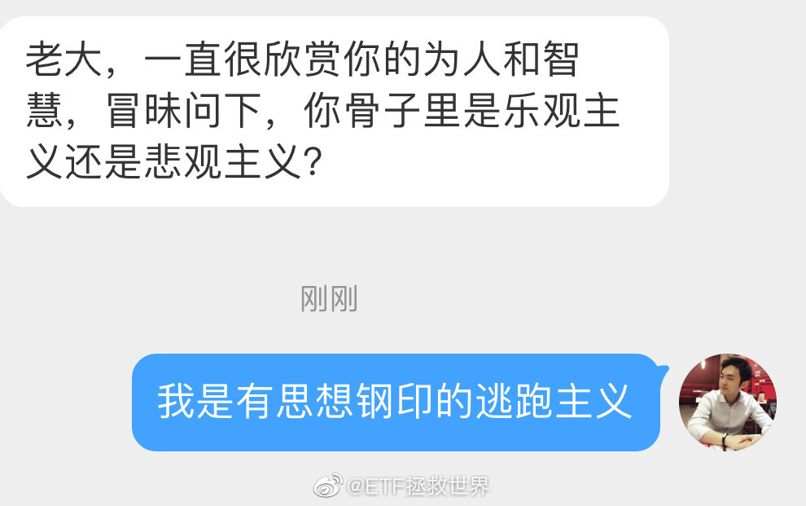

## 2021-09-08 18:04

我预感今天是近期最后一个新高了。

enjoy it. ​​​

## 2021-09-08 18:52

一定一定要记住一件事，人类，不懂得感恩的人是绝大多数。

所以，当你帮助别人或者对别人好的时候，千万不要预期对方会回报你什么。如果有回报，那么就当做意外之喜，如果没有回报，那就是正常现象。

如果你总是幻想帮助别人，对别人好，会得到回报，那么极大概率会失望。

用阿德勒的理念，你要把这件事分成两部分。

第一部分是你自己，你对别人好，是你的事，跟别人无关。是你自愿自发的，你想做就去做。

第二部分是别人的事。他会不会回报你，记不记得你的好，那是别人的事，你不要因为别人的事烦恼。

对，我知道很难。但这个世界的真相就是这样。想不明白这件事，你就会痛苦。

我一直认为，大多数，甚至绝大多数的人类并不值得爱。值得爱的人很少，但为了这些值得爱的人，努力和奋斗，甚至牺牲就值了。

## 2021-09-08 22:41

还是多了解了解再说话比较好。 ​​​
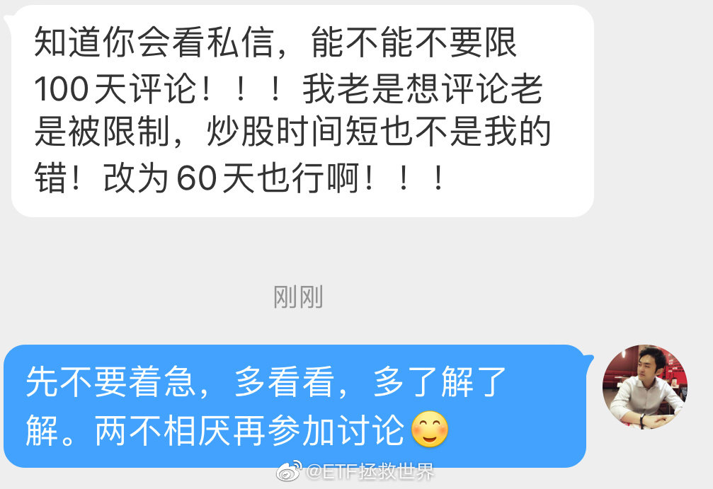

## 2021-09-09 09:20

是不是一日游。

没办法，只能吃回来了，还能怎么办呀。

真吃回来了还要重新创建，点一下好麻烦。

烦死了。 ​​​

## 2021-09-09 12:36

回复@Alice夏日与柠檬:这个我不同意。哪怕只以功利的角度看，你预期每次当好人都有好报当然是幼稚，但是当10次，100次好人，就几乎一定有好的回报。当你做的好事帮的人足够多，改变你命运的那个回报也许就会不期而至。所以还是要多做好事，但要有选择，不要做滥好人。

## 2021-09-09 12:59

对我来说，一个挣大钱的仓位可能需要2-3年，甚至更久的时间来买入、持有。

但是精妙之处在于在每一个时间段来看，手里都会有正在培育的，也会有开花的，也会有结果的。是在交替进行。

所以如果你希望赚快钱，或者新来的手里没有开花结果的只有刚开始刨土埋种子的，我建议你离开。因为这个过程可能会很难熬。

勿谓言之不预也。

## 2021-09-09 14:46

？？60岁不可以5杀吗。万科的王老板都70了，天天赛艇攀岩呢。那身体有几个年轻人能比？差不多行了吧。

## 2021-09-09 15:01

我承认是我幼稚了，毕竟18岁。好吧，今天肯定是近期最后一个新高了。继续enjoy吧。这帮热钱太孙子了……

## 2021-09-09 15:06

说出来不怕你笑话，我今天凌晨被人耍猴了。

JD预约联想的3080 y9000k，等到0点开抢，1秒就没了。

看到下面有人提问：“我们是猴吗？”那一刹那，我哭了。

还有PS5，也抢不到。

那位说了，加钱就能买啊。

这就不是钱的事儿！

这是原则的问题！

让我康康下次是哪天抢…… ​​​

## 2021-09-09 16:37

喷了，你们谁还记得这条。第一波科技对了，第二波金融错了，第三波有色能源完全正确了。//@ETF拯救世界:2018年10月的判断。科技信息是牛市第一阶段。如果牛市继续，第二第三阶段将是金融和有色能源等周期股。//@ETF拯救世界: 回复@江河之走:下一次牛市是科技信息股领衔的牛市。

## 2021-09-10 08:46

今天有人私信问我辞职全职炒股的事，这个可以翻出来再看了

## 2021-09-10 18:11

守男德，保平安

## 2021-09-11 08:41

你看中他的高收益，他看中你的本金。在这个时候，要再次回顾一下我的理念：告诉你无风险收益率超过10%的项目，都非常危险。

## 2021-09-11 22:14

今天开始是曼联球迷。 ​​​
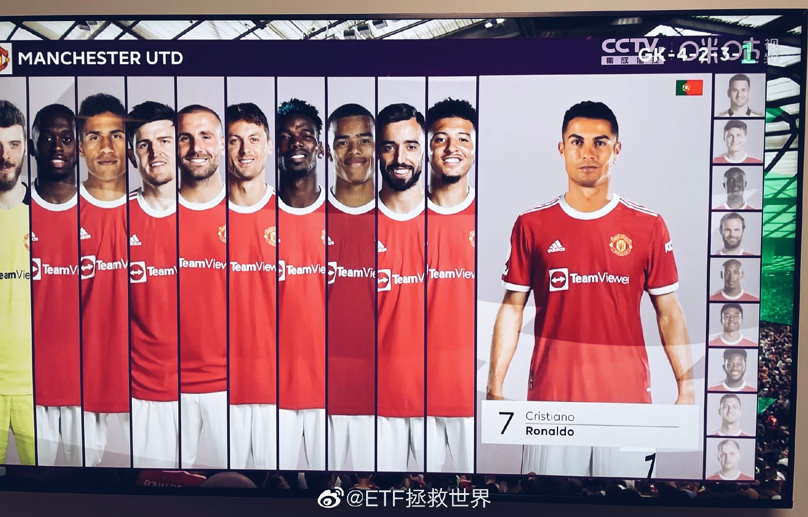

## 2021-09-11 23:05

这种事情我不懂，为什么被协调走的是董先生。难道不应该是霸占别人座位的人被拘留吗。

## 2021-09-12 10:03

很多这种因为父母，兄弟姐妹的各种事情烦恼的私信。

所以我也在想，到底亲人们之间帮忙的界限在哪里。在极端情况下，要不要牺牲自己的人生为他们的错误决策买单。

我说的不是生病之类的，而是亲人主观的错误，比如投资，比如做生意，甚至是赌博等等。

你怎么想。如果你的父母兄弟姐妹出了类似的事，你帮忙的底线是什么。
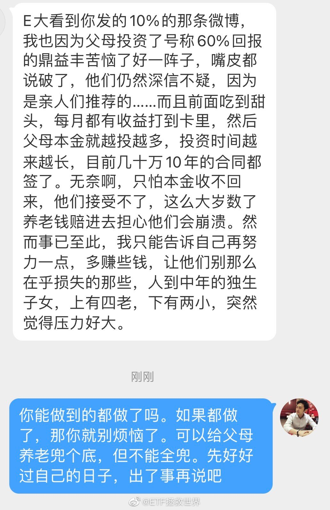

## 2021-09-12 13:01

刚才看见评论里有一位博友的老婆未与他商量就把家里1/3积蓄拿走借给她哥哥的事情。

我不知道你们怎么想，放在我这里，我是绝对绝对不能接受这样事情的。

夫妻之前当然可以有秘密。财务方面的也是，各种原因，你不想把你花的钱告诉另一半，完全没问题。但是，你连商量都不商量就把大额积蓄借出去或者花了或者“投资”去了，我绝对不能接受。

如果出了这样的事情，我对另一半会完全失去信任。如果说之前我家里的所有财务状况都是透明，对财物的支取双方也完全没有限制的话，从这件事发生的一刻起，我要想办法共同限制所有大额账户的单方面支取。任何大额支出必须两个人共同同意才能支取出去。

这不是说该不该帮的问题，是双方大额共同财产一方根本无权未经双方意见达成一致的情况下单方面作出决定。无论男女，都是如此。凭什么？这是理性的问题，也是感性的问题。涉及到很多，甚至包括尊重。

顺便说一下，我家的钱没有什么一定是谁管的问题。一般来说是谁挣的谁管，家里的支出基本都是我负责，太太的收入零花也好存起来也好我不过问。如果有需要我也会转一部分钱进她的股票账户操作，有很大额的支出，比如买房，有必要的话她也会出一部分。我们基本从不互相过问支出或者投资的问题，互相比较相信，相信对方不会做出什么不合理的支出。

## 2021-09-12 21:12

宁波，一座你来了就不能走的城市 ​​​
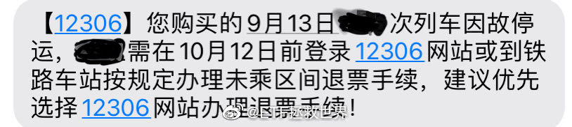

## 2021-09-13 14:49

再说一次我喜欢看美女，没什么见不得人的 ​​​
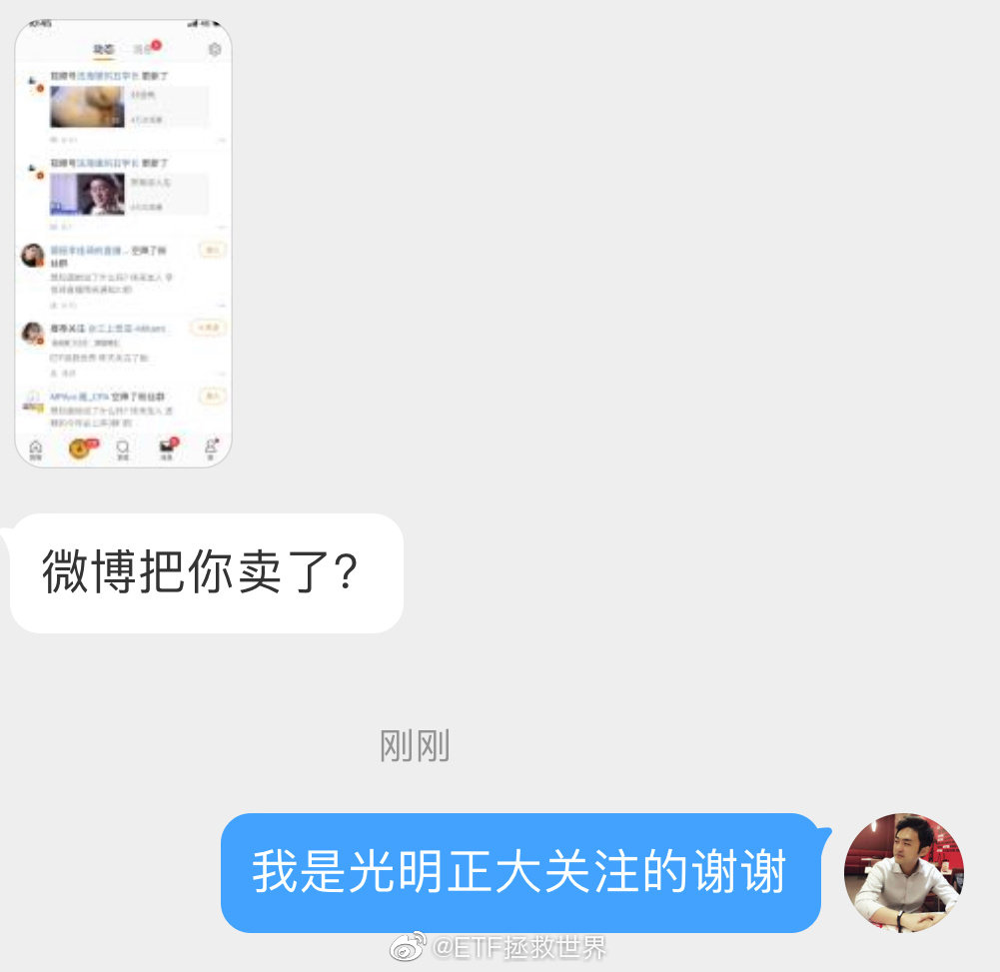 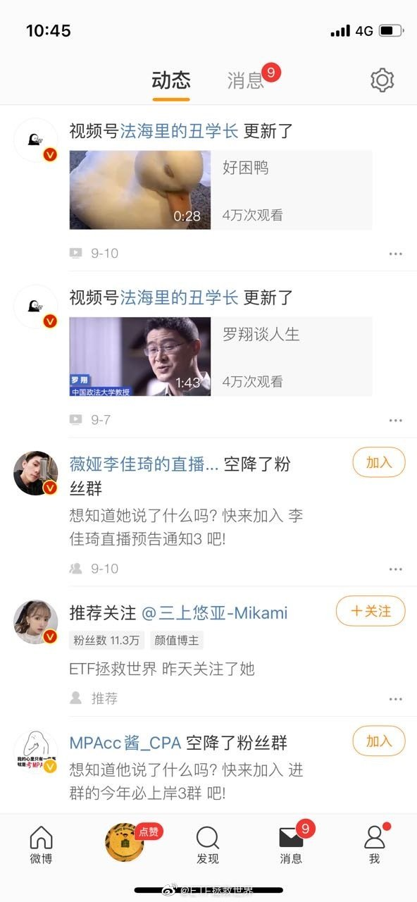

## 2021-09-13 18:26

休格兰特，虽然他很渣，但他80%的电影我都喜欢。 ​​​

## 2021-09-13 19:48

不知道为什么，无论风格怎么切换，都是每天新高。

好奇怪。 ​​​

## 2021-09-13 22:45

我说的对吗 ​​​
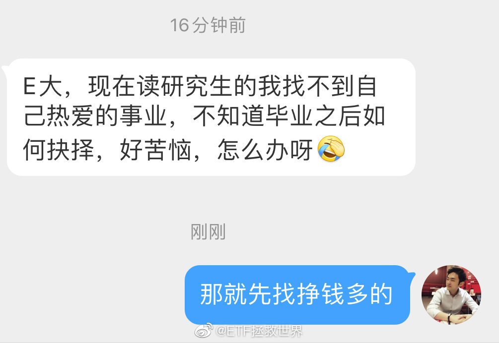

## 2021-09-14 08:38

大家评评理

说之前最好先亮明性别 ​​​
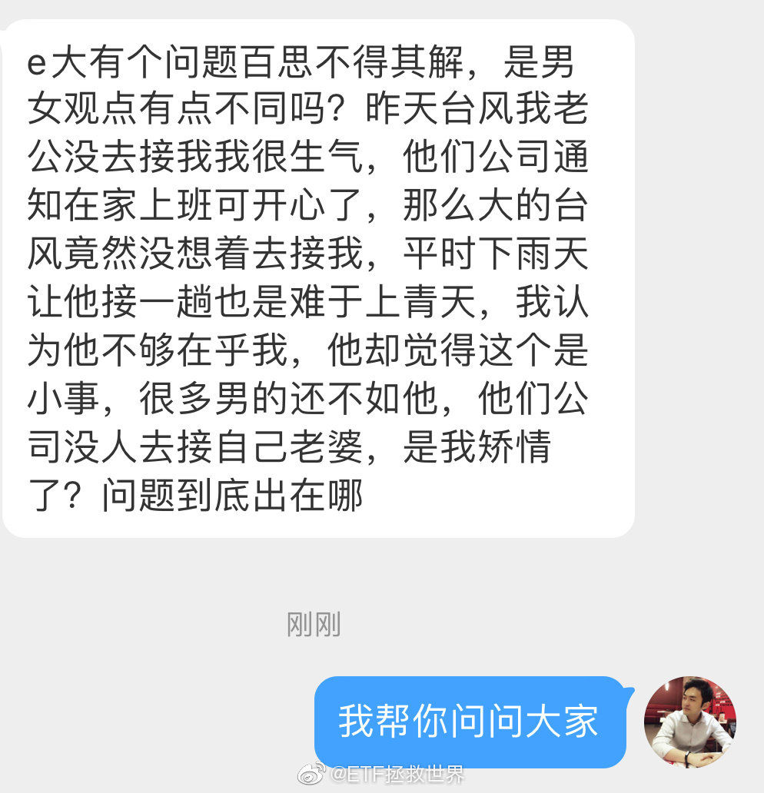

## 2021-09-14 14:39

今天净值顶不住了，没法新高了。

别看盘了，看看脱口秀吧。

鸟鸟不错。 ​​​

## 2021-09-15 10:25

触发条件单又不成交，

就像撩你又不跟你在一起的渣男，

忧郁的眼神，唏嘘的胡渣，

恨它，但又舍不得离开。 ​​​

## 2021-09-15 11:05

事情就是这么个事情 ​​​
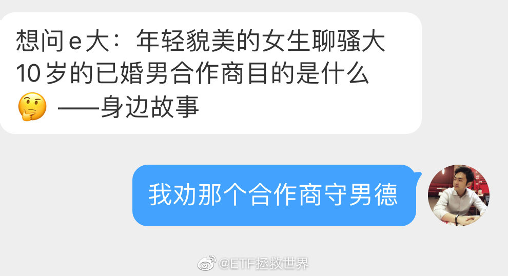

## 2021-09-15 12:24

回复@天蚕豆腐君:明眼人！希望女权大大们也能看出来，以后别骂我了，都是自家兄弟//@天蚕豆腐君:E大田园女权，鉴定完毕，瞅瞅你最近发的微博，涉及到男女方面的你都是挺女拳的，一点也不客观，粉转路

## 2021-09-15 14:38

某只🐏身上的羊毛快被在座的各位薅秃了。 ​​​

## 2021-09-15 14:59

你们谁能想到，哪家公司成功后跨界多个领域最后不失败的。

相关领域不算啊，比如卖可乐的拓展到各种饮料的。

有相关案例吗。 ​​​

## 2021-09-15 17:27

很多时候财富啊，名气啊，之类的事情，就像沙子，

你抓得越紧，越想多拿到一些，反而可能失去的更多。

平淡低调一点可能活得更久。 ​​​

## 2021-09-16 09:47

说真的，我不理解。 ​​​
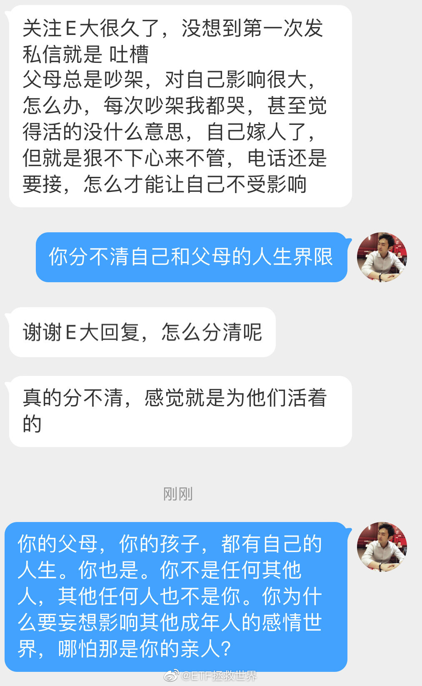

## 2021-09-16 10:20

刚看到有朋友问我，如果我的父母这样吵架我会怎么办。

不好意思，我父母就是从年轻吵到老的。

我成年后，他们也经常会跟我抱怨对方各种各样的问题，也会跟我说他们为什么又吵起来了。

这个时候我会难受的哭得睡不着，觉得自己好没用帮不了忙吗。你说呢？

我会像他们的朋友一样听他们说，然后笑着安慰他们，如果两个人不在一起，我还会顺着一方指出另一方确实有点问题。

然后呢，然后就没了啊。每个人该干什么干什么。第二天我就会忘了这件事，然后去做我应该做的事情。

我何德何能，妄想自己能够改变另外两个成年人的感情生活？改变别人的相处方式？改变别人的性格？吵了几十年了，我要能改变早该变了。事实就是我改变不了，改变不了我就笑着接受啊。多大点事儿啊？

你知不知道这个世界上重要的事情有多少啊，自己的人生有多少问题没有解决啊，因为别人的感情烦恼不已，我是不是太闲了啊。

不介入父母的感情不是无情，不是冷血，而是那根本就不是我应该介入的事情。那是别人的人生，知道吗？别人的人生！每个人都有权决定自己的人生怎么走。人家愿意不离婚就是天天吵，我还要介入？我还幻想自己能控制别人让别人举案齐眉？

我是不是疯了。

## 2021-09-16 11:01

别人如日中天的时候你站出来说他做的有问题，我佩服你是个汉子。

别人被干掉了，骂他没危险了你出来落井下石，

我鄙视你。 ​​​

## 2021-09-16 11:28

你造吗，就很烦。

咱们几年的老朋友，什么都经历过了，什么都明白了，在一起布局一下长线，收割一下翻番的利润，吃一下波动，聊聊天，扯扯淡，其乐无边。

就有些新人利欲熏心什么都不看拿出钱就是买。浮亏了就私信骂人，真的烦。

我根本就不想让你看我微博你造吗？不是给你写的，你造吗？烦死了。 ​​​

## 2021-09-16 12:51

这几天又有表达欲了。

总觉得下一篇公众号文章就在不远处。 ​​​

## 2021-09-16 18:36

Pony是不是听说这里有个支撑。

## 2021-09-17 08:04

日本人平均月薪22000人民币。

## 2021-09-17 10:44

趋势不好，你想建仓，家里又没矿，

这种情况就不要急。

时间、空间，至少要占其一。

不急，慢慢买。有机会就做波段降成本，没机会就慢慢买。

保证总的持仓成本总是会降到底部区域附近。

接下来就是等。不死的品种，早晚会涨，早晚会赚。

至于涨多少赚多少，就看天意了。 ​​​

## 2021-09-17 11:00

各位巴菲特，您说今天能提款吗 ​​​

## 2021-09-18 13:35

前几天那位因为父母关系苦恼的朋友，年初一定没看这个。

再看看，会有新的领悟。

 ​​​

## 2021-09-21 08:09

祝在座的各位巴菲特中秋快乐！

[玉兔][圆月][暖一下] ​​​

## 2021-09-22 10:59

跌的太慢，群众不高兴。

## 2021-09-23 10:08

最近一段日子过得很普通，

没什么亮点。 ​​​

## 2021-09-23 15:21

我大概能判断什么品种在什么价格可以开始买或者开始重仓。

但我永远不知道它什么时候涨。

我做好配置，等风来。 ​​​
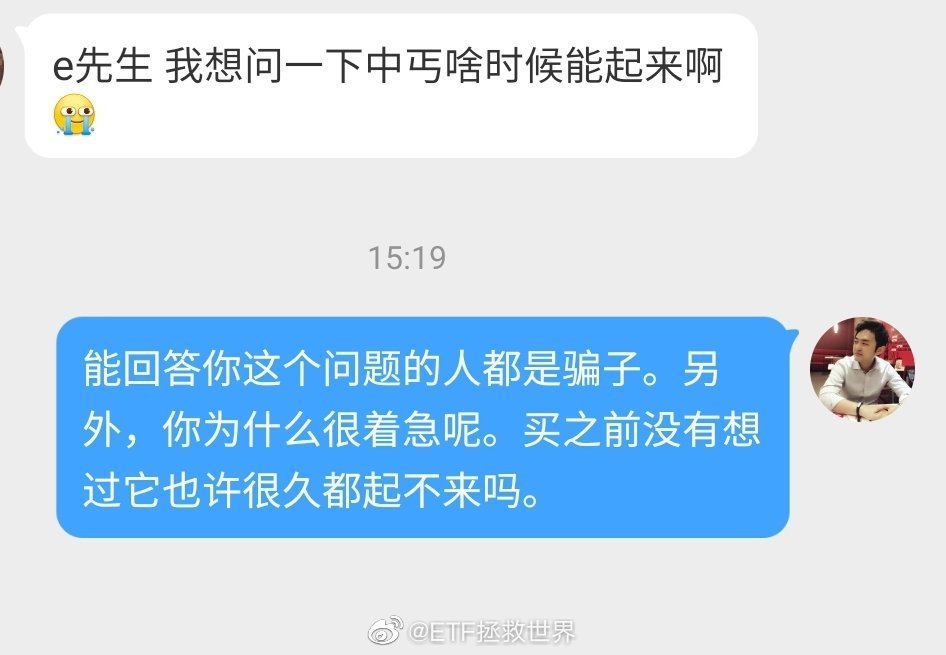

## 2021-09-25 12:23

说句你可能不爱听的，

很多家长根本就是巨婴。

或者说，

很多巨婴做了家长。 ​​​

## 2021-09-25 13:53

昨日收盘，日经估值再次回到过去十年最高，比2020年3月高出一倍——当时几乎是历史最低。之前网格留的利润现在卖出也是可以的。

## 2021-09-25 15:22

IT小贴士：

windows的大部分程序，用鼠标将之拉到屏幕侧边会实现自动分屏。左右都可以。 ​​​

## 2021-09-26 11:43

​​​

## 2021-09-26 14:15

看了看新闻，想了想，我也做不了什么，

我承诺，争取自家和家族企业减少用电10%-20%，为降低碳排放做出自己的贡献……

PS：14:30发。 ​​​

## 2021-09-26 18:10

不知道为什么最近多了很多新朋友关注，因为收到很多你们的私信。

怕您不知道，我强调三点，

第一，不欢迎您。最好取关。

第二，我这里不是基金普及和投资者教育的微博，基础的东西我以前现在未来都不会说。当然，非基础的也不说。概括一下就是没有什么有用的东西。

第三，最好取关。 ​​​

## 2021-09-27 10:09

只能买一份消费大概是这轮计划的宿命。 ​​​

## 2021-09-27 11:26

以后还是盘中发车吧 ​​​

## 2021-09-27 13:06

如果500今天跌幅过大，明天卖也不是不行 ​​​

## 2021-09-27 14:47

券商还能再来亿次吗。 ​​​

## 2021-09-27 14:55

你很羡慕别人，

其实是因为你并不了解他。

家家有本难念的经。

你以为别人哪儿哪儿都很幸福，

其实未必。

懂的都懂。 ​​​

## 2021-09-27 15:44

女人需要安全感。 ​​​

## 2021-09-27 16:03

女孩唱了一首歌。

男孩：怎么回事，我从来不喜欢这个风格的歌曲。但为什么你一唱我就觉得这首歌怎么那么好听？

这个聊天水平打几分。 ​​​

## 2021-09-27 16:12

红利最近回调不少。

有朋友问减仓不减仓，

在这个位置，我无法说服自己减仓。

这里减仓违背我所有的交易原则。

所以我选择不动。

就让利润回撤吧。跌到位我再买点。 ​​​

## 2021-09-28 09:34

没事少视频通话，

如果一定要视频通话，

记得把周围收拾利索。

干干净净，整整齐齐的多好。

PS：守男德，保平安。 ​​​

## 2021-09-28 10:01

普通投资者，或者说，大部分，绝大部分投资者，

弄懂宏观经济，

对收益率的提高有什么帮助吗。

我的答案是，

没有。 ​​​

## 2021-09-28 10:03

但是宏观经济中有一块是货币政策。这个对投资非常重要，还是要跟的。

## 2021-09-28 10:07

中概，我希望它涨，又不希望它乱涨。

希望它涨是因为有些朋友好像在这上面非常煎熬，我希望他们能早点踏实下来。

不希望它乱涨是因为我还想买更多。无论是左侧还是右侧，希望它不要暴躁，慢慢走。 ​​​

## 2021-09-28 10:18

什么是很舒服的投资状态

就是你手里有很多涨得不错的品种。你也适当减仓了，然后现在就是等着它跌到一个触发点继续减仓，比如环保。

也有很多希望它继续给机会买的品种。手里也有了，只是等着它继续跌到触发点，或者涨到触发点继续买，比如中概，消费，医药。

如果它们始终走不出趋势，你也可以不断的提款收割。比如那些品种。

所有事情都做好了预案，只是等着它发生或者不发生。

这就是很舒服的感觉。

你舒服了吗。

## 2021-09-28 13:29

这几天网购了很多东西，不是为了别的，

说大了是拉动内需，说小了是支持中概成分股。

为了大义，忍痛花钱。

 ​​​

## 2021-09-29 10:51

过去一年，

150卖出19份，买入14份，没有在高位区域加仓，甚至做了减仓。

S卖出9份，买入14份，但要注意S是“永续买入”模式，一年时间只买了5份，等于积累了大量应买未买资金。

我们的卖出，基本都是几十个点甚至翻番的品种。买入的，都是大幅下跌后未来可期的。

高位震荡，你我并非接盘侠。

那么，如果下跌，你应该是怎样的心情？

## 2021-09-29 15:57

这一段时间每天都会拉黑几位朋友，

其实你没做错任何事，

只是我们不合适。

对不起。 ​​​

## 2021-09-29 16:12

下阶段布局目标：

医药、信息。

希望它们不要不识抬举，好好给我跌。

医药好价：12000点。

信息好价：5000-5400点。

非历史好价，但低于去年双十一，刚需可入。 ​​​

## 2021-09-29 18:27

其实我有时候会想一件事。

你说咱们对一个人好，是不是会希望ta也对自己好。咱们对一个人有付出，就会希望那个人也回报自己。

但实际上，我们对一个人好，对一个人付出，应该是我们自己愿意的事情，这个好和付出本身就会让自己开心。

我就是想对你好，你对我好不好，是不是回报我无所谓。

这是不是才是最重要的，才是所谓的爱。

至于有没有回报，那个恐怕不应该是付出的理由和目的。

如果只是因为想得到回报才付出，那恐怕不是真爱。

不知道对不对，一个想法。

## 2021-09-29 18:43

博友如果有这个人的同学、同事、邻居、朋友，一定要离他远一点。这种人真的可怕，沾上会倒大霉。

