## 2021-10-01 11:29

国庆节快乐！

这几天有什么计划。 ​​​

## 2021-10-05 19:37

实话实说，有没有一点点想我 ​​​

## 2021-10-08 02:11

👏👏👏 ​​​

## 2021-10-08 02:48

​​​

## 2021-10-08 10:41

华宝油气，只要不是自己乱搞，所有人都赚钱了。

我放心了，也算问心无愧。 ​​​

## 2021-10-08 10:54

第一，不死的品种。

第二，买在相对低位。（80%原则最佳）

我不信你会在股市赔钱。 ​​​

## 2021-10-08 11:25

跟你说一个你不知道的关于你自己的事情：

你的投资水平和查理芒格差不多：

【近日，查理·芒格旗下公司Daily Journal Corporation公布的第三季度13-F文件显示，自7月份以来，阿里巴巴股价下跌了近50%之后，Daily Journal购买了136740股阿里巴巴股票，使其股票总数达到302060股。】 ​​​

## 2021-10-08 16:32

帮你翻微博之金句回顾

## 2021-10-11 10:38

低买高卖

意思不大 ​​​

## 2021-10-11 11:00

我的体会啊

做投资，首先最重要的是有信仰。

信仰这个事情说说简单实际很难。这是一种无论受到多么大的打击，无论遭遇怎么样的痛苦，无论经受什么样的诱惑都不改变的东西。

很多时候，胜利还是失败，差的就是坚持的那一下。

怎么才能坚持下去。

信仰。

有信仰并不够。还要智慧。

智慧不是聪明。你可以智商只有100，又或者哪怕90，这只能说你不够聪明。但你依然可以有智慧。

智慧是很大的概念，聪明只是很小。聪明可以让你反应灵敏，记忆力超群，考试成绩出众，但并不代表你一定有智慧。

投资并不需要太聪明，投资需要你有足够的智慧选择一条真正适合你的路。然后在这条路上持续、坚定地走下去。

每时每刻都在抬头看着你的目标，永远不会偏离你应该去的方向，永远不会忘掉你的初心。

你会经常纠正自己走路的姿势，你会经常审视自己走过的弯路，你会对路边看热闹的人发出的嘲笑和嘘声嗤之以鼻。

即使你身处黑暗，但你心中有光，手中有北斗，永远不会迷路，永远不会做蠢事。

投资的术并不是最重要的东西，大差不差，殊途同归。

最重要的是，悟道。这，需要真正的大智慧。

## 2021-10-11 11:35

现在，你的人生中，让你觉得有意思的事情都有什么。

说出来大家研究一下。 ​​​

## 2021-10-11 13:11

提款这件事，

将提未提的时候最有意思，

就像男女之间眉来眼去的暧昧期最让人迷恋 ​​​

## 2021-10-11 13:26

回头看霉霉又差8厘就能接回来

好气哦 ​​​

## 2021-10-11 13:52

财务自由是个伪命题。

只有心灵自由了才会真的自由。

你听不懂，没关系，有空我展开说说。

当然，展开说了也有80%的人不会懂。 ​​​

## 2021-10-11 18:37

虽然真正想看的人并不多，但为了那些想看的朋友，我还是坚持一个月写一篇东西给你们。 ​​​
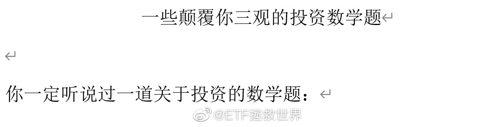

## 2021-10-12 11:27

现在这个市场，仓位差不多家里又没矿的，没必要没完没了加仓。

踏踏实实的提个款，吃个波段就挺好。

除了个别辣鸡板块，我实在看不出有什么大机会值得不停买。

（有些品种甚至又快卖了） ​​​

## 2021-10-12 13:16

这两个工作真的很重要。有想法有能力的可以试试

## 2021-10-12 13:43

药、券、霉真能接回来再吃一次吗。

真的吗，我不信。

运气也太好了吧。 ​​​

## 2021-10-12 14:00

指数从高位回落的时候，你可能有两种情况。

第一种，大幅减仓了。第二种，没减仓。

第一种不说了，这时候你要关注的是什么时候买回去。

第二种情况，新手可能会觉得有点难受。

但难受、懊恼等等这种思维模式并不能让你成长或者获利。这时候你应该集中精力做一件事：

当指数又回高位的时候，自己的资产一定要比上次多。

所有的策略设计，所有的交易，都应该围绕这个任务完成。

这也是“杀不死我的只会让我更强大”在金融市场的一种表达。

## 2021-10-12 15:04

生活小贴士：

男士发型打理，

洗头后首先根据头发生长方向逆向吹发根，半干后顺向吹。

吹干后用发蜡或者发泥抓出想要的发型，然后适当干胶定型。

发型合适的话，可以减龄10-20岁。

女士自理。 ​​​

## 2021-10-12 17:08

一边统计今天的数据，一边犹豫：

要不要半夜爬起来看一场99%输的比赛，

还有，

看比赛的时候吃点什么……

要是没好吃的就不看了…… ​​​

## 2021-10-13 01:57

吃点好吃的 ​​​

## 2021-10-13 14:21

9月买的消费几乎是最低点。但因为特意选了持仓白酒少的品种，所以这波白酒为代表的消费反弹该品种相对表现不佳。虽然在一个月内涨幅同类前10%。

确实水平不行，请取关。 ​​​

## 2021-10-14 09:47

13个交易日，效率越来越低。

建议取关。 ​​​

## 2021-10-14 12:07

祸从口出。

学会闭嘴是长命百岁的必备技能。 ​​​

## 2021-10-14 15:13

我吃完四只对面一只还没吃完，恨不得钳子里的肉都给人家抠出来，过分了。 ​​​
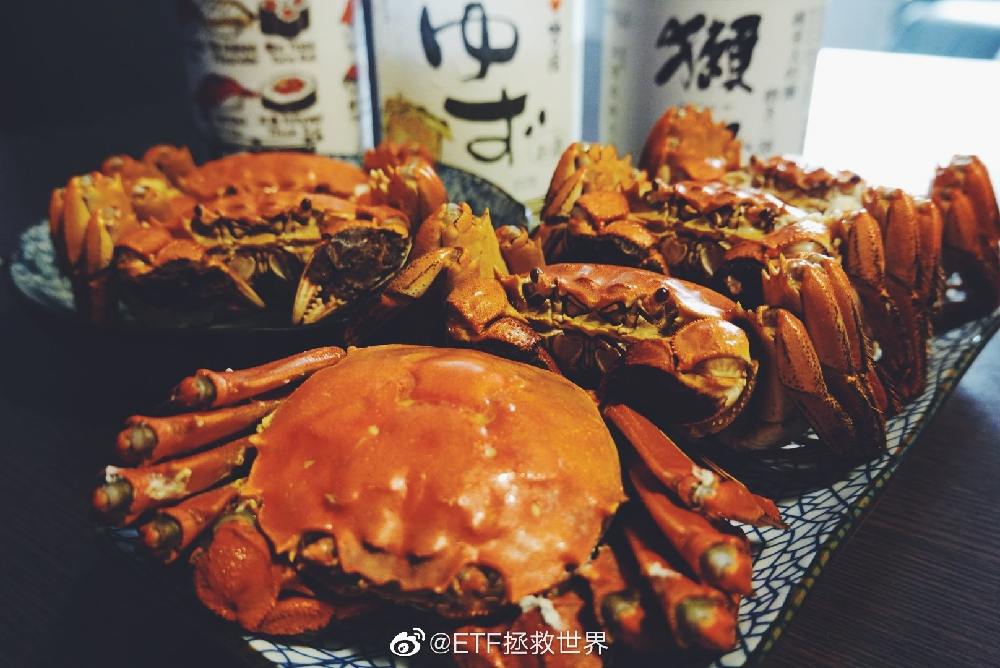

## 2021-10-14 15:45

从前的日色变得慢，

车，马，邮件都慢，

一生只够爱一人。 ​​​

## 2021-10-14 17:23

从已公布的三季报来看，利润增长整体真的不好，涨不动也就太合理了。

当然只公布了很少一部分，半个月后见分晓。 ​​​

## 2021-10-15 09:36

一二三四，

再来一次？ ​​​

## 2021-10-15 10:27

刚才我去茶水间用咖啡机煮咖啡的时候，想起几句话，不吐不快。

第一个，上网，逛微博也好知乎也好，肯定能看到很多负面的东西。负面的人或者事。

但我建议，不要因为这些事放弃对同类人和同类事的希望。比如说吧。

不要因为渣男渣女的新闻就不再相信爱情和婚姻，不要因为某些事情就不再相信有美好善良知书达理的女生存在，也不要因为某些事情就不相信世界上还有阳光大气负责任守男德的男人。

如果那些新闻不是极其特殊的，就不会成为新闻。要相信，大多数都是好的。网上发声的，也未必都是人，也有可能是条狗。

第二个，不要排斥负面的东西。

负面的东西是有价值的。最大的价值就在于，它能让你对这个世界，这个物种有更深层次的认识。我经常说，有些事情刷新我对人类底线的认识。对，就是要知道人类可能有多么无底线，然后做好准备应对它。

这两个点怎么统筹。

很简单。

与一个陌生人交往，首先要有足够的安全意识。对于对方说的东西暂且抱着怀疑的态度。如果交往过程中发现对方很好很诚实，那么就逐渐的相信他，直到完全相信。

除非你发现他有欺骗你的，或者不好的行为迹象，否则你都可以一直相信他。

但是一旦有了欺骗，有了不好的行为迹象——比如对别人态度暴躁不善良，比如虐待小动物等等，那么他就应该失去你的信任。早晚有一天，被骗的、被虐待的就有可能是你。

这时候那些负面新闻的无底线记忆就应该起作用了。

最后再说一次，每个人都是独立的人。无论是男的女的，xx省的，xx职业的，都会有善良的人和无耻的人。不要贴标签，要具体到对方这个人。

PS，不是所有小v都是辣鸡，分人。

## 2021-10-15 15:56

现在的油气让你觉得赏心悦目，全忘了当初给你的痛苦。

然后你就会知道，

现在让你痛苦的品种，未来很有可能让你心花怒放。 ​​​

## 2021-10-16 16:19

广发债分红，选现金 ​​​

## 2021-10-18 09:43

除了电影效果摄像，没什么进步 ​​​

## 2021-10-18 12:17

还没捂热就被抢走了

还有王法吗

还有法律吗

单身的朋友，不要结婚！ ​​​

## 2021-10-18 13:37

国债价格下跌不是什么好事。 ​​​

## 2021-10-18 17:29

周末用两天时间又看了一遍白鹿原。

看到白灵牺牲的那段心里堵得慌。最关键这还是真事。

想发怒又没有对象，想学到点什么又感觉无从下手。

人类啊。 ​​​

## 2021-10-19 10:07

HS我劝你善良。

再涨一个点又不会S。 ​​​

## 2021-10-19 13:35

这是他们一辈子唯一挣点大钱的机会，耍流氓也在所不惜

## 2021-10-19 14:49

好爱中概，还想加。

骂的人越多我越爱。 ​​​

## 2021-10-20 09:26

原地起飞

## 2021-10-20 09:31

南方债现金 ​​​

## 2021-10-20 10:46

论嚣张我只服环保。

反思一下，开始那一波卖多了一两份。以后要注意。 ​​​

## 2021-10-20 11:52

所有品种都要盈利。 ​​​

## 2021-10-20 14:04

吃饭

个人最爱海南鸡饭 ​​​
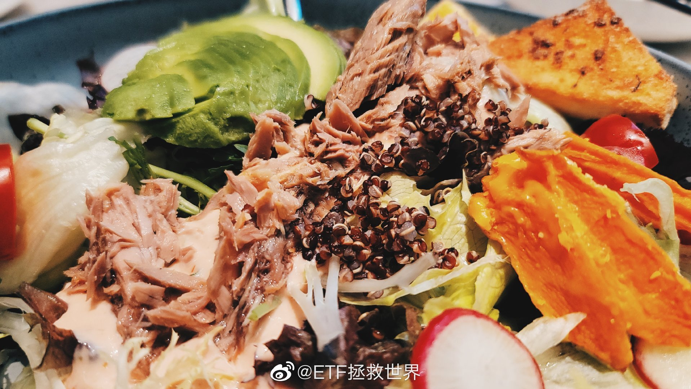 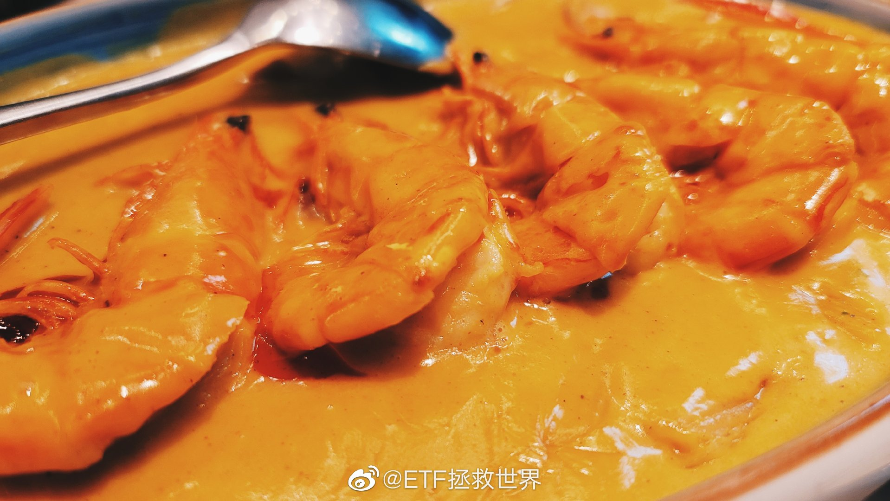 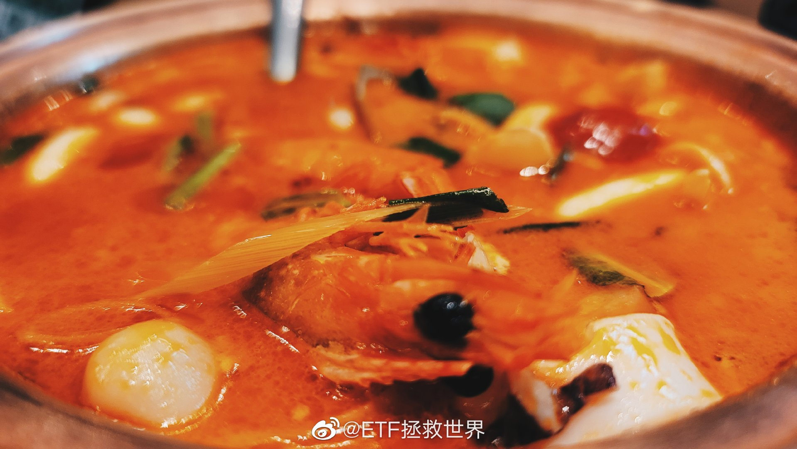 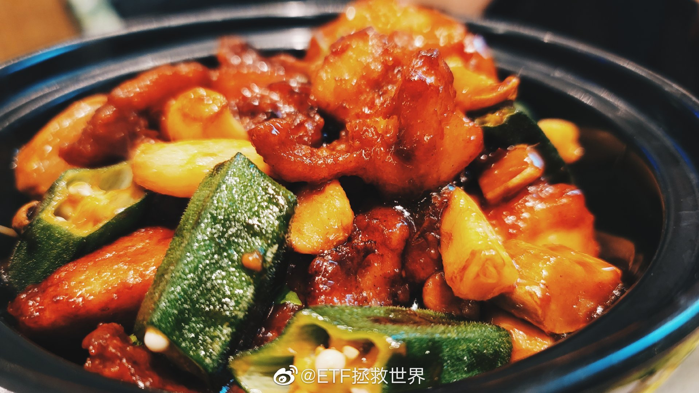  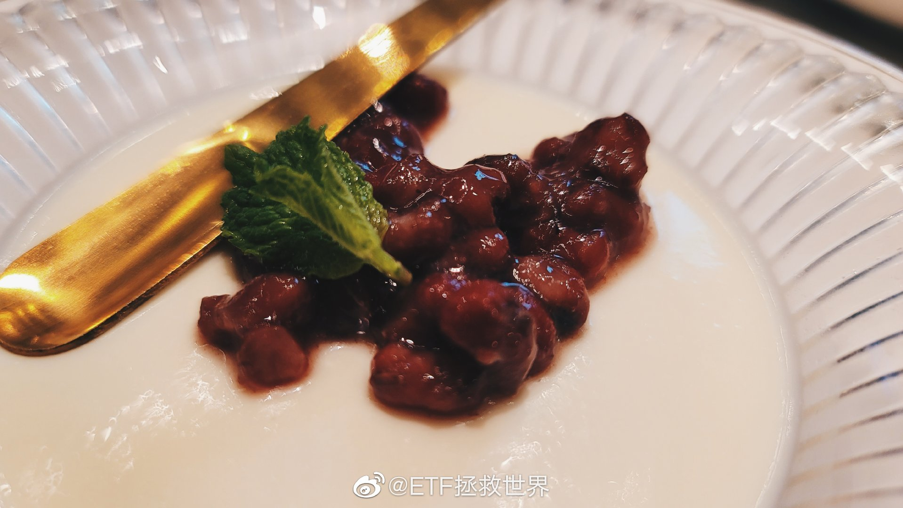

## 2021-10-20 15:52

我就想问问，有没有男的不喜欢3C的。

不喜欢的举手。 ​​​

## 2021-10-20 16:37

经过两个月的上涨，今天中概走出历史最低区域。有意思的是，发帖当日是中概互联基金164906净值最低的一天。你要说怎么做到的，一言难尽，简单说就是纯靠蒙。

## 2021-10-20 20:00

关于QM投顾业务服务费这个问题，本来跟我是毫无关系的，是人家公司的业务。但因为有朋友在评论和私信里面问我，我就再帮着解释一下。

刚才跟他们再次确认过了，签约投顾业务是有投顾服务费的，因为这个是有规定要收的。

但是，QM有个返还政策。简单来说就是，如果你一年交易手续费少于这个服务费，则直接免掉服务费。比如一年交易手续费200，服务费500，则最终免掉所有500的服务费。

如果一年手续费高于服务费，比如一年交易手续费700，服务费500，则免掉500服务费外，还返还200现金。

再说一次，我不是做广告让大家都去开通，这个跟我毫无关系，开不开各位自己定。只是因为有些朋友很焦虑的问我，我才来解释一下。

## 2021-10-20 20:58

好消息不断 ​​​
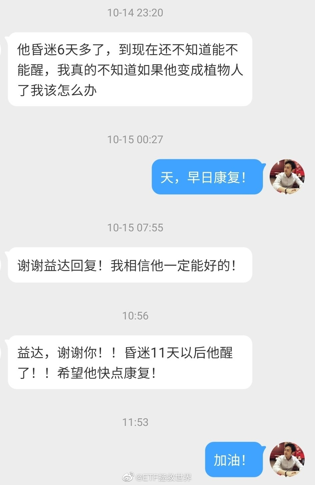

## 2021-10-21 22:13

## 2021-10-22 10:27

我看有些朋友在评论里说，有钱有颜还干这个事情，不理解。

其实很简单，你不理解，就是因为你不是他。你没到那个位置，你当然不理解。

简单说两句我的理解。

首先必须要说清楚，我绝对不认同不支持一切违法犯罪违背社会公德的行为。

好，那么，如果你是一个有不正经想法的，有钱，有颜，有社会地位的男人，你会怎么去找一个鼓掌的对象呢。

你能接触到的，无非是这些人：

同事、粉丝、合作伙伴、经朋友介绍认识的人（也许只吃了一顿饭）、采访自己的媒体人……等等。

那么我请你回忆一下，以上这些情况，这几年是不是都出过大新闻，让男方事业一败涂地起码是社死的。

你设身处地的想一想，当你有钱有颜有社会地位，那么对你来说，想做这样不正经的事情，什么才是最难的。

对了，是弄清楚对方的真实意图最难。对方到底想要的是什么。是真的爱你，还是爱你的钱，或者是想借你上位？

钱，也许是无底洞。上位，当你不能满足对方的愿望……

有些朋友以为，只要我能分辨出是真爱就行了吧。呵呵，我只能说你太幼稚。

如果是真爱，当你想分手，那你死的最惨。

所以，这种人想做不道德的事情，理智来说，只有两个选择，一个是明码标价，一个是陌生人不认识自己。

（想要道德的解决这个问题，对象只能是青梅竹马或者地位财富名气差不多的人）

再说一次，我反对任何不道德的两性行为。

所以对男人来说，尤其是想要做大事或者活得久的男人来说，只有一句话是金科玉律：

守男德，保平安。

## 2021-10-22 11:31

回复@puvny:我说句可能会被骂的话：男人的基因决定了男人的本质就是希望广撒网。通常意义上的好男人是能够控制住自己能够约束自己的那部分。//@puvny:话说有钱的守男德的男性真的不多吧，身边都是中产的男性看着都挺顾家，是不是没有作案时间呢，免不了要怀疑一下下男生的本质

## 2021-10-22 13:22

不舒服就别买，多大点事儿。 ​​​

## 2021-10-22 15:19

回复@How_is_Howie:需要止损的右侧是满仓干的右侧。我的右侧是：暴买一份//@How_is_Howie:回复@ETF拯救世界:右侧不用止损吗

## 2021-10-22 15:44

这次按照右侧理念买入的品种，未必就真的能走出一波行情。只能说概率比较大，不是100%。

未来就会有三种可能。第一第二种可能就还有加仓的动作，第三种则放弃。

第一种可能，筑底失败，再次下跌或者震荡。那很简单，继续根据左侧原则考虑时间空间加仓。

第二种可能，冲高后回落调整，然后继续上涨。这种情况我会在调整到颈线位的时候继续加仓。毕竟还没买满预计仓位。

第三种可能，一路上涨不回头。只有这种情况我不会再买，因为要保证成本始终不离开底部区域。

投资是这样的，要把所有可能考虑到，然后设计预案，然后根据情况执行。

## 2021-10-22 20:15

不瞒你说，兄弟确实在考虑转型美食和探店博主 ​​​
 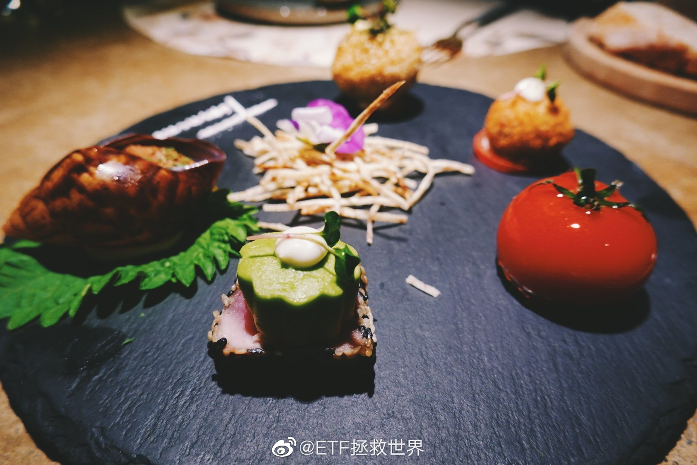 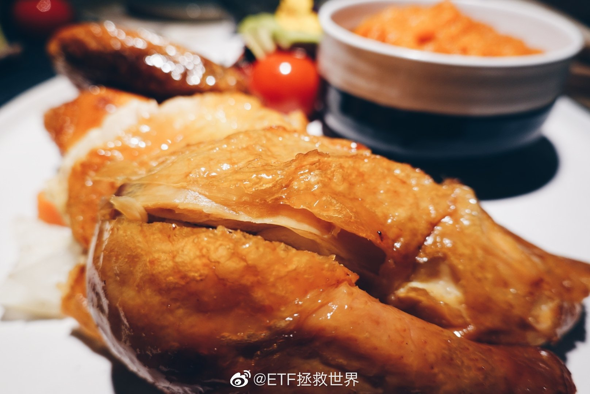  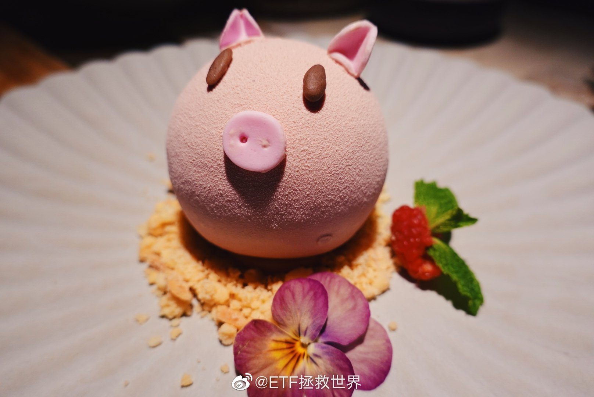 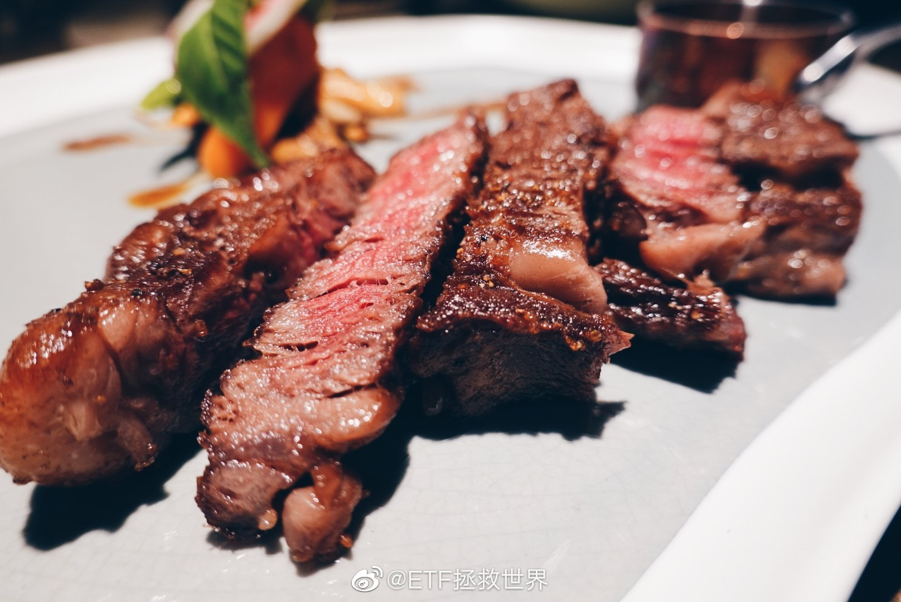 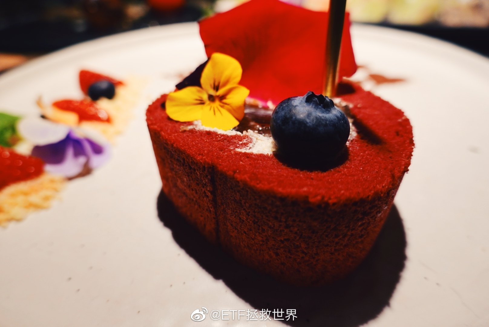  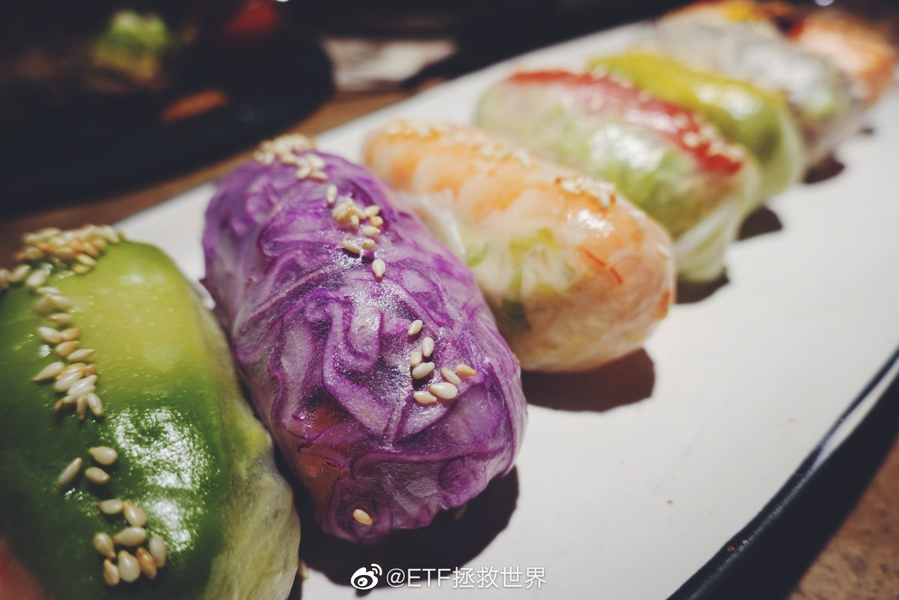 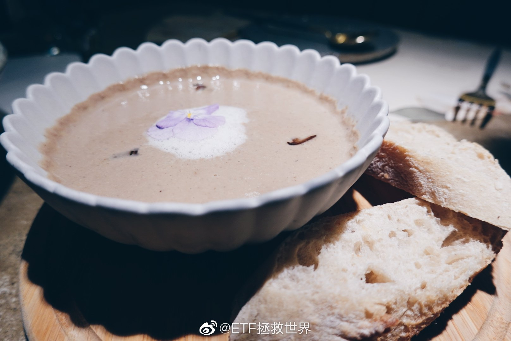

## 2021-10-23 14:59

有些新朋友或者脑子一根筋的朋友会觉得我这里“彩虹屁”多了一点。

其实不是。

我们这里实际上是个大型的夸夸群。大家聚在一起互相夸，在这冷漠又现实的社会里找寻一个可以互相取暖的角落罢了。

我们大家心里都明白，绝大多数情况下，大家不过是互相客套客套而已……

也正因为大家都知道别人是给个面子客气一下，所以也不会真的志得意满止步不前。大家心里都知道，各方面进步的空间非常大，要更加努力，才能对得起别人客套的称赞。

## 2021-10-24 09:34

做个小调查  ​​​

## 2021-10-24 13:51

有个观点先放到这里，几年后看：

现在有些人为了一己私利或者不可告人的目的，疯狂炒作男女对立。如果这种情况持续下去，很可能会出现两个局面：

第一，男女之间的隔阂越来越深，尤其是青年男女之间。两性之间互相越来越看不上，婚育率就不用说了。

第二，为了避免不必要的麻烦，很多老板在用工的时候会更加向男性倾斜。女性朋友的就业隐性障碍又增加了一个。

我绝对支持男女平等。但我对炒作男女对立的辣鸡深恶痛绝。

我说完了，你们骂吧。

## 2021-10-24 17:57

我给一些不愿意独立思考的朋友一个建议：学会就事论事。

不要因为一个男人做了很渣的事情，就得出结论所有中国男人，乃至所有男人都渣。也不要因为一个女人是疯子，就得出所有女人都不理智。

我们看到的新闻，都一定是特殊的。否则它也不会成为新闻。

我始终相信，我们决定不了自己出生在什么样的家庭里，但我们能一定程度上决定自己与什么样的人交往。你在垃圾堆里生存，当然放眼望去全都是垃圾。但也许你能试着走出垃圾堆，看看真实、多彩的世界是什么样。

没错，你可能从这堆垃圾走出来又走进另一堆垃圾，那就继续走。我就不信全世界的垃圾都始终围着你。如果真的你走到哪里都是垃圾堆，那你是不是考虑一下也有可能是自己出了什么问题……

你遇到了渣男渣女，然后你得出结论全世界都是渣男渣女。只要有一点点思考能力的人就知道这不对。我们遇到不好的人，就只是遇到了不好的人而已。也许是命运，也许是我们经验不足，遇人不淑。果断的离开，然后吸取教训，充满信心的开始接下来的生活，依然相信对的人好的人就在前面等着自己，这不才是应有的人生态度吗。

这个世界上不是所有人说的话都是真心话。有人说某些话只是为了利益，ta自己都不信，你却信了，最后有可能ta得到了所有ta想要的，你却失去了也许可以很幸福的人生。

还是四个字，就事论事。请独立思考。用你的脑子，理清楚逻辑，收集尽可能多的信息，然后独立思考，拒绝情绪化。

用脑子！穿越表象的迷雾，尽量看清事情的真相。

## 2021-10-25 08:24

一开始小猫那么信任他

## 2021-10-25 10:24

想让我卖红利，

痴心妄想。 ​​​

## 2021-10-25 11:10

一年多年以后，我和博友们看着再次历史新高的环保，总是会想起它被无数人嘲笑奚落的那个2020年。 ​​​

## 2021-10-25 11:30

关于昨天的微博，一位女性博友的私信，以及我的回答。

你觉得我说的对吗。 ​​​
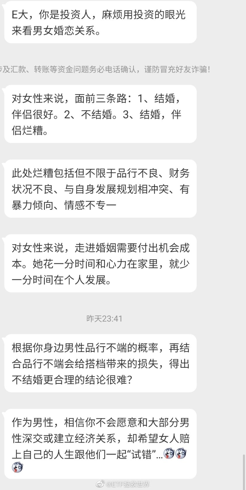 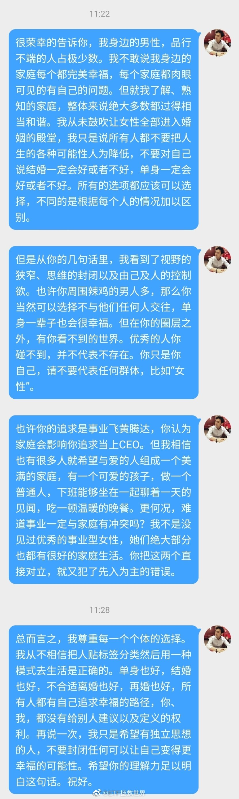

## 2021-10-25 11:51

回复@数不清的咩:凭什么一定是女性做家务？谁有空谁做，大家分担啊。强制女性做家务的男人让他滚蛋。//@数不清的咩:看地方，看人，我曾经跟我一个北方朋友聊起来，说我们这儿女性不做家务是不可能的，他不信，直到有一天他亲眼看到一个老公因为老婆不做家务而动手，这对夫妻还是90后。

## 2021-10-25 12:34

确实烦。不说了。你们折腾吧。

祝所有人幸福。

PS，千万千万不要与自己三观不一致的人结婚，会夭寿。这个角度的话，单身真的很好，至少不会早死。

PPS，每次这样的事情过后，我家的爱情浓度就又上升8%。现实真的太美好了。 ​​​

## 2021-10-26 09:54

今日投资失败案例：

中的新股上市交易后几天才发现已经上市，浮盈大幅降低。挥泪清空。

改进思路：

第一，以后中签后上市交易前即设好条件单，回落卖出。第二，中签后应每日检查上市交易日期。

我的中签新股交易思路：

打开涨停即卖出。不忘初心，新股是用来打的，不是用来炒的。 ​​​

## 2021-10-26 10:10

长期来看，我对红利的预期就是每年7%-11%。结果去年涨了8%，今年20%。（场内更多）

这好吗，这不好。涨多了就又得歇好几年。

不惦记，就当银行理财扔那儿完事儿。 ​​​

## 2021-10-26 12:22

很多人对一些娱乐圈啊，金融圈高层啊或者其他什么所谓名人爆出的新闻感到震惊。

其实真的没必要。

就是说，咱们始终要明白一件事：

任何人，我是说任何人，如果除去工作、身份的外衣，他都是普通人，非常非常普通。普通人有的优点缺点，这些所谓名人也都有。七情六欲，喜怒哀乐都一样。

你之所以觉得他不普通，是因为你距离他太远了。你信不信他的家人绝对不会认为他不普通。

所以反正我是这样，我看任何人，都不会觉得有光环或者神秘什么的。任何人做任何事我都不吃惊，因为大家都是普通人。不同的是所谓名人有人包装，有点光环，喜欢假模假式的端着而已。

当然了，还有更深一层的东西也必须要认识到。那就是普通人中其实有极少极少不普通的人，只是他们没有名气你不知道而已。这些人的不普通也许表现在各方各面。

继续推理，既然普通人中有极少人不普通，那么名人中也有相应比例，甚至更高一点点的人是不普通的人。他们也许拥有某种技能，也许拥有某种思维等等……总而言之，名人中也有不平凡的人，但绝对不是所有名人都是。绝大多数所谓的名人，也都是极其普通的，如果你在他身边工作生活的话。

只是他们的工作是做名人而已。就酱。

至于是不是要用更高的标准要求他们，那是另一个话题，暂且不表。我只是说，名人就是普通人，所以他们做什么我都不吃惊。

## 2021-10-26 13:31

看着镜子里的自己：hi，谢霆锋，how you doing

看着照片里的自己：？？？

看着苹果前置摄像头里的自己：my eyes! ​​​

## 2021-10-26 15:52

明码标价，你觉得贵可以不买，拿杯子去接免费的开水喝。你觉得不合理就向上面投诉，甚至去法院告都行，为什么要难为工作人员？又不是工作人员定的价。辣鸡。

## 2021-10-27 10:56

波动是利润的来源。

小波动小利润，大波动大利润。

没有波动就没有利润。 ​​​

## 2021-10-27 11:25

中证环保，2015年创出3211点后，一路下跌，到2018年钻石坑只剩969点，跌幅69.8%。

完美契合7080定律。

2021年，最新点位3018，自最低点上涨211%。

实际上，一直到2020年4月，它也只有1100多点。要知道2018-2020，绝大多数指数都飞了两年了。而它，只涨了20%。

然后，用接下来的一年涨了170%

三年不开张，开张吃三年。三年又三年，坚持的人最终都赢了。

这就是金融市场。

## 2021-10-27 15:41

在今天这个位置，A股除了个别板块，整体真的不贵。除了某些板块，我不打算减仓。甚至会继续慢慢加仓。某些品种已经快到关键价位了。

## 2021-10-27 16:11

网格部分霉霉的成本位。 ​​​
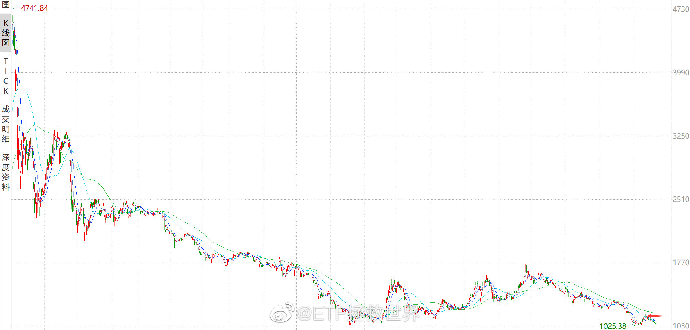

## 2021-10-27 17:29

平安跌那么多太合理了。

我一个从没出过车险的人，今年居然要给我涨保费。

表脸。 ​​​

## 2021-10-28 09:47

做市商何在 ​​​

## 2021-10-28 10:15

前三次分别是5、13、13个交易日提款。

这次会是几个交易日。 ​​​

## 2021-10-28 14:47

再回顾一下。

--------------------------------

其中左侧买入就是我今天想谈的。啰嗦的文字表达能力就是这么让人抓狂，几百字过去了，刚刚准备进入正题。

总而言之我的左侧买入理念就是不让筹码大量聚集在一个区域。或者说，不在短暂的时间内聚集在一个区域。

左侧买入并没有什么不对，但很多朋友左侧买入之所以受伤，是因为在品种下跌的过程中，在自以为的低位上，大量买入，结果下跌趋势继续，因而承受了巨大的损失。

趋势一旦形成，真的很难改变。大一点的趋势，通常会持续几年。在几年的时间里，你的猜底或者猜顶行为只有一次机会是对的。在这场猜谜游戏中，这个赢的概率就太小了。所以我的做法是不猜。

我理想中的左侧买入，会让筹码聚集在底部区域附近。而底部又很难判断，所以我的做法是规定一个买入原则，即我经常在微博上表达的：

左侧分批买入，空间、时间至少要占其一。

我想这非常容易理解。空间，即下跌空间。举个例子，我们的网格策略就是一个“空间”策略。在一个品种下跌5%或者7%或者10%的情况下加仓，避免筹码聚集在下跌的高位。

时间呢？其实通常意义上的“定投”就是一个时间范畴的买入原则。当然我们十几年前就已经抛弃了所谓的定投，但它隐含的时间概念我们却从未抛弃。这个时间没有限制，但最好不要过短，我想，在同样的价格水平上，同一个品种一个月应该是最低的买入时间限制。

换个说法，要么是跌幅够大，要么是时间够长。否则，我不会在同一个区间密集买入太多同一个品种。

当然了，这是大的原则。具体情况还要具体分析。比如说，你的仓位。如果你的仓位极低极低，那么，在某个价位上左侧密集买入一部分也不是不可以。

又或者说，目前已经肉眼可见的极度便宜，就像2008、2012和2018的钻石坑，那么密集的买入也是可以的。

以上，就是我的左侧买入节奏原则。我相信会有37.8%的朋友们看不太懂。没关系，再看一遍。如果还看不懂就别看了，一年后再来看。

你看，这也是给出“时间”的一种应用策略呢。

## 2021-10-28 15:02

我辛辛苦苦给你的留言写了评论，你给删了，让我非常生气。以后我发现谁再乱删我评论，马上拉黑。什么玩意儿。

## 2021-10-29 09:38

医药正在向第一目标位靠拢

## 2021-10-29 09:50

小支撑在12700-12800附近。//@ETF拯救世界:医药正在向第一目标位靠拢

## 2021-10-29 10:03

霉霉下来就是给提款机装钱的？

喷了。 ​​​

## 2021-10-29 10:11

本周末打算做两件事。

第一个是送1666红包。双11了大家手头都紧，为若干位锦鲤稍微回回血，也讨个彩头。

第二个是把我9.9999成新的三星 buds+耳机送了。

第一个应该是按排行榜抽，第二个应该是单独发帖按需申请。

钱不多，多担待，因为我比较穷，能力就这些。主要是个心意。 ​​​

## 2021-10-29 10:45

每次波动后回到原位，如果你的钱增加了，就是成功。如果越波动钱越少，就要想想自己是不是有什么问题。

## 2021-10-29 10:59

有朋友这周在催着问，趋势怎么样了。今天是周五，又可以说说。看了一下，上涨趋势又跌破了一半，但没完全破，只能下周继续观察。虽然这对我们的操作毫无影响，因为我们有预案。但有些朋友那么关心，我怀疑是重仓押注了，所以我把我的观察再陈述一下。趋势转折的过程中通常会非常复杂，要做好各种预案

## 2021-10-29 12:32

霉霉不简单。 ​​​

## 2021-10-29 12:40

不知道你们看不看带货直播。

老罗的直播和其它直播有一个特别明显的不同，就是他的小助理们都有一种高级感，就是看起来气质比较好，感觉层次比较高。其他的直播，包括李和薇的小助理，看起来都怎么说，叽叽喳喳的，比较接地气的感觉。

以前李的那个男助理感觉也高级一些，后来换人了。

至于快手那些……牛鬼蛇神一样我连看都不想看，更别提在那些地方买东西……

## 2021-10-29 13:22

有些朋友问，为什么要浪费时间在那些不涨的品种上面。

我也不知道。但我知道两点。

第一，跌到很惨的时候不买难道涨疯了买吗。

第二，以前这么干都赚钱了。

至于浪费时间，跟浪费时间比，我更怕赔钱。

另外，你很急吗，我不急，你急你先走。 ​​​

## 2021-10-29 15:22

今天犯了一个小错误，但思考之后，发现这反映的是自己思想深处的缺点和不足。

要改。 ​​​

## 2021-10-30 15:34

不要让自己的灵魂屈服于肉体，要用灵魂指导肉体的行为。

做自己的主人。 ​​​

## 2021-10-30 19:16

第一波周末福利，1688元送给互动榜前五十位的朋友。我估计运气好的朋友可以领上百元。

我看领到的绝大多数都是熟面孔，很好。没领到的别生气，以后还有机会。

 ​​​
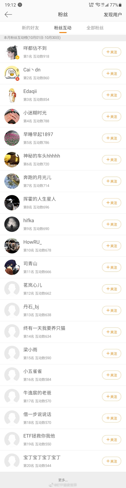 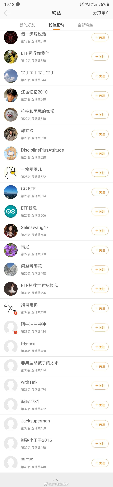 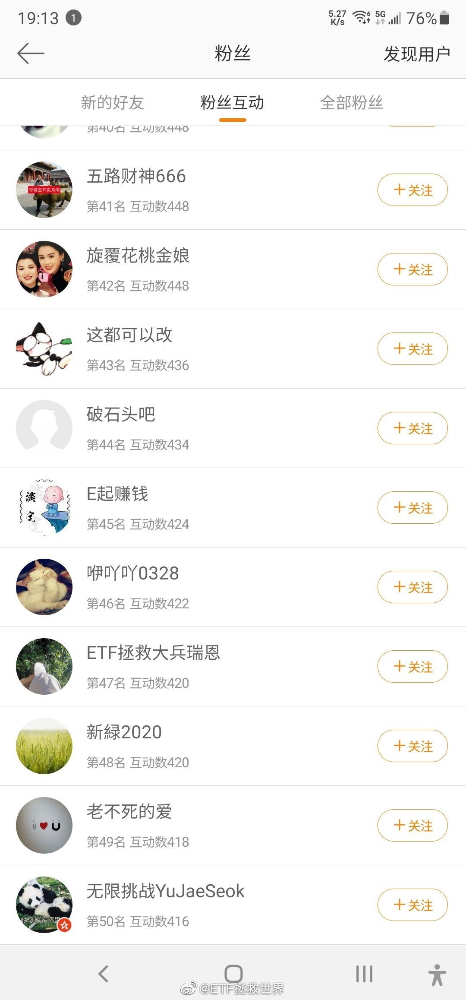 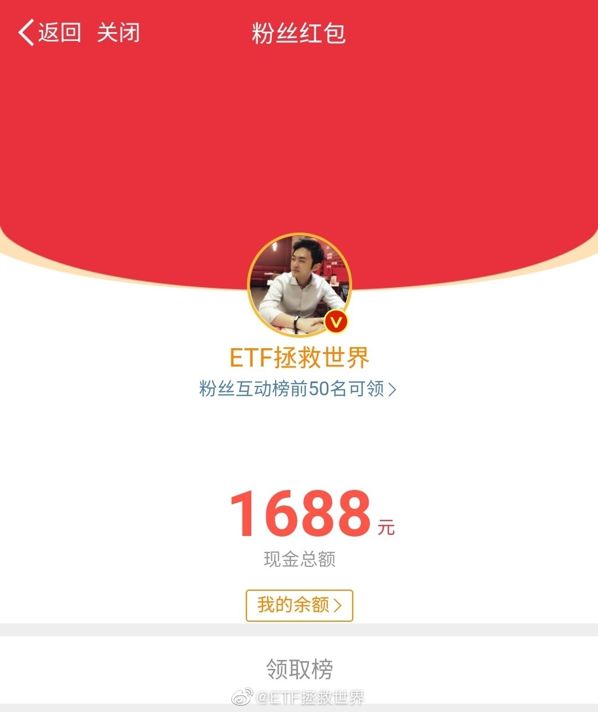

## 2021-10-30 19:22

前五十位来这里领，其他人别点了，会心塞  ​​​

## 2021-10-31 11:31

好好活着，才有机会做事情。//@ETF拯救世界:时隔两年回头看“低调”二字，不禁又有了新的感悟。朋友们，踏踏实实活着，别嘚瑟。

## 2021-10-31 12:30

昨天那个红包应该是微博系统出什么问题了，只有几个朋友领成功了。我已经咨询客服，还没回话。

如果能顺利领完就算了。如果还是不行，不管剩下多少钱，我会再加码在下个月送出去。

下午会发一条微博抽buds+，我的建议，不是真的需要的朋友就别掺和了。把机会留给真正需要的朋友吧。 ​​​

## 2021-10-31 15:40

送个9.9999成新的三星buds+耳机。

第一次送二手的东西，因为实在不好意思送二手，觉得有点拿不出手。

但是这个只用了五次都不到，里面的充电线和替换耳机套都没打开，就送了吧，各位别介意。

只有一个希望：已经有蓝牙耳机的就别凑热闹了（不要评论），留给真正需要的朋友吧。想抽到去卖掉的朋友更别参加了，谢谢你，也不是什么值钱东西，没必要。

老规矩，评论抽奖，限铁粉。16:30开奖。

PS:刚才已经擦拭完毕，升级到最新版本，试听了一下，音质还是不错的，降噪效果差点。寄出前会把电量充满。 http://t.cn/A6xPPnAZ
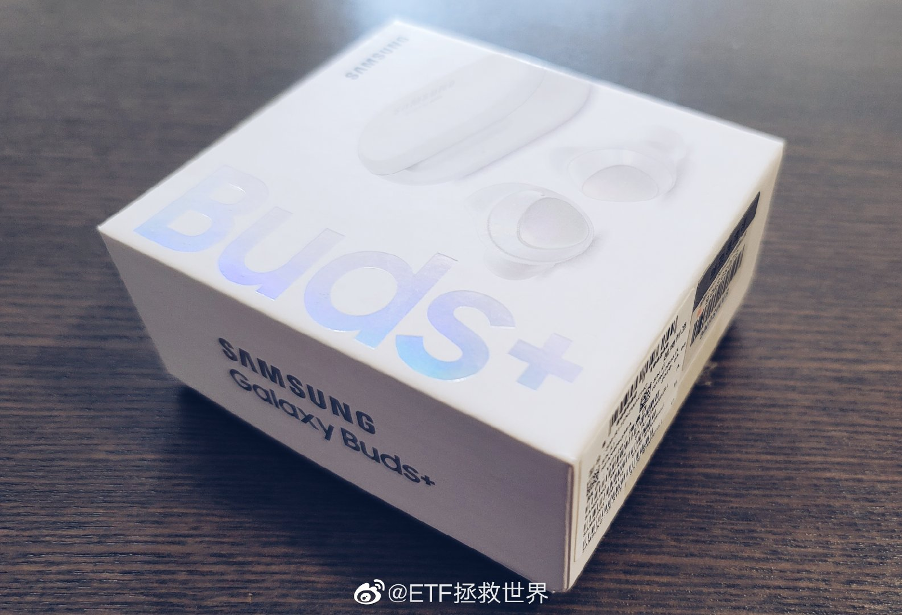 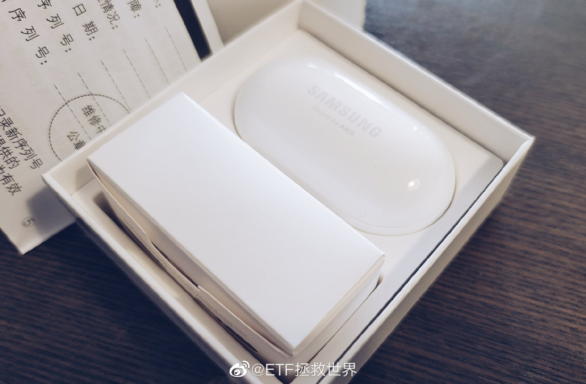 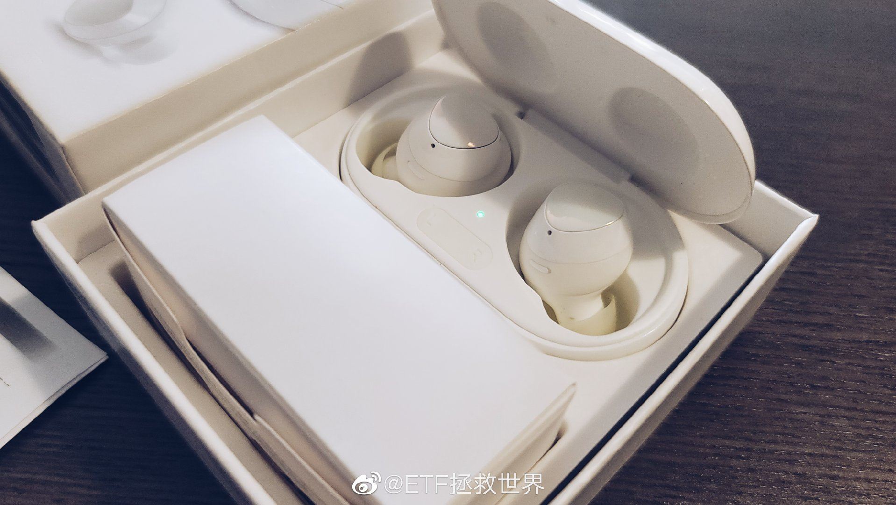 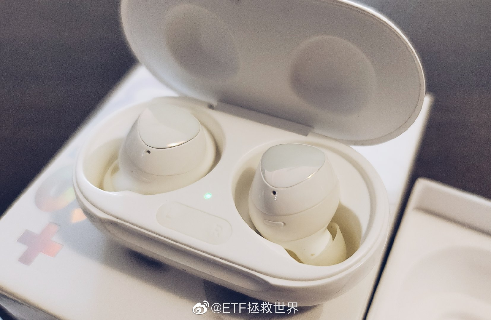 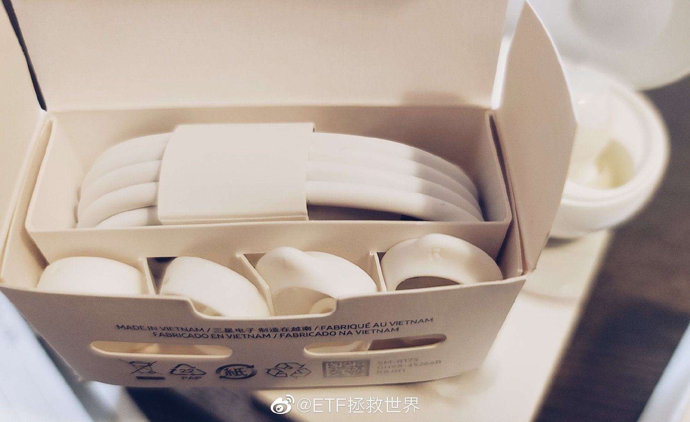

## 2021-10-31 16:32

恭喜@Mirabell-er 1名用户获得【三星buds 蓝牙耳机】。微博官方唯一抽奖工具@微博抽奖平台 对本次抽奖进行监督，结果公正有效。公示链接：网页链接

## 2021-10-31 16:57

今晚准备买什么好东西不妨分享一下 ​​​

