## 2021-11-01 10:20

可以，但没必要 ​​​

## 2021-11-01 10:30

两个闺蜜聊天：

A 哎你知道那个谁吗，他跟那个谁那个了

B 啊，不会吧，真的吗。前几天他不才跟那个谁那什么嘛

路人：都听不懂你们说什么，何必呢神神叨叨的。

闺蜜s：，根本也不是说给你听的，你跑这儿装什么熟人呢。

送给某些评论里教我做事的路人。 ​​​

## 2021-11-01 14:48

豆瓣上的“ETF拯救世界”不是我，出任何问题与我无关。 ​​​

## 2021-11-02 13:18

谁慌了举个手我看看。 ​​​

## 2021-11-02 16:07

破发是第一步。

如果出现一部分新股发不出去的情况，那就说明A股真的回归正常市场了。

这就是长牛的基础。

所有新股上市都暴涨，赚大钱，只能说明一件事：

这个市场上的老股票还太贵。太贵的市场是没有长牛的。 ​​​

## 2021-11-02 16:51

刷新认知了，买断的软件还能单方面改订阅。到期后一分钱都不会给你付。

## 2021-11-02 18:34

亲爱的朋友们，挣钱很重要，但更重要的是身体。

请各位一定要保重身体啊。

无论是肉体还是精神，保持健康。

除了生死，其他都是小事。

万事小心，长命百岁。 ​​​

## 2021-11-03 06:49

不要在我这里说不该说的话，否则我会拉黑您。 ​​​

## 2021-11-03 10:14

surface pro 8玩了一晚上，几个点说一下感受。

续航的话没有广告那么牛，同时运行同花顺 wind choice wps edge大概7、8个小时撑死了吧。不过也不错了。

暂时不卡，i7+16G中配。

音质还不错，但我感觉跟ipad pro比差点，更比不上MBP。苹果的音质绝绝子。

我觉得出门随身带这个够了。对我来说可能还要多带个数字小键盘……

对了，今天我的所有微博都设置了不能评论，不是你被拉黑了，别担心。为了大家好，见谅。

过一会儿会更新一个网格价格，表格更新完毕我会在这里说。

## 2021-11-03 10:54

首网价格更新已发布。 ​​​​

## 2021-11-04 13:07

易方达债现金。 ​​​

## 2021-11-04 15:14

明天提了算了，别那么害羞 ​​​

## 2021-11-05 09:10

对于有些朋友的担心，我不能说太多别的，我只能说，

毫无影响。 ​​​

## 2021-11-05 09:55

多年前在香港逛街的时候偶然买过一双切尔西靴，穿下来特别喜欢，舒服，好看。冬天穿稍微正式衣服的时候我都穿它。

穿几年旧了，赶上双11再去同品牌店铺找，同款当然没了，但买回来最接近的也没那双好看，看起来不高级。

好东西错过了就没有了。

不过也没什么。得之我幸不得我命，做好能做的，其它交给天意。就像今天的霉霉。

## 2021-11-05 10:19

​​​

## 2021-11-05 10:21

梅梅0.744有压力，过去不过去我都ok。

are you ok？ ​​​

## 2021-11-05 10:28

可能很多朋友没注意到，梅梅每次是提9%，已经连提两次，这两次合计三个多月。

所以不怕波动，就怕不动，一潭死水。 ​​​

## 2021-11-05 11:36

成交之前会很热切地盼望着，盼望着。

成交以后就会感到没什么意思，很空虚。

然后下一次成交前你的热情又被点燃。 ​​​

## 2021-11-05 13:01

问一个问题，

您作为米其林三星大厨的小号，觉得蒸鱼用哪种鱼最美味。 ​​​

## 2021-11-05 14:15

无聊的一个周五，

灰色的天空，

除了挣了点钱，

一无所获。 ​​​

## 2021-11-06 15:57

准备了花胶鸡，就等明天大雪的时候热乎乎的吃起来了！

 ​​​

## 2021-11-06 16:34

谁还记得去年11月我发的那个手指干裂的微博。

经过试验大家的推荐以及治疗方法，一年的时间，我这边应该算是大病初愈了，介绍经验给需要的朋友。

其实很简单，我的做法就是：

北京医院的标婷维E乳+资生堂的红白护手霜不停的抹。不是同时抹这三种，而是穿插着来，哪个在手边就抹哪个。

维E乳抹的比较多。另外我感觉，资生堂的白护手霜比红的好像好用一点。

前两年都是手指会有开裂的现象，感觉还比较严重。今年基本好了。还会有一点点干，但一直到现在这都冬天了也没裂，基本也不会起皮了。我想主要原因就是不停的抹，洗完手就抹，沾点水也抹。对了，少沾水，一定要沾就是温水。

ve乳我是北京医院门口买的，资生堂是以下两种。绝非广告，如果是广告今年赔大钱。

我的手也终于恢复光滑了（老图勿cue）。

因为一直有博友私信追问治疗效果，所以写出来供病友参考。
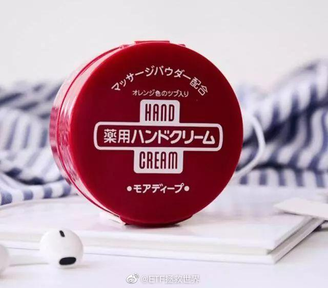  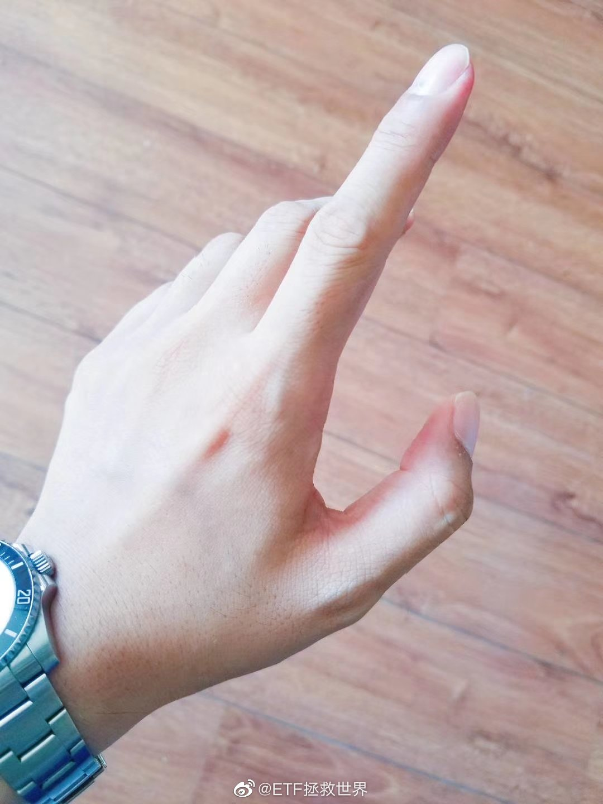

## 2021-11-07 14:28

花胶鸡一鸡三吃：

吃鸡

泡饭

涮肉 ​​​
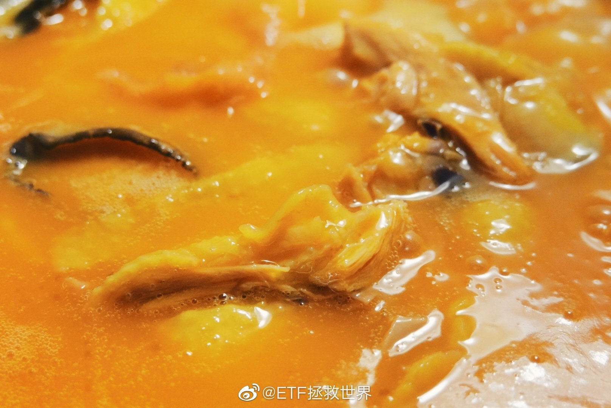 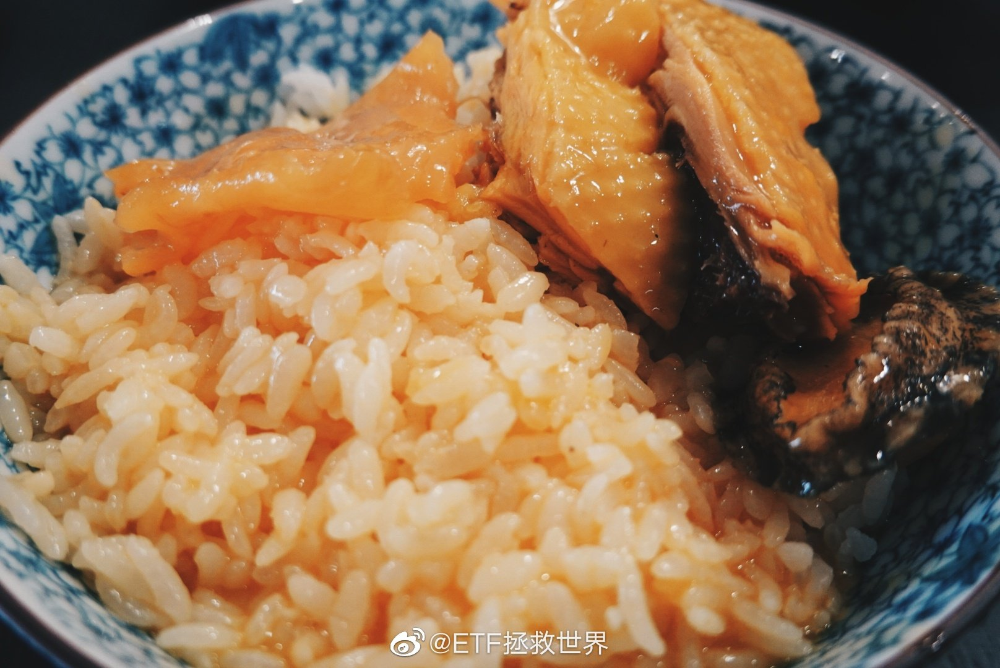 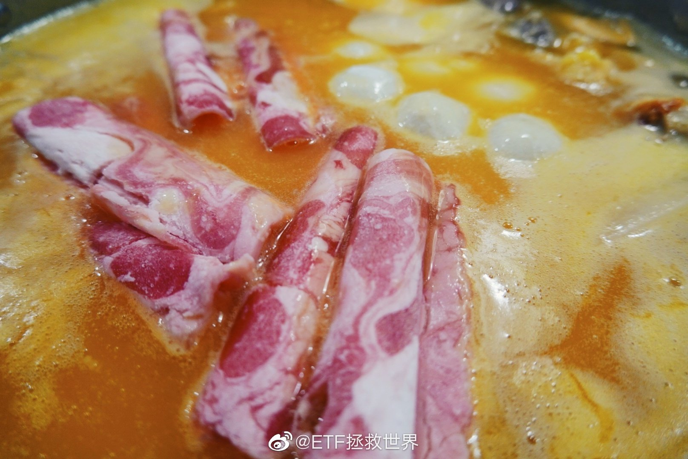

## 2021-11-07 16:06

在双方都有一定实力的情况下，最佳的博弈策略是一报还一报。或者说以牙还牙、以眼还眼。

你伤害我，我就伤害你。你给我一颗糖，我也给你一颗糖。简单、清晰、明了，对双方都是利益最大化。 ​​​

## 2021-11-07 17:18

11.11快到了，过几天要不要帮单身狗们开个交友贴。 ​​​

## 2021-11-08 10:47

## 2021-11-08 11:02

上一次150买入医药还是三年前的钻石坑。

之后只有出没有入。

不知道下次买入会不会很快就会到来。 ​​​

## 2021-11-08 13:09

最近监管对“大V”越收越紧。

我虽然只是个小v，但也确实该考虑是不是慢慢消失或者清谈一些非交易的话。

只是希望各位的投资体系已经慢慢建立起来，不至于又回到被人肆意收割的境地。

每个人都只能陪你一段路，我也如此。

如果那一天真的到来，还是希望你能记得我。 ​​​

## 2021-11-09 15:22

冲了三天没过去。笑看云起云舒，多空大战。

## 2021-11-09 18:22

认识我时间长的博友应该知道，我有一个老朋友，

巴蒂。

一只喜乐蒂牧羊犬。

昨天，即将十七岁的它永远离开了我。

朋友跟我说，对狗来讲，这属于喜丧了。

实话实说，从它的角度说，我算不上特别好的主人或者朋友。我的精力不够，虽然一直与它住在一起，但没能很好的照顾它。

所以时间和精力不够又不愿意随意抛弃的朋友，轻易不要养狗。

昨天翻看以往的照片，很多往事冲击着我的回忆。

我以为我不会哭，但是我错了。

千万不要安慰我，对于生老病死的事情我看的还挺开的，千万别安慰，不至于。

写这条微博没有别的意思，就是纪念一下我的老朋友，参与我人生又离开的老朋友，

牧羊犬巴蒂。
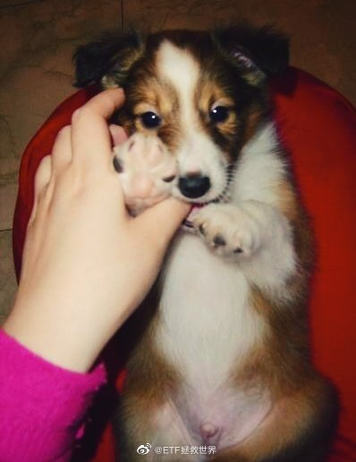 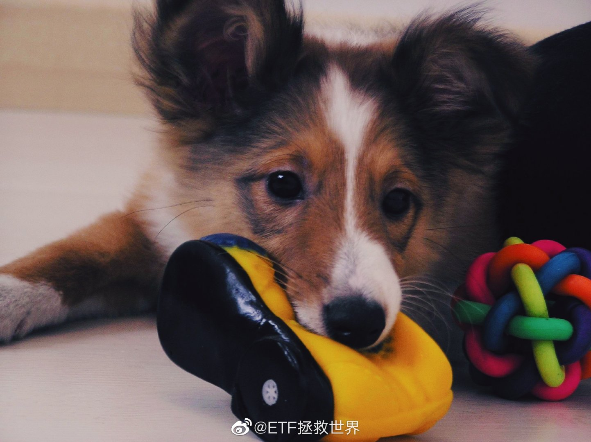 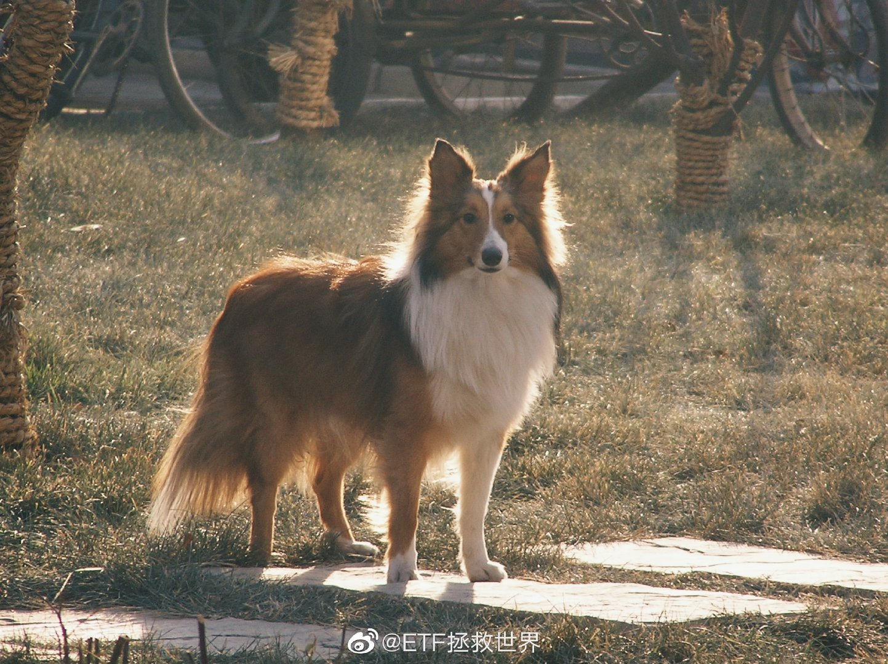 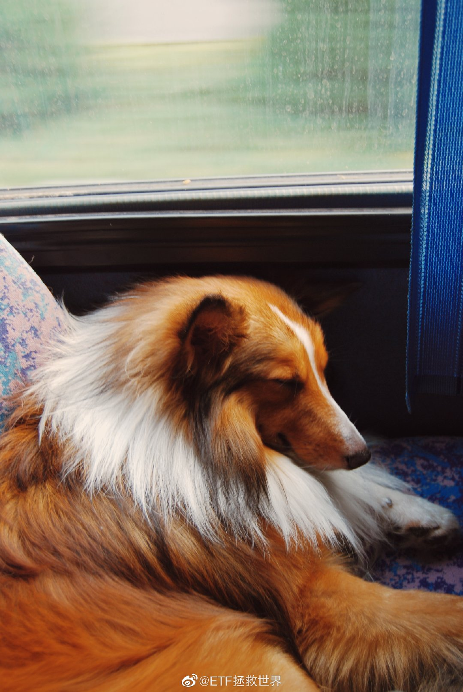

## 2021-11-10 09:38

哈喽家人们，我来营业了。

我先看看黄历啊，研究一下今天聊哪个话题比较安全。 ​​​

## 2021-11-10 10:07

就前几天啊，我看了一条新闻，说是几个人被骗了几百万杀猪盘什么的。

这新闻我一看啊，就有两个感想，分享一下。

首先说被骗的都是30+的人。被爱情骗子们骗了钱。这时候我就想啊，这共同特征就是两条：有钱、缺爱。

缺爱一会再说，先说有钱。

朋友们，想要不被骗钱很简单，我也说过很多次了。只要做到两点：第一，不要贪小便宜。第二，不要掏钱。

其实吃吃喝喝买买东西旅游之类的很难把家败光，最怕的就是黄赌毒和乱投资。黄赌毒不用我说，乱投资只要记住两点：第一，投国家背书的标准化产品。第二，不懂不投，别人赚大钱的时候不投。

好了，再说缺爱。

之所以那么容易上当，就是因为被所谓的爱情冲昏了头脑。那为什么年纪不是很小了会缺爱，当然原因很多。有可能是一直没有遇到合适自己的，如果是这样，那就是天意弄人，没有办法。

但如果是自己年轻的时候不努力追求幸福，或者被某些群体洗了脑觉得异性都是魔鬼，结果年纪大了发现某些群体的人一个个成双成对了结果自己还是一个人，那就怪不得天意了。

所以我就想啊，咱们首先得清楚，人类中有一部分属于垃圾人。这个不分男女。我们要做的就是锻炼自己能够识别垃圾人的能力，远离垃圾人，让垃圾人和垃圾人自己去互相伤害，咱们不要给垃圾人机会，离他们远点。

其次咱们得知道，人类另一部分整体还是好的。不妨在年轻的时候就试试找找有没有适合自己的。有就有，没有就没有。有就好好在一起，没有一个人也很不错。千万别年轻的时候认定一个人单着挺好，年纪大点又觉得形单影只顾影自怜，结果被人几句甜言蜜语迷了心窍，又骗感情又骗钱那就不好了。

这就是我从一条新闻中得到的两点启发，分享给你。

值此双11之际，也不妨在这条微博的评论里找找有没有适合你自己的人。但是我要提醒一下，千万要擦亮眼睛，我这里虽然是中文互联网的一块难得净土，但也会有一些漏网之鱼害群之马潜伏其中，要小心骗子。

最后我正告那些骗子，有什么冲我来，放过我善良的博友们！但我先告诉你一声，也许你可以凭借姿色骗到我的身体，但绝对骗不走我的钱！

## 2021-11-10 11:06

说起双十一买东西，我其实推荐各位买个好点的枕头，再买个好点的被子，最好再买个好点的床垫。

毕竟人生1/3时间都在上面呆着，舒服最重要。

枕头的话可能每个人不同，我比较喜欢那种五星酒店的鹅绒羽绒枕。现在也有很多供货商在网上卖酒店同款，高中低都有。以前我喜欢睡高一点的，现在觉得低一点的对颈椎好更舒服。

被子的话鹅绒被我觉得可以。我用的是95鹅绒的，说实话开暖气有点热，但是真的很轻很舒服，比传统的棉被好，我个人感觉。

床垫也就那几个牌子，跟以上的比算稍微大一点的，可以自己研究后再买。

不带货，只是一个小建议。睡得舒服很重要。

## 2021-11-10 13:46

蒙的太准是一种原罪。 ​​​​

## 2021-11-10 14:20

反正这个世界是这样的。

就是说你要过得好，或者总是很开心，或者总是挣钱，那有些人看到了就会不舒服。然后不舒服的人里面就会有些垃圾人要搞事情。

我觉得还是躲垃圾人远点。不是怕他，是垃圾人都很垃圾，他嫉妒你就要没完没了的搞事情，所以干脆离他远点。

不怕贼偷就怕贼惦记。

垃圾人关注的点不是自己怎么做得更好，而是希望别人倒霉跟自己一样差。

所以以后咱们关注的一些剧集更新了啊，ATM又吐钱了啊，我就发个表情提示一下就完了。懂的都懂，别刺激到垃圾人脆弱的小心脏，哪天他嗷的一声过去了就不好了，您说是吧。

[春游家族]

## 2021-11-10 14:39

回复@Mirabell-er:自己好好用，别让你老公抢走了。//@Mirabell-er:闷声发大财不香吗…E大的耳机收到啦，音质很好 查看图片

## 2021-11-11 10:16

小事情上面豁达一点，得之我幸，失之我命，不要太在意太纠结。几天后几年后回头看都是鸡毛蒜皮，然而你这一刻的心情却被永久性的影响了。

得不偿失。

另外，人生的走向是被很少的几件大事影响的。上什么学，做什么工，与什么人结婚，交什么朋友。在这些方面慎重一点，争取选对。

时常提醒自己，大事一定不要出错。错了就是沉重的代价。

## 2021-11-11 10:36

虽然霉霉很渣，

但它不屈不挠在压力面前努力向上挣扎的样子依然让人暖心。

不过很可惜，它始终是那么辣鸡…… ​​​

## 2021-11-11 12:02

鹅厂福利待遇越来越好，也能理解。

公司利润太高可不行。 ​​​

## 2021-11-11 14:48

如果这样一个品种已经开始盈利了，

那其实不用担心太多 ​​​
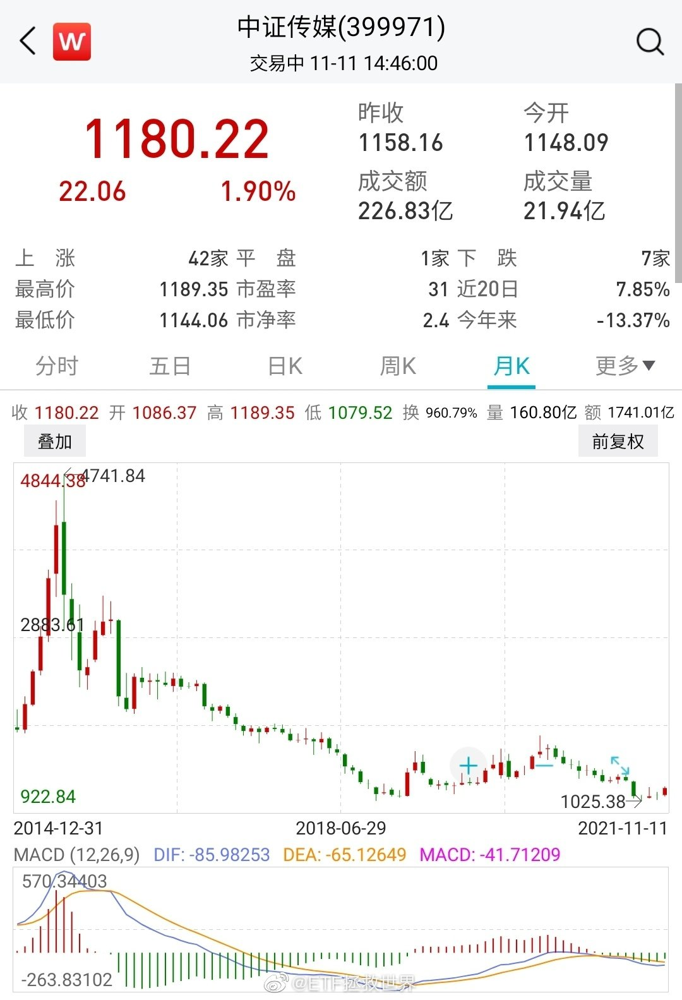

## 2021-11-11 16:56

我们全都是穷困的，虽然有奢侈品包围着我们，倒不及野蛮人有着一千种安逸 。

欲望是没有止境的。

搞钱，然后节制欲望。 ​​​

## 2021-11-12 11:05

发不出来，这样看吧。 ​​​
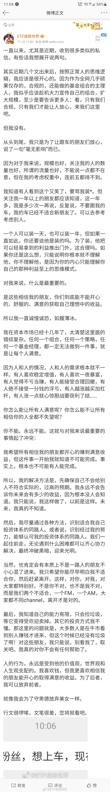 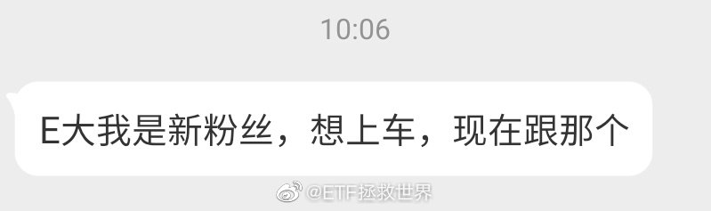

## 2021-11-12 11:21

德不配位，必有灾殃。

大不是最重要的。最重要的是活得够久。 ​​​

## 2021-11-12 17:08

我有个主意，你看看觉得怎么样。

每次觉得无聊的时候就去锻炼身体。

这样既解决了无聊的问题，身材也变好了。 ​​​

## 2021-11-13 12:13

这男主持人真让人讨厌。这种播出事故，主持生涯应该结束了吧。

## 2021-11-13 15:53

看了看市面上的基金投资书，觉得都很好，但不太适合我们这里。

我准备写一本。

书名想好了

《投资只看这一本就够了——基金投资，从入门到放弃》 ​​​

## 2021-11-13 16:43

我这些年看发生的各种大事小事，其实认真想一想，很多悲剧都源于一个原因：

尊重。

一方感受到另一方不尊重自己，于是酿成各种花式悲剧。

每个人都需要尊重。尽量尊重每一个人，有益无害。 ​​​

## 2021-11-14 15:35

各位认为春节应该送哪个  ​​​

## 2021-11-14 18:27

很多事情我都有自己的想法。只是我无法说。

但我会从每件事中学到东西。包括更深刻的认识人类，认识世界。

当然，最重要的是不断调整人生的策略，争取更久的活下去。 ​​​

## 2021-11-14 18:32

如果这是真的，我认为这样的男人不配拥有家庭和孩子，嫁给这样的男人不如单身。如果这是假的，我希望为了流量不择手段的up主原地炸号。

## 2021-11-15 10:15

你有什么想说的。

我没什么能说的了。 ​​​

## 2021-11-15 10:33

## 2021-11-15 10:48

涨一点不要太兴奋。跌一点不要太难过。

涨涨跌跌都是小事。

不要被人收割才是大事。 ​​​

## 2021-11-15 10:52

如果你在上海和深圳打工都挣不到钱。

为什么会觉得自己在北京打工就能发大财。 ​​​

## 2021-11-15 11:20

看过一些关于打仗的资料。

我有个想法，就是地面部队不要聚在一起，分散开，不然容易被全歼。

分散的话，胜利的可能性大一点。 ​​​

## 2021-11-15 11:55

我想大家的投资目标其实应该是分三步走。

第一步，不赔钱。第二步，挣钱。第三步，保住挣到的钱。

然后在每一个周期里面实现这三步。

所有的投资策略都应该是围绕这三步展开。

当然我知道，大多数朋友进来玩的投资目标就一个：

挣大钱。至于怎么实现对这些朋友来讲不是很重要。 ​​​

## 2021-11-15 13:19

刚看到一个人让投注站老板代买彩票，结果中奖了投注站老板私吞的事。

说真的，我不懂这个买彩票的人。

首先，他应该是默认自己绝对无法中大奖，所以才请别人代买，买完了彩票在人家手里。但问题在于，他如果默认自己中不了大奖，为什么要往里面扔钱呢。

其次，如果他认为自己能中奖，那他就太幼稚了。他是在赌一个没什么钱的人（投注站老板）面对上千万的财产无动于心，讲良心把1000万给自己。对，这有可能发生，也确实发生过。但对于80%的人来说，我认为面对1000万会动心。

所以我真的不理解这种人。这种人是在赌世间充满真善美。这当然是错的。我们可以要求自己尽量真善美，但心里要明白，这个世界到处都有丑恶。如果真的碰上真善美，那是赚了，而不是必然应得的。

## 2021-11-15 14:58

平平淡淡的一天，

有些账户新高了，有些没有。

没什么意思，总归都要新高的。 ​​​

## 2021-11-15 16:20

我可以一天不和人说话，而且会觉得很舒服。 ​​​

## 2021-11-16 09:21

其实中国足球和中国教培都是一回事。

都是什么事情呢，就是源于一句话：“万般皆下品，惟有读书高”

什么时候白领和蓝领的收入水平、社会地位都相差不太多的时候，这两个问题都能解决。

否则，无论你如何引入地产老板打造亚洲旗舰俱乐部，规划巴西球员，无论你如何打击教辅机构，都绝对无法真正解决问题。

什么时候大多数人觉得，我孩子上不了大学做不了汽车工程师做个汽修工人，做不了gwy做个装修工人或者水管工也挺好的时候，就都解决了。

不信你好好琢磨琢磨。

## 2021-11-16 09:35

红，梅，还是药。

谁先，是个问题。 ​​​

## 2021-11-16 11:11

💊

🍗

 ​​​

## 2021-11-16 11:16

能做的我已经做到极致了。

## 2021-11-16 13:14

分享图片 ​​​

## 2021-11-16 15:12

呵呵，可笑。

有人把不用的神仙水给我了，说她不适合。

不用了给我了？把我当什么人了。

“别太过分！下次我绝对不会接受的！”我警告她。 ​​​

## 2021-11-16 16:15

接下来你看到的这条微博，可能是今天最有价值的一条。也可能是这个月。

刚才在评论里看到一位朋友说，亲爹给了100万，最近做波段赚了一辆x3。

这有可能是真的，有可能是这位朋友开玩笑，当然也会有喷子会恶毒的认为这是我找的托或者是我的小号。

真相是什么并不重要，我要说的是一件关于投资非常重要的事情：

在投资过程中，什么时候最危险。

有朋友可能会觉得，手里的品种跌得亲爹都不认识的时候最危险。或者价格下跌了7788，所剩无几的时候。

我要说，你错了。

这样的时刻并不危险。相反，这样的时刻有可能孕育着巨大的投资机会。真正危险的时刻，恰恰是你在资本市场赚了大钱，洋洋得意，志得意满，春风得意马蹄轻的时候。

所以，请在座的各位一定要注意一件事，那就是，从来也没有，永远也不会有任何一个投资策略是完美的，是永恒有效的。当你在一个策略上赚到了大钱，这时候一定要小心，巨大的危险就快来了。

推而广之，一个基金经理，一个组合，道理也是一样的。

这个看起来简单的道理，有些人需要用五年、十年，甚至一些人可能一辈子都不会真正的深刻领悟。

我想说的是，在你赚到大钱的时候，请一定再次审视自己的策略，要比之前小心千百倍的去对待带给自己成功的策略、人以及组合。

相反，在一个人、策略、组合非常落魄的时候，如果你反复审视，发现投资逻辑可以自洽，怎么想都是合理的情况下，就应该果断的、大胆的坚定信念，甚至投入更多。

很少有人能够在赌桌上满载而归。究其根本原因，并非没有人能够在赌桌上赢钱。而是赢了却不走，认为自己鸿运当头，最后输个干净才算完事。引以为戒，引以为戒。

那么那位朋友问了，成功投资以后该怎么办？难道摒弃之前成功的经验吗？

当然不是。我的对策，一字记之曰：

度。

## 2021-11-16 20:22

此时此刻有两个想法：

第一，想以后少上网了。网上**太多了，看多了心里堵得慌。

第二，晚上要熬夜看一场肯定赢不了的比赛，心里更堵了。 ​​​

## 2021-11-17 10:31

S所有26个品种全部盈利。

150里面38个品种37个盈利，一个浮亏4%。

WG7个品种6个盈利，一个浮亏2%。

这轮是2015年最高点开始的。A股有那么难赚钱吗？ ​​​

## 2021-11-17 10:59

梅梅，收手吧。

跌得好好的为什么要涨。 ​​​

## 2021-11-17 17:09

刚才翻评论，又有人抱怨不说代码看不懂了，甚至连我带围观的各位全骂了。

这种人并不在意别人的处境，不在意为什么不说代码，也不在意别人乱说话会遭遇什么困难，受到什么惩罚。

他们只在意世界是不是围着自己转，别人的所有行为是不是要满足他的欲望。稍有不满，就要破口大骂。

一旦别人真的遂了他的心愿，满足了他的要求，但最终因此被干掉，他也并不会有一丝丝的愧疚，反而可能笑着又骂一句并且幸灾乐祸，然后彻底忘掉这件事。

## 2021-11-18 16:03

请新朋友周知：

你正在看的这个人的微博不值得关注。

说投资，众所周知，一向以来纯粹靠蒙。

而且现在还添了新毛病。总是神神叨叨的话也说不清，代码更是没有。不仅这一年多来长线没有关注的价值，最近一两周开始波动也没地方看了。

这样的“知名财经博主”不能说一无是处，只能说是个废物。

说生活，三观也非常可疑。总是有一些莫名奇妙的想法，与大多数网友的纯真美好背道而驰。好在能够遵守法律法规部门规章行业自律守则社区规范，否则下场早已不堪设想。

最可恨的，是该博主勾结个别富婆，买了一些自带评论的机器人粉丝。看起来很自然的评论区，其实不过是野生AI程序写得出色罢了。你有所不知，其实这里只有你一个人类，其他评论的都是代码。

所以建议你取关。不要上当，该博主投资能力很差，人品也就那么回事，三观更是一塌糊涂。

不是开玩笑，一定要取关，不要靠近他，否则会变得不幸福。

## 2021-11-18 17:25

有时候看网络评论，就觉得有些事情难以理解。

比如武磊已经是现时中国最好的前锋，但依然被那么多人骂。骂他没有做得更好。

其实我想，这不就相当于你孩子考上了211或者985，你骂他为什么考不上清华北大一样吗。他已经是你们那个城市考的最好的孩子了，但因为他不是全国最好，你就骂他吗。

你怪他考不上清华北大，有没有考虑过是不是自己的遗传基因耽误了他？

至于武磊，因为他比不上梅西C罗所以骂他吗。

奥，对了，梅西C罗也被网友骂。

这么一想我就释然了。

原来没有人不被骂，即使你是世界上最好的。

## 2021-11-19 09:37

🚛

## 2021-11-20 16:36

人在呢人在呢。

忙死我了。

大家都还好吧。降温了别忘了加衣服。 ​​​

## 2021-11-22 09:55

你有什么一直想做却没做的事吗。 ​​​

## 2021-11-22 17:50

不知道什么时候开始，在每一个东西上都有了一个日期。

沙丁鱼会过期，罐头会过期，就连保鲜纸都会过期，我开始怀疑这个世界上没有什么是不会过期的……

最近，我发现，公众号页面也会过期。

你知不知道一个公众号页面，又要写又要编，还要排版，做出来有多么辛苦啊。

说过期就过期了。

早让你收藏页面你不收藏，失去了你才知道珍惜。

但没关系，你的问题可以去问客服。

懂的就懂了，不懂的也不用瞎问，有些事你把握不住。

## 2021-11-23 10:24

一出一进

这个资金利用率

感人 ​​​

## 2021-11-23 13:26

蓝色和黑色永远是我的最爱 ​​​
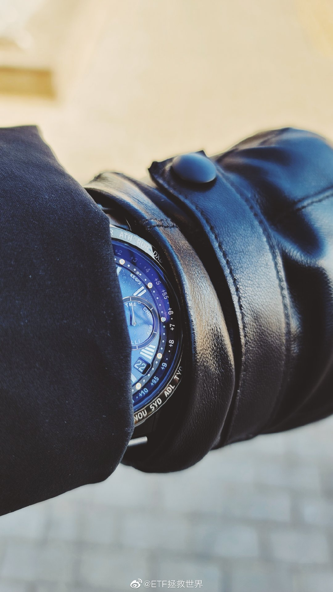

## 2021-11-23 14:28

有暖阳

没有风

没有雾霾的冬日北京

最可爱了 ​​​

## 2021-11-23 16:11

慢慢发现自己是个特别俗的人。

喜欢美食，喜欢美景，喜欢美女，喜欢口水歌和爆米花电影。

还有救吗。 ​​​

## 2021-11-24 08:26

第一，别喝酒。第二，别得瑟。第三，尊重别人

## 2021-11-24 11:44

很多苦难可以只是苦难，也可以变成财富。 ​​​

## 2021-11-24 13:47

把所有人都接上才发车，

让人感动 ​​​

## 2021-11-24 21:30

现在150中概仓位2.5%。

敢不敢把价格打下去让我加到10%以上。 ​​​

## 2021-11-25 09:31

说实话，我不理解花300万充值玩网游的人。

30万或者3万也不理解。

玩个游戏而已啊。充再多钱赢了别人又能怎么样啊。 ​​​

## 2021-11-25 13:40

目前时点本人各策略持仓指数基金权重排名（非推荐，只是介绍自己的状态）

500
中概
红利
恒生
传媒
医药（各国/地区）
消费
油
300
碳中和
其它 ​​​

## 2021-11-25 14:35

如果不做波段，很多人面对这几个月的行情就崩溃了。

即使你的成本很低。 ​​​

## 2021-11-25 15:45

这是一个唯结果论的世界。

所以没必要说太多，也不用解释什么。

努力做好事情，拿出成绩就够了。 ​​​

## 2021-11-26 12:02

之前说的且慢投顾费用抵扣和返还，因为不是所有策略组合都享受，所以请各位看清楚自己跟投的组合在不在范围内。

150和S都在，不用担心。 ​​​

## 2021-11-26 12:14

如果没有危机，你怎么会有机会买便宜货？

凭什么？凭你长得美吗，美也要讲法律啊。

富贵险中求。（但是不要乱求） ​​​

## 2021-11-26 12:29

我坐上了一辆双层公交车，

看到有意思的地方就下车。

想在哪里下就在哪里下，

没人能管我。 ​​​

## 2021-11-26 13:36

隔壁桌的女孩徒手抓了一只蜘蛛。

我假装淡定的喝了一口雪盖摩卡。

店员一脚把蜘蛛踩死了。

没人在乎蜘蛛的感受。

也没人想成为蜘蛛。 ​​​

## 2021-11-26 18:12

小道消息：

我就告诉你一个人，可千万别外传：

欧美崩盘了 ​​​

## 2021-11-26 20:22

想要心情好，就要少上网 ​​​

## 2021-11-26 21:04

上网也会看到好消息 ​​​
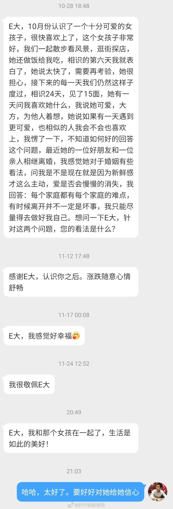

## 2021-11-27 10:55

面对资本市场的危机，我的建议：

第一首先不要慌。

第二，冷静的看自己手里的东西。有没有可能死的，有没有特别贵的。如果有，找机会处理掉。

第三，保命。

第四，找机会进场捡漏。如果没有能力识别，就不捡，保命。

第五，坚持不慌。一开始不慌，最惨的时候更不慌。再次审视手里的东西。跌得很惨，但是会不会死。不会就不用慌。尝试捡漏。

很久没买了，手里钱很多，不用慌。你有钱，你是甲方，市场是乙方。你是话事人。

## 2021-11-27 11:21

回复@优雅的悠:真的相信我就不会出现重仓大额浮亏。150如果是老朋友依然盈利，新朋友浮亏，但是仓位只有2.5%。S也是老朋友盈利。新朋友浮亏，但只买了7份，相当于3个半月的可投资资产。网格目前浮亏8%，这个仓位我没法把握，但初始预期是下跌60%。

## 2021-11-27 14:34

谁要对我好，或者没有对我好但是客观上帮了我，我就总觉得欠人家的，有机会就想还。没还的话心里总是惦记着。

谁要对我不好，或者对我不公平我就觉得ta是**，是死是活我不太关心。

是不是太狭隘了。 ​​​

## 2021-11-27 15:13

回复@一壹y:去年有同学跟我借钱。我借了一个他不会还我也不心疼的数字。后来真的没有按时还。但确实一笔一笔的分期在给。我从没催过，都是他主动还，也证明了我看人眼光的准确。没有按时还是我知道他确实不容易。这件事到现在都让我心情舒畅，从未难受过。这就是做一件事考虑清楚后再做的好处。

## 2021-11-29 10:53

互联网时代，每个人都可能被别人用放大镜审视每一个细节。

所以要说什么，拍什么，发什么，咱们还是考虑考虑比较好。 ​​​

## 2021-11-29 12:08

恒生接下来的支撑位在21500左右。这是倒数第二个支撑。

最后一根支撑在18500左右。如果我是那种轻仓但是想买一部分恒生的，我可能会认为这个位置是极佳的买入位。 ​​​

## 2021-11-29 12:37

咱们普通人积累一些财富不容易，所以我始终有一部分资金是放在银行的。收益率很低，但是安全，另外总觉得它们会有用。

最近我又开始慢慢一点点往证券账户搬家了。 ​​​

## 2021-11-29 12:56

今天看了一个新闻，说有个渔夫总是捞小鱼，有点不过瘾。又买了一个中型的网出海了。

笑死了。好好笑。 ​​​

## 2021-11-29 13:26

什么时候买回来比较好。 ​​​
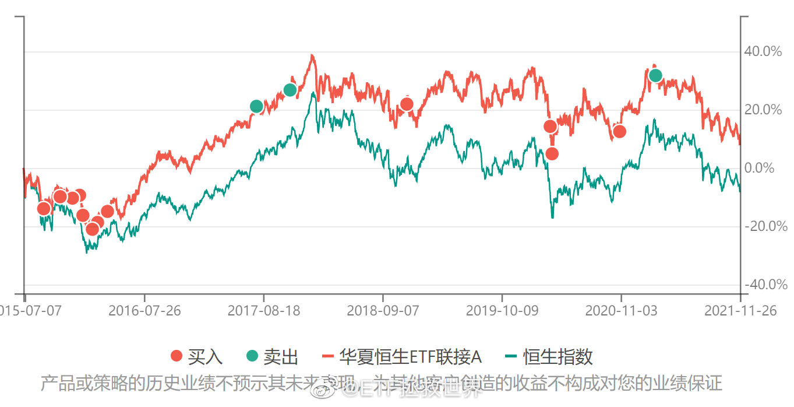

## 2021-11-29 13:42

我这里是微博的和谐之都，首善之区。

所以不要在我这里评论里吵架。大家和和气气，互相吹捧什么的最好了。

如果非要吵，那么带铁粉标志的留校观察，没有标志的直接开除。

每天已经过得很辛苦了，上个网还给自己找不痛快不是吃饱了撑的吗。 ​​​

## 2021-11-29 14:44

有些东西越跌你越害怕，手里的越看越难受，买也不是，卖也不是。

有些东西越跌你越开心。跌也开心，波动也开心，涨也开心。买越多越舒服，一种巴适的感觉。

怎么说呢，就像收藏古董或者手办、名表、金条之类的感觉。就是收藏，觉得真好啊，手里又多了。时不时拿出来把玩一番。

它怎么波动你都不在意，甚至还有点想笑。

## 2021-11-29 15:46

上了年纪的男星里，状态保持最好的是安迪刘。脸上也没有动过的痕迹。

我愿称之为保养偶像。 ​​​

## 2021-11-29 19:12

我是个不喜欢甚至有点讨厌小孩子的人。

但就是喜欢自己的孩子。虽然现在8岁远没三四岁时候那么可爱，但还是很喜欢。哪怕只要时不时拥抱一下就会觉得很幸福。

“来儿子，抱一下。” 然后他抱着你的时候，用他的小猫爪子在你背上轻轻拍几下，你就会感到舒服又甜蜜。

这狡猾的基因！

但你让我再生我是不生了。因为我这个人最怕麻烦，养个孩子太麻烦了。甚至麻烦这两个字都不能诠释这份麻烦的程度。

如果是个爱操心的父母，就更会感觉麻烦得不得了。恰好我就是那种爱操心的人。

什么时候养孩子没那么麻烦，出生率就会提高吧。

## 2021-11-30 13:28

越来越近了。

## 2021-11-30 15:37

过去12个月：

150计划卖出17份，买入12份，净卖出5份。回笼资金。

S计划应买入24份，实际买入13份，卖出8份，净买入5份。剩余19份未投，蓄势以待。

网格提款20次，波动与下跌中不断提款增利润降成本。

如果这样的情况你还不能微笑面对下跌，那就真的别投资了。 ​​​

## 2021-11-30 16:14

快到年末了，今天中证1000四年新高。

回头看年初的判断，可恶，又让这个作者蒙对了。 ​​​
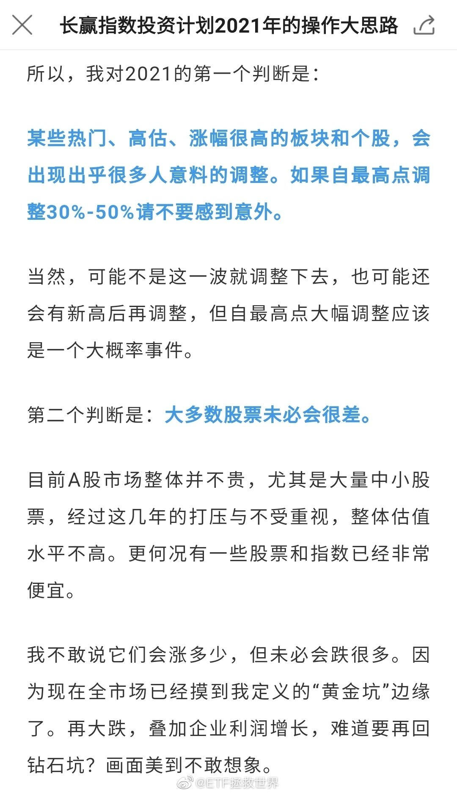

## 2021-11-30 16:30

这条微博是年初热门崩塌前发的。今年中证500上涨15%，中证1000上涨21%。那时候的小公司是真的真的便宜。

## 2021-11-30 17:43

我对中国足球彻底绝望了。

不是因为战绩什么的。

是因为上上下下，里里外外发生的事情让我感到恶心。

我也不是什么精神洁癖患者，自我感觉容忍度还挺高的。就这还是被恶心到了。

没有谁是无辜的，足协，俱乐部，球员，教练，媒体，自媒体，球迷。没有任何一方配得上一支好的球队。

就这样吧。可能我们这个民族真的不适合类似的集体项目。

