## 2021-12-01 09:45

一个品种到底部区域有几个特征

第一，有大V开始谩骂嘲笑它

第二，有人开始在评论或者私信我表达压力巨大

第三，我开始频繁提起并划定支撑位准备买辣鸡

一个品种下跌，你可以选择郁闷崩溃，也可以选择谩骂嘲笑，但其实你也可以想想怎么在这次下跌中赚钱。

前两者除了让你跟其他人一样发泄情绪外毫无用处，而后者则不同。

这是思维方式的差距。也会造就不同的人生。

## 2021-12-01 10:44

今天，第一道数学题暨S卖出一份

至于捡不捡辣鸡我还没想好。

主要是有些人心理素质太差了——哎呀我买了几份套了十个点呀，哎呀好难受啊。

烦死了。

你不应该在这里，你应该在支付宝或者天天的评论区。

听哥一句劝，我们这里的level你把握不住。 ​​​

## 2021-12-01 11:07

各位也请别总是嚷嚷买买买。

您得想想到现在您还有钱急着买是为什么。

还不是因为一直严格遵守男德了。（只敢说守男德）

在我这里说什么都有可能，但最不应该出现的就是“我没现金了” ​​​

## 2021-12-01 11:37

你别说，霉梅还是挺讲义气的。

最高点出了，接回来后又在蠢蠢欲动。

怎么说，辣鸡是辣鸡，但是一个讲义气的辣鸡。 ​​​

## 2021-12-01 11:59

给孩子爱，然后…尽自己所能不要让孩子上辣鸡学校

## 2021-12-01 16:44

3小时还没到10w+。

过气小V不如喵。 ​​​

## 2021-12-02 10:30

多看，少动

保命 ​​​

## 2021-12-02 11:03

每个人都觉得“越多”越好，“越大”越好。殊不知从玄学上讲，每个人都有自己的上限，你自己的命够不够硬压得住这么多这么大？从生物学上讲，也不可能你一个人一个企业越来越NB吃尽所有。那别的细胞还活不活？所以一切都是周期。适可而止，见好就收。

## 2021-12-02 11:31

我希望恒生涨，大家都能提款。

我又希望恒生跌，长线仓位在好买点布置进去。

但我最希望那些什么都不懂的，心理又极不成熟的投资巨婴赶紧从我这里消失。

我真的不是歧视您，我是能力不足帮不了您。真心的。真是能力不足，真的。比珍珠还真。 ​​​

## 2021-12-02 13:35

看了一场儿子足球比赛，赢了，第三名。

又看了一二名决赛，有两个孩子让我深深领悟到一个问题，就是世界上真的有天赋这个东西，不服不行。

儿子没有足球天赋，确认了。 ​​​

## 2021-12-02 14:53

目前整体是这样，关于未来。

首先年初高位减持的50和300不打算接回来。500也不打算加仓，如果涨得过分了还会减仓。

环保这种完全就是在等一个继续卖的机会。

其他品种也没有什么想买的。有些品种做做波段攒一点廉价筹码，比如霉霉，但是长线不会怎么加了。

现在盯的就是医药和消费。在等好买点。具体点位之前也都谈过了，不过点位是动态的，会持续上升，以后也会更新。

这两个希望有机会买多一点，其他的暂时没兴趣。

A股整体的仓位思路是稳中有降，这样的情况下肯定不会加仓。对了，红利肯定不卖。

中概和恒生还会买，恒生的好买点之前也说了，不到的话就继续做波段提款。到了就加仓，因为年初已经在几乎最高点减仓了，至少要买回来。

其他的也没什么好说。整体来讲就是控制好节奏，保命，然后攒点便宜货。

## 2021-12-02 17:56

略微感到有点悲哀。

好几年了，小助理们依然不太了解我…… ​​​
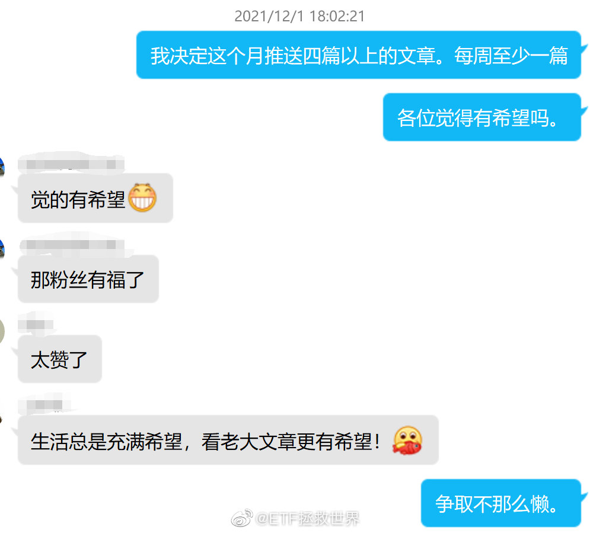

## 2021-12-02 18:25

看到豆瓣被罚款了，我估计是小组的问题。

给你分享一下我加入的小组。

最喜欢各种扔东西小组，非常解压。有空的时候会翻翻。 ​​​
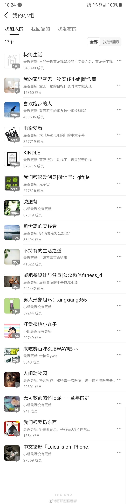

## 2021-12-03 10:13

我不敢说全部，但我估计在座的各位99%持有恒生和中概的绝对金额都没我多。

今天他们跌1%，我可能账面又少了几万块吧。

但这件事在我心里泛不起一丝波澜。我想有几个原因：

第一，它们在我全部金融资产中占比不高。

当然它们加起来可能在所有权益类仓位里面不低了，应该有20%以上了。对，别看150里面只有两个多点，S里面8个点的仓位，但我自己买了不少了。尤其是近期，主要是波段仓位在加。

（这里说错了。150两个多点是中概，恒生+中概也有10%了。S恒生加中概是14%。）

在权益类中占比高到20%多一点，在金融类资产中还低很多，这就让我很踏实。哪怕从现在再腰斩，金融资产降低几个点，我也无所谓。

第二，买它们的钱在可预知的未来根本不会动。所以这个浮亏我只认为是账面的，它们又不会死。

第三，对于所谓的浮亏浮盈，我都认为是虚幻的东西。浮亏只有到了你卖出的那一刻，才真的变成了亏损。之前的变化，无非就是账面数字。

而我的所有投资经验告诉我，不用在意账面数字的变动，也不用在意一个品种有多久不涨。因为只要它开始涨，就会一次性把之前欠我的还给我。我要做的只是不断的降低成本，积累廉价筹码，让自己未来赚的更多。

我希望这两个品种加起来，跌1%能让我赔10万以上的日子早点到来。

## 2021-12-03 10:24

金融市场本来就是波动的啊。不想波动的话去银行存款或者买p 2 p啊。奥，对了，p 2 p连本带利都被卷跑了。

金融市场有意思的地方，不就在于这里是这样挣钱的吗：

你的收益=你的智慧+别人的愚蠢-别人的智慧-你的愚蠢。

那你说一个产品这样不断波动，不就是智慧和愚蠢的较量吗？

你打开网格的交易记录看看，为什么不断有人在高位买你的，低位再割肉卖给你？不是一次，而是一年二十次！

这还不够有意思吗？这简直是智慧对愚蠢的无情碾压啊。

没有波动，你长期账户里那些收益率过100%的品种都是怎么来的啊。没有暴跌，我们何德何能买到翻番的品种啊。

## 2021-12-03 10:56

BABA从最高点319跌到现在122，已经跌了62%。

跌到95就是70%，跌到64就是80%。

根据7080定律……sorry，在我这里不能根据定律，因为我不知道它是不是不死的①……

①我不是说它会，也不是说它不会，我是说，我不知道。——给文盲的注释。

不得不感叹一声，还是指数好啊。踏实，敢买。 ​​​

## 2021-12-03 13:46

没什么意思，退博了。 ​​​

## 2021-12-03 15:43

我相信对于这个问题很多朋友也会感到疑惑…… ​​​
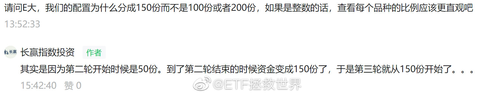

## 2021-12-03 16:26

今天有位朋友在留言中说，HK百年辉煌已经结束了，恒生指数没有希望了。

这个问题我会专门写一篇东西，但忍不住跟大家分享一下有意思的事情。

我们就不说HK70年代股灾，也就是大时代里面方进新破产那次，恒生指数从1711点暴跌到150点，整整下跌91%，我们从80年代开始看。

肉眼可见的，暴跌的行情就有：

81年开始的下跌63%；

87年六个交易日就下跌45%；

93年下跌46%；

97年金融危机下跌61%；

2000年科网泡沫下跌53%；

08年次贷危机下跌66%；

后面的15、18就不说了。

今年才跌了多少？12%。

真的是好笑。如果以股市的表现来说，HK根本就从未出现过什么一直上涨的百年辉煌。50%以上的暴跌比比皆是，几年就来一次。

回调不可怕，可怕的是只看眼前短视的眼光、历史知识的缺乏以及对未来的理性判断。

我看到的，是一个标准上升通道中，波动极大，获利机会极多的指数。买错了你就赔钱，买对了赚大钱。做投资，万万不能鼠目寸光。

另外，从宏观，尤其是臆想的宏观来判断股市走势，那就大错特错了。反例还用我举吗。
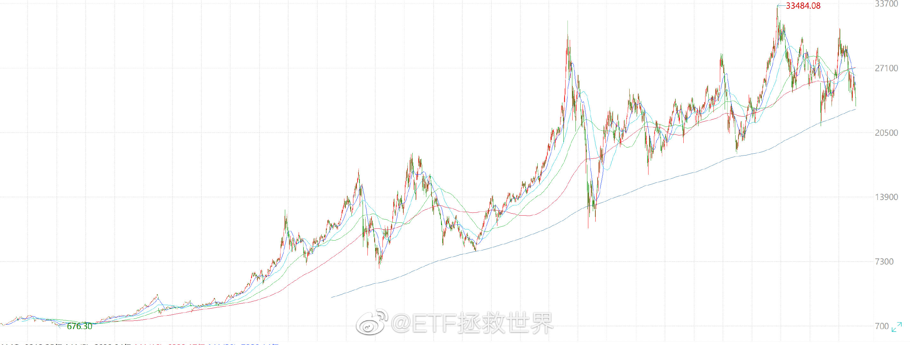

## 2021-12-03 18:07

特别不喜欢新朋友的原因，是他们什么都没经历过，碰到一点点问题就上蹿下跳心惊胆战夜不能眠，最主要的是到处问：

还能不能持有啊，要不要割肉啊，还能不能买啊，你怎么还不买啊，套了xx%怎么办啊……

然后加一个捂着脸哭的表情。

喷了，好讨厌，烦死了。

我不是投资者基础知识教育人员！你看微博那个什么投资者教育的奖都没给我，你就应该懂了。

我是那种嫌弃你这种小白的讨厌鬼！取关我是你最应该做的事情。

你去找找微博给你推荐的那种大V，就是那种追热点很厉害，买了就能涨每年赚很多的。他们水平很高，真的更适合你。

还可以去各种基金论坛找，有很多，每个人都是赚钱高手，投资经验长的甚至达到4、5年之久，资产或将突破五位数，相当值得信赖。

离开我吧，我们真的不适合。没套过又赚了钱的别在我这里出现。套过&amp;赚钱，缺一不可。只套过没赚过钱的是韭菜，只赚过钱没套过的是未来的韭菜，赶紧走。

## 2021-12-03 18:21

说句实话，如果没有股市，

生命真的褪色68.92%。

很多东西每天其实都没有在变，都差不多。

只有股市每天剧本都不一样，很新鲜，没有过期日。 ​​​

## 2021-12-03 18:59

看世界。

## 2021-12-03 23:42

只要不反弹，周一必买 ​​​

## 2021-12-03 23:48

150一共买了五份，两个多点。

S一共买了八份，现金存了很多。

等的就是这种时候。这次我绝对不会再照顾有些人的狗屁情绪了。 ​​​
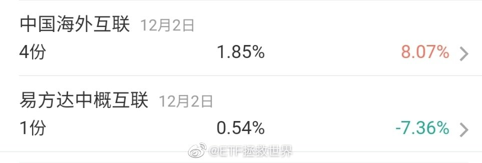 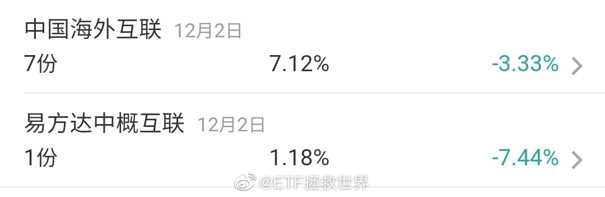

## 2021-12-04 08:12

预告：

今天继续发文章。第二、第三道数学题，以及应用题：中概互联。

必看。

我先去写了。 ​​​

## 2021-12-04 11:06

到办公室了。

7-11买了一份水果。一瓶UCC的冷咖啡。一瓶Craft boss的热咖啡。当做午餐以及下午茶。

拉开窗帘，打开灯，掀开白色的外星人，连上黑色的显示器。

你在休息，我要开工了。 ​​​

## 2021-12-06 09:48

平平无奇。 ​​​

## 2021-12-06 09:57

刚听说一个故事，

说有个渔夫在一片海域捞鱼，捞着捞着发现这片海域太多人了，搞得很难捞到。另外他发现有些鱼好像不是那么可口。

所以他把船开到了另一片海域继续捞。不是重新开始，是继续。

渔夫正让水手们制作航海图，告诉家乡的乡亲们新海域的位置。 ​​​

## 2021-12-06 10:03

长线的话看情况。

暴跌不等，阴跌不急。 ​​​

## 2021-12-06 10:24

连续暴跌，随时可能见底。

连续阴跌，需要一根带量大阳线。

不是所有，是大多数。

多大点事，踏踏实实的。 ​​​

## 2021-12-06 10:30

有些人：抄底抄底抄底！百年不遇的大底！

有些人：完蛋了！半年内不要碰！还有大雷！

我：我们的交易计划在哪里，照做。 ​​​

## 2021-12-06 12:18

今天这两个多点的跌幅，实在是不过瘾，空间没有拉开，所以150和S暂不发车。

原因有三。

上述是第一个

第二是周五刚买了恒生，相关性不是很低。

第三是早上已经下了一网波段。

这三个理由是不是很充分。 ​​​

## 2021-12-06 12:33

HD一年多的时间跌了93%。

但是你造吗，你在最高点27.1买入浮亏93%，和腰斩后13.5买入的人浮亏85%，在交易软件上看起来其实差不多…… ​​​

## 2021-12-06 14:42

下午就有点意思了。

继续看戏。 ​​​

## 2021-12-06 14:48

什么时候都不能上头。

第一重要的，保命。第二重要的，买便宜货。第三重要的，该走就走。

没什么比保命重要。命没了，以前挣多少都是虚幻。

但我们活着并不是为了活着，来资本市场也不是为了保本。所以在保命的前提下低买高卖。

不上头的低买高卖。

其实就这么简单。

可惜，有人只记得赚钱，有人只记得保命，全都忘了初心。

## 2021-12-06 16:39

不知道这家公司台下的人到底是真心敬佩，还是心里什么都明白只是在演戏

## 2021-12-07 09:28

怀念一天提款的日子。 ​​​

## 2021-12-07 19:03

虽然有人经常冒充我，但是… ​​​
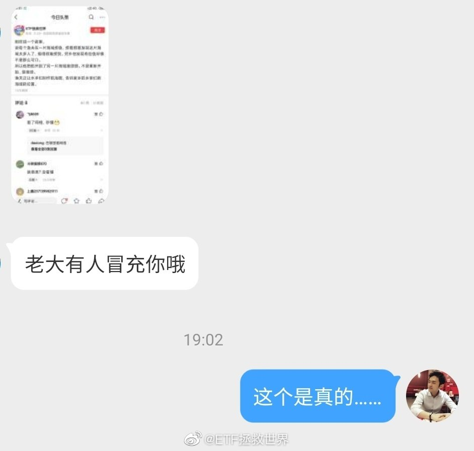 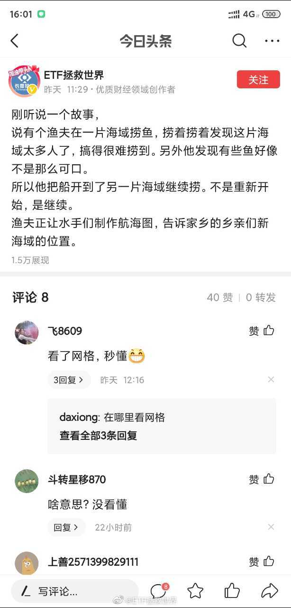

## 2021-12-07 20:34

刚才在评论里看到一位朋友说，这些年第三轮计划有没有什么总结自己做的不好的，能不能说说。

你这话说的，那肯定有啊。

我经常会反思自己的问题，也会总结成功和失败的经验。

然后我发现有些问题可能是我永远解决不了的，相当于建号的时候点的属性，改不了了。

也知道自己目前的大缺陷是什么，但不确定能不能有提升，应该有。因为过去是把主要的精力放在体系、策略、交易时点等问题上，其他的问题可能下的功夫不够。之所以不确定，是因为不知道下功夫不够的方面，真的下功夫了是不是能真的解决。

总而言之其实问题不少。也许有一天我会系统的说说，也许平常时不时的检讨一下。总之就是我犯的错依然不少，我会正视它们，研究问题出现的原因，想出解决的办法，然后与大家分享。

我希望自己以后不会犯错。但我估计以我的资质，做到这点基本不可能。只希望能够不犯大错，少犯小错，希望自己不要让很多朋友失望。

## 2021-12-08 10:53

拐卖孩子的人贩子，拐一个无期，拐两个以上死刑。买孩子的父母20年。

这是我的一个愿望。 ​​​

## 2021-12-08 11:15

红利全收益今年涨了16个点，其实也就比表现很不错的1000少了2个点，比500还高2个点，更是跑赢沪深300超过20个点。

但因为距离前期高点太远，让人觉得它渣渣的。 ​​​

## 2021-12-08 11:34

说起重男轻女我就特别不理解了。

我理解的是什么，是对于男孩女孩天生的偏爱。比如我毫不讳言，我就是喜欢女儿。儿子生下来之前一直想得是女儿就好了。但其实后来是儿子觉得也很不错，儿子也有儿子的好。

那有人就是天生喜欢儿子，我也能理解。这种人比如说生个女儿，会觉得有点遗憾，我也理解。我想这种也会跟我一样，虽然未能如愿，但自己的孩子也是很喜欢。

但我就不理解那种，就一定得生个儿子。或者就是喜欢儿子，女儿就跟不是亲生的一样。到底为什么啊。

你要说封建社会，你儿子能一直跟你住一起，能给你养老。女儿嫁出去可能平常指望不上，那我也理解了。或者说你住村里，家里都是女儿容易被欺负，多几个儿子打架给力。我很理解。

但这是什么社会了？？？你还指望孩子给你养老？不啃你就算好的了。就算指望孩子养老，儿子能挣钱女儿就不能挣了？而且我说实话，就我所见，要是老人真有个病，女儿照顾起来要比儿子给力得多！指望儿子忙前忙后照顾你？你大概率想多了。

所以我不理解，这个年头为了自己的利益重男轻女的。你要是天生喜欢男孩我理解，你要是为了自己的养老喜欢男孩我就不理解。

## 2021-12-08 13:16

搞偷袭的梅梅，爱了。 ​​​

## 2021-12-08 16:34

有没有法律学的好的朋友，帮帮孩子吧。这钱还能要回来吗。

PS，看到“青春无价”四个字我笑出来了。你偷钱就好好偷钱，怎么还搁这物化女性？女性不是附属，不是玩物！男女已经平等了！什么年代了，怎么还拿自己换钱？

在一起你情我愿，互相爱慕互相付出，分手了互相道一声珍重。为什么总有人想把女性搞得低人一等，生气！
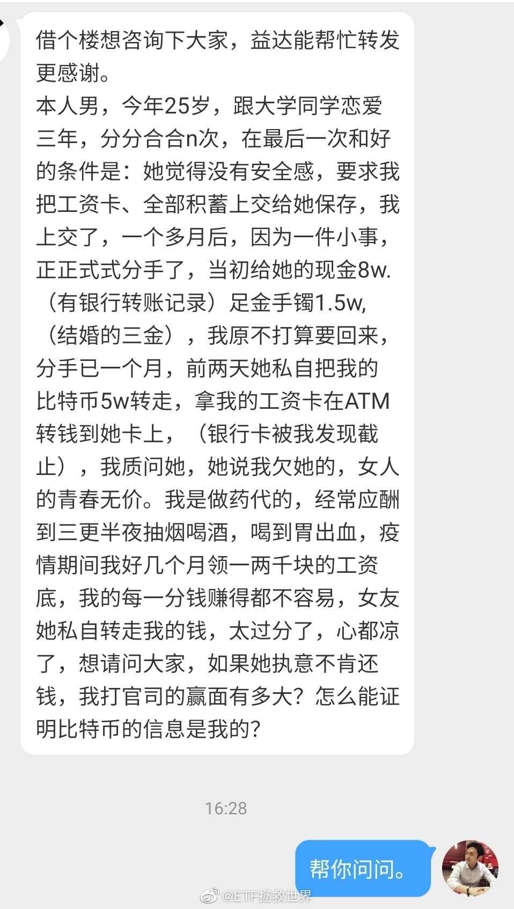

## 2021-12-09 08:38

当你还在犹豫谁才是牌桌上的菜鸟，那么你就是那个菜鸟

## 2021-12-09 10:28

“现在盯的就是医药和消费”。这就是我目前存在的问题之一，过于追求低成本

## 2021-12-09 11:30

今天的行情，大盘股仓位低的人很受伤。

一年都好好的干嘛年底让人受伤呢，这样不好。 ​​​
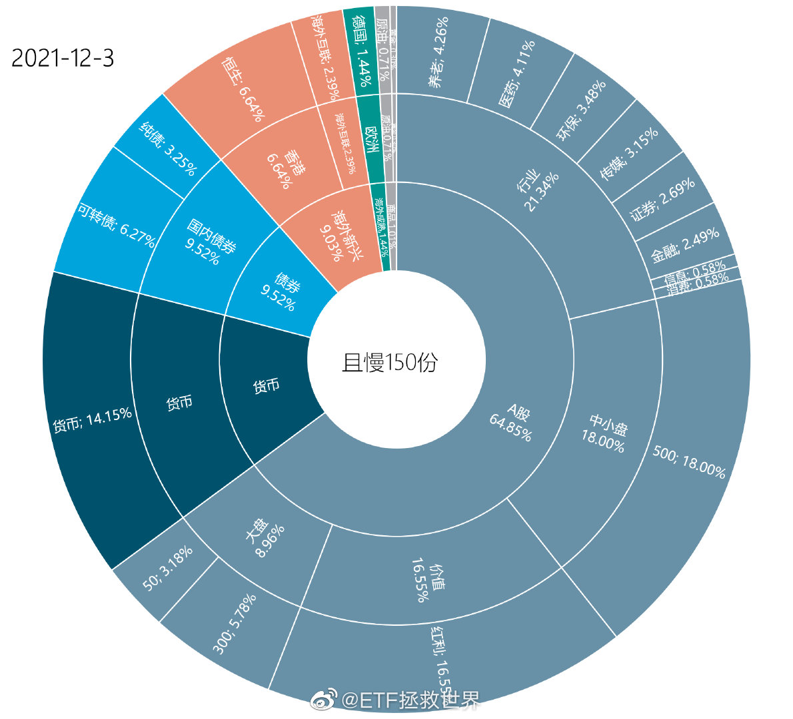

## 2021-12-09 17:25

有时候觉得生活很美好，

有时候觉得世界很糟糕。

如梦似幻，不必太当真。 ​​​

## 2021-12-09 17:51

挣钱的正义性 ​​​
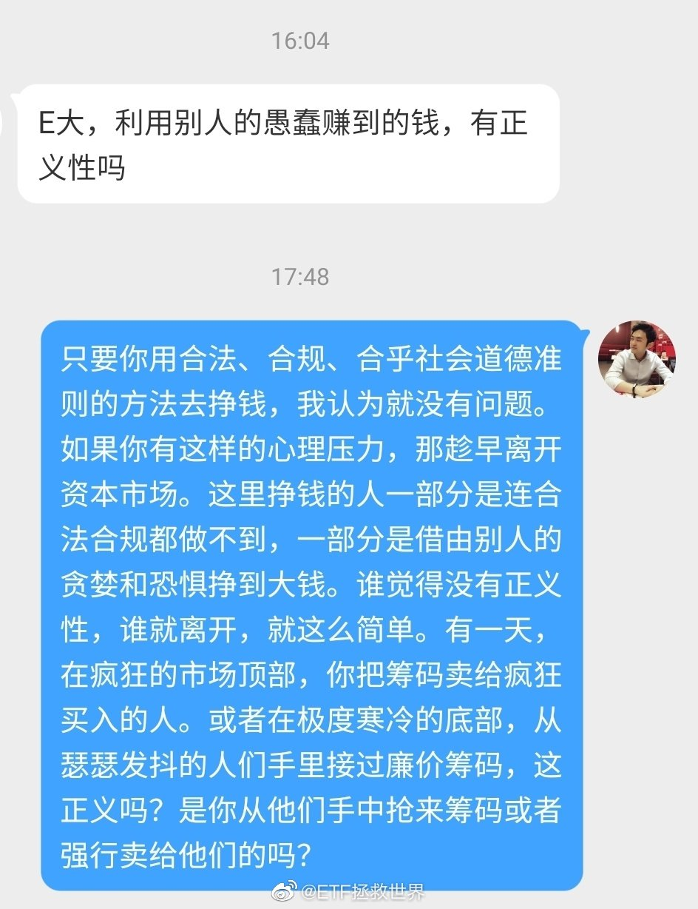

## 2021-12-09 19:04

刚写完上一篇的评论就看到这个新闻了。有些鸡毛蒜皮的小事儿那么在意干嘛啊，把自己身子气病了最终受害的不是自己吗。他说你就让他说去呗，他看得起你看不起你又能怎么着啊，多大点事，踏踏实实的。以后不买他家东西，不让他赚你一分钱不就结了。

## 2021-12-09 19:19

很多人特别希望所有人都“看得起”自己。当然，有时候也包括我自己。

于是很多人就试图在各方面把自己武装起来。比如戴个金链子，穿个貂，开个BBA，穿名牌等等……

但其实吧，根本就不可能所有人都“看得起”你，无论你是谁，无论你怎么做，无论你穿的用的多么牛逼，无论你做出了多么NB的事情。

比如说吧，你开个BBA。好，你开了34C，你以为自己开了豪华品牌应该很多人觉得你牛了吧。不是，大多数人，尤其是网上，会嘲笑你。居然开34C，那也是BBA？

好，你努努力，换了一个56E，觉得自己挺厉害，这下应该有面子了吧。我看不会。至少一半的人依然会觉得你开的车不行，又或者是装蒜，为了面子贷款买的。比如你到知乎问问，我开的56E，谁觉得我NB?你看看你会不会被喷成筛子。

也就是说，你要让大多数人觉得还行，至少要开100万以上的车，落地100万就可以。但这也只是大多数人觉得还行，有些喷子或者更有钱的人，还是不会认为你的车拿得出手，依然会嘲笑你。

同理。你省吃俭用买个LV，依然是大多数人觉得太一般了什么啊。不买爱马仕也算用了奢侈品？你想想三十而已里面太太们合影那一幕就懂了。几十万的包都不敢往前站。

总而言之，千万别试图让所有人都觉得你牛。你用再多名牌武装自己，也不会所有人都觉得你牛，甚至你的气质如果不配，还会被绝大多数人嘲笑“土豪”，“暴发户”。可能表面上尊重你，其实背地里会嘲笑你。更惨的，会有人因为嫉妒，给你下绊子。或者干脆就惦记上你那点也不知道真的假的存在的钱了。

我们每个人必须接受不可能所有人都觉得自己厉害这件事。亚美利加总统也有一半国内选民认为他是s*，也有至少十几亿人各种取笑他。巴菲特去汉堡店吃汉堡，绝大多数店员也不认识他，也不会特别尊重他。

所以，我觉得，咱们还是接受事实。接受世界上99.99999999999%的人根本不可能在乎自己，很多人会看不起自己，无论自己是谁。这就是现实啊，也不可能改变，无论你多牛，也只有很少的人知道你。即使知道你也有至少一半的人讨厌你，就这么简单。

别人看不起自己就气病了，你说是不是稍微有点吃饱了撑的。

## 2021-12-10 10:36

这一波梅梅比较麻烦的是最新压力位在提款价位下面一点。

能不能提到这9%就看梅梅够不够强势了。

加油梅梅，不要被奶到哦！ ​​​

## 2021-12-10 15:28

一心一意搞钱。 ​​​

## 2021-12-10 20:19

你永远也不知道人类的阅读能力可以低到什么水平。

当然也可能是其他地方的问题。 ​​​
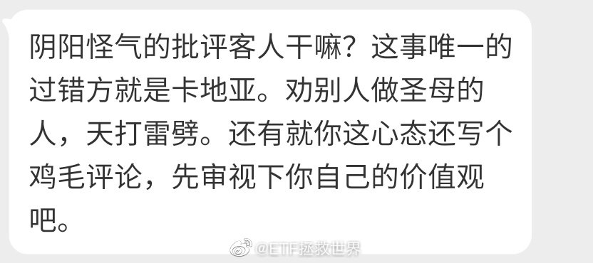

## 2021-12-13 09:34

就是这里，压力很强。

## 2021-12-13 09:40

所有品种都离高点很远，

但你的波段账户已经新高。

我们无法改变世界，

但我们能够改变自己。 ​​​

## 2021-12-13 10:27

喷了，一个月同一价位第二个8% ​​​

## 2021-12-13 10:55

看到各位开心我也很开心。 ​​​

## 2021-12-13 11:53

一个妹子发的私信。

这是怎么回事，是不是碰瓷。在线等。 ​​​
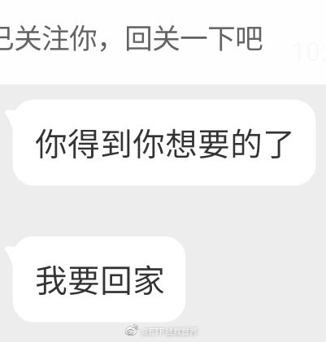

## 2021-12-13 13:17

梅梅波段仓位成本价。 ​​​
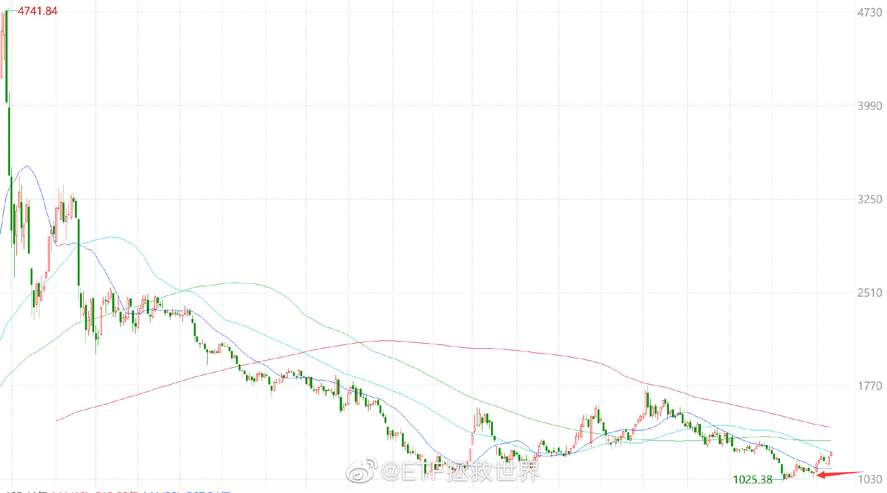

## 2021-12-13 13:39

我特别不希望有些朋友看到其他人赚钱了也想来玩，投资不可以这样。

怎么说呢。投资很多时候靠的是一种信念。这种信念支撑着投资者在很黑暗的时候不会放弃。

但实际上看到别人赚钱就也想加入的人，其动机并非来源于信念，而是来源于希望与别人一样赚钱。那么当需要信念的支撑去度过难关的时候，这些朋友恐怕就熬不过去，因为他就没有这种东西。

信念可以来自很多地方。比如信任一个人，比如信任一个经过思考而认可的策略或者投资理念，比如自己历史上的无数次胜利带来的信心。

总而言之，在最黑暗的时候，必须有点什么东西支撑着你能够支撑到光明的到来。

“别人赚钱了我也想这样赚钱”，这样的想法是绝对不行的。

## 2021-12-13 17:07

被禁止的拍照搜题，包括那种拍照帮孩子判题的功能吗。

如果包括，我。 ​​​

## 2021-12-14 09:38

梅梅这么不懂事，恐怕很快就会被铁拳狠狠的教育。 ​​​

## 2021-12-14 09:56

持仓品种也是不同的。

有些根本就没想过卖；有些在等回落信号发出来就卖；有些在等冲高后卖。 ​​​

## 2021-12-14 10:33

你造吗我真的很感慨。

梅梅这几年表现特别差，差到什么地步呢，从最高点到最低点跌幅是78%（这个数字懂的都懂，不懂的也不要问。水很深，你把握不住）。

那么前一段时间，无论是长线还是波段持仓都是浮亏的。

最有意思的事情出现了。明明是浮亏，有些朋友仓位还不轻，结果我们每次说起梅梅，都充满了欢乐的气氛。什么莫再提啊，什么霉霉啊。大家轻松的打着趣，开着玩笑。

即使根本看不到希望，看不到上涨的迹象，即使打开账户都是浮亏。

真的很感慨。这要搁别的地方，不是破口大骂就是抱头痛哭了。

我们这里确实是A股市场非常特别的一个存在。跟大家在一起战斗就很荣幸。

## 2021-12-14 12:32

每天扔一件东西，

已经扔了387件。

扔东西心情会好。 ​​​
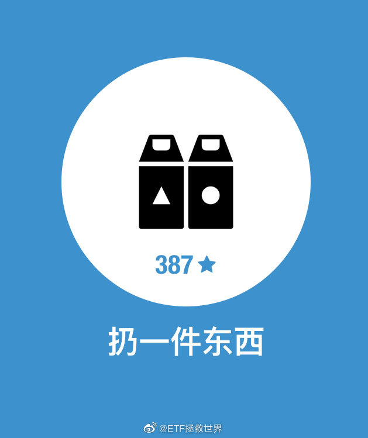

## 2021-12-14 14:00

不能确定是否不会死的品种，最好不要乱补仓。

一点个人看法。 ​​​

## 2021-12-14 15:08

刚才看有朋友说，自己想扔东西过干净利索的生活，但是父母/另一半不同意。

父母：

住一起吗？不住一起根本不用在意，你自己的生活，你要扔什么还要他们管吗。如果你经济不独立当我没说，听话就好。

住一起？你成年了吗。成年了，经济独立，自己的东西自己买的，好，你自己那屋你能决定吧。扔你自己的东西，把自己那屋收拾好，按照自己的想法布置。如果你经济不独立，当我没说，听话就好。

另一半：

生活理念不同吗。那扔自己的东西可以吗？自己的东西也不能扔？你是奴隶吗。结了婚两个人都是平等的，共同的东西好好商量，自己用的自己买的自己决定。人生本来就很多枷锁，难道回家还要让人管着这么不自由吗？

这不是买东西，需要花两个人的共同财产。而是你自己的东西你觉得用不上了，占地儿了，碍眼了，你想拥有一个窗明几净清清爽爽宽敞的生活空间，又有什么错？

能沟通就沟通，不能沟通就自己扔。哪儿那么多事儿。

这辈子还能不能为自己活哪怕一秒了。世界很大，我们要做更重要的事情很多，别再为这些鸡毛蒜皮的事儿支配别人或者被别人支配了！

## 2021-12-14 15:41

看了上一篇评论，我可算知道为什么大家都活的这么累了。

好嘛，有的父母不仅要干涉成年，经济独立的子女做什么工作，和什么人结婚，房子怎么装修，甚至要管孩子扔不扔自己的东西？醒醒吧，那是个人，有血有肉有自己思维的成年人，不是你的附属品！

经济不独立单说。拿你的钱，你就有资格指手画脚，没毛病。

还有，有人说家里人开心最重要。真的吗？好，如果你说家里人开心这件事，带给你的开心远胜于生活环境好带给你的开心，那没问题。

但你如果一边面对环境痛苦不堪，一面要迁就家人，这样的生活你觉得值吗？家人爱你吗？如果爱你，会让你每天不开心吗？

你“委屈”自己，让家人开心，能委屈多久？一年五年还是五十年？你爆发或者崩溃那一刻，受伤的是所有人。

只有你自己会陪自己过一生，先照顾好自己，对自己好一点，家人也会为你感到开心。

## 2021-12-15 10:43

DSN那个量产的玩偶居然也能成炒作对象，我深受震撼。

那个是什么时候开始炒的，是环球的变形金刚火了以后，立即出来一个什么贝儿。我觉得很明显，就是炒作，争夺眼球。

本来炒作就炒作，跟一般人也无关。但问题是如果有人真的去高价买玩偶，可能就是智商上稍微有点欠缺。不过想一想，还有那么多人给美军流落在外的上将、转生的秦始皇、驻叙利亚的维和部队打钱，就能理解了。

## 2021-12-15 10:53

我看不懂元宇宙。

但只要它带着梅梅一起玩，我就拿它当朋友。 ​​​

## 2021-12-15 14:39

不奶正好，一奶就跌。

多看少动闭嘴。 ​​​

## 2021-12-15 16:13

医药，150最后一次买入2018年10月。

之后只有卖没有买。更在去年七月高位卖出3份。

S除去年底抄到调整大底买入一份大摩外，也没有再高位买过。至今甚至只剩两份持仓。

网格就豹笑了，一年时间四次波段精准吃到。长则十几天，短则两三天，资金利用率无法用常理解释。

那么面对今天医药的下跌，我们合理的心态应该是________。

## 2021-12-15 17:54

以后要这么精准的蒙到真的很难了…… ​​​
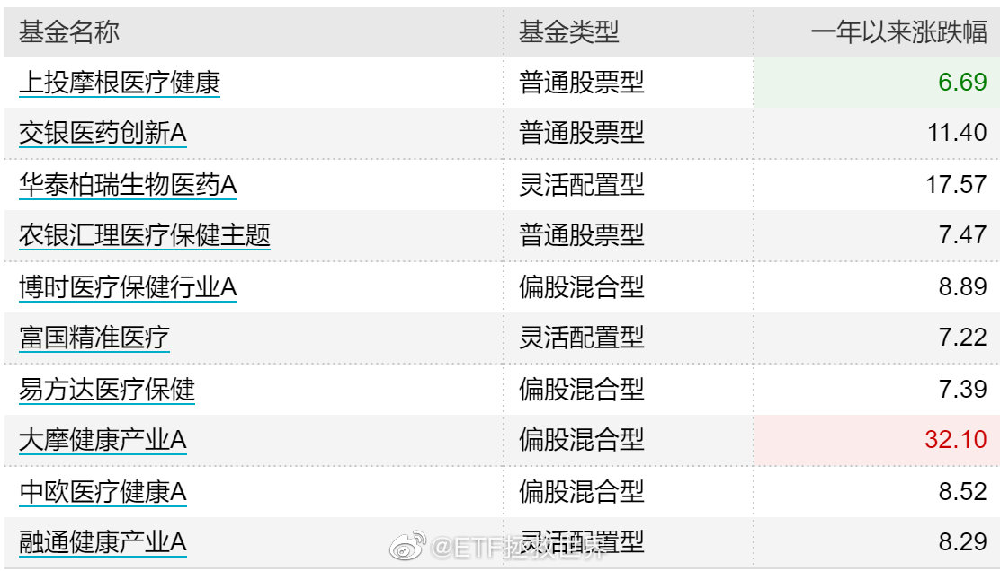

## 2021-12-16 10:42

我想说我不能说但我还是要说：

要相信爱。 ​​​

## 2021-12-16 11:37

永远都不要再问我“我的股票/基金”该怎么处理。

该怎么处理，浮亏时候怎么办，浮盈时候怎么办，什么时候加仓，什么时候出货，都是买之前就要计划好的。

买都买了才去焦虑该怎么办，整个流程全都错了！

反正我帮不了你。 ​​​

## 2021-12-16 13:06

还是这句话，红利绝对不会卖。无论它怎么折腾，也不可能把我甩下去哪怕一毛钱。

## 2021-12-16 13:24

刚才看到有高端白酒涨价的新闻，我突然有个想法。

我觉得高端白酒的价格应该完全放开，厂家想定多少就定多少，不要管它。1000、2000、3000、4000、5000……50000一瓶都没问题。

穷人肯定不会去买，中产没事也不会去买，都是有钱人在买。反正有钱人的钱也花不出去，索性让他们多掏钱去买。

这样，公司利润大幅增长，然后就大量分红。大股东是国资嘛，拿到的分红款就转入所在省份的医保基金。为什么，因为喝酒伤身体啊，医保兜不住，就拿酒厂大股东的分红来补。

这样简直是全赢：

有钱人掏了钱但是拿到了想要的尊贵身份；老百姓享受了医保；医保基金得到了充实。

干嘛限价呢，让它涨！每个经济落后省份有一个高端酒品牌，很多事情就解决了！

## 2021-12-16 14:12

又发一车。

买入的主要原因是，不买会难受。 ​​​

## 2021-12-16 15:49

有两种人不聪明。

第一种是觉得自己什么都不行，怎么看别人都好，自己哪儿哪儿都是毛病，一无是处。觉得解决问题的办法就是回炉重造。

第二种是觉得自己太NB了。这个世界没了自己就歇菜了。谁都看不起，自信心爆棚，谁都离不开自己，谁都得求着自己。

我希望这里的朋友都不是这样的人。咱们的世界不是只有黑白，也有灰色。我们每个人都不是完美的，也不是一无是处的。我们有自己的优点，我们只要改进自己的缺点就会越来越好。

## 2021-12-16 16:16

今日数据：

A股全市场估值上触五年均值。

上一次是2020年7月。再上次是2017年9月，然后是2014年9月。

与前几次不同的是，目前的五年均值大幅下降。究其原因，我考虑是这几年的准注册制导致A股长期恒时高估的情况得到了明显改善。

2000、2007、2015那样的全市场估值70倍的情况应该永远也不会再出现了。

中期来说，明年的行情将非常刺激。

正所谓，几人欢笑几人悲，笑看世事轮回。

## 2021-12-17 09:52

我觉得吧，孩子犯错了，敲打敲打，教育教育，孩子认错了，改了就算了。 

别往死里打啊，都是自己孩子。玩死里打，其他孩子也得害怕啊。害怕了要真离家出走了也麻烦不是。

当然了，要不当自己孩子，当成来抢东西的坏人那就另说了。 ​​​

## 2021-12-17 10:13

回复@这只是一个游客:被殴打的孩子150浮亏不到5个点，S不到10个点，网格14个点左右，浮亏六位数，感觉良好，请加大力度，不要怜惜我。//@这只是一个游客:想知道益达浮亏几位数了

## 2021-12-17 10:28

你有没有发现梅梅的一个特点，

别人不行的时候它在那嘚瑟

别人行了它马上不行

感觉好像它在元宇宙一样，跟大家都不同世界。 ​​​

## 2021-12-17 10:45

我给大家介绍一下，通常情况下，一个不死品种的底部特征。

不说基本面，不说技术面，只说人性面。

第一，前期无数抄底资金被套。

第二，前期无数信心满满抄底的人开始迷茫、徘徊、崩溃。

第三，开始出现大量高手，嘲笑前期抄底的人。

第四，开始出现大量股神，开始预判该品种基本面已经完全坍塌，并将毫无希望。

第五，有人开始一键清仓。

PS，以上五点不要在我这里找，我这里没有。去支付宝或者天天基金、雪球等地方看。

## 2021-12-17 11:24

从心理学上讲，如果你一直觉得很舒服，那就不会真的舒服。总要有些让你不舒服的事情，最后你把它变舒服了，才会真的舒服。

比如说你觉得考试很讨厌，但最后你考试过了那种开心，是没有考试的时候体会不到的。

我是什么意思呢，我的意思是，你的组合里总有一个两个让你不舒服的品种，那其实最舒服。因为它们最后赚钱的时候，你特别开心。

你想想，如果100%的品种都是赚钱的，你的生活还有什么波澜，一潭死水了。

这就是我为什么总是保持组合中有一两个浮亏品种的原因（chedan）。

但是吧，这个要把握一个度。比如你考试每次考都不过，组合里面只有一两个赚钱其它全绿，那就怎么也舒服不起来了。

有难度，但是难度不特别大，能够让你努努力完成，这就是最舒服的状态。

## 2021-12-17 14:37

只在冰汽时代里见过的温度。

## 2021-12-17 14:41

别怪我没提醒你，今天开始，EPIC每天一款游戏免费领。

弄不好有大作。

你可以不给我打赏，但你不能不白嫖游戏。 ​​​

## 2021-12-17 16:03

回复@蓝隼37401:说到DC，就不得不说那个把DC手柄当做生日礼物送给我的女孩。她叫乔乔，重庆人。那年，我刚满19岁。我记得认识她的那天下着雪，很冷……//@蓝隼37401:今天是莎木3，上一次看到这个名字还是在dc上

## 2021-12-17 20:06

今天的卖出数据出来了，从数据看，这一份各位的平均收益率是136%。

看到这种数据会让我开心18.6个小时。 ​​​

## 2021-12-18 11:06

我现在体会，跟人交往也好，更尤其是结婚对象，最不能接触的就是过度自私的人。

其实每个人都会首先为自己想，这个无可厚非。但是过度自私就有可能导致毫无底线，根本不把别人放在心里。为了实现自己的利益和目标，所有其他人的利益都可以牺牲。这个非常非常可怕。

这种特质，也有可能是天生的，也有可能是成长环境导致的。正常人你是不可能改变他的，唯一的自保方法，就是离他远点。

尤其是恋爱和婚姻。这个东西不是交朋友，你觉得他不好就可以很轻松的离开。结了婚想离开就没那么容易了，即使最后成功，不死也要掉层皮。

所以谈恋爱的时候就要深刻的理解对方的特质——ta到底是不是过度自私。注意，谈恋爱的时候千万别只看他是不是对自己自私，那是不准的。那个时期，不能看对方对自己什么样，而要看他对别人，以及平时做事情是不是只顾自己，完全不考虑别人。

举个例子，比如有人错过高速公路路口，会倒车回去或者在路口突然变道想要出去，这种人就一定不能在一起。因为他不仅过度自私，而且没脑子，是傻的。你跟一个又自私又愚蠢的人在一起，可想而知你这一生会过得如何。

你千万别以为他爱你，所以他只会对别人自私会对你好。别逗了。终有一天你就是那个最惨的人。

当然了，如果是两个过度自私的人，我很鼓励你们在一起，请原地领证，不要去祸害别人。

## 2021-12-18 14:46

金店如菜场 ​​​
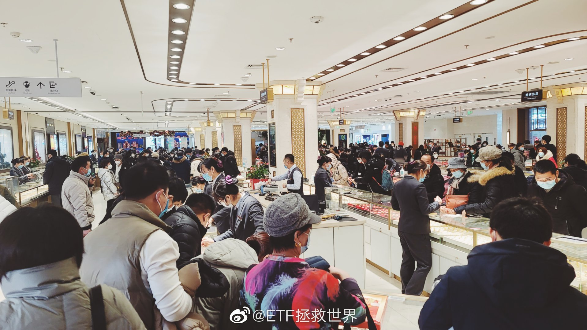

## 2021-12-18 15:34

我有个新的感悟，

所谓爱情的“爱”，恐怕是个奢侈品。未必人人都有。

大多数人有的是一见钟情的荷尔蒙，搭伙过日子的想法，传宗接代的基因。

爱是什么，你告诉我爱是什么。仔细想想，其实你也未必真的知道。 ​​​

## 2021-12-18 17:49

现在看这个，突然觉得鲁豫真NB。很多问题直击最核心。要么是早就知道些什么，要么就是顶级的采访触觉。

## 2021-12-19 11:08

说实话，不管这些画是谁画的，我还真的挺喜欢。适合我家的装修风格

## 2021-12-20 11:17

持仓中有跌的很惨的品种，很慌，问自己三个问题。

第一，这个品种会不会死。

第二，它占用的资金是不是中短期会用的。

第三，自己还有没有资金，未来有可能把持仓成本降到底部区域。 ​​​

## 2021-12-20 11:32

那些因为持仓品种下跌而导致心情不好的朋友，我告诉你一件事。

可能有人觉得我说这句话是找抽，但我真心诚意的告诉你，

这样的经历，对你来说是极其珍贵的经验。请你仔细、认真的反思关于这笔让你心情抑郁的投资，其整个投资过程。

包括确定标的、制定投资计划、分配资金、执行计划等一系列动作；

包括心态的变化：希望、冲动、喜悦、忧虑、恐惧……等等。

把所有这些东西弄清楚，然后找出问题所在，再制定解决办法，无论是从投资策略还是心态上的。记下来。

这是你获得宝贵投资经验的时刻。请你不要与绝大多数人一样，将宝贵的，可以获得投资经验的时刻沉浸在愤怒悲伤恐惧的情绪中。那不仅于事无补，还会让你越做越错，最终崩溃。

在你还年轻的时候，在你只有不多的钱拿去投资的时候，获取这样的投资经验至关重要。

因为如果你未来年纪稍长，拿着8位数再来积累投资经验，那么有可能会用一生的时间去付出代价。

失败的事情（未来看未必会失败）带给你的应该是经验，应该是进步，应该是杀不死我就会让我更强大的力量。你的人生中可能经历过很多失败，但能够明明白白白，清清楚楚积累经验的失败也许没几个。不妨把这次加进去。

未来你会发现，你成长了不是一点半点。就像这里在座的大多数朋友一样。

## 2021-12-20 11:59

第一支撑调整到22000左右，第二依然是18500。在这两个支撑附近都会买。

## 2021-12-20 12:12

我已经想好了，在一些指数的最低支撑或者7080，留3-5年家庭生活支出，然后把所有金融资产分散买进去。

真要崩到0，一了百了，也无所谓了。得之市场，失之市场。真到那时，是我学艺不精，认了。

只是有两点必定会遵守：

第一，只买不死的品种。

第二，一分钱杠杆也不上。 ​​​

## 2021-12-20 12:55

有一说一，他有些歌我觉得还不错，已经开始下载了… ​​​

## 2021-12-20 13:24

我的买入，我的卖出，我的梭哈，

从来都不是一时冲动上头的操作，

而是冷静计划后的执行。 ​​​

## 2021-12-20 13:50

150环保是不是卖少了。 ​​​

## 2021-12-20 14:21

波段资金不够，可以调低目前挂单的每份金额。

这些东西非常自由，根据自己的情况增减。 ​​​

## 2021-12-20 14:30

本来想好的2022展望，这么一跌，给我整不会了。

你要提前用半个月时间把2022年的剧本走完了，我怎么写？ ​​​

## 2021-12-20 15:11

刚刚做了一个艰难的决定：

我要戒糖至150/s/波段的中概/恒科全部盈利那一天。

戒掉的食物包括但不限于所有糕点，面包，零食，冷饮，干果（果脯类），饮料（0卡除外），酸奶牛奶，咖啡（黑咖啡除外）等。

欢迎线上线下所有朋友们监督。如发现我违反，可爆料，我会暂时退出投资圈。 ​​​

## 2021-12-21 09:20

早上起来又看了一遍伟大选集第一卷第一篇，常看常新。

大家冬至快乐呀。 ​​​
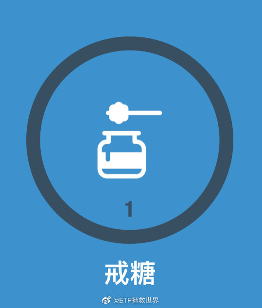

## 2021-12-21 09:47

卖出后，环保开始放飞自我。 ​​​

## 2021-12-21 09:53

浓眉大眼的医药也这么不讲义气，这是我没想到的。 ​​​

## 2021-12-21 10:00

面对上方的压力，梅梅依然在努力的冲……

辣鸡就是这样，跌得多，涨起来上面全是压力。一道道一层层……

不像新高品种，天高任鸟飞，能飞多高全看天意，没有上限。 ​​​

## 2021-12-21 10:09

今天红利是被地产带起来的，不用感到奇怪。 ​​​

## 2021-12-21 10:52

老帖新看//@ETF拯救世界: 每个人都觉得“越多”越好，“越大”越好。殊不知从玄学上讲，每个人都有自己的上限，你自己的命够不够硬压得住这么多这么大？从生物学上讲，也不可能你一个人一个企业越来越NB吃尽所有。那别的细胞还活不活？所以一切都是周期。适可而止，见好就收。

## 2021-12-21 10:59

我个人认为，最重要的书，是历史书。

最重要最重要，没有之一。

历史书看多了，整个人生观会发生变化。

你说做投资？历史当然也重要。企业历史，企业家历史，市场历史。

生活的其他方面，更要看。因为一切都没有太多变化，过去发生的现在也发生，未来还会发生。

这个世界只是外衣变了，内核没有变化。

多看历史没错。

## 2021-12-21 11:07

回复@救赎-还有希望:这个要看你怎么定义“命”。我只能说，在同等条件下，一个人的命大多数时间都是可以自己改变的。主观还是能够发挥很大作用。所以尽量改变可以改变，躺平接受不能改变是我的人生信条。//@救赎-还有希望:e大，冒昧问下你信命么，如何看待这事//@ETF拯救世界:老帖新看

## 2021-12-21 11:27

//@Kevinqin008:

## 2021-12-21 11:34

我有个想法。等我这个微博名义粉丝数量到达100万的时候，我会清洗一下，看看还能剩多少。

之后再到100，就开个小号继续玩。

总而言之，不做大，苟住，猥琐发育。

您意下如何。 ​​​

## 2021-12-21 13:16

其实我在想啊，比如红利这种，就是咱们上一网精准最低点买入那里，

明显很便宜了，我是不是能够突破仓位上限，至少在S里加一些呢。

这是个大问题。 ​​​

## 2021-12-21 13:52

在底下布置好了中网，如果你在这里开始涨，那么我就会很生气。

very very生气。 ​​​

## 2021-12-21 15:30

这就是命运吧。 ​​​

## 2021-12-21 17:57

如果你的家族香火旺盛，没有丁克和不婚不育的后代出现，

那么即使如此，几十年后，最多到你的第四代，也就是你的儿子、孙子之后的那代，

不出意料的话，根本就不会知道或者记得你。

也不会去给你扫墓。

到时候他（她）（们）的经济状况和生活状态根本就完全不可控。

那么，耗尽自己的生命，玩命鸡娃的意义在哪里。

## 2021-12-21 23:00

这是什么神仙好物，种草了 ​​​
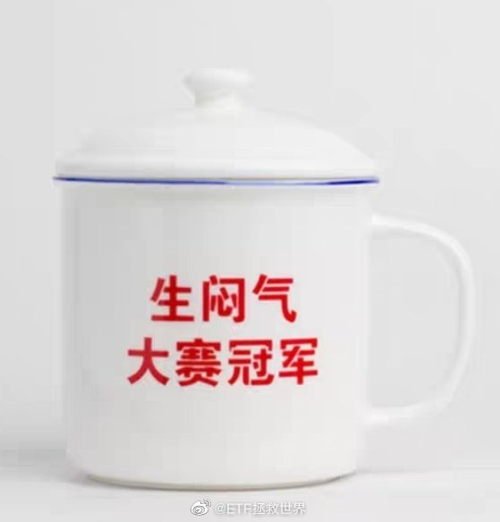

## 2021-12-22 10:39

年底之前一定要去拜拜了。

希望咱们都平平安安的。 ​​​
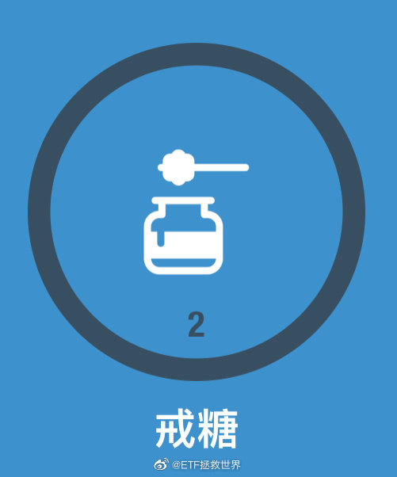

## 2021-12-22 10:57

有些人，你欠梅梅一个道歉。 ​​​

## 2021-12-22 11:28

在圣诞树里突然发现藏着这个，

有点慌，

因为圣诞老人给你准备的是齐天大圣黄金机甲。 ​​​
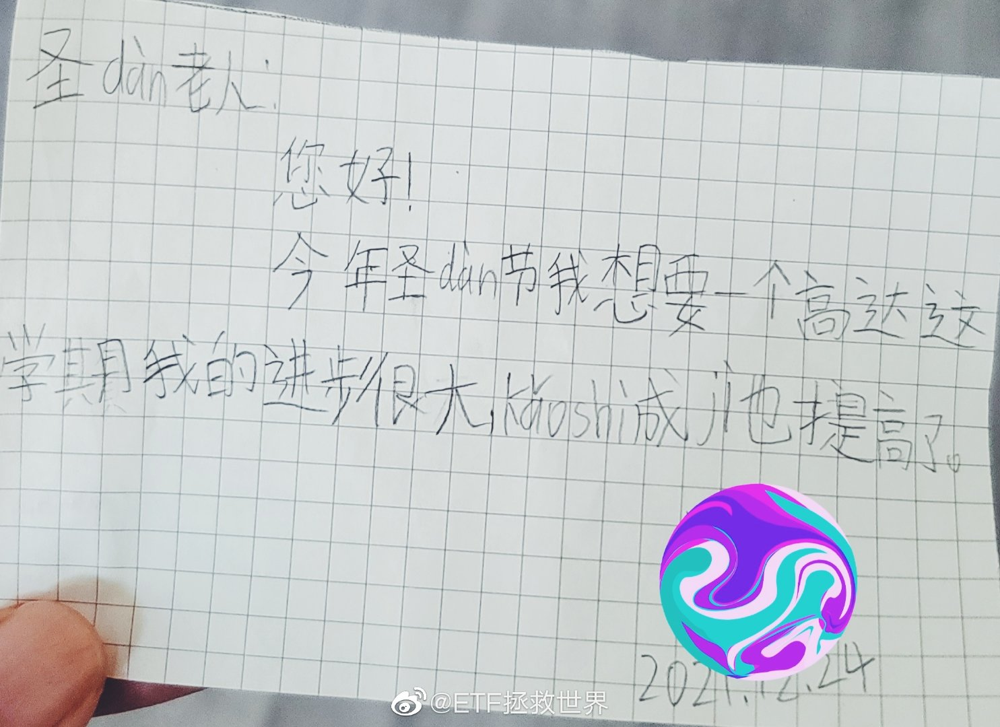

## 2021-12-22 15:19

今天梅梅盘中假突破最重要的一根压力线后，收盘被压制。

随便吧。涨跌都行。但最好能提一次大家可以喜迎新年，添个彩头。 ​​​

## 2021-12-22 16:56

你有没有被能力差的同事或者合作伙伴气得火冒三丈的时候。

真的，让人生气啊。

我感觉这种人什么事情都不做，国家给发钱，可能社会的运行效率会提高。 ​​​

## 2021-12-23 10:01

我这里有考研的朋友吗。

你考上了。 ​​​
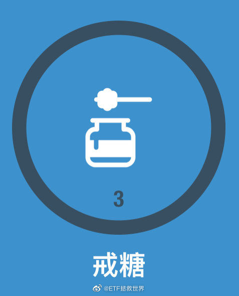

## 2021-12-23 11:49

刚才看有朋友在评论里说我这里的朋友素质很高。

这件事其实我是前几年请兼职小助理的时候，看了简历就认识到了。

你永远也不会知道现在跟你一起刷这条微博的人，是来自于哪些让你惊讶的学校和工作单位……

我只能说，水很深，整体层次很高。有多高呢，大概也有三层楼这么高了。 ​​​

## 2021-12-23 13:58

年底了，不妨在评论里贴出你自己今年最满意的一张自拍照（他拍也可以）。 ​​​

## 2021-12-23 15:41

兄弟们，上条评论的三个感想：

第一，立即开始健身。

第二，好好打理发型。

第三，研究一下穿衣服。

跟女性朋友比，整体上来说落后了！

这三个方面做好了，找女朋友的难度减少80个巴仙。别不信，经济实力当然重要，但现在越来越多的女性朋友也很重视外表了~

加油兄弟们，别人不卷你稍微一卷就赢啦！

## 2021-12-23 17:57

我：儿子，太可惜了。你的三科考试就差一个英文字母就可以拿3个一百了。

儿子：爸爸，我跟你说。第一，这个成绩不会记到高中记录里面，不重要。（大概在他的认知里，高中是很重要的阶段）。第二，过去的事情已经过去了，你再想也没用了。有这时间不如想点开心的事情。

我：？？？ ​​​
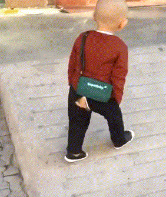

## 2021-12-23 20:27

这三位朋友联系我一下，每位200元京东购物卡作为年终礼物。 ​​​
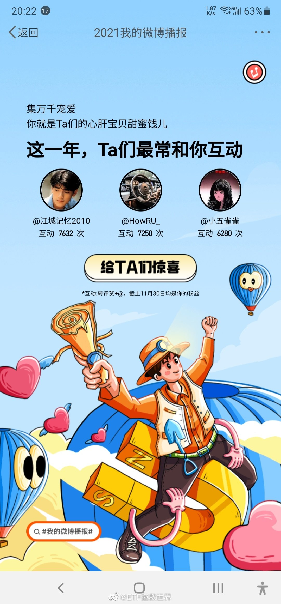 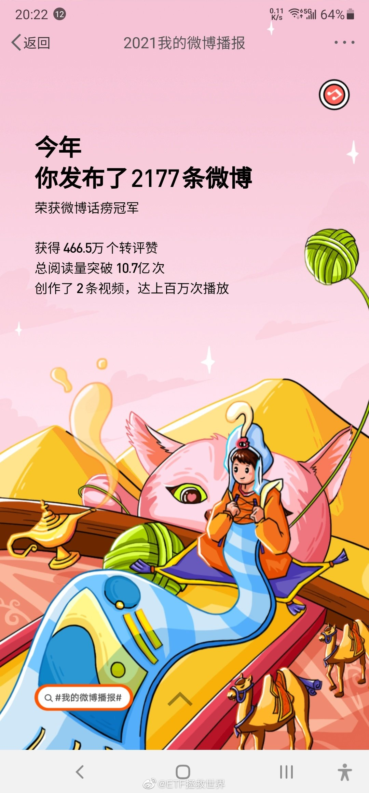

## 2021-12-24 10:41

有些暴涨的股票明显是击鼓传花，就看在哪位幸运儿手里爆了。

咱们反正高位卖出，爱在谁那爆在谁那爆。 ​​​
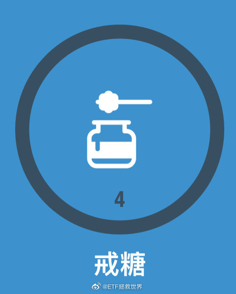

## 2021-12-24 10:56

我算看出来了，互动最高的微博分别是：

抽奖、相亲、晒照片、情感故事。

互动最低的是：

投资。

那么你说，有没有可能，我只是说可能啊，我是个投资博主。 ​​​

## 2021-12-24 11:07

事不过三。

今天是梅梅第三次冲击压力线。

行还是不行，得有个说法了吧。 ​​​

## 2021-12-24 12:23

舞力全开的“卡拉永远ok”给哥跳笑了。 ​​​

## 2021-12-24 13:36

A股的定位，从一开始到现在都是一个为企业融资的地方。

只是重点扶持的融资对象有变化而已。

在A股投资，无论用什么模式，都不能忘了这个。

作为散户，首先要思考清楚的，是自己以什么身份出现在这个市场上。

是出资方、套利者，还是波段（无论大波段小波段）获利者。

这很重要。生存下去的第一步是看清楚世界。

## 2021-12-24 13:57

彼得林奇曾经一针见血的指出了涨跌的本质：

你觉得一个东西好不好不重要，甚至这个东西真的好不好也并不是最重要的。市场觉得它好才最重要。他用了选美的例子去解释。

如果这个是正确的，那么对于散户来讲，就有三种模式去做好投资：

第一，预判市场下一步会看好什么，提前布置进去。但不能提前得太多，否则等几年十几年也够呛。

第二，敏感的感知市场刚刚开始看好什么，买进去。这个需要极度敏锐的触觉。

第三，不能确定市场将看好什么。所以将资金分配到相关性不大的，市场有可能看好的品种上，在比较便宜的时候买入，等待市场的一个个临幸。

其难度从难到容易正序排列。

大机构就不完全这样了。大机构完全可以联手引领市场偏好——翻译成人话，就是抱团。

## 2021-12-24 14:16

如果环保这里真的是一个顶部，那么它是近十年来我见过的最厚道的顶部。

因为它给足了机会卖出。

那么150剩两份其实还是多了，剩一份更好一点。 ​​​

## 2021-12-24 22:24

我说了，该说的我都说清楚了，你不要再毫无证据污蔑我了。

你为什么删评论？ ​​​
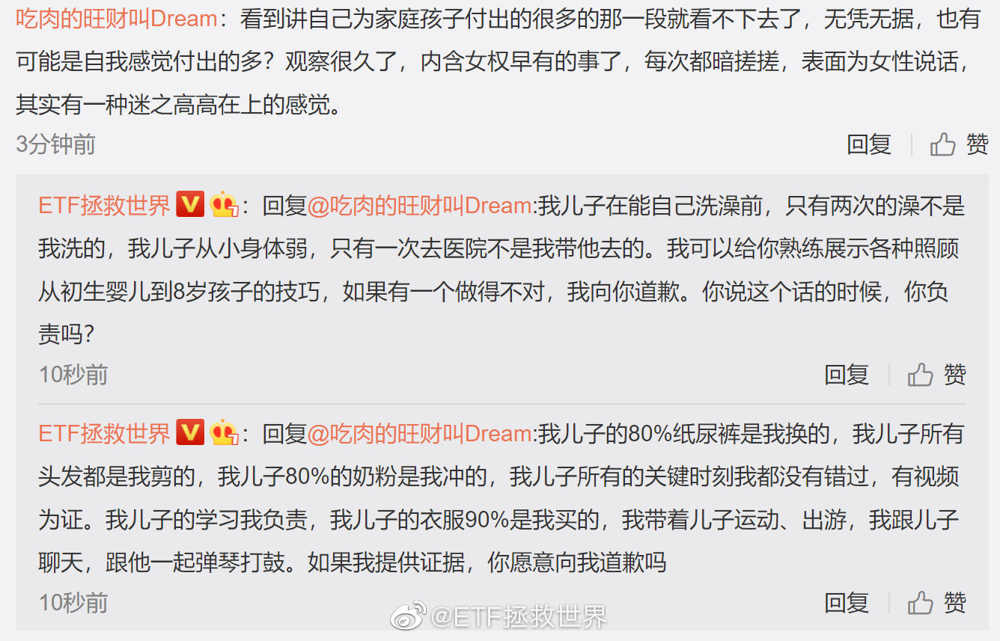

## 2021-12-25 22:05

你在我面前时，你是一切。

你不在我面前时，一切是你。 ​​​

## 2021-12-26 17:11

关于为什么讨论很多品种用昵称的问题，有朋友不清楚，答案是图一。

真不是故意难为新朋友。当然，我依然是希望新朋友别关注我。因为你真的不会理解我在投资上的做法，也不会理解我这个人。最后弄得大家都难受，没什么必要。

对了，前几天我建议大家贴今年最好的照片这件事也被喷了。

同一件事，有些人能从中得到快乐和努力的动力，有些人会阴谋论。

不过也正常，毕竟我聊自己去看电影了也被喷呢。

什么是原罪，原罪就是咱们那么多人每天开开心心的聊天，让有些人不开心了。
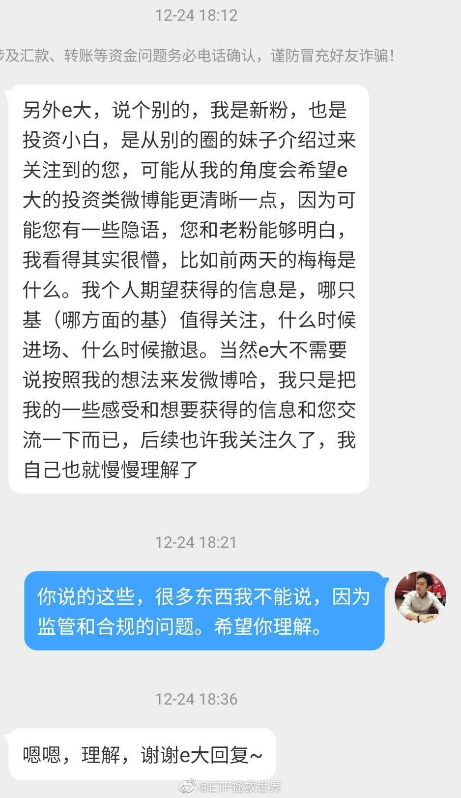 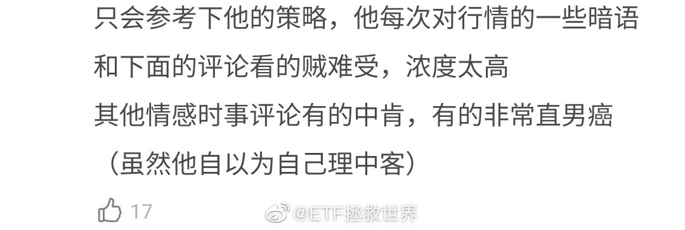 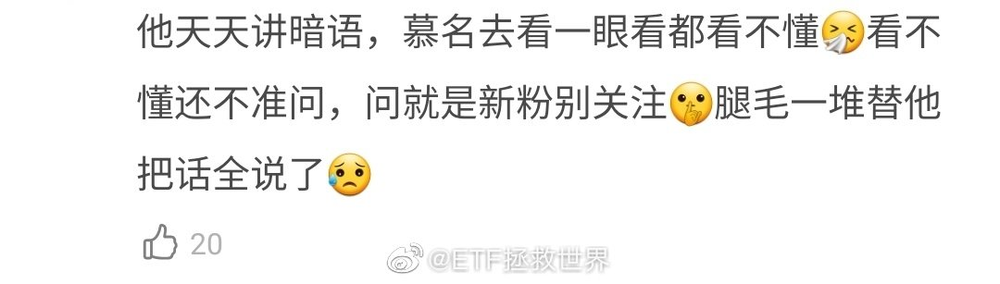

## 2021-12-26 22:29

昨天看了一本老舍的小说，深感人性一百年并没有太大变化。又看了一本医学类的小册子。

今天上午整理了一下明年的投资思路，看起来还需要几个上午的时间才能明确。

下午陪儿子刷一张数学卷子，讲清楚所有错题，协助他把错题剪下来，分知识点贴在错题本上，让他自己写清考察的知识点/错误根源以及正确解题思路。

黄金机甲搭了一半了。

天知道这糖要戒到什么时候？圣诞蛋糕和小助理送的圣诞饼干一口都没吃到。该死的中概…
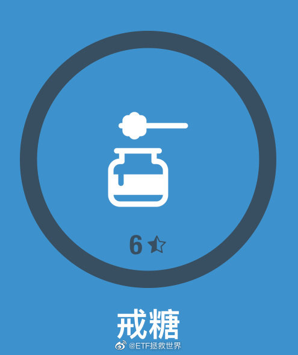

## 2021-12-27 11:44

你今天中午吃什么

（没有别的意思，就是单纯打个招呼客气一下） ​​​
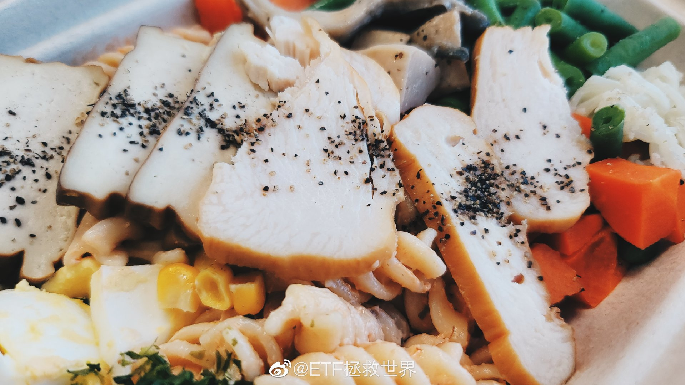 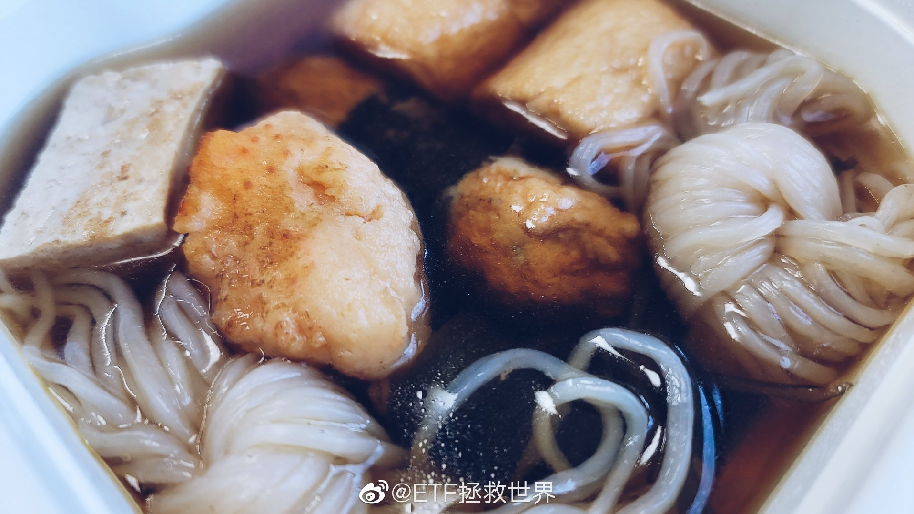

## 2021-12-27 12:07

我又忍不住多嘴了。

有一本书不知道各位看过没有，《美丽的标价》

其中有一部分对某些热门事件会有一些启发。

但我不会谈我的想法了。我没有想法，我什么都不知道也不懂。无论你的观点是什么，我都跟你一样。 ​​​

## 2021-12-27 13:21

一般来说，连续三天冲不过去重要压力线，就要放低预期了。

## 2021-12-27 14:51

在考虑新年以及春节怎么给大家送礼物。

送礼物花多少钱无所谓，但让我想起来就心痛的是，有可能一些没有底线的辣鸡一边骂我一边过来领钱，而且，还有可能真的被ta领到了！

怎么才能把祝福和红包送到真朋友手里，确实太难了。 ​​​

## 2021-12-27 16:09

“今年他们掌握的数据是有超过78%的股民亏损，盈利的约只占一成”。真的吗，我不信。

## 2021-12-27 16:25

炒股真的很难，为什么难：

第一，A股一共4600多只股票（明年超过5000只）。你要在这4600多只里面选出几只优质的。

第二，选出来后，你还要买在低位。或者说，至少不要买在高位。

第三，要能在高位卖出。当然，如果真的是长期大牛股，你不卖，跌回去也没事，可能几年后又涨起来了。但是——如果它不是呢。

第四，带着上面的疑问，你拿着长期大牛股。在最底部亏损很多，越亏越多的时候，你还能拿的踏实吗？只要信念有一点点缺失，就拿不住。就有可能割肉。

第五，非常好，你没有割肉。股价回来了。终于回本了，你如释重负的卖出。结果，你猜怎么着，它继续在暴涨，然后，又翻番了！

第六，你只能从第一开始，重复一遍。

也就是说，想要长期的投资股票赚钱，你必须：

能选出好的股票、能买在低位、能卖在高位、有坚定的信念在赔钱的时候相信它会涨、回本后坚信还能涨。

能做到这些的股民有几个？一波两波行情，运气好，能赚不少。运气会一直好吗？

不是说没有，而是比例很少。当然一亿股民，即使10%，也有1000万人了。但剩下的9000万呢？

炒股很难！

那么，有没有办法不去跨1.5米的跨栏，而去找一个0.5米的跨栏呢？

## 2021-12-27 16:48

目前债券价格已进入卖出区域，组合中的债券基金（不含转债基金）将择机减仓。 ​​​

## 2021-12-27 17:38

S对海外科技的配置明显要比150激进很多。 ​​​
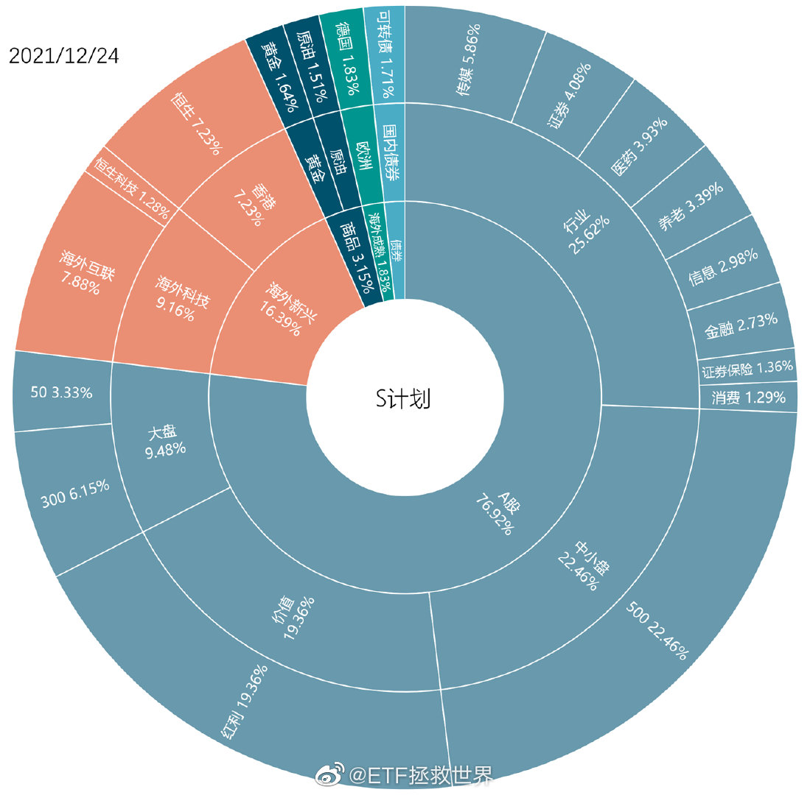 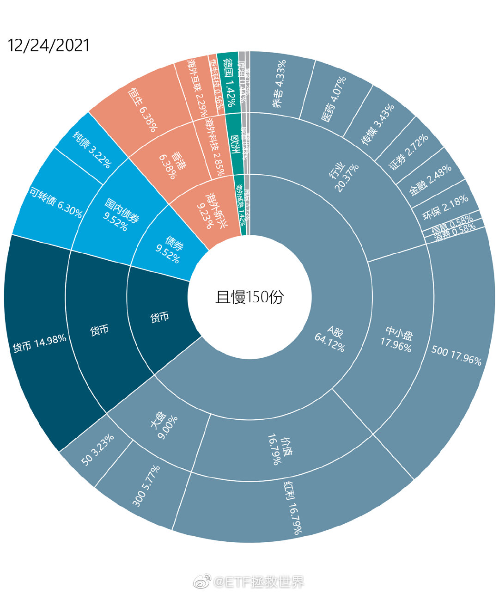

## 2021-12-28 10:06

我很难相信只讲感性不讲理性，

只讲情绪不讲逻辑，

只讲立场不讲事实，

不独立思考，不收集隐藏信息，不挖掘事情本质的人，

怎么可能做好投资。 ​​​
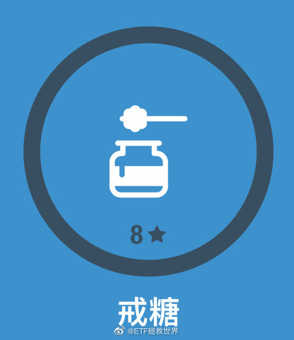

## 2021-12-28 10:40

跌的时候你后悔买多了，

涨起来你后悔买少了，

这是一种心理上的病，

我尽量试着帮你治治。 ​​​

## 2021-12-28 11:06

信不信由你

某些已经被踩在脚下的品种

一两个月内，极大概率会有一次至少中级的爆发

但我劝你掌握好节奏，不要梭哈更不要上杠杆

命比钱重要 ​​​

## 2021-12-28 14:31

争取周五买一份，快乐收官。 ​​​

## 2021-12-28 14:34

给儿子抽一个悟空，给自己抽一个人造人18号。

## 2021-12-29 10:03

我在观察和思考一个问题。

如果这一波这几家大的互联网公司全都会死或者再也好不起来了，

那么我将永远不再相信什么个股的狗屁长期投资。

我不是不相信个股投资，也不是不相信长期投资，

我是不再相信个股的长期投资。

太脆弱了。

甚至更进一步说，行业也会说没就没。所以，之前设定的细分类别不超过20%配置是绝对极其有价值的。

所以，下面就是看它们是不是真的会死或者真的会一蹶不振了。

## 2021-12-29 10:07

回复@听说能改昵称了:你这个感觉完全错误。首先什么是“很有信心”？是150的2%还是S的9%，还是网格的吃了就走。第二，我现在的信心与之前完全一样。在我说的这些结果没有出现之前，我没有变化的理由。//@听说能改昵称了:感觉E大现在也不是很有信心了

## 2021-12-29 10:18

2021年，在资本市场上我最大的收获是见到了从未见过的事情，也学到了很多，自己也更加深刻的思考了之前从未思考过的层面。

一直以来，我都是在经济这个层面思考投资，未来，确实要更多的跳出这个局限，站在更高的地方来认识资本市场。

其特殊性、其本质、其存在的价值、影响其波动的更多可观察信息等等。

很多东西是无法改变的。所以，想要继续有进步，就必须深刻认识本质，设计与其相适应的观察体系、决策体系。

我自己的一点年终感悟，相信有相似思考的朋友会懂。

## 2021-12-29 10:48

尤其是鹅。

鹅这种动物的特点就是平常不怎么叫，而且非常听话。村里说有人家饿肚子了，鹅第二天就会把家里的鹅蛋拿出来分了。最近又把家里养大的小狗送给别人。

鹅非常谨慎。它家占着村里最好的路口，却从不费尽心思把自己的钱借给过路人。甚至可以说，在用钱挣钱这个行业，鹅几乎是什么都没干。不是它不知道干这个挣钱，是它谨慎。

鹅不是没有缺点。鹅的缺点是它的主要生活来源是想方设法逗大家开心，当然是收费的，而且这还容易上瘾。鹅还喜欢到处去买小鸡小鸭什么的，谁家的孩子它都喜欢买点，它想的是万一哪个变成天鹅了呢。缺点是缺点，其实没有太本质的错误。想要多吃点，变胖点，这是动物的天性。哪个动物不想多吃点呢。

但是因为鹅长得比较大了，大家对它的希望比较高，希望它能为村里做更多的事。

鹅是好鹅，不完美，但没做过什么伤天害理的坏事，改了就是更好的鹅。

我觉得应该放鹅这样的动物一条生路，真挺听话的了。

## 2021-12-29 11:50

之前大指数反弹的时候，说绝对不会再买，趁机还会卖。

结果又跌下来了，卖的好机会也没出来。好在之前高位卖出过，仓位也不重。

大指数的问题在于，这两年的轮动行情，让大指数不断的把暴涨的股票纳入，把下跌的股票剔除，导致估值一直很高。

目前要想加仓，一定是要同时减仓。看来，减大指数的这条路走不通了，想别的吧。

## 2021-12-29 13:36

明年A股会很难做。

如果今年难度是1，那么明年可能是3-5。

不是没有机会，是很难做。 ​​​

## 2021-12-29 14:14

西安的朋友们，辛苦了。一定要平安啊。不知道有没有什么可以帮忙的？ ​​​

## 2021-12-29 21:35

终于有了好消息

## 2021-12-29 22:38

美股中概已经跌了66.9%了。

即将进入7080区域。但激动的时候别忘了算算数学题，做好最坏打算。 ​​​

## 2021-12-30 09:39

差一分钱没买到，要比差一厘心情好很多 ​​​

## 2021-12-30 09:55

梅超疯 ​​​

## 2021-12-30 10:47

又到了。很难。

## 2021-12-30 10:53

比如，我说比如啊，

春节想送大家一批杯子，

我想在上面写“踏踏实实，多大点事儿”

你还有没有更好的创意，觉得印点什么比较好。

高赞答案有机会选用，选用直接送礼物。 ​​​

## 2021-12-30 14:52

梅有涨停，差评 ​​​

## 2021-12-30 16:02

如果不出意外的话，在梅梅这个下跌了80%的品种上面，无论长期还是波段，应该已经没有人亏损了。

“唯一亏损”这份荣誉已经转移到了中概。 ​​​

## 2021-12-30 16:53

你准备怎么跨年，有没有什么比较特别的想法。 ​​​

## 2021-12-30 17:03

你造吗，人生的分段不是根据“时间”来界定的，而是根据“事件”。

你回首已经过去的人生，会发现如果只提起时间，会非常模糊。但如果某年、某月、某日，发生过什么特别的事情，你就会记得很牢固清晰，并用这件事将时间切割成两段。

这样的事情多了，时间轴被切割成很多段，那么人生也就变成了非常丰富的记忆。

平平淡淡的每天，会让你觉得时间莫名其妙的溜走了。一转眼，为什么十年二十年已经过去了。那是因为每天每天都一样。每个月，每一年，也全都一样。你也不记得大多数新年、除夕、生日……是怎么过的。除非有特别的事情发生。

而有了特别的日子，我们才会饶有兴趣的回味那些片段，人生也由黑白慢慢染上了颜色。

为自己的人生创造一些特别的日子，过一些不同寻常的生活，会非常有意思吧。

## 2021-12-31 09:05

大涨和大跌一样，没什么特别的。

不用为大涨兴奋，也不用为大跌难受。

踏踏实实的，多大点事。 ​​​
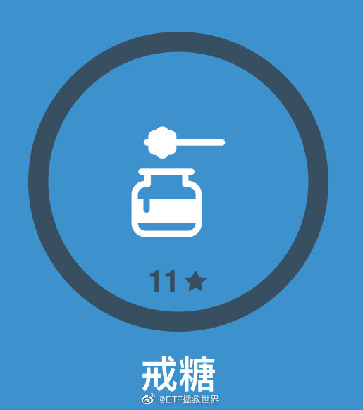

## 2021-12-31 09:47

给别人提出批评建议的范文：首先，打出高分，对于总体成绩给予极大的肯定。然后，委婉的提出批评。最后，再次给出肯定。我个人认为，这样提出批评建议不容易发生冲突，效果也会比生硬的方式好一些。

## 2021-12-31 09:59

要冲了吗。 ​​​

## 2021-12-31 10:11

持仓里面，目前最爱的依然是红利。

今年涨了18%不说，还是那么便宜。在我的卖出序列中，它依然和转债基金排在最后面。 ​​​

## 2021-12-31 10:43

添个彩头。

## 2021-12-31 11:04

这几天上蹿下跳的，有些情况变化了，所以今天就不发车了。

文章的话也可能不发了，休息一下。如果假期里状态好再说。 ​​​

## 2021-12-31 15:01

随着2021年最后一笔全员提款，大家一起心情舒畅的结束了一年的交易。

2021，也要过去了呀。

这一年来，如果在各方面对您有些帮助，我很高兴。如果没有，那就是我各方面能力不足，非常遗憾。但无论如何，请相信我是在用心做事。

这一年来，感谢各位的关注和支持。尤其是从各方面用意念以外的各种方式支持我和鼓励我的朋友们。每当我遇到一些挫折和困难，都是各位的支持让我重新树立信心以及鼓足勇气，继续在一条不是很容易走的路上继续走下去。

让一个人战胜挫折的通常并不是坚强的意志，而是内心深处拥有的爱和温暖。

展望2022年，并不会特别顺利，但机会也正蕴藏在起伏中。回头看我们每一个成功的投资，无不是在困难和危机中种下种子，长成的参天大树。如果你刚认识我，会觉得我在为浮亏的持仓辩解。而只有老朋友，知道我在说什么，并深信不疑。

2022年，祝愿这里的每一位朋友（除了喷子和坏人），平平安安，有惊无险的度过每一个起伏，收获成功和幸福——关于投资，也不仅仅关于投资。

我们自以为拥有的，也许并非真正拥有。我们以为已经失去的，也许会让我们拥有更多。

新年快乐！ http://t.cn/A6J7OQbG

