## 2022-01-01 14:35

恭喜@夏司腻 等10名用户获得【京东购物卡-200元】。微博官方唯一抽奖工具@微博抽奖平台 对本次抽奖进行监督，结果公正有效。公示链接：网页链接

## 2022-01-01 14:38

又是一次出其不意的抽奖。

请以下十位朋友私信我，每位可以领取京东购物卡200元。

没被抽中的朋友不要着急，春节还有3-4波力度很大的抽奖。

具体是什么奖品还不能说，只能说相当庸俗。 ​​​
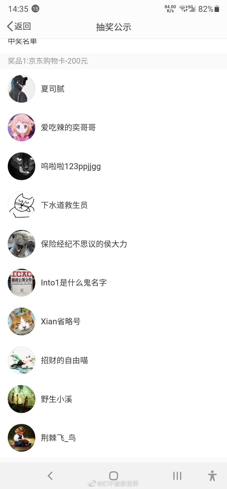

## 2022-01-03 13:37

在连续三年年初蒙对当年行情（19年各指数大涨；20年巨幅波动；21年热门板块跌30%-50%，中小股票表现出色）后，

照例又要预测一下今年的大致行情。

当然，事不过三，今年蒙对的难度系数增加了好多，权当一笑吧。

今年的行情会非常复杂，但一句话总结，到年底，大多数指数应该是收阴。

展开说说。

首先按大小分，大指数21年表现很不好，22年表现非常好的可能性很小。即使上涨，幅度也会很有限。

中小股票已经不像去年那样便宜到令人发指了。所以也不要对我们的500等品种抱有太大的期望。全年下跌的可能性大于上涨。

热门板块，调整了，但调整的不够。

如果让我判断2022年的机会，我反而会说来自于21年的弱势品种，比如中概等。

逻辑是这样：

自目前的位置，中概如果进一步暴跌，那么即将到达70-80，也就是未来赚大钱的起点。那将是几年一遇的大机会。

如果不暴跌，只有波动没有涨幅，也完全ok。因为我们有提款机制。你只管波动好了。

如果上涨，那不用说，我们的持仓等着赚钱就好。

所以今年中概等弱势品种，要么会让我们赚钱，要么会为未来赚大钱打基础。我相当看好。

有朋友问，如果大多数指数今年收阴，为什么不清仓。

下跌或者波动，很多时候不代表没有机会赚钱。我们判断行情，不是为了指挥自己的主动性去操作。比如你悲观了就去减仓清仓，乐观了就加仓满仓，我的投资不是这个逻辑。

我的投资是，根据主观判断，在投资体系中调整主观判断那一部分的因子。怎么理解呢，就是我判断大指数不行，我就减仓，或者不加仓。比如2021年，我在年初就判断热门板块很危险，所以卖出50、300、恒生，之前也卖出中概。我是没有消费，要不然当时也卖出。但我轻易不会清仓，因为要有一个容错空间。比如我年初看好中小，所以一直到下半年，我一分钱500也没卖，但年初也不会加仓，都是一个道理。

主观判断只是权重配置逻辑之一，其它的还包括各种客观分析，这个不多说了。

概括一下：

1、全年看，下跌的品种比上涨的品种多。大多数会下跌。

2、全年看，大指数、调整不充分的热门板块，我依然不看好。我不知道会不会跌，但继续大涨的概率很低。

3、中概等惨烈的品种要么会赚钱，要么就是会提供赚大钱的买入机会。

4、中小指数相对大指数不会再表现像21年这么好。因为已经非常鸡肋。

5、22年会非常非常难做。因为年中的波动会非常怪异，远超绝大多数人的想象。如果21年没赚钱，22年赚钱的可能性就更低了。尤其要警惕21年赚大钱的板块、策略、组合以及基金经理。

6、如果我猜错了，大多数指数大涨特涨，那么我被打脸，但会很高兴，因为第三轮计划结束的日子也就快到了。

## 2022-01-03 14:25

不知道干什么的时候就一边看《孤独的美食家》一边锻炼身体。 ​​​

## 2022-01-04 09:48

再回头看几个月前说的，是不是有了新的感悟。

## 2022-01-04 09:50

三个月前，有些人在评论里埋怨小美第一重仓，浮亏了。

我忍着没理你。

现在小美出息了，我回去把你找出来拉黑你。

赚钱了就赶紧走吧，我这里不适合你。 ​​​
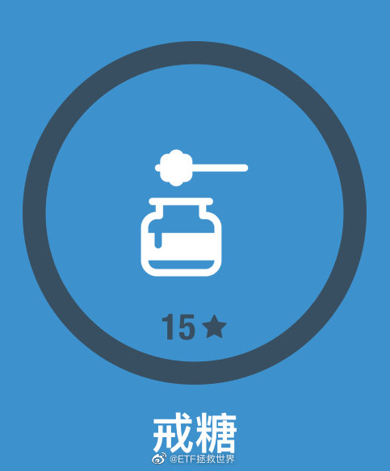

## 2022-01-04 10:22

我对投资的理解，新朋友可以看一下。我用一个例子来解释。

就是种地。当然我没种过地，但大致应该形容的不错。

首先你的买入，相当于春天播种。

你能不能想象今天种下去明天就有收成？客观来看不行对吧。当然，有一种情况可以，我最后说。

种完了，你时不时浇点水，除除草，施施肥，然后等着。

等过了春天，过了夏天，到了秋天，才可以收割。

周而复始。

所以你不能要求一个真正赚大钱的，长期看稳妥的投资是今天买明天赚后天卖。这不科学。

有一种情况是可以的，就是你秋天来了。别人收割春天埋下的种子长成的果实的时候，你也来了。你来捡地上别人掉的三瓜两枣。

好，你发现今天来今天就能捡到，你可太高兴了，原来捡果实这么容易。马上打电话摇银儿，把三姑六婆七姑八姨都找来一起捡（相当于储蓄搬家加仓）。结果捡了没几天，人家收割完了，冬天也来了。不仅你要挨饿，所有的亲戚（后期的加仓）都要挨饿。惨一点的还要饿死冻死。

人家聪明人在暖和的屋子里躲了一冬，喝着热可可，吃着大餐。春天把存下的更多的种子拿出来种，然后等，然后收割，然后一帮“更聪明的人”又在秋天来赚快钱，然后冻死……

你真的不觉得今天投入明天，或者下个月就要有好收益是一个很可笑的事情吗？到底世界上有什么生意是刚投入就能有持续的好回报的？除了刑法上规定的那些？

## 2022-01-04 10:33

医疗崩，医药不崩，

我很惆怅。 ​​​

## 2022-01-04 10:50

爱它信任它，它就会回报你。

## 2022-01-04 11:01

回复@诅影:医疗就是治疗器械医疗、服务等，比如呼吸机口罩专科医院之类。医药是药（中西药）+医疗。//@诅影:虽然能看懂医疗和医药的字面意思区别，但并不懂市场上哪些是医疗哪些是医药，不过并不惆怅，知道跟车就对了。

## 2022-01-04 11:02

到现在，很多朋友才明白为什么小美的提款区间是7%而不是5%。 ​​​

## 2022-01-04 13:50

又一位老朋友跳车告别了。

缘尽了。 ​​​
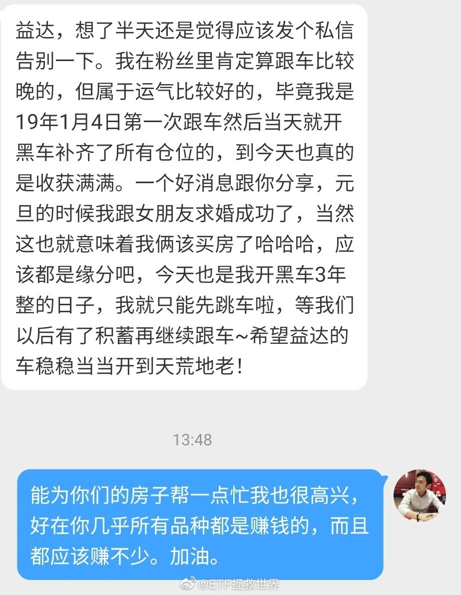

## 2022-01-04 14:35

如果，我是说如果啊。

如果有个非常nice的朋友（或者博主）要送你香水，

你想要迪奥，古驰还是香奈儿。

评论选择之后留性别。 ​​​

## 2022-01-04 17:16

回复@洗头狂魔:神奇的人。别人要送朋友东西，你凑过来说太土了，别的牌子不好吗？我去，真的长见识了。你这种人人缘肯定特别好。//@洗头狂魔:回复@ETF拯救世界:好心给建议还经不起正经评价了。那你送吧，看看人家会不会喜欢。心心眼土鳖

## 2022-01-04 22:08

打开私信，每十条有三条是关于分手和被分手的。

看来新的一年开始，让很多人想要开始新的生活啊。

走不出来的朋友，怎么说呢，交给时间吧。时间会冲淡一切。再找一个更好的，忘了ta。

不爱了，勉强在一起双方都会痛苦。长痛不如短痛，就这样吧。下一个更好。 ​​​
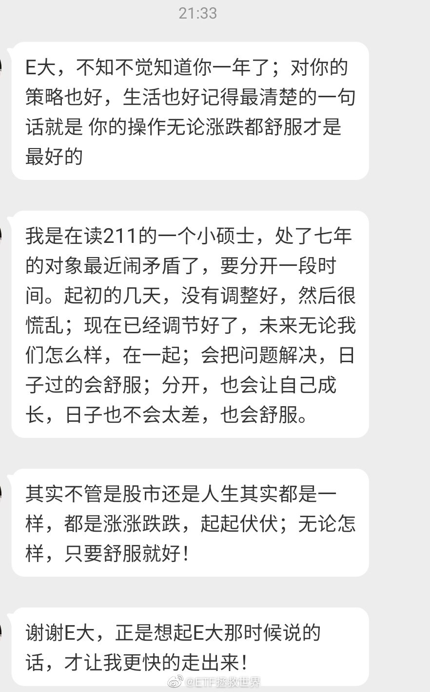 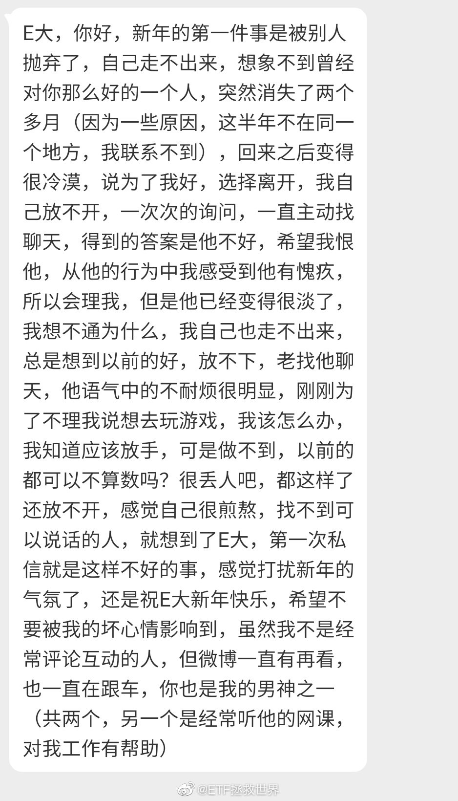

## 2022-01-05 10:42

666一点也不6，

我哭得很大声。 ​​​

## 2022-01-05 11:09

今年一定要小心谨慎。大多数人会被今年的行情整蒙圈。“5、22年会非常非常难做。因为年中的波动会非常怪异，远超绝大多数人的想象。如果21年没赚钱，22年赚钱的可能性就更低了。尤其要警惕21年赚大钱的板块、策略、组合以及基金经理。”

## 2022-01-05 11:23

机构：遇事不决就抱团。 ​​​

## 2022-01-05 14:22

买，当然是买。但还是说了多少次的，时间、空间控制好。

不用急，没什么“不可以错过的机会”。

没有。

资本市场的机会没完没了层出不穷，有命活到抓住几个就可以了。

胸口上写个“勇”字冲下去乱打，死的最快。 ​​​

## 2022-01-05 15:01

我本人的中概+恒科在权益类品种仓位比重已经达到15%，超过红利，直追500。

没别的意思，就是说一下。 ​​​

## 2022-01-05 15:41

学生去找老师问问题，老师说：“别烦我，自己去想。”

不上课外班，不请家教行吗？

呵呵。 ​​​

## 2022-01-05 17:55

中概牛逼在哪里你知道吗？

牛逼在白天你工作的时候跌5个半小时，晚上你睡觉的时候还要跌6个半小时。

每天跌12个小时，怕了没？ ​​​

## 2022-01-05 21:21

有暖气很干燥别忘了敷一片补水面膜。 ​​​

## 2022-01-06 11:28

来晚了。发生肾么事了。 ​​​

## 2022-01-06 11:46

头像旁边这一圈浓郁乡村风格的东西怎么去掉。

跟我高冷又有腔调的气质不搭。 ​​​

## 2022-01-06 11:54

目前支撑位依然不变。如果你已经提前很久很久做好了准备，那么它真的跌到那里的时候你怎么会慌呢。//@ETF拯救世界:第一支撑调整到22000左右，第二依然是18500。在这两个支撑附近都会买。

## 2022-01-06 11:59

恒生的长线仓位交易历史。

不客气的说，我比99.9%的人更懂这个指数。 ​​​
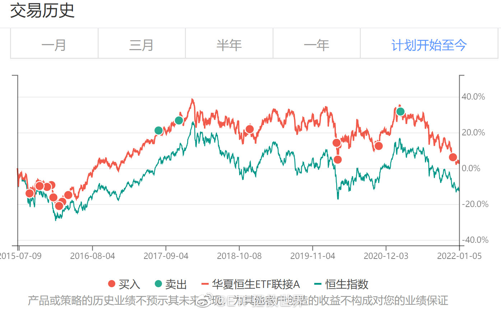

## 2022-01-06 12:37

刚看到有投资者举报某私募管理人，净值跌幅过大，要求保本赎回。

有一点感慨。

无论是公募还是私募，绝大多数基金管理人其实是希望规模越大越好。规模越大，管理费越多。当然，无论是人还是商业机构，希望利益更大是无可厚非的。

但是，在资产管理行业，这里面有些东西跟一般的商业还是有很大不同。

比如，一般来说，行情越好，或者说某个基金经理业绩越好，公司对他的宣传力度也就越大。这时候来申购的投资者，来的钱也越多。

但问题是，这世界上绝大多数投资人在一波被瞩目的涨势后，都极大概率会变得很差。原因有三：

第一，他一定是一个极端的人。不极端很难做到第一第二。极端在顺风顺水的时候是第一，一旦不顺就是最后。

第二，不顺是必然的。因为一个行业一个板块，不可能无限涨下去，一定会均值回归。但他一定是坚定相信还会涨，因为不相信的中途都下车了，也就拿不到第一了。所以极端+均值回归是问题的本质。

第三，大多数人管理小资金的时候好，资金量大了就未必好。韩信点兵多多益善只适用于极少数人。

上面这三点说的是第一个问题，也就是“追涨”明星是祸根。

下面是第二个问题，即匹配度的问题。

基金管理人为了利益更多，基本上一定是来之不拒。就是从管理人角度，一定是吸引的资金越多越好。但问题在于，你吸引来的资金，真的合适你吗？你适合它吗？它适合你吗？

一支军队想要打胜仗，一定是上下一心，令行禁止。指挥官战术上对也好，错也好，队伍中一定不能有杂音，这样才能打胜仗。而一致的根源，在于有共同的信仰，共同的思维模式。

如果大家对于投资的认知根本不同，走到一起怎么可能有好的结果？你把一堆根本无法承受回撤的人弄到一起，给他们匹配的却是可能大幅波动的策略，怎么可能会成功？

投资人要筛选管理人，管理人也要筛选投资人。很多事情不是越多越好。可惜，在真实的世界里，为了更多的利益，很少有管理人会对资金说“NO”。

现在，你真的明白为什么我隔三差五请新朋友不要参考我的计划了吗。

第一，我认为市场没有太好的机会。

第二，我认为你不适合我。

对我来说，利益并不是最重要的，最重要的是我希望你能挣钱，我能开心。

## 2022-01-06 12:58

请教各位米其林三星的大厨：

酱油炒饭用生抽还是老抽。 ​​​

## 2022-01-06 13:40

我真的搞不懂：

第一，这个价位到底是怎么定的可以这么精准，一次次的在这里止跌；

第二，是谁不停高位接走低位还回来。是因为爱吗。 ​​​

## 2022-01-06 15:45

很犹豫。

医疗技术位快到了，价值位依然不可以。

怎么办，反复考虑，我做了一个违背祖训的决定。 ​​​

## 2022-01-06 18:23

转发微博

## 2022-01-06 19:01

如果一个人，平常没有被别人当成人，

那么他也不会把别人当成人。

所以最大的问题在于，我们都应该把别人当成人。

不仅是自己的家人，朋友，同学，同乡，还有陌生人，无论贫富，无论职业。

有些人的冷漠甚至残暴来源于他的经历。只有感受过爱的人，才会做出温暖的事。 ​​​

## 2022-01-07 09:19

收入高一点的，在网上晒工资条，有一个算一个，

全是脑子有问题的。 ​​​

## 2022-01-07 09:29

急救绷带回血中 ​​​

## 2022-01-07 09:39

小美像极了被人嘲笑，却不放弃，无论环境多么恶劣，也要努力往上冲的我们这些普通人。 ​​​

## 2022-01-07 09:55

前几天有人在评论说：红利高位没卖。

我心想，燕雀安知鸿鹄之志。 ​​​
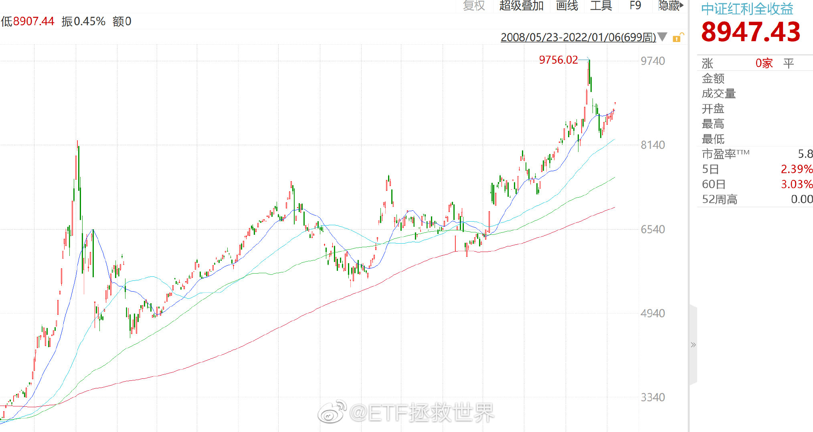

## 2022-01-07 10:25

我刚才看评论，有些特别有问题的倾向，我提醒一下：

我们的持仓涨了，我贴出来点评两句，有两个目的：

第一，与各位一起高兴一下。

第二，帮有些朋友坚定一下持仓信心。

但是！

我绝对没有任何暗示“可以买入”的意思！我觉得什么时候可以买，无论是长线还是波段，我都会把自己的操作清清楚楚明明白白的提前展示出来：日期、仓位、价格，一点点含糊都没有。

如果我没有说清楚，那不代表我认为可以买。希望你知道。

还有一个希望你明白，是评论区其他人的观点不代表我的观点。什么“还便宜”啊，什么“刚刚开始涨”啊，这都不是我的观点。我的观点就是我自己说的话。

我绝对不会忽悠你以高于我持仓价格的价格去买任何东西。我一定要保证你的成本要比我低，我赚你也能赚，我赔你赔的比我少，我心里才踏实。

开黑车有赔有赚，但都跟我无关，这个要说清楚了。

## 2022-01-07 12:53

父母应该加强对孩子这方面的教育。 ​​​
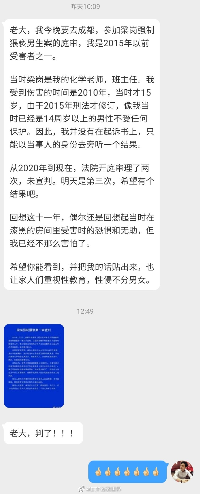 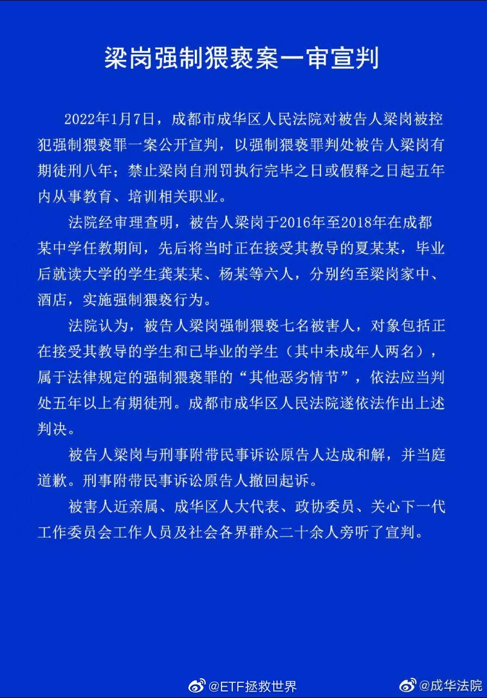

## 2022-01-07 12:58

女同学们帮忙出出主意，这种情况还能挽回吗，该怎么做。 ​​​
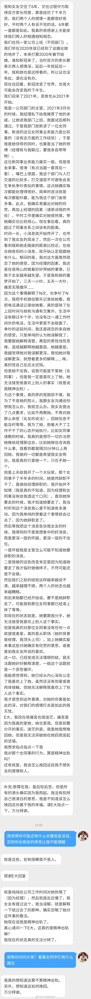

## 2022-01-07 13:15

刚才看到有朋友对昨天HS差一点点没有买入失望懊悔。

我想说的是，差不多行了您，您这是想天下所有好事都归您一个人是吧。

且不说下周还会不会跌，就算这里有一波反弹，恒科买到了吧，虽然不是最低位，但也比现价低了。YY买到了吧，几乎是最低位，买了就涨。

还想怎么样啊，差不多行了啊。太贪心可是要出问题的。知足常乐。

## 2022-01-07 14:06

小美的这根超长上影真的很难看。收盘如果拉不回去，那之前卖掉的波段接回来就不是梦了。 ​​​

## 2022-01-07 14:48

只是一周时间，各位可能已经体会到了今年的难。

大的涨一天，小的涨一天，然后一起跌一天。

板块更是各领风骚一两天，热点疯狂切换。

刚开始就这么刺激，今年一定很好玩。 ​​​

## 2022-01-09 18:50

清点了一下家里储存的食物，乐观估计正常够吃1-1.5个月。极限情况2个月也应该可以。

营养全面就不用考虑了。什么事情都做最坏准备可能是一种深入骨髓的病。 ​​​

## 2022-01-10 09:44

人也好，事也好，你曾经认为ta们都是完美的。你很热爱。

但有一天你发现ta并没有那么完美，于是你很愤怒，很失望，很生气。

恭喜你，你认识到了真实的世界。真实的世界并不是粉色的童话世界，而是充满了各种肮脏和黑暗。

有些人一生停留在第一阶段，恭喜你们，你们的人生很幸福。

有些人的人生停留在了第二阶段，同情你们，你们一生都很压抑痛苦。

但其实，人生应该上升到第三阶段，也就是，在肮脏和黑暗中，依然能相信、识别、珍惜美的存在。不因为黑暗和肮脏，放弃对美和善良的追求和热爱。

你知道真实的世界是怎么样的黑暗，但你依然相信和热爱那一缕阳光，这也是成熟的标志之一吧。

## 2022-01-10 10:07

早上说泡点豆子做点腊八粥应个景增加一点人生乐趣，

翻了一圈发现家里8种材料有6种之前被断舍离扔掉了。

这就是人生吧。 ​​​

## 2022-01-10 10:14

健身房现在还能去吗。

有点犹豫。 ​​​

## 2022-01-10 10:44

不知道是不是已经开始了。现在看不清。

## 2022-01-10 11:00

班子成员开了个碰头会，定了，印这两个：

“踏踏实实的，多大点事儿。”

“二级市场捡垃圾大赛  第一名”

尽量多做点，争取做到饮者有其杯。 ​​​

## 2022-01-10 13:31

朋友送了我一个华为GT runner。

试用了几天。别的不说，我只有一个疑问：

为什么用起来感觉差别不是特别大的GT和apple watch，续航时间差别这么大？

watch一般就一天，撑死了一天半。为什么GT可以做到每天只掉十个点的电。

为什么，这到底是为什么。按理说苹果的技术不至于做不到华为能做到的事情啊。

## 2022-01-10 14:04

预告一下，S的组合展示有一点更新。是这样的。

S跟150不同，不是一个固定金额的组合。之前是卖出后就直接从组合里移除，但这里有个问题：

比如极端情况下，我不看好市场，将S组合卖出了99%，只剩1%。但这个时候，以前的组合还会显示100%仓位，因为卖掉的直接“消失”了。也就是说我卖掉了99%之后，拿回了99%的现金，结果组合还是显示100%仓位，要承受所有的跌幅。

这个明显不合理。

所以我提出了一个思路。即，在S组合展示中，卖掉一份权益资产后，将之转换成一份货币基金留在组合中。如上面的例子，我卖掉99%股票基金后，变成了99%的货币基金和1%的股票基金。这样，是不是更能准确的体现组合的状态？

如果之后要买权益类，会优先从货基里提取资金。

## 2022-01-10 16:56

5、22年会非常非常难做。因为年中的波动会非常怪异，远超绝大多数人的想象。如果21年没赚钱，22年赚钱的可能性就更低了。尤其要警惕21年赚大钱的板块、策略、组合以及基金经理。

## 2022-01-10 17:20

我给个建议：

永远不要去分析去年的冠军基金经理做了什么。类似的分析文章也不要看，毫无意义。

做了什么？很简单，一定是重仓满仓某个风口上的行业，就这么简单。

每个行业都会有很多基金经理重仓满仓，哪个行业跑出来了，哪个类型的基金经理就是冠军。没有什么稀奇的，就是这么简单。

还是之前说的，真正厉害的投资者，是始终保持在同业前1/3的那波人。他们也许没有一次拿冠军，甚至没有一次进前五前十。但他们每年都能在前1/3，最终的王者会是他们。

你要投资主动基金，要按照这个思路去买。而不是找去年的冠军。冠军通常带来的不会是收益，而是价值毁灭。

比如去年的冠军，年初规模两亿多份。到了9月30日规模已经有了52亿份。到年底保守估计有60、70亿以上的份额。大多数人都是相对高位进去的，去年涨了100%，我相信跌20%多，这只基金就已经价值毁灭了。

## 2022-01-10 18:00

我从来也没说过主动基金经理不行。

一定有行的。而且不是一个两个三个四个，一定是有一批。说少了几十个人，说多了百来人也能有。

但是，最关键的，是你一定要从几千名公募基金经理，几万名私募基金经理中把他们找出来。

现在公募基金数量已经超过两市的股票数量了。选靠谱的基金经理，难度不亚于选靠谱的股票。

主动基金和被动基金，一定是各有所长。也一定是适合不同的人。

我是个兼容并包的人，没那么狭隘就会说什么方式一定好，什么方式一定不好。我选择被动投资组合的方式来构建自己的投资体系，原因很简单：

我相信策略+数据，大过于相信人。我对于找人来说并不擅长，我更喜欢跟数据和策略这些机械的、完全数字的东西打交道。

也就是说，投资被动品种更适合我，仅此而已。

## 2022-01-10 20:53

今天卖出的500C收益率比上次的环保差不少，大家平均收益率50%多不到60%。 ​​​

## 2022-01-10 21:13

对于生孩子，我又有一点新的理解。

我认为关键的问题，在于人们会思考，生孩子，或者多生孩子，到底是对自己有利还是有弊。而最关键的问题，是“社会性养老”。

试想，既然养老是社会的责任了，退休金是社会发了，那么，养一个或者几个孩子，会对自己未来的养老有多大帮助呢。

如果没有社会性养老，需要“养儿防老”，那不用催，必然能生几个生几个。

这也是为什么落后地区生育率高，发达地区生育率低的原因吧。据说某些以能生为特点的人群，到发达国家定居后，生育率也是越来越低的。

现实的巨量付出（经济以及精力），未来的极小甚至没有回报，作为理性人，会做出什么样的选择就不足为奇了。

## 2022-01-11 09:55

红利真的很垃圾。

估值刚刚超过十倍，可见未来有多么黑暗。不像人家白酒和科创，跌那么多，估值还是50多和70多倍，说明前途一片光明。 ​​​

## 2022-01-11 10:28

人都是会变的吗？

所有婚姻都有爱情吗？

有了爱情就会有婚姻吗？

有爱情的婚姻，会变得没有爱情吗？

没有了爱情，婚姻一定要结束吗？

每一个人，每个人在人生不同阶段，都会有不同答案。

这道题太难，我不会做。 ​​​
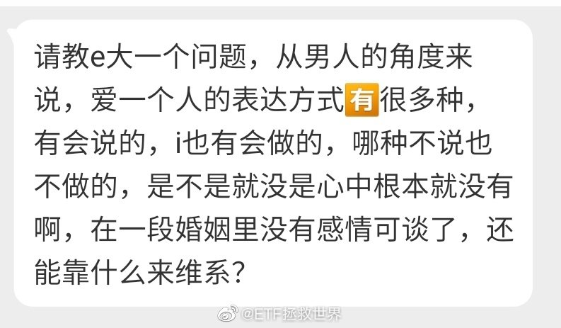

## 2022-01-11 11:14

从理性的投资者角度来讲，我们不应该希望市场上大多数人变成同样理性的。

因为如果那样，就会有很多人也来捡垃圾，最终垃圾就不会成为垃圾；

也不会有人疯狂的冲100倍以上的品种，那样我们就拿不到136%的收益率。

怎么说呢，大家还是不要到处去科普捡垃圾的好处，要我说，看到非理性行为，只有四个字：

尊重，感恩。

## 2022-01-11 13:34

投资者成熟三部曲：

第一步：不接盘。

第二步：买辣鸡。

第三步：让别人接盘自己的辣鸡。 ​​​

## 2022-01-11 13:58

很多品种跌了，说来你不信，是我们大家的万幸。

因为每个人都应该有一个贯穿一生的基本仓位配置。其构成还是我之前说的：

大盘、中小盘、价值、医药、消费、科技。

如果真的有幸在底部区域全部配置完成，那么之后就是简单的增增减减，投资这块也不用费太多心了。

所以不跌，你怎么在底部配置完成？

A股以外，再加上美国和欧洲，再来点新兴市场，就齐活了。除非太贵，否则这个组合可以陪你一辈子。

## 2022-01-11 14:32

技术性调仓。 ​​​

## 2022-01-11 16:06

爱自己。

帮助自己保持健康。

逗自己开心。

最重要了。 ​​​

## 2022-01-12 05:25

我说今天有机会出一份恒科会不会太夸张。 ​​​

## 2022-01-12 09:06

今天场内恒科开盘涨幅在3-4%之间比较合理，如果不折价 ​​​

## 2022-01-12 09:39

差一分没考上重点学校的感觉。 ​​​

## 2022-01-12 09:41

给做市商打call。 ​​​

## 2022-01-12 10:07

这次恒科留了将近2.5倍利润转为长期持有。

接下来就回到中概继续表演了。 ​​​

## 2022-01-12 10:18

“3、中概等惨烈的品种要么会赚钱，要么就是会提供赚大钱的买入机会。”2022年的第一次提款，意料之中。

## 2022-01-12 14:03

HS中网，让人不禁感叹，不完美才是人生常态。 ​​​

## 2022-01-12 18:55

北京人均GDP2.8万美元。

这个数字大致低于意大利，高于西班牙。

与台湾省差不多。 ​​​

## 2022-01-13 09:47

如果没有波段仓位，你左右为难：反弹了，卖不卖啊，不卖跌回去怎么办啊，卖了继续涨怎么办啊。卖一点？卖多少啊。

有了波段仓位的你：随便，尊重，都开心。 ​​​

## 2022-01-13 18:37

今天在外面鬼混了一天，没空发什么微博，勿cue。 ​​​

## 2022-01-14 09:39

行情上蹿下跳，你猜猜是什么人被反复收割。对了，就是那些看到行情管不住手的，不停交易的人。今天涨，明天跌，只要你动手，就给你砍下来。我能给的建议，是机械执行既定的交易计划，将自己打造成没有感情的野生AI交易机器人。不要动感情，不要动感情，不要动感情。

## 2022-01-14 09:49

我真的很讨厌那种只有不断增发、配股，才能把业务发展起来，甚至才能维持下去的公司。 ​​​

## 2022-01-14 10:01

对我来说，打新股就像与人交往。

在没有破发新股之前，相当于这个人从没骗过我，那我就完全信任他与他做朋友。

但只要有一只新股破发了，就是被骗了一次。只要有一次，我就不再信任他。也许还会来往，但不会把他当做朋友。

也就是说，不会再打了。

因为这本来是个稳赚不赔的，现在变成有赚有赔，那整个策略的基础就已经变了，策略也就崩塌了，怎么可能还会执行呢。

## 2022-01-14 12:19

真的很烦。找遍中文互联网，竟无一处被二极管、喷子和低智人士放过的净土。

上网没有乐趣了，真的。

不想与这些人有任何交集。诺大的互联网，无处可去！

（PS，不是说我这里，我这里没有这些。） ​​​

## 2022-01-14 20:00

荣格说，越强调理性的人，内心越是充满感性。

所以，我这样一米八几，一拳能打死一头牛的猛男，用这样的充电宝也是很合理的。 ​​​
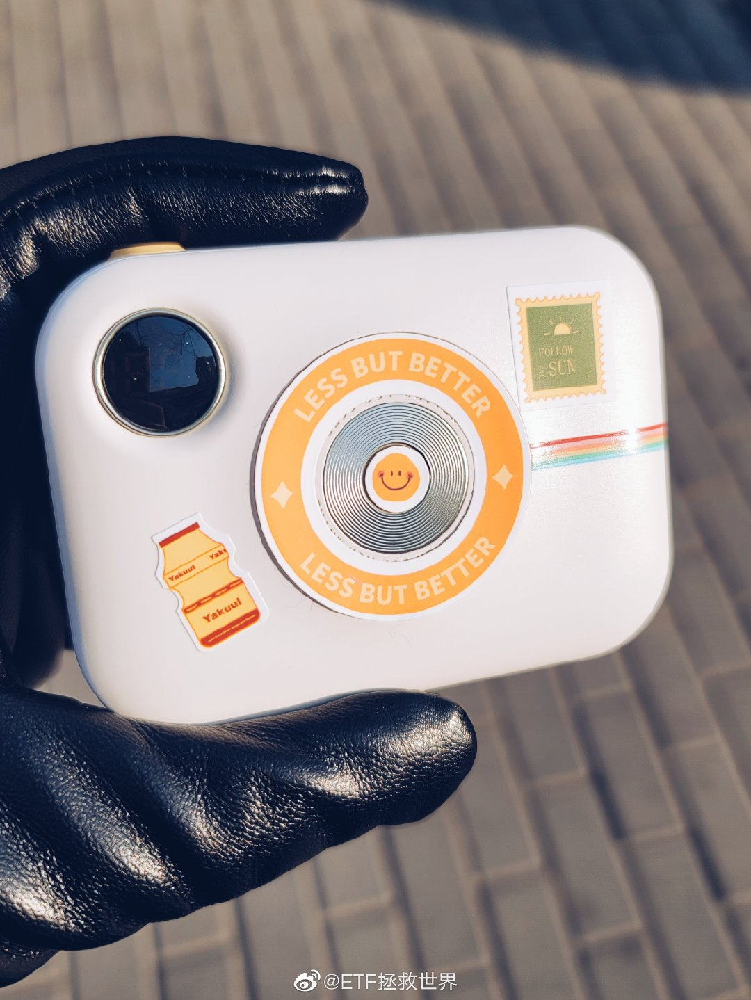

## 2022-01-16 10:00

真的一两句说不清 ​​​
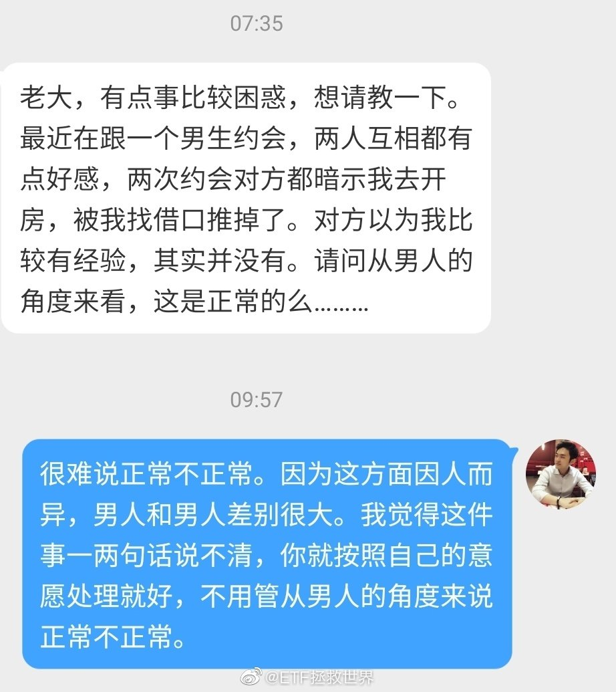

## 2022-01-16 21:46

上什么学，做什么工作，与什么人结婚，大致能决定我们这辈子会不会幸福。

朋友们，好好选择人生关键的岔路口该向哪边走。一定一定认真选择。

看私信再次有感。 ​​​

## 2022-01-17 10:51

很无聊的一天。

没有风。没有雨。没有钱。没有你。 ​​​

## 2022-01-17 11:44

我给各位一个真诚的建议：

不要为了国家大事，世界大事焦虑。

真的，80%的事情都会解决，都是毫无意义的焦虑。

20%的事情真的解决不了，但你焦虑也没用。不如多关注自己的事情，把自己的日子过好，为这些解决不了的问题多做准备。

就是什么呢，就是你想吧，最坏能怎么样，最坏就是去天堂了对吧。去天堂是一件很大的事吗，地球诞生以来已经有上千亿的人去了，说到底也不是什么大事。

既然最坏的事都不是什么大事，你为那些你根本改变不了的事情焦虑什么？先想办法过好今天吧。

## 2022-01-18 16:15

小助理不停的搬运总算有点成绩了… ​​​
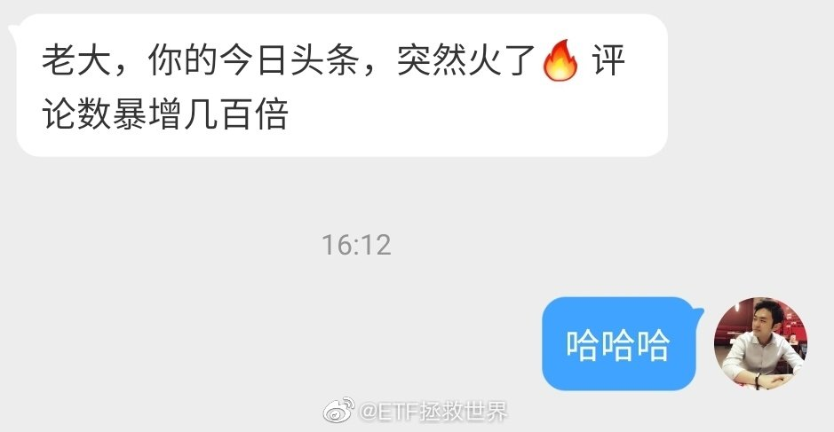 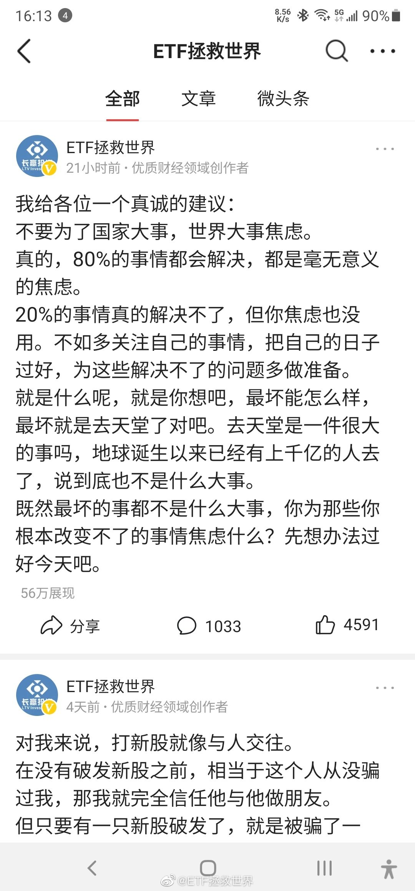

## 2022-01-18 17:35

咬了一口糖葫芦算不算破戒了。

我觉得不算。 ​​​

## 2022-01-18 21:17

带锅的这个女的看着真够瘆人的。 ​​​

## 2022-01-19 09:42

你可能没注意过一件事，

几乎没有任何不是太小的投顾组合，会像150和S这样，第一时间公开操作品种。一般的组合，你不在特定平台跟投，是绝对看不到操作的。甚至有些跟投了也看不到。

150和S这样第一时间向所有人公开，当然在商业方面会有损失。毕竟公开后你在哪里买都可以。但我依然坚持这么做，因为就像我一直说的，我很喜欢钱，但对我来说，有比钱更重要的东西。

我要对得起所有人。那么没有在特定平台上跟投的朋友，也要像一开始一样能够看到调仓信息才对。

但是一直以来，总觉得欠那些相信我，在且慢跟投的朋友一些东西。因为你们比别人对我多了一份信任，也多了一份搬家的麻烦。一直想着怎么回报，但也没有太好的主意。

2022年，我希望给各位一点专属的礼物。我想在且慢开一个专栏，写一点东西。至少要包括每次调仓的原因和初衷，以及没有在其它地方公开分享的投资体系、策略、数据、思路类的东西。

对得起所有人，给对我好的人以更多回报，这也算是我让自己内心安稳的两个原则吧。

## 2022-01-19 10:23

只要红、丐、美涨，

药、消跌，

我就会很满意。 ​​​

## 2022-01-19 11:07

环保这个顶真的仁至义尽。

盘整、破位、反抽，给足了机会卖——不止一次机会。

少卖了一份是自己的责任，没有任何狡辩的借口。

还需要继续努力钻研业务。 ​​​

## 2022-01-19 11:59

想来想去，还是要去健身房，应该没事。

希望有两个，第一没有病毒，第二别掉头发。

肌肉什么的随缘。 ​​​

## 2022-01-19 15:33

每天15:30开始计算数据的时间，排在一天中最舒服的时间段第三位。 ​​​

## 2022-01-19 16:47

2008年，可乐180亿港元大幅溢价收购汇源，被反垄断叫停。

2020年，汇源退市。

2021年，汇源被申请破产清算。 ​​​

## 2022-01-19 22:30

我这思路对吗 ​​​
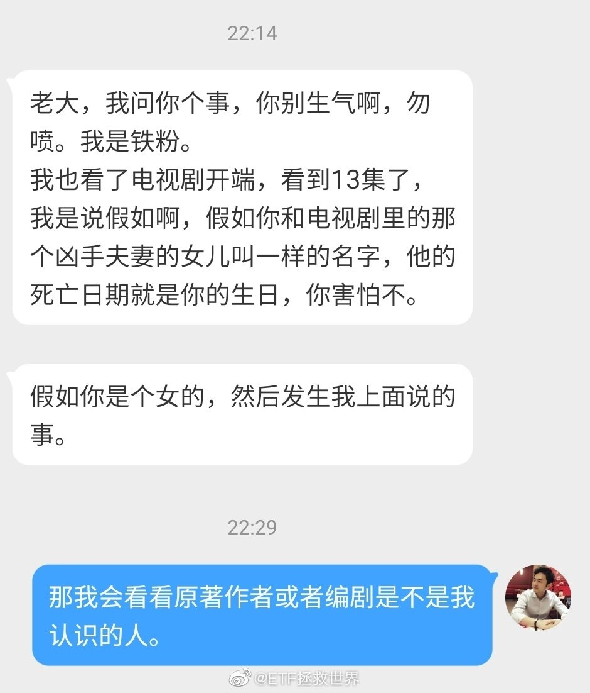

## 2022-01-20 07:52

有朋友问我关于北京最近确诊的，这位体力工作者的流调信息怎么看。

我也知道说些什么可能会让大家更认同，但我想说其实我的关注点跟大家不一样。

他的工作能看出来真的非常辛苦，但对于晚上工作这一点，我想说其实很正常。我看信息里面有在簋街工作到凌晨的，那在簋街工作，不就得凌晨吗。包括饭馆老板，厨师，服务员，都得到凌晨。

还有写字楼工地装修，要白天干你们也不答应啊。

其实很多职业都有晚上凌晨做的。夜班医生护士，执勤交警，环卫工人，卖菜的…太多了。

我关注的问题，是他这样的工作，在人均GDP2.8万美元的北京，一天收入是多少。如果足够高，那么共同富裕，包括教育的根本问题才会得到实现和解决。

晚上工作不可避免，收入够高才是关键。

## 2022-01-20 09:24

希望他早日找回孩子。

## 2022-01-20 09:49

最近欧洲的银行股表现不错，不知道A股金融会不会联动，会不会带红利再来一波。 ​​​

## 2022-01-20 09:57

两年疫情，从美国到欧洲，从中国到日韩，大家看到的新闻是大富豪们更有钱了，看不到的新闻是其实大多数持有房产和股票的人，资产也整体上增加不少。

但不持有资产的人，纯打工的或者自己做生意的，很多都过得很艰难。

我不知道未来世界会不会发生根本的变化，会不会全球性的以资产为视角做出改变。如果不会，那么我想大家真的要在努力工作的同时，有意识的多积累资产。

因为资产的增值真的要比劳动增值快。

## 2022-01-20 10:46

500不是乱卖的 ​​​

## 2022-01-20 10:57

人均75000。三口之家总收入22.5万。夫妻两平均年收入11万。北京的各位朋友，不吹不黑，达标了吗

## 2022-01-20 11:02

回复@西米露好好喝www:所以网络真的有意思。如果在知乎问，人人都说没有几十万活不下去。公布了数据下面又都在说拖后腿。也不知道大家是在吹还是在黑。中国人的收入是个迷。//@西米露好好喝www:年入20在北京怎么生活啊

## 2022-01-20 14:06

观剧建议：

好评的剧等完结了再看。

 ​​​

## 2022-01-20 14:18

辣鸡恒生今年涨幅6%，全球主要市场涨幅第一。 ​​​

## 2022-01-20 14:27

“如果让我判断2022年的机会，我反而会说来自于21年的弱势品种，比如中概等。”至少第一个月对了。 以后打脸再说以后的。

## 2022-01-20 14:35

我们的货币政策、财政政策不是没用，这是一个很复杂的事情。目前阶段主要是两点：

第一，逆周期。

这里是说与联储的周期是逆向而行的。它要加息，我们降息。他们收紧，我们放松。这个是我年初判断今年异常复杂的一个因素。

这里面的纠结与互相影响，根本就很难弄清楚。体现在市场上当然是会走得复杂。

到底宽松的政策只是会对冲掉利空，还是会产生利好？不是那么容易说清的。

第二，ZC累积效应。

ZC发挥作用不会是出一个就有效。货币政策的特点是会在一段时期内持续。而持续一段时间，不断加码后，最终才会在市场上有反应。只看到一条政策就觉得怎样怎样，只能说还未够班。

还是那句话，今年会特别复杂。少动多看是上策。锦囊握紧，依计行事就好。

## 2022-01-20 15:33

昨天那份Dax各位平均卖出收益率是61%。 ​​​

## 2022-01-21 00:11

还没睡的你正在干嘛 ​​​

## 2022-01-21 09:28

9:30，游乐场的大门打开了。

生活变得有趣起来。 ​​​

## 2022-01-21 09:48

今年开年的弱势，绝大多数人根本就没有一点思想准备。导致直接就乱了。

我们对今年有了提前的预期，所以这样走就早已有了思想以及配置上面的准备，所以根本不会乱。

之后，如果还按照剧本走的话，就是要在最多人慌乱的时候捡辣鸡。这样，就可以为今年余下的时间，以及更远的未来拿到可以赚钱的筹码。

预测有用吗，这要看你怎么用。对不对。

它是用来指导战略的，不是用来指挥战术的。体会一下。

## 2022-01-21 10:04

不要催我买什么。

高位一分钱没买，大家也一分钱没赔。我要听有些人的，已经赔很多了。

买还是不买，什么时候买，什么价位买，我有自己的计划和判断。不一定对，但没人能影响我。谁要觉得自己车开得还可以，那就自己开。毕竟有些朋友有仓位，有些没有，情况也不同。

没事儿别老抢方向盘。 ​​​

## 2022-01-21 10:20

药跌得让人心动。别说那么多，先下一小网顶着先。长线配置再看看。 ​​​

## 2022-01-21 10:35

港股通鹅送的狗什么时候到账？ ​​​

## 2022-01-21 11:36

没有天理。

高净值人士最喜欢的礼物品牌，我送给大家却被嘲笑Low。 ​​​
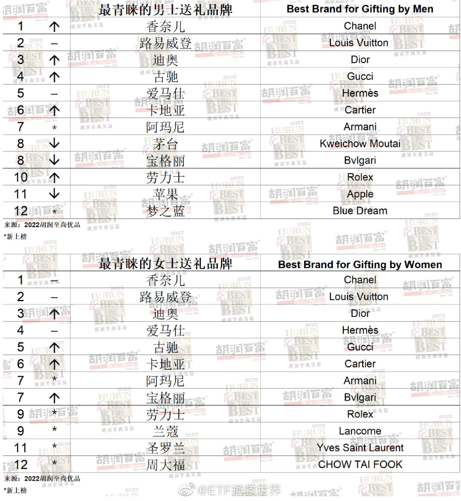

## 2022-01-21 13:30

手里拿着一半基金一半现金经历下跌，感觉就像半杯水。

有些人看着半杯水，会觉得我好倒霉只有半杯水。有些人会很高兴，我还有半杯水呢。

我就很高兴，看着猎物一步步走进伏击圈。至于那些下跌的持仓，我有个坚定的信念，就是它们极大概率会涨回去。

股票我不敢这么说，持仓的基金很有信心。 ​​​

## 2022-01-21 13:57

说句实话，我们股市涨还是跌，除了股民和基民，没什么人真的在意。 ​​​

## 2022-01-21 17:48

这就是主动基金的风险之一

## 2022-01-21 18:12

今天数据非常好。

下周一如果能再来这样一下，必买。 ​​​

## 2022-01-21 22:10

分享图片 ​​​
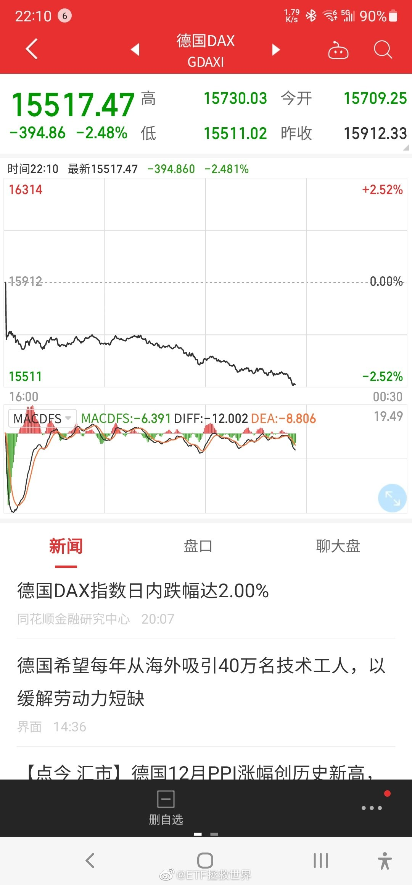

## 2022-01-22 15:19

昨天奈飞大跌。怎么说呢，两年的涨幅，基本上三个月跌完了。

也就是说，如果你意志坚定的长期投资拿了两年，以为赚了很多，结果三个月一场空了。

你肯定以为我要说会低买还要会高卖。

不是，你猜错了。

我想说的是，

同样的，你以为一个品种你拿了两年多浪费时间一点没赚，

结果可能突然三个月就赚翻了。

这就是资本市场的魅力。你永远不知道你特别开心或者特别失落的时候，紧接着要发生什么了。

## 2022-01-22 16:18

一个人在办公室，看着窗外的雪景，给各位大爷打工。 ​​​
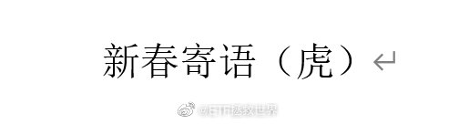

## 2022-01-24 07:18

最近又有明星经理被喷了。

其实没有什么新鲜事，只是历史在一次次的重复。我来总结一下一直在说的两点：

第一，价值毁灭。

规模很小的时候开始涨，涨100%，变成明星，吸引巨量资金，小幅下跌后就会出现价值毁灭。比如，跌20%，就会出现整体亏损。

这个，适用于基金，也适用于个人投资者——你赚了一点钱，信心大增，投入更多，结果变成高位接盘，也是同样的价值毁灭。

解决这个问题的方法是高位想办法停止扩张，不让资金流入，或者严格限定投资人的买入成本。然而——哪个脑子正常的管理人会这么做？

第二，价值回归。

一段时期表现好，会让不懂投资的人认为封神了，是投资天才。其实极大概率不是天才，而是正好坐到了风口上。

一个基金不可能永远表现亮眼，不可能在每一个阶段出色。原理很简单，一个是规模问题，一个是运气问题，一个是风格轮动问题。都详细说过，不多说。

总而言之，一段时间表现特别好，接下来就可能特别不好。所以赔钱的不二法则就是去总结之前一个阶段谁最好，谁是冠军，然后买入。这样做可能短时会很爽，最终结合第一点，就会死掉。

捡垃圾，保平安。

不停的卖掉涨势良好的品种，不停的买入不断下跌的垃圾，并不容易。其难点不仅在于与自己和解，更有外在的压力。比如你会被朋友所谓很高的收益率打击，也会被喷子嘲笑你买的东西不涨。

“为什么不去买大涨的热门，而要买那些看起来永远都不会涨的垃圾？”这是大聪明们经常问你的问题，最终很有可能也会让你开始怀疑人生。

只有一种人不会怀疑自己，不会左右横跳。这种人的自信来自于一直以来的成功，来自于所有品种最终都会盈利的结果，来自于从不高位接盘，从不低位割肉的自信。

热门的股票、热门的组合、热门的管理人，明星不断轮回，最终结局极大概率都是一样的——一地鸡毛，无人生还。

希望所有朋友都能够成长为真正自信，勇敢面对自己，笑对他人嘲笑，低买高卖，不追热门，扮猪吃老虎的垃圾佬。

## 2022-01-24 08:45

自己做柠檬茶有什么诀窍吗。为什么做出来的和茶餐厅的喝起来不一样。 ​​​

## 2022-01-24 09:03

我有一个关于感情的认知：

年龄越小，对于感情认知就越单纯。年纪大了，想得就会越来越多。交往就会掺杂更多感情之外的东西。

如果以这个结论为起点，就会衍生出很多观点。但我就不说了，怕被骂，虽然其实没什么好骂的。 ​​​

## 2022-01-24 10:12

神奇的数学：

HD最低价1.42，自最高点跌幅94.76%。

目前2.02，自最高点跌幅92.54%。

是不是看起来只差了2%。但其实从1.42涨上来，已经涨了42.25%。 ​​​

## 2022-01-24 10:16

兰兰被骂了。

那么我们准备把高位卖出的捡回来吧。 ​​​

## 2022-01-24 10:24

你能想象吗，上次买入居然是3年前…… ​​​
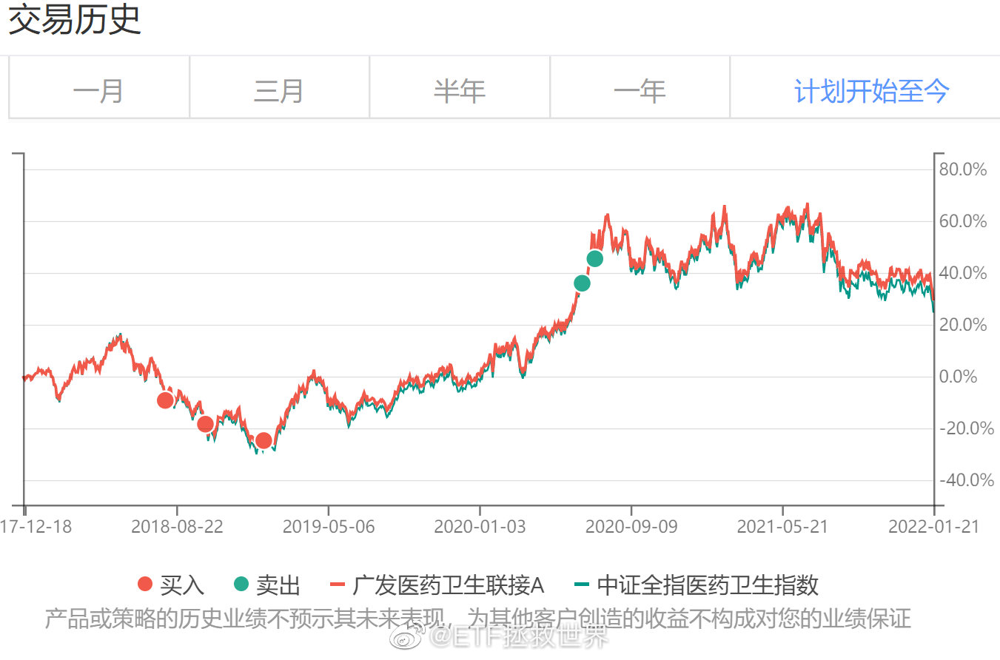

## 2022-01-24 10:53

其实一个人结婚不结婚，单身不单身，要不要孩子，都无所谓。自己想干嘛就干嘛。后悔了也是自己的决定，这就是人生。

但我看不惯的就是结婚的人天天吹结婚好，撺掇单身的赶紧相亲结婚；单身的猛吹单身好，忽悠别人一起跟自己单身；有孩子的总是不忘教育丁克：小心老了无依无靠。

别人的事情关你屁事啊。你又不是别人，你知道别人怎么回事啊。适合你的就一定适合别人吗？而且，是不是适合你自己其实你也没那么确定吧？

不是直系亲属就别老操心别人了，把自己的日子过好就不错了。

## 2022-01-24 15:14

问猫奴们两件事。

第一，什么猫漂亮、温顺、黏人又不会太黏，活泼又不失沉稳。

第二，北京在哪里买猫比较靠谱。 ​​​

## 2022-01-24 15:31

是儿子要买。他说愿意把攒了一年的零花钱都拿出来买一只小猫，应该是真喜欢。家里那只我以前在外面捡到的猫跟人不亲，儿子脸贴在它身上它也没有互动，不让他抱也不让摸。孩子很少提出要求买什么，既然提了，我就要尽力帮他完成。虽然他长大了也可以自己养，但我想那时候就与小时候的感觉完全不同了。

## 2022-01-24 15:56

21年4月的时候，环保还是最便宜的行业指数。

到了现在，绝对值比它高的只剩军工、医疗、信息了…… ​​​

## 2022-01-24 16:05

好生气。

昨晚在B站找小猫的视频，给我推了一大堆豪宅room tour。

我又买不起干嘛给我推这个？拍这种东西不怕我们这些买不起的人生气吗。

烦死了，再看一个…… ​​​

## 2022-01-24 22:19

DAX你怎么了

是被谁抛弃了吗，振作点啊！ ​​​
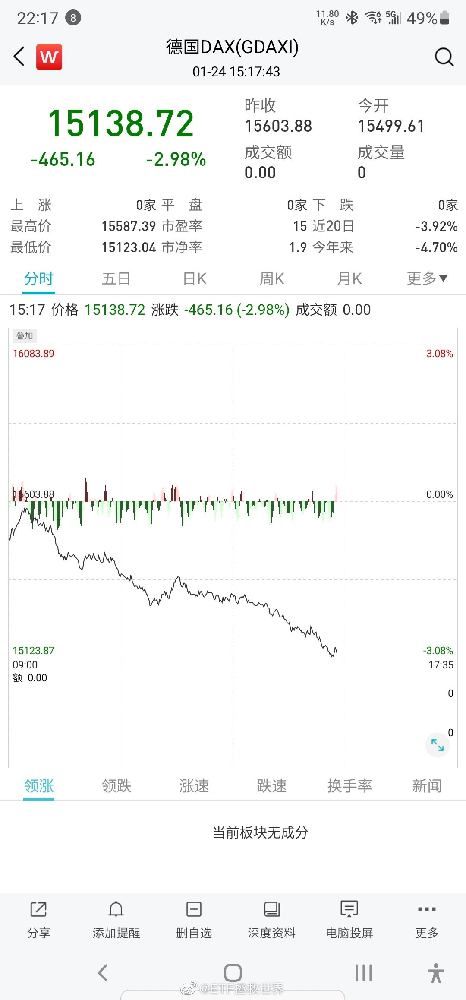

## 2022-01-24 23:33

这个真没有 ​​​
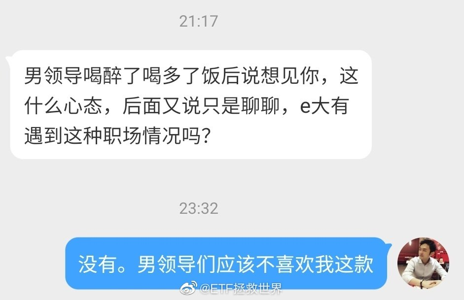

## 2022-01-25 08:04

有些事情有点可疑，别急，先等等看 ​​​

## 2022-01-25 09:31

今年财务方面的三个愿望：

第一，平安。没有什么意外的财产损失。

第二，股市不赔钱。

第三，消费、医药顶格配置完毕。 ​​​

## 2022-01-25 11:06

找了几个全球消费的QDII准备放入基金池，结果一看持仓，

茅台、老窖、恰恰、拼多多、网易。

什么鬼。全球消费啊喂。

我要的是宝洁可乐沃尔玛百事costco菲利普莫里斯雅诗兰黛好时LV爱马仕

白瞎了那么好的投资方向和额度了。 ​​​

## 2022-01-25 12:30

这种情况该怎么教育，这是情商高还是有点虚伪。

儿子：我去可乐家了。可乐说家里太乱了。

我：你怎么说的。

儿子：我说一点都不乱啊，比我家干净多了。

我：嗯？

儿子：其实根本没咱家干净。我是怕他不开心。

我：嗯……去别人家做客，客气客气也挺好。

儿子：他给了我两张奥特曼卡牌。

我：这叫做即时正反馈。

有那么一瞬间想起了来我微博做客的喷子……

## 2022-01-25 13:12

一切按照剧本走。 ​​​

## 2022-01-25 13:37

回复@Anonymous80626:机构造不了时势。报团个股或者板块可以，大盘走势不是他们能够左右的。跌很正常，不正常吗？//@Anonymous80626:回复@ETF拯救世界:不是国内机构他们最近都持续卖出嘛，北上是持续流入的呀？

## 2022-01-25 14:07

时隔三年，150和S的医药买入周期又开始了。

接下来的区间目标，是在9500-12000之间，将医药仓位配置完毕。

所有的事情都有预案，有解决方法，有执行措施，有理论和体系的保证。

你很怕跌？为什么？

哦，原来是因为什么都没有。 ​​​

## 2022-01-25 14:11

现在迷茫的，再看一遍。再说一次，跌，是正常且合理且可以预期的。

## 2022-01-25 14:25

我再说一句

上半年跌，要比下半年跌好太多了。

甚至可能出现全年指数跌，但你赚钱。

不懂的以后回来看。 ​​​

## 2022-01-25 14:38

对不起，今天兴奋了。

还是太年轻。 ​​​

## 2022-01-25 14:55

回复@牛奶芝士酸汤鱼:在我微博搜“医药 支撑”。你会发现，现在我做的事情，几个月一年前就计划好了。计划好的事情，条件成熟了不做？那不成韭菜了？//@牛奶芝士酸汤鱼:不懂为什么左侧狂跌途中加仓，虽然跌破强支撑了，e大能否稍微解惑

## 2022-01-25 16:15

我个人的最新仓位排序有变：

第七位的医药与第六位的传媒互换位置，医药升至第六，传媒降至第7。

恒生与红利换位。红利降至第四，恒生升至第三。两者差距极小。

500与中概换位。中概位列第一，500降至第二。两者差距极小。 ​​​

## 2022-01-25 18:24

2021年9月看到这条评论的你有没有卖。已经从1.3跌到1.1了。买也管，卖也管，全方位全流程服务，还有第二家吗？！//@ETF拯救世界:昨日收盘，日经估值再次回到过去十年最高，比2020年3月高出一倍——当时几乎是历史最低。之前网格留的利润现在卖出也是可以的。

## 2022-01-25 22:30

算烂尾吗。各位资深影评人说说。 ​​​

## 2022-01-26 09:22

基金当然有很多问题。但是说实话，其中一部分问题难道不是基民造成的吗。

是谁看基金短期业绩排名买基金？是谁在牛市中涨幅稍微落后就破口大骂？是谁追捧风格激进的经理为“女神”“男神”组织后援会？

基民要求一个人一个基金上涨的时候疯涨，下跌的时候不跌，是不是属于分裂症了？谁能精准把握牛熊转换切换仓位？

你买第一，就要接受它是激进的。接受不了，就去买弹性小的。所有人都追着排名第一的买，弄得头部越来越大，这不是逼所有人都去卷都去激进都去争第一吗。

你投资人就不理性，怎么要求管理人理性。

市场涨100%，如果基金涨不了100%就会被骂，遭遇赎回。市场跌50%，基金回撤控制的好只跌15%依然会被骂，因为赔钱了。那么如果是你做基金经理，反正控制风险也会被骂被赎回，那么你会怎么做？

这是公募。私募就更不用说了。其奖励机制天然的就造成了风格一定是激进的才有前途。

## 2022-01-26 09:40

大辣鸡恒生今年至今跑赢纳斯达克17%。 ​​​

## 2022-01-26 09:57

我感觉今年医药配到10%应该没问题。

目前150是4%，S是5%。

新增部分成本如果能控制在10000-10500之间我就会很满意。 ​​​

## 2022-01-26 15:48

带儿子逛街买衣服，带儿子的妈妈做头发，不光累还得付账。

自己什么都没有。

人生还会好吗 ​​​

## 2022-01-26 19:40

今日数据：

医药和医疗指数26个月以来估值新低。所以兰兰现在开始买200万是可以理解的。（跟我们开始买入的时机完全一致，虽然我觉得她买的太少了）

但还请注意另一点——距离救命底的估值，还差30%以上的下跌。（对新朋友解释一下：距离历史最低还有30%的下跌，不代表一定会跌30%，也不代表不会随时止跌，也不代表跌30%就是铁底。累不累？很累吧。没办法，你以为我为什么不喜欢新朋友。）

## 2022-01-26 20:28

回复@早睡早起1897:理论上说当然可以用7080做极限套任何不死品种。但很多时候我也会加个主观判断。比如医疗指数最高20000点，你说它要跌到4000点我觉得有点太惊悚了。我对它的最低预期大概是7500左右。

## 2022-01-27 09:03

信息差导致怨恨。 ​​​
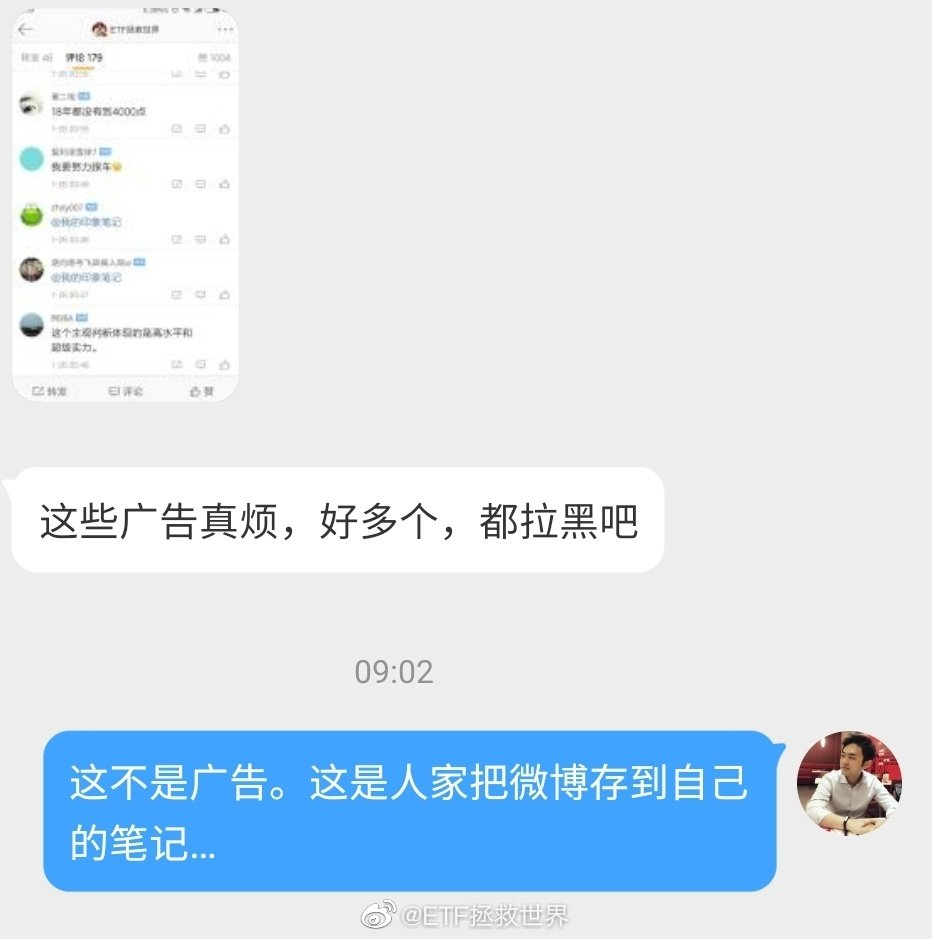 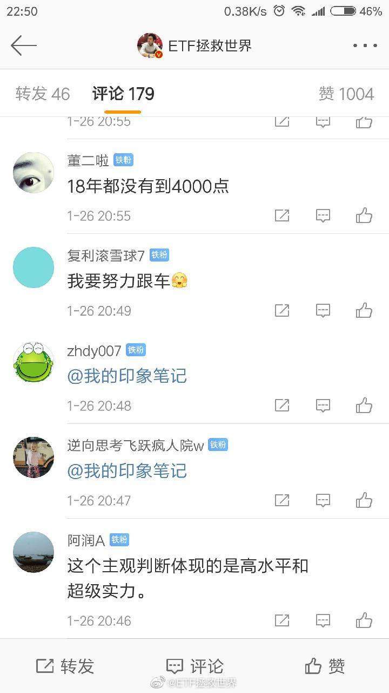

## 2022-01-27 09:19

各位时尚先锋们，有没有推荐的男士手链款式。

要求精致、时尚、金属材质或者大部分金属材质。

各类宝石珍珠木头的就算了，不是一个世界的。

不限品牌。 ​​​

## 2022-01-27 09:30

好家伙，十几天一个来回，筹码不变，一份成本减少8%？ ​​​

## 2022-01-27 09:46

再次提示，波段仓位如果未做好压力测试，导致资源不足以支撑策略持续进行，减少投入或暂停都毫无问题。这个说过好几次了。

只是会减少下面几次的收益。 ​​​

## 2022-01-27 10:02

由于日元大幅贬值，投资日经225的波段逻辑已经完全改变，所以暂停日经波段。

我会删除自己的日经条件单。 ​​​

## 2022-01-27 10:26

正式进入9500-12000之间的建仓区域。接下来是考验各位建仓水平，以及持仓心态的时候了。今年太有意思了。

## 2022-01-27 10:55

整个2021年全年，150在A股方面，一共买入了一份金融、一份信息、两份传媒、一份消费，一共5份。（信息与消费买在全年低点，目前依然盈利）

同期，A股高位卖出了利润非常高的50、300、环保、500一共11份。

也就是说，在a股，我们的计划一直是高位减仓，未在高位加仓。目前的下跌，只是会减少过去的利润，没有高位接盘。

我说了一年多不欢迎新朋友，是因为一年多前我已经预见到现在的结果。老朋友只是利润回撤，新朋友则会发生亏损。你亏损了会骂人，我不想被骂，就酱。

## 2022-01-27 11:05

一些利好ZC不会太远了。

当然，有没有用另说。 ​​​

## 2022-01-27 12:41

说句实话，我不太相信2018之后在2022会再次进入钻石坑。

如果真的会，不计利润波动，全市场估值下降20%左右即可。 ​​​

## 2022-01-27 15:20

今晚看日本VS中国。

足球&amp;股市，两个添堵王炸居然凑到一天了。

值得纪念的日子。

（等待数据传输中，准备开始计算今日数据。） ​​​

## 2022-01-27 16:15

目前长期仓位配置中，最讨厌的是以食品饮料为代表的消费仓位。

团报得太紧，总是调整不下来，始终无法建立起基本仓位。

非常讨厌。 ​​​

## 2022-01-27 16:29

真的，服了。

为什么我总在微博问一些事情，因为从几年前我就发现，我问的事情，总是能从评论或者私信中得到特别完美的答案！

什么知乎百度值得买小红书，全都是CD，还是这里的兄弟姐妹真的给力。

各位推荐的手链有几款很喜欢，抽空就去买！ ​​​

## 2022-01-28 09:57

新股大面积上市首日破发，是进入底部区域的标志之一。 ​​​

## 2022-01-28 10:08

在高位吸引不成熟的、幻想赚快钱的、对投资一窍不通的人申购自己的产品，然后抱团贵到匪夷所思的品种，其最大的危害并不是申购者的资产损失，价值毁灭，

而是在下跌过程中，这些申购者会不会惊慌失措赎回产品，导致被抱团的，极度高估的品种更加快速的崩塌。

羊群也好，旅鼠也好，当它们数量足够大，杀伤力也是很大的。

你以为规模大了是好事，其实福祸相依，没那么简单。

## 2022-01-28 10:16

还有，不要忘了这个数据。

1.8万亿两融资金，在快速下跌中安全性是否能得到保证，会不会因很多账户强制平仓导致新的问题？

大，一定是好吗？ ​​​
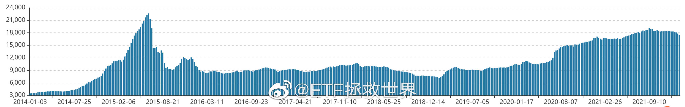

## 2022-01-28 10:42

今天跌了2%，看起来有一点点不那么讨厌了。。

## 2022-01-28 10:45

内地+海外的医药&amp;消费，加起来买到20%-25%的低成本持仓，想想都很开心。 ​​​

## 2022-01-28 14:21

我相信时势造英雄，英雄是造不了时势的。

庞大、复杂的系统，在趋势运行的过程中，很难通过人为手段改变。比如股市、比如足球。

但是，在趋势运行末期——也就是所谓“不能穿鲁缟”的时候，人为手段是可以一两拨千金发挥作用的，就是所谓压倒骆驼的最后一根稻草。

我不知道这话是不是该说，说的合适不合适。不合适我可以删。

## 2022-01-28 14:47

下跌3%，功力不减当年。被监控的微博？

## 2022-01-28 14:50

提前说个消费的建仓区域吧。

开始建仓点位大致在17000左右，最终支撑位在11500左右。两者之间的区域是极佳的建仓区域。 ​​​

## 2022-01-28 15:01

收盘了。下次开盘就是虎年了。

可能有朋友觉得这个月跌得很难受。但我要说一句，这样的下跌预示着未来，甚至有可能就在今年的某个时期，就会出现非常棒的收益。

所以大家开开心心过年，现在你以为坏的事情，其实未必坏。现在你以为好的，反而有可能是刮骨钢刀。

开心起来！明天发一篇公众号。然后初一到初五，你懂的！

## 2022-01-28 23:27

爱情神话看到一半想打五分。 ​​​

## 2022-01-29 00:46

看完了，还是维持五分。5/5。我就喜欢这种带点幽默感的爱情轻喜剧。类似于真爱至上，诺丁山等等。上海话也不影响观感，比较新鲜。这种类型的片子国内很少见。

## 2022-01-29 10:12

真是奇怪，我自己个人的微博，我愿意拉黑谁就拉黑谁，我不愿意让谁看就不让谁看，你管得着吗？

我欠你的？哪条法律规定我一定要写东西给你看了？

你也可以对等反制拉黑我啊。当然我是个有腔调的人，绝对不会用小号骂你，侬晓得哇。 ​​​
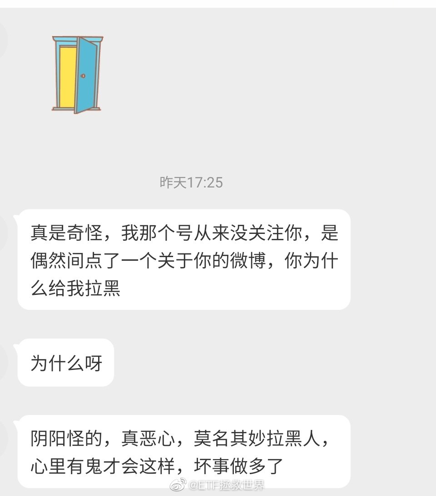

## 2022-01-29 13:35

为什么喜欢爱情神话这种电影呢。

我想了又想，应该是它会让我在一种轻松和舒适中感受到爱的乐趣。

没有狗血，没有恶人，没有尔虞我诈。每个人都轻松，都幽默，都让人感到舒服。

画面、调色、运镜、角度、音乐（整个观影过程中我三次打开听歌识曲收藏好听的歌曲）无一不让人舒服。

更让人喜欢的是人与人之前的感情。没有轰轰烈烈，没有惊天动地，却能感受到空气中流动的，隐隐约约恰到好处的爱情、友情和亲情。

整个过程，让人非常享受。台词和表演会让你笑出来，但都不会用力过猛。就连老乌墓地的一幕，都会让人在难过中会心一笑。

真是很喜欢这样的调调。

爱情也许真的是神话，但它依然会是很多人的一生所求。

## 2022-01-29 13:56

回复@uncutjade_harmony_lin:正式通知一下，拖更了，要好好排版编辑一下，明天上午发……//@uncutjade_harmony_lin:等今天的文章等的望眼欲穿

## 2022-01-29 14:09

先预告一下，各位大爷先看看喜不喜欢。

具体情况等通知。

（非本帖抽奖，不用刻意评论） ​​​
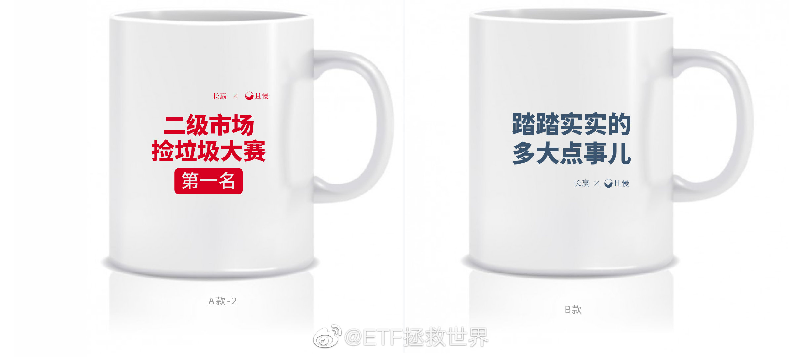

## 2022-01-29 17:30

健身房只有我一个人。 ​​​

## 2022-01-30 10:29

BGM想放一首“旧社会顶穷的人”，

想了半天大过年的意头实在不大灵光，下次吧…… ​​​

## 2022-01-30 13:04

请把拐卖妇女儿童的人贩子全部枪毙，没收全部家庭财产

——来自于一个普通人民群众的心声 ​​​

## 2022-01-30 13:26

世界上有两种人。

第一种人是把其他人分为两种：可以带给他利益的人，以及多余的人。

除了能带给他利益的，全是多余的，讨厌的，最好全部消失，其死活他也不会在意。

能带给他利益的，他会用尽各种办法在他们身上取得利益。

第二种人是把其他人当做人。会感恩对自己好的人，会力所能及的帮助素不相识的人。

真实的世界中，第二种人要比第一种少得多得多。两种人的本质区别，在于如何看待其他人。

当然，还有一些介于两者之间的人。

但无论如何，“第二种人”最多只占全部人类的5%-10%。所以，年轻的朋友们，千万不要对人类整体抱有什么太大的希望。人类就是自私残忍的，这就是客观事实。你的希望太高，最终就会失望，乃至绝望。

所以当你遇到了美好的人，就一定要珍惜。做朋友也好，做爱人也好，非常难得，珍惜。

## 2022-01-30 15:26

购物小贴士：

如果你有一样一直想买但总觉得有点贵舍不得买的东西，那你就应该去看跟它一个种类，但贵很多的东西。

然后你再回来看它，就会觉得它很值，就会马上入手。 ​​​

## 2022-01-30 16:14

今天练胸和背。

还是我一个人。 ​​​
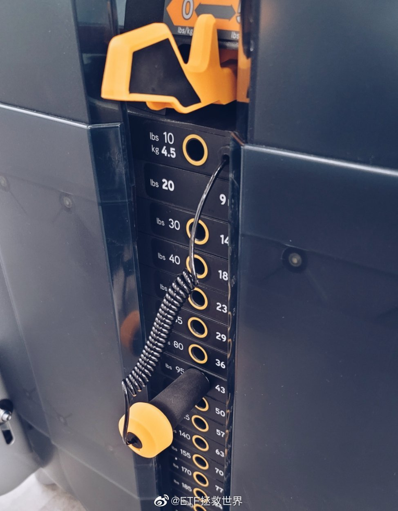

## 2022-01-31 23:59

祝各位虎年大吉！ ​ 抽奖详情 ​​​

