## 2022-02-01 10:45

如果你觉得一件事没意思，那就加点仪式感试试。 ​​​

## 2022-02-01 13:53

恭喜@知道自己不知道1984 等30名用户获得【200元京东购物卡】。微博官方唯一抽奖工具@微博抽奖平台 对本次抽奖进行监督，结果公正有效。公示链接：网页链接

## 2022-02-01 13:55

请三十位中奖的朋友私信联系我领取新年第一份奖。//@ETF拯救世界:恭喜@知道自己不知道1984 等30名用户获得【200元京东购物卡】。微博官方唯一抽奖工具@微博抽奖平台 对本次抽奖进行监督，结果公正有效。公示链接：网页链接

## 2022-02-02 09:40

【初二抽奖】香水

昨天抽了6000元购物卡，今天抽香水。本帖评论抽奖，抽2-3人，限铁粉。

注意事项：

第一，请真的喜欢，真的需要的朋友参与。别你不喜欢抽到了扔一边，喜欢的朋友抽不到，浪费。

第二，全部都是全新专柜正品，包装完好。大多数是出去旅游的时候购买于境外专柜或者机场。但都不是这一两年买的了，介意的勿抽。

第三，抽到的人可以从这里面任选一瓶。选择顺序以中奖后与我私信联系的先后顺序为准。

是家里的一些买了没有用的全新香水，本着断舍离以及物尽其用的宗旨，我翻出来几瓶送给有需要的朋友。都不是什么特别好的东西，您能开心的接受我不胜荣幸。 http://t.cn/A6iSW1MA
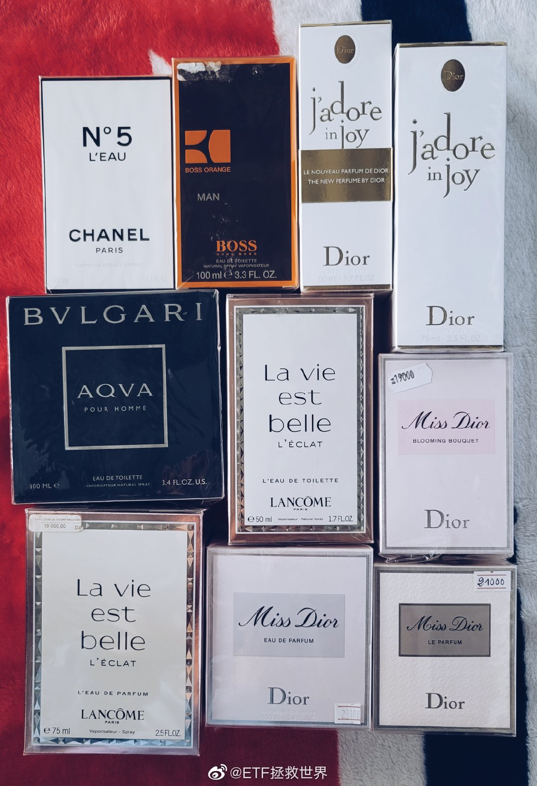

## 2022-02-02 12:08

恭喜@君时尘 等2名用户获得【全新正品香水一瓶】。微博官方唯一抽奖工具@微博抽奖平台 对本次抽奖进行监督，结果公正有效。公示链接：网页链接

## 2022-02-02 22:04

希望美股再扛三天不要回撤，我们一个交易日提款，欢度春节。 ​​​

## 2022-02-03 10:21

【初三抽杯子】  欢乐的抽奖在继续。今天是800个杯子。  请各位移步且慢微博抽奖，因为我没有精力发送这么多实物。  祝各位支持我的朋友好运。

## 2022-02-03 14:30

虎年第一练，腿 背和有氧 ​​​
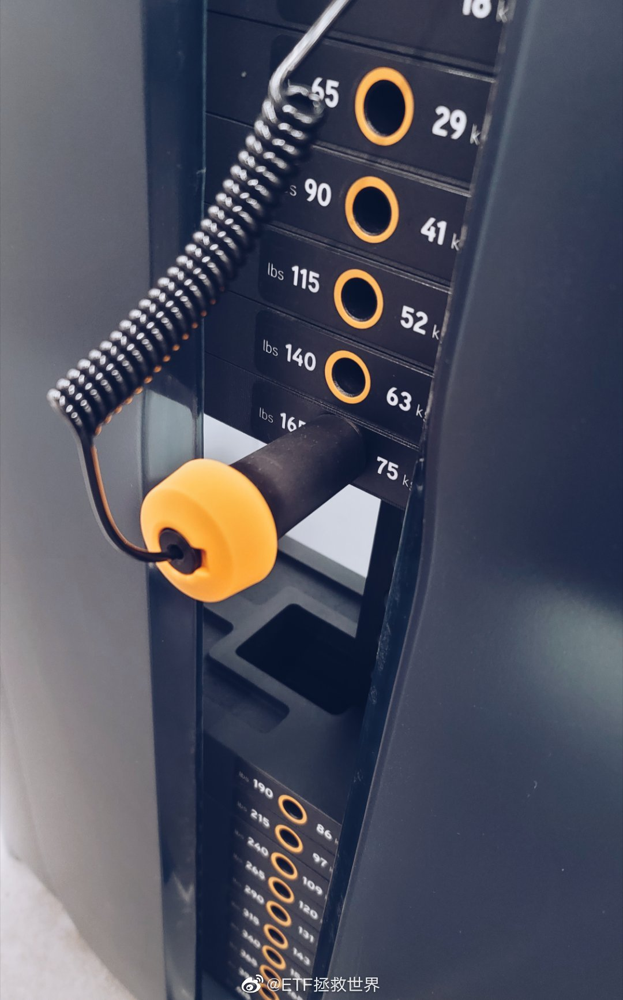

## 2022-02-03 16:56

在爷爷奶奶家过年的三年级大孩子 ​​​
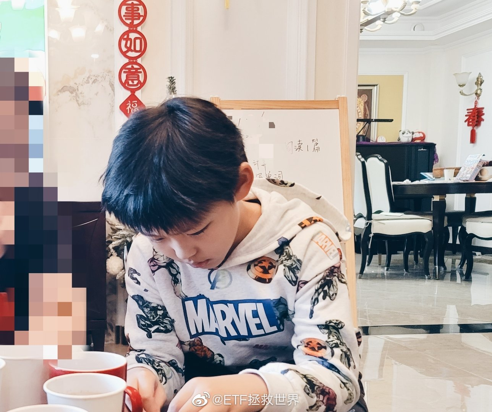

## 2022-02-04 14:04

【初四不抽只送，阳光普照】

今天不抽奖。年后直接为每位进行网格交易的朋友多增加五个条件单，祝大家虎年多提款，少操心！

感谢@华宝智投--上海浦电路营业部 对本次活动的大力支持。 ​​​

## 2022-02-05 10:46

准备开始发送第一波奖品。中奖的朋友尽快私信我，我把卡密发给你。

初五迎财神，也祝所有朋友虎年发大财！ ​​​
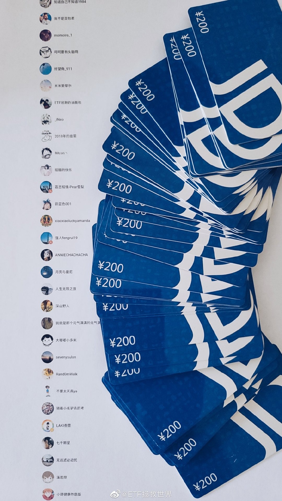

## 2022-02-05 12:11

很多人是初五才想起财神爷，不是说不好，稍微有那么一点点不真诚。

我是日常家里供奉财神像。

没办法，就是很庸俗的喜欢赚钱。 ​​​

## 2022-02-05 12:33

过年这几天有没有什么有意思的事情分享。

或者有没有比如相亲遇到有意思的人这种群众喜闻乐见的经历。

不妨评论里面说说让大家开心一下。 ​​​

## 2022-02-05 20:10

想写一篇关于“财务自由”的文章。

这个话题虽然非常老套，但我相信有些观点你应该没有看过。

不知道什么时候动笔，希望早日填坑。 ​​​

## 2022-02-05 21:19

一定要看咪咕的王濛解说哈哈。 ​​​

## 2022-02-06 10:02

初六送穷神。

要找几个坏人拉黑一下送他们走。 ​​​

## 2022-02-06 19:43

儿子经过几天的考虑，并与家庭投委会充分商议评估后，决定把压岁钱交给我管理。

约定年化收益率为8%。其中4%按月以现金形式分红，4%再投。

鉴于其为SVIP客户，免收申购赎回及管理费用。 ​​​

## 2022-02-06 20:36

女足NB!

万万没想到我能看到中国足球落后两球扳平。

中国的女性是最棒的！ ​​​

## 2022-02-06 20:54

！！！！！！！！！！！！！！！

## 2022-02-06 22:19

我只是帮儿子拿一下真的没有吃 ​​​
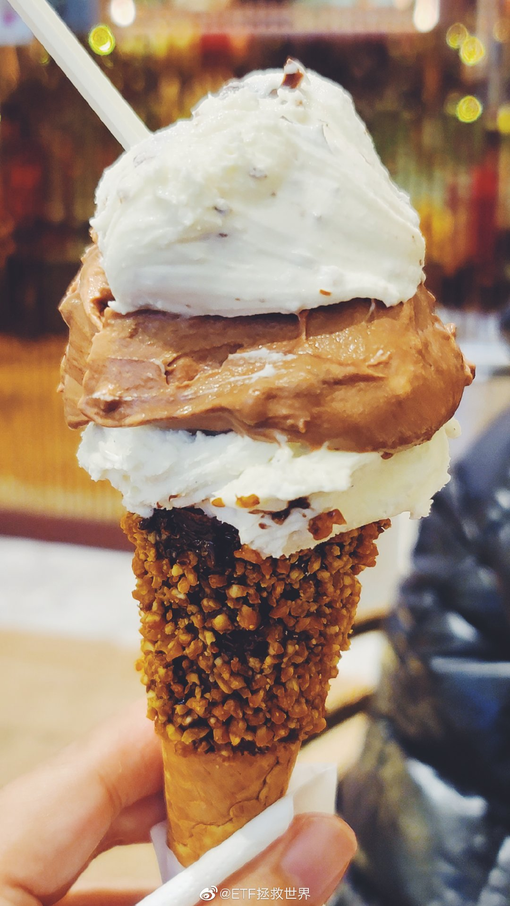

## 2022-02-07 12:22

刚才有机构的人发了这个页面给我看，问是不是我。

这位评论的朋友，你是不是有病。发这么low的评论，还要顶着我的ID？

我不是说“ETF拯救世界”这个名字只能我用，但我必须要澄清，这TMD不是我！这么low的话我说不出来！！！ ​​​
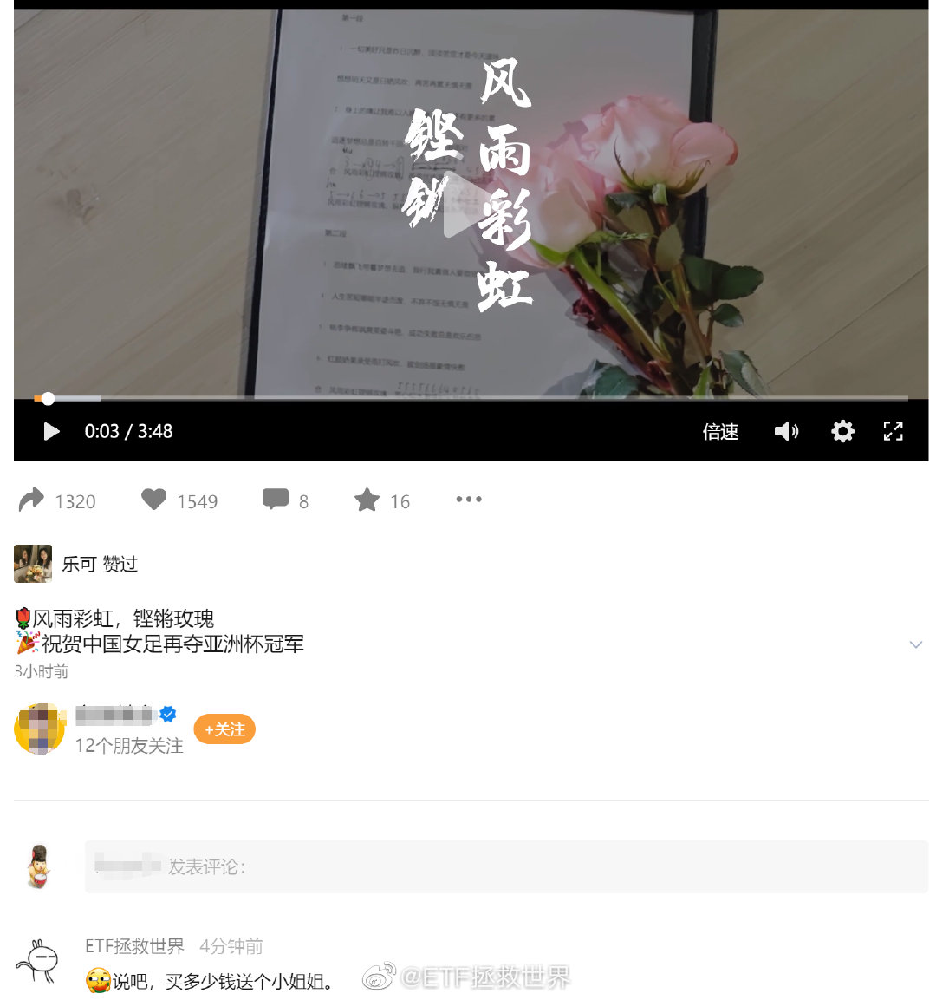

## 2022-02-07 15:46

市场真没什么好说的。有气无力，磨磨唧唧，装腔作势。

今年不亏当赢。 ​​​

## 2022-02-07 16:06

婚姻这个东西吧，我觉得吧，个人认为，几个点很重要。

两个人想要比较和谐，

第一个是三观大概一致。对各种事情的看法，比如说，举例，高速路口不小心错过了，有人觉得我倒车回去也没事，有人觉得你倒车回去你就是脑残。

这里面体现什么呢。第一个是对规则是否尊重，第二个是对于危险的认知，第三个是逻辑推理能力，第四个是对于生命的看法，第五个是对他人的态度。

如果两个人三观不一致，这一件生活中很琐碎的一件事就能吵翻天。但三观一致，无论是开回去还是不开回去，都会很和谐。

也就是说，三观不论好坏，只要一致，婚姻就会和谐。不一致就一定出问题。

第二个是钱。要有能保证基本生活的钱。否则会为了钱不停的吵。

第三个是会不会互相尊重。会不会关心爱护对方。

第四个是那什么是不是和谐。

至于说有没有共同语言啊，有没有共同的兴趣爱好啊，这些有当然更好，没有其实并不是什么致命缺陷，也不影响夫妻关系良好。你又不是找创业伙伴。

上面四个点，只要有一个不合适，就很容易出现看对方怎么都不顺眼的情况。对方说什么做什么都觉得很讨厌，出现在眼前就很烦，那基本就差不多快走到尽头了。

（都怪辣鸡市场，情感博主被迫上线营业）

## 2022-02-08 00:15

昨晚发的那条微博有后续了。

男主又私信说明了情况，他一直在外地。

这样的话真的很难说谁是谁非了，只能说理解万岁吧，都不容易。 ​​​
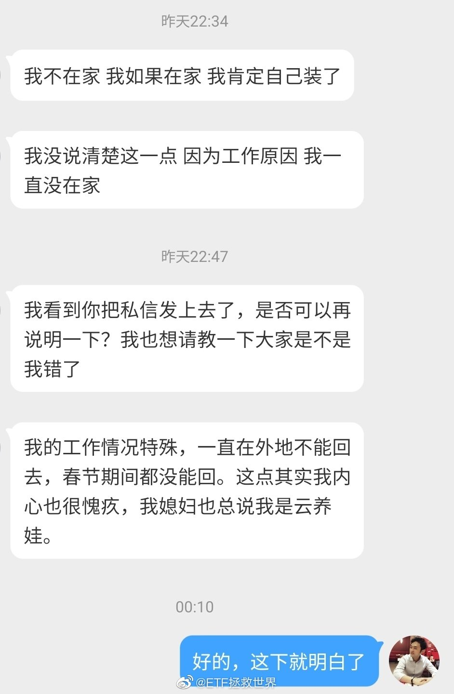

## 2022-02-08 09:55

## 2022-02-08 10:21

你猜白酒50多倍狂买，腰斩后30倍狂卖的是哪些人。 ​​​

## 2022-02-08 11:05

医药面临两个问题，跟中概差不多。

一个是内部的集采，一个是外部的打压。

没有利空好买点怎么出来？最后一根强力支撑依然看在9500，暴风雨来得再猛一点吧。 ​​​

## 2022-02-08 11:12

回复@杨柳听风:我有个数字，但是对一般人来说太恐怖，还是不说了。另外我说的这个点位不是“合适”点位，而是我认为的最后一根支撑线。//@杨柳听风:消费指数要到多少合适？

## 2022-02-08 11:18

消费其实是一个很好的行业，股价也是稳定上涨。

但2020年5月之后，成分股以及指数就走出了与以往完全不同的走势，猪突猛进。

一直到现在，它还没有回到“合理”区间，更不要说价值区域。

这一切，都要归功于…… ​​​

## 2022-02-08 11:23

医药则不同，其依然完美运行于我定义的正常区间。不信你去看看20年我对医药定义的外太空区域是哪里，再看看它最高点是哪里。已经不能用完美来形容。

医药现在已经身在价值区域，注意，我说的是医药，不是医疗。

9500-10000，是医药极佳的长线建仓点位。无论到时候它的利空有多么猛烈，有多少人又想救我一命。

## 2022-02-08 11:43

总而言之，就像年初预计的一样，今年会很困难。

但是，

请看我们的持仓。

占20%仓位的红利今年可是没跌。

还有不少现金。

还有一堆债券。

S存了好几年的应投未投。

150高位减持了不少获利丰厚的品种腾出仓位等待。

我们已经做好了准备，迎接今年也许会出现的，为将来3-5年建仓的一个好机会。

一切都在掌控之中，截止目前，没有任何意外。

做好准备，干就完事了。

## 2022-02-08 11:50

对很多人来说，今年的难是很意外的。但其实，今年的难是应该的，是大概率的，是合理的。如果照着这个剧本继续走，那么，未来的光明也是应该的大概率的合理的。就像到了下午你就应该知道夜晚即将来临，而不是夜晚来临后惊慌失措。在深夜你也应该知道黎明不远了，而不是认为将会万年长夜。

## 2022-02-08 11:52

回复@CJ01189:昨天那种虚假上涨被我一眼识破，将之定义为“有气无力，磨磨唧唧，装腔作势。”。今天回到了正常节奏，让人欣慰。//@CJ01189:E大兴奋了啊

## 2022-02-08 12:07

A股有其自己的特点。其中最大的特点就是波动极大。

而波动极大的背后，就是估值水平巨幅波动。

拿环保（新能源、碳中和）来说。

最高点的时候，其成分股前40位的股票，平均估值超过90倍。

你说宁德也好，隆基也好，都是高成长，享受百倍PE合理。但是40只股票都是高成长？做梦呢。

所以我们走了。

你说这样疯狂的估值背后，是谁买出来的？机构、散户，一个都不能少。

这就是A股的特点。集中资金办大事，几个月，一两年就把一个行业一个板块从东非大裂谷干到珠穆朗玛峰。

如果我们能够了解、掌握这样的A股特点，那么就可以尝试从中获利。

首先是不做接盘侠。你在珠穆朗玛峰接了盘，恐怕几年的时间会冻得够呛。

其次是去东非大裂谷等猎物。就在那趴着，一年两年都无所谓，就是等。等猎物从高峰掉到深谷。

再次是打到食物后不要急着走。继续利用A股特质，在估值不合理的时候卖一点，在上了珠穆朗玛峰的时候卖一点，在很明显踩踏即将发生的时候再卖一点。

这个市场上充满了疯子和傻子，也充满了饥渴的猛兽，待宰的羔羊。先想清楚自己是哪个阵营的，然后好好看清楚这是个什么样的世界，然后找到自己生存、壮大的方式。

有时候，有些人看起来是傻子，其实他们是狐狸。有些人看起来是猛兽，其实他们是纸老虎。

有些人看起来是疯子，他们真的是疯子。

## 2022-02-08 12:25

我从来不跟任何人宣传股市很好，“股票长期看是最佳投资品种”，我从来不说这种话。因为我知道这个地方没有成熟理性的思维，根本就是来送钱的。而成熟理性的思维，对大多数人来说根本不具备。

我也不会宣传指数投资好。虽然我自己相信这个，但我也知道它绝对不是适合每个人。我知道它适合大多数人，但不是每个人。所以我也不说这种话，我只是说，它适合我，我愿意把自己的投资过程和一些理念以及方法体系分享出来。

这样的分享有些朋友会受到一点启发，有些朋友并未因而受益。但我个人认为，只要能够帮助大多数人解决一些问题，这样的分享就有意义。

做点能帮助一部分朋友，一些有意义的事情，是我现在的人生阶段非常乐意为之的。

其实就这么简单。

能让别人因为自己的存在而变得更好一点，其实是很幸福的一件事。

## 2022-02-08 13:32

其实今天的上涨下跌家数对比是2900:1700

也就是说，大多数股票是上涨的。

大跌的是之前的大热门、大市值。

那么大热门是谁买出来的呢，这样的下跌是谁最受伤呢。 ​​​

## 2022-02-08 13:47

回复@yesterday多一次:很多新朋友不知道历史上有一些著名的“庄股”。主力控盘80、90的股票。最终，无一不崩盘。为什么绝对控盘还会崩呢。//@yesterday多一次:都说报团取暖，可是为什么买的人多了，反而还会跌下来呢？不懂求教。 这个和之前基金经理报团买股有啥区别呢

## 2022-02-08 14:02

#谷爱凌在海淀黄庄学奥数#  一言难尽。 ​​​

## 2022-02-08 14:40

现阶段唯一非卖品红利今年居然是涨的。

到哪儿说理去。 ​​​

## 2022-02-08 15:58

我有个想法，明年过年的时候送的东西。

可以有一个特别大的鼠标垫。巨大的，至少半米长那种。

上面印点东西。印什么呢。

先来一个A股历史估值图。（这一个就值了）

再来一些我很喜欢的指数历史走势对比图。

再来一些计划持仓的品种，包括代码和跟踪指数代码。

再来一些数学题和公式。比如下跌50%再跌多少到80%。比如复利计算公式等等。

还有一些数据，各大类品种相关系数之类的吧。

再来一些经典的语录。

总而言之就是交易的时候你想要什么好东西一低头就有了。

想法是不是很好，好得我现在就想要一个。

但这个工作量再加上善于挖坑不填的我，随缘吧。

## 2022-02-08 18:46

收工。看了几页书，现在去健身房。 ​​​

## 2022-02-09 10:40

刚才那两条转自己可见了。

我发现只要什么话不完全说明白，换一种说法说出来，大多数人就看不懂。

还是转为自己可见吧。话说了，大多数人又听不懂，还可能给自己惹麻烦，没必要。 ​​​

## 2022-02-09 14:41

无意义的反弹只会增加筑底时间，以及反弹之后下跌的强度。

当然，还是我说的，如果我看错了，不是反弹是反转，今年继续大涨，我也很高兴。咱们都能又赚一年钱。

怎么说呢，属于双赢，双面哪面出现都赢。 ​​​

## 2022-02-09 14:57

霉霉是真的奇葩。

就它这个波动性，不做波段真的是浪费了好基因。 ​​​

## 2022-02-09 19:04

我个人认为，不计房贷，没有重病支出，一个正常普通三口家庭，年支出的极限大致在50万左右。

除非你非常喜欢购买奢侈品之类的东西，或者经常去国外旅游，否则很难突破这个上限。

再说一次，我说的是正常、普通、不计房贷、没有重大疾病的年支出上限。 ​​​

## 2022-02-09 21:53

我怎么看重要吗。

一天天就被这些破事儿困扰，人生怎么才能快乐起来。 ​​​
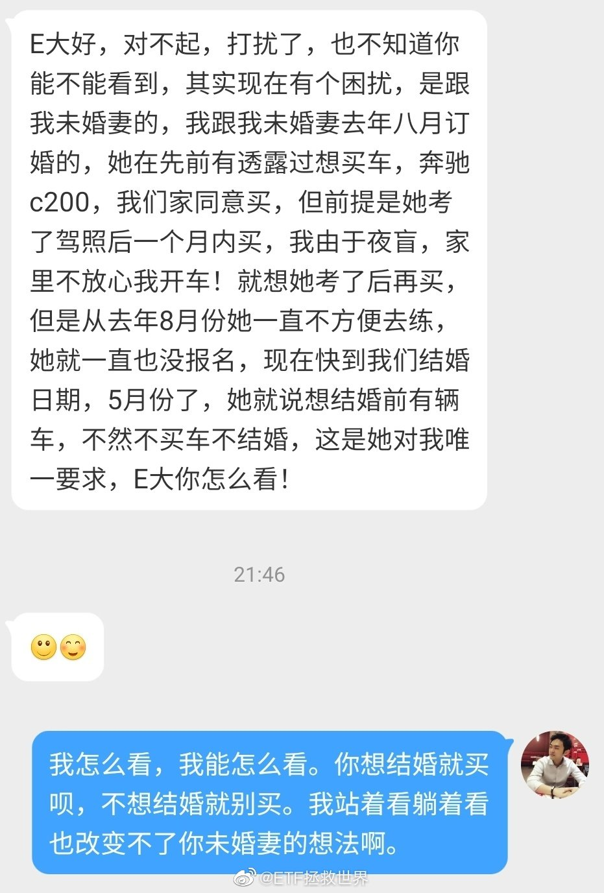

## 2022-02-10 09:12

5个交易日提款，

谁支持，谁反对？ ​​​

## 2022-02-10 09:23

儿子：我的蜂蜜蛋糕要烤一下

妈妈：微波炉转一下就行了

儿子：不要。我可是很讲究的人。

我：？？？ ​​​

## 2022-02-10 09:52

你会怎么选？

你的脚下是一座活火山，根据各种情报表明，它会喷发。但是在山上有很多钻石或者黄金，离火山口越近的地方越多。

这时候，你有两个选择：

第一个，保命要紧。在山腰捡到自认为足够的钻石就下山。

第二个，自认为能够在火山喷发之前及时离开，所以依然往上爬，去捡那些更加丰厚的钻石。

你选了哪个，就代表了也许你会在股市怎么做。

这就是为什么只要稍微理性一点的人，在2007、2015都知道泡沫已经比天大了，但依然投入最后的疯狂不肯走。

因为他们相信，自己能够在坍塌前及时跑路。

可惜的是，绝大多数人，跑不了。

我是非常典型的第一种人。最后最丰厚的利润也许我会放弃，但在接下来的坍塌中，我会拿回这部分利润。通过债券，通过分级A。

跟赚快钱比起来，我更喜欢不回撤，更喜欢保命。

这两种选择未必有对错，但适合的人不同。

有些人选了第一种，但看着身边的人在最后的疯狂中赚大钱，心痒难耐，最终在火山爆发前的一瞬间又冲了进去，反而更惨。

有些人选了第二种，但人家身手敏捷，手眼通天，喷发前就是能安全离开。

选择适合你的就好。

就怕什么，就怕涨的时候迷迷糊糊，跌的时候懵懵懂懂。不知道为什么涨，不知道为什么跌，不知道什么时候买，不知道什么时候卖。简单来说，就是靠运气吃饭。这种朋友，可能真的要把离开列入日程了。

## 2022-02-10 09:55

## 2022-02-10 10:06

今年红利跑赢沪深300 8%，跑赢中证500 9%，跑赢创业板16%。

今年它依然是上涨的。

在弱势平衡中，强势品种也许还能保持强势。但真的一旦情绪快速变差，或者整体开始大幅回撤，那么所谓的强势品种也不可能独善其身。

那么这个最大持仓的品种，为什么我连一份都不卖呢，做个再平衡也好啊。

因为我真的舍不得卖掉成本这么低，依然这么便宜的红利。如果未来要坐电梯就坐吧。

主观判断和客观体系之间，我还是选择相信体系。

## 2022-02-10 10:24

再说一次我的观点：

如果全年是V字型，上半年完成下跌主体，下半年有反弹，那么全年虽然收跌，但全年赚钱的机会非常大。这是最好最好的情况。

如果是L型就比较差。前面下跌，后面不断震荡，但是不会大幅反弹。那么，很难赚钱。

最差的是前面横盘甚至有反弹，后面大幅下跌。这种情况无法建立起低成本仓位，却在年末吃到全部跌幅。这种情况基本不会赚钱。

无论如何，我依然认为大多数指数今年收阴，但以上三种情况会发生哪种我不知道。

没什么说的，长线仓位等关键支撑买入，其他时间做波段吧。希望今年依然继续赚钱。

## 2022-02-10 14:00

你有没有想过一个问题。

环保这种品种，我们是根据价值左侧卖一部分，根据趋势右侧卖一部分。

那么高位不卖甚至继续买的人，是因为看不到估值很高，还是看不到趋势已经坏了呢。

也许是因为高成长，认为贵点没事。也许是以为只是回调，还会继续涨。

总之，投资确实很难吧。 ​​​

## 2022-02-10 14:38

从健身房回来，脱下181cm才能穿的帅气款羽绒服，晒着9摄氏度的冬季暖阳，喝着加冰块的零度可乐，看着想买的品种跌，

你能想象到吧这种舒服。 ​​​

## 2022-02-10 15:13

买了大概率跑赢碎纸机。

## 2022-02-10 15:26

今天有传闻有资金大规模赎回女神的基金，导致医疗继续新低。再回头看看半个月前的这条微博。很多事情都是意料之中的。

## 2022-02-10 15:48

今日数据，红利已经脱离非常便宜区域。未来是否会减持，要继续看数据。 ​​​

## 2022-02-11 09:42

我不懂，为什么只有食品饮料的走势，我的模型无法解释，不受模型规律约束。 ​​​

## 2022-02-11 10:09

全指医药历史上曾四次进入目前的区域。

这四次在刚进入时候买入，回本时间为1-1.5年之间。

回本后的走势自己去看。分别是：

06年3月，09年3月，13年1月，19年9月。 ​​​

## 2022-02-11 10:20

我还有个判断，

如果没有外力干扰，医药在2022年7月底前大概率会见到最低点。

最低点不是说一定会开始大涨，也许还会横盘，但最低点应该是在这半年内出现了。

再具体点，可能是3-7月之间。 ​​​

## 2022-02-11 10:53

周期、能源、金融、地产。

谁的热度红利都想蹭，没有节操，下流。 ​​​

## 2022-02-11 11:03

可能持仓的红利又要分红了，我估计每份1.5-2毛左右，当然还是选再投资。

有人说基金分红是左手倒右手。这种思维表明你大致处于第二阶段。

第一阶段是纯小白，认为基金分红是白给钱。第二阶段是认为左手倒右手。

还需要进阶。

这个事情没那么简单。 ​​​

## 2022-02-11 11:08

我想到一个判断股票型基金经理是否高水平和高节操的标准：

看他是否在高位能够大比例分红+管理的所有基金全部暂停申购。

这代表几个意思：

第一，他能判断哪里是高位，代表水平够了。

第二，将已经取得的收益分配给持有人，让持有人落袋为安，享受牛市收益。

第三，不接受新的资金，避免价值毁灭。但要管理的所有基金全部暂停，不然你暂停一个，别人去买你其它的，还是一样。

如果碰上这样的，爱了吧。值得信任。

## 2022-02-11 13:03

有些话我不知道怎么说。

这么说吧。

如果有那种让你特别痛苦、悲伤、愤怒……的新闻或者事件出现，是不是可以暂时不要受到铺天盖地众口一词声音的影响，如果你愿意，是不是可以试着认真追踪、收集资料、查询各方的证据，然后认真比对，分析，得出一个尽量接近真相的结果。

然后再做出选择。

大家认为的，未必真的是真相。

但是有一点很重要：如果你的判断与大家不同，你要想好是不是把自己的观点说出来。

不是每个人都会像国王的新装里那个孩子一样幸运。

反正从我来讲，我什么都不敢说了。也许这个世界并不需要独立思考又多嘴的人。

## 2022-02-11 13:22

2021年7月1日，中证医疗指数流通市值排名前30位的股票估值。

算术平均127倍。 ​​​
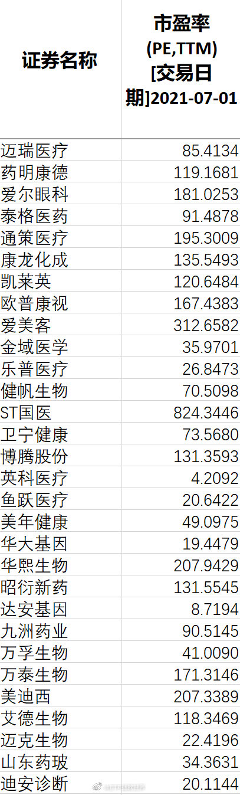

## 2022-02-11 13:54

回复@金融镭射眼:彼得林奇说过，如果你不知道买什么，记得不要买太贵的东西。（林奇：我说过吗）//@金融镭射眼:结论：贵了的不能买，

## 2022-02-11 14:05

这几年，我已经学会不再说什么贵了，什么便宜了。

因为我说贵了就会有人清仓。清仓了还涨，他就会回来骂我。然后呢，然后真的暴跌了，他也不会回来道歉。

贵还是便宜，我都用我的交易来说明。

别怪我不会再像2015年一样，在疯狂的时候提示什么了。人言可畏，除非精准的在最高点说，否则总是要挨骂的。

## 2022-02-11 14:06

【国债期货跌幅扩大，10年期主力合约跌0.52%，5年期主力合约跌0.39%，2年期主力合约跌0.13%。】 ​​​

## 2022-02-11 14:27

照这么跌，还有5天就能到了。

 ​​​

## 2022-02-11 16:53

今日数据

完全没有任何惊喜。中规中矩，包括医药医疗，无法让人产生任何继续加仓的欲望。 ​​​

## 2022-02-11 21:08

说明一下：

我认为市场是正常波动，A股依然是长牛过程中，现在是长牛中的回调。

我说的那些点位是提前设定的加仓点位，不是看空市场。

我是A股最寒冷时候最坚定的自干护盘人。 ​​​

## 2022-02-11 22:56

刚才看有人在评论里说今天跌得害怕了，信心全无。

我不懂。

150今年回撤3.15%，自历史最高点回撤6.4%。这样就害怕了，失去信心了？

真的别投资了，存银行吧。 ​​​

## 2022-02-12 10:07

有人问大摩过山车的问题。如果是善意提问，我可以大致说说。如果是来问责，我请你赶紧取关。因为有铁粉标志，我姑且认为是前者。那我就说几句。

大摩并非特例，你之所以关注它，是因为它上涨的时候表现的太好了。其实第三轮到目前为止，清仓的品种只有创业板、消费、波段的500C、石油南油、标普。

其它所有的，包括大盘的50 300，中小盘的500，行业的医药、环保、养老、传媒，全都是高位减持，都没有清仓，都坐了“过山车”。

在微博上，我表达了两次环保少减持了一份的反思。这是因为这一份卖出，我是应该能做到而未做到的。

为什么大摩，以及其他的高位减持却没有清仓，没有清仓的那部分都做了过山车我却并不遗憾？因为不清仓只减持符合我的体系，再来一次，大概率还是如此。

具体到大摩，为什么高位不减仓呢。其实很简单。

持仓大摩的S，在买入大摩后，医药的仓位只有3%。由于S有大量应投未投的资金，未来买入其它品种，会导致医药仓位更低。我不能接受自己的持仓中医药仓位这么低。

另外，由于是实验性的在组合中加入主动的行业基金，同时在研究了历史情况后，我希望主动行业基金能够在下跌中表现出一定的抗跌能力。当然这个目前看没有太大的效果。

总而言之，我是减持还是清仓，会看这个品种的疯狂状态，以及组合中的仓位状态。最好的情况当然是50或者环保，又或者150的医药这样，底部吃够了筹码，在高位既可以左侧，又可以右侧让我从容卖出。S的医药和150的区别就在于底部筹码不够。高位减持后配置过低，没有继续卖出的空间了。

说白了，就是买点过于精准，在绝对低点只买了一份，这个怎么卖？就像内地消费一样，绝对低点买入一份，买了就起飞。我卖了就是清仓了，该怎么做？太难了。

为了解决这个问题，如之前所说，我不会再过多的顾虑各位的情绪，S会在合适的时候多买。比如中概。我要买足，这样在未来高位才能游刃有余的减持，不至于因为仓位过低导致高位无法卖出，让你觉得“坐了过山车”。

## 2022-02-12 12:41

突然想起来，大摩这种问题我应该放到之前说的在且慢开的那个专栏上。

我抽空整理一下，弄得有条理一点，更加深入的说说，就作为专栏第一篇放上去吧。 ​​​

## 2022-02-12 13:03

回复@敬岳:周五应该已经全面升级了，下周一你试试。//@敬岳:【初四不抽只送，阳光普照】  今天不抽奖。年后直接为每位进行网格交易的朋友多增加五个条件单，祝大家虎年多提款，少操心！  感谢@华宝智投--上海浦电路营业部 对本次活动的大力支持。 ​​​  老大，这个坑几时填？

## 2022-02-12 13:15

喷了，抽中的两位选了最贵的香奈儿五号和Miss dior。你们是不是一件件查了价格选的。

## 2022-02-13 11:16

我真的难以理解公元2022年，那些人的思维。

一方面不喜欢女孩，千方百计生男孩。一方面又不能接受单身，从人贩子那买媳妇。

是不是精神分裂？全是你自己造成的，凭什么去把别人的人生和家庭毁掉？

我之前说贩卖妇女儿童死刑，很多人不同意。那我再加一条来自普通人民群众的朴素想法：买家判无期！ ​​​

## 2022-02-13 12:04

很多人觉得字好，内容不行。其实我想，是因为他们从没写过情书吧。情书的内容，就是表达自己的思念，自己的爱慕，自己乱七八糟的想法啊。话说回来，各位有多久没写过，或者从来没写过情书了？更别提手写了…

## 2022-02-14 10:33

我之前说过很多次，想要不被骗就是两点：

第一，不贪心。不相信好事会那么轻易的送上门来。

第二，不掏钱。

其实在股市也一样。

如果没有浮亏的痛苦，怎么会轻易让你买到钻石。你凭什么啊。

每天都有热点波动，骗你入场。没关系，只要你不掏钱，每日热点就不会骗到你。 ​​​
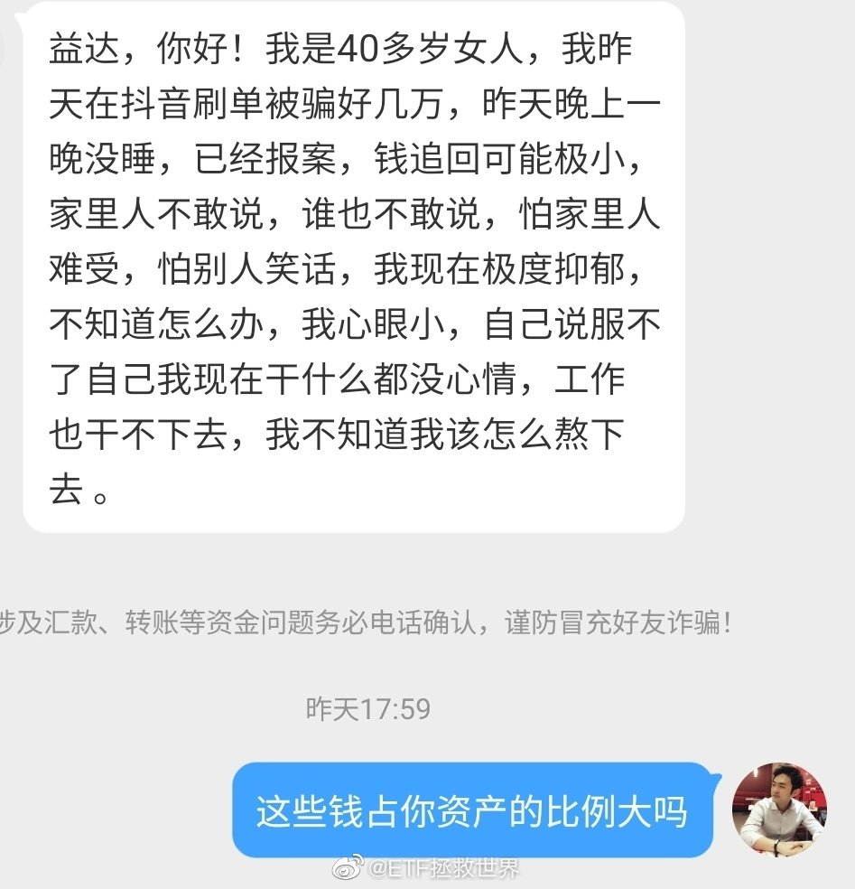

## 2022-02-14 14:41

不要反弹，反弹只会延长见底时间 ​​​

## 2022-02-14 15:41

今天一个人过节的出来抱团。 ​​​

## 2022-02-14 16:34

今日数据：

科创50今日创出上市以来估值最低，终于快跌破60倍了……

创业板也终于有可能元神归位了。 ​​​
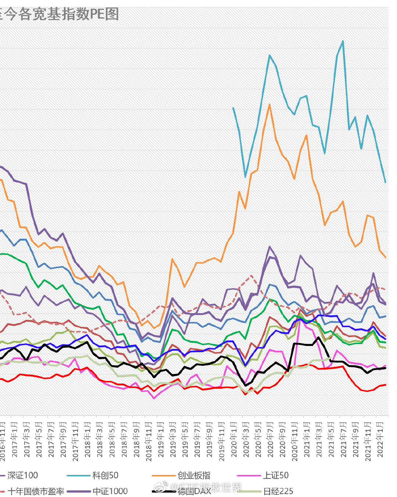

## 2022-02-14 17:10

欧洲今天跌了3%，我最近正在处心积虑布局一个新的国际品种。

如果能再来一次2020.3，那么就是最好的机会。 ​​​

## 2022-02-15 14:47

能突破11900再嘚瑟吧。

辣鸡医药，一点都不想买。有什么了不起，呵呵。

（刚删的那条看错图了……） ​​​

## 2022-02-15 21:33

下跌的日子，我的发博量比上涨的日子多20倍。

我是有多爱下跌的辣鸡啊。 ​​​

## 2022-02-17 15:08

摸着良心讲，两天没见，有没有偶尔想起我。

想起我们开心的过往。 ​​​
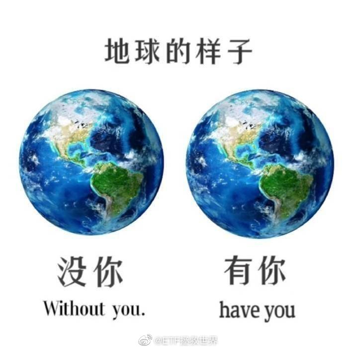

## 2022-02-18 15:47

健身房四个人，三个妹子。 ​​​

## 2022-02-18 16:44

每天开盘

在长长的买单里

挂上我的条件单

等着捡我的辣鸡

到收盘

才发现今天不卖辣鸡 ​​​

## 2022-02-18 17:15

有一个问题

我们的年度富豪榜前几名，有没有下场还不错的 ​​​

## 2022-02-18 20:56

再说一次我的想法

很多事情不能浮于表面去看，而是要从最本质上出发去考虑。

什么是最本质呢。还是第一卷第一篇文章。

真正深刻理解了本质，很多现象就会理解，未来会发生什么，自己如何应对也会有答案。 ​​​

## 2022-02-19 20:02

有目标很重要，为了实现目标努力也很重要。

但是，享受生活每一刻更重要。不要为了早点到达山顶，放弃了沿途的风景。

人生只有一次。享受生活每一刻。观察，感受，创造生活，而不仅仅是活着。

目标达到了，你大概率会发现不过如此。没有达到，如果连过程都没享受，不是更亏。

一花一世界，一叶一菩提。自己的世界怎么样，很多时候是自己决定的。

如果有些事必须要做，不如换个心态去好好做。如果一条路走得太辛苦毫无乐趣，不如换一条路。

## 2022-02-20 12:35

目前A股的状态：

中庸。

中小股票经过一年多的上涨，已经不便宜，回到中枢位置。大股票指数却因为连续将抱团大涨的牛股纳入，将不涨的品种剔除，也并未因为下跌变得便宜些。

行业板块方面也是乏善可陈。环保消费虽然真的跌了很多，但依然让人没有买入或者买回的欲望。医药也只是回到了中枢附近。红利已经脱离最便宜区域，科技也跌回中枢。

总而言之，几乎所有品种都是在中枢。这里的意思就是说涨跌都很正常。当然，我依然认为今年全年看下跌的可能性大于上涨。

总而言之我本人不会有太大期望，如果不大跌，就拉开时间买想买的东西。如果大跌，时间方面就不会这么严格。

然后就是做波段，再平庸的市场，总会有波动的。

美股方面，指数跌得不多，实际上很多股票也调整非常深了。希望今年会有一些买入机会。我这两年越来越明白为什么美股总是长牛——因为在美股，是所有参与方都希望市场上涨。想想太正常，毕竟是万恶的资本主义社会。资本是真正的立国之本。

150和S还有一份黄金。再买基本上可能性不大了。看看这一份什么时候出。

还有一些债券，前几天已经出了一份，剩下的再看看，不是大问题。

中概和恒生都已经配了一部分，但可加仓空间依然非常大。如果大跌，会继续买。如果不大跌，那么两个月加一次，拉开时间。

今年很难做，不亏就可以，年初以来一直这么说。保住利润，为未来的胜利做准备。

## 2022-02-21 13:15

它涨得并不快。

但它一直在努力。

听懂掌声。 ​​​
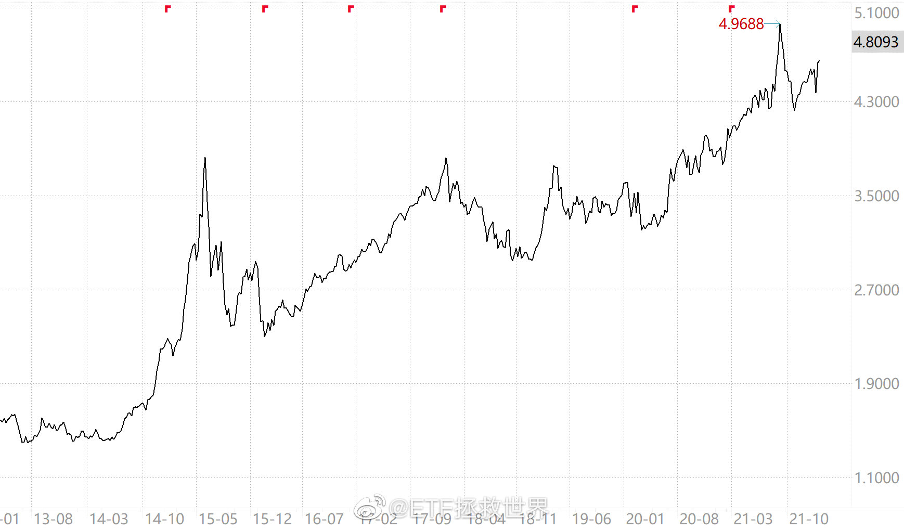

## 2022-02-21 14:02

今天看了一个数据，说根据人口普查，有些县市的0-4岁男孩女孩的比例是1.8:1.

也就是男孩比女孩多80%。

除了有一些瞒报的，生育前B超或者验孕发现是女孩就打掉的应该是占了主要原因。

我真的无言以对。所以你说人类整体是不是非常愚昧。对，他们做出这样的选择，一定有自己这样那样的原因。但他们就是愚昧。

最终，这样的愚昧造成的结果一定会反噬这个群体，甚至整个群体。

人类整体值得爱吗？根本不值得。

值得爱的，是一小部分人。很小一部分。

从我来讲，希望自己能做一些力所能及的事情。把那些值得帮助的人识别出来，用自己的方式帮助他们。

## 2022-02-21 20:08

不知道为什么，心情突然就很不好。

想来想去不知道为什么，也有可能是饿的。

你有没有突然之间心情毫无缘由变差的经历。 ​​​

## 2022-02-21 21:22

今天Dax再跌两个多点，创近一年新低。

走得早不如走得巧。 ​​​
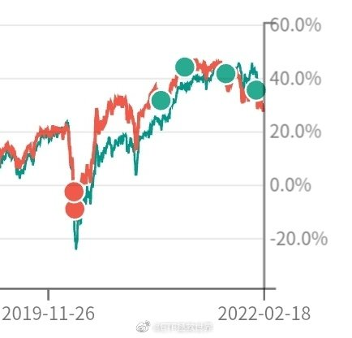

## 2022-02-21 22:04

什么意思，是不相信我吗。 ​​​
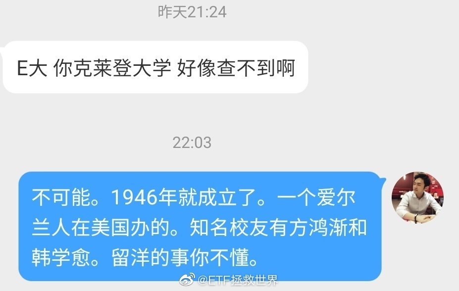

## 2022-02-22 11:38

天下大乱，不要乱买，执行策略，保命 ​​​

## 2022-02-22 13:19

## 2022-02-22 13:29

我心中的最大的怨念依然是消费。

2020年5月以来的疯癫状态，到底怎样才会结束。

即使跌到现在，它居然依然还没有进入我定义的可买入区间上限。

是我错了还是市场错了。

所有板块，只有它依然无法哪怕下手一点点。

这是道德的沦丧，还是人性的扭曲。 ​​​

## 2022-02-22 15:55

兄弟我做了一些关于战争与股市走势的研究，随便说两句，您随便看看。

第一，直接或间接参与的战争会影响股市走势。

第二，对于大国来说，局部战争不会影响很大。

第三，对于大规模的战争，还是要躲一躲。跌幅不会小。

第四，不能等战争结束再重新入场，那已经晚了。最佳入场时机是胜负天平开始倾斜的时候——当然，一般人也看不出来。
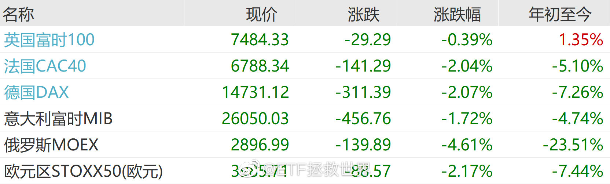

## 2022-02-22 17:12

记忆力好的朋友应该还记得我们之前开过一个DAX网格，但价格没到后来就撤了。

现在有机会重开了。

等着吧，合适了我会重新开。

多大点事儿，有钱还怕买不到东西吗。 ​​​
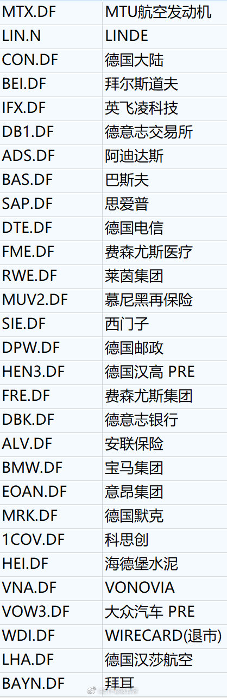

## 2022-02-22 18:10

回复@核心天天红:已拉黑。这一两年开始参考的吧，就差跪下求你别跟了。你不走，我送你走。//@核心天天红:150还亏钱没赚到

## 2022-02-22 18:32

在我看来，资产管理行业应该是双向选择。这件事我已经阐述过了。

可惜，99.99999%的资管都是张开双臂欢迎所有资金。因为资管行业追求的是规模。规模大了，对于管理人来说，才有更好的回报。

不好意思，我就是那0.00001%其中的一个。

我的钱不多，但踏踏实实过一辈子应该够了。我也不想再买什么豪宅，也不想买什么豪车。

吃喝嫖赌毒。一个正常人，敞开了吃，能吃多少？喝，不好意思，除了心情好的时候喝点自己调的鸡尾酒，或者极其偶尔与朋友小酌两杯，平常滴酒不沾。喜欢美女，但弱水三千只取一瓢饮足以，所以也没有更多的花销。赌的乐趣怎么比得上在股市搏杀？毒更不用说。

所以，还是那句话，我很喜欢钱，但目前阶段我的需求真的不大。多点更好，少了也没有大的所谓。

更何况，我的计划是完全公开。你到别的地方跟车，我也毫无收益。就凭这一点，你就应该知道做这件事，对我最重要的绝对不是钱。

从十几年前开始的第一轮，第二轮，全都是公开的，跟钱有关？

那么是什么？

我总说，做投资要不忘初心。我想，做每件事都应该不忘初心。

我做这件事的初心，就是想证明在A股这样的市场上，只要你理性，就一定能挣钱。然后对我最重要的事情，就是我不希望任何一个人因为我的分享而赔钱。

好了，第三轮至今，只要是前几年开始跟车的朋友，93%都是赚钱的。所有持仓品种，绝大多数也都是赚钱的，只有几个新建仓的品种是浮亏的。

93%的人赚钱，这在A股市场上难道不是一个奇迹吗。这样奇迹的背后，是严格控制成本的制度设计，也是各位即使在最黑暗的时候也不放弃，也坚信的结果。

这一两年，我为什么跪求新朋友不要跟？因为我知道你现在买很难马上赚钱。而新人的特点就是什么都不懂，他们根本就不知道我们的节奏是怎么控制的，根本就不懂买的那一点点仓位即使上涨也赚不到大钱。又因为没有以前低成本品种的对冲，导致整体浮亏。

这一切我早已预见到。所以我一直说新朋友不要跟。我不是ZK，也不是GL。我不需要规模，我只想要一件事：

那就是你赚钱！

这对我来说最重要。

有些人，根本就没有做好准备。说浮亏的那些，我问你，你这两年开始买，你的150份，买了有15份吗？买了有20份吗？你连10%仓位都没买好，你着什么急赚钱？

我告诉你，你这样的，就是我选择让你出去的那种。你选择了我，我很感激你的信任。但我不选择你。

对我来说，规模也好，跟车的人也好有多少，不能说一点不重要，但绝对不是最重要的。

最重要的，是我希望与理性的人们一起，一起赚到钱。

没有比这个更重要的！

## 2022-02-22 18:45

回复@Felicia_沉迷吸宇:150或者S如果要调高每份金额，我的建议是新资金再开新计划。否则会遇到很多问题，比如应卖不卖的问题。

## 2022-02-22 18:52

有意思吗？？ 查看图片

## 2022-02-22 19:13

想换手机。

可是想买的其实与现在用的几乎一样，只是拍照好了点。

但是我出门经常带黑卡或者A7，所以拍照好点也没太大意义。

那你说我应该买吗。 ​​​

## 2022-02-23 11:25

在股市，永远不要劝别人“不要买什么”，即使这个东西非常贵。也永远不要劝别人“买什么”，即使这个东西很便宜。

我来讲讲为什么。

如果你喜欢做这些事，只能说明一个问题：你对人性没有真正的理解。你没有认识到，大多数，甚至绝大多数人，是不理智的。出了问题，他们永远不会想是自己哪里做得有问题，找出问题，想出解决办法，继而下次修正。不会，他们只会埋怨别人。因为这样做最轻松，自己会最开心。

好，具体讲讲。

一个东西，如果你判断的没错（更别提你有很大机会判断错），很贵了，你好心好意的告诉别人，别买了，可能随时崩盘。他听了你的，没买，然后，

暴涨50%。

即使到最后，这个品种跌了80%，远低于你劝他的点位，你觉得他会感激你吗？

如果你觉得会，那就好笑了——他只会觉得，他会赚到50%，然后暴跌前离场。你，成了他发财路上的绊脚石。

一个东西，如果你判断的没错（更别提你有很大机会判断错），很便宜了，你好心好意告诉别人，可以买点了，随时可能涨。他听了你的，买了，然后，

又跌了30%。

你觉得他能扛住吗？他扛不住。他不会埋怨自己，投资决定是自己做的，而只会埋怨你，听了你的，赔钱了。

这种情形绝大多数情况下，他会底部割肉，或者回本就跑。因为他没有信心了。然后这笔亏损，当然记到你的账上了。即使这个品种最后真的在你推荐的价位上涨了100%。

也就是说，除非你每次都在最顶部和最底部给建议，否则，你一定会被埋怨。我强烈建议明智的你，不要再给任何人投资建议。

那么该怎么表达自己的态度和判断呢：

把你的交易记录放出来。你的态度，就是你的交易。别人参考不参考，是他自己的事情。你没有建议。更好的地方在于，你让他知道了买多少合适，什么时候卖掉合适。等于一条龙服务了，这他就该没话说了吧？

如果他自己参考了你的交易还来骂你，那他就是脑残，赶紧离他远点。

## 2022-02-23 11:51

我选择相信。因为想不出省委乃至ZY隐瞒拐卖事实的理由。同时，我再次表达一个普通人的朴素看法：拐卖人口的人贩子以及买家，请修改法律，加到无期到死刑！那是一个人、一个家庭的全部人生，因为那些辣鸡的拐卖行为，全毁了！

## 2022-02-23 12:11

我一个朋友跟我说：

相信不相信一件事，不能凭感情和感觉，而是理性的分析。

谎言，一定有一些构成因素。比如：说谎的动机。

说谎嫌疑人自己也会有一个权衡，比如，说谎能得到的利益与后果的对比。

从理智上讲，大多数情况下，GF的TB会比传言靠谱一点。当然，有一些TB的可疑性就大一点，比如：

级别较低的。当你对这个世界越了解，你越会发现，越小的地方，不讲规矩的人越多。其中很多人就在写TB。相对来说，级别高的，可靠的概率就大。

当然，级别高的也不是全都可靠。如果牵扯到级别非常高的人或者事，同样也可能不可靠。

但是，级别非常高的，说一些级别很低的人和事的时候，其实可靠性基本还是有保障的。

我说，我看不懂，贴到微博让大家评判吧。

## 2022-02-23 12:32

其实我觉得能鲜明表达自己的看法特别好。即使我知道我说的很多人会不同意，甚至因此变得讨厌我。

我说一些大家都爱听的，或者不说，不是挺好吗。也没人因此讨厌我，其乐融融。

但那还是我吗。还是说，那只是一个虚假的，经过刻意隐藏的形象而已？

没有任何两个人对任何事情的看法都一样。如果只是因为别人跟你对一件事看法不同，你就从喜欢变得讨厌他，那么你们之间的感情和连接是什么样的？

当然是非常脆弱的。

你想找一个事事与你看法相同的人，那么只有两个可能：

第一个，那个人是你自己。（而且只是现在的你。明年的你与现在的你对很多事情看法都会不同）

第二个，那个人想从你这里得到一些什么——你的金钱、你的权势、你的关注、你的身体等等。他只是在虚假的迎合你而已。

对我来说，没有关系，也感觉很好。我不希望我交往的人因为一句话，或者对一件事看法不同就与我不共戴天。这是什么样的关系？这样的关系没有，简直是天大的好事。

## 2022-02-23 13:31

昨天券商最低

1.032

为什么这个世界是这样的。 ​​​

## 2022-02-23 13:55

小猫后续：

很多朋友关心小猫的事。最新进展，有朋友送了一只，一会见到。我也不知道什么品种，到时候拍照上来让各位猫伯乐鉴定。 ​​​

## 2022-02-23 15:18

昨天买的手机送一个buds pro耳机。这耳机我自己现在在用，非常不错。

不出意外的话，我会把这个送的新耳机抽奖送掉。

如果你最近想买蓝牙耳机，可以等等，万一中了呢是不是。

祝您中奖。 ​​​

## 2022-02-23 18:23

虽然我与部分博友对于最终结论的看法不同，

但这不能改变我对他们以及更多人的敬意。

如果没有大家的关注以及声音，就没有最终的，更加接近真相的结果（即使很多人认为结论与真相相去甚远）。

无论如何，希望由此事件，对于女性权益的保障，对于被拐卖人员的救助，对于参与拐卖犯罪行为人员的更大力度打击，对于相关法律的完善，能够有一个新的局面。

我跟你的观点不同，但我知道，你和我一样，都希望这片土地更加美丽；都希望这片土地上生活的人更加文明，远离愚昧；都希望坏人受到应有的惩罚；都希望每个人都把别人当成“人”，而非工具与商品。

虽然大多数人类根本不值得爱，但那些善良与无辜的人不应该也不能够受欺负。虽然这个世界非常辣鸡，但依然希望它越来越好。

## 2022-02-23 20:45

每个人都有自己的爱好，只要不犯法，别人不要瞎操心。 ​​​
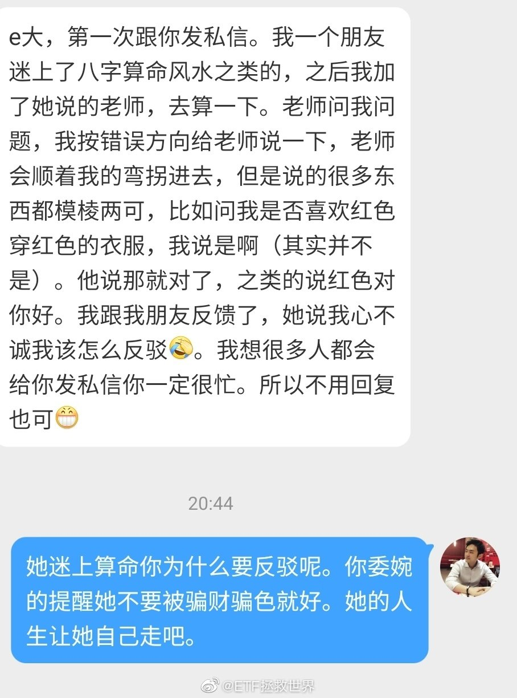

## 2022-02-24 10:22

相信价值。坚持信念

## 2022-02-24 10:33

这一轮卖掉内地消费后，不是没买过。这个买了一份。

买点当然照例是蒙的。但也能看出，我的价值观是有点用的 ​​​
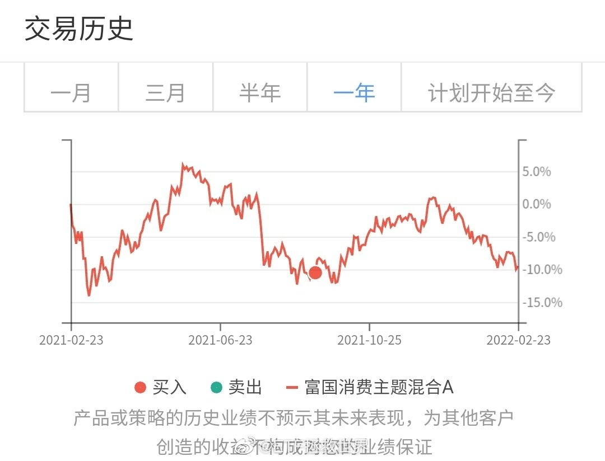

## 2022-02-24 11:19

恒生18500-22000之间会买5-6份以上。别忘了攒钱。 ​​​

## 2022-02-24 12:51

我直接好家伙！ ​​​

## 2022-02-24 13:02

A股真的是被一帮神经病把持的地方。 ​​​

## 2022-02-24 13:38

一个小时，我感觉被干掉的不是乌克兰的海军和空军，而是我的账户。 ​​​

## 2022-02-24 13:43

乌克兰也许会投降，我的账户不会！

## 2022-02-24 13:47

今天我对东欧的地理知识上升了一个lv. ​​​
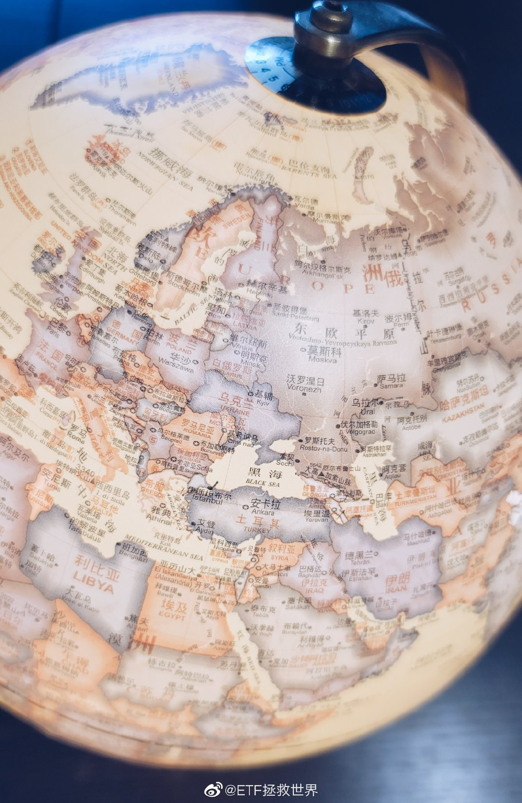

## 2022-02-24 13:57

战争对人民都是坏事。希望世界早日和平，东欧人民尽快安居乐业。

但是我想说未来也许我们会买到便宜货，这不是不道德的，也不是什么带血的筹码，因为，

往小了说，这会让我们的家庭资产增加，增加家庭财务稳定度，保持家庭和谐，

往大了说，这是践行ZY共同富裕的理念，也是为祖国的金融市场稳定贡献自己的力量。

于公于私，我们做的都是造福人类的大事，所以不要有心理负担，各位善长仁翁！

## 2022-02-24 14:08

按摩一下，脆弱的朋友往前面排：

第一，你买的是指数。股票和公司会死，指数不会。除非出天大的事。

第二，你的成本不高。如果你这一两年开始，你的成本比以前的朋友高，但你买的少。仓位非常低。

第三，你还有准备了很久的现金。

第四，你不持有东欧的基金。但你有黄金和油的。

第五，战场离中国很远。未来中国受到什么影响，正向的还是负面的，你现在猜不出来。

第六，没有人平白无故会把特别便宜的筹码交给你。如果你能买到便宜筹码，说明有大事发生，很多人已经吓尿了。你不要尿，你就赢了。

第七，今天天气很好，喝点下午茶，关注一下战事进展。交易的事，交给策略。

## 2022-02-24 14:15

世界这么乱，真的先不要再打孩子了。

等天下太平了再打吧。 ​​​

## 2022-02-24 14:38

恒科中网到手。卖出价格我需要较长时间计算，更新会延后。 ​​​

## 2022-02-24 15:04

各位，2020，俄乌这场战争，是跟各位一起见证的，也算是一种缘分。

苟富贵勿相忘。 ​​​

## 2022-02-24 15:18

8年前，油价100。

2年前，油价是负的。

现在，100。

这就是金融的世界。 ​​​

## 2022-02-24 15:34

有大规模战争风险的市场，一定要先跑掉规避风险。 ​​​
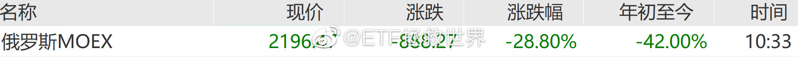

## 2022-02-24 15:50

小猫躲在床下已经24小时了。

我知道不应该管它，让它慢慢适应。

但是，它如果拉尿在床下面怎么办。。。 ​​​

## 2022-02-24 16:10

很多事情你慌，其实是因为你没有“有效经历”过。

什么是有效经历。

就是你有过经验。经历过类似的事情，从头到尾。

但这并不够。80%来资本市场玩的人，多的只是经历，而不是有效经历。简单的经历什么也记不住，因为他根本就没弄懂，能记住什么？所以一次次重复失败。

有效经历最重要的是“有效”。

就是从一开始，到过程，到最后，每一步你都清清楚楚明明白白。因为第一次有效经历，所以可能没那么淡定。没事。你知道为什么这样，也清晰的将为什么和现实一一对应，也明白了最终原来真的会这样。

好了，你有了有效经历，下一次再碰到，就淡定了，踏实了。你就不是小白，而是老炮儿了。

但有一点，我不得不提醒你。就是当你变成老炮儿，一定不要妄自尊大。觉得策略在手，天下我有。谁都看不起，最重要的是看不起市场。

那你就完了。市场可是最大的。敬畏，永远的敬畏。太阳下当然没有新鲜事，但每次都会略有不同。如果你只是以经验去对抗市场，妄图以上次的经验击败市场，那市场就会等着看你的笑话。

所以，积累有效经验——变成老炮儿——理性面对——客观观察这一次的不同——微调策略——再次获胜。

80%的人不会积累有效经验；

15%的人倒在了妄自尊大；

5%的人永怀谦卑，将知识和经验结合，在每一次投资上最终赚到钱，那才是长赢的人。

## 2022-02-24 16:26

一天40%。麻了。 ​​​
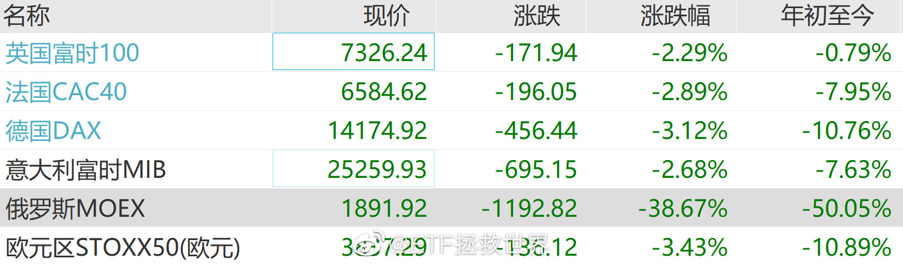

## 2022-02-24 16:36

关于DAX，我有第一个加仓目标点，把它买回来。但我现在暂时不说。

## 2022-02-24 18:57

内事不决问博友，诚不欺我！

把猫砂盆，食物和水全部送到床底下，然后用监控全程观看了小猫如厕的过程！

博友，伟大。 ​​​

## 2022-02-24 19:11

回复@Jjjun1900:我写的微博每一个字，公众号文章每一个字，都是我自己写的。公众号排版的小助理也不允许改任何字。这点，我用所有的资产和魅力保证。//@Jjjun1900:回复@withTink:他有秘书，有团队，你就是一个人

## 2022-02-24 19:15

我写的这些东西，如果有人可以帮我写，为什么他自己不去开个号写，甘当幕后英雄？

这是我不能理解的。 ​​​

## 2022-02-24 22:10

28小时成功解锁与小猫咪的亲密关系，撸猫成功。

过几天发照片。太奶了，猛男狂喜。 ​​​

## 2022-02-25 11:29

反弹骗不了，下跌吓不住。

没有主观判断，不会随波逐流，不会贪嗔痴慢疑。

一切交给已经制定好的作战计划。

就这么简单。 ​​​

## 2022-02-25 14:25

恒生第一个中网拿到。提款价格需要算一下，需要一个多小时 ​​​

## 2022-02-25 15:38

胸怀天下没错，但最重要的是过好每一天吧。

谁知道明天发生什么。您说呢。

三点多了，喝杯美味下午茶吧。 ​​​

## 2022-02-25 15:51

断更到会让人感觉要弃号的程度了吗 ​​​
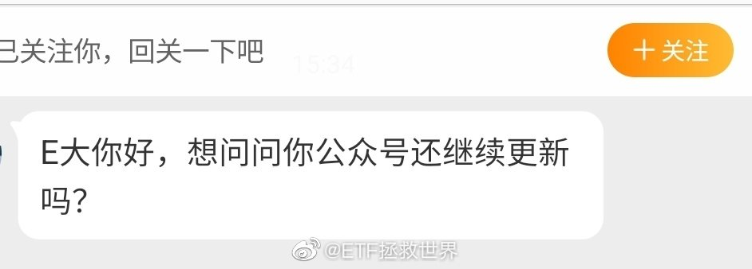

## 2022-02-25 17:43

已更新，目标30%。

可接受实现时间为3-4年。 ​​​

## 2022-02-25 17:53

我发现很多人的投资思维永远不能形成一个最关键的点：买入一个品种的时候，第一个考虑的事情应该是：最差会怎样？

## 2022-02-26 09:04

经历的越多越会明白，我们所接触到的信息，一部分，甚至有可能一大半是虚假的。

进一步，很多写在历史书上的东西也未必都是事实。

再进一步，每个当事人眼中的事实也未必完全一致。

作为一个追求独立思考的人，我想，最重要的应该是多听多看多想，综合各方面的信息，对于这个世界得出自己的结论。

独立思考真的非常困难，这是罕见的优秀品质。大多数人，甚至包括很多自认为能独立思考的人，也许只是人云亦云乌合之众的一份子罢了。

希望这里的朋友都能够独立思考，收集信息，处理信息，而非单纯的接受经过处理的信息结果。

## 2022-02-26 12:12

我发现微博现在会吞字，一句话会截取一部分显示。这是什么高科技。 ​​​

## 2022-02-26 15:33

原来战争的时候真的会给老百姓发枪。

算是解答了我从小就有的一个困惑。 ​​​

## 2022-02-27 08:17

俄部分银行被断开SWIFT。

可能有朋友不知道，前两年贸易战最猛烈的时候，把我们踢出SWIFT的方案也曾经被对方当做选项提出过。

我们什么都没做，因为一些编造的谎言就被制裁被威胁，那么未来我们做点对方不喜欢的事，会发生什么。

现在俄受到的一切压力，都可以被我们用来做压力测试。从上到下，早做准备吧。

## 2022-02-27 11:35

照片上挺大其实很小只。 ​​​
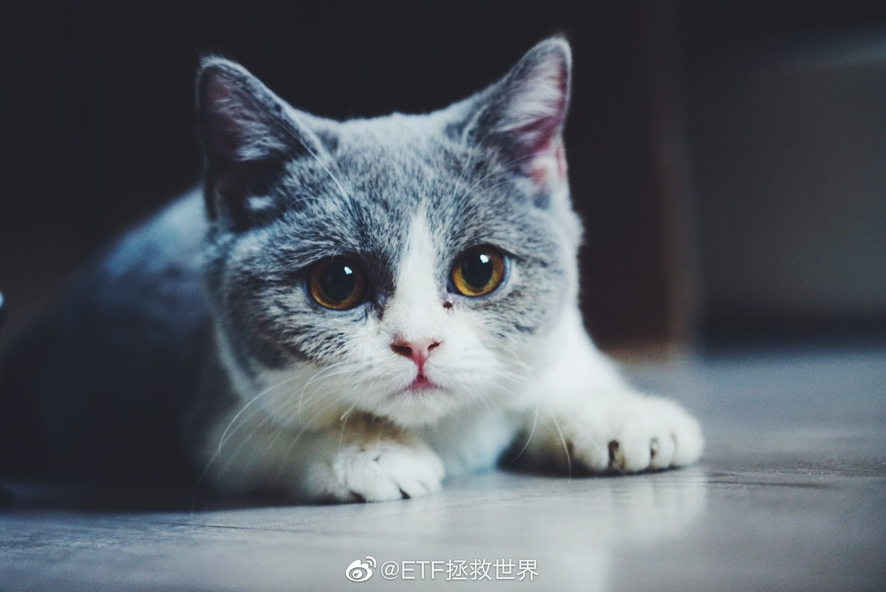 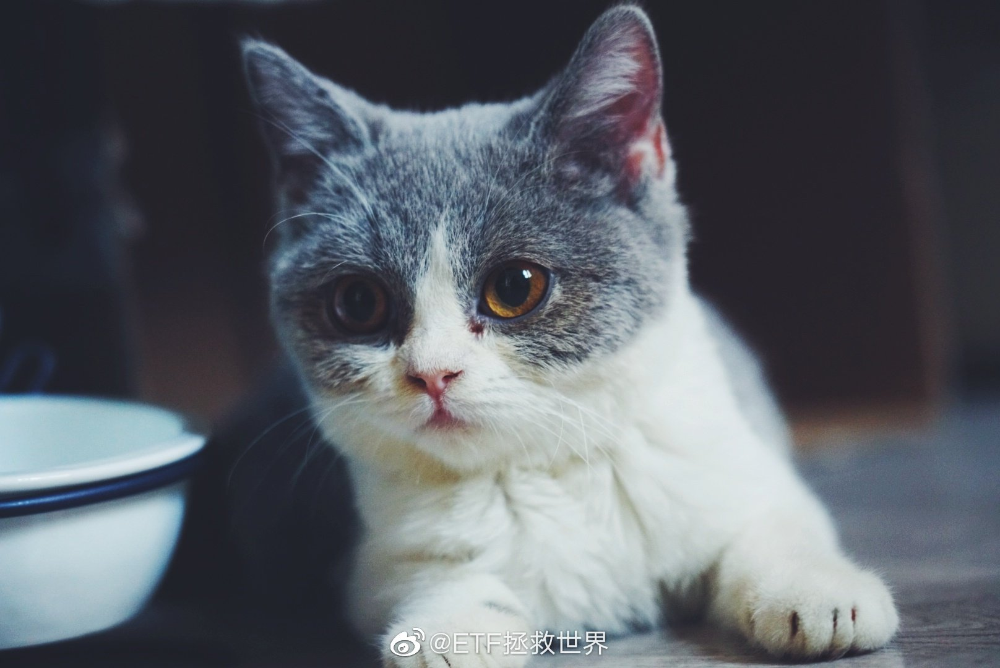 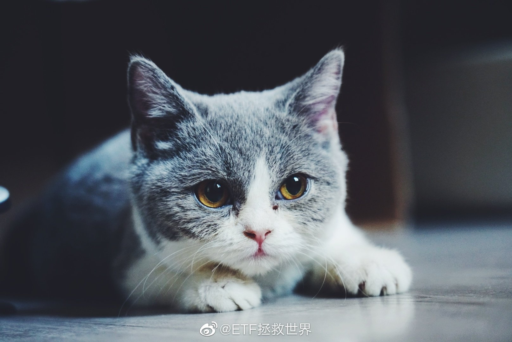 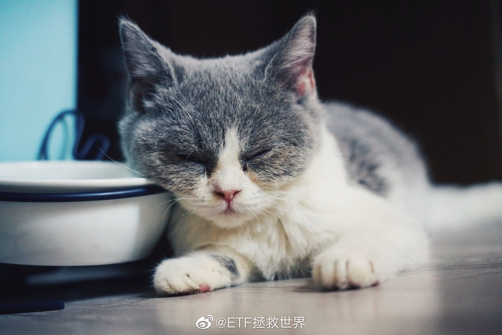 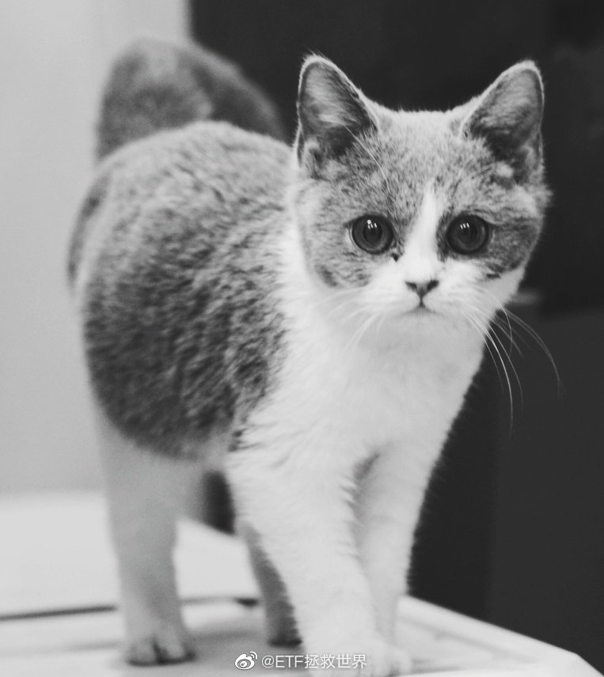

## 2022-02-27 11:53

我的选择 ​​​
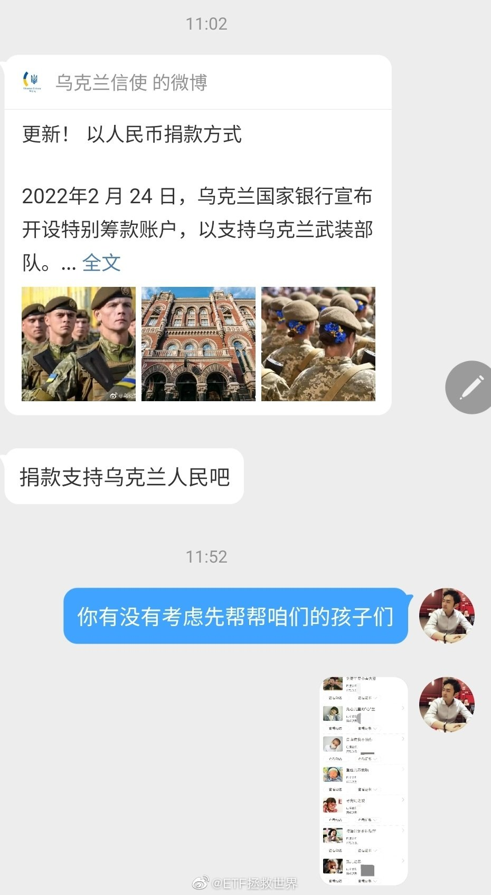 

## 2022-02-28 08:48

出现类似于战争这种危机，你首先需要决定的是：

走还是留。

相对来说，战争中的乡下要比城市靠谱。

其次，要保证有办法弄到生存下去的物资。

但比这个重要的，是能保护物资的能力。否则，你的物资越多越危险。 ​​​

## 2022-02-28 11:03

22000买了。接下来就是18500，也是历次危机的最终支撑。如果撑不住，那就是过去几十年没有发生过的了。接下来怎样我也不知道，反正到了我就买。//@ETF拯救世界:第一支撑调整到22000左右，第二依然是18500。在这两个支撑附近都会买。

## 2022-02-28 11:12

大家在最恐慌的时候，要想清楚一件事。

股票市场整体有没有可能崩，有。指数有没有可能消失，有。

你是不是很担心你的指数投资。没错，你担心的很正常。

但你想一下，如果连指数和股票市场都没了，你的债券、现金、理财……还会有什么用吗。

那一定是极端的情况发生了。

什么是极端。

极端就是不仅本币巨幅贬值（比如目前的卢布），甚至连美元欧元日元黄金你都用不上了。或者说，在你的生活中，以黄金计价的物资都会非常非常贵。比如，100克黄金一升水，或者一个罐头之类的。

所以如果股市不崩，指数还能活着，那你也能活着。最后还能缓过来。

如果股市指数崩了，那就是极端的事情发生了，你的钱也没什么用了。

这就是逻辑。

## 2022-02-28 17:25

现在发生在R身上的事，未来如果我们在东南动手，那么就有可能也发生在我们身上。

所以我们每个人都应该认真观察整个过程，并提前做好自己应该做的准备。让有可能发生的损失尽可能的变小。 ​​​

## 2022-02-28 19:42

有一说一，猫和猫真的天壤之别。

我之前收养的流浪小猫到现在十年了，跟新来的对比一下我才知道，真的怎么说呢，智商情商双堪忧。以前没对比，不知道。

猫抓板不会用，翻盖厕所出不来，玩具不会玩就算了，跟人也很不亲。跟我算是最亲了，偶尔来让我摸摸，动不动见了人扭头就跑，家里来了人也躲。

儿子就是因为它只让我摸，哭着要一只新小猫要从小培养感情。

新的这个您猜怎么着。服了！猫抓板扔地上马上就知道怎么用了！玩具每个玩得都很开心！也不怕生人！最重要，跟人特别好。你不理她她就扒着你的腿求摸摸，喵喵的，哪个猛男受得了！
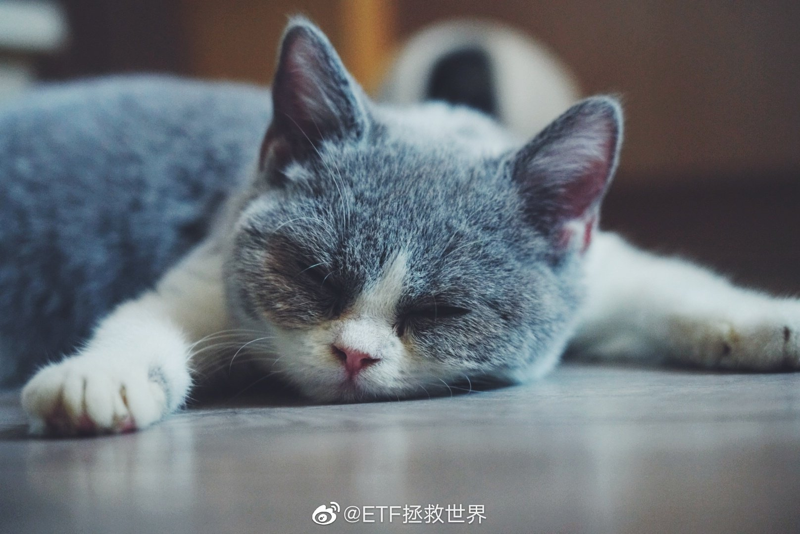 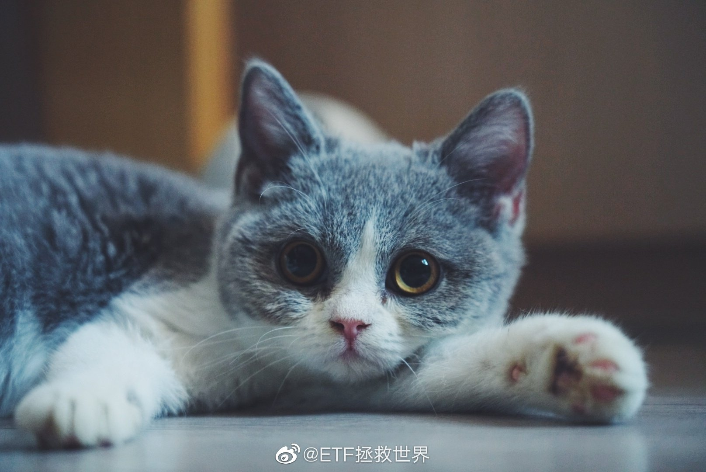

