## 2022-03-01 12:41

举报的人如果是弄错了那么情有可原。如果是因为发货慢了故意举报，我拉黑你一万年。就像上次一样，送东西你还举报，是不是人？

## 2022-03-01 15:14

有些人看到反弹了一点就慌了，其实根本不用慌。 ​​​

## 2022-03-01 18:27

不要让你爱的男人养猫。

否则你会失去男人，也会失去猫。 ​​​

## 2022-03-02 16:33

油价110美元了。

你还记得那些在油价低位的时候，论证原油将永远起不来了，因为新能源将主导世界的人吗。

资本市场是观察人性最好的地方。

在一个不死品种跌了70%以上，持续低迷的时候，引经据典论证它永远没戏的人，大概率是个非常水的水货。 ​​​

## 2022-03-02 17:23

最近在看荒野求生。

北京的驴友朋友，有没有入门级户外运动的好地方推荐。 ​​​

## 2022-03-02 17:34

回复@该用户已卸载微博APP:对，我看了一集就觉得只是节目，应该有不少摆拍。但我从里面确实学到了一些知识。这就是我对这世界的认知：即使我知道它是不完美的，有虚假成分的，甚至比较差的，能让我学到东西就行。

## 2022-03-03 10:48

执着于追求“低买高卖”其实是一把双刃剑。

这轮计划至今，其实有不少品种长期持有的前提下，做到了低买高卖。具体的我不用说，毕竟太多了。

但是很明显，当然也有没有在高位清仓甚至一份都没卖，结果又大幅下跌的。亏损可能不至于，但利润大幅回撤我估计很多新手朋友会感到郁闷。

呐，你记住我接下来的这段话，未来总有一天你会真的明白其中的意思。别忘了回来打卡。

绝大多数指数从整体上说，都会越来越高。所以如果你执着于阶段性的低买高卖，那么就一定要面临一个问题：能不能以低于卖出价的价格再买回来。

也许大摩这一轮三个月涨50%然后用几个月又跌了回来让你印象深刻，你想以后遇到这种情况我一定跑。

那你在什么价位跑呢。30%、40%、还是50%收益率？

2018年10月，钻石坑我们买了一份消费。2019年5月，时隔6个多月，我们拿着将近60%的收益率走了。然后，它又涨了100%多。

大摩和内地消费这一份，当然并不重要。因为数量太少，不会对账户有太大影响。

但真正的问题在于：

未来，会有一天你持仓几年的重仓品种开始涨。涨到一个价格，你觉得要跑了，不跑像大摩一样坐电梯不就白玩了吗。然后你想着低买高卖，以后跌回来再买。结果，它一路向北，不再回头。

几年的时间，全都白费了。再来一次，要等它跌回来，几年，再涨上去，又要几年，几年又几年，一下子十几年就过去了。你在股市有几个十几年浪费？

对于一个长期看会持续上涨的品种，当然不是说不可以低买高卖，比如环保，S卖没了，150只剩一份了。这是你真的用各种角度去考虑它都不适合持有的情况，再卖。千万不要用我先卖了低位再买回来这个理由去卖出，如果是这个理由，那么大概率就飞了。

大多数时间坐电梯，好过卖飞。总有一天你会懂我的意思。

## 2022-03-03 11:56

差生文具多。

经过两周的努力，我的末日生存包已经膨胀为末日生存箱。

所含物品也升级为以硬核装备为主。

最诡异的是竟然从买装备中获得了快感，感觉整件事怎么有点偏离初心的意思。 ​​​

## 2022-03-03 13:21

如果，我是说如果，我们卖出最近这份以后，环保继续下跌，那么这次就不是仁至义尽的问题了，而是里面的主力部队可以说真的懂投资，行家！不像有些板块，就知道以资金优势抱团往上怼，毫无技术含量，差评！

## 2022-03-03 14:15

我总有一种感觉，印度这个国家，是有一种成为独立自主大国的那种渴望和姿态的。

包括德法其实也有点。

不像日韩这种，尤其是日本这种在漂亮面前低三下四完全失去自主意识的样子。 ​​​

## 2022-03-03 15:23

一些青春的记忆是如此清晰而又模糊，

甚至你会怀疑那真的发生过，

又或者只是一个令你印象深刻的梦？

那个阳光灿烂的下午，好像一切都被烤成了白色，沉静又慵懒。

她的红色连衣裙，让整个世界开始跳动。

（待续） ​​​

## 2022-03-03 16:02

今日数据：

创业板正在向伏击区逃窜。已锁定。 ​​​

## 2022-03-04 09:22

不是切尔西球迷，但这十几年阿布对切尔西的改造真的改变了很多东西，也让英超更好看了。

话说随意冻结没收某个国家国民个人财产，没问题吗。

未来富豪们再转移财产也要考虑一下了吧。 ​​​

## 2022-03-04 09:36

恒生指数十几年一次的好买点快到了。 ​​​

## 2022-03-04 10:05

为了表达对18500的尊重，也是言行合一的意思，虽然我已经持有不少恒生了，

但真的到了这个点位后，我会再买7位数，也就是至少100万。会贴图。

没有别的意思，就是说以后你看我赔的比你多，你会舒服不少对吧。。 ​​​

## 2022-03-04 10:16

恒生指数是一个非常规律的指数。

目前的点位，大概是3-5年就会回归的一个位置。而18500，是5-15年会回归的点位。

至于说这次会不会与以往不同，18500也撑不住。当然有可能，地球明天可能被外星人侵略呢。

有可能是有可能，但我依然会把18500这个位置当做一个特别好的买入点。错了的话会赔钱，但它大概率不会死吧，那就能涨回去。

所以没有在怕的。

## 2022-03-04 10:49

再次提示，我已经暂停自己的日经条件单。

## 2022-03-04 11:11

B站从最高点到现在跌80%了。

一个指数跌80%，我敢买很多。就算留几年生活费把所有钱都买进去也可以。

但是股票我真的不敢。 ​​​

## 2022-03-04 11:47

原贴是21年白酒崩塌前发的。现在我来更新图表了。还是五粮液。现在回头看，你才能意识到当时抱团的机构以及股民基民多么疯狂。  查看图片

## 2022-03-04 14:47

鹅如果不能在目前这个强力平台撑住，那么下一个支撑就已经到了290左右。

目前的平台实际上被鹅自己以及段老板等投资人认可，都在增持。但市场不认。

到290的跌幅与中概是大致一致的。也就是说鹅290与中概80%共振了。如果这样的情况还是顶不住，那下面就不知道了。从鹅来说，290顶不住意味着十几年上升趋势已经被破坏。

## 2022-03-04 14:52

市场对鹅已经极度悲观了。鹅未来会怎样呢。 查看图片

## 2022-03-04 16:00

其实人类的恐惧，绝大多数都来自于“未知”。

比如核武器吧。未知是不知道它的杀伤力到底有多大，对方会不会扔，扔多少。

如果对方告诉你了，时间地点数量，估计你也踏实了。愣着干什么，挖吧。土拨鼠一样挖很深很深，带足了东西，躲呗。

就连核武器这种东西，只要你准备好了，都不是必死的。那还有什么你做好准备过不去的呢。

投资也是如此。你手里的东西跌到你难受，是因为你根本没想到会跌成这样。

“最坏会怎样”，你根本没想过，别人说了你也没认真看，看了也不当回事。所以真的发生了，别人的地下掩体都挖好了，你傻了。

做投资，第一个问的不是说“这一单我能赚多少”，而应该是“我买了最多跌多少？”

你有了这个思维，才是稍微有点成熟了。你知道最差大概什么样，然后也做好了物质和精神准备。最坏的真的发生了，谈笑风生。没发生，那就没发生呗。

我这里为什么你能看到的绝大多数朋友，不管是发生什么，钻石坑也好，有浮亏品种也好，都心态特别好。你在中文互联网财经界根本见不到的那种盛况，为什么，因为我们早就做好准备了。

从仓位，到心态。最差的情况已经在我们脑海里演练过不知道多少次，也为它做足了准备。真的要发生，或者发生的过程中，又怎么会崩了？

崩不了，这辈子都崩不了。除非市场关门，指数归0，地球从内部爆炸了。

## 2022-03-04 16:05

今天数据没有惊喜。我对目前的A股毫无兴趣，不会加仓。

之前腾出来的仓位另有他用。 ​​​

## 2022-03-04 16:17

环保指数市值前40位公司TTM PE。

算术平均75，去掉两个超过200倍的极值，算术平均61。 ​​​
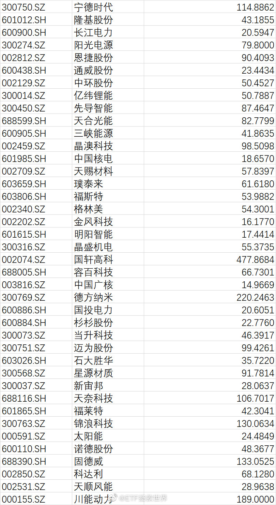

## 2022-03-04 16:35

很多人之所以在底部会对手里的股票崩溃，因为他不知道这支股票会不会死，会不会永远起不来。但你如果拿几只相关性很低的指数，情况就会好很多。至少你知道他们不会死，而且有涨有跌，没那么容易崩溃。

## 2022-03-05 08:43

认识六个月以上的朋友来投个票  ​​​

## 2022-03-05 21:15

我在球球关于恒生的历史大顶大底帖子。

全蒙对了，你可以对照k线时间看看。

那么，这次还会对吗。 ​​​
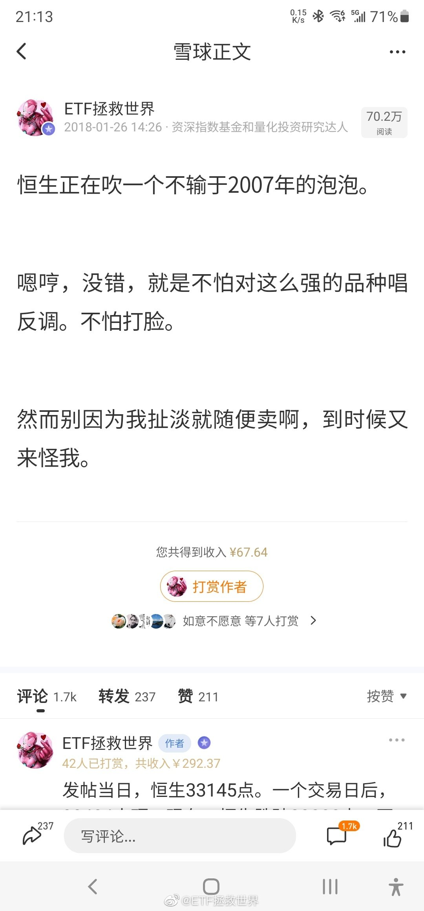 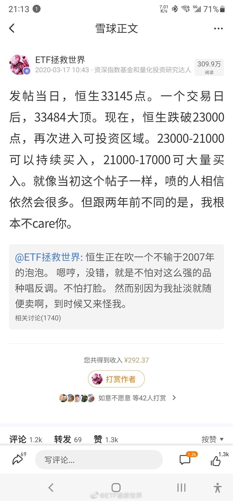 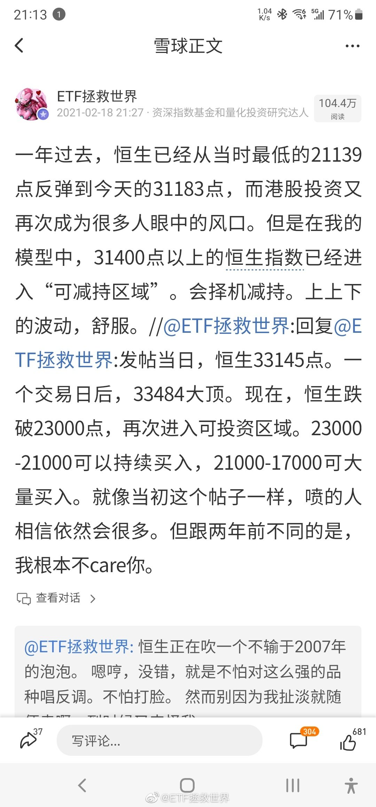 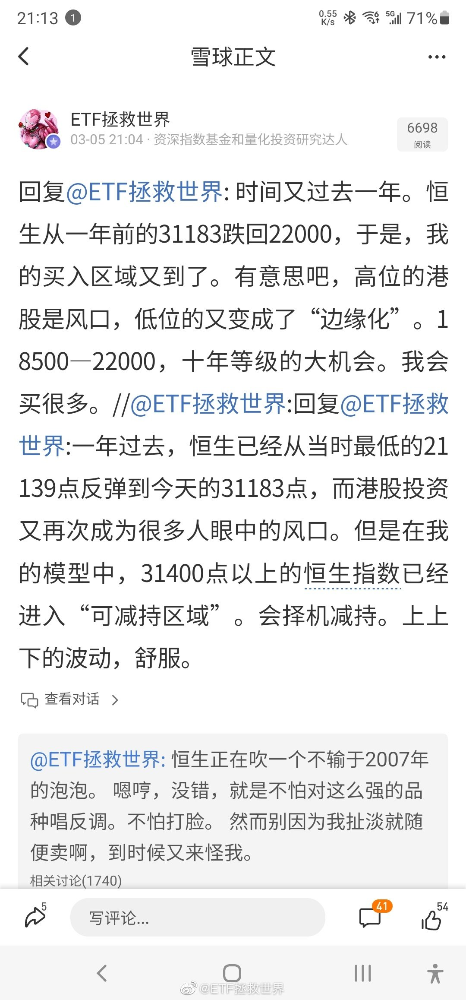

## 2022-03-06 16:56

啊球友的总结。真的吗，是蒙的了啦 查看图片

## 2022-03-06 21:52

显示效果提升不少。 ​​​

## 2022-03-07 07:25

我有几个投资原则，分享给各位：

第一，本金安全永远第一。

第二，一个品种占我整个金融资产的比例不会超过20%。金融资产包括所有可以用的货币类，债券类，股权类品种。

第三，任何情况下都是用闲钱投资。不会因为“大机会”就赌上所有。机会有很多，命只有一条。留够两三年的生活费，至少一年。

我认为自己一定会在投资上犯错，但没有任何错误能让自己死，也没有任何品种清零能让自己死。

仅供参考。

## 2022-03-07 08:10

各位认为，进入大规模战争的标志是什么。以这次俄乌为例

## 2022-03-07 08:39

昨天带儿子去爬野山，妹想到是一座很有难度的山，大意了，没有躲。

快到山顶的时候，我看着两边的峭壁，看着难以攀爬的岩石，想起了各位每天来看我的老爷们，想起了居委会大妈对我的谆谆教导，想起了小学老师在黑板上写字吱吱呀呀的声音。

我想，我要是出了点事，对得起谁呀我…

对儿子说，要不咱们往回走吧…儿子看了看下山的路：我怎么觉得往下更难。我回头一看，一阵头晕目眩…

下山的路上，我给儿子讲了很久风险与收益的取舍问题…

## 2022-03-07 09:10

再次提示//@ETF拯救世界:再次提示，我已经暂停自己的日经条件单。

## 2022-03-07 10:14

恒生下一网将是该品种最后一网，接下来也不会再继续下网了。

这是考虑到市场、持仓状态等因素决定。

之前的当然继续交易。

当然，有余力的朋友可以继续制定自己的交易计划。

恒科大概还会有2-3网，之后也不会继续再下。理由与恒生一致。 ​​​

## 2022-03-07 10:16

换句话说，18500的恒生，与80%的中概/恒科，将是波段加仓的最后底线。

## 2022-03-07 10:35

确定了，恒科还有两网就会停。也就是说，我在恒生以及恒科的波段仓位上面，只会再留一共三网资金。

长线仓位后续买入份数暂未设定。但依然遵循单个品种不超过20%上限的规则。 ​​​

## 2022-03-07 14:18

150和S都有动作，一买一卖。

根据自己情况决定，丰俭由人。 ​​​

## 2022-03-07 14:44

长期计划中，最近几个月依然延续了这两年的理念，

逐渐收回资金，如果要买，就要有卖。

150和S，都保持了非常理性的务实状态。

不增加整体风险的情况下，加仓目标品种。 ​​​

## 2022-03-07 14:47

消费终于开始低下高昂的头颅。总是埋怨它不是讨厌它，而是爱它，怕它走在歪路上一去不回。

## 2022-03-07 15:08

养了十几年猫，第一次知道原来你躺着的时候，猫会自己爬到你肚子上趴下陪着你。

我家原来的猫能跳到我旁边呆一会儿我就感动得要命了。

这该死的温柔。 ​​​

## 2022-03-07 15:53

今日数据：

没有亮点，让我大失所望。

科创50历史首次跌破60倍算吗？当然不算。

50和300跌到现在居然还不便宜，事实再次教育了我。每次当我不完全相信自己的数据时，都会犯错。高位的50和300减持的不够，正是因为没有完全相信数据。

高位更换成分股，把涨幅巨大的品种调入大指数，对大指数伤害太大了。尤其是这种抱团的情况，把一部分股票价格打到天上更会导致这个问题非常严重。

虽然50仓位卖得只剩3%，300只剩5%，但依然要反思。

## 2022-03-07 16:15

网格3.5正在进化完善中。

这次的进化，主要希望解决的问题是，如何在交易过程中保证资金投入的可持续性，避免在战役与整个战场上，因战线过长出现兵力不足的问题。

同时，顺便解决底部波段收益率不够的问题。

绝不满足，发现问题、解决问题，永远要进化。 ​​​

## 2022-03-07 16:49

漂亮是真的又狠又鸡贼。

为了自己的好日子能持续，为了自己继续当老大，上蹿下跳，无所不用其极。

其实每个国家都希望自己好，区别是有的对别的国家更没有下限一点。

为了不让欧洲团结，不让亚洲团结，为了让世界乱成一锅粥，它获取最大利益，漂亮真是一直在努力，从未被超越。

只是仇恨没有意义，最重要的是自己强起来，能够多交一些有远见的朋友，干到它能老实一点。

## 2022-03-07 17:25

回复@Lateatnight86:默在欧盟内部一直奉行务实态度，顶住了漂亮要求欧洲一起制裁我们的压力。默一直追求欧洲自主，不愿意完全跟随漂亮的指挥棒。我说她有远见是指国际事务。他们国内事务我不操心。

## 2022-03-07 17:33

你以为我想关心蓝星这些破事儿吗。

现在的问题是，你不关心行吗。我们的投资是会受到极大影响的。 ​​​

## 2022-03-07 22:17

今天的红利，有至少一半的朋友没有卖出。

我很欣慰，两个原因。

第一，说明各位还有资金，不必卖出再买入。

第二，说明各位有了独立思考能力。对错不说，至少会选择自认为更加符合自己情况的操作了。

有一天每位朋友都能自己做出理性而智慧的操作，我的愿望就实现了。 ​​​

## 2022-03-08 08:13

前一段让大家看美股历史不知道各位有没有看。

70年代美股美债走了十年熊市，正好是油价金价大涨通货膨胀的十年。

这十年跌得最多的是什么股票？

你说巧不巧，正好是60年代的“漂亮50”。什么是漂亮50，就是机构抱团，“永远不会跌”的那些蓝筹公司。尤其是消费股跌幅较大。

历史有没有借鉴价值，看看吧。

## 2022-03-08 08:19

好消息是，如果你在这些蓝筹股价暴跌后买入，那么你会发真正的大财。因为之后就是40年的牛市。

## 2022-03-08 08:32

买了新的镜头拍猫猫。

上一次认真玩摄影置办装备，还是结婚前帮姑娘们拍糖水片的那段时间。 ​​​

## 2022-03-08 09:15

今天又是刺激的一天吧 ​​​

## 2022-03-08 09:44

KWEB跌幅已经73%了。

距离80%还有27%。 ​​​

## 2022-03-08 09:49

红利 -0.83%。

恒生 +1.06%。

别管以后怎么样，至少这十几分钟是对了。 ​​​

## 2022-03-08 10:32

以目前的价格看，除了医药已经进入伏击区，没有任何品种让我有长线加仓的想法。 ​​​

## 2022-03-08 10:36

信息倒是也可以盯着了。

## 2022-03-08 10:50

今天更新的网格品种，下一网价位与之前有很大区别。我会将之前的改掉。稍后可看。

体现了3.5进化版本。 ​​​

## 2022-03-08 11:12

指数跌80%的情况，历史上真的非常少出现。

从90年至今，排除非市场因素的暴跌80%，只出现过不到十次。

全球主要市场。 ​​​

## 2022-03-08 11:15

可能有些私募已经到清盘线了。

1.7万亿两融希望安全。 ​​​

## 2022-03-08 11:20

回复@司青山:在降了在降了。去年9月有1.9万亿。虽然19年初只有7000亿，20年初1万亿。//@司青山:俺以为市场跌那么多，两融余额应该会下降很多，没想到还有1.7万亿，这帮融资客，头真铁啊！我都替他们害怕（才没有）。 查看图片

## 2022-03-08 11:23

有时候独立思考也有风险……

## 2022-03-08 11:30

这种时候，你要做的是关上账户，去外面走走。

然后你就会发现，心情还是那么糟。 ​​​

## 2022-03-08 11:38

年轻的时候，总觉得A股很难挣钱。

不要急。

等你年纪大了，有经验了，你就会发现，这是真的。 ​​​

## 2022-03-08 11:46

刚看见有朋友问我这里离钻石坑有多远。

如果你问的是全市场，我不能告诉你。

不是我不想说，而是我不知道，算不出来，太远了。

我年初说A股已经不便宜了，大中小都是如此。结果现在才跌了十几个点，你就问钻石坑，是不是早了点。 ​​​
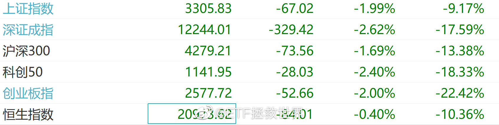

## 2022-03-08 12:02

不过我说真的，出去走走。

在大街上走，在田野里走，在山上走，在海边走。

在很辽阔的地方，在阳光明媚的地方，很多困扰你的事情你会突然觉得那么渺小，不值得去担忧。

你值得拥有一种举重若轻，泰山压顶谈笑风生的气质。

风险可控的一点点小事，以后想起来你会发现为它担忧非常可笑。 ​​​

## 2022-03-08 12:14

请各位先不要按照提示补仓，我先看一下是怎么回事。 ​​​

## 2022-03-08 13:01

今日补仓提醒整体问题不大。但有两个建议：

第一，DAX不要补，各种原因。

第二，只补价格差15%-20%以上的份数。

希望你的成本远低于我。 ​​​

## 2022-03-08 13:11

回复@无枝可栖的灵魂:这个自己定。我说15-20是很保守的。至于具体多少自己定，高一点就更保守一点，低一点就激进一点。//@无枝可栖的灵魂:只有恒生差价在15%以上

## 2022-03-08 14:20

祝各位少女以及资深少女节日快乐！

（本条男性博友请勿评论，望自重） ​ 抽奖详情 ​​​

## 2022-03-08 16:09

这不是统一不统一的问题。而是俄倒了就会有人集中全部精力干你的问题。大多数理智的中国人不想出现这样的局面。出发点是国家利益而非其它。

## 2022-03-08 16:18

今天数据出来了。二话不说，我先送一张宽基图给大家。行业图下次有缘再送。全市场图钻石坑送。

整体来说，A股依然没有很便宜。并不是说很贵，基本就是均值偏下一点点的位置吧。所以跌，非常正常。

这与德国、港股等完全不同。这些地方是绝对和相对意义上都比较便宜。

具体到分类。

大指数依然让人难以下手。这一年多，每年调两次成分股，调入了大量疯狂抱团估值上天的股票。后遗症就是50 300跌到现在，依旧没眼看。

创业等品种自己看吧。当然比这一两年便宜不少，但……

500什么的还好。也是凑凑合合，仓位足够了，不需要加。

整体看目前的下跌依然是正常范围。有些行业我是很有兴趣了。从技术到估值。

目前要做的事，就是把未来大家都会选的选美前三甲（彼得林奇的比喻，非歧视女性）找出来，等他们需要帮忙的时候，掏钱助人为乐。
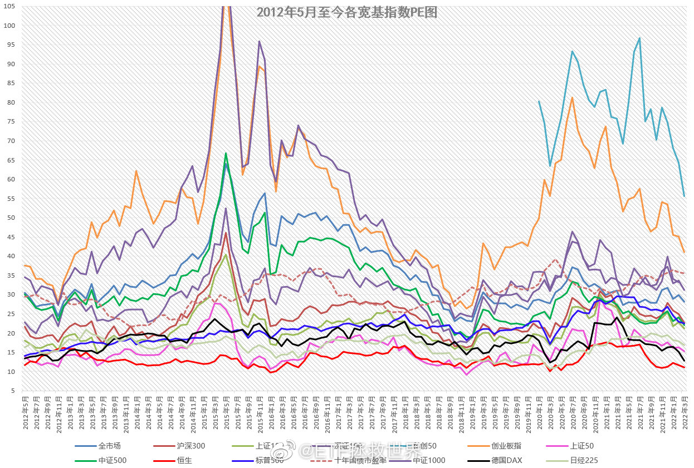

## 2022-03-08 16:25

回复@有舍才能得etf:恒生估值没起来过，但是价格可是上下翻飞。我立个Flag，恒生18500如果有幸买到，不到30000点我不会卖。//@有舍才能得etf:为什么恒生看起来一直是趴着的状态呢

## 2022-03-08 16:28

回复@l_O_O_l:欧盟目前一盘散沙，没有力量对漂亮说不。真的很悲哀。//@l_O_O_l:回复@冬季的秋名山:魏强联蜀抗魏，蜀强联魏抗蜀。现在就是看不懂欧盟，明明一丁点好处都没，还把能源粮食弄得那么高价格分分钟忍饥挨饿，他们图的是什么？？？？？？？

## 2022-03-08 16:31

你是不是慌了，不用慌。

我推心置腹的说一句，

等文章。

本周，定了，我说的！ ​​​

## 2022-03-08 16:41

恒生已经马上跌破10倍估值了。

过去20多年，只要破10倍就进钻石坑。

我不知道能不能到18500，但只要不出天大的事，比如大战，比如被联合制裁，那么，现在离底部绝不远了。 ​​​

## 2022-03-08 16:59

今天不说太多了。只是想告诉大家：

到目前为止，一切都很正常。全都是你来投资应该做好准备会发生的。至少在我这里，没有任何意外。

意外的事件，导致了暂时没有意外的市场。

未来市场会不会超出我的认知范围，我不知道。到现在为止，依然正常。

如果你心情不好，别想太多。没有意义。想太多你容易做错事。我觉得在这方面，你可以适当相信我。反正你不信我也没用了是吧，干脆就信了吧。

没上杠杆，没all in，就有救。

踏踏实实的，多大点事儿啊。没事儿。

几个小时后会有最后一条，然后今天就结束了。做人开心最重要！

## 2022-03-08 18:38

恭喜@无敌冰淇淋77 等100名用户等额平分【1688元现金】。微博官方唯一抽奖工具@微博抽奖平台 对本次抽奖进行监督，结果公正有效。公示链接：网页链接

## 2022-03-09 11:00

目前我感觉压力比较大了。并不是因为几天时间我的账户缩水大七位数，因为自己肉比较厚，禁打。压力测试做得也可以，资金没有问题。

我是特别担心没有做好资金分配导致后续部队不足的朋友，各位可能会比较焦虑。

无论是长线还是波段，如果资金不够，完全可以停止后续投入。没有任何问题。

一定要根据自己的情况调整，同时记录目前的状态，以后会有用。

## 2022-03-09 11:51

医药网格还剩两网。

目前已经确定最终网的品种：恒生：1；恒科：2；医药：2。一共5。

其它的还没有确定，但传媒不会超过1，券商不会超过2，红利不会超过2。

其它品种暂时没有新开的计划。

也就是说，目前看，到最后最多就是10网资金。我会根据自己的情况安排。 ​​​

## 2022-03-09 12:08

所有的权益类投资都要有个资金投入极限。在投资开始前设定好这个数字，到了就停，这是纪律。

150不用说了，本来就是固定金额的投资。

现在波段也有了极限。

S积累了大量资金，当然有些朋友把S未投的投入到波段了，这并不是问题，因为你之所以参与了S，说明你有稳定的收入来源，所以不是问题。

也就是说，会有一个总数字，就这么多了，不会再投了。收入结余会以安全的形式积累，直到再次有能力增加权益类品种的投资，直到权益类品种在你资产中的比例让你再次感到太低，再继续加码。

## 2022-03-09 13:33

未来一段时间长线仓位买入思路：

已经有一定仓位的，不会盲目加仓。会在最关键的位置，比如最后支撑，比如下跌80%的位置稍作买入。

剩余的会在右侧买入。

会注意保留资金，优先使用黄金、债券、原油的卖出部分。 ​​​

## 2022-03-09 14:14

如果收个长下影的红线，我会感动到流泪。 ​​​

## 2022-03-09 15:05

我在人生现阶段，最大的希望除了身体健康外，

就是国泰民安。 ​​​

## 2022-03-09 15:21

目前为止所有网格品种持仓收益率。

这是一个艰难时刻，希望我们所有人顺利。 ​​​
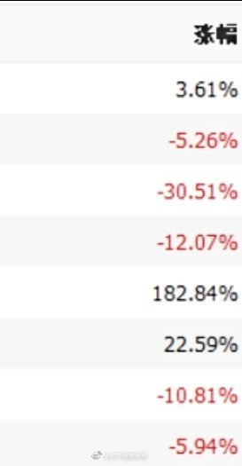

## 2022-03-09 15:44

每天先天下之忧而忧，弄得好像脸上长斑了…… ​​​

## 2022-03-09 16:31

这张图有个数据有问题，不好意思更正一下。德国DAX的估值（黑色）并未低至图中所示。虽然是不贵的状态，但没那么低，大致比日经高一点。这个问题是原始数据的问题，今天发现已经更新。

## 2022-03-09 17:52

如果明天A股和港股能像欧洲这么勇，那我们这几天买的就能大范围回血提款了……

是我想太多吗。 ​​​
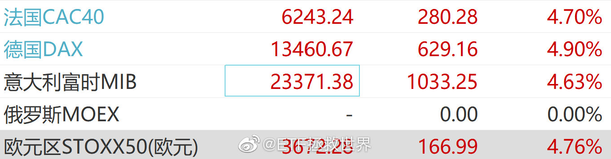

## 2022-03-09 17:56

今天有个数据必须说一下，

金融地产指数的各种估值，已经创出历史新低。低于08 12 18任何时候。

市场真的很悲观。 ​​​

## 2022-03-10 10:42

1个交易日提款，

你永远可以相信小红。 ​​​

## 2022-03-10 15:26

最近一两年跟车的朋友，可能最近收益率有点惨。因为你们不是像老朋友那样卖出盈利品种买入，没有安全垫，所以账面很不好看。

150的朋友可能还好，因为你们知道自己有上百份资金还没有投入。

S的朋友因为没有一个直观的认识，不清楚自己其实积累了很多应投未投的资金，这些资金一旦投入，都会将浮亏的亏损度大幅降低。

老朋友一定还记得我2018年反复说的一句话：

现在你手里的品种有点浮亏不是问题，我会想办法将它们在底部区域的浮亏幅度降至很低。

牛市来临的一周、两周内就能翻红，然后就是盈利之旅。

我是这么说的，最后真的这样发生了。

这句话也送给新朋友们。

## 2022-03-10 15:41

续上一条：

这一两年跟车S的朋友，可以看看手里已经买的，浮亏的品种。你会发现，除了中概/恒科，每个品种一共才一两份。

这一两份降成本有多容易你知道吗。最关键的，是我们从没有在一个区域高位大量投入，所以低位再买一点，成本一下子就会下去。

这一两年S买的品种：

传媒：2份（1个月投入）

信息：2份（1个月投入）

医药：2份（1个月投入）

证券保险：1份（0.5个月投入）

文体娱乐：1份（0.5个月投入）

恒生：2份（1个月投入）

恒科+中概：9份（4.5个月投入）

也就是说，2年时间，应该有48份投入，你只投入了19份。是什么意思呢，意思是你其实半仓都不到。你现在闭着眼睛把剩下的买进去，浮亏的幅度也会大幅降低。

我有信心，一定会把绝大多数品种的成本控制得非常好。

## 2022-03-11 07:15

好好工作，多存点钱。

控制买入欲望，控制节奏。 ​​​

## 2022-03-11 08:44

预感今天将会是战斗的一天。 ​​​

## 2022-03-11 09:54

正在写东西（这次是真的，有图为证）。

争取下午发。

我想很多朋友应该是需要的。 ​​​
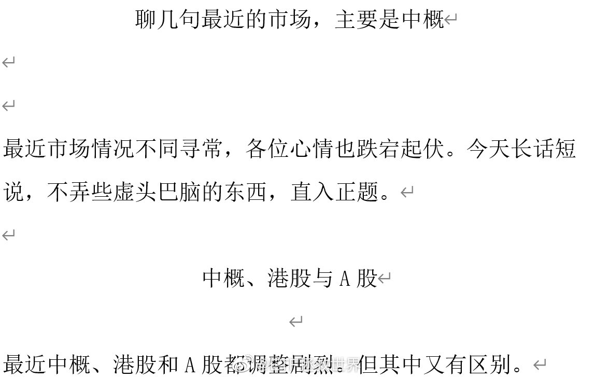

## 2022-03-11 13:55

写完了，在等小助理排版。

今天能不能提个double kill给老爷们助助兴啊。 ​​​

## 2022-03-11 14:11

？如果恒生反弹收红，我今天一大早跑到办公室吭哧吭哧写半天又有何用？

什么玩意儿？ ​​​

## 2022-03-11 14:39

gzh人工审核了十几分钟，终于通过了。 ​​​

## 2022-03-11 15:12

差那么一丢丢，没有double kill.

终究是错付了。 ​​​

## 2022-03-11 16:43

回复了几十条了。其实回复的留言大家可以看看，我想有些回复还是挺有价值的。 ​​​

## 2022-03-11 22:24

昨天卖出的那份油气各位平均收益率47%。

有些朋友收益率不高，很不好意思。相信下次会更好。 ​​​

## 2022-03-14 07:58

数据显示，二月外资开始减持国债。

巧合 思路一致 还是跟车了 ​​​
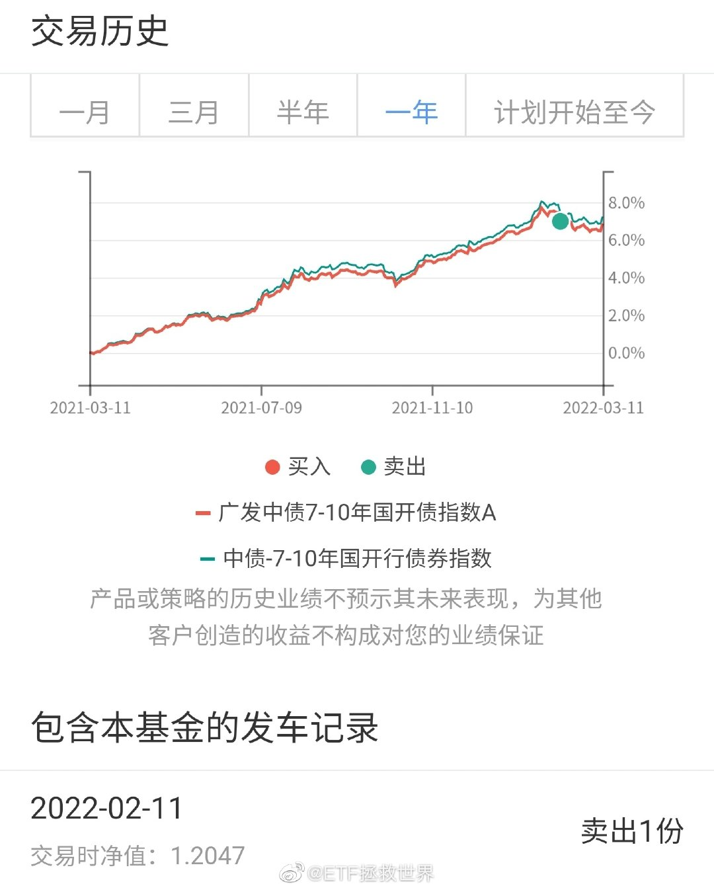

## 2022-03-14 09:13

今天没什么别的希望，就是希望能提一次款 ​​​

## 2022-03-14 10:14

三个交易日提款成功。

接回价格有变，我不会在历史交易里面重新创建。

表格稍后发出。 ​​​

## 2022-03-14 11:52

我不会跟你说价值呀，机会呀，不买不行呀。

也不会跟你说陷阱呀，危墙呀，先跑再说呀。

我只能说，据我从各个维度考虑，某个点位从历史上看，是5-10年才会到的一个很低的价位。在那里我会买一些，然后就不再惦记了。

至于它之后是涨是跌，就交给市场吧。我的注意力就会转到别的品种上。

怎么说，就很平淡的感觉。做好计划，条件触发了，就做相应的事情。没有恐惧也没有激动，踏踏实实的一种体验。

## 2022-03-14 12:04

带儿子去做核酸，路上碰到他的两个女同学。道别后跟儿子讨论了这两位同学照片和真人的差异，皮肤啊，发型啊，性格啊什么的。

发现跟儿子有时候很像哥们儿了，当然这也是我所追求的关系。在我印象中，我父亲从来没有跟我谈论过我的任何一个同学。 ​​​

## 2022-03-14 16:05

今天，一个账户。

心如止水。你信不信。 ​​​
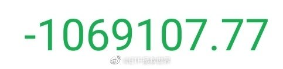

## 2022-03-14 16:21

ND爷。不是说欧洲输得最惨吗。

## 2022-03-14 19:58

大家还记得几天前的投票吗。几天过去，你要改一下答案吗  ​​​

## 2022-03-14 20:16

这里说明一下，最近重新整理了过去十年恒生的数据，发现源数据中有一些数据被污染了。清洗后目前恒生估值没有11倍那么低，大概是13倍左右，也已经是非常非常低了，尤其是在近几年加入大量科技股票后。18500的操作逻辑没有变，我的加仓策略也没变。

## 2022-03-14 20:40

最近的极端行情，让我有了很久没有进行过的深入思考。

真的，朋友们，确实只有挫折才会让人思考和进步。

主要的思考点：

第一，如果中概这些公司，真的因为非市场因素挂掉，会改变我对很多事情的看法。这个一两句说不清，不是简单的改变，是对一些人生方向以及更多东西的改变。

第二，自己的体系需要适当升级。比如，为什么一些品种，比如恒生，明明知道在哪里是很贵了（2021年初），却只卖一点。问题到底出在哪里。因为这不是一个品种出现这个问题，

所以这是体系和策略的问题。

包括网格在极端情况下占用大量资金的问题。

还有，左侧在买入策略的权重中是否过大，增加右侧买入份额是不是会更好。比如巴菲特买苹果，那已经不是右侧的问题了，而是空中加油买，但依然赚很多。值得思考。

再有，明明年初能够预见今年很困难，有没有机会进行调整？年初的仓位状态是否真的合理？当时是不是意识到了不合理，为什么没有改变？

对于这些，我有了一些思考的结果，也有了一些继续提升的想法。未来会融入操作中。

一帆风顺只会让人停滞不前。

## 2022-03-14 22:17

我不会管别人怎么想怎么操作。

我的最后一笔买入时刻到了。 ​​​

## 2022-03-15 09:32

我这几笔主动买入，早在几个月甚至几年前就已经计划好了。现在只是执行计划，同时向18500致敬。

我绝对不是忽悠你要杀入。因为你并不知道这100万占我资产的多少。也许很少，也许很多。

我做这个记录，是因为之前答应了朋友们，买了就贴出来。也是为自己做个记录。未来有一天赚钱了，或者赔光了，这都是非常好的历史记忆。

因为之前也持有不少，我的恒生总仓位已经不小了，所以未来除了长期计划和最后一份波段网格，不会再主动买入。
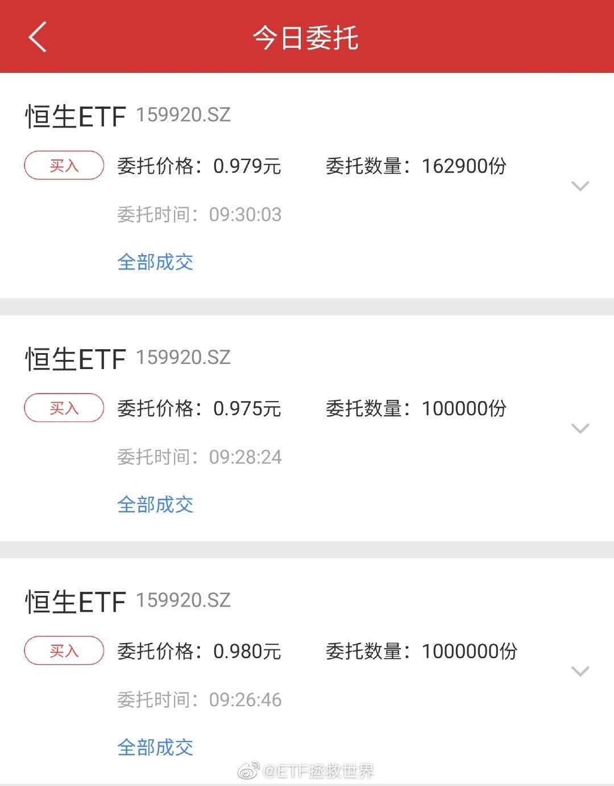

## 2022-03-15 10:27

基本上恒生的买入已经结束了。

今天我的主动买入最后一笔；

网格波段最后一笔；

150和S会买入一笔。

所有的最后一笔买入全部卡在18200-18500上方。

如果跌破，那么也不会再买入。全部投入到此为止。

还会有可能买的是150和S，但是会走右侧。

永远不会向一个产品用无底洞的方式投入。 ​​​

## 2022-03-15 11:40

今天港股买完后，很长时间应该不会再有什么大的投入了。

A股完全没有兴趣买多少，零星买一点有可能。

所以接下来应该是恢复元气积累资本的时间。

相当于中场休息。 ​​​

## 2022-03-15 15:04

不到关键点位不要轻易抄底，不要不停买，因为家里没矿。 ​​​

## 2022-03-15 15:24

不用说那么多有的没的。重复一下我的建议：

第一，好好工作。

第二，多攒点钱。

第三，保证1年以上的家庭支出以类现金形式存在。

第四，1-3年不用的钱做波段，5年以上不用的钱做长期投资。

第五，不要有了钱就不停的买。你买不应该是因为有钱了，而应该是因为有好机会了。巴菲特手里上千亿现金，说现金是垃圾的人，根本就对风险毫无概念。资本市场机会每天都有无数，缺的不是机会，而是现金。

第六，股市涨跌非常正常。如果没有做好心理准备就进来，可能在资产不断缩水的时候会非常难受。如果你难受，尽量不要去想损失，多去想以后还投不投，吸取了什么教训。

第七，你买的是不是不死的品种？如果是，不要过于担心。如果你还有钱，那就更好。做点喜欢做的事情，分散一下注意力，股市不是生活的全部。

## 2022-03-15 15:30

正在跑今天的数据。

今天我没怎么看盘，结果数据出来大吃一惊。全市场两项数据出现了很罕见的大幅下降。

一会宽基和行业数据出来再说。

再这样跌几天，A股居然也很有投资机会了？这是我没想到的。 ​​​

## 2022-03-15 15:56

所有数据都出来了。

没有赶上2018年钻石坑的朋友，在2022年，你很有可能再碰上一个钻石坑。

甚至有些品种要比当时还要便宜。

在这种时候，我不想说太多让你激动的话。因为我们现在面对的是一个非常非常复杂的金融市场，其复杂甚至并非仅仅来源于金融。

但我必须要说的是，如果继续暴跌，今年大概率真的会出现巨大的买入机会。

我要对自己说，也要对各位说，不要兴奋，不要恐惧，我们做好了准备，机会来了就伸手抓住，这是很简单又并不简单的一件事，希望我们能做好，也希望国泰民安。
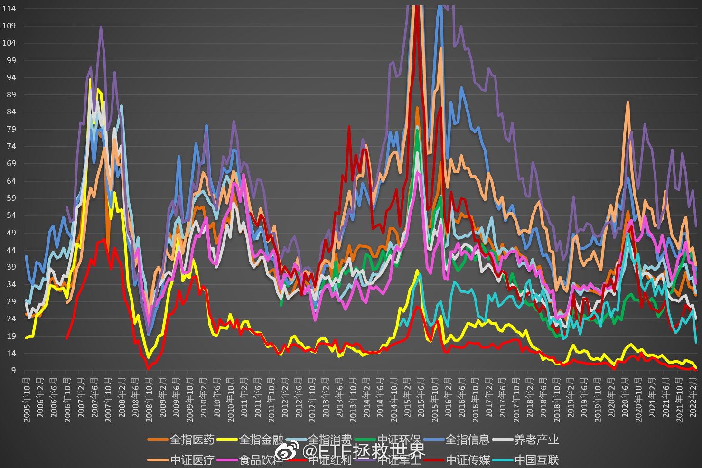

## 2022-03-15 22:46

是男人你就坚持到明天 ​​​
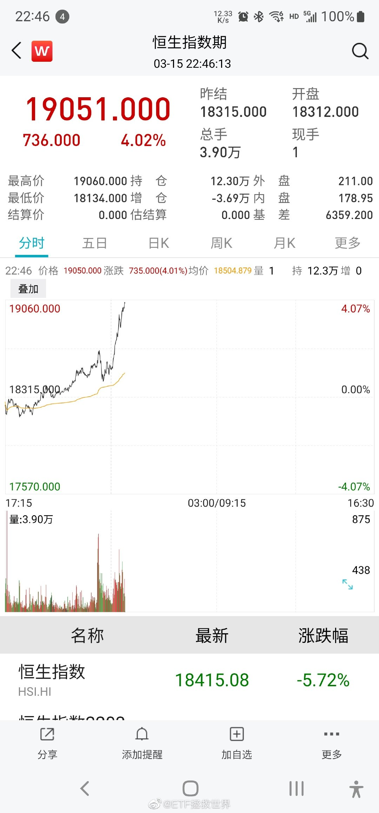

## 2022-03-16 10:28

卧龙凤雏。 ​​​

## 2022-03-16 10:35

有没有一种可能，

所有行业都变成公用事业。 ​​​

## 2022-03-16 10:45

今日好消息：消费终于跌回历史正常区间了！//@ETF拯救世界:消费终于开始低下高昂的头颅。总是埋怨它不是讨厌它，而是爱它，怕它走在歪路上一去不回。

## 2022-03-16 11:27

今天再次买回的品种，后续还有一份的额度就会结束买入。

我不会忘记改一下之前设置的条件单，下一网价格会有变化。 ​​​

## 2022-03-16 13:22

昨天买的致敬份额终于解套了 ​​​

## 2022-03-16 13:25

回复@梅之敦敏:放心。我做人永远有始有终。卖的时候必然会说。//@梅之敦敏:致敬份额啥时卖呢？

## 2022-03-16 13:39

主要是我比99.99%的人会瞎蒙

## 2022-03-16 13:50

昨天且慢提示补仓，补了的晚上给自己加个鸡腿。

你应得的。 

会不会跌回去不重要，反正今天赚了今天开心就完事。 ​​​

## 2022-03-16 14:31

不知道各位是什么样的心情，

对我来说，很平静，跟昨天一样。

钱投在市场里，一定是上上下下起起伏伏多多少少不断波动的，所以没什么稀奇。

我对自己只有一个要求：

未来回到高点的时候，一定要比上次到达这里的时候更有钱。

其它的，平平无奇罢了。 ​​​

## 2022-03-16 14:37

现在场内不断卖恒科的脑子是不是有点大病。

折价6个点卖。 ​​​

## 2022-03-16 14:40

告诉你一个可怕的数学题：

b站一天涨了40%，

但只是回到上周五而已。

低位买入是真的暴利。 ​​​

## 2022-03-16 15:26

昨天鹅最低297，恒生18235，中概79%，三者共振完成。而这一切，半个月前已经定下了。当然，是不是最低，后面还会不会跌我不敢说，但这个逻辑是完美的。

## 2022-03-16 15:44

刚才我在小助理群里说的，我觉得应该分享给大家。

这是我的真实想法。

我发现每一次进化，都来源于失败。只有在失败（或者不足或者不满意）后，才会努力的去寻找解决的办法，才会最终变得更强。

我们每个人都不想失败，但失败真的是进步的契机。区别是有人面对失败充满沮丧自暴自弃，有人面对失败寻找解决办法，追求更加强大。
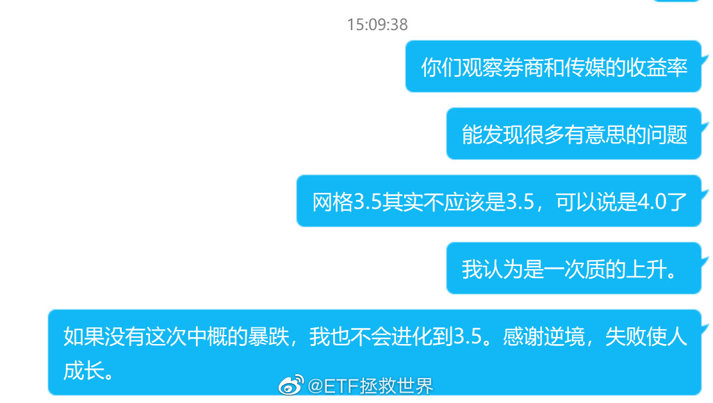

## 2022-03-17 07:36

整个人尬住了：

一天涨40%的品种怎么做右侧，这道题太难我不会做。 ​​​

## 2022-03-17 08:21

QDII ETF/LOF都已经实现T+0了，却依然设置10%涨跌幅是特别离谱的一件事，相关部门领导能不能考虑把这个调整一下。

机构的朋友们也多向领导们建言吧。 ​​​

## 2022-03-17 08:25

回复@GENE_SOBER:策略不执行还叫什么策略？不如随心所欲去玩好了。//@GENE_SOBER:今天网格继续策略么？右侧不给机会了嘛

## 2022-03-17 09:36

HS又因为折价没出去。

天妒英才。 ​​​

## 2022-03-17 09:51

恒科这一网如果出不去就太亏了。

被交易制度干掉了。 ​​​

## 2022-03-17 10:25

做市商是真不干活啊。 ​​​

## 2022-03-17 10:36

你永远可以相信（  ）（  ）。

同一个品种一周两次6%，每次两个交易日，还有谁。 ​​​

## 2022-03-17 10:48

屋漏偏逢连夜雨，最近赔这么多，它还涨价，节食吧还能怎么样。 ​​​
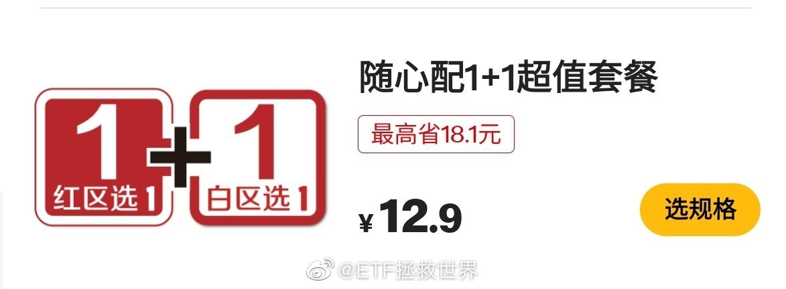

## 2022-03-17 11:09

错了，这一笔是不到一个交易日7%。没有人注意我把买入价下调了一个档位吗。

## 2022-03-17 12:09

今天的日常生活记录：

壹：

疫情原因，家里做饭的阿姨不来了。点开久违的麦麦1+1，发现价格巨幅上涨7.5%。

生气。

贰：

两年前别人送的咖啡机今天拆箱拿出来用，发现回路不上水。找维修上门，用一根管子吸了一下就好了。被收了280。

生气。

叁：

发现在投资上面很难克服心魔，知道应该怎么做却很难下决心做。

生气。

肆：

看了一眼账户，连续第二天大幅回血。感觉自己又行了（没有之前不行的意思）。

得意*3。

午间总结：

生气*3中和得意*3，平淡的一天。

## 2022-03-17 12:19

回复@飘渺七夜: 不要气，观察一下谁相信了，然后在相信的人后面备注【脑残，离远点，否则会受伤】。//@飘渺七夜:刚才我气着了，一位网友（别的地方的）竟然说E大最近让清仓取现金了！！！！！！ 我惊了！这谣言吗？网络上这么公开的事情，闭眼造谣啊！

## 2022-03-17 12:23

回复@Horse17721:一般人觉得可笑的谎言，正是骗子用来筛选脑残的。如果连那么低级的谎言都能信，说明这个人可以，能骗。//@Horse17721:老大就是务实，这都能找到实用之处？

## 2022-03-17 12:40

说两句正经的。

经过两天大幅反弹，可能有很多朋友会关心之后怎么走：

是特级大熊市中继的“死猫跳”？还是V型反转继续大牛市？还是要做双底还有一波下跌？

我不知道谁能判断出是哪个，反正我是判断不出来。

谁能猜出熊熊突然干入邻居家？谁能想到昨天开会？

如果都不能，凭什么我们能猜出市场怎么走？

好了，如果我们猜不出，那么是不是该迷茫？

当然不是。是否知道市场怎么走与我们知道不知道该怎么做关系不是很大。

简单来说，我们要做的是为三种走势都做好准备。

首先保证自己在任何情况下都不死；其次保证自己在任何情况下都不会做大的错事。

我们需要做的决定无非就是以下几点：

第一，长线仓位左侧、右侧什么时候进。

答案：左侧价值+原则，右侧形态趋势。

第二，波段仓位是否要转为长期。

答案：我不会转，我做人喜欢不忘初心。环境的变化永远不会让我忘记为什么要开始走这条路。定了策略，就严格执行。

第三，加仓还是减仓？

答案：审视自己的仓位状态。反复压力测试，反复代入涨、双底、继续下跌的场景，观察自己的情绪。

## 2022-03-17 13:10

回头再看这个最黑暗时刻的投票，我真的感慨万分。各位是中文互联网上最特别的一群投资人，我为能与大家站在一起感到骄傲。

## 2022-03-17 13:21

成交。

两个交易日12%。没弄错的话应该是两年来收益率最大的一次。 ​​​

## 2022-03-17 14:02

虽然说不预测走势，但从历史的角度看，恒生指数从未在18500-22000这样的极度价值区域出现V型反转而只是短暂停留。

最少也要徘徊几个月。

换而言之，在这个区域会出现不止一次的波段机会。从历史看，大概率。

换而言之，各位要做好准备，知道大概率还会向下测试底部是否牢固。做好准备的意思，是真的出现了要知道它是正常的，不要跟其他人一样又变得惊慌失措一片悲观。

当然，历史规律总是要打破的。看看这次会出现V型底，还是18500撑不住？

记住，出现任何情况都不要死，不要犯大错。

## 2022-03-17 15:04

HS更新。买回价格有变化，我会在历史记录里面找出然后改单。 ​​​

## 2022-03-17 15:47

明天是个时间窗口，保不齐长期计划会追涨硬上！ ​​​

## 2022-03-17 15:55

今天HS没挤下车的不用担心，只要今晚中概不掉链子，明天全都能下。

我说的！ ​​​

## 2022-03-17 16:34

希望所有回购公司回购后都注销。不然真的意义不大。

## 2022-03-17 16:47

问你个问题，你是不是觉得咱们之前低点买的富国消费这几个月没挣钱非常垃圾。

但你知道吗，大摩的一幕又上演了： ​​​
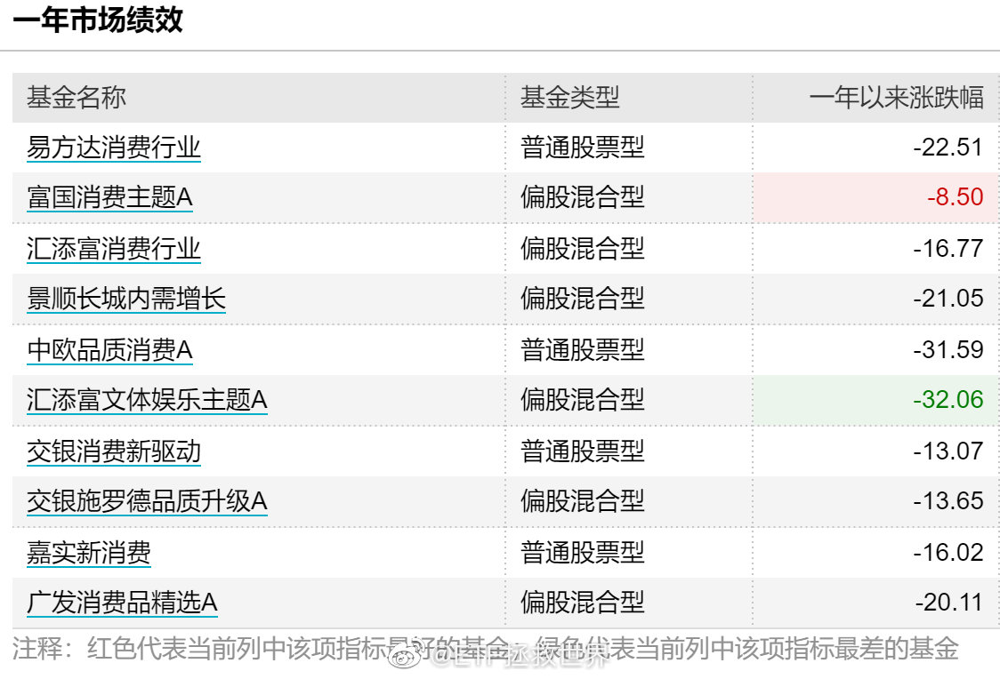

## 2022-03-17 17:36

最近这两天关于小品演员和足球运动员的争论，吵得很热闹。但其实你知道其中最关键最核心的地方是什么吗。

最关键的不是男足菜，

而是男足菜，又挣得多。

谁规定足球一定要强了？没有。中国根本就没有足球的土壤氛围，不强就不强，其实不是事儿。但你又菜挣得又多，那就一定被骂。

到这里不要停止思考，继续往下。

这个思考的结果，对我们的人生又有何益处呢。

它教育我们：

永远不要让别人知道你赚得多。无论你赚得多还是少，让别人觉得你是一般人就最好。

因为绝大多数人类啊，就是看不起没钱的，讨厌有钱的。

你不同意我也没关系，早晚有一天你会同意的。

## 2022-03-18 07:18

艺高人胆大，现在买 查看图片

## 2022-03-18 10:07

药兄不会再来一次吧。

这碧海潮生曲一波接一波谁能顶得住！ ​​​

## 2022-03-18 10:18

今天150进二出一，S进二。

无奖竞猜一下。 ​​​

## 2022-03-18 12:50

你有没有发现一个很有意思的，就是咱们都说明星、男足球员收入高，不合理的高。

对。大家的感受其实是对的。为什么对。

国内的视频平台，前些年开始，因为有资本加持，所以无底线抬高剧集价格，导致明星收入也疯狂上涨。

然后呢？你就会发现，这些平台一直在亏钱，从未盈利。爱奇艺股价跌成什么样了。

足球也是。

之前收入就高，但不算离谱。*大入场后那简直是疯狂。从世界各地用巨额资金买球员，工资奖金更是疯狂。结果整个联赛成本极高，大家都在疯狂投入。

结果呢。搞笑了，去年联赛冠军夺冠后直接原地解散。*大更是爆出有上万亿的债务，球员开始限薪6万。整个联赛彻底崩塌，多少球队连工资都发不出来了。

说明什么，说明无序的资本真的是丧心病狂。也说明不合理的事情终将被清算。

其实一个国家，一线明星也好，顶级球员也好，一共就那么一二百人。十几亿人口基数，几亿人关注，多拿点钱真的非常正常。这与他们水平无关，与他们自身是顶流有关。有关注自然高收入这个无可厚非。

之前月老不是说了吗，何同学一个视频博主一个视频都能收入几百万，都是一个道理。

但是，资本疯狂烧钱下的高收入就注定会崩溃。不健康的财务状态一定会出大问题！足球也好，影视作品也好，根本就没有一个良性的循环，怎么能支撑这些高收入？

总结：

明星和球员高收入很正常，因为有关注。但是因为资本的疯狂，收入过高，就一定会出问题，导致整个行业的崩塌。但是对于那些已经几年时间赚了几辈子钱的明星和球员来说，崩塌也无所谓了。

## 2022-03-18 13:25

我要卖的一直在跌，我要买的由跌转涨。

不，我不能接受。我不同意这门亲事！ ​​​

## 2022-03-18 13:33

2022年3月18日，

两个计划的环保终于清仓了。

这个品种带给我们很多东西。有物质的，有精神的，还有一些投资经验。

它走了，我很怀念它。也许会买回来，大概在1***点。 ​​​

## 2022-03-18 14:04

my pleasure

## 2022-03-18 14:23

发车的时候明明是下跌6%。

你是不是针对我。 ​​​

## 2022-03-19 00:19

能不能顶到收盘。 ​​​
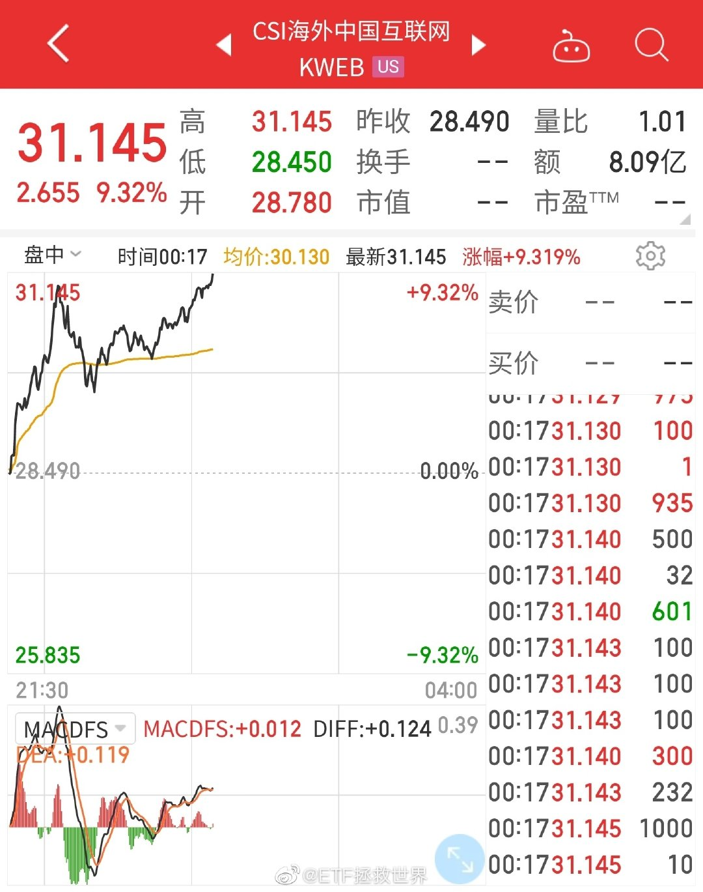

## 2022-03-19 16:38

富国红利即将分红。

分红比例12%。

再投。 ​​​

## 2022-03-19 17:11

一会有一篇文章推送。做波段的朋友应该看看，应该不会是纯粹耽误时间的水文。 ​​​

## 2022-03-19 17:57

时薪300左右的兼职在国内是什么水平。 ​​​

## 2022-03-19 21:50

刚才看了一遍gzh留言，说两个点。

第一，条件单跟长期计划毫无关系。没有做波段的不用改单。

第二，我到现在依然不敢说18500或者7080是铁底，这世界上有什么一定不会发生的事情吗。所以我们的波段才会一网一网的，按照纪律卖出啊。

总而言之我们的目标就是：涨也可以，跌也可以，大概就是这样。 ​​​

## 2022-03-19 21:58

PDD砍价这个新闻，让我有一个想法。

比如说我发一个砍价的信息，各位帮我砍，咱们看看能不能砍成免费，看看它们搞得这个事情到底是真的还是假的。

如果是真的能砍到，我就把砍到的东西抽奖送给大家。

但是我没砍过，这是一个什么机制。就是说如果砍成了是免费送吗，还是说只是便宜一点。只是便宜一点就没意思了。

## 2022-03-21 09:05

怕有朋友没看到，在这里贴一下。

再说一次，改了未必好，不改未必差。几分钟的行情很难说。

我只是选一个相对大概率正确的决定。

 ​​​

## 2022-03-21 10:17

上周五卖出的最后一份环保平均收益率91%。

很不好意思，这次没到100%。 ​​​

## 2022-03-21 10:42

没卖出，失败！

没买入，失败！

微信消息发错人了，失败中的失败！

小猫咪何在，让我吸一下缓一缓…… ​​​

## 2022-03-21 15:04

之前医药波段积累的极低成本利润不要卖。

18000再说。虽然不知道什么时候才会到。 ​​​

## 2022-03-21 16:46

🙏🙏🙏🙏🙏 ​​​

## 2022-03-21 19:50

回复@ETF拯救世界:嗯。//@ETF拯救世界:所以啊，想做的，有能力做的事情，就赶紧去做吧。别拖了，拖来拖去最后会有遗憾。

## 2022-03-22 11:45

卖了的跌，买了的涨，还有一个要提款。

还可以吧，相当凑合。 ​​​

## 2022-03-22 13:19

跌吧，我好了。 ​​​

## 2022-03-22 13:48

大家兴致这么高，上个小咪给大家助助兴。 ​​​
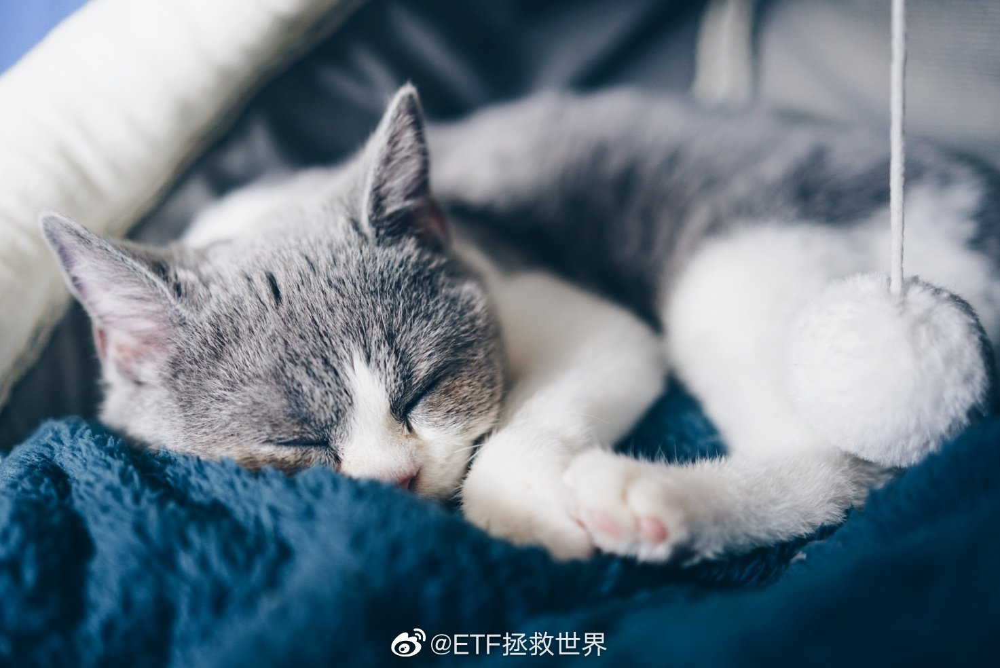

## 2022-03-22 14:35

买了一丢丢消费后，心态好多了。

跌，我们欢迎；涨，我们奉陪。

现在看茅也没以前那么讨厌了。真．屁股决定脑袋啊。 ​​​

## 2022-03-22 16:06

恒指今天再次大涨，反弹到22000关卡附近。

在上方的时候，这是支撑，在下方，这就变成了压力。

以我对恒生的了解，以及多吃几个波段的私心，是希望22000的压力发挥威力，在18500-22000区间多几次震荡的。

当然真要突破也无所谓，但我还是估计没那么轻松。

无所谓了，涨跌我都ok。你ok不ok。 ​​​

## 2022-03-22 16:12

回复@_Cloudcloud_:我是人不是神，不可能几年前就精准预测到下跌的个位数点位。18500上下大差不差就行了。//@_Cloudcloud_:涨跌都ok 只是突破下限的时候确实有点方

## 2022-03-22 22:55

现在每天中概不波动10%，感觉就跟平盘没什么区别。

过惯了刺激的日子，平平淡淡就少了点味道。 ​​​

## 2022-03-23 08:48

图片评论 查看图片

## 2022-03-23 09:31

恒科监控时间可以改回9:30开始。 ​​​

## 2022-03-23 09:40

本网六个交易日收益16%。

市场会奖励意志坚定的士兵。 ​​​

## 2022-03-23 09:48

不说你不知道，今年3个月过去，已经提了7次款（去年全年21次）。

三月一个月就是6次。

波动对很多人来说是噩梦，对一些人来说是印钞机。 ​​​

## 2022-03-23 10:06

连续第二天发错微信。

今天是把波段发车表格发到且慢发车群（都是工作人员）去了。

解决整改方案：

1、修改群信息。

2、30天内微信谨慎发言，能不说就不说，小心度过水逆期。 ​​​

## 2022-03-23 10:47

资本市场的钱，一定是慢慢的越来越集中。

从那些不理智、情绪化的人手中，集中到理智、讲纪律、意志坚定的人手里。

这也相当于资源优化配置吧。

当然，最终都会流入大平层，在另一个层面上被收割…… ​​​

## 2022-03-23 10:59

一场风暴过后，雨过天晴，大家都当没事发生。

只有那些底部割肉的人心如刀割。 ​​​

## 2022-03-23 11:05

回复@艾_自_由:第一，杠杆爆仓。第二，清盘线。第三，割了还有一点不割可能一分没有了。//@艾_自_由:一直不理解，为什么会有人底部割肉？

## 2022-03-23 14:00

长牛的时候你觉得长线仓位NB，波段仓位太多了，以后不做波段了。

波动的时候你觉得波段仓位NB，长线仓位太多了，以后不拿长线了。

其实没有别的原因，就是你不懂资本市场。更不懂我们整个体系是如何互相支撑互相配合的。 ​​​

## 2022-03-24 07:38

“挣外币花外币不能换算”是最二的说法。你不换算根本感受不到真实情况。

## 2022-03-24 09:35

世道困难，有些公司不敢说自己挣钱了，拼命压低利润。

因为别人不挣钱就你挣钱，你就离出问题不远了。

同理，

别人都很困难，如果你没那么困难，你就不要嘚瑟了。

共度时艰，猥琐发育，苟住。 ​​​

## 2022-03-24 09:54

我就问你，12000点这个支撑-压力强不强。在这个价位周边晃了2个月了。

## 2022-03-24 10:32

回复@虫子的生活记录:一项一项说。先把收入支出说清楚，再好好说福利。你不能说收入支出的时候“不能换算”，换算完了又开始把福利弄进来一起捣糨糊。

## 2022-03-24 13:47

中外生活水平这个问题，我是这么看的。如果你不同意，保留意见。

首先毫无疑问的，是我们与美加、西南北欧、澳新等国家的生活水平还有非常非常大的差距。这个差距怎么说呢，100年前就有了。现在我们的人均GDP也只有一万多美元，发达国家至少在3万以上。有差距这是显而易见的，还用说吗。

其次，也是显而易见的，我们的生活水平在不断提高。前一段时间我看一部80年代的香港电影，居然在里面看到了洗碗机。现在，有什么发达国家普通人用的最新产品，我们是没有的吗。

再其次。说国内，其实是不能概括全貌的。比如上海北京，人均GDP已经2.5万美元了，比葡萄牙，希腊，沙特都高。但是最低的广西才6000出头，相当于纳米比亚，白俄，厄瓜多尔等等。

在上海北京有房的前提下，人均月收入2万人民币以上也并不是太稀奇的事情，这些人的生活水平，我估计绝不亚于一般的发达国家老百姓。但是偏远地区农村人，生活水平就会低特别多。

至于福利什么的。我们的人口多，确实医疗啊养老啊水平跟发达国家比肯定差不少。但这里面也有很多细节，比如发达国家的公立医院你想预约免费医疗可能会排很久的队，可能病好了也排到了。国内虽然确实就医也不容易，但看个病不会让你排好几个礼拜的队。咱们主要是大病返贫这样的问题，这还得国力的配合才会做得更好。

还有房子。总有人说咱们是70年产权啊，别人是永久的啊。我很久以前去美国之前也这么想过。但是当我知道他们每年都要交房产税，人不死税不停的时候，我就再也不会这么认为了。而且我们的70年，到期后续期一定非常顺畅。在担心70年的问题前，你还是担心一下自己的房子质量能不能扛到70年吧……

还有油价的问题。总有人说美国油价多便宜。多新鲜啊，人家是产油国，还出口呢。你去沙特阿联酋俄罗斯更便宜。你去看看欧洲的油价。有人又说了，看欧洲油价？怎么不比收入？你废话，你在国际上买油，人家还因为你收入低给你便宜点？

我不是要洗什么。我是说很多东西你不去了解，道听途说，就特别二。你去生活一段时间，才会有个真正的体会。

我们有很多问题需要改进，但不是说外国所有的月亮都是圆的，也有菱形的。

## 2022-03-24 14:48

好消息：信息、消费跌了。

坏消息：医药涨了。

好消息：医药涨了，还需要再涨一点。

结论：

赢麻了。 ​​​

## 2022-03-24 22:42

今天中国队会很惨还是沙特会放点水。 ​​​

## 2022-03-25 16:04

今日数据：

科创估值从几个月前的100倍跌到了今天的50多；

某个我们一直想买，但一直没机会，去年买了一丢丢的品种最近可能再加一点；

大指数刚刚开始进入“不贵”区域；

某知名私募3月初清仓了，上次是2018年底的钻石坑。当然，对于这个我没有什么看法。每个投资人的投资体系完全不同，很难一概而论是对是错。当年他也是在2019年2、3月买了回来。所以这样的操作一定是他们投资体系的一部分，外人不用评价太多，管理人和投资人都舒服即可。

## 2022-03-26 18:35

小助理们的小福利 ​​​
 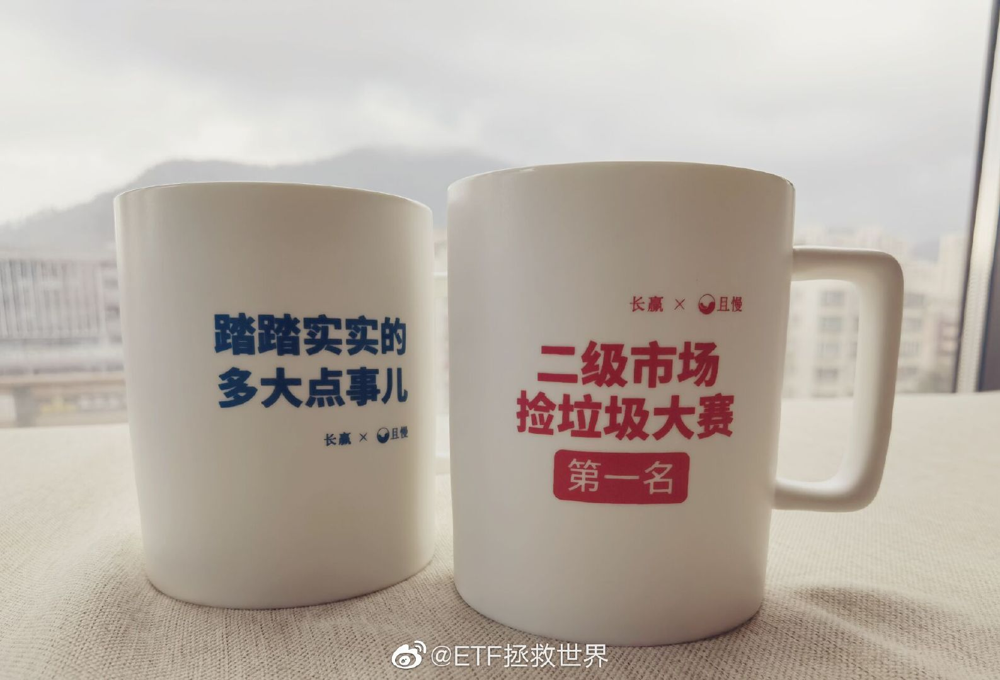

## 2022-03-28 09:04

接下来，以赚钱为目标战斗吧！ ​​​

## 2022-03-28 09:40

更新WLY的图：

认真的说，投资者，尤其是抱团的这帮人，真的不是有点病吗。 ​​​
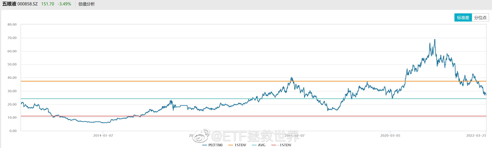

## 2022-03-28 09:51

我们的消费建仓成本如果能控制在11500-14000之间，就会是非常成功的。 ​​​

## 2022-03-28 10:11

油气，两年前无数人嘲笑唾骂，现在一枝独秀暴涨两年。

炒股的都是神经病。真的。绝大多数都是。 ​​​

## 2022-03-28 10:27

所有资金甚至加杠杆all in一个公司，一个行业，真的有可能成功。然后就会有无数人羡慕、崇拜、跟随。

但是……大众没有看到的，是一将功成万骨枯后面的累累白骨。多少同样猛干一家公司一个行业的人，死得无声无息。

更重要的问题在于：

你很难弄清楚这份成功到底是运气还是实力。第一次成功了，第二次、第三次……第十次呢？

这样的模式只要有一次失败，就会前功尽弃，前面的成功全都作废。

## 2022-03-28 13:53

价格腰斩了。估值终于从120跌到了50多…… ​​​
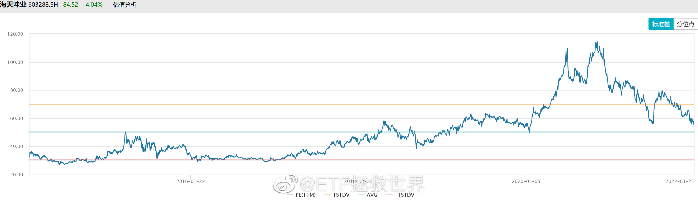

## 2022-03-28 14:07

据我所知，如果你自己不去银行或者其它金融机构操作你的钱，他们很难去主动找你。

这意味着，如果有人因为各种原因不能把这些钱的情况告诉亲人，那么亲人们可能永远也不知道你还有这笔钱。

所以，还是定期把自己在各个金融机构的资产情况汇总一下。如果想告诉亲人就发给亲人，暂时不想让他们知道也至少要有个地方记录一下，让他们能看到——在哪里，有多少资产。

就像之前的囤物资或者末日背包一样，也许永远也用不上，但做个准备总是没有大错。

## 2022-03-28 15:31

辣鸡

## 2022-03-28 16:28

我来介绍一下，据我观察，什么长相的动物会显得很萌：

眼睛周围有一圈黑眼圈+瞳孔非常大。

怎么说呢，就相当于画了眼线+戴了美瞳的效果吧。 ​​​

## 2022-03-28 17:40

中概/恒科在仓位中已经布置了一部分，除非再次巨幅下跌，应该不会再多加很多。（恒生也可以看做中概弱相关指数了）

今年的希望，是买回一些医药、多布局一些消费。也希望能买回一点之前卖出的创业。如果能多买入一些科技类品种，比如创业/科创/双创/科技等品种就最好不过。

有朋友说了，你很机车唉，要买就买啊，成交量这么大还买不到？

不是。我们说布局，一定是有节奏的布局——一般价位买一点，便宜价位多买点，特别便宜价位买很多，右侧起来再买一点酱紫。

整个过程不会患得患失，涨跌都很舒服的感觉。

随便价位买，你当我是韭菜。

总而言之，如果2022年能把一些一直想买但没买到的品种补完，那这一波就真的没有白跌了。

## 2022-03-29 10:12

昨天囤菜那篇微博下面的评论我看了看，我发现一个问题。

很多朋友的思维是停留在右侧思维。即见顶才跑，见底才买。

但有个问题，是很多事情是突然发生的。这个顶是尖顶，底是尖底。而且是一天涨跌50%甚至90%那种，完全右侧可能有时候措手不及。

所以至少一部分冰箱仓位要用左侧思维去买，去囤。当你看到SZ封闭了，你在SH就应该有点警觉囤一点。你看SH封闭了，你在BJ就应该意识到有没有一点点可能自己这里也会发生。

那就左侧买一点，又不影响生活。买的放在冰箱里随时都可以吃，或者罐头什么的保质期更是3年，占不了多少地，关键时刻能应急是吧。

很多东西你不提前准备，真发生了就懵了。股灾了你想起来跑了，封闭了你想起来冰箱是空的，那可能就会有点问题。

## 2022-03-29 10:18

还有很多类似的。比如药。有些朋友有慢性病，需要长期开药的，就应该囤一点。比如医保说只给你开一个月，那你自己掏钱买3个月的。然后循环起来，保证不过期。这样万一几个月去不了医院，不至于断档是不是。这些东西都是一个道理，其实不用一个个说。

## 2022-03-29 11:12

有人打过猎，或者玩过猎鹿游戏吗。

看着你想买的东西一直跌，向你设置好的买入区域跌去，就像看着等了很久的猎物即将进入你的伏击区一样兴奋。 ​​​

## 2022-03-29 17:23

好家伙太能吹了吧 ​​​
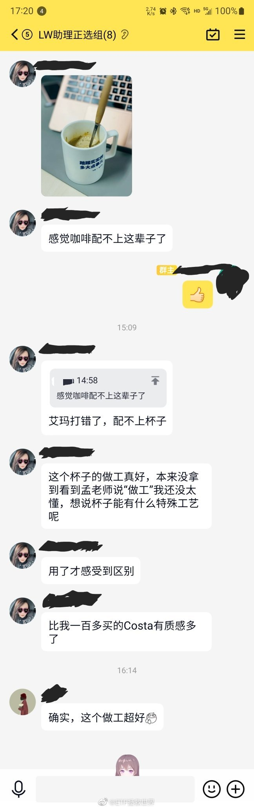

## 2022-03-29 17:41

搞不懂为何如此辣鸡。 ​​​
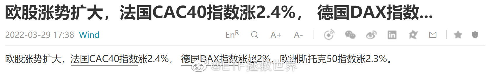

## 2022-03-29 21:54

记住这个图形 ​​​
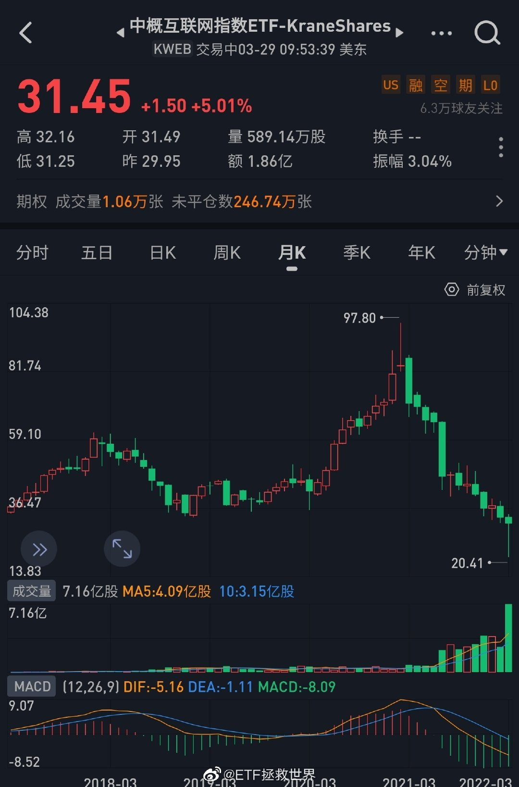

## 2022-03-30 09:39

据我观察，这几年，有一些其实做了很多好事的人，因为有意无意表现出的傲慢或者说优越，遭受了很大的打击。

高调做事，低调做人，不要傲慢，平易近人。 ​​​

## 2022-03-30 13:16

冷知识：

红利今年是上涨的。 ​​​

## 2022-03-30 13:27

是谣言吗。如果不是，真的没有除了死以外其他的办法了吗。

## 2022-03-30 14:18

看淡了涨跌也是一把双刃剑。

账户损失很多钱固然不会心情焦虑，多了很多也没有任何开心的感觉。

哎。 ​​​

## 2022-03-30 15:08

刚才扑杀宠物那条微博下面，大家观点都很不一样。

其实随着人慢慢的成熟，就会明白人与人对于同一件事的看法会非常不同。以前自己会觉得，“怎么还会有这样的人”，后来发现是自己太幼稚了。

人与人的立场不同，性格不同，思维模式不同，环境不同，成长经历不同，所以看法不同，非常正常。

昨天晚上我在书桌前面翻阅数据，小咪走到我旁边，两个前爪扒着我的腿，睁大了萌萌的眼睛看着我，奶声奶气的喵了一声。

我慢慢的把它抱起来，帮它挠挠耳朵，跟它贴一贴鼻子，轻轻的吸一吸它毛茸茸的小脑袋……那一刻我在想，猫和狗，到底是什么时候开始天生的与人亲近呢。为什么全世界只有这两种动物，生下来就知道人类，这个与它们完全不同的生物，会是它们的朋友呢？

猫也好，狗也好，对人的这种感情，人对它们的感情，有人可以体会到，有人一辈子也体会不到。这又是极大的不同了。

这其实很好理解，比如说，

有人会觉得除了中国人，其他国家的人都不算人。也有人觉得除了自己省、市、县、村，乃至除了自己认识的朋友，甚至自己的亲人，更极端一点的，除了自己，都不是人。

其他所有不是人的“人”，为了自己的利益，都可以随意牺牲。生也好，死也好，都与自己无关。“别人”如果生活得好，就非常可气，最好吊路灯；如果生活的差，就非常可笑，一定要欺负嘲笑一下才过瘾。

说了这么多，我也不知道自己想说什么。

我只是希望，如果不能兼济天下，那么至少我们中国人，把同样是中国人的同胞们当成真正的人。尽量保证每个人都值得尊重，每个人都有权利生活得更好，每个人都值得帮助，每个人都值得保护——除了那些被证明是辣鸡的辣鸡。

如果更善良一点，不妨也对我们的宠物朋友更好些。我们吃猪牛羊，是因为我们是动物，我们需要能量。我们对那些生下来就认定我们值得依赖的宠物好，是因为我们是人。

当然，又回到一开始说的：

这些只是我的想法。我的人生，我的经历，我的思维，我的状态，让我有这样的想法。如果你的想法与我不同，也特别正常，因为我们本来就是不同的。

## 2022-03-30 15:17

主要做波段的一个账户这个月这样翻红了。

上个月底清仓也许是对的，就少了这个月上下翻飞的折腾。

然而，清仓了，什么时候买回来呢？如果现在还是空仓，是该买呢还是继续等待呢。

就我所知，空仓要比满仓忐忑很多。 ​​​
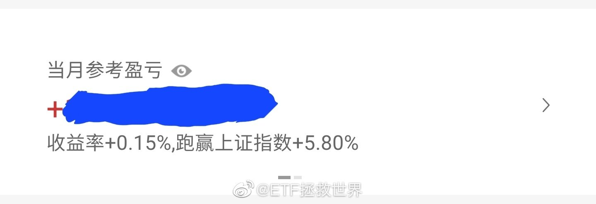

## 2022-03-30 15:37

鹅猫狗有没有可能做点什么？除了拿出1000亿共同富裕，紧急关头利用自身优势做点事情吧，以后可能会打得轻一点也说不定啊。

## 2022-03-30 20:06

给使用且慢跟车的朋友们一个建议：

删除自己在APP中填写的所有“在且慢外持仓”。否则有可能会导致自动跟车失败。

路径是资产——150——拉到最下面——查看明细、修改外部持仓——点开具体品种——删除或改成0。 ​​​

## 2022-03-30 20:28

回复@月是衣上白__:我问一下除了扑杀还有没有别的方法，应该不会被网暴吧。另外据说当地已经出文停止扑杀了，希望大家都平平安安的。//@月是衣上白__:提醒一下E大，这条评论被人截图发出去了，我刚在别的地方看到了截图

## 2022-03-30 20:39

## 2022-03-30 20:50

我的另一半有很多缺点。

但也有很多优点。

第二大优点是非常善良。

她平常胆子不大，坐个滑沙都能吓哭。但有一次做的事情让我刮目相看。

我以前住的小区有一些流浪猫。有一天，一只刚出生几个月的小猫——前方高能预警，心理承受能力差的朋友不要继续看了——

小猫的四个爪子被人砍断了。被发现的时候应该是已经有几天了，伤口已经惨不忍睹。

我必须说我知道的那一刻退缩了。因为太惨了我接受不了……

但平时胆小的她，拿起外伤药和纱布二话不说就去给小猫做了包扎，然后送去了医院。

与一个善良的人一起生活，心里会很踏实。

## 2022-03-30 21:53

美元兑卢布

熊是真的什么都敢干啊。 ​​​
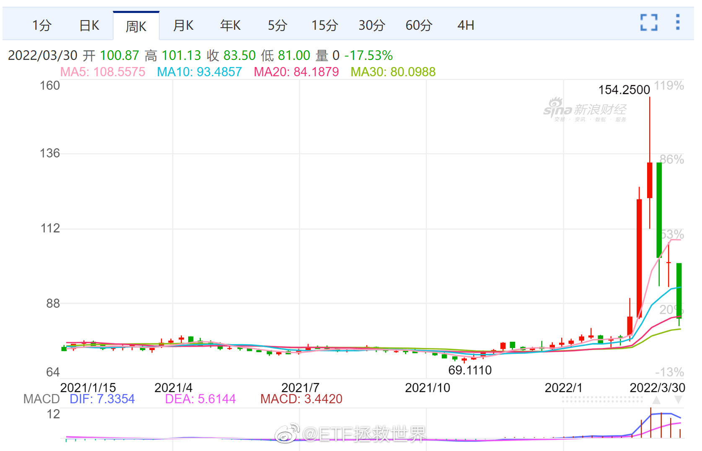

## 2022-03-30 22:11

教育孩子，也要像熊这样，说到就真做到。

教育孩子定规矩，我说了你做了什么样的错事，我就会怎样惩罚你。

当你真的做了，我就真的处罚。

而不是定了规矩不执行，最后孩子就无法无天了。 ​​​

## 2022-03-31 08:49

你有没有发现我们处在一个造神毁神无限循环的环境中。

好就好上天堂，无限吹捧；过一阵坏就坏下地狱，渣都不剩。

其实从来也没那么好，也没那么坏。

对我们的人生经验应该就是，好的时候自己不要嘚瑟，平常心，无论外界如何评价都能正确认识自己，居安思危，明白一切顺利的时候反而危机四伏。 ​​​

## 2022-03-31 09:05

听了两节儿子的网课，发现女生的逻辑思维和表达能力普遍比男生强多了  ​​​

## 2022-03-31 09:54

没想到上一条也能吵起来。

我其实只是像平常一样，如实的说一下我的观察，非常客观独立，自认为。

因为我也是第一次养孩子，也没养过女孩，现在学校也不允许考试排名，所以听了几节网课觉得挺有意思就发一条。

这样，我持续跟踪，到小学高年级，到初中，到高中，看看会不会有什么变化，到时候也客观的发出来。

另外我之前就知道的，8、9岁的小女孩揍同龄男孩毫无压力[doge]

多大点事儿啊，因为这个也能吵一通。没必要没必要啊。你看看是不是又要提款了，赶紧的乐呵乐呵多好啊。

## 2022-03-31 10:25

红利再涨仓位就又要超过20%了。

又要卖了，好烦。 ​​​

## 2022-03-31 10:37

总体来说，我们的单品卖出有几个条件。

第一，超过20%仓位。

第二，贵+到达重要压力线。

第三，非常贵。

第四，贵+右侧。

体会一下。几十个字，能帮你节省10-20年自己总结的时间。 ​​​

## 2022-03-31 10:48

红利连涨四年了。很多朋友觉得它不错，至少很稳，拿着不停涨。

但两年以前关注我的朋友应该知道，我们把那样一个一直不涨，涨的时候涨幅也比不上热门板块的品种，买到了第一大持仓压力多大。

当时被多少人质疑嘲笑。

记不记得有人拿着基金排行，说红利一个月、三个月、半年、一年表现都不好？

这就是资本市场，这就是生活。

现在坏的，未来也许大放异彩。现在好的，未来也许就是万人冢。

你不明白这个，说明你还没入门。

## 2022-03-31 14:15

我感觉到，全都回来了 ​​​
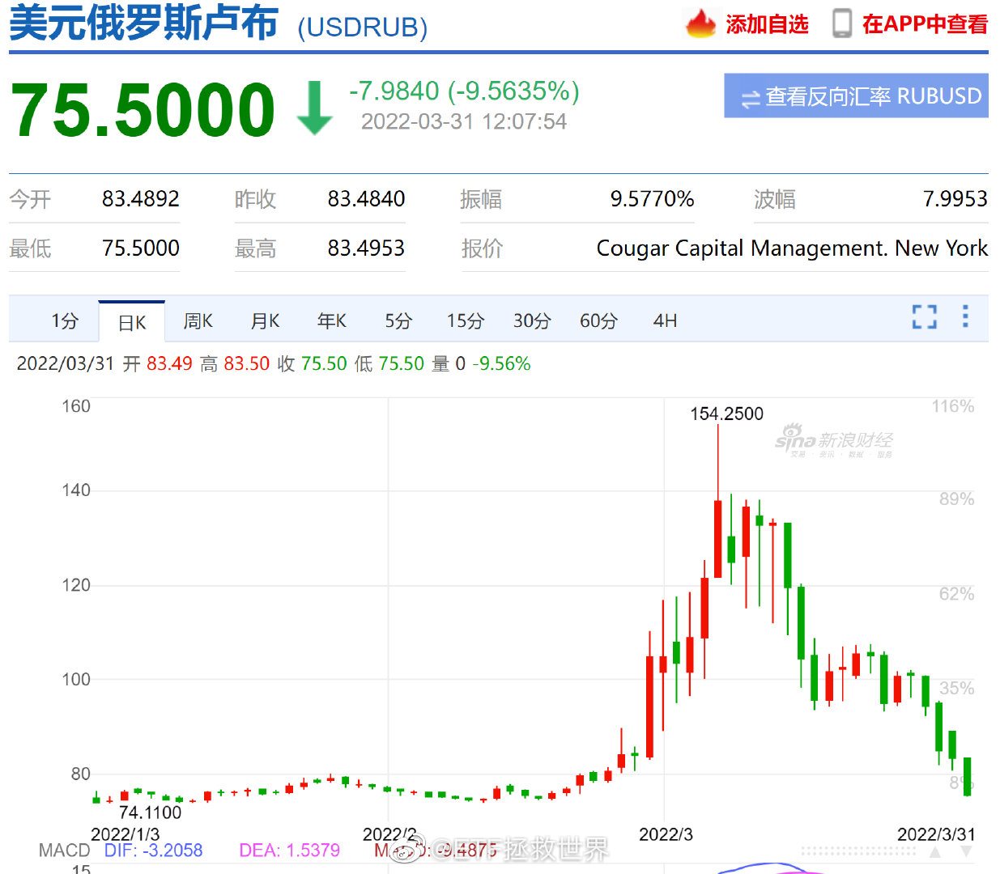

## 2022-03-31 18:45

冷知识：

今年全球主要市场跌幅最大的是俄罗斯市场。

第二名不说了。 ​​​

## 2022-03-31 20:33

回购注销

