## 2022-04-01 09:55

一句话告诉你立场决定观点：

要是以前看到消费这么嘚瑟别人跌它涨我就怒斥抱团可恶了。

现在买了两份我就会微笑的看着它装*。

两份而已。

人类啊！可悲！哪有什么正义，全是利益罢了！ ​​​

## 2022-04-01 11:38

传媒主力是微博管理员实锤了。

又一次精准的把月老封在最低点。

什么时候放出来传媒就要小心了。 ​​​

## 2022-04-01 12:15

上海的朋友，能不能说说你买菜的真实情况。

好买，费劲，还是买不到。

不要骗人哦。 ​​​

## 2022-04-01 12:49

囤菜的话，肉啊奶啊这些东西都不用说了，比较好囤。比如奶要求别太高的话，进口的有那种保质期一年的。应急问题不大。

还有就是罐头，肉罐头水果罐头什么的，2、3年保质期。肯定营养有流失，但你是为了紧急情况又不是为了享受满汉全席是吧。

比较难的是菜，保质期短。但是现在有那种冷冻菜。我家有两种，一种是那种豌豆玉米胡萝卜丁什么的一大包，一种是西蓝花胡萝卜菜花一大包。另外还有一种是冷冻蘑菇片什么的。保质期都是18个月。

如果冰箱够大，准备一些应个急我觉得可以。

但是不知道为什么这些冷冻菜名字都是什么美式啊，加州啊。难道这个冷冻菜是美国人发明的吗，不懂这个。

## 2022-04-01 13:18

回购注销与不注销区别还是很大的。

回购不注销，有可能公司把股票买回去，当做股权激励给员工。但这部分股票并没有消失，再流回市场什么都没变。

回购注销就不同了。公司把股票买回去，注销掉，减少注册资本。比如说以前市场上有100万股，回购30万股注销，市场上就剩70万股了。但公司的盈利啊现金流啊都没变，你说是不是每股价值增多了？那你说好不好？

与之对应的就是增发、配股。这就是稀释股东权益。原来市场上有100万股，增发配股到130万股，原来股东手里的权益是不是就稀释了？当然增发配股不是说一定不好，也许公司拿到钱去发展业务赚更多钱，但总而言之是稀释了。

美股这些年超级大牛市，很大一个原因就是很多很多公司不停的回购注销。

为什么美股公司愿意这么干呢，因为很多公司所有人和管理层并不是一拨人。股东雇管理层打理公司，公司股价涨了，股东开心，给管理层加薪发奖金。管理层天然的有做大市值的冲动。管理层+股东都希望股票涨，那股票能不涨吗。再加上美国是资本立国，国会ZF基本被资本控制，资本希望股市涨，决策层能不害怕股市跌吗。

说回来。总而言之，回购注销通常来讲对股东来说是非常好的。一家公司不停的回购注销，说明这家公司第一有钱，第二真心希望股票涨。不像有些公司，根本不在乎股价涨跌，涨跌对管理层来说毫无意义。如果一家公司自己都对股价涨跌无所谓，那就非常麻烦了。

希望A股更多公司能够大规模回购注销，为股东权益的增加多做点事。

## 2022-04-01 14:16

蓝色区域像不像史塔克家的冰原狼。

## 2022-04-01 14:21

一切都会好的。

虽然这个世界非常辣鸡，但一切都会好的。 ​​​

## 2022-04-01 16:26

关于医疗保险。评论区可以讨论，但不要做广告啊。 ​​​
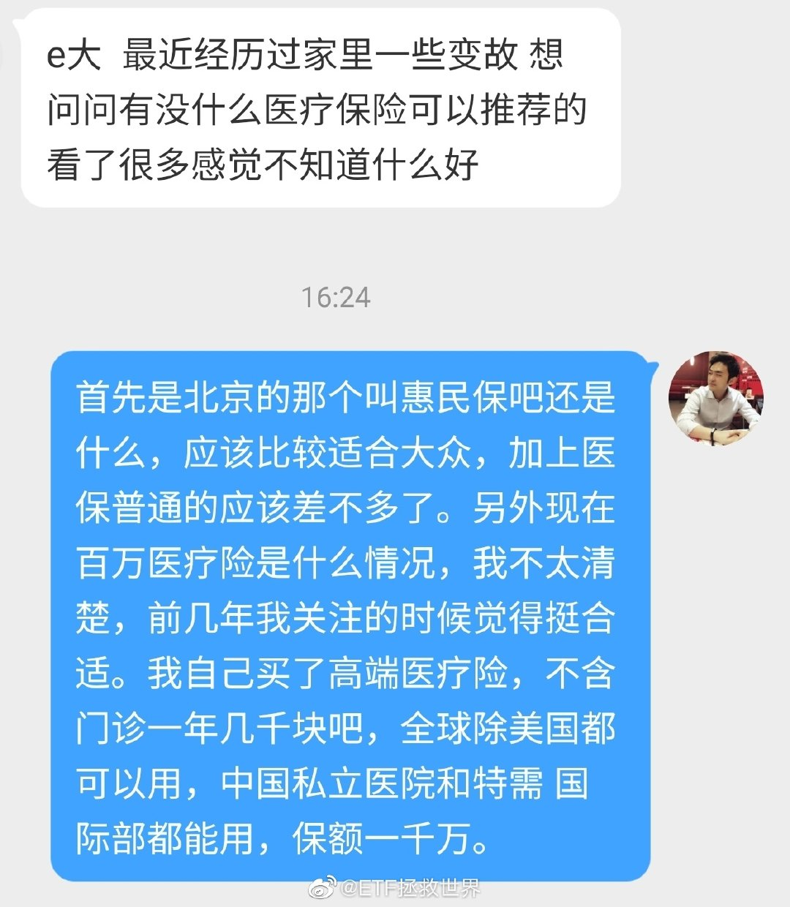

## 2022-04-01 21:37

中概这一天天上蹿下跳跟神经病似的，烦死了！ ​​​

## 2022-04-02 15:20

刚才的投票只有几分钟，但是也有几千朋友投了，基本上1：1吧。

其实我有个技术上的问题，后期如果放开，可能需要每个人都弄清楚的：

轻症一定是居家了，不然医疗系统肯定瘫痪。但是如何界定轻症还是重症呢。还有，婴幼儿与成人的标准一样吗。

弄清楚了，大家才知道什么情况去医院，什么情况在家呆着。

无论如何，各种生活必需品多准备一点不会有大错。

## 2022-04-02 16:31

回复@OliviaXKuo:我这里的朋友理性，客观，特别好。//@OliviaXKuo:e大评论区已经比其他地方好太多了

## 2022-04-02 18:40

就是说，你们家的小猫会不会在你工作的时候跳到你肩膀上，然后走到你头上……

然后趁你还没发火又把脸凑过来亲亲你的嘴。 ​​​

## 2022-04-02 20:24

下周开盘，如果没有大的变化，至少S，想买点东西。 ​​​

## 2022-04-03 14:34

懂的都懂，不解释 ​​​
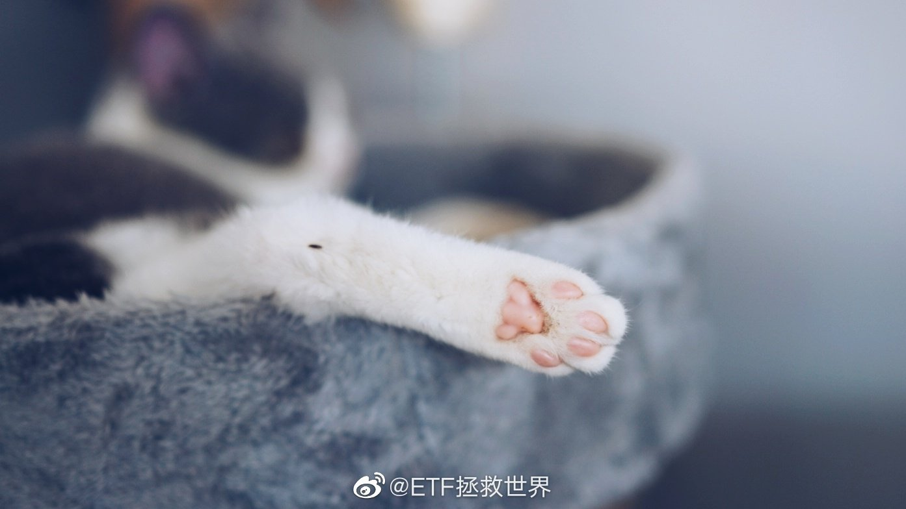

## 2022-04-03 15:27

年初的微博，可能当时很多朋友会觉得可笑…顺便说一下，我在此基础上一直在加仓。目前看只要有水电，坚持三个月左右问题不大。

## 2022-04-05 09:49

套路拿捏得死死的：

a股休市涨，a股开市跌。

有没有一种可能，是A股… ​​​
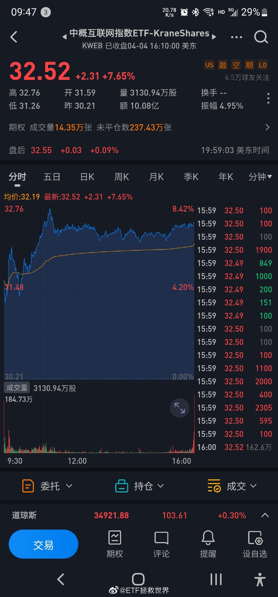 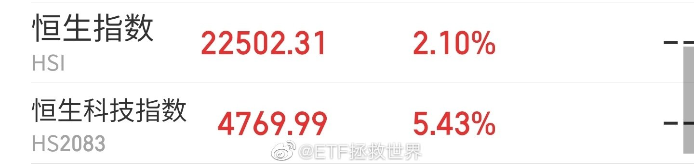

## 2022-04-05 09:51

跌这么多回到“合理水平”，潜台词就是，之前高位的时候并不合理。问题来了，不合理的时候为什么没人说话？

## 2022-04-05 13:23

趁着A股不开盘，恒生指数偷袭到了22500，超过了22000。

几个月甚至更久之前我就已经把恒生的几个关键点位明牌放出来了。

18500不用说，致敬底。致敬不解释。

18500-22000点，港股价值区域。

如果能有效突破22000，那么25000将是下一个关键压力位。

再下一个关键压力位，则是30000点——那将是致敬仓位的出货区域。

再往上，则是32500左右，是150、S等长期指数卖出大部分仓位的点位。如果再涨，就到了外太空，无法再判断。

你现在觉得32500是个笑话，因为半个月前你刚刚在18500听说恒生已经边缘化。然而未来有一天到了32500，就又会有一帮人叫嚣着南下抢夺定价权……

世事轮回，无非如此。观察人性，资本市场是个极好的地方。

## 2022-04-05 22:04

岁月如飞刀，

林志颖也快50了… ​​​

## 2022-04-06 07:49

在微博上关注了很多人。

关注谁不代表一定认同谁。在很多事情上，会关注完全不同观点的对立双方。

即使对某人的观点不认同，也可能会关注，因为这样才会更加全面，只要他言之有物。另外，谁说自己认同的观点一定对呢。

但是有一种人我会取关，就是说不出任何有用的信息和观点，就是在不停的宣泄情绪，不是论事，而是为了支持而支持，为了反对而反对。

关注这种人，纯粹的浪费生命。

## 2022-04-06 09:31

拿捏了 查看图片

## 2022-04-06 09:41

记得吗，那时候1000亿申购，200亿买到。90倍估值，当时到底是什么样的人在买？今天又新低了，回看一下，无限感慨

## 2022-04-06 09:49

回复@ETF拯救投资小白:估值90倍：有人发行产品，有人猛推销售，有人举着钱买入。无话好说。//@ETF拯救投资小白:鸡精经理接盘侠？//@ETF拯救世界:记得吗，那时候1000亿申购，200亿买到。90倍估值，当时到底是什么样的人在买？今天又新低了，回看一下，无限感慨

## 2022-04-06 09:54

环保也新低了。

但我不想说这个前任什么坏话。

毕竟，

赚过。 ​​​

## 2022-04-06 11:25

红利持仓周期太多啦，不能买啊。

有些人这样说。

今天煤炭、有色跌了，红利依然在涨。已经是去年9月以来新高了。

他们不懂红利，不懂组合，更不懂投资。 ​​​

## 2022-04-06 11:45

能与有共同理想，共同追求，共同目标，共同价值观的人在一起做事，是非常幸福而且难得的。

如果你有，要珍惜。 ​​​

## 2022-04-06 13:39

唱唱反调：

一个品种表现越好，越要警惕。不要上头。

就是在说那个第一大仓位又不停上涨的品种。

我们持仓的品种，涨了，我绝对不会吹它还能涨多少，而是说风险会越来越大。

这是做人的底线。 ​​​

## 2022-04-06 14:06

一般来说，一个品种，除非你特别想配置或者加仓，另外如果不是很便宜，

那么最好不要新低的时候买。

就像新高最好不要卖，等一等。 ​​​

## 2022-04-06 14:13

我觉得应该开发一个相对右侧的计划。

因为有些朋友不太适合买了就跌的左侧，他们会认为买了就跌持仓体验不好——虽然也许只买了不到1%。

那就应该走右侧。 ​​​

## 2022-04-06 14:23

有朋友问了：你说xx很贵，但你说贵了以后人家有人买了，还赚了不少，你怎么说？

我说，

你造吗，历史上杀人放火金腰带的事情多了，现在也有很多违法乱纪捞偏门发财的例子，那么，你要去照做吗。

做不对（自认为）的事情，也许会有收益。这时候你做不做？

我的选择是不做。

赚钱了不代表对。虽然这是一个利益至上的时代，但总应该有一些原则是要坚持的。

投资也好，日常也好，都应该是这样。

## 2022-04-06 14:34

其实很多东西相克相生。

地球正是因为物种的多元化才能生生不息。

很多你讨厌的声音，也是维持生态不可缺少的一环。

如果所有声音都完全一致，恐怕也未必是太好的事情。 ​​​

## 2022-04-06 14:45

其实平台是不太喜欢我这种的… ​​​
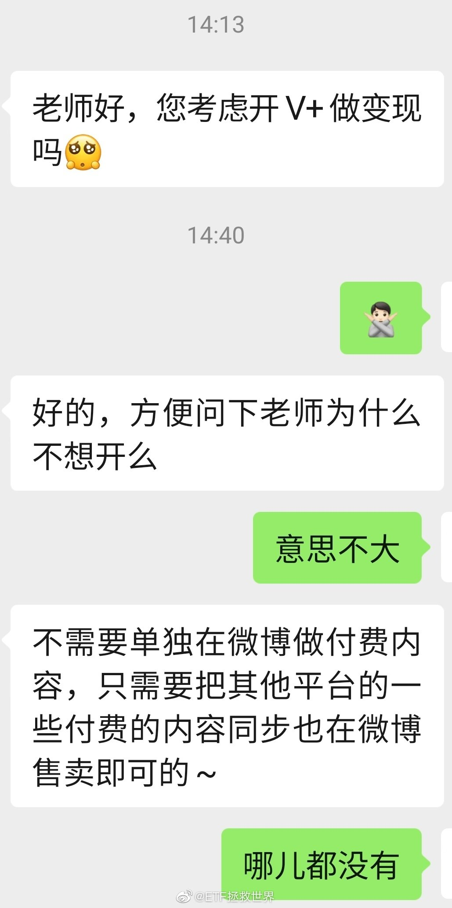

## 2022-04-07 10:37

懂的都懂

## 2022-04-07 16:51

之前两年，我都一而再再而三的请新朋友不要参考我的投资计划。原因有二：

第一，你没有安全垫。老朋友一堆收益率几十甚至翻番的品种，你没有。

第二，在过去两年入场，我看不出有什么好的确定性的机会。

有朋友不听我的，现在应该果然是没赚什么钱才对。

但是今天，我可以说一句，

在这个环境下，新朋友如果希望参考我未来的投资，在做好买入即跌的心理准备下，我本人开始表态：不拒绝。

因为现在已经没那么疯狂了。

我这样的，你应该很少见到。因为我希望朋友们都在低位买入，而不是高位都来凑热闹，最终价值毁灭。

我知道市场是什么样的，我也知道人性是什么样的。我希望逆人性而动。包括各位，包括我自己。你和我都能拒绝利益的诱惑，才有可能一起奔赴胜利。

## 2022-04-07 17:08

10号是周日。

那么明天就是一个重要的时间窗口。

买还是卖。所有人都需要做出选择。 ​​​

## 2022-04-07 17:13

回复@乾坤日夜服:上一个说我说话神神叨叨的人在小黑屋里睡得很安详。//@乾坤日夜服:E大这种说话神叨叨的风格特别适合于吸引有好奇心的小白…..

## 2022-04-07 18:24

明天继续下单囤东西。 ​​​

## 2022-04-07 18:41

回复@慵懒操盘手:留念。以后会翻出来。//@慵懒操盘手:嗯，继续砸港股，港股和中概我还是那个看法，是永远不可能反转的。他们和原油不一样，本身就没有周期性，在中国人口红利见顶之下，跌下去就很难反。//@ETF拯救世界:懂的都懂

## 2022-04-07 19:11

但是我要再次提醒，不要随意“重仓”、“满仓”、“上杠杆”。

大概率、极大概率，不代表100%。

在投资的世界里，没有100%的事情。你始终要为那1%甚至0.1%做准备。

投资啊，尽量不要发生资产大幅回撤。

人生啊，只要富一次就好。 ​​​

## 2022-04-08 08:13

时间窗口延期了。

## 2022-04-08 09:57

不要催。

我要听你的买入是不是又浮亏了。

不要急，再观察观察。

想买的品种不停的新低你急什么。 ​​​

## 2022-04-08 10:19

明明白白，清清楚楚，踏踏实实。 ​​​
 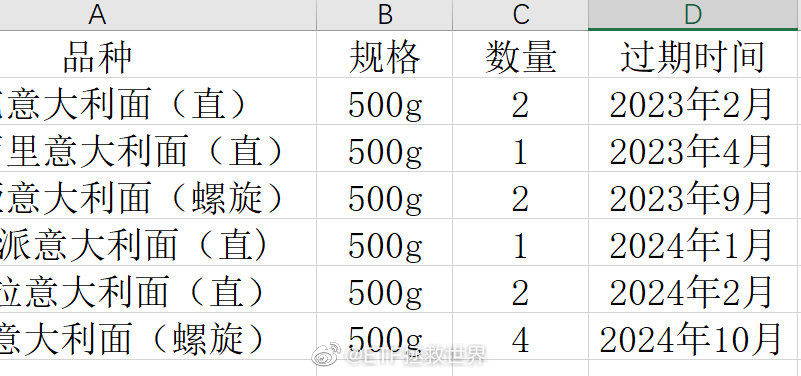

## 2022-04-08 10:48

S下午有可能会加1-2份。不一定。看走势。 ​​​

## 2022-04-08 13:07

不要让同事知道你有百万存款。

## 2022-04-08 16:33

再次忏悔：

90%的错误，都来源于不相信自己设计的策略，定下的规矩。

犹豫、懦弱、怀疑……

执行，坚定的，用钢铁意志去执行！ ​​​

## 2022-04-08 17:12

今天的养老体现的是高抛低吸；信息体现的是时间+空间。

感受一下。 ​​​
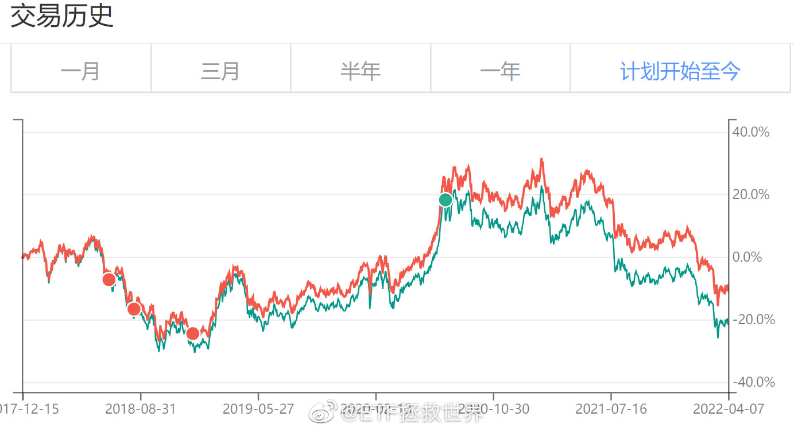 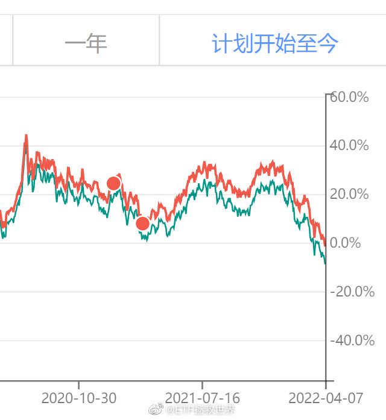

## 2022-04-09 13:45

食品库继续建仓。

京东已经要几天后送货了，今天从本地超市进货。 ​​​

## 2022-04-09 14:08

怎么还有人问买的什么，会不会过期。这点东西几年吃完怎么会过期。好些东西也不需要冰箱。

## 2022-04-09 14:32

怎么总有人把做准备跟焦虑划等号呢。

多买一点未来会吃的东西。有事，有备无患。没事，慢慢吃呗。

什么事情都不提前准备，真发生了到处抓瞎哭呗？

焦虑是什么，是你没准备你才焦虑。你把能做的准备做好，能想到的问题都做好预案，你焦虑什么？

焦虑有用吗？屁用都没有。努力做好能改变的，坦然接受不能改变的，不就完了吗？

多大点事儿啊。别说除了生死都是小事了，就算是生死，真有什么吗？我个人来说，除了孩子太小什么都没经历过觉得可惜，否则明天地球爆炸外星人入侵我都觉得无所谓。

真有多大事儿啊？生亦何欢，死亦何苦？生死都不怕，还有什么事值得焦虑啊。

踏踏实实的。

## 2022-04-09 16:52

2021年11月1日，商务部印发《关于做好今冬明春蔬菜等生活必需品市场保供稳价工作的通知》。

其中明确指出，“鼓励家庭根据需要储存一定数量的生活必需品，满足日常生活和突发情况的需要。”

说我制造焦虑？我是按照国家部署，部门指导意见，在形势复杂的情况下提前做好准备，争取不为国家添乱，在关键时刻，将有限的资源让给更需要的人。

想给我扣帽子？您歇歇吧。

## 2022-04-09 20:33

对我有什么意见、建议、抱怨、不满，不妨在评论里开诚布公的谈谈。

红红脸，出出汗，不用客气。 ​​​

## 2022-04-09 22:38

两个小时过去了，一无所获，收杆儿睡觉。行吧，都挺机灵的

## 2022-04-10 08:45

骂A可以，千万别捧B贬A。

谁都禁不起捧，捧高了摔的更疼。 ​​​

## 2022-04-10 18:46

三个月过去，这两天已经最终建仓完毕。后期只需要正常增减保持长期仓位。这个话题以后不再说了//@ETF拯救世界:年初的微博，可能当时很多朋友会觉得可笑…顺便说一下，我在此基础上一直在加仓。目前看只要有水电，坚持三个月左右问题不大。

## 2022-04-11 09:54

环保又是3个点，新低。龙头6个点。

两个问题：

第一，机构云集的赛道崩塌，他们会继续看好继续重仓吗。

第二，六月的指数成分股调整，大指数会把这一年多来刚刚调入的，暴涨后又暴跌的股票再调出去吗。 ​​​

## 2022-04-11 10:07

科创即将跌破1000点+终于快跌破50倍了。这个指数存在2年，所有买入还没有卖出的全都被埋了。即使如此，依然是50倍……好消息是，相比2年前的1000点，估值已经降了很多了。那时候……是80倍。

## 2022-04-11 10:23

个股我不讨论，因为个股的估值非常非常复杂。不是说亏损或者PE 400倍就不能买，也不是说PE4就一定有价值。

但是，指数，你永远应该记住一句话：

如果你买60、70、80甚至更高估值的指数，那么，你就应该做好随时跑路的准备。如果你不知道怎么跑路，那么就应该做好被深套的准备。

如果你不会跑路也不想被深套，那就——别买。

## 2022-04-11 10:44

有人问：xx那里为什么科创50只有30多倍估值？

我的回答：

第一，这个问题你问我干嘛？不应该去xx问客服吗？

第二，科创50一共50支成分股，其中40倍以下的15支，大部分都非权重股。这个30倍难道不是很可疑吗。

碰到任何问题、数据、说法，我们应该想一想，看一看，查一查是不是合理。别人说什么你就信什么，那就很危险。

我的大部分身家都买指数基金，所以我绝对不会相信任何人的数据，这十几年，一定要自己算才踏实。

## 2022-04-11 13:13

回复@ETF拯救世界:7个月前给的价位。信息从4300上调到4500。该位置配满信息科技仓位。一切尽在掌握。//@ETF拯救世界:历史低价信息4300，医药9500。可梭哈一把配满。

## 2022-04-11 13:21

很多人一看到跌就慌了。

为什么慌，因为他根本没想过会跌。或者说，没想到过会急跌或者阴跌。

我在买一个品种，或者想买一个品种的时候，会计算一个“能理解的最低位”。然后以这个位置为基础，左侧也好右侧也好，布置自己的资金进去。

如果价位并未跌穿你的“能理解的最低位”，有什么慌的？不是一切都在预料中吗？

什么，你没有计算出“能理解的最低位”？

那还愣着干什么，赶紧刷我微博啊。

PS，这个最低位能不能跌破呢。当然了，任何事情都有可能发生。这是一个概率问题。

我自己计算的最低位，从历史上看，不是说没跌破过，但一段时间之后，绝大多数都被证明那是一个非常好的价位。

（历史不代表未来。这还是一个概率问题。）

## 2022-04-11 13:28

科创50现在是不是低位，今天之后能不能涨我不知道。

但这是科创50自由流通市值前20位的股票TTM PE。

你告诉我这个指数估值只有30多倍，无论如何我是不信的。 ​​​
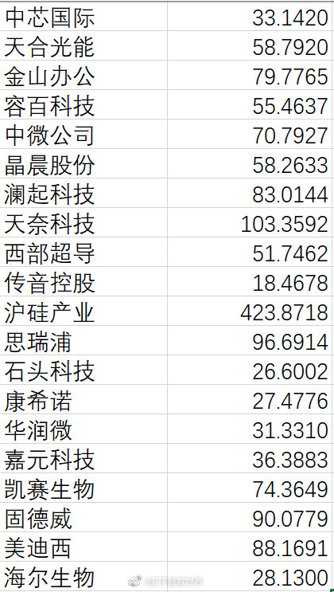

## 2022-04-11 13:31

整体来看，科创的优势是利润增速其实不错。未来我也想买，也大概有个买入区间。但这个就不说了，因为指数太新，比较模糊，还是不说了。看看未来150和S有没有机会买吧。

## 2022-04-11 13:45

老朋友都知道我喜欢的三个品种：

消费、医药、科技。

消费和医药不用说了。

科技方面，中概+恒科主要配置的是“软科技”，而A股上市的大多数是“硬科技”。当然，到底这些企业到底有多少科技含量我们不讨论，只是说会这样划分。

所以未来中概恒科+信息或科创等品种，使我们配置科技板块的思路。 ​​​

## 2022-04-11 14:45

今天的数据让人期待。

人生第三幸福的事情，就是每天看着数据一个个跑出来。 ​​​

## 2022-04-11 15:23

我提两个改善情绪的办法。

一、运动；二、吸猫（脾气好又很软的那种）

各位还有什么别的方法不妨也展示一下。 ​​​

## 2022-04-11 15:39

今日数据：

时隔四年，再次向钻石坑飞奔。 ​​​

## 2022-04-11 15:45

根据最新数据，150终于可以加A股仓位了  ​​​

## 2022-04-11 17:00

关于“投资群”，我的一点想法，至今未变。总而言之，投资群就是耽误时间+几乎没有营养+各种牛鬼蛇神出没+小白互相干扰的一个地方。真那么有时间在里面聊天，去做点有价值的事情不好吗。

## 2022-04-11 17:01

这条也是关于我对“投资群”看法的。新朋友可以考虑一下。

## 2022-04-11 17:54

特别难。难在哪里。

你左侧买吧，他说参考了你的买了就亏；

你左侧一点都不买全都右侧吧，万一一根大阳线手里什么都没有他又说你踏空了；

你分成150份，左侧买10份吧，他说：什么150？我只看买了的这10份！

你说现在高位，新朋友别跟了。他说我就要跟。浮亏了我就骂你。

低位你说咱们第三轮牛市顶部开始建仓，最差的时候整体也没赔过钱。他说买余额宝的都没赔钱。

低位你说我跑赢了同期沪深300接近50%，跑赢中证500超过70%，他说你年化多少？

高位你说我年化上来了，他说你跑赢最疯狂的那个指数了吗？

你说我是第二轮最高点清仓后牛市最高点开始的第三轮，不能跟熊市最低位开始的组合比。他说高点开始低点开始都一样。

我承认我菜……您走吧……

## 2022-04-11 19:09

娱乐不是罪。

成年人的不是，

孩子的也不是。

人应该快乐的生活，而不是重重压力，无限焦虑。

人们需要快乐。 ​​​

## 2022-04-11 21:12

我不抽烟啊。

但我有个问题问问烟民朋友们。

如果你在一个买不到烟的环境里，好几天没抽了好难受。有人说他能搞到，但不好搞所以要加价。

你会出多少倍的价格去买。

1倍、5倍，还是10倍原价换一盒。 ​​​

## 2022-04-12 10:20

我有一个想法，

我觉得对于行业来说，可能是那种，能活着但活不好，快死了又没完全死，不要赚太多钱，也不要赔钱，能解决就业和社保，又不会产生太大利润，

应该是最稳的。 ​​​

## 2022-04-12 13:11

为什么要拉？不拉行不行？

车都发动了你给我来这一手？ ​​​

## 2022-04-12 13:16

还有，提款17%的那个品种还差一点点就又可以接回来了。

谁在拉？你哪个单位的？ ​​​

## 2022-04-12 13:25

心里堵得慌。 ​​​

## 2022-04-12 13:30

日经ETF新低了。

依然不买。

还是汇率问题。

日经不跌，ETF因为汇率跌不少，买进去没有道理。

最好的局面是：

未来日经跌到可以买的地方，同时汇率跌到极限，买入。

那么就是双击。估值修复+汇率上升。 ​​​

## 2022-04-12 13:33

今天本来犹豫买三个。

现在不用犹豫了，买一个没那么暴躁的吧。 ​​​

## 2022-04-12 13:56

前几天那位因为给快递小哥打赏200元，被网暴“打赏太少”，最终跳楼的女士，

如果在天之灵看到今天网民又在网暴每单平均被打赏100多的快递员，

不知道作何感想。

你真觉得大部分人类是值得被爱的吗。

扯淡。 ​​​

## 2022-04-12 14:59

今天很不开心。

感觉被偷家了。

更不开心的是如果明天继续跌，那就是被偷家*2。

K**。 ​​​

## 2022-04-13 07:52

有些人抱怨，新股发行多啦，估值上百倍贵啦…其实没什么抱怨的。

这就是市场化发行。多也好，贵也好，你不申购不就行了？大家都不申购，券商包销，发一只赔一只，你看看还能发出来吗，发不出来不就平衡了。

这就是市场化。

好嘛，不管多贵你都去买，新股必胜，跟一级市场一起割二级市场的韭菜，可能永远持续下去吗。

不过有一点，各位如果发现无论公募私募，有不把投资者的钱当钱，无论什么新股都申购，那就直接拉入黑名单，该基金经理的产品永不再买。

## 2022-04-13 08:05

分享图片 ​​​
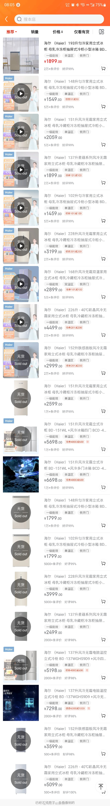

## 2022-04-13 10:18

随着时间的推移，医药指数左侧买入完毕点位上移至9600。不玩虚头巴脑，明牌。

## 2022-04-13 11:13

【FBI Warning！ 本条微博非上海朋友不要评论！】

上海现在比较困难，最近一直想着能为大家做点什么。昨天看且慢发了一些物资礼包，我觉得，我也可以。

这条微博，抽66位上海的铁粉朋友，我自费送每位单价500元+的食物礼包。

【FBI Warning！ 本条微博非上海朋友不要评论！】

但是有几个点一定请知悉：

第一，我，以及且慢具体操作的朋友会尽力做好这件事。但现在的情况你也知道，物资组织、物流运输、小区封控等各种问题，不一定能把物资送到每一位被抽到朋友的手上。如果抽到你了却因为不可抗因素没有拿到，请别骂也别投诉，我们都是一片真心。

第二，抽到没拿到的，收货信息不规范的，忘了填收货信息的，被外地朋友误评论抽走的，就会有一部分物资剩下，剩下的会继续第二次再在这条微博里抽掉。

第三，我本人没什么钱，只能做一点小事。以后发财了再多送吧……

祝所有人都平安顺利，祝国泰民安。

【FBI Warning！ 本条微博非上海朋友不要评论！】

铁粉+评论+上海。今天15:30抽奖。 http://t.cn/A66u7rAC

## 2022-04-13 13:41

该涨的偷家，该跌的一网17%的又在涨。

是不是要去拜拜了。 ​​​

## 2022-04-13 13:50

每次看到这样的人，才会觉得一小撮人类值得被爱，也会想为这些人多做一点什么。 ​​​
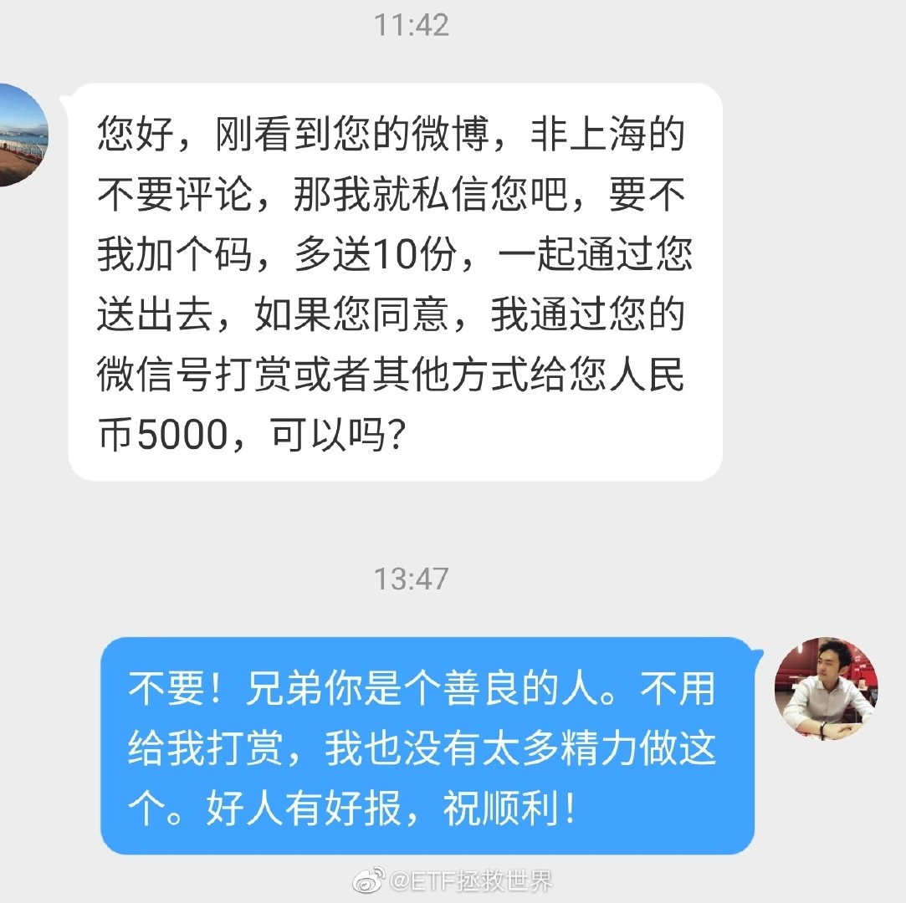

## 2022-04-13 14:17

什么玩意儿啊，对自己的智商和判断力产生严重的质疑：

对于某些事，看一方说的觉得有道理我支持，再看另一方说的也很有道理我也支持。

看一方的数据觉得没错是这样，看另一方的数据又觉得你说的也没错啊。

WTF，小丑竟是我自己。 ​​​

## 2022-04-13 15:35

恭喜@雪英珺 等66名用户获得【单价500元 食物礼包一份】。微博官方唯一抽奖工具@微博抽奖平台 对本次抽奖进行监督，结果公正有效。公示链接：网页链接

## 2022-04-13 15:38

今天数据出来两个事：

第一，很想放一张行业数据图，后来决定下次公众号文章放。

第二，科创50终于快跌破50了。从96下来的。 ​​​

## 2022-04-13 16:45

北京的房价是不是涨了。偶尔打开链家一看，比去年高了。 ​​​

## 2022-04-14 10:29

还有15位中奖的朋友没有填写收货信息。我已经单独提醒，请尽快填写，截止时间今天15:00。因为要尽快操作送货，不能没完没了的等。

## 2022-04-14 10:51

环保继续新低。再说一次，如果你不知道买什么，记住不要买贵的。但我不想说前任坏话，环保留给我们的记忆是美妙的。。

## 2022-04-14 11:49

吉林 尽快恢复正常生活吧。

## 2022-04-14 12:30

其实很多争论，就是源于所处的位置不同。屁股不同，立场不同。

是不是触及到了自己的利益，会有很大的不同。

不说了。说不清楚，一言难尽。 ​​​

## 2022-04-14 13:08

今年的目标：完成医药+消费+科技的配置。

今天继续。 ​​​

## 2022-04-14 13:22

什么意思，又要偷家是吗 ​​​

## 2022-04-14 13:51

这世界充满恶意。什么玩意儿。

## 2022-04-14 14:07

回复@就是干委员会会长:不看事实是吧。前天信息发车的时候明明是下跌一个多点创新低，一边发车一边开始拉升的。怎么是大跌不买呢。//@就是干委员会会长:怎么最近都是第一天大跌不买，第二天中午横盘买，下午飙升，为啥大跌的当天不买呢，是时间未到吗

## 2022-04-14 19:43

能从别人的错误以及遭遇中学到东西的，是聪明人；

能从自己的错误和遭遇中学到的东西的，是明白人。

一而再再而三重复在一个地方犯错的，是傻子。

感谢互联网，让我们有那么多机会看到各种各样的错误和不幸。所以，在看热闹的同时，也应该多考虑考虑自己从别人的错误中学到了什么，做什么准备会减少或规避不幸。

## 2022-04-14 19:55

医药行业的业绩增速是真的真的很稳。

统计十年了，只有几个季度是略微下降的。 ​​​

## 2022-04-14 20:01

如果你冰柜有货，销量还可以翻几番。

## 2022-04-15 09:39

看环保，也就是新能源、碳中和之类的走势，

再次感叹一下抱团、赛道。

连带着，这两年把疯狂股票调入指数的大指数，也依然无法下手。（不是说任何人都不能买，而是依然不到我们加仓的条件）。

而50和300，距离我们减仓已经下跌30多个点了。

疯狂的时候，看什么都合理，都对。但是均值回归，谁也跑不了。

## 2022-04-15 10:17

不停的有朋友问500的问题。

我给两个点吧。

如果是空仓，特别想买，那么5900左右买一点点我看问题不是很大。

如果你能在4750-4800之间买到，那么直接买10%-15%仓位极大概率不会错。 ​​​

## 2022-04-15 10:24

医药消费红利顽强翻红，背后原因令人暖心。 ​​​

## 2022-04-15 12:23

有人能收到就好。

看了一下，这点东西价格贵是真的贵，但特殊时期，能解大家燃眉之急就行。

 ​​​
 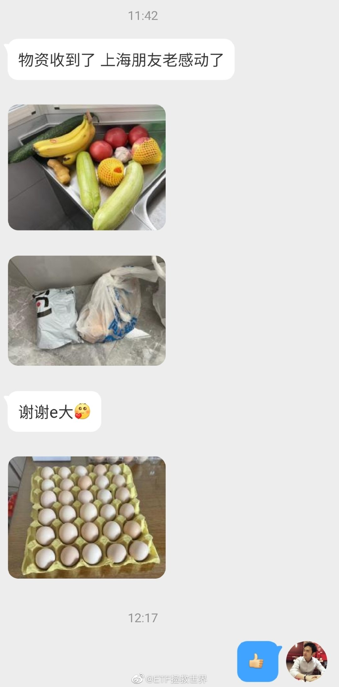 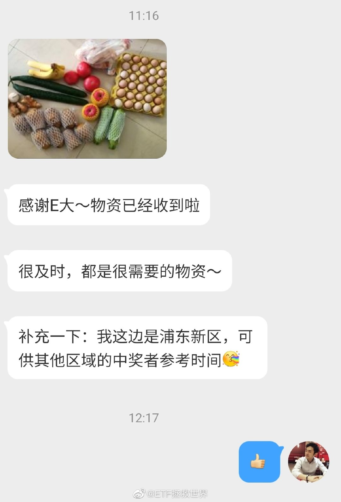 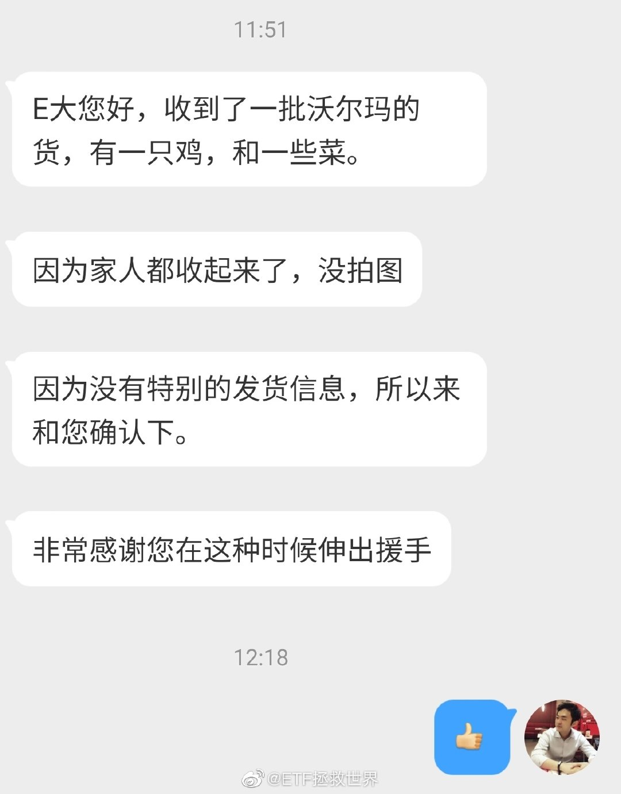

## 2022-04-15 14:12

我说几句很多很多朋友会不认同的话。但这就是我真实的想法。

去迪士尼或者环球影城，如果多掏点钱，就可以买到速通卡，不用排两三个小时的队。

去医院看病，多掏点钱，可以去特需或者国际部优先就诊，不用起很早去排普通门诊。

有些人愿意用钱换时间，有些人的病很严重，一部分人愿意多掏点，就选择掏钱。

我觉得这很正常，也很合理。

这里面最重要的，是要能保证不加钱也能得到，只是慢一点。比如不加钱也可以排队玩项目，不加钱也可以排队看病。

现在的情况也是。你愿意加钱，就送的快一点，当天就到。不愿意加钱，也有正常的团购渠道，3、4天到。我觉得这是合理的。

不能接受的是什么，不能接受的是在正常价格浮动之外，根本买不到。或者在准入许可方面不公平，有什么猫腻，就像当年计划经济的时候，把物资批给谁谁就能挣钱，导致各种问题。

综上，我愿意加一些钱给那些朋友加快配送，这是我自愿的，我也觉得很合理，因为我赶时间。花钱买服务，很正常。

## 2022-04-15 17:59

其实把钱给别人帮自己代买彩票的人，根本从心里就不相信自己会中。

## 2022-04-15 19:48

纯技术问题啊。请海外的朋友解答我的疑惑：

外国是如何规定电子游戏的。包括对成年人和未成年人的限制。包括分级，游戏时间限制，游戏上市审批限制等等。

不在海外的别瞎扯，否则别怪我拉黑。

客观帮忙解答问题，陈述事实即可，不用有任何评价或者别的。 ​​​

## 2022-04-15 20:43

消费小贴士：

本月18号开始又要发北京消费券了。连发6个月，京东可领。

限经纬度在北京的朋友。 ​​​

## 2022-04-16 09:11

不知道之前说我贩卖焦虑的人看了是何感想。 ​​​
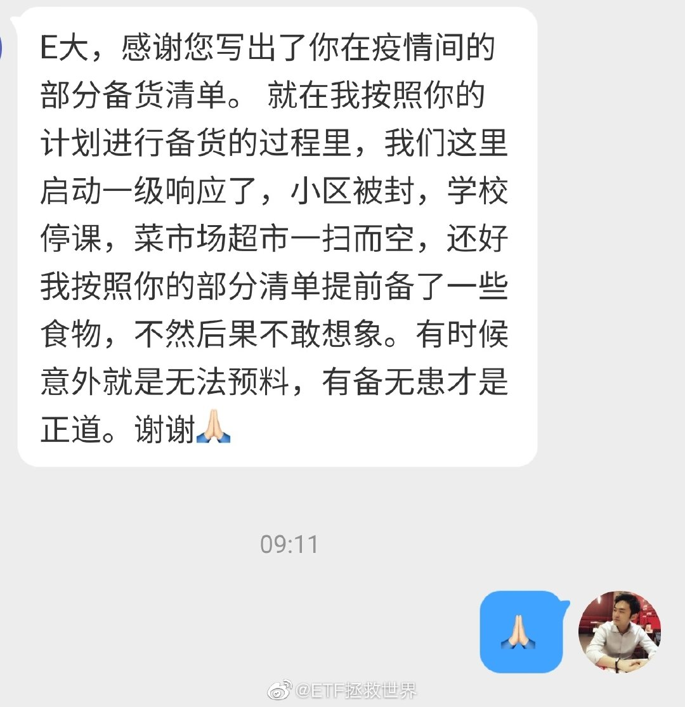

## 2022-04-16 20:32

咖啡达人请推荐你觉得好的豆子。 ​​​

## 2022-04-18 09:51

科技信息这么挣扎我不喜欢。

一把干到4500让兄弟们再买点才是你正确的选择。 ​​​

## 2022-04-18 10:33

长线仓位没有加仓霉霉的原因，主要是A股仓位问题。

目前A股60%多的仓位非常合适，如果算上可转债甚至有点超。如果加多了，以后消费买不买，医药买不买，科技买不买。这些品种可是已经进入建仓区域了。

前几天有朋友说，羡慕你们还有现金的。

对，为什么会还有那么多现金，是因为一直在克制欲望，以及从一个更加整体的角度去调兵遣将。

## 2022-04-18 10:41

对霉霉感兴趣的朋友，请关注后续是否会跌破前低931。如果不跌破，那么这里就是一个极其标准的80%+双底。

## 2022-04-18 10:52

很多男人的乐趣，就是买一堆各种各样的工具，

但实在是找不到地方使用，一直放着，

突然有一天有用了，很开心的拿出来用一下。

即使是安装拆卸一个螺丝，能用上买了很久的电动螺丝刀，也会猛男狂喜。

（没有说女性不喜欢的意思，因为本人男性，只了解部分男性的状态，不了解女性，望周知。respect）

## 2022-04-18 11:07

有多少人的心愿是有一个工具房，里面有各种工具，有空就去做个木工活，做点旧物件翻新之类工作的。

## 2022-04-18 14:48

今天易方达信息如果能涨2.7%以上我会觉得比较满意。 ​​​

## 2022-04-19 09:31

3.26%。一朵小红花。

## 2022-04-19 21:34

有没有一种可能，usd对rmb汇率涨叠加恒生中概涨，双击呢。

就当我做个美梦吧… ​​​
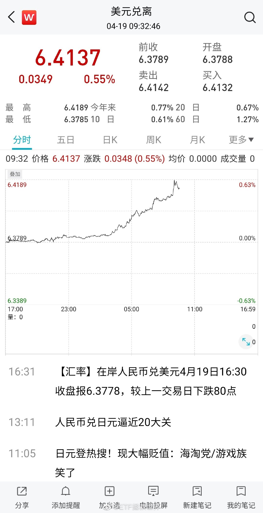

## 2022-04-20 08:45

这个问题之前说过了。

不要在原计划高位加仓，否则全乱了。

新开一个，只买便宜货。 ​​​
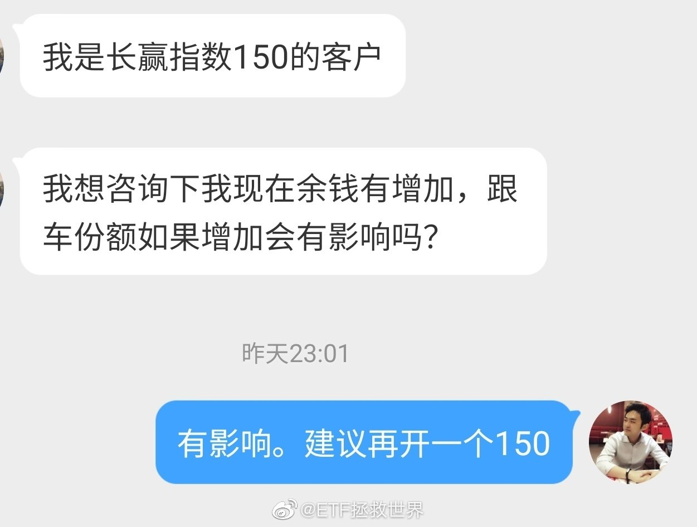

## 2022-04-20 09:04

通利分红选现金 ​​​

## 2022-04-20 10:14

这一把跌下去算什么，送温暖吗。

表格稍后更新。 ​​​

## 2022-04-20 13:59

创业板指又新低了。为什么它先新低呢。

2020年初，宁德在它的权重中只有6%，第三大权重股。

然后宁德一路拉升，创业板指一路增加权重。到了去年底，权重17%。

牛市加仓，一把赔光。

懂了伐。 ​​​

## 2022-04-20 16:05

这几天事情非常多，需要我处理，发博比较少。

一会抽空跑一下数据，有惊喜的话会说一声。 ​​​

## 2022-04-20 16:35

回复@给菲菲摘月亮嘛:一个品种，你的持仓收益率接近50%。某天回调3个点，你说“亏了3个点”，让人感觉像个不适合投资股市的人。//@给菲菲摘月亮嘛:红利要卖么今天亏三个点

## 2022-04-20 16:46

这两天发博比较少，有人说，是不是跌的我也害怕了。

我真的大无语。

如果你看过公众号那个春节特辑，看看过去十年历次市场情绪最低落，每次绝大多数人崩溃的时候我说了什么做了什么，

你也说不出这种话。

哪怕没看过，翻翻这两年的微博公众号也行啊。

你记住，即使所有人崩溃，我也一定是最后一个崩的；即使所有人都要死，我也要最后一个倒下。

我说的！

## 2022-04-20 16:54

今天数据没有什么惊喜。但这个图我必须更新一下。

看创业板。

终于从外太空回来了。 ​​​
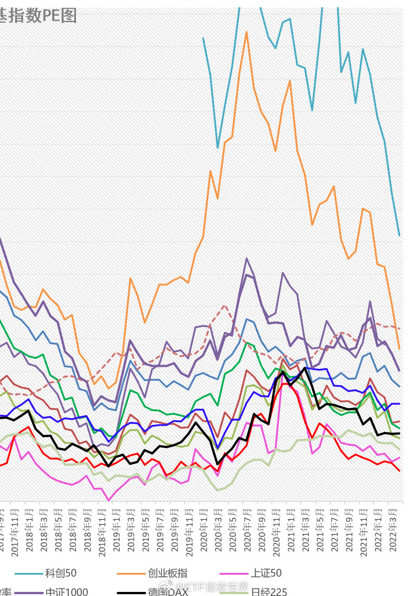

## 2022-04-20 17:02

回复@CalmoOOo:你说对了。历次市场大底，全都是所有指数估值大致回归同一区域。然后牛市中又大幅分化。换句话说，每次都是大概率所有板块都挤干净水分才见底。 查看图片 //@CalmoOOo:看线趋势有一种感觉，不同颜色的线又将奔赴同一个坑位（是感觉

## 2022-04-20 17:12

这么多年了，可能老朋友已经基本了解我处理事情的流程了。

首先，是把结果想到尽可能的坏。然后为最坏的结果做准备。生活上也好，投资上也好，都是如此。我不相信任何人或者机构一定能照顾好我，所以我要保证的是自己能尽量照顾好自己。

对未来可能发生的各种可能做准备，做计划，执行。

其次，人生中一定有计划无法预料到的事情。突发的，不可预知的，无从计划的。

这类事情发生后，我的对策是冷静分析整件事，尽快做出应对的决定。不去想“为什么我这么倒霉”“为什么那么多人只有我不幸”，因为那没有意义。

寻求一切可以帮助解决问题的资源，想一切能想到能做到的办法去解决，用最大的力气去补救，去解决。

解决了，就解决了。用尽所有力气都无法解决的，就坦然接受。

也就是，努力改变能改变的，平静接受不能改变的。

结果导向，不与自己、不与他人较劲，取得最好的结果最重要。

投资也好，生活也好，大都如此。

## 2022-04-20 17:37

刚才有朋友在评论里问，如果某件事发生了，如何配置仓位。

这个很复杂，不是很简单就能说清楚的。

首先会不会发生，这是一个问题。第二要看市场已经把多少概率的预期跌出来了。

当然，最重要的，是一旦真的发生，可能未来5-10年，甚至更长时间的部分投资逻辑会发生变化。一定是要做一些避险动作的。 ​​​

## 2022-04-20 17:49

其实有个问题你想过没有，就是你到底应该不应该投资金融市场。

这里面分两种情况。第一是你没钱，第二是你有一定资产。

把钱都花光的朋友也不能说一点道理都没有。谁知道明天怎么样呢，吃了喝了买了才是自己的。

但你有没有想过，如果没事呢。又或者有事。其实无论有事没事，没钱的人始终是最惨的。

所以尽量还是有点钱比较好。

当你有了钱，你就会面临怎么处理的问题。

买房吗。买房当然好，但也不是没风险。极端风险是可能直接因为什么因素就变成平地了，不极端的是你总不能没完没了的买房。

害怕风险存银行吗。看你怕不怕通胀了。不说普通的通胀，如果发生什么事情，恶性通胀，现金分分钟就是废纸了。房子啊股票啊反而会涨。

润吗，第一是你能不能润出去，第二是最极端的事情发生了，不怕被人家没收吗。

换黄金外币吗，换一点可以，你真放心全都换了吗。黄金市场没有涨跌吗，而且贵金属的行情可是20、30年起。一旦开始跌，就是几十年。换外币，拿着也是贬值的命。投，投什么呢。

总而言之，我个人认为，拿出一部分资产参与金融市场是有必要的。只要你别在别人都赚钱，热门基金配额发行的时候进场就行。

## 2022-04-20 18:11

微博网页版，点击“展开全文”，直接给开一个新窗口。

是哪个大聪明这么改的。有没有去看医生，医生怎么说。 ​​​

## 2022-04-20 19:25

19:24，亲测已修复。别折腾了，踏踏实实的别乱改了。

## 2022-04-21 10:01

奈飞几个月时间，价格从700跌到了200多，抹平4年涨幅。

有没有让你意识到一件事，

无脑长期持股不适合所有股票，甚至不适合绝大多数品种。

什么时候退出，是极其重要的一件事。

包括我们交易过的所有品种，回看历史，也会有更深的理解。 ​​​

## 2022-04-21 10:13

但是止盈这个问题并不是那么容易解决。

你别看网上到处都有人吹自己如何高位跑掉，实际上非常难。一亿股民里面，瞎猫碰到死耗子跑一两百万也是正常，下次他们还能跑吗？很难讲。

为什么说不容易，你可以看所有知名的公募私募基金。他们有没有跑掉。按理说，他们都是经过十几年市场考验的老兵。但如果他们都很难在趋势已经变化的时候跑掉，那就说明这个特别难。

（别说那谁，他1月卖掉之前，净值已经掉了几十个点了）

跑当然很容易，交易软件里还有“一键清仓”这个选项。但你怎么确定这是转折点，比如奈飞，10年涨了70多倍。这十年中波动非常大，每次卖出都是错的。如果一路没有卖，那大概率700也不会卖。700卖了的，大概率早就卖了。

也就是说，拿得住的，就跑不掉。拿不住的，赚不到。

非常非常难。

我们的环保清仓，现在看非常成功。但未来如果买不回来，又继续大涨呢？就又错了。

那么买回来吗？继续大跌怎么办？

非常难。卖出，太难了。

## 2022-04-21 10:23

有朋友说，看估值啊。

股票不说了，那就不是一般人能判断的。我说句实话，90%的公司，连自己的董事长都不知道五年后自己的公司什么样，你一个局外人要判断十年后的公司价值，再判断到时候市场给的情绪，只能说祝福吧。

指数呢。指数估值稍微简单一点。基本上A股的历史大致就是20-70之间波动。

好，看创业板。我们大致是20多30倍买，50多倍觉得贵了，卖了，赚了50%多吧。结果呢，人家一路干到70多。然后就有人发私信骂我，为什么创业板卖那么早，害他少赚钱。

是啊，为什么呢。我**能想到你一路把100多倍的宁德加仓到17%吗，我能想到你能把加仓到17%的宁德一起抱团拉到那么高吗。

我能想到吗？我想不到，没有那个能力知道吧。

估值？估值在疯狂面前就是个笑话。讲估值的人会被疯狂的人笑然后私信骂。

## 2022-04-21 10:27

回复@海栗ETF:更有甚者，大多数董事长都不知道第二天自己是不是就要“另有任用”了//@海栗ETF:90%的公司，连自己的董事长都不知道五年后自己的公司什么样  太对了

## 2022-04-21 10:32

回复@呜啦啦123ppjjgg:如果有人整天没事干，就是聚在一起骂一个遵纪守法，没做过伤天害理事情的人，那只能说明这些人的生活（），这些人的品质（），这些人的心态（），这些人的人生（）//@呜啦啦123ppjjgg:有一个群有几个人专业骂你，我退群了。。。

## 2022-04-21 10:44

对于被骂这件事，我这两年就有很多新的感想，分享给你。

一个人为什么会被别人骂呢。究其原因，无非是几个，

做了坏事，说了错话，招人嫉妒，观点不同……

然而根本原因，是很多人在用“完美”，“圣人”的要求去审视别人。

这个人不能有任何错误，不能说任何错话，事业不可以出现波折，感情一定要专一，不能有任何不良嗜好，长得要好看，身材保持要完美……

就离谱。

叠加到资本市场，更是如此。世界上哪里有永远表现好的投资者？根本就没有。但围观的人恰恰就是要求别人所有操作都完美，买在最低，卖在最高，净值永远向上。熊市跑赢支付宝，牛市立马跑赢最牛的指数。

就离了个大谱！

其实你好好观察一下，真正的强者，有没有时间像宁姆格福地下洞窟里的老鼠一样聚在一起叽叽喳喳，骂这个喷那个。

没有。

成功的人，关心的是怎么把自己手里的事情做好，怎么让自己的生活变得更好一点，怎么才能为别人解决更多问题，更好的实现自己的价值。

想明白了，也就一笑而过了。

## 2022-04-21 11:01

两融数据更新：

依然有1.6万亿以上。另外据我所知，现在很多私募已经跌到预警或止损线了。

越接近坑边，压力越大。 ​​​
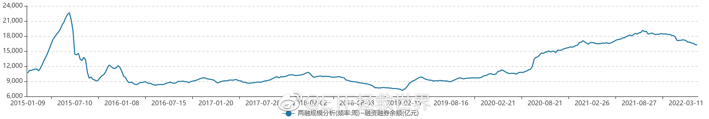

## 2022-04-21 11:11

为了表达对医药9500的敬意，长线以及波段仓位外，我会买一份致敬仓位。

依然会贴出来。完成一个知行合一的动作。 ​​​

## 2022-04-21 11:19

回复@困惑蜗牛想改名:只要不反弹，会很精彩的一天。期待。//@困惑蜗牛想改名:今天看着像是数据会好看的一天。

## 2022-04-21 11:24

一个月，又买了回来。不知道这一次的16%会等多久？

## 2022-04-21 13:54

新低的时候就不要总是觉得是底了。

新低后面大概率还是新低，所以不用急，让它走，走出来再说。

不要没完没了的买，空间时间给出来。家里没矿，注意节奏。 ​​​

## 2022-04-21 14:08

我的日常 ​​​

## 2022-04-21 14:17

说真的不是很理解，是因为这个事情吗。

看样子不是啊。 ​​​
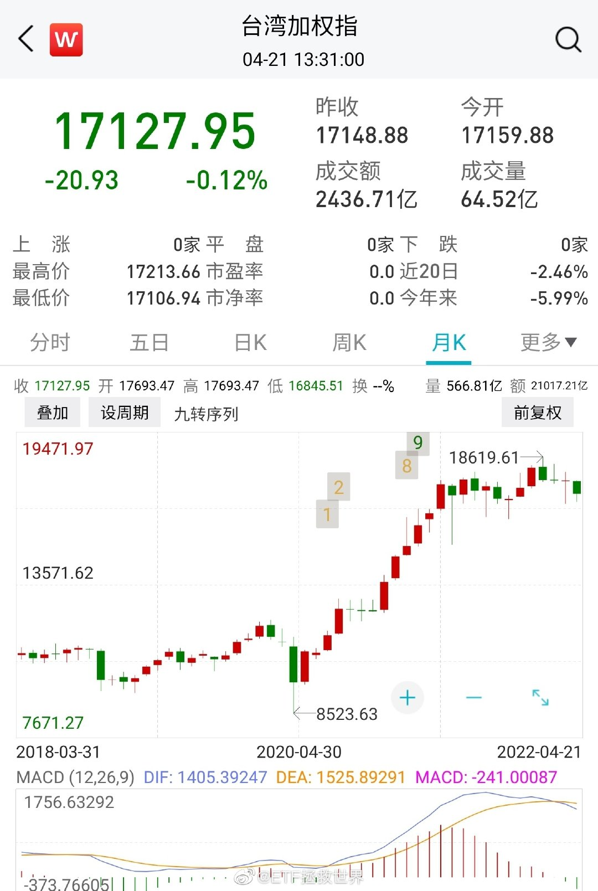

## 2022-04-21 15:38

今天数据出来了。

我不想说太多。只说一句。

也许你没钱买了，也许你持仓很难受。但相信我，

不要卖。

除非你非常有信心能够在短时间内以更低的价格买回来。

否则，

你极有可能，也许就是在下半年，会非常后悔。

我不敢说一定，但大概率。

好好看看手里的不会死的品种，如果不贵了，真的，别卖。

## 2022-04-21 15:48

这几天的下跌，已经把长线计划的加仓空间跌出来了。

准备开始加仓了。 ​​​

## 2022-04-21 15:56

目前市场上依然保持相对高位的，还是那些这两年的抱团品种。

消费（主要是食品饮料）、新能源（环保）、军工、部分医疗。

大多数股票，以及医药、科技信息已经调整到非常不错的位置。

会按照之前设定的点位，有序买入。

现在说钻石坑还差那么一点点。我比较好奇的是这次市场会给多大的机会。 ​​​

## 2022-04-21 15:59

我个人认为，如果以80%仓位为A股上限，

那么，目前以中性仓位为65%左右为界，激进、保守上下浮动15%以内，会是不错的配置。 ​​​

## 2022-04-21 16:39

生活小贴士：

春天到了，北方很干燥。集美们不要忘了做面膜。

有些面膜不是会有两层吗，一层面膜还有一层有点硬的那个不知道叫什么。

我的建议，不要浪费，你贴面膜，把另一层给老公，让他贴上。

男人也需要保养。 ​​​

## 2022-04-22 07:53

今天会卖一个品种（不断新高的），确定的。

不确定的是，如果拉升就不买。如果继续跌就买一个品种。

非常期待今天的走势。 ​​​

## 2022-04-22 08:20

我个人支持注册制。想上就上有多少上多少，股多钱少，到处都是钻石，总比全都70/80倍没法买好。

至于个人打新亏钱，太正常了。你愿意高价接盘，人家公司要募集5亿，你举着钱送过去，大幅溢价，超募50亿，然后你赔钱，你怪谁？谁逼着你打新了？新股不败本来就是计划体制下的畸形产物。

但有两点，一定要说。

第一，拿着别人钱利益输送瞎寂寞打新的基金经理，发现一个拉黑一个。

第二，造假上市的，连带保荐人保荐机构律师会计师一个不剩罚的倾家荡产。

## 2022-04-22 09:45

其实恐惧来自于未知。

黑暗、突发、感官刺激……就会让人产生恐惧。

这个市场上大多数，或者绝大多数人，其实就是蒙着眼睛在黑夜里爬山。目前的状态，对他们来说，就是失控状态。

不知道前方是平地还是悬崖，不知道这一脚踩空要落到哪里，不知道深渊有多深。

只要你大概知道极限是哪个区域，并为之做好了充分的准备，那么未知就已经不是未知，你也不会恐惧。

如果你看恐怖片，清楚的知道这个人几分几秒会死，那个吓人的音乐和场景几分几秒在哪里出现，那么恐怖片就会变成喜剧片了。

## 2022-04-22 09:52

我不是不支持抱团，

我是不支持你们抱团我没有的品种。 ​​​

## 2022-04-22 10:04

合作好过对抗。

昨晚翻了这几十年的历史书，我得出一个结论。 ​​​

## 2022-04-22 10:09

感觉又要被偷家，现阶段我很惆怅。

## 2022-04-22 10:22

我不知道有几位能体会到我的感觉。

就是从估值到技术，想买的品种直奔自己的目标价位。然后自己已经买了一点点，终于有机会在理想价位买更多。

就是一种想笑的感觉。 ​​​

## 2022-04-22 10:29

数学题：

一个品种，你买了1000块，下跌了20%。你再买1000块，账面浮亏幅度变成多少，再涨多少你可以回本： ​​​

## 2022-04-22 11:17

今天都在传一张图，2008年4月23日的3000点保卫战。

当个段子看看就行了，事实没那么简单。

上证综指之前的编制方式有很大问题。可惜，从上到下没有人在意这个。去年终于改了。

实际上2008年4月23日到现在：

深证综指上涨98%；

沪深300全收益上涨49.56%；

中证500全收益上涨90.48%；

中证红利全收益上涨129%；

全指医药全收益上涨266%;

全指消费全收益上涨319%；

全指信息全收益上涨170%。

对，可能十几年有些品种的收益看起来也一般，但你要知道，现在可是跌到钻石坑旁边了。你知道如果在牛市顶峰看，这些收益率是多少么。

A股不是不能赚钱，是有些指数和有些人不能赚钱罢了。

## 2022-04-22 11:27

微博的点赞太有问题了，刚才发现不知道怎么回事就点了几个看过微博的赞，赶紧取消了。

我必须声明：由于误点概率太大，我微博的所有点赞都可能不是我的本意。 ​​​

## 2022-04-22 11:49

回复@liuzhicheng10:这一轮已经不是普涨了。看2015年15000点的中证1000，涨到8000多点就跌回来了。但消费医药红利全都创了历史新高。A股永远没有所有股票的普涨了。//@liuzhicheng10:我觉得a股已经不会有以前那种普涨的顶峰了

## 2022-04-22 11:54

既然都跌下来了，我就再说一个点位。

中证500好价4800-4900左右。如果能到，中小仓位配置不够的一定补足。 ​​​

## 2022-04-22 12:04

老师奖励给儿子的鸭舌好好吃。

一不小心吃光了。

他放学回来怎么解释，慌乱中。 ​​​

## 2022-04-22 14:08

另外还有一个数据，2008年4月23的全市场估值，比目前贵38%。也就是说，上面这些涨幅，是消化了38%的估值后取得的。

## 2022-04-22 14:32

有朋友问，现在什么环境啊，什么情况啊，有什么利好啊，都是利空，还买？等有好消息再说吧。

是，这位朋友说的没错。确实坏消息一堆。但我这些年有个心得，

就是吧，股票这个东西，它不是有好消息才涨，有坏消息才跌。

它有个提前量。

具体这个提前量是怎么出来的，我也不知道。就是说会有一批先知先觉的人吧，就是会坏消息前卖，好消息前买，然后顶底就出来了。

最近一个例子。

奈飞新的季报会员大量流失，结果一天暴跌35%。但它是季报出来才跌吗，不是的。去年11月就开始了。坏的财务报告之前，已经从700跌到300了。

这里是不是底我也不知道，但是便宜了就买点呗。等所有消息都变好，恐怕也轮不到我买便宜货了。

我凭什么能在风和日丽的日子里买打折货啊，您说是不是。

不赌，空间时间出来就买点，没多大事儿。

## 2022-04-22 19:53

今天卖出的一份油气，各位平均收益率是62%。 ​​​

## 2022-04-24 08:35

我突然有一个想法。

你说，现在动不动就封城。一封就是一两个月，但是好像也没说日子过不下去。

那么问题来了，

我们的各种假期，为什么一定要借工作日凑数？你就干脆多放一两天，真能怎么着吗？好歹比封城还能多拉动一些消费是不是。

有点不理解。 ​​​

## 2022-04-24 18:54

内事不决问博友：

请户外小能人推荐居家旅行必备的帐篷品牌型号。

三季即可。不用两室一厅，不用非常便携，要透气防晒，可带天幕，要方便拆搭。 ​​​

## 2022-04-24 21:23

有人说赶紧囤东西，有人说平台运力不够了，

我说我不跟大家抢，不挤占有限的资源，要把资源留给更需要的人。

不是因为我觉悟高，

是因为我早就囤完了。

照顾好自己，不给大家添乱。 ​​​

## 2022-04-25 07:33

不提前准备，有疫情了，别人抢你也抢还有一个问题：

无论是线上还是线下，

是不是交叉感染的风险变大了？ ​​​

## 2022-04-25 08:52

冒着枪林弹雨跑单帮赚钱我还能理解，

高价倒卖救灾捐赠物资直接震惊了。

这不依法判个十年八年能说的过去？ ​​​

## 2022-04-25 09:10

我觉得很多朋友始终没有建立一种概率思维。

我看有些朋友说，相信什么什么，一定能保证没事。

这就是说，把自己的所有希望寄托在，自认为是100%能照顾好自己的机构或者组织或者某些人身上。

但我觉得这个恐怕不是100%。世界上100%的事情很少很少，这个恐怕不能算。

很多东西的概率也是要随时变化的。你要把新观察到的条件代入，调整有变化的变量数值。当概率结果变化，那么就要做出不同的应对。

除了概率，还有机会成本。

拿囤货这件事说，不可接受的是什么你造吗，是当年囤了好多好多盐的那种。十几二十年吃不完。这机会成本就非常大，不理性。还有当年姜昆相声里洒了一被窝的黄酱那种。

但是如果你囤的是平常就会吃的，不容易坏的，即使没事也会慢慢消化光的物资，那又有什么机会成本呢？几乎没有。

如果一件事几乎没有成本，反而有可能会得到非常大利益的情况下，为什么抗拒着不做呢？

很多东西都是可以通过理性思考去选择的。而不是一时的感性冲动。

## 2022-04-25 09:36

希望本月有机会完成信息科技的左侧部分买入。 ​​​

## 2022-04-25 09:47

因为上证的编制方式有变化，所以也许不太准，

但如果按照历史模型的角度讲，上证2800是一个非常非常扎实的底部点位。 ​​​

## 2022-04-25 09:54

目前两市融资额依然在1.5万亿以上。

除了小部分套保，其它都是加杠杆炒股的。 ​​​
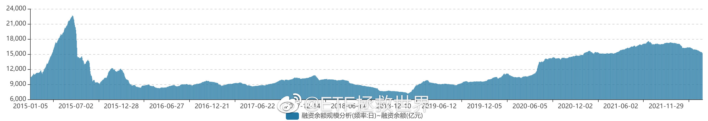

## 2022-04-25 10:10

霉霉今天波段最后一次买入，接下来向下不会再买。

这一网如果卖出，收益率是18%。 ​​​

## 2022-04-25 10:25

手里有钱的不用急着抄底。时间空间一定要拉开，不要让成本大量堆积在一个非底部区域。 ​​​

## 2022-04-25 10:25

我觉得3000点被很多人看作一个标志，所以可能有人会做事。

瞎猜的，没有操作指导意义。 ​​​

## 2022-04-25 10:36

中证1000已经领先所有指数率先到达历史模型低位。 ​​​

## 2022-04-25 11:07

3001，做事了。

## 2022-04-25 11:27

你猜我会不会把它买回来。

这，就是波段。 ​​​
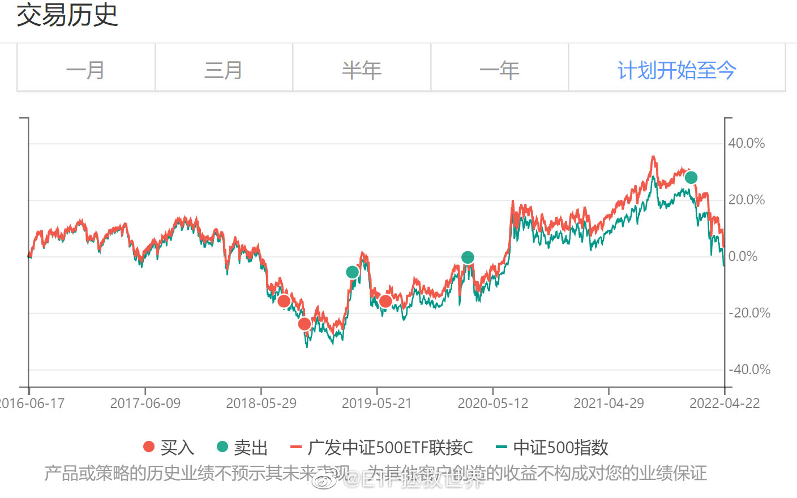

## 2022-04-25 13:46

消费为什么能高高在上特立独行。

我想了三天三夜也没想明白。 ​​​

## 2022-04-25 13:58

我给各位朋友的建议：

第一类：已经早早做好心理准备的，攒了很多钱准备买的，继续看盘。看着指数一步步向你的目标跌去。

第二类：以为自己做好准备结果发现自己没有做好准备的，已经慌了的，心情已经被股市弄得很糟的，关闭软件，关闭我的微博，不再看盘。

第三类：实在忍不住痛苦的折磨，准备一键清仓再也不投资的，请取关我。然后爱干嘛干嘛。

## 2022-04-25 14:10

转发微博

## 2022-04-25 14:27

第一件事，红利的表格可能有变化，过一会看一下，如果有，请更新之前的设定。

第二件事，晚上我争取写点东西。差不多应该写点了。但不会长，不整那些虚头巴脑的按摩，都是老战士了。多表格，多图。争取能写吧，不知道有没有别的事情耽误。 ​​​

## 2022-04-25 14:51

还有10分钟收盘，居然是光脚。也就是说，在这个位置没有预案，或者说没有达到动手的条件。

那么今天会不会开个会呢。

总而言之不要影响本周的加仓计划就好。 ​​​

## 2022-04-25 15:01

今天两市跌幅中位数居然超过了8%。

而今年所有股票跌幅中位数也到27%了。 ​​​

## 2022-04-25 15:03

回复@阿胜同学:我也非常期待。//@阿胜同学:期待今天E大跑出来的数据，还有今晚的文章推送。

## 2022-04-25 15:21

我现在特别害怕今天晚上出个什么利好。 ​​​

## 2022-04-25 20:13

我有几句话想说。

第一句，就像2018年底的坑里一样，很多之前觉得我还行的朋友，会开始讨厌我。因为左侧买入，一定会导致坑里的收益率非常难看。还记得上次坑里有个骂我的，去他微博一看，不久前还在点赞我。这就是情绪改变了你对我的看法。

其实我一直没变。没有特别好，也没有特别坏。这个市场盈亏同源，猛将兄回撤就大，持续稳增长的回撤就会小点。

我只能说尽量做好吧。

第二句，虽然我完整的公开了长线计划以及波段计划。长线计划包括买卖点、买卖份数、持仓仓位全部事无巨细公布，波段仓位不厌其烦强调压力测试，但刚才看到公众号留言，说有人在微信群里说因为我满仓中概，现在看我微博非常生气。

我确实买中概了，150仓位最低，不到3%，S稍高，波段相对买的最多，十几份吧，我不知道满仓买是怎么回事。不过没关系，人和人的阅读理解能力，执行力，背锅能力全都不同。骂就骂吧。骂我你能进步，你能舒服，我无所谓。以前我会不高兴，现在看开了，毕竟我也成长了。

总而言之，我公布我的投资，就准备好了承受各种指责。何况是在噩梦难度的A股。其实看看市场，有任何一个公募私募不会被骂的吗，好像还真没有。无所谓了。

无论如何，跌到钻石坑的现在，这两年收益率确实不行。是我学艺不精，骂的有理，我认了。

## 2022-04-25 21:05

股市搞不好，很多投资者的怨气越来越大，对很多问题的看法也发生了变化… ​​​

## 2022-04-26 09:06

突然又重启调查了。顺便又看了一遍录像。千言万语总结一句话：守男德，保平安。与各位弟兄们共勉。

## 2022-04-26 09:12

6点就开始工作了，并没有一直在看花边新闻 #就这一刻# ​​​
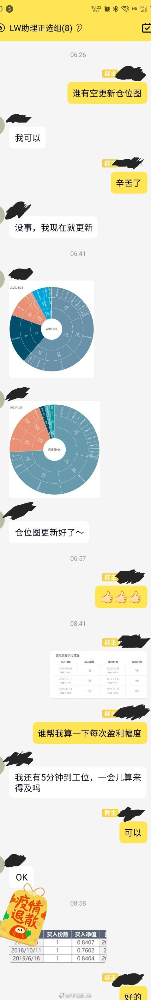

## 2022-04-26 09:38

我不希望今天又暴跌。暴跌的话，有人下午开盘就又要动手动脚了。

不是说动手不对，你乱动又无法阻止市场下跌，没有意义。

不如小跌一点，谁也别动手，我们买点。 ​​​

## 2022-04-26 09:51

经过一周暴跌，我个人认为，中性仓位可以上升到70%，激进、保守分别是80%、55%会不错。

## 2022-04-26 09:56

这是150的两份500C做了三次波段的结果。

波段仓位有没有加入S计划的意义呢，还没决定。 ​​​
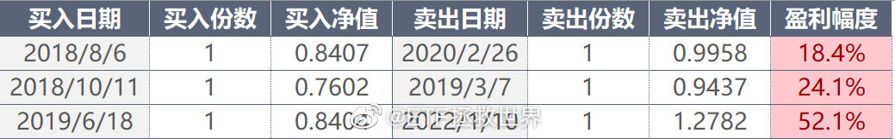 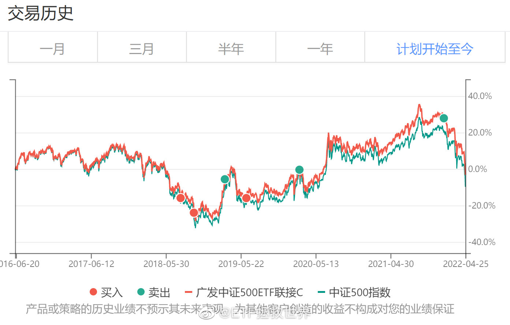

## 2022-04-26 10:18

我觉得吧，一个人也好，一个企业也好，一个行业也好，如果即将被消灭，是不是应该给他们一个，不说上诉吧，就是说话的，申辩的机会。 ​​​

## 2022-04-26 10:25

不知道为什么就是感觉心在滴血。

（这不是正式发车，是正在布置一部分品种排版任务。正式的可能会改。） ​​​

## 2022-04-26 10:31

现在是按照150买3卖1，S买3准备的。

但如果涨太多，恐怕不能买了。下午1:30-2:00定吧。 ​​​

## 2022-04-26 10:53

小猫在鼠标旁边趴着睡觉。

醒了，伸个懒腰，跳到我腿上，再跳到地上。就好像我的腿是它的楼梯。嗬，你可真不见外。

我说，走啦？

嗯。它呼噜一声。

还嗯！看着要买的暴涨品种，更生气了。 ​​​

## 2022-04-26 10:57

回复@我在故快乐:10000就涨这么多，那要7500还不直接起飞啊。来个7500的。//@我在故快乐:医药起飞了

## 2022-04-26 13:18

我有一个疑问，请懂的朋友说说。

就是说，都在说日本老龄化严重。但是以日本的经济社会条件，吸引东亚、东南亚的高知年轻人移民应该不难。

他们之所以不这么做，是不是因为老龄化的严重性还不足以抵消维持单一民族社会的共识。 ​​​

## 2022-04-26 13:36

一会的科技信息车，不出意外的话是左侧买入的最后一车，除非跌幅巨大，或者时间够长。

道理很简单，到了重要支撑了。如果跌破，不知道支撑在哪里，没法分配资金了。 ​​​

## 2022-04-26 13:50

居然说我退缩了。

你放眼市场上，现在有几个人还敢买，还能买，还有钱买的。

我缩，谁缩我都不会缩。如果所有人都要缩，我也是最后一个缩的！ ​​​

## 2022-04-26 14:57

你以为大力发展私募机构会让市场波动降低，

实际上到了预警和清仓线，私募杀起来是二话不说的。 ​​​

## 2022-04-26 15:02

看到15:00跳出这个新闻是什么感觉： ​​​
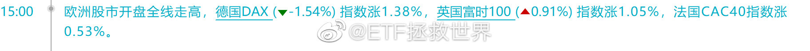

## 2022-04-26 15:07

朋友们，有四个字是这一轮我彻底信仰并皈依的投资信条，

未来，也将围绕这四个字进行狂野研究。

——

均值回归。 ​​​

## 2022-04-26 15:17

关于信息，多说两句。

我的信息走势模型，曾经有两次没有撑住，又下跌了20%左右。

一次是2008年金融危机大底部，两年后自底部涨了328%。

一次是2012年底，两年半后自底部涨了546%。

这个品种弹性是真的大，目前看也在模型支撑位。但要做好足够的心理建设，撑不住也是发生过两次的。

2018年撑住了，涨了100%多。

基本就是这样了。

## 2022-04-26 15:23

今日数据出炉：

只说一个：

从全市场的角度看，今天，是2008年10月-11月金融危机大底以来，A股市场最便宜的一天。从各个数据的角度看，都是。

当然，请各位一定要注意，目前的市场环境与2019年之前完全不同了。

现在是注册制。

但无论如何，数据显示，全市场就是这个样子，板块不论。 ​​​

## 2022-04-26 15:28

2022年4月底，注定将成为A股市场的又一个被铭记的日子。

## 2022-04-26 15:51

目前市场上只有一个板块比历史最低高不少：

机构重仓。

没人照顾的股票，已经杀到脚踝了。

当然，从前期热门基金动辄50%以上的最大回撤幅度来看，机构重仓板块也跌了很多了。但依然没到最便宜，因为，

之前炒得太疯了。 ​​​

## 2022-04-26 16:15

没有任何人关于市场的情绪能够影响我。你不能，所以不用教育我。

我坚定的，不妥协的认为，目前的区域就是底部区域。我不敢说哪里是铁底，但这个区域一定不会错。至于区域到底有多大，我没法量化，但一定不是很大。否则还叫什么区域？

在这个位置，我会加快买入节奏。就像之前好几年几乎不买一样，这里就是我买买买的地方。

但我不会盲目满仓满融杀入。我会首先活着，然后买。买完了还活着，活着就继续买。

你同意不同意，你有什么关于股市的内幕消息，你有什么关于政经的高深见解，我根本不care。

我只知道我就是要在这个区域买，有节奏的买，就这么简单。

## 2022-04-26 16:28

从今天起，我不看评论不看私信，不会让任何人影响我的情绪。

## 2022-04-26 17:01

各位可能没有意识到一个问题：

今年公募基金没有增量，都知道吧。没什么人申购了，毕竟抢新发基金等配额这种事情只发生在最高点。

私募基金不用说了，正轮流在预警线和清仓线卖出。

股民……有几个股民还敢买。敢的都被套了。

那么问题来了，这样越跌越低的时候，敢买，还有钱买的，有几个人？

很多朋友经常问：为什么历次大底，很少有人抄底呢？

是啊，为什么呢。

因为啊，在底部买入，你得有胆子，有知识，还得有钱啊。

## 2022-04-27 08:17

几年前我曾经说，不断下跌的熊市中最终坚持不下去的人会有七成。

但是我错了。

到现在为止，停止的人只有4%。

瑞思拜，各位。 ​​​

## 2022-04-27 08:31

如果今年有机会把美股买回来就彻底稳了 ​​​

## 2022-04-27 08:38

我比较好奇的是另一半居然没有感染

## 2022-04-27 09:24

很多朋友觉得美股永远涨，其实不是的。

大家看美股指数其实只跌了十几个点吧，但其实，下面这些股票，距离52周最高点，已经跌了：

paypal：73%
奈飞：72%
facebook：53%
amd：48%
英伟达：46%
安德玛：46%
通用汽车：43%
福特：43%
星巴克：39%
迪士尼：39%
波音：35%
耐克：32%
雅诗兰黛：32%
高通：31%
3M：29%
亚马逊：26%
英特尔：20%

比较强的，是家乐氏、宝洁、可口、通用磨坊、百事、强生这些消费品，只跌了不到10%。

消费啊，YYDS

## 2022-04-27 09:37

两市融资余额继续下降，目前已经降至14600亿。

但是，融资额占流通市值的比例，却上升至2.53%。因为流通市值跌得更多。。

融资额占流通市值比例曾经在2015年7月3日达到最高点，是4.72%。

而在2019年3月5日，市场即将暴涨的时候，降至1.85%。

融资的人，一定是越涨越加杠杆，越跌越不敢借钱。

而目前的困局在于：

市场下跌过快，融资盘会不断出现到达强平线要补仓的状态。如果没钱补，就会被券商一键清仓，彻底赔光。

所以我们观察融资盘和私募之所以会在低位出现必须卖的情况，原因在于：

1、借钱投资或短款长投
2、各种原因造成的可容忍波动区间过小

各位，一定一定要切记：

闲钱投资，牛市不追涨，熊市即使你不敢买了，也别随意卖掉不会死的品种。否则你会后悔十年。

## 2022-04-27 09:43

S的汇添富文体，去年8月买了一份，今年4月再买一份，时间间隔8个月，时间足够；

空间：3月最大跌幅超过30%。很多朋友看到这个数字绝望了。

目前状态：

4月只补了一份，浮亏幅度已经大幅收窄至12%。要知道目前市场是什么状态。

12%，趋势转折后，分分钟赚钱。趋势不转折，继续给时间给空间，拉回浮亏幅度轻而易举。

时间、空间，给足的一个实例。

## 2022-04-27 09:46

行情无聊的时候，我跟大家谈风花雪月，跟大家一起围观八卦狗血，跟大家组建道德法庭。

但是关键时刻，我会把数据、思路、模型一股脑的扔过来砸晕你。 ​​​

## 2022-04-27 10:33

本次买入波段医药后，后续该品种也只剩一次波段买入，之后就不会再买。

同理，在所有指数支撑位，都会在长线仓位中加仓。情况不同，加仓幅度不同。几个重点品种会在长线仓位外额外买入致敬仓，买了会贴图。

在之后，如果继续下跌，我本人不会再过于关注市场走势。还会看，但意义已经不大。

之后会继续投入每个月的收入一部分，但也不是很重要了，因为不会再大笔投入，因为我预计投入就那么多。该买的都买完，随便怎么走，不是很关心了。

换句话说，我会在我能理解的所有支撑位，买入绝大多数预计要投入A股的资金。然后转移焦点，继续好好生活。我不信这些目前这个阶段买入的不死品种最后会赔钱，等着就是了。

## 2022-04-27 10:50

我个人认为，人做事，就要有信念。没有信念，一定是一败涂地。

我对于资本市场的信念就是：

1、指数不会死。
2、长期看，正常情况下，指数会不断上涨。
3、即使长期不涨，也会有波动。
4、便宜的地方买入，贵的地方卖出，能赚钱。

这些信念支撑我的意志从未因市场走势动摇。别人极端绝望的时候，别人极端兴奋的时候，我从不会受到一丝一毫的影响。

因为我有自己的信念。

策略可以修正、技术可以提高、认知可以更新，但信念永远坚定。

## 2022-04-27 11:00

信息产业我要谢谢你，至少你在4500左右能挣扎一下。

不然会显得我的支撑点位过于低能…… ​​​

## 2022-04-27 13:12

可以了可以了，休息一下。只有你到，别的兄弟不到就不够意思了。

## 2022-04-27 13:31

如果收盘前不掉链子，150的两支信息科技浮亏程度就只剩8%了。

而这个指数这轮从最高点跌下来是45%。

有什么慌的。真没任何需要慌乱的。

15%以内，一两周。 ​​​

## 2022-04-27 13:35

其实我现在也不知道这一单波段能赚多少百分比。

主要得看能买多少。 ​​​
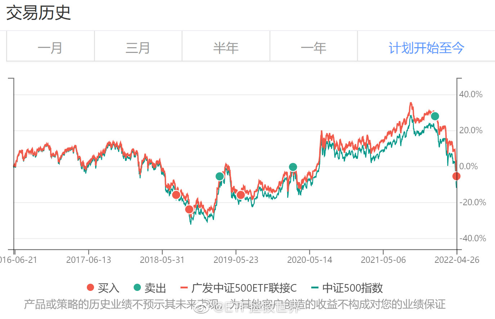

## 2022-04-27 13:53

今天可能有各路人马分析反弹的性质、原因、持续力度。

说真的，我毫无兴趣浪费时间去看这些玩意。 ​​​

## 2022-04-27 13:54

A股市场的参与者，大部分，甚至绝大部分都是神经病。

真的。

无论是机构还是散户。 ​​​

## 2022-04-27 15:05

就这样吧。

没什么意思。

再！见！ ​​​

## 2022-04-27 15:18

忍不住看了眼评论，真是气的我够呛。

一个个好像昨天清仓了一样。

昨天你没买？上午医药波段几乎最低位你没买？

涨一点你捶胸顿足买少了，再跌下埋怨我买多了的是不是你？

新朋友补仓提醒几十份你都买了吗？老朋友仓位不低了吧？

不舒服就买到舒服！别跟我这患得患失。要不你把钱打给我我一年收2%管理费，盈利提20%你看怎么样？

服了！不舒服赶紧看病！

## 2022-04-27 15:32

我不是说别的，各位，弟兄们，集美们，我们的心态要始终保持平稳。心态平稳的一方面是了解金融心理，一方面是仓位合适。你如果觉得仓位不合适，就把它弄到合适。想象，代入，上涨下跌，看自己经济状态和心理会怎样。不能涨也难受，跌也难受。你到股市干嘛来了！就单纯的找罪受是吧？

## 2022-04-27 15:38

这是150的仓位图，自己结合前天公众号文章的估值状态看情况弄吧。

仓位建议保守-激进比前几天最新的那条可以提高2、3个点。 ​​​
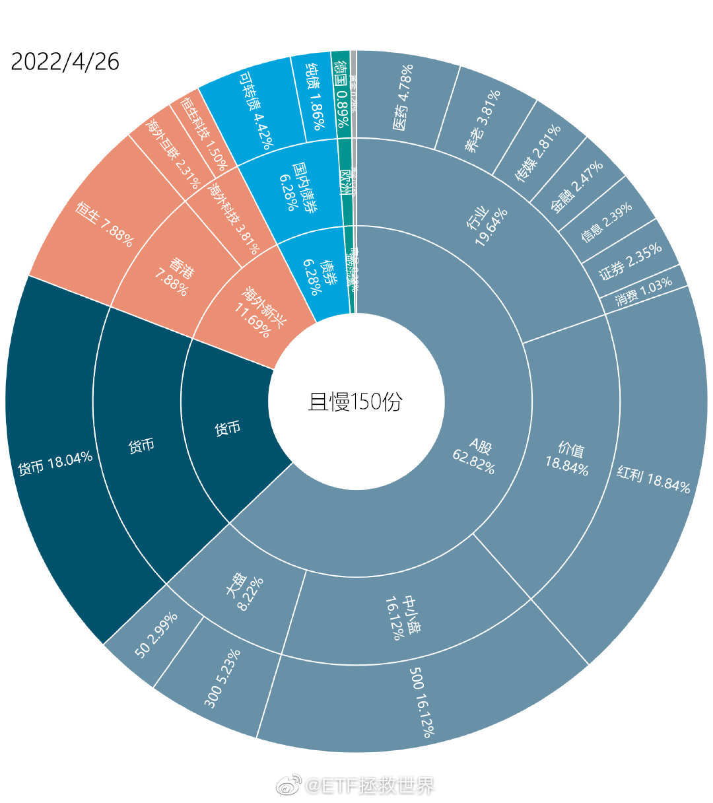

## 2022-04-27 15:59

说明：“要不你把钱打给我我一年收2%管理费，盈利提20%你看怎么样？”这句话的修辞手法是反问和夸张。含义是：我不是你的私募基金经理，不知道也没能力没精力了解每位朋友的情况。绝无非法集资抑或有意向成立私募进而公开或私下募集资金的意思。望周知。

## 2022-04-27 19:46

我的露营计划是不是要泡汤了。 ​​​

## 2022-04-27 22:51

我真的服了。

没事上球球刷刷情绪，结果在推荐流里面看到两个跟我有关的帖子。

真的偷窥我微博和公众号的兄弟们不要再往球球搬运我的东西或者讨论我的操作了。

球球现在是什么人在评论啊，

就这么几个理性的，大多数都是情绪化的喷子在评论，

他能理性吗，理性不了，他没这个能力你知道吧。

你跟他们分析这个那个，哦呦，谢天谢地了。

我劝你们，想办法输出自己的东西，各种理念先搞清楚，别老聊我。

我在微博公众号过得好好的，你非给我惹事干什么…
 

## 2022-04-28 08:44

越来越近了。一位确诊流调信息，几天时间把周围超市跑遍了，应该是在囤货。

这种情况去超市有问题吗。我的想法是尽量不动用战略储备，随时把储备补满。但如果风险大，开始消耗储备也没问题。

就像投资，能不用战略储备就不用，但真到关键时候要用，从银行搬家也可以。 ​​​

## 2022-04-28 08:56

我想做一个实验。就今天开始。

一点东西都不买，到周日，记录每天三个人消耗的食物。

看看加的血条到底能扛住boss多少天的攻击。 ​​​

## 2022-04-28 09:29

我观察sh的这次情况，非常好的诠释了什么才是好企业：

那么多人对可乐的渴望，甚至是明确的对某个品牌的渴望，说明了一切。 ​​​

## 2022-04-28 09:38

昨天晚上我花了两个小时翻阅去年10月以来，奈飞的所有新闻。大致得出三个股价崩塌的基本面结论：

第一：竞争加剧。影视巨头切入赛道：

“在 奈飞 (NFLX.US)最新的致股东信中，有一句话传遍了全世界：“虽然竞争加剧可能会影响我们的利润率增长，但……” 尽管，这一说法或许并不代表着什么，但这可能是奈飞承认竞争激励的有力证明：流媒体竞争正在影响其用户增长。 ”

第二：涨价导致用户流失：

“北京时间1月17日早间消息，据报道，Netflix再次提高美国、加拿大的包月用户订阅费，此次涨价是Netflix在过去三年里第三次在美国上调价格。目前，Netflix的顶级服务价格比2018年底高出42%。”

第三：欧美防疫政策改变，人们走出家门。

有人说，你在这放什么马后炮，跌那么多了才说。

你是不是傻！我是在复盘整个崩塌过程，从基本面，技术面，全面分析一个强势品种崩塌的迹象、过程。对自己的投资做出启发。

对了，整个过程中投资银行给出的目标价位，增减建议非常有意思。以及大佬Bill Ackman如何在腰斩抄底损失几十亿人民币后清仓走人的过程也很有趣。

到底什么行业才是好行业，什么行业才有真正的护城河，什么时候要开始警惕，学到了很多。

## 2022-04-28 10:46

你有没有想过，为什么一个月前，将医药的波段价位定在0.75而非正常的0.8。

又为什么昨天正好在0.75附近止跌，以致0.75几乎是最低价。

这到底是道德的沦丧还是人性的扭曲？ ​​​

## 2022-04-28 11:03

我个人非常非常推崇市场机制。我觉得只有市场的定价才是最有效的。

但前提，是市场一定要受到强有力的规则的制约。违反规则的杀无赦。

A股的问题，其实很大程度上就是不市场化。从新股发行开始。目前注册制的改革方向是对的，虽然短期看会对市场造成一些伤害。但只要有人无脑打新炒新，那么新股发行就不会被市场本身所拒绝。

有朝一日打新的人理性了，就平衡了。平衡了，就好了。

但最关键的，一定是对财务造假的，串通上市抬轿子的往死里打。造假上市的不仅要追回所有融资，还要打的倾家荡产。

让好好做事的得到融资，让弄虚作假的死，最终市场不再恒时高估，一切正常循环。

## 2022-04-28 11:11

全指医药目前有100多家公司公布一季度业绩，增速继续保持20%+……我估计最终是十几个点。全市场目前是个位数。

去年四季度稍差，但也比全市场好多了。 ​​​

## 2022-04-28 11:30

还是那句话，有些东西最好别捧得太高。预期太高会放松应有的警惕。

还有就是，人还是要首先依靠自己。把所有希望寄托在别人身上，很容易出问题。

这是我的一点想法。 ​​​

## 2022-04-28 11:47

如果两个月前，一个城市还被所有人吹捧为最优秀的，两个月后，却成了千夫所指。

那么，人真的理性吗，真的能认清事实吗，你看到的就真的一定是真相吗。

有极端的好和极端的差吗，又或者其实极端的是人群自身而已？

不要相信人们的夸奖和称赞，因为一瞬间所有掌声都会变成另一个极端。

人类整体，或者说大多数人，其实绝不理性，也不爱思考，这是我在资本市场混了十几年后得出的结论。资本市场以外的人，大概也无非如此。

## 2022-04-28 17:24

有没有一种可能就是说5月再提16% ​​​
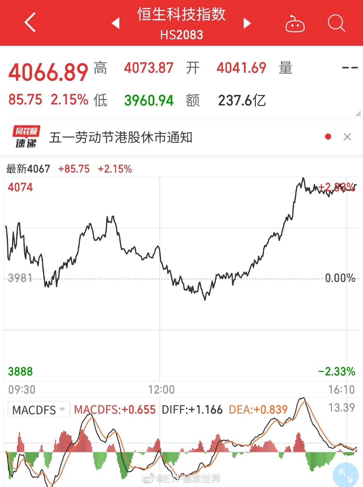

## 2022-04-28 18:54

根据长期使用的感受，

猫家的省钱卡，夕夕的省钱月卡，狗家的plus100元券比较，

猫家的卡最厚道。从未遇到过不能用的情况。

夕夕的卡百亿补贴产品不能用。

狗家的很多东西不能用。

省钱卡这波，没什么钱的我站猫。 ​​​

## 2022-04-29 07:44

巨额回购股票，按季度分红。

## 2022-04-29 09:04

回复@Paul爸_言午:平常一个月两次或者考一百分（语文除作文全对）/体育比赛拿前三可以玩40分钟。假期一周可以一两次//@Paul爸_言午:回复@ETF拯救世界:这个好。每天都有吗？还是只限定周末？

## 2022-04-29 09:56

我突然想到一个育儿奇想：

各位觉得给孩子玩英文大段文本的RPG游戏怎么样，会不会提高英语成绩。有做过实验的家长吗。 ​​​

## 2022-04-29 12:53

勿谓言之不预也

## 2022-04-29 13:05

QDII ETF设置10%涨跌停真的是最可笑的一件事。 ​​​

## 2022-04-29 13:08

10天前说的。瑞思拜。

## 2022-04-29 13:13

回复@哲思Lucky:150只有十几个点的现金了。难道真的不为可能发生的意外做一点点准备吗？在当时那个时候，市场上还有谁敢买，有钱买？只有我们。这是为什么？

## 2022-04-29 13:17

QDII ETF设置10%涨跌幅这件事，我觉得第一大责任人是发行QDII ETF的基金公司。

监管顾不了那么细节的东西，各位管理人难道不能多考虑考虑投资者的利益吗？如果创业、科创、双创ETF都能20%涨跌幅，为什么QDII ETF就不能向监管汇报一下，争取一下？

我真的大无语了。

为投资者考虑考虑吧！各位大人们！

## 2022-04-29 13:19

回复@ETF拯救大兵瑞恩:最主要的是因为没钱了。为什么没钱了，不就是因为动不动就“梭哈”吗？//@ETF拯救大兵瑞恩:因为其他人吓死了

## 2022-04-29 13:23

如果今天不掉链子，浮亏幅度只剩不到5%了。高点跌下来超过40%。15%以内，一两周。投资不是匀速上升，而是三年不开张，开张吃三年，各位。

## 2022-04-29 13:25

回复@水汪汪的萌咩:本来也不需要封住！我们吃的是盘中波动，你只要波动上去我们就能提款。结果？？？？//@水汪汪的萌咩:没封住

## 2022-04-29 13:35

我不知道为什么总有朋友问：

怎么涨起来啦，怎么跌啦，发生什么啦。

你觉得充斥着一帮神经病的地方，你能弄清楚为什么涨跌吗？

只要你低位买高位卖，市场就让神经病去上蹿下跳不就完了吗。 ​​​

## 2022-04-29 13:45

我要再说一次这个问题。涨起来了，可能大家都忘了当时是什么情况了。但能在那种腥风血雨的环境下，到处都是哭声一片的情况下，96%的朋友依然毅然决然的坚定买入，这真的是特别值得自豪的一件事。A股市场能有这样的一群人，真的特别不容易。致敬。

## 2022-04-29 13:47

回复@ourbbs:还好我不是大V……//@ourbbs:感谢，投资路上有E大指引，进步很大。 查看图片

## 2022-04-29 14:00

那些说“好可惜没买够”“时间太短啦我钱刚到位”的人，

我告诉你，即使到现在，中证500也只比最低那天收盘高7%。其它指数也差不了太多。

你要真觉得后悔，你就买进去。别涨起来了就一脸价值投资大师的样子，抱怨这个抱怨那个没买够。

你不会连7%的幅度都害怕吧？你的大底就差7%？

别装了，你就是那种涨起来抱怨没买够，跌下去抱怨买多了的人。

烦死我了！

## 2022-04-29 14:03

今天我反而最期待的是汇添富文体的表现。

其它都是指数或者指数增强，大差不差。汇添富文体我感觉能在港股吃一笔。 ​​​

## 2022-04-29 14:17

说两句技术层面的东西：

第一个，是除了信息，我表格里列的其它指数点位都没有碰到。当然我不是说一定会碰到，但那么多都不碰反正也有点怪怪的。

有两种方式碰，一个是下跌碰，一个是横盘等支撑慢慢靠上来。

我个人还是希望大多数都碰一下。

第二个，历史四次钻石坑，两次w，两次v。这次是w还是v，又或者根本还有低点，这个真的很难讲。

你要真觉得自己买少了，可以考虑前低附近加一点。能不能加到是缘分，加到了会不会跌出新低是天意。

我也不知道怎么走，毕竟一直都是蒙的。

所以你可以为各种可能做准备。除了V不用准备。

## 2022-04-29 14:46

如果这一波恒科的16%没吃到，假期后跌回来，那就是交易制度的问题。

如果假期中中概大涨，节后回来我们多吃了很多bonus，那么就是我们的善举（别人不要我们好心接盘）感动了上天。

总而言之我们总是对的。 ​​​

## 2022-04-29 15:03

今天最后一帖。

刚才翻回去看评论，我发现之前说过很多次的事情好像还有朋友不清楚，那我就再说一次：

在且慢跟车的话，我是有一些作为主理人的收入的。这个问题我不会避讳，也说了很多次。

再说一次的原因，是不希望有朋友突然知道我还有一些主理人收入会变得很生气，觉得我是干了什么对不起你的事一样。

我请你明白的是：

我的计划完全免费、及时同步在公众号。

你愿意在且慢跟车，一个是对你来说方便又便宜，一个是我有点收入，我说声荣幸，也谢谢你的支持。

你不愿意在且慢跟，但是愿意参考我的计划，随便在别的哪里买，也都没问题。我说声荣幸。只是如果你未来不满意我希望你别骂我，因为我不欠你任何东西。

只要我还能自己决定，我就会继续免费、完全公开自己的投资计划。不会说为了让你在哪里跟车就不公开，只要ZC允许，我就一定会持续公开。

事情就是这么个事情，我自己觉得无愧于任何人，不知道你有没有不同看法。

## 2022-04-29 17:20

一季度机构最重仓位宁德。有几家机构能判断它利润下降了。

## 2022-04-29 18:59

记了两天。

无任何补给的情况下，3-4个月，稳了。 ​​​
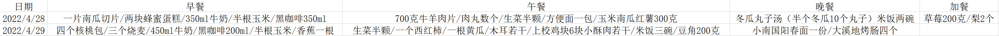

## 2022-04-30 15:48

在客厅里搭了帐篷，躺在里面看了两小时b站露营视频。

我的长假露营活动圆满结束了。 ​​​

## 2022-04-30 23:03

巴菲特总是保持手里有大量现金，有些网友却因为反弹了两天没有满仓而痛不欲生

