## 2022-05-01 10:49

368复机。

请说出密码： ​​​

## 2022-05-01 16:35

关于满仓还是不满仓，我还有一个角度早就说过：

有人说，我每天都满仓！

你问他，那跌了怎么办？

他说，把存款拿进去补仓啊。

你再问，你现在家庭金融资产多少在股市里面？

他说：10%。

行吧。 ​​​

## 2022-05-01 16:58

第三条关于满仓的絮絮叨叨：

马戏团有人可以表演空中飞人，但不代表每个人都能做。

能做的人万中无一。

有人可以常年满仓，也成功了，不代表你也能做。常年满仓被消灭的人你看不到。历史不会记录失败的无名之辈。

建议你根据自己的情况，保持仓位动态平衡，低了多拿点，高了少拿点的人，也许给的建议不适合每个人，

但他一定是真的为普通人能长久在股市活下去才说的。一定是真的为你着想的。

## 2022-05-01 17:28

以前儿子很小的时候，抱着他，总是会想，未来有一天他去上大学了，去外地或者外国工作生活了，离开我，我得多难过啊。

现在，儿子出去跟朋友玩，我长出一口气：终于能轻松一下了！

人生的真相好残酷啊。 ​​​

## 2022-05-02 08:33

劳驾各位帮我看着点，如果我说了什么不合适的，评论里提醒我一下。 ​​​

## 2022-05-02 11:21

再说一次，有人喷我也好骂我也好，真的不用告诉我了。

只要没看到，我就当它不存在。喷就喷呗，还能怎么着啊。喷完了它不依然是内心苦闷的生活，我依然是开开心心越来越好吗。

喷来喷去，最差能怎么着吧。好，最差不就是我消失吗，不说话了，不发车了，不聊投资了。

还能怎么着？不能了吧。那不就完了吗。就像当年我离开球球，那又能怎么着？还不是越来越好？

喷子永远都在那里。在他们的世界里，永远都是要求别人完美。人可能完美吗，不可能。所以被喷是必然的。

所以不要告诉我了。让它们喷呗。

## 2022-05-02 11:43

我是个什么样的人呢。

除了遵纪守法，有点善良，勉强算个好老公好爸爸好儿子以外，可以说是一无是处。

贪财好色，好逸恶劳，玩物丧志，杞人忧天我全都占全了。

最重要的是投资水平低，看一次错一次，说一次打一次脸。高位低位没有一次对的，支撑压力全都反着来。

更别提仅仅是第三轮计划就跑输沪深300高达40多个点，跑输中证500甚至有70多个点。整个计划买的A股基金除了一个传媒，在这样的大牛市中居然浮亏全都超过5%！

这样的人别说喷子了，我都想喷了！[怒]

天怒人怨！

## 2022-05-02 13:35

儿子不太能共情，没有什么感同身受的能力。似乎不能很好的感知别人的痛苦和悲伤。

话说，同理心是天生的还是后天养成的呢。 ​​​

## 2022-05-03 08:04

有没有爬虫课学得好的朋友，帮我把我的微博内容全都爬下来，然后做个word文档发我一份，谢谢！

什么事也没有，只是有备无患。 ​​​

## 2022-05-03 09:47

如果能够节前出掉，没准节后就能买回来。这将是什么感觉。

科普一下：节前净值本来已经可以出货，但因为涨跌停限制价格没到导致没出去。所以非常遗憾。 ​​​

## 2022-05-03 09:53

不要慌。

是马冬梅，不是马超。 ​​​

## 2022-05-03 11:08

有些朋友总是说，有利空啊，再等等吧，等变好了再买。

问题在于，变好了凭什么你能买到便宜货呢。

富贵险中求。

这里面的关键，是你要买的东西看起来危险，但你确定它是不会死的。还有，

它险，你不能险。你要保证自己不危险。险的是它，不是你。

你怎么都死不了才对。

刘畊宏在周董默默无闻的时候鼎力支持，为他争取机会。这样周发达了才会跟刘做一辈子的兄弟，各种回报。

人家发达了你凑过去，能有什么患难之交，能有什么真感情？

人家落魄了你连手都不伸，人家以后发达了凭什么让你挣钱？

风险你不愿意承受，钱都让你赚了，好嘛，好事儿都是你一个人的呗？

## 2022-05-03 11:23

回复@风口点I火因I:大错特错。可以看看当年我跟踪“超级大主力”入场离场的时间节点帖。2013年初入场扫货50 180，2015年5月清仓。大写的服字。可惜，后面再也没有公开数据了//@风口点I火因I:机构和社保貌似偏右侧，关键是普通人没有那么多资源和能力去研判

## 2022-05-03 11:41

恒科：我感觉自己还有希望，扶我起来看看。 ​​​

## 2022-05-03 11:46

北京的朋友，有没有在家里躺着就弹窗的。 ​​​

## 2022-05-03 21:39

我不能说具体情况，但是离我越来越近了。 ​​​

## 2022-05-05 09:43

“虽然我没有预测到2022年一季度业绩，但我能预测到2030年业绩。”

——谜之证券分析 ​​​

## 2022-05-05 10:52

节前恒科因为交易规则没有出去，意难平。

医药买在最低点，涨势良好，又觉得天道酬勤。 ​​​

## 2022-05-05 10:59

处身事内，你就会知道很多事情真没那么完美。

千万别吹，任重道远。 ​​​

## 2022-05-05 11:47

回复@皮皮鲁西西77886:如果一个人这里有漏洞，就说明整个流程中还有问题。当你发现一只蟑螂的时候，就有九只蟑螂隐藏了起来。有问题就及时解决，而不是藏着掖着护短，才能避免更大的问题出现。为什么现在有这么一种风气：提出问题就是抹黑就是唱反调？

## 2022-05-05 11:55

我们总是说，要客观看待事物。其实说说容易，做起来难上加难。

首先自身利益很多时候就决定一定无法客观，这个就不说了。

第二个，就是自身的局限，很多时候也让自己无法客观起来。

什么是自身的局限呢，我都不说什么能力学识智商高度，就说一个：

经历。

具体的不解释，就一句话，懂的人都会懂：

无事岁月静好，有事社会套路深。

经历过一些事情，和没有经历过的人，根本就不可能站在一个维度上看待问题。

只有经历过，你才能真的明白很多事情，才会更加客观。

你现在不懂这句话，说明你的人生很幸福。但大概率，有一天你会懂。

成年人的世界，没那么简单。

## 2022-05-05 12:13

中国香港就业收入中位数19600，众数2-2.5万。另外，中国香港所得税率极低。内地还需要努力啊。

## 2022-05-05 12:52

我这里各地的朋友都很多，大家能不能在评论里说说当地的房价。

愿意详细说具体城市就说，不愿意可以说“华东三线城市”，“华南二线城市”，“西北一线城市”这样就可以。（当然，很多朋友对自己在的城市是几线也很迷茫……）

大致的就行，比如大多数楼盘5000-8000就行。

北京上海深圳就别说了，大家都知道。

没别的意思，交流一下。

## 2022-05-05 14:08

大家有没有想过，分析师为什么是分析师，而非交易者。

分析师擅长的是收集、整理、分析，而非交易。

所以我观察分析师，以及分析师的成果，并非其结论，尤其不是交易建议，而是它的逻辑、数据、分析方法等等。

只要我能学到以前没有思考、意识到的东西，那么这位分析师就值得关注。

最近有一位分析师不再说话，有些朋友觉得他之前在关键点位给过不正确的建议，所以不靠谱。我觉得这个思路不对。原因就是上面这些：分析师给的是分析，交易决定需要你这个交易者自己来做出。

我对这位分析师还是很感谢的，因为我的体系中有一两个技术节点来自于他文章中某些部分的灵感。

这就够了，这就值得感谢。就像你出去玩一次，回来满意的照片也就只有几张而已。看一本书，关注一个人，能有一两个启发点，就足以值得感谢。

总是抓着别人的失误说事情，怎么说呢，格局不太够，思维模式也很僵化。

## 2022-05-05 22:59

什么时候给机会买回来。

一定一定多买点。 ​​​
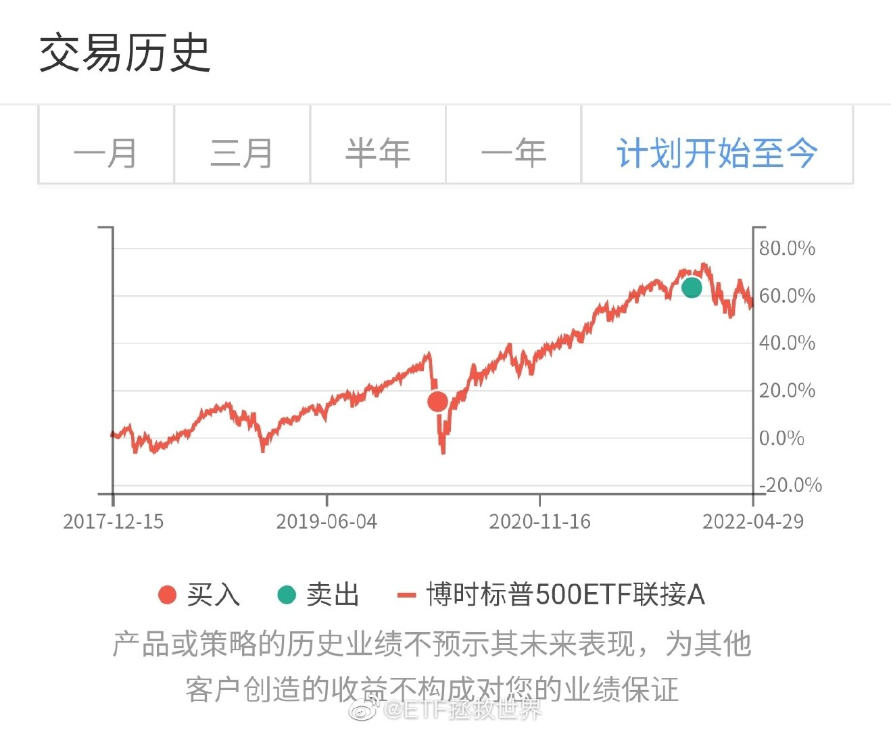

## 2022-05-06 10:24

今天不出门。

中午吃羊蝎子吧。好歹得消耗点存货。 ​​​

## 2022-05-06 10:43

如果那天顺利出货，这就又快可以接回来了，第三个16%也就不远了。

意难平啊。

这不能算天意。 ​​​

## 2022-05-08 22:06

一切都好，

勿念。

爱你。

   ————你的彦祖 ​​​

## 2022-05-09 09:22

我觉得个人也好，投资也好，企业也好，有一个问题一定要非常重视，

杠杆。

不是说绝不能上杠杆。比如个人的房贷，以前说的投资方面一些好用杠杆，企业更是不可能全部用自有资金运作。

但是，杠杆的程度一定一定要控制好。不要借贷超过自己承受能力的钱。借钱的时候也要做好最差预期。

就像你用自己的钱买指数基金，有点浮亏，即使没钱低位补仓，你也会知道早晚有一天能涨回去，钱不会永久损失。但是如果你加了杠杆，一旦爆仓，就彻底失去了希望。

当然有人和企业用杠杆发了财。比如一些房地产公司，比如一些多元化的大金融集团。但是easy come easy go，均值回归永远是真的。

## 2022-05-09 19:39

业余选手最近暂时不要总是盯着资本市场了，找点别的关注点，转移一下注意力。

这边有我帮你盯着。该买会买，该卖会卖。

您踏踏实实的，尽量让自己在这个**的世界里开心起来。

呐，做人呢，开心最重要！ ​​​

## 2022-05-10 05:58

只睡了三小时。 ​​​

## 2022-05-10 06:11

睡不着主要是在思考三件事：

第一，美股再次入场时机。从货币环境，估值，技术形态三方面考虑。

理智与人性在这个时候不断在头脑中交战，我希望理智能赢，并且有好的回报。

第二，产品选择。

有几个QDII产品真的非常非常喜欢。但是规模问题，计划竟然几乎不能买。

不禁感叹，基金公司发了那么多同质化的产品，在极窄的路上不断拼杀，而真正有特色的好东西却那么稀缺，投资人也宁愿高位千亿去送钱，也不愿意多买点长期好品种。

规模太小的品种不能买，这个问题怎么解决，非常头疼。

第三，公募私募回撤，基金以及基金经理的本质，产品匹配，基金经理匹配，投资者如何选择及投资的系统梳理。

晚上千万不能想事情，不然真就睡不着了。

## 2022-05-10 09:16

标普500第一买入点和第二买入点已经确认。

希望能到。 ​​​

## 2022-05-10 09:27

最后一个坚硬的泡沫，消费，能破掉吗。拭目以待吧。

## 2022-05-10 10:12

真的好笑。

几天前恒科因为交易规则没卖出去。

今天恒生因为美元升值没买回来。

什么玩意儿。 ​​​

## 2022-05-10 10:43

今年很多热门公募跌了20%多，30%多。很多热门私募跌了40%多，50%多。

有人骂，其实真没必要。

与其骂，不如好好想想，自己为什么买。是因为近期业绩好，是因为宣传，是因为认同理念，还是什么原因？

因为近期业绩好，有没有考虑过均值回归；

因为宣传，有没有考虑过销售机构和管理人的最终诉求和本质利益；

因为认同理念，那么短期的波动是否影响自己的认知，抑或根本没有认识到该管理人的特质到底是什么？

盈亏同源。

你选择了涨幅惊人的明星，就要承担几乎一定会出现的巨大波动。没有人能在每一个时期表现出色，没有人。

骂，解决不了问题。只有反思后的认知进一步增强，才会对自己的提升有帮助。

当一个基金短期涨幅明显超过他人太多的时候，就需要警惕。当一个基金经理买入豪宅的时候，就应该准备跑路了。

## 2022-05-10 10:58

反过来想。

如果你真的认同某个基金经理，那么，当他被所有人骂的时候，反而是你应该考虑买入的时候。

资产管理行业的顽疾之一几乎没有任何可能改变——价值毁灭。

无名小卒的时候，或者市场低迷的时候，无人问津。比如昨天只卖了7个亿的网红经理。

业绩出色的时候众星捧月，导致规模大到超过管理能力+均值回归，最终一个小波动就导致绝大多数人亏损，亏损金额大幅超过盈利金额。

你信不信，未来这位7个亿的业绩好了，会有70个亿来申购，然后又是一轮毁灭。

既然是这样，那么聪明的你就应该反过来做：

你认可一个基金经理，就在他挨骂的时候买，在所有人吹他的时候卖。

非常简单。市场上都是疯子和神经病，你正常点就行了。

## 2022-05-10 11:18

各位都知道，我从来不推荐任何基金。我看好就在组合里买，绝对不会去分析，推荐任何基金。

因为只要说了，就有非独立嫌疑。

但今天必须说一只，因为规模小，计划几乎没法买。但是确实是比较不错的东西，以后合适的时候我会通过别的方式买。

再次强调：推荐绝对没有任何利益因素，没有任何收费，如果有，出门被雷劈。

同时，也不怕其他人摘桃子，其他人买得越多越好，这样我才有机会在组合里买。

哪只先不说，以后买的时候说。各位看最近8年的涨跌幅，以及持仓。

就这个持仓，我简直是爱极了。
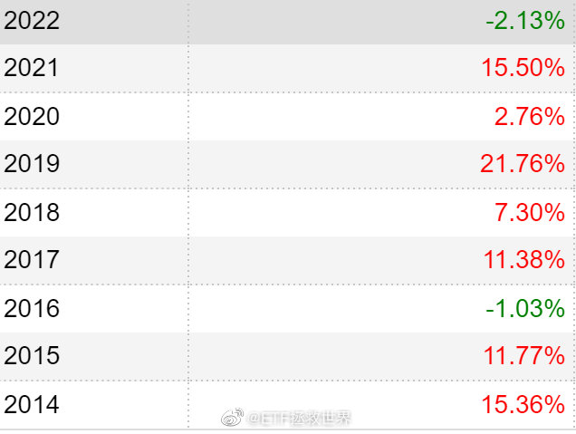 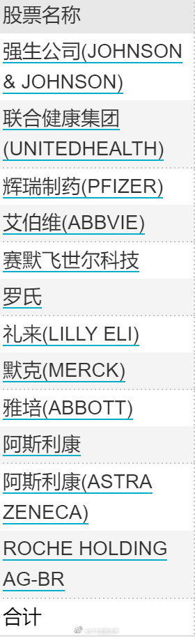

## 2022-05-10 11:28

既然说了全球医疗，不如把我关注的全球消费也剧透了。

反正计划都买不了。希望有人能买一买把它搞大。

真不明白为什么基金公司都扎堆弄一些同质化的产品呢。这样的产品太稀少了。 ​​​
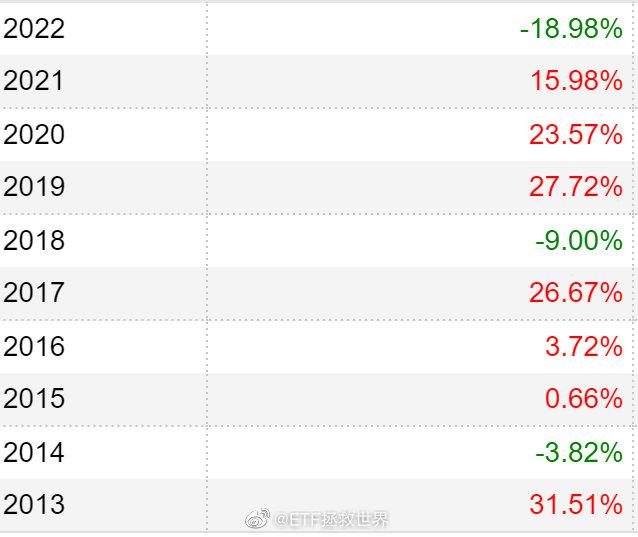 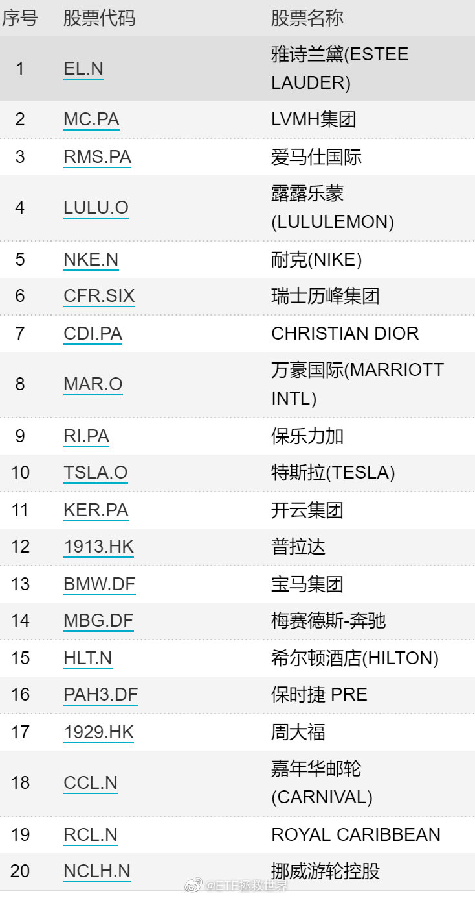 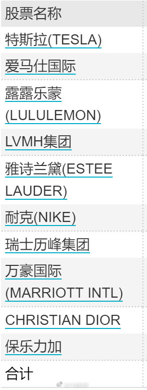

## 2022-05-10 11:53

但是投资QDII有一个需要关注的点，就是地缘风险。

一两句说不清，总之所有投资都要谨慎。 ​​​

## 2022-05-10 17:05

图1，1953年至今，美十年期国债收益率走势。

图2，1953年至今，对数坐标下，十年期国债与标普500走势对比。 ​​​
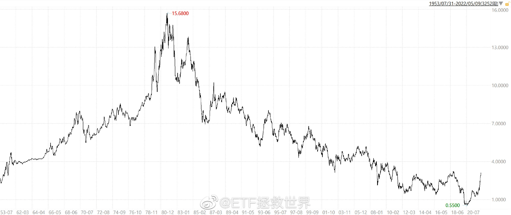 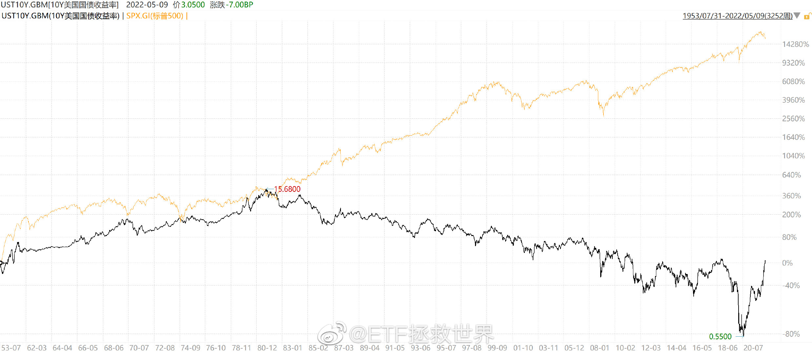

## 2022-05-10 17:29

刚才跟儿子一起看豆瓣，看到豆瓣推荐的变形金刚、天空战记、忍者神龟、圣斗士、大白鲸、一休、希瑞……这些都是小时候在电视上看的。

突然特别感慨。

儿子9岁了，这9年看的都是什么辣鸡动画片？

时过境迁。

准备开始给儿子补课。 ​​​

## 2022-05-10 21:42

没事儿别给别人做担保。

你把握不住世界，更把握不住别人。

看私信有感。 ​​​

## 2022-05-11 09:00

一块钱大家都不会当回事，

为什么不能每个人给我一块钱，我就发财了。

——这么想过的回复666 ​​​

## 2022-05-11 09:41

医药波段这个买点回头看又震惊一次。

都不知道是怎么蒙的。 ​​​

## 2022-05-11 09:48

如果有人说，技术在投资中没有用，那么就可以把这张图扔给他了。

当然，再次强调，技术有用，但是只是辅助。完全把交易理由放到技术上，就是舍本求末了。

但无论如何，技术一定是有用的。

一次两次，可以说是蒙的。但如果大多数都对了，就要研究一下是怎么蒙的了。 ​​​
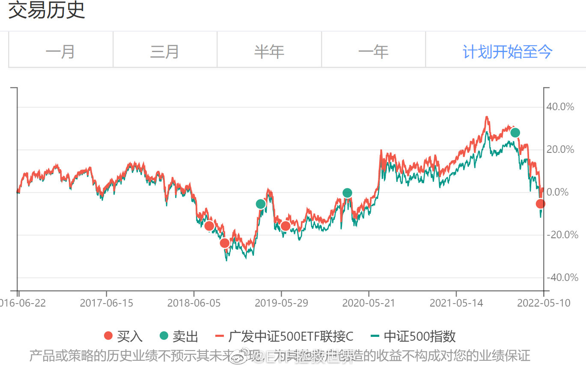 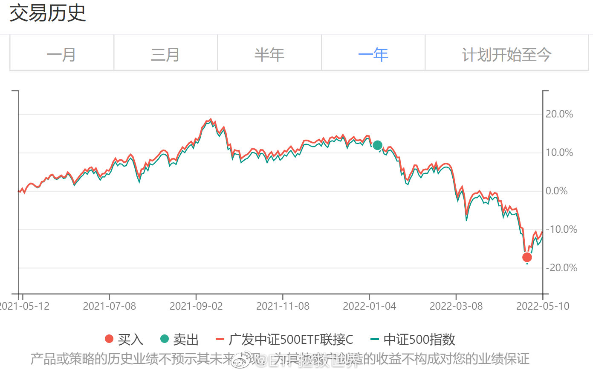

## 2022-05-11 09:57

有朋友说，这次计划大多数A股仓位并没有卖出，算是失败。

怎么说呢，回头看确实不完美。但有两个点要注意：

第一个，2018年底以后到2022年初，150和S几乎没有加仓。也就是说，基本上高位没有买过A股，整体只有卖出。能做到这个的人已经非常少了。

第二个，之所以没有大量卖出，是因为这150和S毕竟是“长线”仓位。比如150里面的500波段仓位，是清仓的。从这个角度就应该理解。

当然，无论如何，回头看，没有卖的更多一定是有问题。我之前也反思过，至少应该再卖5%-10%。尤其是有些品种，没有相信数据和科学，被人性掌控了，所以卖少了。但无论如何，至少有55%的A股仓位是再来一次也绝对不会卖的。

今年回调了13%，确实比较惨。但现在只是5月，今年还没过完，别急，再等等。

## 2022-05-11 10:01

今天如果不掉链子，易方达信息基本可以盈利了。广发信息还差2%。

要知道全指信息今年跌了33%。

我说过，控制成本，保证自己能在趋势转折后1-2周抹平浮亏，然后开始盈利。

浮亏并不可怕，真的。关键是控制成本。 ​​​

## 2022-05-11 10:13

恒科如果前几天不被摁住，昨天买回……这又冲向卖点了……每次都是16%啊。

不能多想，会哭。

我自己倒是无所谓，是真希望大家多赚点…… ​​​

## 2022-05-11 10:22

儿子跟好朋友打电话：

“你上午去做核酸还是下午？我妈说上午带我去。我们打算道法课的时候去。写字课去也行，你说呢？道法课还是写字课去。你现在干嘛呢。”

我终于明白什么叫“煲电话粥”了。

为什么我打电话都是赶紧说事儿说完了一点废话都聊不出来那种。

甚至正事儿都不想打电话…… ​​​

## 2022-05-11 10:37

听了两天儿子上网课，发现他不喜欢回答问题。

我觉得不好。主动回答问题说明思路紧跟老师，总是不回答容易走神。

于是定了规矩，主动举手并回答问题，奖励10元。一整天一个都没回答，扣10元零花钱。

好嘛，一天半过去，累计挣60了。

要知道一个月零花钱才300啊，定价是不是草率了。 ​​​

## 2022-05-11 14:10

给南方网友科普一下什么是🐏蝎子 ​​​
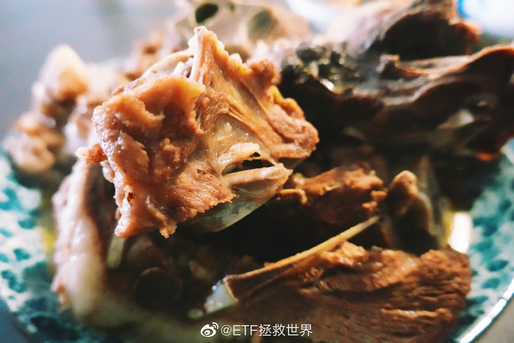 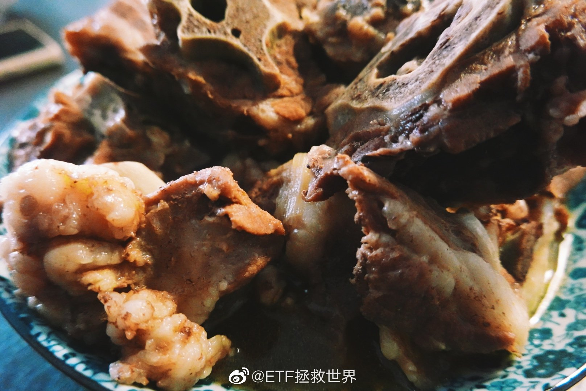 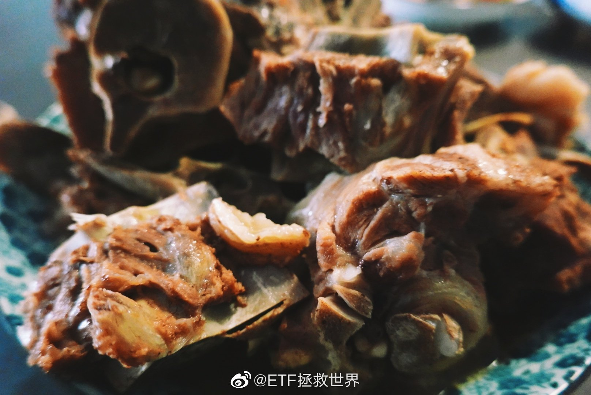

## 2022-05-11 14:21

医药又是折价差1厘。

最近是不是水逆？

不过这个我平静接受，是市场因素，我认。 ​​​

## 2022-05-11 14:52

连续几次，就说明运气有问题。

最近各位一定诸事小心，谨慎决策。 ​​​

## 2022-05-11 21:14

我爷爷家，从我姥姥家坐23路直达。每家自带卫生间，但没有厨房，因为据说入住的时候楼里有食堂。在当年的北京相当于现在的霄云路8号。小时候在楼门口的报亭买了人生中第一个高达模型。

## 2022-05-12 01:18

新低不买，也适用于美股。 ​​​

## 2022-05-12 09:43

美股小盘股已经跌回2020年2月的水平，估值也只有14倍。

标普和纳指依然高高在上，主要是稍大型股票，尤其是个别大型股票依然不肯投降，比如苹果谷歌…… ​​​
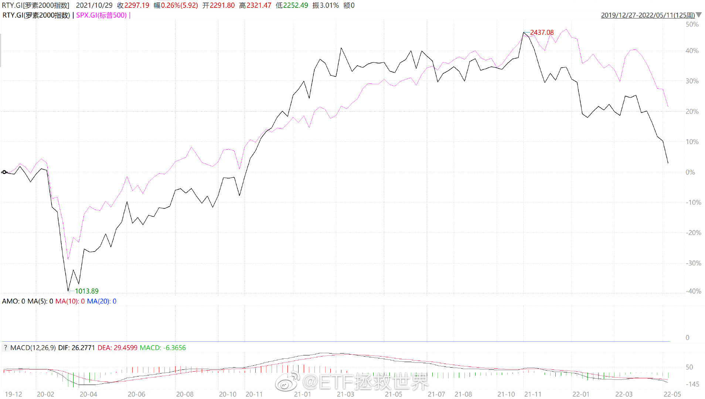

## 2022-05-12 09:59

儿子已经进入癫狂状态，一节课竟然回答了3个问题。

事态已经逐渐变得不可控制。 ​​​

## 2022-05-12 10:27

我过去，现在，未来，从来也永远不会用PE甚至PB PS 去评估一家公司是便宜还是贵。

因为公司和指数不一样，其差别大致是加菲猫和猎豹、吉娃娃和冰原狼、狗熊和熊猫、喷子和我们之间的差距。

那么用什么呢，流行的自由现金流贴现还是未来业绩预期贴现呢。没那么简单。

所以刚才的问题，我用PE去评估那位朋友说的“便宜”并不严谨科学。但至少是一个维度，数据也相对来说容易获取。总比空对空的意念评估好那么一丢丢。

## 2022-05-12 11:06

如果今天提款成功，

下午就去订一辆劳斯莱斯幻想。 ​​​

## 2022-05-12 11:23

回复@纪之风:创建的时候选择“成交监控”。那么触发未成交，下一交易日会自动重新监控。如果不选，那就失效了。//@纪之风:昨天的条件单触发了但未成交，今天是不是要重新发起条件单呀？

## 2022-05-12 14:15

它就像一个渣男渣女，不说行，也不说不行。

你放弃了，它就来撩几下。你重燃希望，它扭头就走。 ​​​

## 2022-05-12 16:27

刚才跟人聊到对于基民来说，怎么样的一种买入方式才是大概率赚钱的。追高还是买低。

不妨看两只基金的份额与净值变化对比。这两者非常有代表性。

前者毫无疑问，是有很多资金在做波段，同时低吸。净值不断下降，份额不断增加。份额的顶部与净值的底部完美契合。然后随着净值反弹，份额不断下降，最终一波下跌过后，份额回归初始状态。可以看出，虽然一轮过去净值没变，但大多数人是赚钱走人的。

后者则完全不同。

随着净值上涨，份额不断增加。很明显可以看出，这是一只投资者主要是“追涨杀跌”人群的产品。在净值最顶峰，与份额最顶部基本契合。

更有意思的点来了。

它目前的净值与2020年6-9月差不多。但注意，当时的份额大概是92亿左右。但最高点是300亿，目前是260亿。也就是说，它明明是一个涨幅很大的基金（涨幅100%），但目前持有的份额中，有至少60%以上是亏损的。

前者是净值基本没变，但大多数人都获利且离场了；后者是净值大幅上涨，但60%以上的份额是亏损的。

这不是很有意思吗。
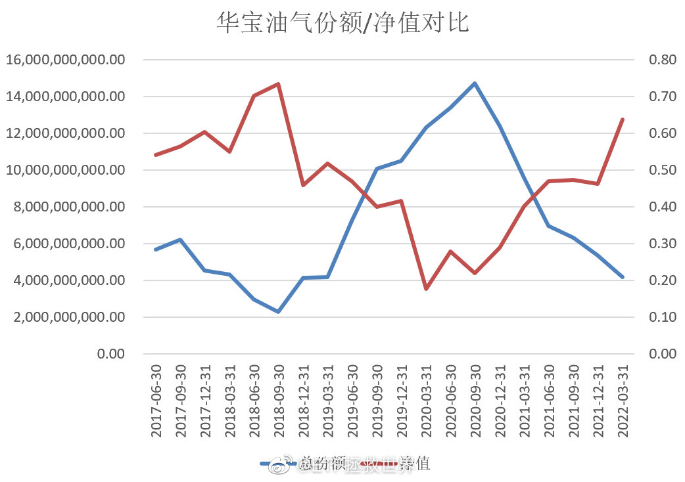 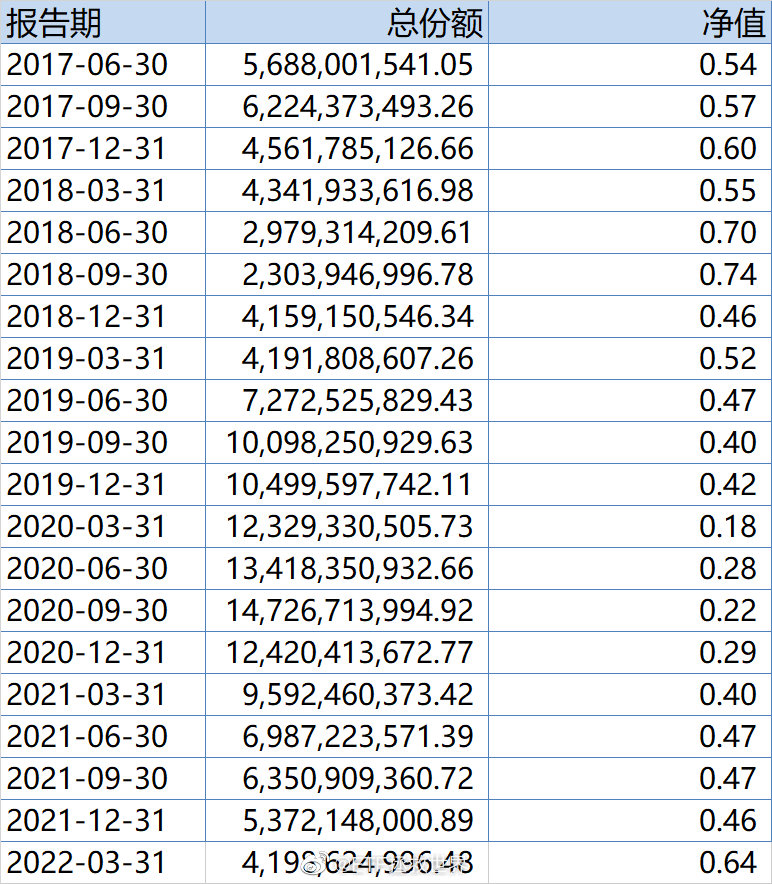 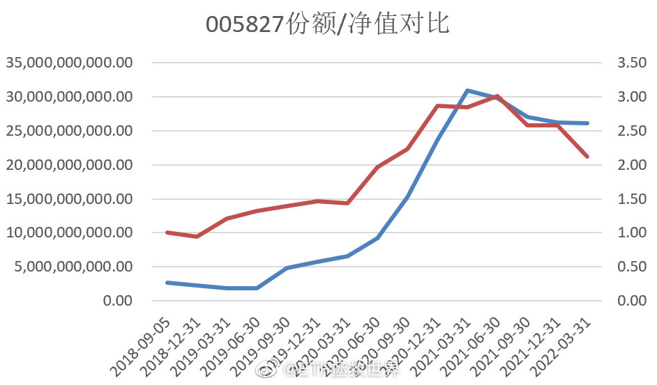 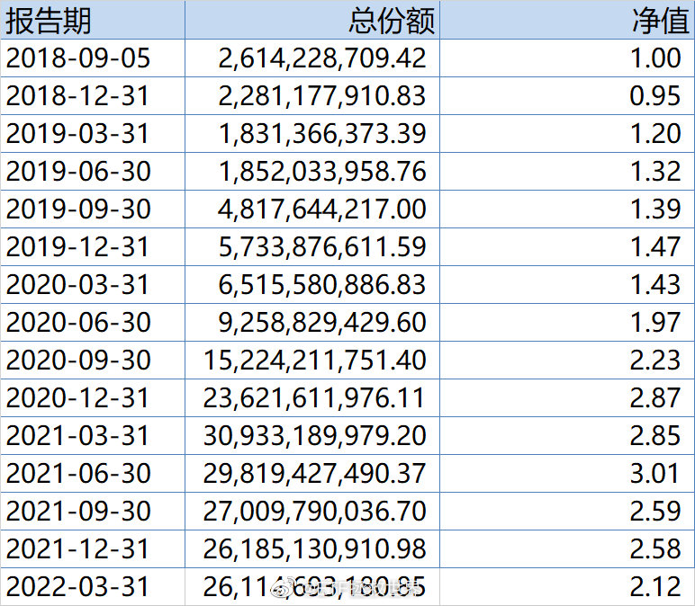

## 2022-05-12 16:45

这第三个例子，是一个极度正面的例子。

随着净值见底，份额持仓也创出了最大值。之后，是非常稳定的持有。一直到涨了大概50%后，第一次小幅减持出现了。然而，大部分成功抄底的人依然没有动，直到——

在上涨60%-130%这个区间，持仓份额大幅减少，所有坚定低买，坚定持有的人，全部获得了非常高的收益，安全离场。

最终，在该品种回调几十个点后，持仓份额比一开始还要低很多了。

这里是理性的光辉，还是价值投资的胜利？我们不得而知。

我们只知道，这不是一般机构能够做出的操作，彻底服了！
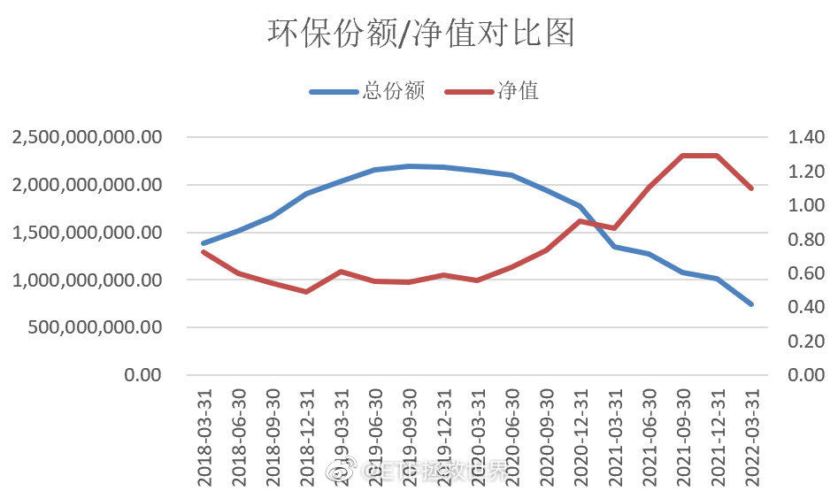 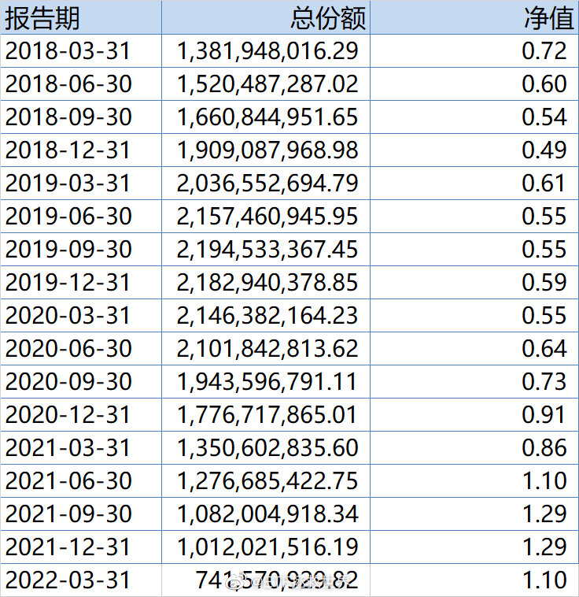

## 2022-05-12 22:03

纳指标普继续52周新低。不装了，摊牌了，我就是想买。距离目标价位还有空间…

## 2022-05-13 08:42

一条谣言引发了一些人去超市抢物资，希望不要交叉感染。

没事的时候多做点准备，还是要比听风就是雨盲目慌乱好一些。 ​​​

## 2022-05-13 09:23

我说今天能出，

谁支持，

谁反对。

水逆什么的，也该结束了吧我说！ ​​​

## 2022-05-13 09:27

今天开始玩水培蔬菜。

对我来说，种植领域是一个全新的世界，说起来，倒是有点小期待呢。 ​​​

## 2022-05-13 09:34

9个交易日12%，效率太低了 ​​​

## 2022-05-13 09:41

当你发现自己在执行一个涨跌都开心的策略时，

就说明这个策略是适合你的。 ​​​

## 2022-05-13 09:57

有些人在波动里追涨杀跌，痛苦不已。

有些人在波动里高抛低吸，乐在其中。

世界是同样的世界，你用什么态度和方式对待它，它就是什么样子。 ​​​

## 2022-05-13 10:08

正在更新。买回价位有变，可以参考一下。 ​​​

## 2022-05-13 12:59

二级市场非常好的一点是可以看k线。

我们可以看美帝的k线，研究证券市场的历史。也可以看无数个股指数的k线，研究每一个大顶大底到底是什么形态，有什么规律和特点。

研究和借鉴历史k线，是江户时代的米商送给我们的价值连城的小礼物。 ​​​

## 2022-05-13 13:36

我发现绝大多数老师都非常和蔼可亲，甚至可以说是温柔，不论男女。

是因为网课家长有可能会看到，还是在学校也这样呢。

记得我小时候老师大多数都挺凶的。 ​​​

## 2022-05-13 13:43

红利这货永远与别的品种不在一个节奏上。

有一说一，我喜欢。

相关性越低越喜欢。 ​​​

## 2022-05-13 14:19

庙小妖风大，池浅王八多。 ​​​

## 2022-05-13 15:10

出货了言而有信。有人跟我拼单lsls幻想吗。

满200-30，还差150。再用一个-5元的券，然后凑单两节五号电池，可以用掉主页搜关键字红包-5元，再用一个省钱卡，最终到手价23元，历史好价。（好评还可以返现1元 ​​​

## 2022-05-13 15:58

那事儿就那么有意思吗？

就金融投资那事儿。 ​​​

## 2022-05-15 11:43

再给朋友们一个建议：

明显超出同类产品收益率的金融产品，一定要小心对待。无论它的名字叫做基金、债券，还是存款。不是说一定不能投，投的话，一定要把握好在你资产中的占比，不要梭哈。

有些朋友说，我买的产品收益率也不高啊。这个问题的关键在于与同类产品比。比如说吧，别人的存款利率是2%，你的是4%，那你就得多考虑考虑，有没有什么风险。

暴富也许真的是险中求，但险中未必有富贵。深刻理解超额收益率的来源，然后再买，会比较好。

## 2022-05-15 19:36

全冷冻食物的一顿晚餐 ​​​
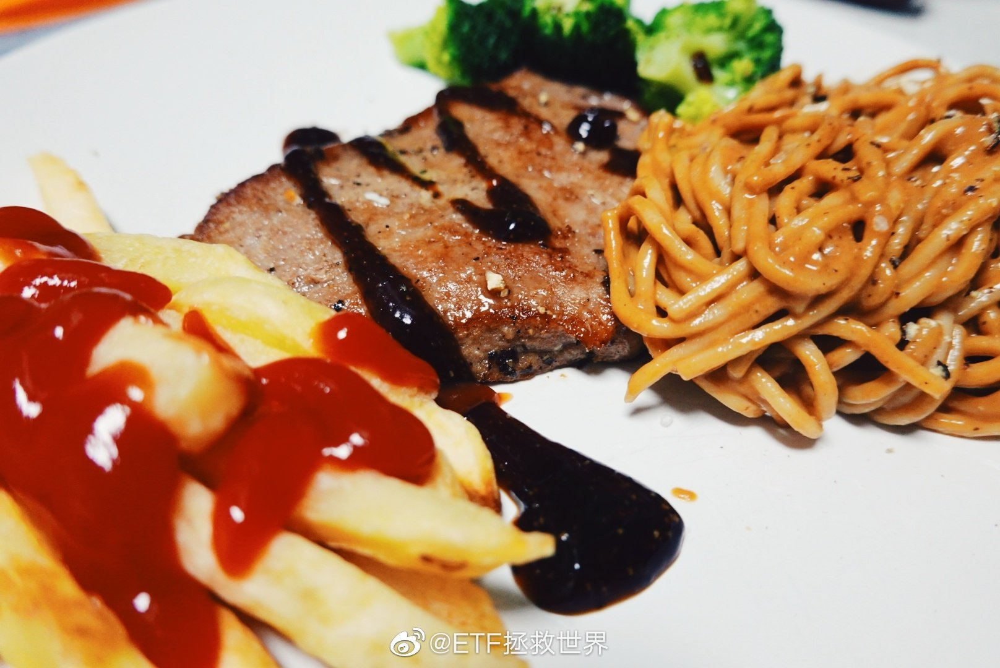

## 2022-05-16 10:35

【FBI Warning】

我准备开始清理粉丝了。或者称作修正粉丝数。

我的理由很简单，不希望粉丝数量太多。我的愿望是在网上能跟更多朋友交流的同时，尽量做个小透明。

我不知道微博这个修正粉丝的原理是什么，也不知道会不会误伤正经博友。如果您被误伤，实在不好意思。

接下来我就准备尝试开始了。也许能操作成功，也许不能。如果不能，到接近100万的时候，这个号也会暂停继续发布信息，可能会换一个，也可能是别的方式。

总而言之，保持低调。

## 2022-05-16 10:59

越南股市跌了一点，我不知道很多人在高潮什么……

人家十年好歹涨了5倍（本币计算）。

我不是说它好，我是说客观一点，不要妄自菲薄，也不要盲目自大。 ​​​
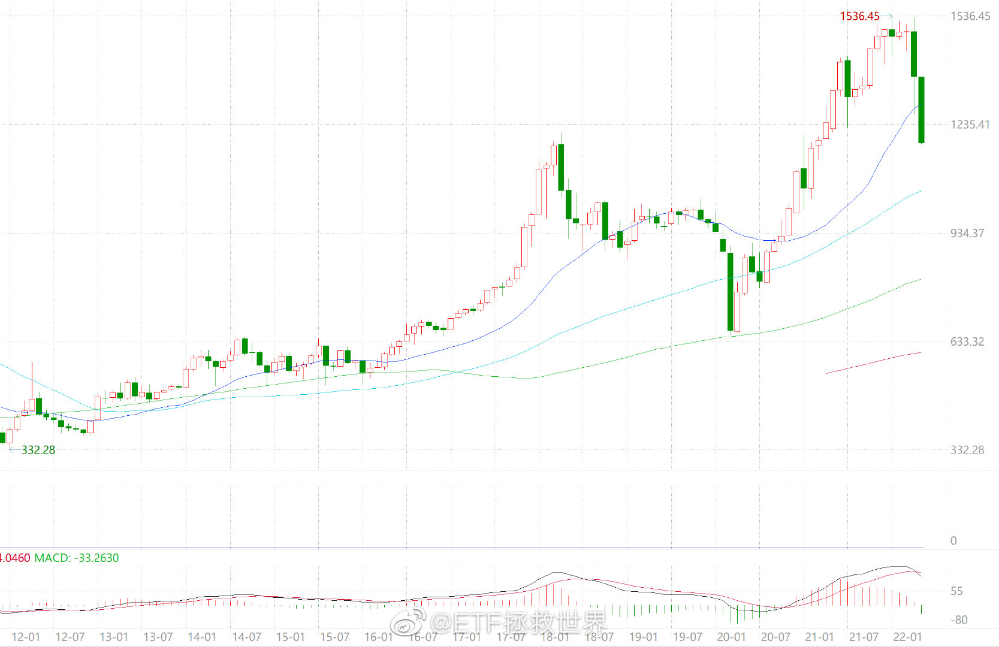

## 2022-05-16 13:16

清理的非常缓慢。 ​​​
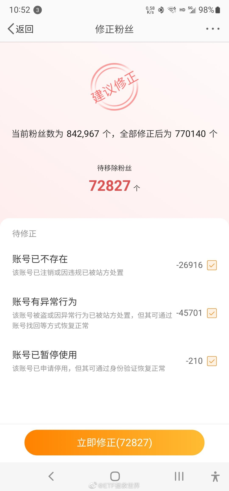 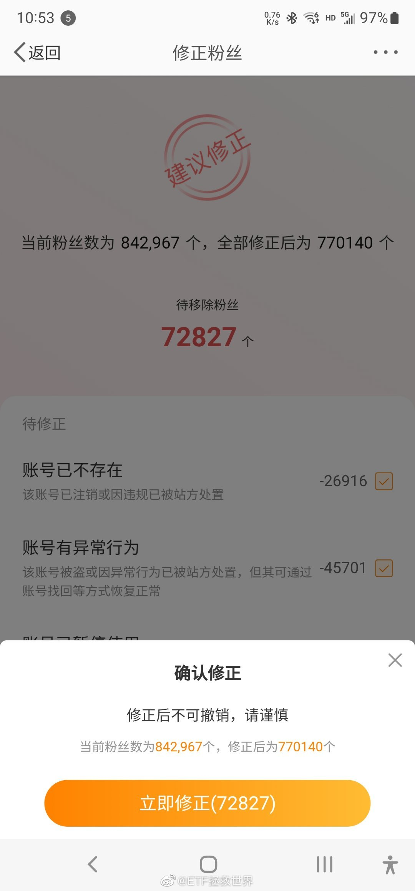

## 2022-05-17 09:49

有没有想过，为什么你很难快乐。 ​​​

## 2022-05-17 09:53

认真、负责，同时兼具能力的下属和同事，非常非常难得。

如果你有幸拥有，一定要珍惜。

也要对ta好一点。 ​​​

## 2022-05-17 10:08

巴菲特这几十年在富国银行上赚了不少，有机会更是不停表示富国银行的优秀。

在富国银行十年股价没动的今天，巴菲特清仓了。 ​​​

## 2022-05-17 10:24

YY这一笔，

如果最低那天差5厘最低价买入是蒙的，那么最高那天最高价附近卖出也是蒙的吗。

毫无疑问，是的。

全是蒙的。 ​​​

## 2022-05-17 11:14

看到恒科的走势，

脑子里浮现三个字：

大

冤

种。 ​​​

## 2022-05-17 11:35

什么样的倒霉可以接受。

就是那种完全无法改变的。比如一个人走在路上，突然飞下来一个陨石砸头上。

什么样的倒霉不能接受。

就是那种人为的。比如一个人走在路上，突然楼上一个**往下扔东西，砸头上了。

还比如在下跌过程中，一个大涨本来可以卖出，结果因为交易制度不合理，导致卖不出去。

什么样的失败需要改正呢。

就是那种因为自己的原因造成的失败。比如制定了交易规则，经过验证发现有问题，也找到了问题所在，然后想出解决问题的方法，就去改正。

什么失败不需要改正呢。

就是那种因为不可抗力造成的失败。我会因为交易制度不合理就去修改我的交易规则吗？我不会。因为无从下手。这不是说这次抖个机灵手动卖出就是修正了交易规则。规则不是随心所欲，而是一整套触发——执行的体系。如果无法修改体系，那么就无法系统化的提高。

不触发就执行，那是瞎**操作，不是修正了错误，改进了系统。

## 2022-05-17 14:12

等福报。

（但是严肃的说，这是一个复杂的问题，一两句说不清。） ​​​
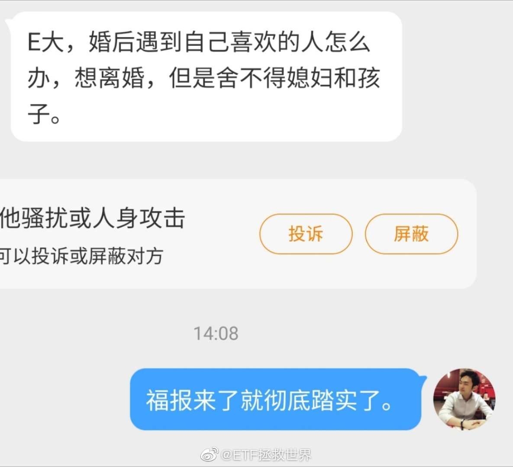

## 2022-05-17 14:49

回复@风竹某某:娶了红玫瑰，久而久之，红的变了墙上的一抹蚊子血，白的还是”床前明月光”；娶了白玫瑰，白的便是衣服上沾的一粒饭黏子，红的却是心口上一颗朱砂痣。//@风竹某某:理解遇到自己喜欢的人，理解舍不得孩子，不理解为啥舍不得媳妇…如果舍不得媳妇，那么就是两个都爱？

## 2022-05-18 14:03

易方达信息已经盈利，广发信息还差1%。

该指数今年下跌32%。

接下来，计划会增加所有品种右侧买入的概率。

不要再问“为什么更低的位置不买，涨了你才买。”

照你这么说，所有品种都只有最低价买入是对的，所有之后的买入都是错。以后这种问题，见一个拉黑一个。 ​​​

## 2022-05-18 14:14

最近这几天，发现了别人的一些错误导致的一些问题，对自己造成了影响。

情绪没有波动是骗人。但马上意识到，任何情绪都不能改变已经发生的事实。接下来怎么做，才是最重要的。

于是立即转变思路，尝试从另外的角度思考解决的方法。

出乎意料的，发现了以前自己没有意识到的，弥补自己体系缺陷的一条新的路径。

如果不发生问题，自己可能不会努力去找弥补的办法。如果不去找弥补的办法，可能无法发现新的路径。

塞翁失马，焉知非福。

当然，大家还是努力、认真，不要总是失马，让我也别总是那么心累……

## 2022-05-18 14:20

大家都知道，投资是概率的问题。做大概率正确的事情，那么就大概率能挣钱。

那么：

第一步，将标的锁定在不死的品种。保证自己买的东西绝不会死，也就是说，资产不会永久性损失。这个赢的概率是多少。

第二步，在标的不贵，甚至便宜的时候买入。那么，赢的概率是多少。

第三步，在不死标的不贵的时候，技术上开始转强的时候买入，这个时候，赢的概率是多少。

不死+基本面+技术面，我想，买入赚钱的概率，应该大于80%-90%。

如果每一个持仓品种都是这样的概率，那么，十个品种，有9个都赢了，一个输了，整体看，你的组合获胜概率应该是：

99.99999%

## 2022-05-18 14:46

金融交易分为三个组成部分：

选品、买入、卖出。

这三个部分，自我感觉隐隐约约看到“圣杯”的，是买入。自己已经形成了非常非常成熟可靠的完整体系。

其它两个方面，还需要继续努力。相对来说，最难的就是卖出。特别特别难。 ​​​

## 2022-05-18 18:34

刚吃了两口中超某队主教练的瓜，发现一个问题：

为什么国外（欧洲）的主教练，不管年纪多大，40 50 60年龄段，大多都把自己弄得利利索索，打扮的人模狗样。

而国内刚退役没几年做了教练，大多数就身材走形，穿的邋里邋遢。

穆里尼奥，瓜迪奥拉，杰拉德，克洛普，西蒙尼…甚至年纪大的温格，安切洛蒂，身材都保持很好，也整天西装笔挺的指挥比赛。

为什么呢。

## 2022-05-18 23:25

我坐在沙发上看美股，

小猫咪躺在旁边看我。 ​​​

## 2022-05-19 07:16

苹果本轮调整收盘新低，日常消费大跌6%。出来混总是要还的，均值回归…

## 2022-05-19 07:41

回复@Yuen-Kwan:不是感觉。从技术指标上看，某些美股品种确实是调整刚开始。当然，也许我错了。等吧//@Yuen-Kwan:感觉才开始调整//@ETF拯救世界:苹果本轮调整收盘新低，日常消费大跌6%。出来混总是要还的，均值回归…

## 2022-05-19 07:47

我感觉今天消费可能蚌埠住了。一个感觉，不一定对//@ETF拯救世界:最后一个坚硬的泡沫，消费，能破掉吗。拭目以待吧。

## 2022-05-19 09:43

再说一次，目前已经进入右侧补全阶段，不会着急抄底。除非到了关键点位，不会买入。

所以你不用慌，不用催，让市场自己走。

走得好我们就扶上马送一程，走不好我们就躲在防空洞里收听末日广播。

急什么，慌什么？ ​​​

## 2022-05-19 09:59

下跌的时候，不要总是担心买不到。底部不是一天形成的，一次大的下跌，需要比较长的时间筑底。

也许你买不到最低点，但在筑底过程中买入就不算错。

格局打开。用长期的视角，而不是分钟线、小时线、日线去观察市场。

左侧仓位有没有？有。有就行了，踏踏实实等市场自己把底部走出来。 ​​​

## 2022-05-19 10:52

一方面说投资者不成熟不理智，追涨杀跌，学不会低位买入的价值投资；

一方面跌到底部就限购，不让买。

投资者：

我太难了！！！ ​​​

## 2022-05-19 11:02

我翻开历史k线一查，这历史没有国别和品种的限制，歪歪斜斜的每张图上都写着右侧体系四个字。

我横竖睡不着，仔细看了半夜，才从字缝里看出字来，满本都写着两个字是

稳了！ ​​​

## 2022-05-19 11:18

回复@起源199609:今天没车。看月底。如果顺利，会有。符合条件一只就买一只。//@起源199609:我猜今天是达摩和信息的车，消费也有可能

## 2022-05-19 11:32

为什么我隐隐觉得这两个例子哪里不太对。

## 2022-05-19 12:18

看到这样的新闻，准备继续卖出债基仓位

## 2022-05-19 19:51

从功利的角度，讨论为什么要善良 ​​​
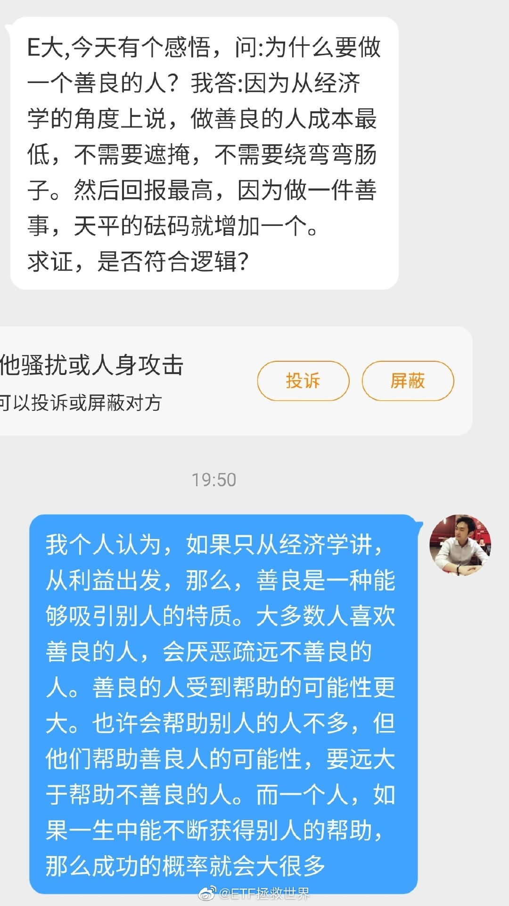

## 2022-05-19 20:08

回复@小元447贰:举个也许不是十分恰当的例子吧。你觉得鲁智深是不是善良的人。总体来说是吧。救卖唱女，救林冲。谁敢欺负他？//@小元447贰:可生活中常见和常遭遇到的却是人善被人欺，马善被人欺诶

## 2022-05-20 09:39

每个孩子都是潜力无限的…

当然我还是希望有点限度… ​​​
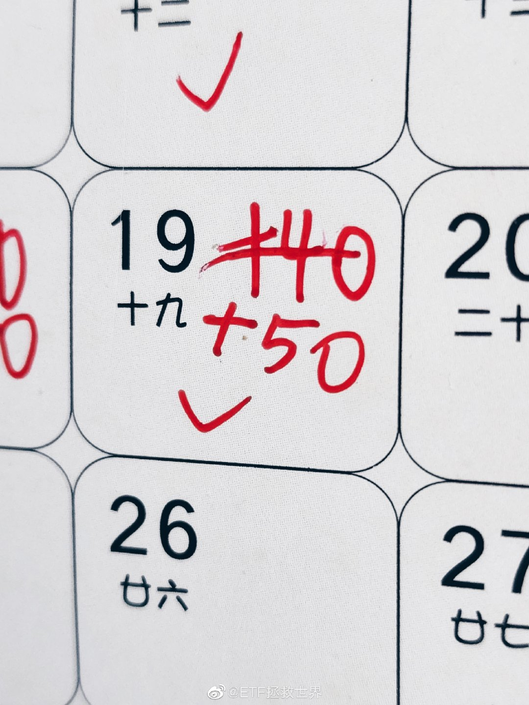

## 2022-05-20 10:52

520这种日子，

单身的朋友，不如在评论里找个靠谱的人，谈个恋爱，吃一点爱情的苦，尝一点爱情的甜。 ​​​

## 2022-05-20 13:43

目前已经有三个品种符合买入标准。

一只加仓摊低成本，一只买回，一只新建。

会继续观察，还是月底确认。 ​​​

## 2022-05-20 13:51

今年自我感觉在投资上有一个比较大的进步，是破除了一个心魔：

涨了，就很难再下手。

比如说，见过1块钱，你让我1.1去买，我会很难受。

这明显是不对的，但确实是一直以来无法破除的心魔。

今年已经完全破除了这个心魔，对于右侧买入，已经毫无心理压力。

其实道理很简单，

如果左侧买入，一路摊低成本，最终在底部浮亏十几个二十个点是可以接受的。那么，右侧涨起来十个点买入，为什么不可以接受呢。

当然，对于右侧的把握，依然是非常严格。我认为，所谓右侧，一定是底部起来非常罕见的机会。趋势转折的时候，一定是只有2-3个买入机会。之后，那就不是右侧了，那就是追涨了。

心魔一破，世界瞬间就不同了。

## 2022-05-20 14:06

回复@耘Boicary耔:不可能。巴菲特一季度这么高还不停的在买苹果。这一点我无论如何做不到。

## 2022-05-20 21:11

150今年收益率回撤不到10%了。

年度不赔钱的记录今年能延续吗，走着看吧。 ​​​

## 2022-05-20 21:19

回复@差一点先生leo:之前两年我一直建议新朋友不要跟车。但4月份首次建议可以新开150，对我这样还算负责的人来说，能作出这样的建议，绝不是信口开河。//@差一点先生leo:4月26日跟车补了26份，已经盈利6个点了

## 2022-05-20 21:22

无论下半年怎么走，我现在依然认为如年初所预计，绝大多数A股指数今年恐怕很难收红。

但是，注意，不收红不代表一定赚不到钱。

因为，

有波动。 ​​​

## 2022-05-21 09:51

一天就发芽啦。

生命的力量，破土而出。 ​​​
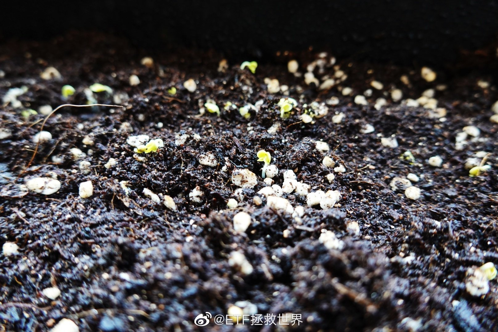

## 2022-05-21 11:28

发现一个黑天鹅：

即使准备了一个大冰箱一个大冰柜的食物，甚至可以自己种菜吃，

但如果被人全部扔掉，那么所有的准备就是无意义了。

所以，还要对黑天鹅的发生继续进行准备吧。 ​​​

## 2022-05-21 18:58

震惊！原来很多菜把菜根种到土里就可以继续长出来了！

相当于植物界的比克大魔王了。 ​​​

## 2022-05-22 17:45

大家一起感受一下生命的力量。

美中不足的是动了两下 ETF拯救世界的微博视频 ​​​

## 2022-05-23 10:08

红利买回价格没有变化，直接重新创建即可。 ​​​

## 2022-05-23 10:14

为什么我种的上海青和小白菜长出来是一样的 

难道不同青菜的宝宝长相都差不多，长大了才有分别吗。就像人类宝宝一样。 ​​​

## 2022-05-23 14:14

如果不想跟异性有过多的纠缠，就直接或间接的让对方感受到：我没兴趣。

千万不要让对方感到有更进一步的可能。

有些人很容易想多，即使你觉得只是正常交往，也会让对方产生幻觉。

所以，该冷淡的时候一定要果断冷淡。 ​​​

## 2022-05-23 16:01

小时候，跟王心凌一起喜欢过一大批女歌手的歌。包括但不限于：

S.H.E、徐怀钰、Twins、4 in Love、周惠、苏慧伦、梁咏琪、许茹芸、郑秀文、陈慧琳。

那时候听歌也不太看脸，就是喜欢听歌。

现在也不能听了，听当时的歌，回忆起来都是故事。 ​​​

## 2022-05-23 19:19

有没有一种可能，给生活比较困难的人稍微发点钱。 ​​​

## 2022-05-24 09:09

又有人在评论里教育我，“还是多说点经济和投资吧”，“不要一直说**，看多了烦”。

首先呢，两年前就有过投票，90%的朋友支持什么都可以聊。

其次呢，这是我自己的微博，爱说什么说什么。

第三呢，只说投资，行情平淡的时候，哪有那么多好说的啊。我发了1.3万条微博，得有1万条是关于投资的。差不多行了。有的说就说，没的说也不能硬坳啊。

所以，别教我做事。当然，你要觉得我发的哪条比较危险，可以提醒我。这个我是欢迎的。虽然我已经很谨慎，但百密一疏，还得请更加敏感的朋友帮我把关。

毕竟活着才能做事，对吧。
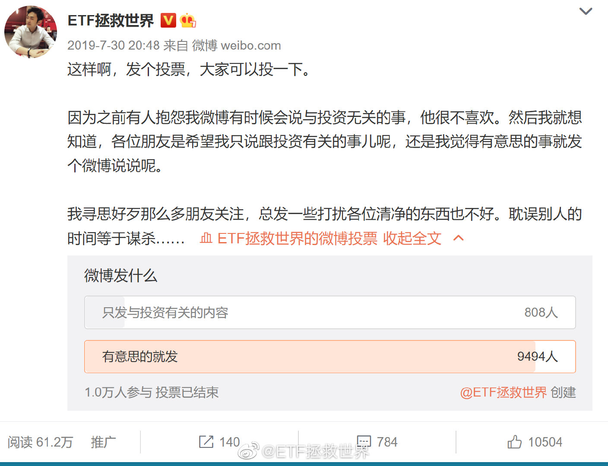

## 2022-05-24 10:03

不见兔子不撒鹰 ​​​

## 2022-05-24 10:28

我个人认为，私募基金还是要有个预警和止损线的约束。

为什么呢。你想啊，

从私募基金管理人的角度来看，在上涨趋势中，赚得越多，提成越高。所以它天然的就会有重仓满仓尽量多赚点的冲动。

如果没有预警和止损线会导致什么呢，

会导致它没有敬畏之心——反正跌很多也没有坏处，涨很多会有很多提成，那么为什么不永远满仓干呢。

但是有了预警和止损，就会谨慎很多。在赚钱的同时，起码会适当的注意风险。

## 2022-05-24 10:48

一句话告诉你我的真实财务状况：

舍不得用日抛。 ​​​

## 2022-05-24 13:36

预先设计好投资计划还有一个好处，就是会让你感到特别特别轻松。

你跌到了那个点位，我就买。致敬，加仓。

你涨到了某个指标，我就追。说买多少就买多少。

所有的情况我预先设计好，条件达成我就干。毫不犹豫，毫无负担。所有的事情事先都想好了，会出现什么状况也想清楚了，做好准备应对了。

条件没到，我就不动。条件到了，我雷霆万钧。

轻松不轻松？

犹豫？彷徨？左右为难？骑虎难下？

都是什么意思？我不知道。

if *** 

then 买

else 不动

这就是野生AI的简单逻辑。

## 2022-05-24 14:09

你以为塔说要等到月末才做决定是乱说的，

塔才不是乱说的，塔是有备而来。 ​​​

## 2022-05-24 14:29

用更长的眼光去观察，就不会被短期的上蹿下跳所迷惑。

## 2022-05-24 14:52

500波段差一个多点没有卖在最高，

没做好，

骂我吧。 ​​​

## 2022-05-24 15:03

医药要观察一下前期低点是否能撑住。

如果撑不住，9500的大支撑就大概率能到了。到了就买左侧最后一次。

如果能撑住，我会看情况加。

右侧还有。右侧加完，医药就可以彻底放在一边不用看了，集中注意力盯其它想买的品种。

都计划好了，触发哪个条件就调用相对应的计划，都是明牌，提前说清楚，让市场自己选。

## 2022-05-24 22:12

想了三天三夜也没想明白，为什么市场上的美国消费指数基金，亚马逊和特斯拉居然占了40%多仓位。

麦当劳星巴克耐克加起来才10%。

这合理吗。

这也没法买啊。 ​​​

## 2022-05-25 10:05

有没有一种可能：

每次我这里出现有人要救我的命，或者信誓旦旦言之凿凿的表示已经暴跌过的不死品种还要继续暴跌，

那就是底部标志，预示着可能要开始涨了。 ​​​

## 2022-05-25 10:09

长期看，现金一定是贬值的。

送大家一份礼物。本来想哪次公众号发文送的，可现在感觉遥遥无期啊。

所以在微博送了吧。

各指数历史走势4月更新。  ETF拯救世界的微博视频 ​​​

## 2022-05-25 10:29

看了这个视频，你就会发现用现在的视角去判断谁好谁坏，就是根本不懂投资的人在扯淡。今日辉煌者，有一天也许会神台跌落。今日落魄者，未来可能会光彩夺目。

## 2022-05-25 10:56

YY拆分不要急。完整的修改挂单方案正在制定。

所有的事情都会处理妥当，力争保证不会让任何人出问题。

这是我做事的原则。

具体情况所有流程理顺后会公布。 ​​​

## 2022-05-25 12:03

我有个很严肃的问题问一下：

如果我把纯牛奶冻起来，然后当成冰激凌吃掉，那就不能算是破了戒糖的规矩。

这样想，是没错的吧。 ​​​

## 2022-05-25 14:05

谁知道北京如果被隔离了，家里的宠物怎么办。 ​​​

## 2022-05-26 09:52

刚看了一个选择去外交部还是去大厂的帖子。

正好昨天儿子的一个同班同学终于从印度回来了。马上上四年级了，这才第一次回来上课，一直在印度。孩子的父母是驻印度的外交官。

什么工作都没那么容易啊。 ​​​

## 2022-05-26 10:00

四月买了一堆，五月没买吧，没追高吧，还减仓了吧。

那么，跌就跌呗。跌了再把卖了的买回来。 ​​​

## 2022-05-26 10:11

医疗新低了。

新低意味着很多。

我们还没买，但我们也许会买。 ​​​

## 2022-05-26 10:34

看盘的朋友，

你们最近能不能感受到神秘力量。 ​​​

## 2022-05-26 11:40

有一种感觉，

今天小红都能提款。 ​​​

## 2022-05-26 11:48

S计划里面，A股浮亏最多的一只是券商保险，也就是非银，-19%。

但是相信我，只要一个买入动作，浮亏程度就会降到8%。然后很容易就会开始挣钱。

不急。等信号。 ​​​

## 2022-05-26 21:59

今年618我准备给大家派发1688元购物卡，助力消费。 ​​​

## 2022-05-26 22:20

可能性极大。

## 2022-05-27 09:25

儿子网课，老师在讲书上小熊的排列组合题。

一个学生在评论区说，那不是小熊是土拨鼠吧。老师生气了，书上写的清清楚楚是小熊，你不好好做题发土拨鼠干嘛。

我跟儿子说，其实这个孩子挺有质疑精神的，思维也很活跃，但缺点是不够认真不够仔细，一定程度上也干扰了教学秩序。

儿子说，而且是小熊或者土拨鼠都无所谓，这也不是这道题的关键。

我说，很好，你的思维高度又进步了一层，懂得分清主要次要矛盾了。

儿子说，

进步了，加钱吗？

## 2022-05-27 10:11

还有两个交易日。这个月能不能买，能买多少，就看这两天了。 ​​​

## 2022-05-27 11:15

有没有更大的阴谋不知道，显而易见的是作者一定有点奇怪的XP

## 2022-05-27 11:20

总有人问波段剩下的那些利润仓位怎么办。

再说一次，踏踏实实拿着。给时间让雪球滚起来。 ​​​

## 2022-05-28 08:30

改单指南已推送 ​​​

## 2022-05-28 09:21

一个人有没有用心做事，从结果是能看出来的。

用心两个字，说起来容易，做起来难很多。

用心，是超越“认真”、“负责”的一个程度。 ​​​

## 2022-05-28 12:12

第一，平衡很重要。如果一方力量是压倒性的，反而有可能最终崩溃。需要平衡。

第二，大多数时候压力也是必不可少的。没有压力，容易温水煮青蛙。

所以，很多事情要看得更高一些。 ​​​

## 2022-05-28 19:23

暑假海南环岛的话，会热吗 ​​​

## 2022-05-29 14:09

行吧。我不说话了。

历史终究要不断重复的。

就这样吧。 ​​​

## 2022-05-29 18:40

我不怕你们说我欣赏水平低，艺术修养差，理解能力有问题，

我坦白，我不喜欢瞬息全宇宙。

2/5分。 ​​​

## 2022-05-29 22:32

不瞒你说，今天还是有一百多位设置错误了。

把以前的价格又设置了一遍。 ​​​
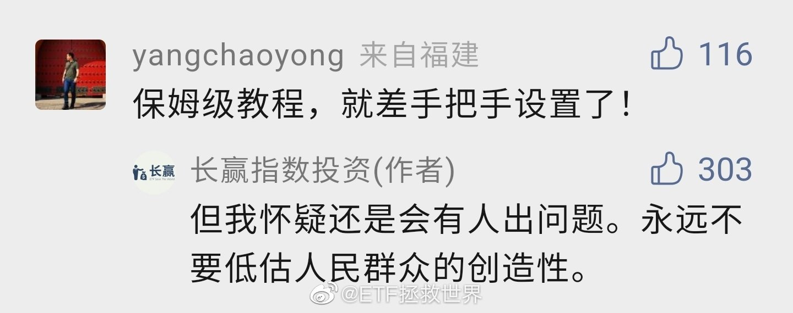

## 2022-05-30 09:28

你能想象吗，就2年前，被无数人嘲笑，让无数人痛苦的华宝油气，

最大涨幅超过400%了。

一定一定不要让一个品种现在的表现好或者不好，影响你它对未来的判断。 ​​​

## 2022-05-30 09:51

最近开始吹中证红利，上证红利的人开始多起来了。

他们也找到了各种理由证明这些指数有多好。

说实话，我感到很不安。 ​​​

## 2022-05-30 10:06

如果你一个品种没有做好，比如说买早了，买晚了，卖早了，卖晚了……

一点点点点沮丧懊悔都不需要有。

因为证券市场不是你的婚姻，也不是你的职业，更不是没有低位买入的那套抄底房。

不是说一生只有一两次的机会，错过了就错过了，人生就改变了。

证券市场的机会，没完没了，无穷无尽。小机会每年都有，大机会三五年，五六年就必然有一次。

我们要做的，是在犯了错误后，不断反思，不断总结，不断升级，抓住下一次机会，下次做得更好。

不要懊悔，不要埋怨自己或者他人，不要浪费时间在这些上面。如何提高自己，让自己有能力有准备抓住下次机会，才是最最最重要的。

否则，下次，下下次，下下下次，直到永远，你都会在懊悔以及埋怨中度过。

## 2022-05-30 10:09

错误带给我们的不应该是悔恨，因为当时的我们就是那个能力，那个状态，那个运气，再来一次也还是如此，有什么好悔恨的？注意力集中在提升自己的认识和能力，才会在下一次有更大的概率获胜。没有人会永远胜利，但有人会永远进步。

## 2022-05-30 10:14

明天是发车日。目前看，会有三个品种，150和S各三份。

但不确定，要明天中午才能定。 ​​​

## 2022-05-30 10:23

暴涨ing！接下来就是考验是否能够知行合一的时刻了——能不能面对大涨毫无所谓的右侧买入？

## 2022-05-30 10:59

这么准的吗，惊呆了。观察情绪必不可少。//@ETF拯救世界:可能性极大。

## 2022-05-30 11:08

但关于右侧，我再强调几个我的观点：

第一，右侧绝对不是100%胜率。否则所有人都做右侧不就完了吗？又不用承担下跌风险，又买了就涨。所以这一定不是万能的。

第二，我对于成本把控要求极高。所以对我来说，右侧只有2-3个买点。错过了我就不会买了。所谓追涨那些涨幅几十个点或者翻几倍的品种，我应该永远也做不出来。

## 2022-05-30 11:18

为什么40岁的阿sa还是很有少女感。

做一些可爱的动作什么的一点都不违和。

有什么保养秘籍可以公开一下吗。 ​​​

## 2022-05-30 11:32

不好意思，刚才茅台的最低价数据出错了。该死的某交易软件。

但意思还是那个意思，道理没错。 ​​​

## 2022-05-30 14:04

500事件重演了 ​​​
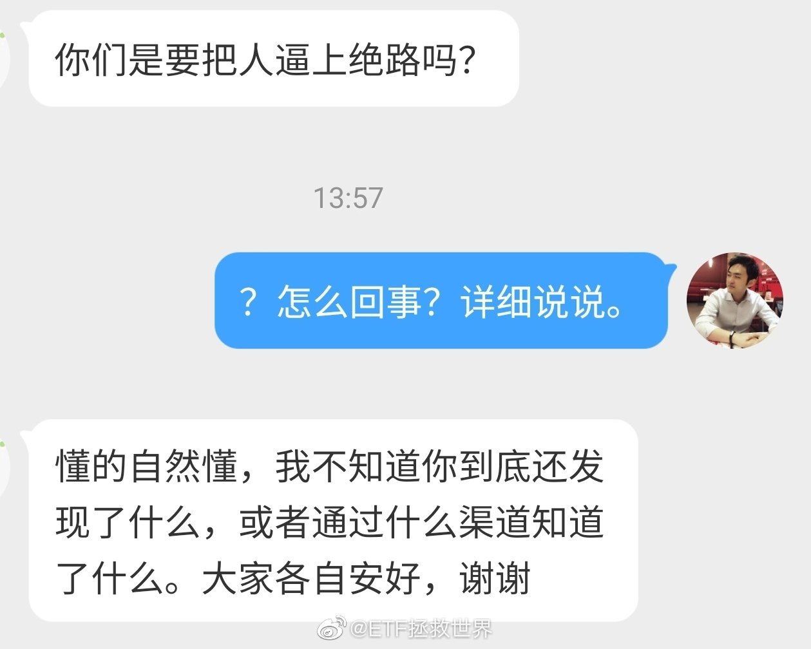

## 2022-05-30 15:04

港股，怕它不涨，又怕它乱涨。 ​​​

## 2022-05-31 09:41

种了几天菜，突然明白了止损与坚持的区别。

有些种子，幼苗非常弱。长了几天，一周后就能看出，它注定长不好了。这时候就应该止损，拔掉，换上强壮的幼苗。否则就是浪费时间，最终还是要枯萎的。

这就是止损。

什么是坚持呢。

你同时种了两个不同季节开的花。你知道那盆在春天不开的花不是死了，也不是没长好，而是它就不应该在这个季节开，只要等着，总有它开花的那一刻。

这时候就是坚持，就是不赚钱绝对不走。

止损，是碰到了一个烂人谈恋爱或者结婚，早点离开ta，早点过上幸福生活。

坚持，是你知道在一起的这个人只是暂时不得志，人品也很好，能力也很强。你选择了跟ta一起努力，你知道你们的幸福终会到来。

## 2022-05-31 10:54

21个小时没吃东西了，也不饿，因为忙吧。 ​​​
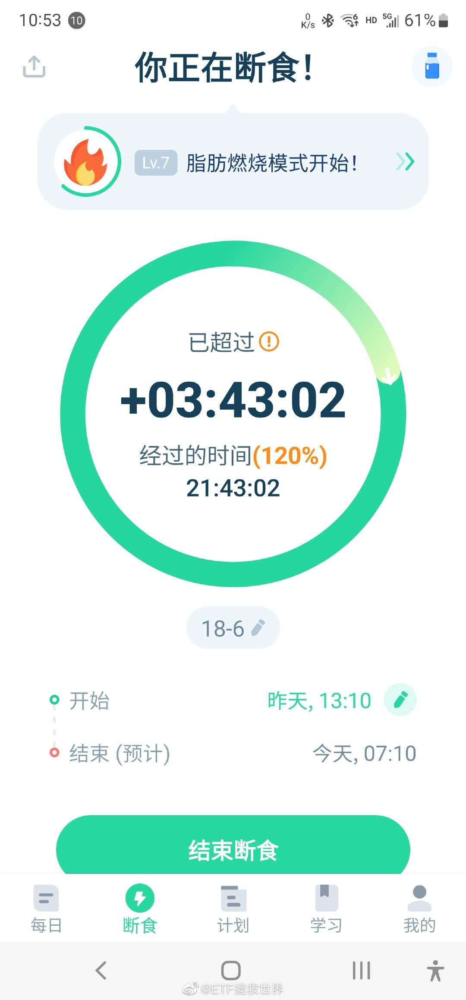

## 2022-05-31 11:00

心都碎了。 ​​​

## 2022-05-31 13:01

我明白了。

大机构们都在等最后一天是吧。 ​​​

## 2022-05-31 13:23

你是不是针对我。 ​​​

## 2022-05-31 13:31

愿意等回调的就等，不用告诉我。

我的原则就是按照原则做事。不会被情绪和主观意识左右。 ​​​

## 2022-05-31 13:41

我想问问，这能算追高吗。 ​​​
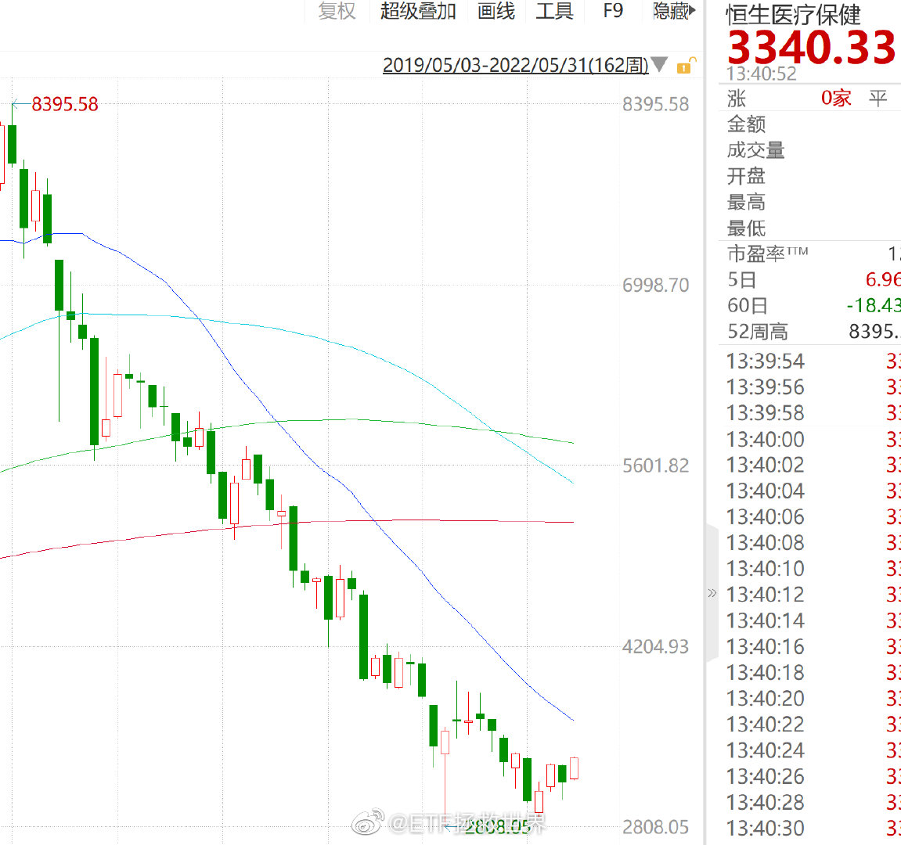

## 2022-05-31 13:51

一个月波段仓位16%的品种提款。

本来应该是一个月32%的。**的交易规则。

一会更新表格。 ​​​

## 2022-05-31 14:07

你们说前几天那个，在每一条下面刷港股要完蛋的那哥们，

有没有一种可能，

是个高手。

但为了隐藏自己，不想被大众了解，故意装傻，但又想提示大家，所以在行情启动前疯狂反向暗示，想让大家挣钱。 ​​​

## 2022-05-31 14:25

薛微有点过分了 ​​​

## 2022-05-31 14:33

今天确实比较过分。如果有觉得自己短线水平可以的朋友，可以自己决定买入时间。也许明天会回调，也许会更高。能把握的自己定吧……

## 2022-05-31 14:49

最完美的一种情况：

高位波段出，低位长线买回。 ​​​

## 2022-05-31 15:47

昨天的一条，今天你终于看懂了

## 2022-05-31 15:56

防骗小贴士：

如果一个人跟你谈生意，跟你说，哥，你是演员吧，看你很眼熟。

不要怀疑，他就是为了签你的单恭维你的。 ​​​

## 2022-05-31 19:17

今天要买什么好东西吗。

不妨说出来大家一起促销费。 ​​​

