## 2022-06-01 09:03

上个月儿子每天收拾自己东西加回答网课问题，收入450元。

他自己规划，100元进入“可消费”部分，350元存进“没有大事绝不动”部分。自己记账，对账。

我说，你的“可消费”部分有多少钱了。他说，600多了。我说你得多花点，多体会花钱的乐趣，买你想买的东西。“可消费”就是可以随便花的。

他说，爸爸，你想要什么生日礼物。别超过300啊。因为我还得给你买生日蛋糕，也得200-300。

我心里想，到时候要真的都给我花了，这儿子也算没白养。当然，还得找个由头，把钱还给他。

## 2022-06-01 09:40

我有一种感觉，

昨天出掉的那份波段，

可能永远也接不回来了。

乱猜的，不要根据这个交易。 ​​​

## 2022-06-01 18:47

《生存家族》

可以看看，能学到点东西。 ​​​

## 2022-06-02 22:17

全都是幻觉，明天早上再看就跌了 ​​​
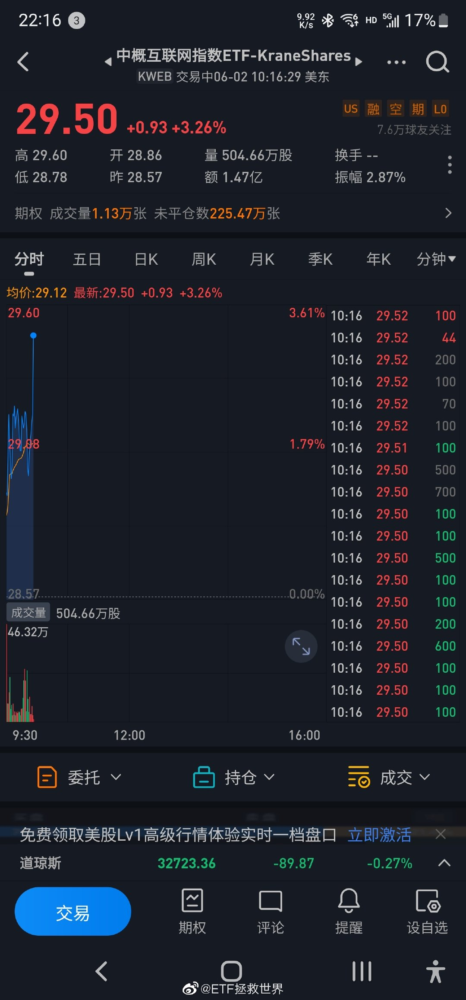

## 2022-06-03 06:53

影响环境的真凶找到了。 ​​​

## 2022-06-03 07:16

这一波下跌，最大的收获就是把a股的信息加海外的中概恒科（大科技）仓位建了起来。150有8个多点，s更是超过15%。

消费也买了一点，再跌跌多买点更好，不跌也行。

还有一个品种再买一点就完成任务了。整体仓位合适。

每一次下跌，都是市场的馈赠。 ​​​
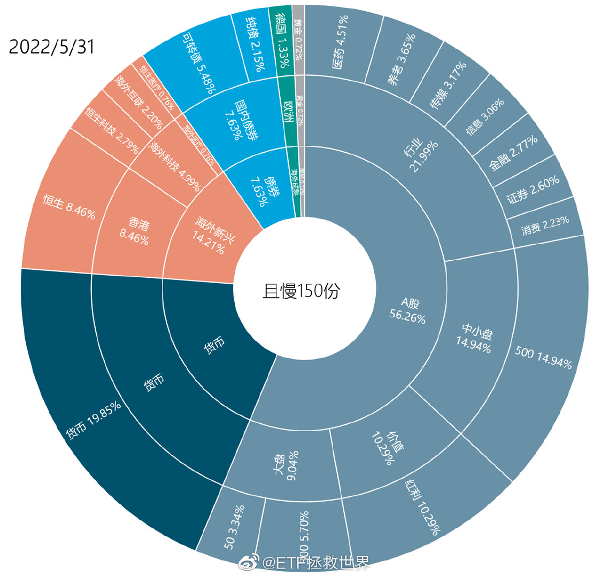 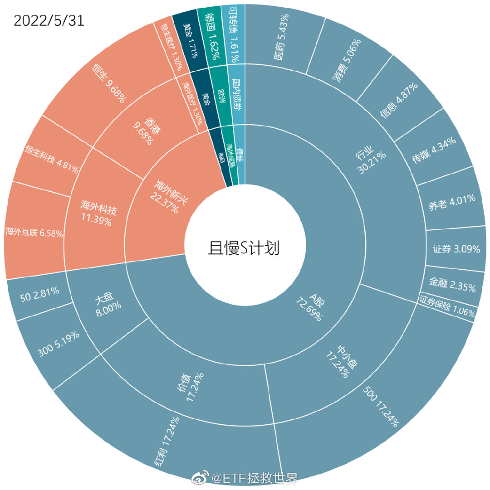

## 2022-06-03 22:42

只要你不抱希望，就没什么能让你失望 ​​​
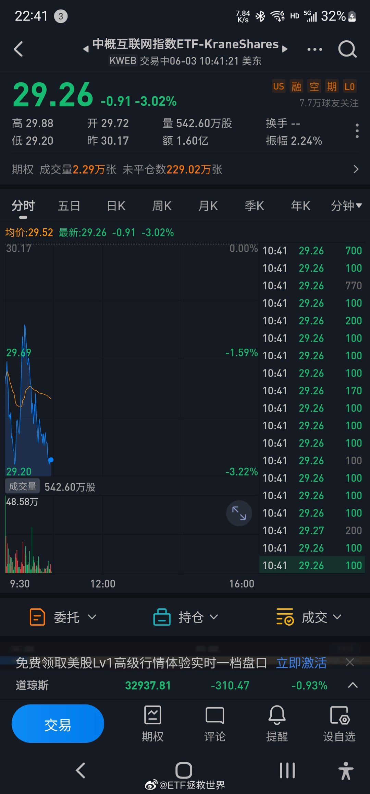

## 2022-06-06 09:18

我最恨的是不守规矩的辣鸡。

如果车位是别人的，你占一个月，那你就是辣鸡。

如果车位是开发商或者物业一鱼两吃私下倒卖，那就是开发商辣鸡。

总而言之，谁不守规矩谁就是辣鸡。

为什么我这么恨这些辣鸡，因为这些人让每个人都活得很累！每个人都要时时刻刻警惕自己的利益是不是被侵犯。如果侵犯别人的利益又得不到惩罚，就会有更多人想方设法钻空子去获取同样的利益，于是，有更多人活得更累！

插队也好，占别人车位也好，全都是只顾自己不顾规矩不顾他人的辣鸡！在他们眼里，世界上只有自己是人，别人都是碍事的。

大辣鸡！！！！

## 2022-06-06 10:07

说句心里话，你希望我这个感觉是对的还是错的。我个人来说，都行。

## 2022-06-06 10:34

恒生医疗今天会盈利吗。

下午会掉链子吗。

右侧靠谱吗。 ​​​

## 2022-06-06 11:45

5月最后一天右侧买入恒生医疗，之后两天指数下跌，但场外基金跌幅大概只有一半不到。

因为买进去的资金仓位没建立起来。

但我估计周五已经建好了。

什么意思呢，意思是，

下跌的时候轻仓，上涨的时候满仓了。

猜的对不对，看今天净值变化吧……如果下午不掉链子，一天就反杀了。 ​​​

## 2022-06-06 13:09

官太太一定没有关注我的微博。

## 2022-06-06 13:58

有些朋友觉得：

我的钱是我自己努力合法挣到的，为什么要低调呀。开豪车穿名牌让全世界都知道我有钱，我多有面子啊。以前那么苦，受那么多歧视，我要反杀呀。

层次稍微低了点。

且不说收入合法不合法。你知道人类这个品种，最恨的是什么。整体来说，最恨人有笑人无。

你过于嘚瑟，就要被很多人讨厌、恨，即使也许你根本没有侵害他的任何利益。但因为你太嘚瑟，让他很不爽，他就会恨你。

恨的人多了，搞事情的人也就会多了。明枪暗箭，脚下使绊子就不会少。俗话说，不怕贼偷，就怕贼惦记。整天惦记着搞你的人多了，就非常麻烦。因为你知道自己哪天说错一句话，哪天做错一件事？

只要有机会，你就会被干掉。你敢保证自己一辈子不犯一点错吗？

好的。你一边嘚瑟，一边保证了自己没有犯任何错误（概率是0.000001%）。那你能控制世界怎么变化吗。你不怕有一天，有钱就是原罪，不怕被**灯吗。

所以，踏踏实实的。低调。自己低调，家人低调。不要让人觉得你过得很差，生活寒酸。比一般人稍微强点就行了。这不是虚伪，这是保护自己。

不要嘚瑟，尤其是不要侮辱比你穷，比你地位低的人。别侮辱任何人。人的自尊心一旦受到打击，后果不堪设想。

## 2022-06-06 14:15

618换了第四台扫地机器人。

第一台是乱扫的，扫到哪里随缘。

第二台是有地图规划的，扫得很干净。

第三台是扫拖一体的，更干净了。

第四台是自动集尘自动清洗拖布的，更省事了。

这个产品发展的真的很快。但是不是也到头了，还能怎么着啊。自动上下水没有太大的意义吧。 ​​​

## 2022-06-06 15:22

刚才是从“人性”的角度，说低调。

另一个方面，从“天理”的角度。

你已经有钱享受好的生活了，你已经有权可以办什么事都一帆风顺了，物质生活已经非常富足了，比一般人强很多了，

你还要在精神上压迫别人。让没有那些物质的人来羡慕你，看着你的好日子过自己的苦日子，

你觉得，你做得符合天理吗。

任何事情都是有代价的，不会全天下的好事都让一个人占了的。你要在各方面碾压别人，就有极大可能被反噬。

我知道，有人笑了：你居然相信天理，你个**。

对，我真的信。所以我敬畏很多事。人啊，有点敬畏的东西，还是必要的。

## 2022-06-06 16:06

感谢“港股永远没戏了”的榜一大哥 ​​​
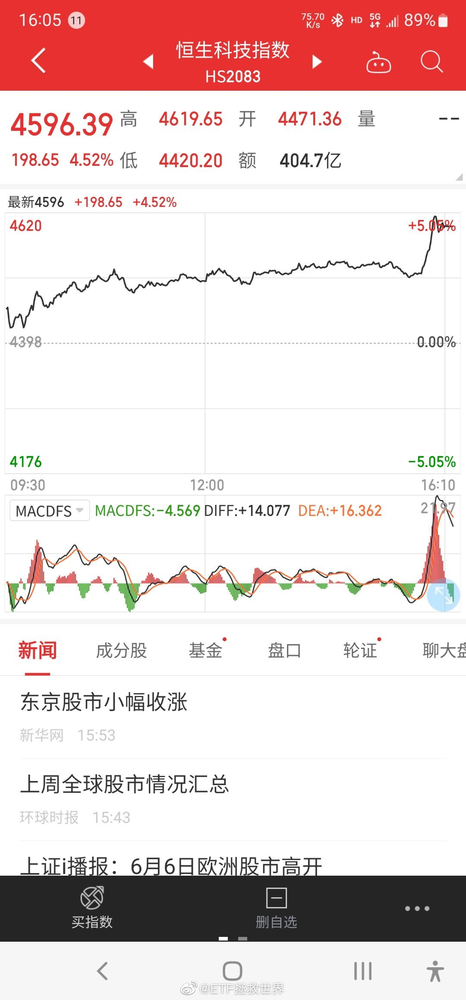

## 2022-06-06 21:03

没人看出这位研究员的良苦用心吗。告诉你事实，又不能说这是利空，还能怎么说，只能这么说。这不禁让我想起了一位评论员。每次他都会严正批判一些不怀好意的新闻，但其实，他不批判，根本没人知道。有没有体会到异曲同工之妙。

## 2022-06-06 21:32

睡吧。全都是幻觉，明天早上再看就跌了 ​​​
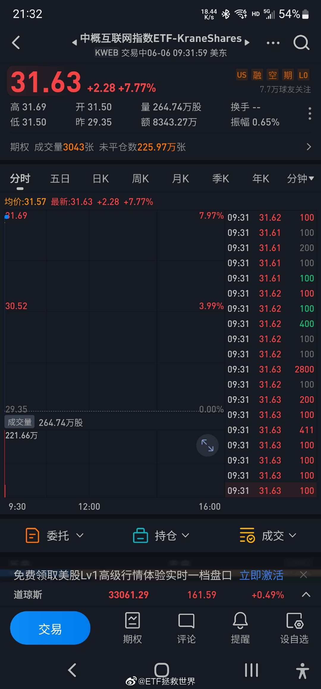

## 2022-06-07 01:57

​ 抽奖详情 ​​​

## 2022-06-08 08:57

儿子花费2/3流动资金买的蛋糕。

愿意为你花掉2/3现金资产的人，都值得珍惜。 ​​​
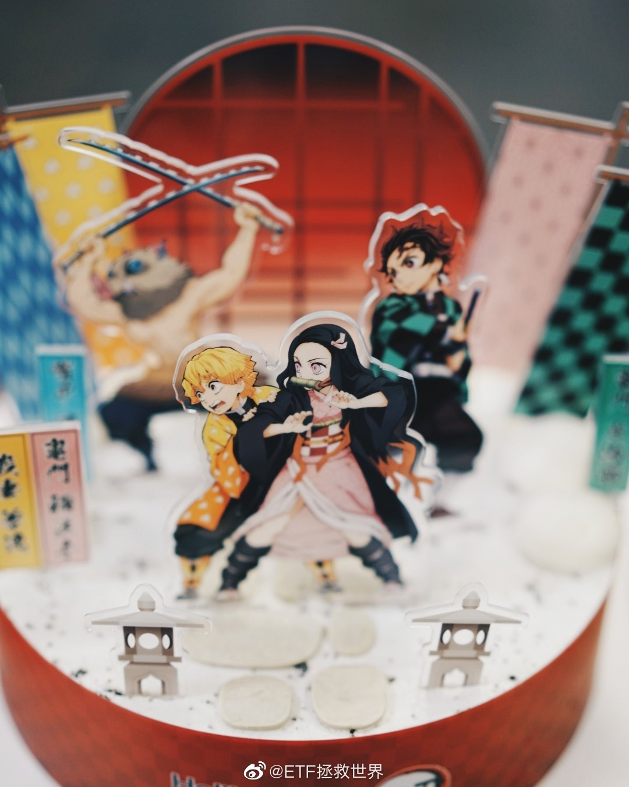 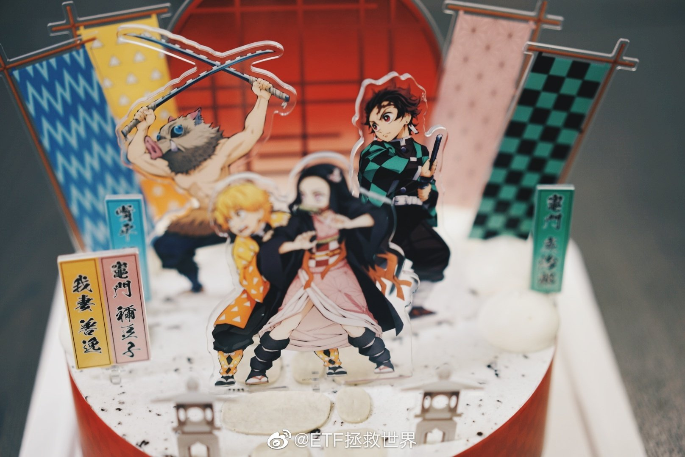

## 2022-06-08 09:16

做一个小调查：

投资S计划的朋友，最近一次发车，人数比最高点下降了百分之十几。150人数没有变化。

我想问一下，之前跟投S计划，5月底却停止的朋友，为什么会停止。

是因为没有多余资产，最近收入又降低，无法投资了，还是失去信心，不愿意再投入了？ ​​​

## 2022-06-08 09:34

提款。

没有分配好资金的朋友，可以在不断提款后重新分配下次买入的资金。 ​​​

## 2022-06-08 09:41

这个买点若干时间以后看，会不会是一次右侧理念开始在计划中发扬光大的标志。

## 2022-06-08 09:58

​​​
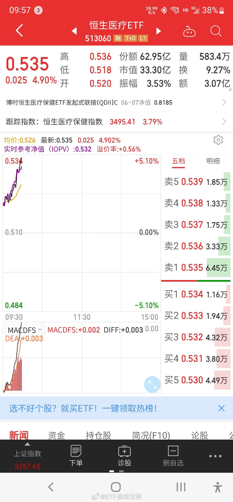

## 2022-06-08 10:24

表格更新中。听说买回价位有变化。 ​​​

## 2022-06-08 10:29

回复@ETF拯救世界:这周暴涨，这个品种买不下去。这是我的错，上周不够努力，应该上周加的。//@ETF拯救世界:决定了，下周加那个品种

## 2022-06-08 10:44

“不能买指数，指数涨得太慢。炒个股才快” ​​​

## 2022-06-08 10:51

回复@ironsoul0:哪里的全面大涨？今天A股上涨1500家，下跌3000家。//@ironsoul0:全面大涨的日子很无聊

## 2022-06-08 10:57

右侧这么够劲儿的吗 ​​​
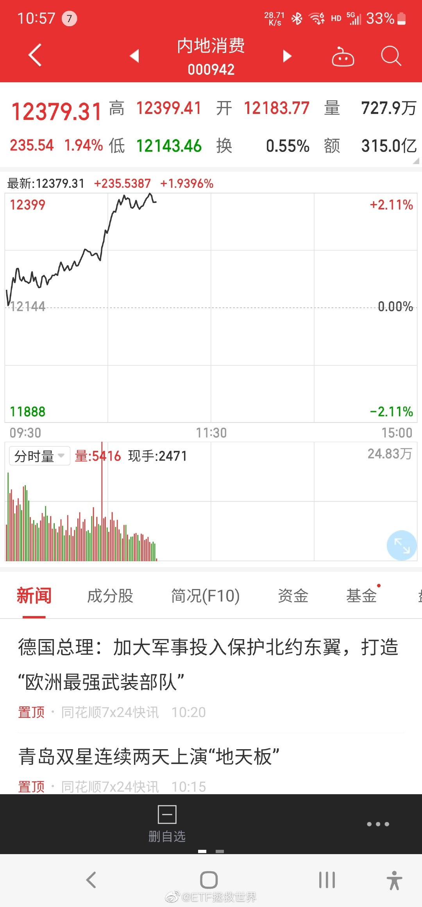

## 2022-06-08 11:06

对于大多数，甚至绝大多数投资者来说，

右侧的持仓体验一定是比左侧好的。（前提是你的右侧是正确的）

如果想要大多数人舒服，左右结合应该是必不可少的功课。

舒服很重要吗。舒服真的很重要。舒服了才能不做错事。

今年进步真的非常非常大。从长线到波段，都有了非常大的升级。

挫折才会带来进步，一帆风顺不会。

## 2022-06-08 11:29

谁能想到，十几年前的21世纪初，北京大街上其实还有这种公交车。

## 2022-06-08 13:16

“涨了就是右侧，跌了就是左侧”

说这话的人，根本就不懂我的理念，就别在这儿现了。

我一再说，肯定不会每次都对。买错的右侧，就是错误的右侧，绝不是左侧！

左侧是越跌越买，右侧是有转折迹象的涨起来了才买，怎么可能一样？

但是，我为什么说真正的右侧只有2-3次买入机会？

因为我的右侧，也是有价值的右侧，不是没有下限的追涨。所以，即使买错了，是假突破，又下跌了，那也没关系，在下一个右侧会继续买。

## 2022-06-08 13:44

就这样吧，没什么意思。

江湖再见。 ​​​

## 2022-06-08 23:01

又研究了几个备选品种，本月有可能继续右侧买入。

买得到是运气，买不到是天意。

继续努力。 ​​​

## 2022-06-08 23:06

美国国债ETF。

如果你认为债券是安全的不会跌，那你就错了。 ​​​
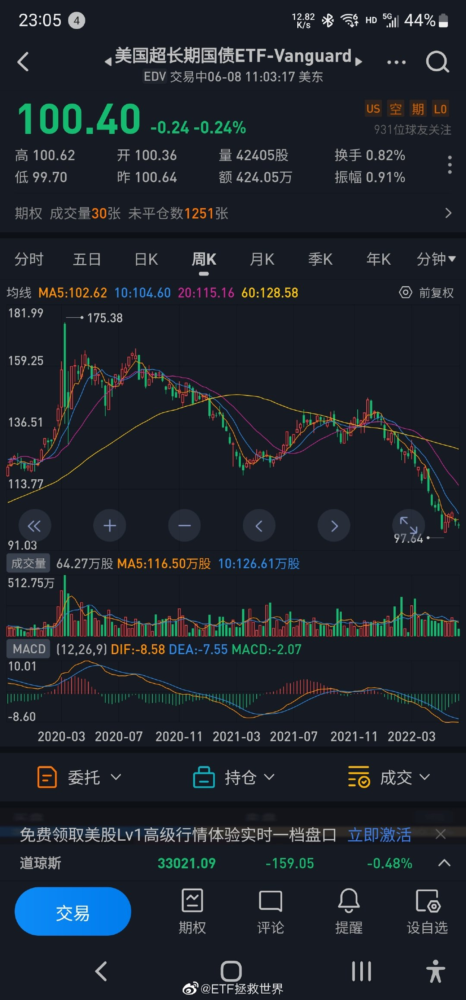

## 2022-06-09 07:16

内什么，是不是很多朋友担心今天恒科卖低了。

这样，担心的朋友依然是修改交易时间段。我个人认为，晚一两分钟就行。我个人会改到9：31。

当然，不改也行。只要一部分朋友改了问题就不大。即使低卖也低不了多少。

修改监控时间段的方法：

 ​​​

## 2022-06-09 08:06

涨了几天，是不是有朋友又觉得，

哎呀长线是不是该卖了啊。不卖的话跌回去不是白玩啦。

哎呀波段是不是不应该卖啦。趋势这么好拿着赚大钱吧。

图样图森破。

你以为这些单独的策略组合成一个体系是乱来的，塔才不是乱来的，塔是有备而来，全天候应对复杂路况，老司机出行必备。

你考虑一下，这个体系，如果你还各种焦虑各种难受各种不舒服各种骑虎难下，有没有一种可能，你不适合金融投资。

你可能出现的问题，都已经有人帮你事先考虑到了，也有解决办法了，是不是。

而且这些解决办法依然在高速进化，不断修正提高。

多大点事儿，踏踏实实的。

## 2022-06-09 09:33

​​​

## 2022-06-09 10:19

我自己的买回价格不变，重新创建就ok ​​​

## 2022-06-09 10:32

1 你卖在最高点

2 跌3%了

你能相信。 ​​​

## 2022-06-09 11:28

没有适合所有人的策略，

只有适合大多数人的策略。 ​​​

## 2022-06-09 13:28

周五13:30整。 ​​​

## 2022-06-09 14:00

今天大跌，这个品种明天又有可能有机会买了你能想到。//@ETF拯救世界:回复@ETF拯救世界:这周暴涨，这个品种买不下去。这是我的错，上周不够努力，应该上周加的。//@ETF拯救世界:决定了，下周加那个品种

## 2022-06-09 15:04

投个票吧。放心，绝对匿名，我看不到谁投的什么。

即使真能看到也绝不拉黑，以我的全部资产保证。  ​​​

## 2022-06-09 16:08

今日数据更新后，根据全市场估值状态，如果以80%为A股持仓上限，

那么从保守到激进的A股仓位在40%-70%为佳。 ​​​

## 2022-06-09 16:35

绝对支持。不知道占车位这男的是什么背景，居然一点消息都没有。如果车位真的是女车主的，那么整件事最大的辣鸡就是这个占车位的，他为什么没事？难道这真是一个耍无赖就能赢的世界？

## 2022-06-09 17:41

哦，酒吧。

好多年，好像结婚后吧，就再也没去过酒吧了。

结婚要慎重啊，年轻人们。 ​​​

## 2022-06-09 19:23

有没有机会一天接回

## 2022-06-10 05:51

又是腥风血雨的一天 ​​​

## 2022-06-10 06:40

早上做了不好的梦。

梦到儿子长大了，十几岁吧。我说带他去迪斯尼，他说不跟我去。态度还非常不好，就是那种中二少年的叛逆样子。我就很生气，还把票撕了…

醒了以后觉得，不去就不去呗。落得清净，不知道梦里自己为什么那么执着。

又想，要对孩子更温柔一点，争取不要让他出现梦中那种状态。因为梦里面对着他那种叛逆的样子，我束手无策…

## 2022-06-10 08:37

个人认为，对一个人来说，最重要的三样，

健康，周围的人际关系，搞钱或者说事业。

其他的可有可无，没那么重要。 ​​​

## 2022-06-10 09:56

A股和港股这是吃药了还是没吃啊，

突然与以往不同了。 ​​​

## 2022-06-10 10:09

你信不信，等我们做波段的品种涨起来以后，会有一帮大聪明嘲笑我们做波段赚小钱损失了大利润。 ​​​

## 2022-06-10 10:29

回复@ETF小小韭菜:我把钱给你你帮我实现每年10%的增长好吗。//@ETF小小韭菜:要求真不高，华宝里的钱每年能达到8%-10%的增长就行。

## 2022-06-10 10:49

回复@ETF小小韭菜:历史上有一个人做到你说的要求了。那个人叫麦道夫，现在在联邦监狱，还有400多年就能出来了。//@ETF小小韭菜:给一万吧，多了我搭不起//@ETF拯救世界:回复@ETF小小韭菜:我把钱给你你帮我实现每年10%的增长好吗。

## 2022-06-10 11:28

刚看了一眼评论，各位别指责刚才说8%-10%那位朋友。他只是对投资收益率理解的不太透彻，不是坏人……

也对相对来说小白的朋友说两个观点：

第一，承诺保本无风险收益率，最好不要超过定期存款的一倍。比如说三年定期存款是3%，有人跟你说无风险6%，你稍微小心点。有人说7%以上，那基本是我的话我就不会投了。

第二，金融市场的收益率，无论是什么投资体系，都很难每年以平滑的曲线向上增长。合理的情况是好的年份增长的多一点，差的年份不增长或者很小的幅度负增长，接下来好的年份就又把收益率补回去。

如果有人说每年都8%-10%（长期看年化8%-10%并没有问题），那基本也可以归入骗子的范畴了。

整体来说，到底收益有多少，跟你多贵的时候入市有关系。如果市场整体的净资产收益率是10%，你在1倍净资产、2倍、5倍净资产的时候买，长期收益率一定是不一样的。越便宜，长期会越高。

## 2022-06-10 11:39

回复@种树打工人:你这样很好。如果做好了，是一个典型的保本策略——每年都不赔钱，牛市还赚不少。很适合风险承受能力极低的人。//@种树打工人:只有我这么保守吗，80%存在银行，剩下20%不亏能小赚就行了

## 2022-06-10 13:55

没有了心魔的困扰，彻底放飞自我，从此只有两个状态：

舒服以及，

更舒服。 ​​​

## 2022-06-10 14:07

我不懂啊就是问问，别喷我啊。

比亚迪市值超过大众是合理的还是薛薇有点不合理。

大众旗下：

保时捷、兰博基尼、奥迪、布加迪、宾利、斯柯达、斯堪尼亚、MAN、西雅特、杜卡迪。

没有任何看多看空的意思，汽车小白的疑问…… ​​​

## 2022-06-10 14:18

为什么每到周末月末就拉升？

难道大家都是看图做右侧的卢瑟吗。

你们就不能转行去做说话又好听样子又帅气的价投吗！ ​​​

## 2022-06-10 14:35

2014年到2020年，整整6年半一分钱都没涨。

2020-2022，5倍。

什么叫横起来多长竖起来多高，什么叫耐得住寂寞。 ​​​
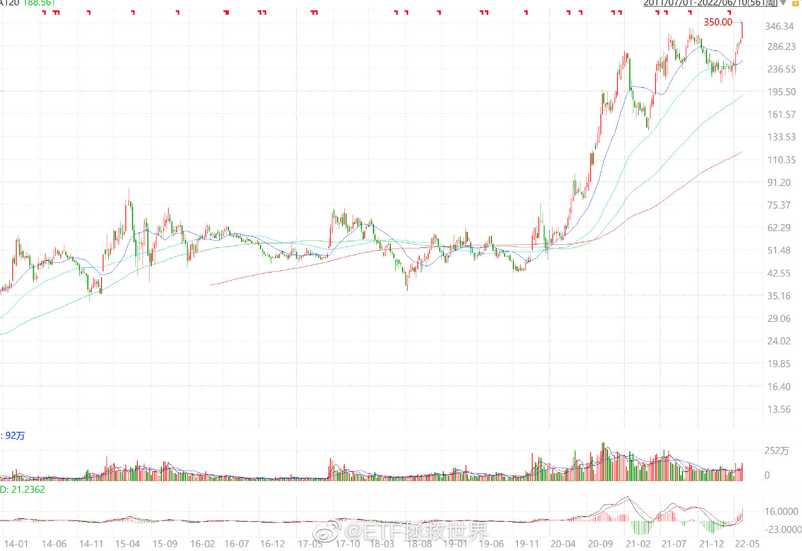

## 2022-06-10 14:38

回复@乐恩ing:我没买。另外，我买了也不会在涨了之后说。所有没有提前说的品种，赚多少也不会拿出来吹。//@乐恩ing:你买了？

## 2022-06-10 15:30

回复@悬崖上的韭菜花:什么情绪，看到有股票大涨自己没有的情绪吗。问你个问题，别人中彩票了你有情绪吗，小马哥创建tx，东子创建jd你有情绪吗。那个股票涨之前你关注过吗，关注了买了吗，买了持有了吗。如果都没有，那就不是你的能力圈，为什么要有情绪呢。

## 2022-06-10 16:05

这不是黑社会？这不抓起来依法严判？？？

## 2022-06-10 20:30

回复@littlesaaa:我不信会没有下文。如果没有，我会一直转发。我的力量很小，但我也要出份力。我希望施暴者受到最严厉的惩罚，我还希望所有上网的人都知道这样做会受到什么惩罚，让那些辣鸡想要嚣张的时候也会掂量掂量后果。

## 2022-06-11 06:59

刚才看报道，唐山的事已经抓了5个，还有四个正在抓。

我突然有个问题，问问大家。

如果你是施暴者的同行友人，在一起吃饭，他们突然去殴打别人，你该怎么做。

拉架该怎么拉，才不会被围观者认为你也参与暴力袭击了。毕竟现场一片混乱，如果没有监控，很难记清谁在打谁在劝。

如果你置身事外，舆情搞大，你也难免受到牵连。

所以，你会怎么做？

## 2022-06-11 10:53

医药仓位让人开心。

后续再跌还加。9500 7600必须致敬。

不跌的话这个仓位已经很好。当然还没结束，后续还有全球医药。 ​​​
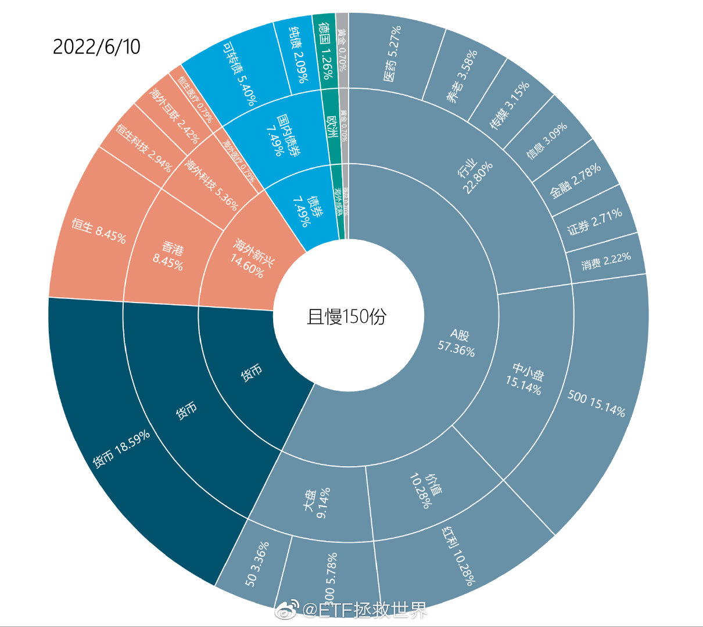 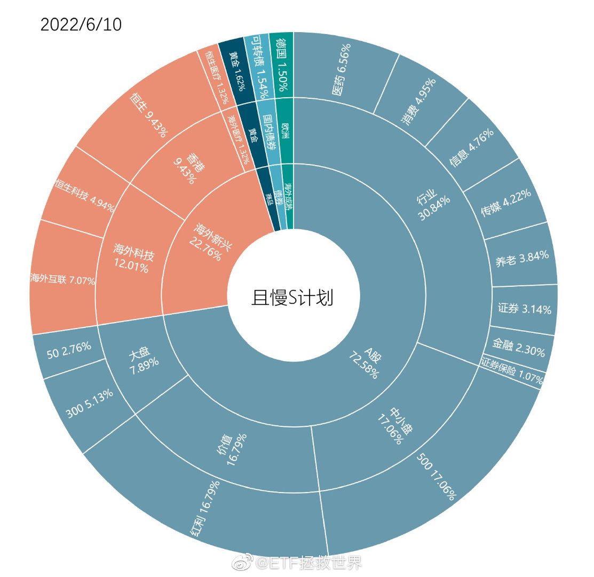

## 2022-06-12 19:48

今天儿子的英语作业是“my dream job”

儿子写的是“cook”。

我以为是苹果ceo cook，结果就是做饭的那个cook。

我想了想，也挺好的。至少饿不着。 ​​​

## 2022-06-13 07:16

只带儿子去过一次动物园，再也不会去了（野生动物园除外）。动物不应该一辈子被关在笼子或者玻璃里面供人观赏，看着心里非常难受。

## 2022-06-13 09:33

美股整体估值以五年的维度看已经真的偏低了。

但是！

考虑到国债收益率已经回到了08-09的水平，真的很难说这个价位就是低了。

因为，那个时候估值比现在低30%-50%……

市场无风险利率水平对各类资产价格的影响是很大的。 ​​​
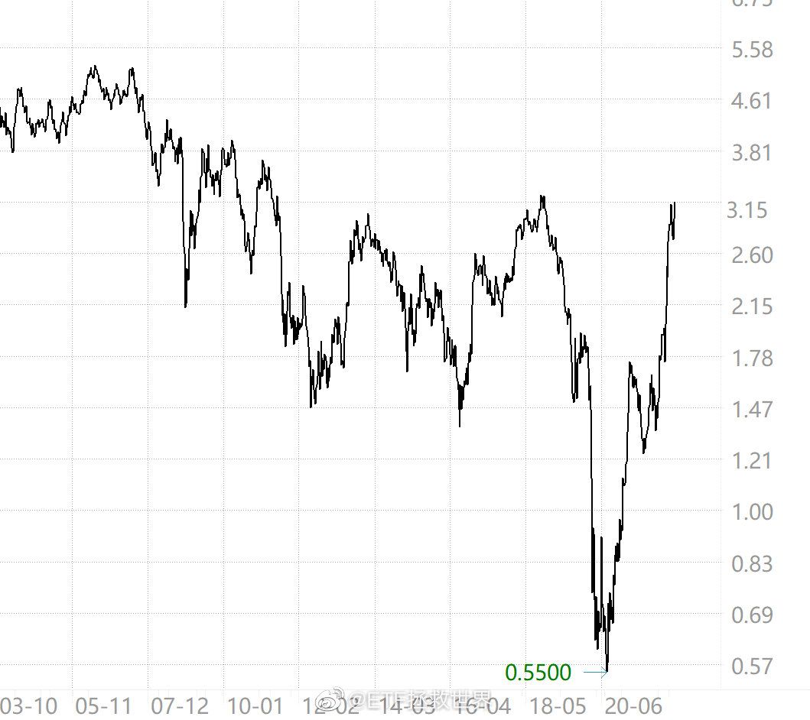

## 2022-06-13 09:55

价值和趋势，左侧和右侧，有时候真的会打架。

比如中证红利。

从趋势，技术看，其实是有点危险的。但是从价值、估值看，真的并不贵。

这时候就需要选择更相信哪个。

以今时今日我的水平来看，我更相信后者。但我会观察后续走势，让市场告诉我我的选择是不是正确的，然后再好好总结。 ​​​

## 2022-06-13 10:43

这是不是属于里外不是人了（开玩笑）

其实我相信大多数朋友只要关注得久一点，就能发现我真的是喜欢客观、理性的分析。我喜欢就事论事。

因为什么呢，因为这个世界特别特别复杂。除了事情，我们根本无法真的理解一个人，更别说人群。

即使是事情，实际上每一件事也通常会特别特别复杂。事情的成因、现状，每一种处理方式带来的结果，都是错综复杂交织在一起。

遇到事情，抽丝剥茧，尽量触及其本质的过程，本身就是非常非常复杂困难的。又因为人的能力、经历、思想高度是有限的，难免会发生偏差，甚至出现错误。但我想，每一件事，只要一心一意从只为发现事情的真相，解决问题出发，就一定是最正确的处理方式。

人们通常喜欢与自己思维一致的人。如果不一致，各种情绪就会上头。你会，我也会。但我愿意尽量学着理解与我不同的观点。我对还是不对并不重要，重要的是真相。我错了，就必须改。改了才能进步。

就好像投资，明明错了，为了面子或者其他，一味坚持，那又怎么可能赚更多钱？

这件事你觉得可能我在站某些人，那件事你可能又觉得我站另一些人。我不是骑墙，更不是希望讨好所有人，我只是希望弄清楚事情的真相和本质，对自己的人生有一些帮助。
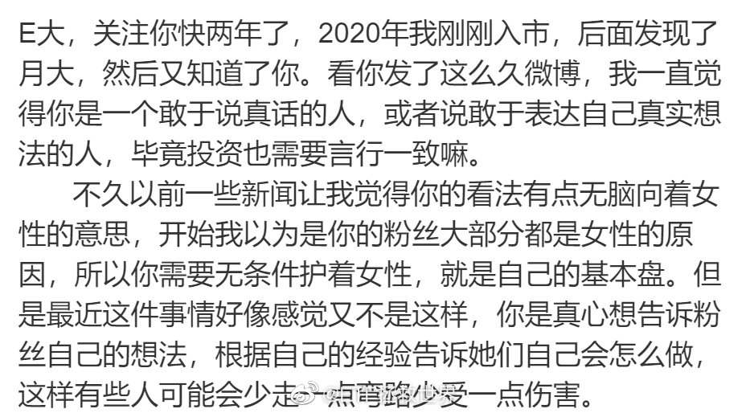

## 2022-06-13 11:14

今天新东方港股上涨100%，上一个交易日上涨40%，最低点上来涨了346%。

我没买，一分钱也没赚到，但我真的开心。知道新东方的带货直播火了也特别开心。

不知道为什么开心。

也许是看到一种遭遇灾难后，不认命不服输一定要奋力拼搏活下去那种精神；

也许是感受到那种一条路被堵死，就开动脑筋积极自救，利用手里现有的资源盘活全局的智慧。

特别好。我不知道最后它能不能活过来，活得好，还是说只是昙花一现。但我真的很开心。

认真工作，努力拼搏，守法经营的人，不应该突然死去。

## 2022-06-13 11:23

回复@自封ETF拯救世界关门大弟子:再投。//@自封ETF拯救世界关门大弟子:老大，富国300要分红了，选红利再投还是咋滴？

## 2022-06-13 11:48

年龄真的会改变一个人。

以前看着我妈在花盆里种菜就嘲笑她，跟她说：现在是信息社会了，你怎么还停留在农业社会，自给自足。人类在工业社会就已经分好工了！

结果现在我那几颗破菜，一天看8遍，小心翼翼的伺候着，充满乐趣。

所以啊，有时候双方无法沟通，有没有可能是一方年龄、阅历，还没有跟上。真的等经历过之后，回想起来别人跟自己说的，才会由衷地感叹，

真香啊。

## 2022-06-13 13:51

恒科接回来问题不大吧。

辣鸡行情总要保持一点希望。 ​​​

## 2022-06-13 14:47

医药大级别支撑已经上移至9600。

反正事情就是这么个事情。

不跌，震荡，底部就会逐渐抬高。

正常的指数就会这样，越来越高。顶，底，都是如此。 ​​​

## 2022-06-13 15:39

每次经过一些事，我都更爱我的另一半。

也会更加珍惜原以为是很平淡无奇，现在看却是无比幸运的幸福、平和家庭生活。

两个人能和谐的，三观一致的生活在一起，不仅人生质量会提高，做什么事也都会顺利很多。

感恩人生，也感谢自己的眼光。

各位一定一定要与三观一致的人在一起，否则还不如单身。跟三观不一致，缺乏逻辑又钻牛角尖以及过于强势的人交流，真的胸口会一阵阵的发闷……

如果每天都这样痛苦，恐非寿相啊。

## 2022-06-13 15:47

今天是指数成分定期调整的第一天。

情况非常不好。各指数大量调入大涨品种，导致几乎所有指数估值都上升。升幅有高有低。

也要看看有没有机会稍微降一点仓位了。 ​​​

## 2022-06-13 16:16

回复@Oli_Stark:你说对了。50和300真的是不热门不调入，这次又进来一批。好在我们18年以后再也没买过了。//@Oli_Stark:艹，没办法，指数就这个编制规则。特别是50、300之类的，择机减仓吧

## 2022-06-13 16:19

回复@疏月无影:我的意思可不是50和300一定不会涨。我只是说他们每次调完就估值上升。高估不代表不会涨，望周知。//@疏月无影:上星期把50卖完了//@ETF拯救世界:回复@Oli_Stark:你说对了。50和300真的是不热门不调入，这次又进来一批。好在我们18年以后再也没买过了。

## 2022-06-14 09:15

三个交易日买回问题不大 ​​​

## 2022-06-14 09:34

再次提醒各位，一定要警惕电信诈骗。

据我所知，电信诈骗一般都会准确说出你的信息，然后说你在哪里借钱了什么的，然后要根据他们的指示操作，否则会有大麻烦。

我的建议：

第一，不要轻易相信类似的说法。第二，不要根据他们的指示办银行卡。第三，不要下载他们让你下的软件。第四，不要在app上贷款。第五，不要往任何地方，包括新办的你自己的银行卡转钱！

停在任何一步都会减少你的损失。永远记住，想要不被骗的两大原则：

第一，不贪小便宜。第二，不要掏钱！！！

这位朋友已经非常惨了，评论里不要对他再有任何打击嘲讽，否则直接拉黑。前几天那些帖子里骂我的我一个都没有拉黑，但你要骂已经这么可怜的朋友我就没法不动手了。
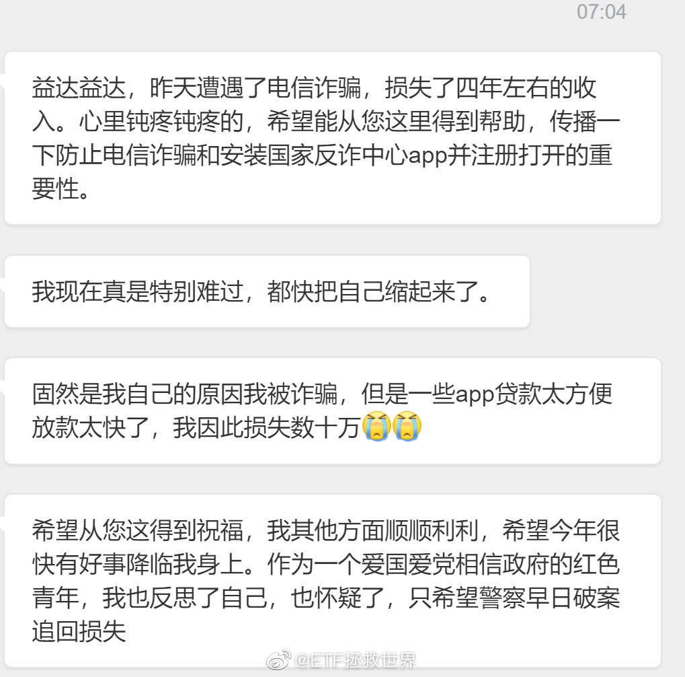

## 2022-06-14 09:49

以前自己没有，嘲笑机构抱团。

现在自己买了，生气机构为什么还不抱团。 ​​​

## 2022-06-14 13:59

恒小科，我真的琢磨不透你啊。

就差1%都不给吗。 ​​​

## 2022-06-14 14:01

毁灭吧，累了。真的。

## 2022-06-14 14:19

有不止一位朋友来私信询问我，或者质问我为什么没有买新能源了。

我说一下，

第一，2、3个月前我们刚高位清仓。大多数朋友赚了100%，小部分朋友也有50%以上。肉别光你一个人吃，大家都吃点，让别人赚吧。

第二，更重要的，是目前的所谓新能源/环保等等，完全完全不符合，一点点都不符合我的买入条件。无论它怎么涨，都不符合。我是不可能买的。

你总不能看什么涨的好就眼馋吧。一级行业十几个，二级行业几十个，你总不能都买吧。

你要觉得好，完全可以自己买啊。不用问我。

## 2022-06-14 14:30

说起新能源，其实我们大家可以一起做一个观察：

目前新能源的领头羊BYD的TTM PE是280倍。我们一起来看看，几个月或者一年后，它会跌还是会涨。PE会上升还是下降。

我说明一下：我完全不知道它高估还是低估，会涨还是会跌。我只是想观察一下，增长一点经验。 ​​​

## 2022-06-14 14:35

给券商10%的波动空间你以为是乱给的……塔才不是…… ​​​

## 2022-06-14 14:40

问题在于，S的证券保险还没补仓，就快回来了。我只是想等个右侧而已…… ​​​

## 2022-06-14 19:19

刚才看公公转了一个7选3的问题。问你会选什么。3000万啊，名车啊，身高啊，年轻10岁啊，爱你的人啊，北大录取通知书啊…

想了半天，竟然不知道选什么。想选年轻十岁，又觉得像现在这样不能随心所欲的去想去的地方，做想做的事，年轻十年又有什么意义。

我知道，大多数朋友肯定第一个就选3000万了。你说对不对。

我倒是希望增加一个选项，就是怎么吃都不会身材走形，不用锻炼也有八块腹肌，必选[doge]。

## 2022-06-15 09:34

不要说话，不要毒奶。静静等待…… ​​​

## 2022-06-15 09:44

昨天1%没买到，今天1%能卖出吗。

好人一生平安。 ​​​

## 2022-06-15 09:48

回复@menky:不安来自于“感觉”，还是对数据和信息的分析。//@menky:过了3300了，我这心里越发不安啊

## 2022-06-15 10:04

尊重市场，敬畏市场。

永远不要觉得你比市场聪明。市场永远是最聪明的。

当然，市场在极端的时候会犯病，精神错乱。这时候理智的我们就可以获取一些超额收益。

但大多数情况下，市场是最聪明的。永远不要自视甚高。

瑞思拜。 ​​​

## 2022-06-15 10:21

你把金融市场想象成另一个世界。我们是身处其中的，大致是封建时代的人。

经过长期观察，我们总结出了这个世界有四季。也就是会有寒冷的冬天，炎热的夏天，以及舒爽的春秋。

这样你就不会因为严寒的来临，恐惧和害怕。也不会因为没有提前准备过冬的粮食而饿死。同样，你也不会因为夏季的丰收和热浪，认为世界永远都会是丰收祭典、沙滩浴场上的鸡尾酒和比基尼。

四季更替，多么正常。这就是规律。找到规律，尊重规律，利用规律。当然了，不是每个人都进入了封建时代。大部分人还在旧石器时代随遇而安。

之所以只是在封建时代，是因为我们并不知道错综复杂的金融市场后面，真正的原理——类似于相对论，甚至古典物理学定律之类的规律都没有被发现。我们只是观察、总结，利用现象而已。

也正因为这个是一个世界，所以其中有凶猛的狮虎，有成群的鬣狗，甚至有史前巨无霸的霸王龙。但这丝毫不影响机敏的羚羊和善良的小白兔繁衍生息。

每一种生物，只要找到了自己在这个世界生活下去的诀窍，就能活下去，然后开枝散叶，四世同堂。

本质就是这样。世界怎么运行，金融市场就怎么运行。世界会遭遇冰河期，会有小行星撞击地球导致最凶猛的生物灰飞烟灭。但生命一定会延续，找到自己的方式，无论发生什么，都要活下去。

## 2022-06-15 10:45

辣个品种，两天的涨幅，收复了之前两个月的下跌。

这难道还不能给你点什么启示吗。 ​​​

## 2022-06-15 10:48

上个月底买的三个右侧品种，目前暂时还都在赚钱。内地消费还新高了。

但是，跟踪它的基金昨天涨幅远小于指数。规模这么大的基金，我根本就没预期它还能跑出超额收益。但如果长期跟不上，那我就不能接受了。 ​​​

## 2022-06-15 10:57

能不能午饭前解决战斗！ ​​​

## 2022-06-15 11:28

## 2022-06-15 12:14

过去一年零三个月，券商做了三次波段。收益率分别是：

10%、10%、11%。

分别耗时2个月、18天、3个月。

牛市有牛市的玩法，猴市有猴市的玩法，熊市有熊市的玩法。

多大点事，踏踏实实的。 ​​​

## 2022-06-15 13:09

这两天非银暴涨。我反复反思，发现再来一次我依然不会在低位买。因为无论从哪个右侧形态角度看，都没有买入的理由。左侧的话，确实无法定义券商和保险的精确价值。只有一个也许可以解决的角度，即：下跌XX%，即买入一份。这种突然暴涨的形态右侧是无法解决的。

## 2022-06-15 13:18

大声告诉我，波段操作有没有让你的长线部分拿得舒舒服服，

不再担心坐电梯，不再不停猜测是假突破还是真上涨，不再不停惆怅是不是要赶紧卖掉保住利润。

你以为塔是乱设计一个策略，塔才不是，塔是有备而来。 ​​​

## 2022-06-15 13:43

右侧买入看似很好——不会承担下跌的痛苦，不会踏空大级别的行情。

但前提是，有两个问题需要解决：

第一：碰到假突破怎么办。

第二：行情开始的过于迅速，来不及买入患得患失导致踏空整个周期怎么办。

最惨的，行情开始的过于迅速，大涨之后闭眼买入发现是假突破，彻底被套。

所以，左右一定是结合的。这些问题也一定要找到相应的解决方案才能将右侧融入整个体系。

## 2022-06-15 14:05

由于近期不断收割利润，我之前在银行理财转入波段操作的资金已经转回银行了一部分。

因为之前转入的时候说了，转出的时候也要说。

做事要周到。 ​​​

## 2022-06-15 14:11

回复@christina036:有活期的有定期的。但我是把固定的期限错开，保证每周或每两周都有到期的。//@christina036:e大的银行理财看起来是想转出的时候就转出了，应该不是固定期的，其他的就不知道了

## 2022-06-15 14:58

没卖在最高点，但坚定执行策略心情就会很好。

大盘，明天见。 ​​​

## 2022-06-15 18:47

我最近有一些感触，分享出来与大家探讨。

就是说，当某一件事，需要在很多人中选择一位的时候，其核心在于，被选择的这个人，能够带给有选择权力的人或组织最大利益。

可能有点拗口和不容易理解。举例来说，就是，

无论是恋爱、婚姻、考试录取、招聘员工……几乎所有需要在很多人中选择的时候，都会有这个问题——如果你想被选中，就一定要能提供给对方最大的利益。

这个利益不仅仅是金钱或物质。有可能是感情寄托，能力，生理心理需求，甚至有可能是随之而来的各种隐形利益因素。这里面有正当的，也可能有不正当不正常甚至不合法的，这个就不讨论了。

继续延伸。很多更深层次的社会问题，也是由此而来。总体来说，每一个进行选择的个体或组织，都会是理性的。他们会全面评估，为什么我要这个人，不要那个人。这个人能带给我什么，又可能引来什么麻烦。

很多问题并非被选择个体自身努力不够的问题。而有可能是天生或者社会因素导致某些人直接就少了很多竞争优势。这个问题，必须从社会层面给予这类人补偿，从而使他们能与所有人站在同一水平线上竞争。

另一方面，从自身来讲，如果我们想被选中，那么，我们就要想，到底我能为别人提供什么样的利益？能够为别人做好什么服务？能帮别人解决什么问题？

看得懂就看看，看不懂就算了……其实有些话我可以说的更明白一点，但我现在也不知道说什么会被骂，所以还是笼统的泛泛的聊聊吧。

## 2022-06-15 20:05

明天上午开盘之后，我去随便找一条之前的微博抽奖。

20位，每位100元购物卡。共同为提振内需消费做贡献。

（不是这条抽，我知道有些朋友一定会没看懂） ​​​

## 2022-06-15 21:14

是不是又有人因为名表出事了。

不管是不是真的绿水鬼，反正是惹事了。

低调啊，低调。 ​​​

## 2022-06-16 07:17

今天早上醒得早，看了眼美股，想起最近提款后该做的事情没有做，赶紧行动。

我的规则是，波段提款两次后就一对一资助一位贫困学生。以往的经验看，相对来说对女生的帮助多一些，因为很多时候她们更困难一点。

对于慈善，老朋友都知道我在十年前就开始不断做了。但我还是有个建议，每个人应该先让自己、家人过上比较好的生活，再考虑帮助他人，切莫为了做好事导致家人生活水平降低。

穷则独善其身，达则兼济天下。
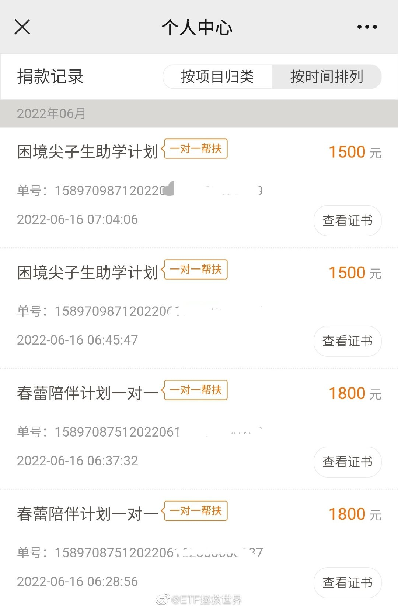

## 2022-06-16 08:35

这几天还是有朋友不断给我发私信，给我看视频，文章等等，要么是试图说服我，要么是让我以后不要再说自己的想法。

这些朋友说话都很客气，一看就不是极端分子，是好人。所以我也没拉黑，说实话，最近这一周，我也没有因为有朋友跟我意见不一样拉黑谁。反而是有人给我私信后拉黑了我……

我想说的是，想要说服我，也许会成功，也许不会成功。我也许会改变想法，也许不会。

但你要让我不说话，对不起我做不到。我自认发言没有违反法律法规，社区公约，没有违反公序良俗，我只是说出自己的想法。

我尊重你或者你们，我尊重每一位朋友发言的权利，即使你的想法与我不同。我也希望自己有这样的权利，能说出自己心里的想法。

以后类似的东西不要给我私信了。但如果有需要我帮助的，比如受到侵害的，需要救助的，或者说需要在更高层面帮忙呼吁转发的，都可以找我，我会在核实后尽量帮忙。我希望帮助你们解决具体的问题，而不是没完没了的空对空争论到底事件的本质是什么。

解决具体问题！这就是我的诉求。这就是我作为一个男性的，也是一个人类的最本质的诉求，解决问题。我自问已经是非常能共情的男性了，但我的本质诉求依然是解决问题。解决性骚扰的问题，解决黑恶势力的问题，解决不平等不公正的具体问题。

不要再空对空让我看那些不解决问题的东西了，在我看来，真的毫无毫无意义。争论100年，什么问题都不会得到解决。

就酱。

## 2022-06-16 09:40

为什么抽这条应该能理解吧：默默祝我生日快乐的总不会是坏人和喷子吧！  请这10位朋友私信我，我会把卡密发给你。     恭喜@IP爆炸 等10名用户获得【200元狗D购物卡一张】。微博官方唯一抽奖工具@微博抽奖平台 对本次抽奖进行监督，结果公正有效。公示链接：   网页链接

## 2022-06-16 10:20

医药又开始蠢蠢欲动。

最近两次买的四个右侧品种，会让很多朋友极大缓解“买了就跌”的焦虑感。

买了就涨会让一些朋友的持仓体验上升很多。

但左侧我依然不会放弃，还是希望你知道，买了就涨买了就跌并不重要，重要的是早晚都要让它给你赚钱。 ​​​

## 2022-06-16 10:22

养猫的朋友，我请问一句，

你们家的猫会把玩具叼到你面前，让你把玩具扔出去然后它再叼回来这样跟你玩吗。

这不是狗才会做的吗？ ​​​

## 2022-06-16 10:49

莫再提笑死了。还装成一副有可能涨上去的样子。

骗我可以，注意次数！

骗子！ ​​​

## 2022-06-16 11:16

非银今天调整了几个点。如果继续调整，那么也许在某个周五，我真的再买一份摊低成本。

至于会不会继续回调，我在哪里买它回来，我也跟大家一起期待着…… ​​​

## 2022-06-16 22:11

标普500和纳指都已经52周新低。

新低不买，有点犹豫啊。 ​​​

## 2022-06-17 10:25

群魔乱舞，有点忧伤。 ​​​

## 2022-06-17 10:51

说到做到，说送就送

## 2022-06-17 13:51

今日身子有些不爽快，心想横竖勉强挣扎着出去走走逛逛，总比在屋里闷坐着到底好些。打开软件一看，却连出去走走的力气也没了。

下午看着那几只泥猪瓦狗却也是尽力的往上爬，又觉得世间也许还有希望，好坏不能放弃了对好事情的期待。 ​​​

## 2022-06-17 14:52

如果今天大摩涨不了3%，我就不是很认可。 ​​​

## 2022-06-17 15:29

期待啊期待。期待买到国际大医药公司和美生物医药。

什么时候能买呢，期待啊。 ​​​

## 2022-06-18 11:23

上次200元购物卡还有三位朋友没有给我私信，抓紧时间。当然，没有有效期，什么时候私信我，我都会发给你卡密。其他七位朋友都发送完毕。

最近一年多光购物卡就送了这么多，不知道里面有没有你抽中的？ ​​​
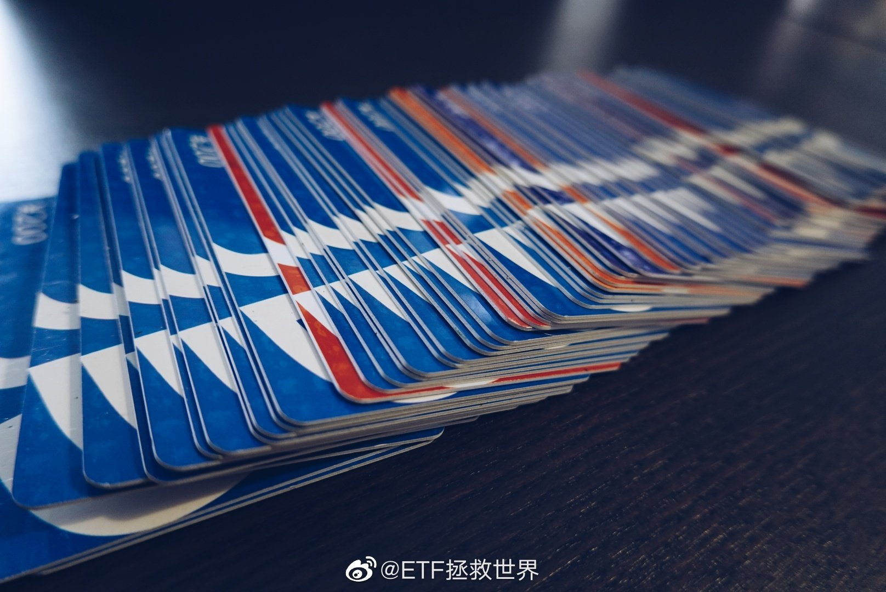

## 2022-06-20 09:47

祸兮福所倚，福兮祸所伏。

苦难的日子中希望不灭，动脑筋想办法，把挫折当做变得更强大的机会，永不服输。

好日子里反而要更加谨慎，战战兢兢，如履薄冰。你永远不知道一帆风顺的下一步是多么坑，这个坑有多么大。低调再低调。

这是股市和人生教会我的。啊，股市，听我说，谢谢你，温暖了四季…… ​​​

## 2022-06-20 10:11

千万不要让好人流血又流泪。等一个后续。

## 2022-06-20 10:34

环保已经涨回我们最终清仓的位置了。这一波反弹非常强劲。

我反思了又反思，发现无论从左侧右侧考虑，都无法从自己的体系中在低位买回它吃到这一波。所以，未来类似的情况我依然吃不到。

要不起，过。 ​​​

## 2022-06-20 13:13

我来说一下我本人的银行类资产（区别于证券类）都放在哪个银行，以资产占比排序：

第一位：招行。目前大致占银行类资产的1/2。

第二位：工行。大致占1/4。

第三位：平安银行。第四位：建设银行。

第五位：中关村银行。

其它零零散散还有一些都可以不计了。

招行是因为用起来很顺手。app各种操作整得明明白白。

工行的app用起来就差很多。

平安、建行，跟工行的情况差不多。

使用村行是因为有个小助理在那里工作，存了一点点钱。。

再小的银行我就没碰过了。各类互联网金融平台的存款更是没有操作过。微信的零钱放零钱通，支付宝的零钱放余额宝。

总之安全是最重要的。再说一次我的理念：

我不是不能接受风险，股市的波动风险那么大我都能接受，另类QDII我都敢买很多，我会怕风险？

我怕的是连锅端的那种底层风险。在不死的品种里面，波动中我亏钱是自己技术不好。但如果钱放在了不安全的地方出事了，那我是绝对不能原谅自己的。

## 2022-06-20 22:20

广东的店主见义勇为被打到昏迷不醒，北京的年轻爸爸在父亲节下河救人不幸去世。

这两位都值得敬佩，他们不顾自己的安危，救了一位陌生人和几个孩子。

但店主夫妻在病床上的样子，以及失去父亲的女儿那撕心裂肺的哭喊让人心碎。

还是那句话，即使会被骂也要说的：见义勇为，量力而行。

又要因为这句话骂我的，请你把为这两位英雄及家属捐款的凭证给我看。否则，你就是个辣鸡。

## 2022-06-21 09:58

很多人依然不懂我的微博到底是一个什么所在。

如果你把它看成一个人与朋友聊天的地方，很多事情你就会恍然大悟，为什么这位博主这么说。

它不是什么宣传阵地，也不是什么财经小V纵论天下的地方。

它就是一个人，把自己心中所想，取出一部分适合说的，与朋友们交流的地方。

关键词：

朋友，聊天。 ​​​

## 2022-06-21 10:35

恒生医疗如果不掉链子，收盘就又是买入后新高了。

坏消息不断的情况下，还是有好消息的。 ​​​

## 2022-06-21 13:34

最近水逆。

我会减少发言，减少各种决策。

等情况好转后再恢复常态。 ​​​

## 2022-06-21 19:41

夏至已过，

夜，

会越来越长了。 ​​​

## 2022-06-21 21:44

​​​
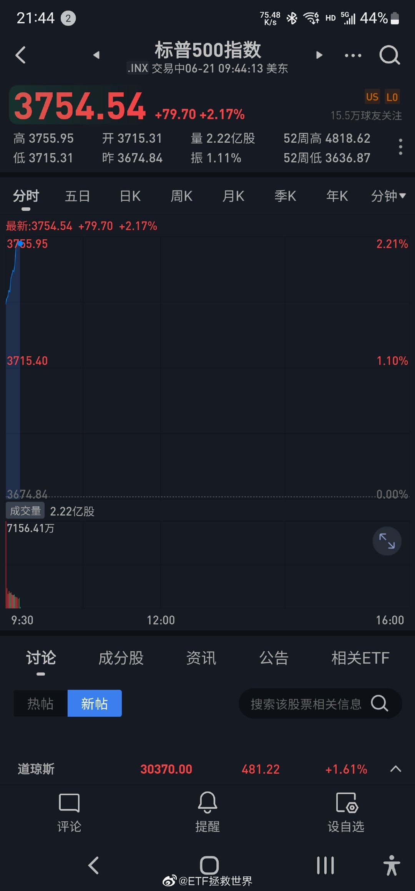

## 2022-06-22 09:51

守男德，保平安。🙏

## 2022-06-22 10:01

我总在想，不正常的男女关系，

要钱那是无尽的麻烦，无底洞也许多少都填不满；

要人比要钱还麻烦。对方得不到想要的，你的人生也许会被毁掉。

不要钱也不要人却是最最麻烦。生命中每份免费的礼物都暗中标好了价格。你为自己占了便宜沾沾自喜，打算挥一挥衣袖转身离去，一个天坑就在身后。

（以上男女都适用）

有诗为证：

人间最美是福报，平安到老守男德。

## 2022-06-22 13:09

有人说被判的那哥们很冤。因为是女的第二天早上叫他去的。

要我说，一点都不冤。

你结婚了，叫你去你就去？你做的对吗。

我不是装圣人，不是装白莲花。我的意思是，每个人都有自己选择的权利。叫你去，你选择了去，你就要承担有可能发生的各种结果！

告你猥亵也好，不告你被妻子发现离婚也好，总而言之，都是自作自受。

警钟长鸣啊，朋友们！做选择之前，一定要想好可能付出的代价。想想自己是不是能承受。

## 2022-06-22 13:27

有些朋友还在纠结“法律”和“道德”问题。

法律，你能说清到底发生了什么吗。说实话，你说不清。

我们可以从头根据每一个细节分析还原真相，但那永远是分析，也许是真相，也许不是。

什么是真相，这就是一个罗生门，每个人都有自己相信的真相。

而法律所相信的真相，这种案子，就是原告所叙述的。

你有意见吗？有意见保留。事实就是，这种事情，女方说什么就是什么。哪怕进行到中途人家说你是强迫的，你也没办法。

所以法律根本没什么可谈的，因为谈了也没用。什么有用？

守男德，保平安。不要做不该做的事！君子不立危墙之下。

## 2022-06-22 14:26

我不知道法律要靠证据吗。呵呵。

这种事情，且不说你要证明自己没问题有多难，就算你证明自己是被冤枉诬陷的，然后呢？

你没社死？你没消失？

所以，解决问题的根源就是不要让自己掉入粪坑。而不是希望自己从粪坑里爬出来是干净的。 ​​​

## 2022-06-23 09:14

我万万没想到，在我跟男性朋友探讨“守男德保平安”的微博下，也能被打。我真的感到无限凄凉。

这相当于什么呢。相当于，我和朋友A和朋友B过马路。

当时是绿灯。我掏心掏肺的跟朋友A说，虽然是绿灯，但你知道，有些司机磕了药，有些技术不过关，有些根本就是想蓄意杀人。这个世界的坏人坏事永远永远也不可能清零，所以咱们左右看看再过吧。

朋友A当时就爆发了：你不去管司机，你要管我？你不去惩罚磕了药的，技术不过关的，想杀人的人，你让我过马路左右看？我有什么错？我为什么要看？

我想了想，决定永远不再对朋友A说任何自认为真心真意，实际被认为“爹味儿十足”的话。

下一个路口，我跟朋友B说了类似的话。

朋友B拍着我的肩膀说，兄弟，你说得对。我们控制不了别人，但我们可以控制自己，减少伤害发生的概率。真被撞了，别管司机会受到什么惩罚，疼的是自己。我知道你是为我好才说了这么多，咱们一起过马路的时候多注意车，各方面的灾难概率减少了，生活幸福又快乐。

万万没想到，朋友A又爆发了！

你怎么能跟朋友B说这些？你怎么能说保持干净的最好方法是远离粪坑，而不是希望自己从粪坑里爬出来是干净的？这是什么意思？你说谁是粪坑？

我战战兢兢：我的意思是类似的事情是粪坑，不是说人……

A：别解释！你就是仇视我是不是？你们两个都仇视我！你们就是想压迫我！你们是不是希望我没有自由？

我：我都不敢和你说话了还不行吗……

A：不行！什么都不行！谁让你建议我过马路左右看了！你在我心里，永远将是个辣鸡！你说什么我都要骂！

行吧，累了。你都对。我错了，行了吗。

## 2022-06-23 09:31

回复@喋喋的小呆毛:很多人根本意识不到开车的人都是什么人，他们的技术可能会多差。建议没事儿的时候就去B站看交通事故视频合集。同理，很多人根本就意识不到永不可能消失的坏人可能有多坏。

## 2022-06-23 09:34

我感觉自己的水逆结束了。

原因有二：

第一，昨天把碰到的麻烦事顺利解决了。

第二，昨天限行开车出去被拍了但不罚款。

我再观察两天看看，如果没问题就正式官宣。 ​​​

## 2022-06-23 13:43

路遥知马力日久见人心。今天终于有老师上网课的时候因为一个小女孩在评论区打字爆发了。

## 2022-06-23 14:25

在股市呆久了，遇到的“机会”多了，你就更能正确的理解，对待机会。

有些机会你会知道你抓不到。因为你的见识、认知、能力、信息在那个时候都不能让你抓住它们。再来一次，情景重现，依然如此。这时候你就应该放平心态，不要患得患失。那个美女你根本不认识，人家结婚你嫉妒，你到人家婚礼上大喊“我不同意这门亲事”，除了被打毫无作用。

还有些机会你本应抓住的，却没抓到。这时候不要捶胸顿足，后悔不已。为什么呢，

因为啊，因为资本市场的机会层出不穷，无穷无尽，三年小机会，五年大机会。虾米机会每天都有。

如果你真的有能力，一定会抓住下一个属于你自己的。如果你没能力呢，即使抓住了这次本该抓住的，以后也会再赔光。因为你没能力啊。

所以最重要的，不是后悔，而是反思，复盘。自己为什么手软了，为什么犹豫了，为什么忽略了。是什么影响了自己，下一次怎么才能做得更好，抓住机会。

股市和人生很像，又不完全像。不像的地方在于，股市的机会无穷无尽。而人生的机会，平均到每个人，够得上改变人生这个级别的，最多也就3-5次吧，甚至可能更少。错过了，就可能再也没有翻盘的概率。

## 2022-06-23 14:36

回复@kklila_:比如进入哪个行业，比如跟谁结婚，比如低位的时候买了几套房，比如什么时候入市，比如利用自己的特长做了什么别人没注意的事业，比如认识了哪个贵人。每个人都会有改变人生的机会。//@kklila_:e大说一说3-5的改变人生的机会  除了高考还有什么？

## 2022-06-23 14:45

上个月底的右侧品种本月表现都不错。恒生医疗表现最好，涨了10%+。

那么本月底还有几天，现在看还是有机会继续买。但依然是不确定，还要看。

具体品种现在还不能透露太多，只能说依然一定是在底部区域。涨起来的那些，你威胁打死我我可能会买，不打我我肯定不会买的。 ​​​

## 2022-06-23 17:48

今日数据：

环保/新能源，在我所跟踪观察的30个国内外指数中，成为第一个中/长期估值数据全部处于95%分位以上的品种。

我饶有兴趣的看着这个品种会如何收场。 ​​​

## 2022-06-23 18:37

我曾经以为自己很讨厌开车（字面意义上的开车，非引申义）。

后来发现，自己只是不喜欢在拥堵的城市里开车。

在空旷的高速上，在绿树成荫的空旷国道上，在风景秀丽或奇险俊美的空旷山路上，开车的时候我都会心情非常好。

我有个想法，下次我在风景很好的地方开车的时候，如果心情也很好，可以开个微博直播。有想聊的就聊聊，没有想聊的就跟大家一起听着歌看看风景，是不是也很不错啊。

## 2022-06-23 22:54

我告诉你水逆结束了你还不信… ​​​
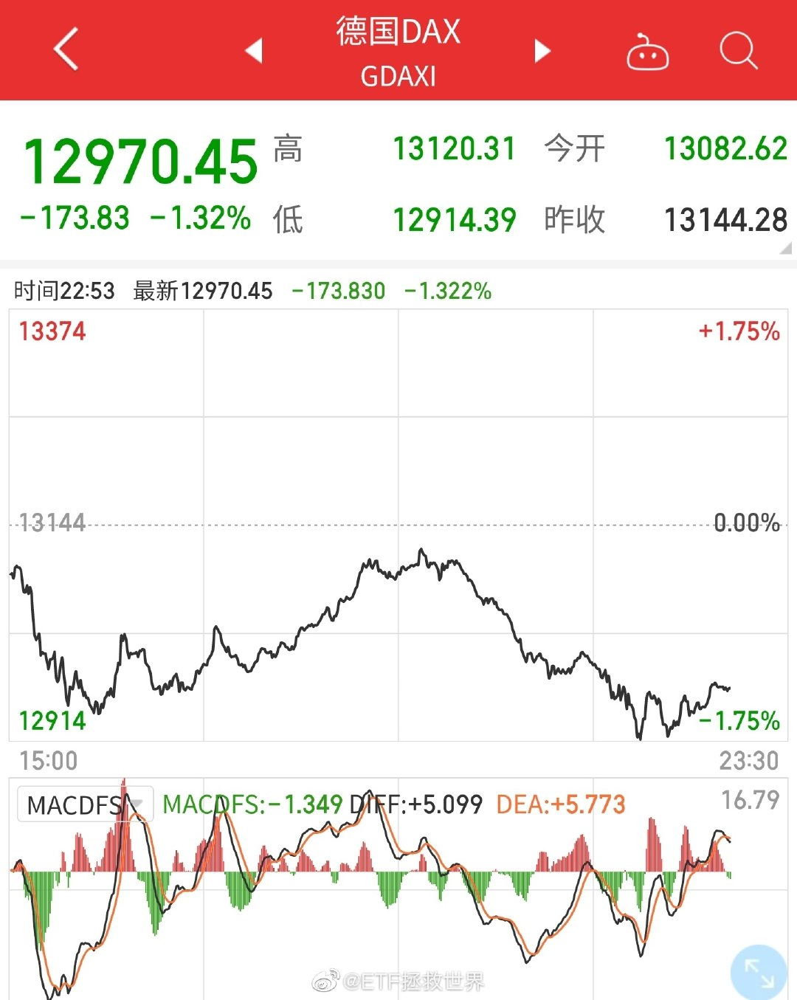 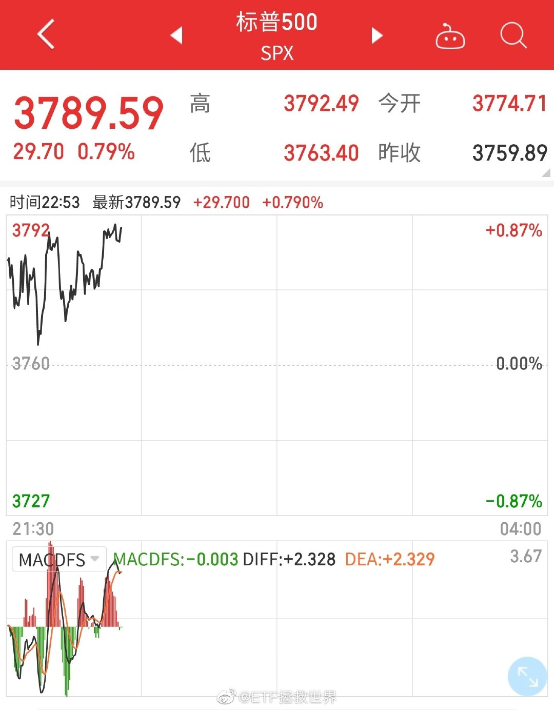

## 2022-06-24 07:10

这位是之前未被起诉男上司的妻子。我们不去讨论案情，因为每个人心里都有自己的判断，吵来吵去也没有结果。我比较感兴趣的，是大家对于这位妻子案发以来的做法怎么看，你觉得她为什么这么做？你觉得她是一位怎么样的妻子？

## 2022-06-24 07:32

我关注这件案子，一个是因为它太过离奇。一个是能从这件案子上面学到很多东西，也能观察到面对一件事，不同人群的不同反应，并且连带的，这些反应对事件本身的反身性影响。

两位男主，一位女主，两位妻子，一位丈夫，每个人都有截然不同的表现；

法律，公安，法院，检察院，律师，做出各种决定与判决的真正原因；

事件的整个梳理，时间线，人物线，证据线，精彩纷呈；

吃瓜群众的立场，舆论的推波助澜，对结果的影响。

整件事，人性被血淋淋的曝光在公众视野中。不禁让人感叹：

守男德，保平安。在平行宇宙中，守了男德，什么事情都不会有的。

## 2022-06-24 09:23

所有买入的品种，一定要给它折腾盈利了。

绝对不会亏损割肉。

这就是我的投资理念之一。 ​​​

## 2022-06-24 09:37

恒生医疗买入新高。

目前有个小压力，看看能不能过去。 ​​​

## 2022-06-24 09:41

心魔一去，世界就会有些不同。

所以各位，我的感想，

虽然客观世界并没有变，但如果我们自己的思维变了，自己这个维度的世界也就变了。

小时候觉得唯心可笑，风动，幡动还是心动？

现在觉得，唯物唯心，很难说得清楚啊。 ​​​

## 2022-06-24 09:53

回复@趴趴囧斯:不要用短期的好坏评价一个品种。春夏秋冬都有轮回。霍去病十八岁封狼居胥，黄汉升70岁定军山斩杀夏侯渊拜大将军。永远不要短视。//@趴趴囧斯:这玩意比中证医药强太多了啊

## 2022-06-24 09:58

你觉得它好，是因为你买的价位好，买了就赚了。

你知道今年它跌了20%，最大跌幅41%，最高点下来最多跌了67%吗。

如果你是高位买的，绝对不会觉得它好。 ​​​

## 2022-06-24 10:23

医疗今天3%，医药2%，跟恒生医疗比哪里差了。 ​​​

## 2022-06-24 11:18

我要去远方浪了，勿念。 ​​​

## 2022-06-24 12:03

这句话什么意思我看不懂，有朋友解释一下吗。

是在骂我吗？

如果是，有没有律师朋友，请教一下，我准备告它，这个能告吗。 ​​​
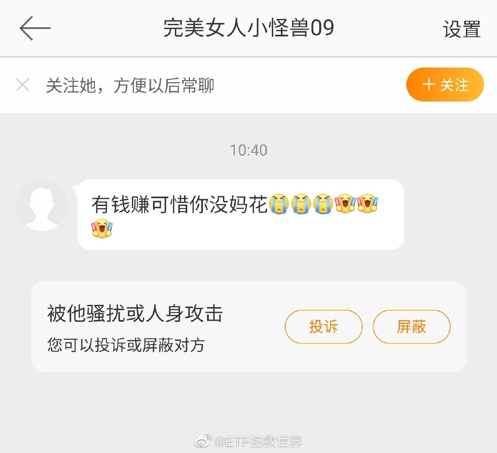

## 2022-06-24 12:05

回复@靓仔小宝:不理？为什么不理？我做什么伤天害理的事情了让它这么诅咒我的家人？我不把它挖出来我从此退出微博！//@靓仔小宝:真是啥玩意儿都有别理他

## 2022-06-24 13:24

姓名地址身份证号手机号全拿到了。

开始走起诉流程。

我先看看有没有人管。 ​​​

## 2022-06-24 13:31

请所有知道它手机号码的朋友不要骚扰它，我们不要从占理变成无理。

相信我，我有能力搞定。 ​​​

## 2022-06-24 17:16

那个人居然还在发微博污蔑我打电话骚扰他骂他？？？

我会给他打电话？？？

他从我这边接到的，只会是我的律师或者法院的电话！我会给他打电话？我会骂他？

做好准备应诉吧。我先看看有没有人管。如果没有再说下一步。 ​​​

## 2022-06-27 14:17

我的诉求非常简单：

第一，要求对方道歉。诚挚的道歉。不是迫于压力的道歉。要真的意识到网络不是法外之地，不可以随意侮辱，网暴，伤害别人。尤其是别人根本就没有做任何坏事错事的情况下。

第二，捐赠500元到任何公益项目，做一点好事，让这个世界因为你的存在而变得更好一些，而非相反。500元对于一个学生也许不算太轻松，但你的家庭条件是不错的，我知道这点对你来说并不是什么问题。主要是希望你能记住这件事。

21岁，还是个孩子，希望好自为之。

## 2022-06-27 15:55

另外，法律程序也在走，都开始干活了。

这个没那么快，别急，我会在合适的时候及时通报给各位朋友。 ​​​

## 2022-06-28 18:04

由于对方未有任何回应，我这边也进入了司法程序，将耗费大量的人力物力财力以及精力，这两项诉求已经不合时宜，我宣布作废。未来的诉求会在起诉书上体现。这个案件不会再频繁更新，等结果吧。

## 2022-06-29 13:53

感谢各位朋友的关心。

在这里，也请大家相信法律的公正。现在就是等待最终结果即可。

不要去尝试与对方联系，不要去尝试与和对方有关的单位联系。

还是那句话，相信法律。一切交给法律。

再次感谢大家。 ​​​

