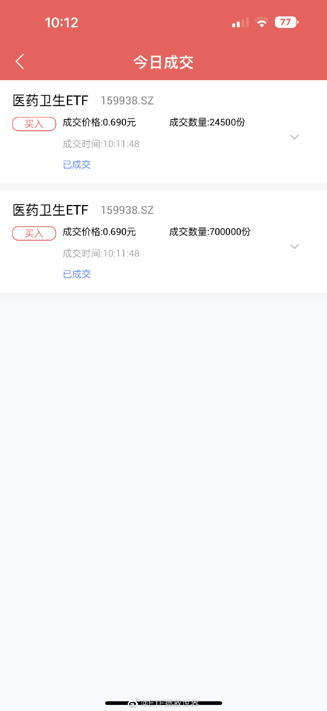
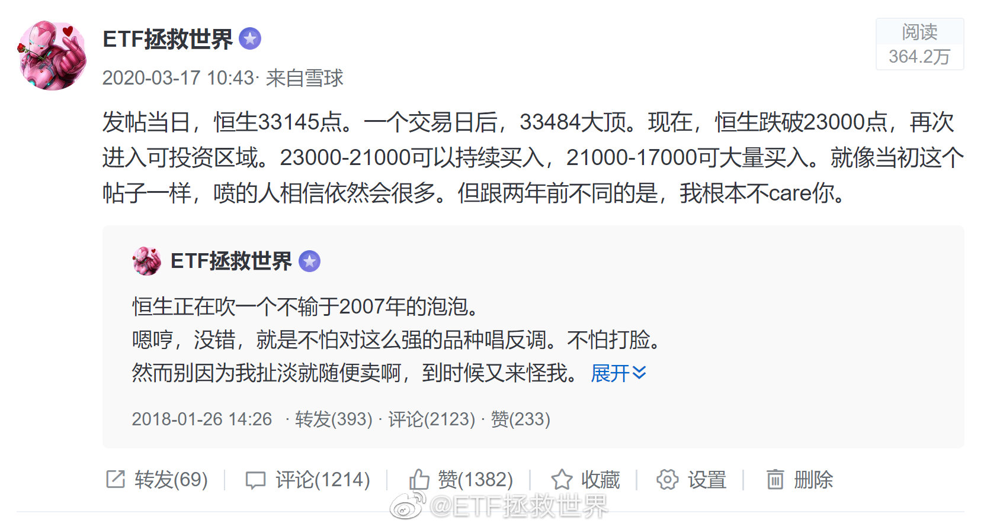
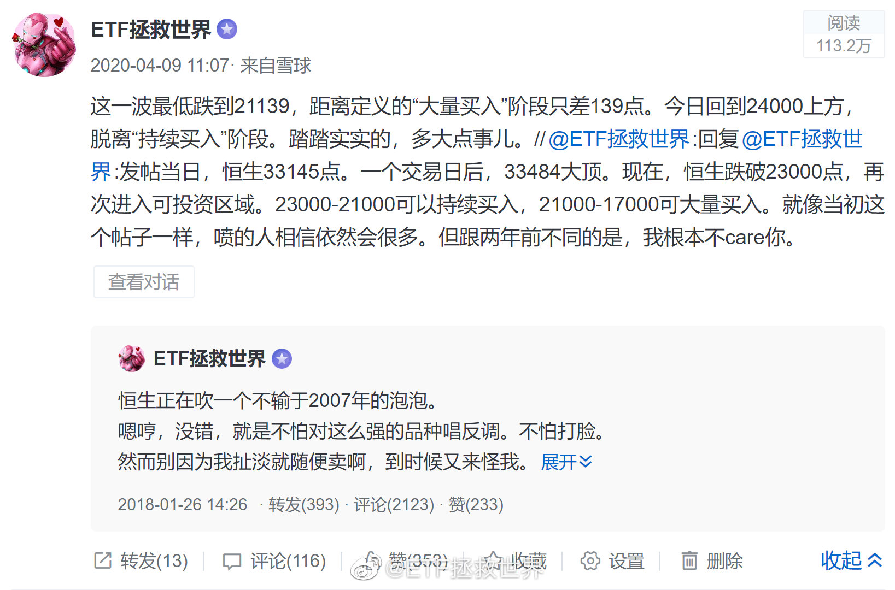
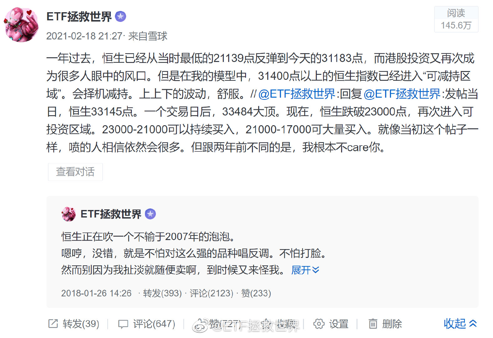
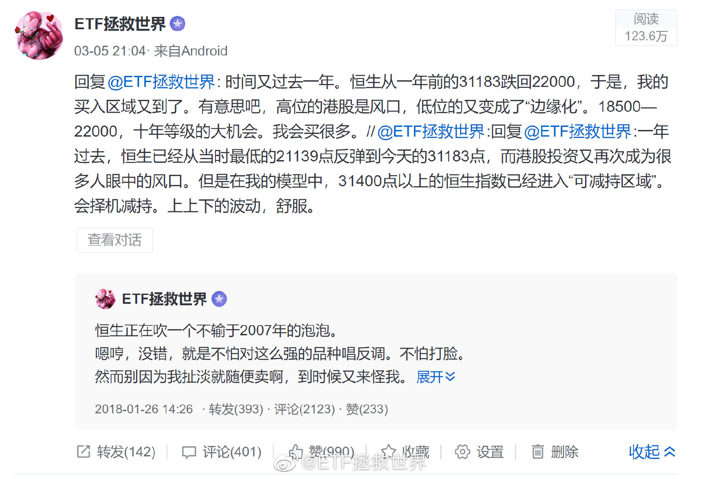
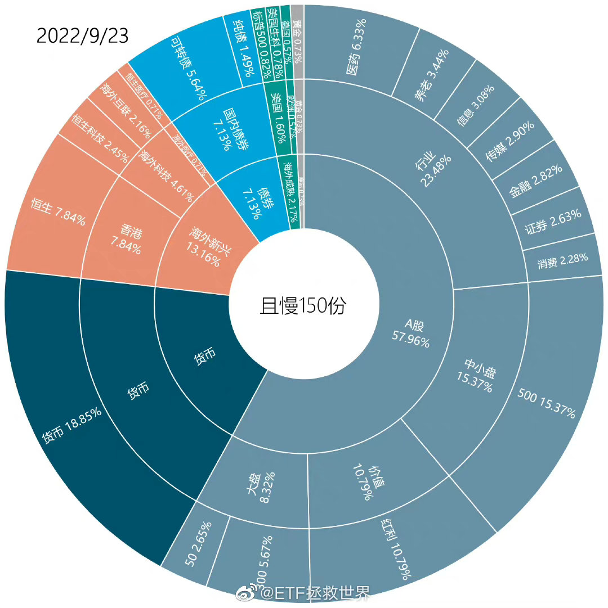
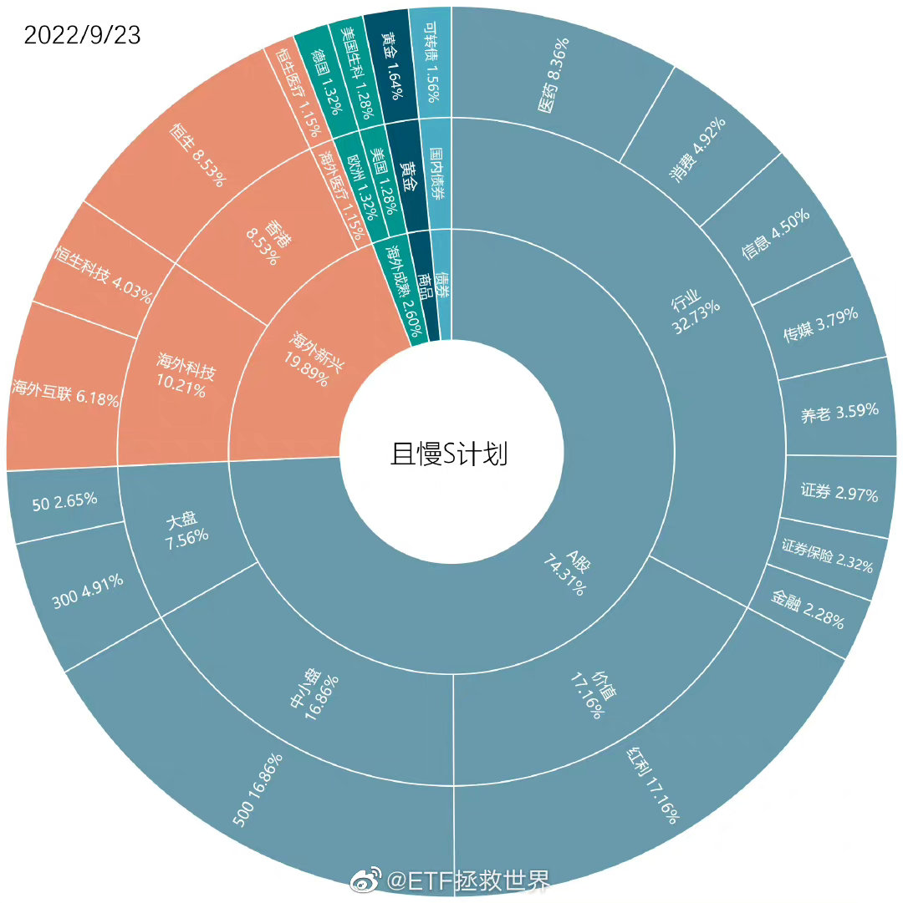
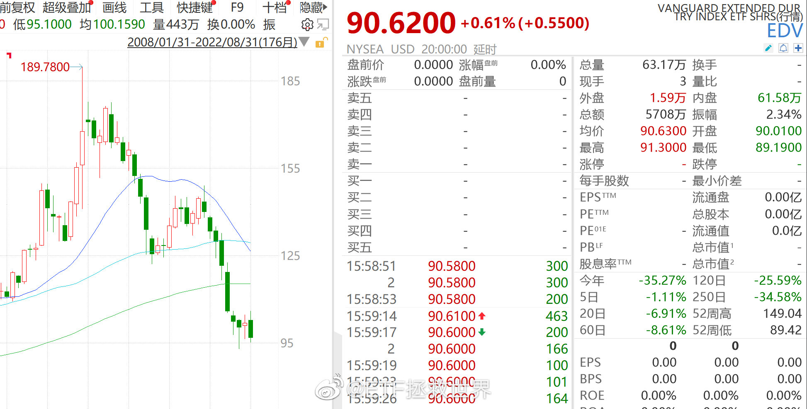

## 2022-09-15 14:27

20% 40% 60%的你不会慌。 ​​​

## 2022-09-16 14:26

这一次，没人能从我手里抢走。

我说的！ ​​​

## 2022-09-16 16:17

还有王法吗？还有法律吗！

 ​​​

## 2022-09-23 10:13

先小小的表达一下敬意。

更大的致敬等医疗归位。

说到做到，瑞思拜。

（这是我自己的操作，不代表任何投资建议。你也不知道这是我的多少仓位，不要脑袋发热乱跟。） ​​​

## 2022-09-26 09:41

恒生已经跌破最后一根支撑18500。

跌破支撑线本身意义并不是特别大。比如2018年，医药跌破最后一根支撑7700后，长达几十天都没有翻身，最终一飞冲天。

只是最后一根支撑线跌破后，从我的操作体系讲，不会再买。包括长线仓位，包括波段网格，都会停。因为所有的策略都是以最后一根支撑为下限设计的。

接下来就是等它翻身了。

要是永远翻不了身呢。

那就等到永远呗。

## 2022-09-26 09:50

关于恒生，我的历史判断。

你一定要对照k线，去看看我的这些判断的点位以及后续走势，你会震惊的。

如果历史每次都对，那么这次……总该错了吧。 ​​​​
   

## 2022-09-26 10:13

不过从我的角度讲，也确实是越来越轻松的感觉了。

大多数朋友都已经是老炮儿了，看起来很淡定。

只有三五小萌新，上蹿下跳慌得不行。

没关系，你们也早晚让我A教育成老炮儿。 ​​​

## 2022-09-26 10:26

S的医药仓位已经到了8%。如果它敢再跌，超过10%甚至15%都是有可能的。

死磕。 ​​​
 

## 2022-09-26 16:20

美国超长期国债ETF

千万不要以为债券只会涨不会跌。 ​​​

## 2022-09-27 10:03

发生肾么事了 ​​​

## 2022-09-27 10:36

猫不喜欢自己呆着。总是会在你身边找个地方舒服的趴下，看着你，陪着你。

但如果你要抱着它，它又会试图跳开。

保持亲密关系，但又拒绝零距离。

如果人与人之间也总能拿捏好这样的分寸，那该多么舒服啊。 ​​​

## 2022-09-27 10:57

这几天东方甄选玉米这个事情吧很有意思。我从另一个角度考虑一下啊。

你说一根玉米卖6块，被这个骂那个骂，然后供应商还在背后捅一刀，说货是从我这里进的，我只卖3块，来我这里买。

我是这么考虑的。

你说，愿意花6块钱买一根玉米的人，是不是真的在乎这3块钱的差价。我觉得不在乎。甚至说，你卖到8块、10块，很多人也不在乎。

卖了高价，企业利润增加了，交了更多税，雇了更多人。这经济不就好了一点吗。

好，你供应商咔嚓一下，把价格打到3块卖。那么没错，消费者省了3块。但问题在于，很多6块钱买的人，根本不在乎这3块钱差价。他把钱省了，也没地方花，就存起来。

非常好，本来是消费掉的钱，存起来了。本来多交的税，多雇的人，全没了。这经济能好吗。

我怕你看不懂我说的，我再总结一下：

高价的东西，只要能卖出去，你就不要控制它的价格。有人能买得起，这些人这钱不花在高价的东西上，他也没地方花。你不如让他花了，对经济有好处。

买不起高价东西的，自然会去找低价的。你不能把高价，利润高的东西都消灭，最后全是低价竞争，最后谁都是喝点汤，没肉吃。那样我们国家都在低价竞争，什么时候能发达起来？

推而广之。

你还没看出来吗，这几年过去，并不是所有人都经济状况变差。而是一部分变差，一部分变好。银行存款增加的几万亿都是假的吗。

要想办法提供高质量、高价格的产品和服务，让有钱人把钱花掉，带动制造业、服务业发展。而不是低价、低价、低价！低价的最终结果，就是所有人都只有汤喝。

## 2022-09-27 11:04

回复@柴哥--:没错。很多人确实只喜欢价格低的，但也有很多人不那么在乎价格，就希望有高质量的产品和服务。我们现在有一个很大的问题，就是很多领域找不到高质量的产品和服务，即使高价，产品和服务也一塌糊涂。

## 2022-09-27 11:50

再继续说两句关于消费的吧。

消费要起来，有两点，一个是消费者手里有钱，一个是消费者有愿意买的东西。

手里有钱的关键，在于分配。

十几年前我就在博客设想过一个场景，现在依然适用。

一个煤老板在一个地方挖煤，90%的利润他拿走，矿工喝点汤。这个煤老板买10辆BBA，买三栋大别墅，找5个相好的，差不多是极限了吧。

等煤挖完了，他带着大量的利润走了，去北京上海买房了，给当地留下什么呢。废弃的煤矿，10辆二手车，三栋破别墅，依然贫穷的当地人。

另一种可能，煤老板自己留30%，剩下的矿工分了。矿工有钱就要消费，然后当地的餐饮、服务业、汽车销售、房地产，各行各业都发展起来了。大家手里都有钱了，继续消费，继续生产、服务。煤矿挖空了，当地的其他经济支柱也有了，可持续发展。

这是一个极端的例子，但其中包含的道理应该都能理解。

另一个就是市场提供消费者愿意购买的东西。

煤老板想买保时捷，矿上的中层想买BBA或者魏小理，矿工想买几万的车。当地的4S都能提供，那么大家就都把钱花出去，消费好看了。但如果当地只能提供几万的车，老板和中层都不想买，把钱存着，或者去外地买，那当地的经济能好吗。

老板和中层想花大价钱买“有机蔬菜”，当地没有高端超市提供，是不是又少了一块就业和高利润消费？本来种有机蔬菜的农民和流通渠道可以把老板们的钱赚出来，自己变成高收入，现在是不是依然要不停的打压价格卖低价品。

老板和中层想买高价的华为，该地没有，只能去买几百一千多的手机。对，他们的钱省下来了，但华为是不是就少了一块利润，研究经费少了，科技水平上不去了。公司员工的高收入和股票分红少了，一连串的连锁反应，是不是甚至影响到深圳的消费了？

消费这个事情其实是牵一发动全身的。不是简简单单你买了一个公司的产品，只有这个公司获益。而是通过整个链条，包括公司的上下游，包括公司的员工再带动更多的消费，然后又带动更多公司更多的消费。

所以其实就两个关键点：

第一，大多数人都享受发展的红利。而不是少数人少数机构拿走绝大多数利润。人们手里有钱了，才有可能消费。少数有钱人钱再多，终究也是吃三顿饭，睡一张床，只靠有钱人消费是上不去的。

第二，在各个领域允许高收入，同时提供各阶层所需要的产品和服务。价格高不是问题，价格高，利润高。利润高，大家的收入才能更高。让有钱人花钱！多一点只坑有钱人的品牌，我觉得挺好！

## 2022-09-27 13:41

一个品种你买了，然后又跌了一个多点才见底，事后人们会说，呵呵，都没买在最低，蛮垃圾的。

但其实你在当时，是非常难的。因为随时有可能涨。虽然再跌你的成本会低，但你要付出的代价有可能是买不到。

真的很难。你用后视镜看异常简单的事情，在当时，需要用智慧经验意志来判断概率，没那么简单的。 ​​​

## 2022-09-27 14:13

连续第二次致敬买入都是在长期下跌最低价（起码是阶段性）当日。

这也许是巧合。那么看看第三次致敬还会不会继续巧合。

如果不是，就说明致敬这个行为背后所依托的交易决策系统是有效的。 ​​​

## 2022-09-27 14:21

有人问YY致敬仓位什么时候卖。

我给几个点位，具体怎么卖到时候我也会善始善终说清楚。

第一，12300附近。

第二，13500附近。

第三，17300附近。

以上点位随时间推移会有增加。

我从来不怕提前几个月甚至几年说出几年后的操作，我们一起看看我会不会食言。

知行合一。 ​​​

## 2022-09-27 14:34

今天说太多了，各位消化一下先。

下课。

儿子看完哈利波特，自己写了一篇玄幻小说（第一章，弄不好是最后一章，咕咕咕），我去拜读一下……

明天见。 ​​​

## 2022-09-28 10:02

厨艺小白美食贴士：

五花肉切片煸香

放入延边（也可以用韩式代替）泡菜翻炒

放入一点延边（也可以用韩式代替）辣酱翻炒

放一点点酱油，放一点点水

出锅，拌饭。

小心，巨下饭，你可能会吃很多米饭。

不好吃你打我。 ​​​

## 2022-09-28 10:50

对于港股，现在我的做法就是不看了。

除了7080支撑，没有技术支撑了，所以没有办法观察了。

随便怎么跌吧。不看就没跌。 ​​​

## 2022-09-29 09:47

are you ok? ​​​

## 2022-09-29 10:04

某人：昨天你微博有个黑粉说你涨了吹跌了不看。

我：哦，无所谓。群众的眼睛是雪亮的。

某人：你珍惜我吧。要没我，哪天你一个人，别人骂你你都不知道。

我：？还有这种好事？

疼。 ​​​

## 2022-09-29 10:24

“跌了不看”，很有意思。

各位回忆一下，认识我的几年，我是那种买了跌了就不看的吗。

从价值，技术，趋势，提前几年找到支撑，部署买入计划，在大支撑几十上百万真金白银买的是谁？

叫你一句黑粉冤枉你吗。

从我嘴里说出不看的有几次？如果有支撑，我难道不是一次次的按计划买入。

不看的前提是什么。是没有技术支撑了，看也白看了。不如腾出精力去看还有支撑的品种，找机会买，找机会致敬。

脑容量太小以致理解不了吗。

那么我该怎么跟大家说？

哎呀好惨啊，哎呀割肉吧，哎呀满仓抄底买入呀。任何一种说法的后果，你想过吗？

干嘛嘛不行，嘴炮第一名。

## 2022-09-29 22:33

美股方面，我考虑左侧价值买一部分，右侧趋势买一部分。

你觉得呢。 ​​​

## 2022-09-30 10:54

今年上海和深圳市场是全球IPO融资额最大的第一第二位市场。

美，港IPO规模因行情不好大幅下降，而我们今年有可能再创IPO融资额新高。

风景这边独好。

👏

从融资的角度看，A股一直都在牛市。因为什么新股都有人买，老铁家人们，还不点赞 ​​​

## 2022-09-30 23:49

我终于看清楚一件事。

有些市场不能病，咳嗽一声所有专家围过来嘘寒问暖。

有些市场死了就死了，病入膏肓了护士还举着针管问你打算献多少血。 ​​​

