## 2022-10-02 14:41

我觉得吧，真正的自信是，你觉得我好不好无所谓，你的看法我并不在意。

比如说，中国美食是不是真的有那么多外国人喜欢，是不是世界第一，不在乎，自己喜欢比什么都重要。不会为了外国人说喜欢中国菜欢欣雀跃，也不会为了外国人说中国菜不好吃义愤填膺。

自信还是我不在乎你的东西来不来我这里。你尽管来，我有足够的自信我比你好，即使你在某些方面真的比我好，也会被我同化吸收，让我变得更强。

## 2022-10-03 11:52

我现在每天做50个俯卧撑，分几组在不同的时间段做完。（休闲模式，工作累了活动一下身体）

有没有练家子朋友说说每天早上起床做 200个俯卧撑，在健身界是一个什么水平。一般人这样坚持下去，体型会有什么样的外在表现。

还是说连续200个的强度很小儿科，体型上完全看不出来。 ​​​

## 2022-10-03 21:41

最近看了几部国产影视剧，有个发现觉得颇为蹊跷：

绝大部分地名，城市，省份…

都是虚构的。 ​​​

## 2022-10-04 22:46

以后A股每周，或者每个月开一次盘好吗。 ​​​
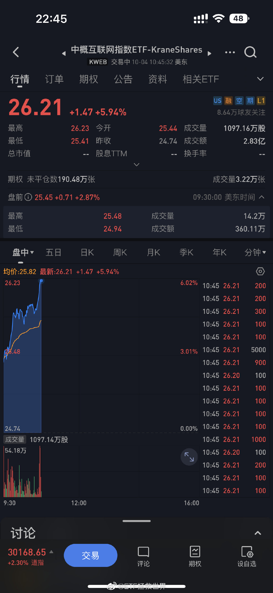

## 2022-10-05 13:33

就差一点，本来应该能买到恒生最后一网。

然后提款。

不过一切都是命中注定，不用太在意。 ​​​

## 2022-10-05 19:53

有没有人像我一样，其实对各种节日没有什么感觉的。

不是说节日不重要，就是自己没什么感觉。

也可能跟过各种节日的时候，除了放假，其实跟平常没什么区别有关吧。 ​​​

## 2022-10-07 16:31

看了一眼港股，

我知道，

假期就要结束了。 ​​​

## 2022-10-07 16:56

回复@zz爱困了:从你对我态度的变化，我感受到了人性，感情，利益，时间。也对不谙世事的朋友说一句，任何事情都会变的。包括人。而大多数人变的是最快的。如果人变了，非常正常，不要意外//@zz爱困了:呵呵

## 2022-10-07 17:05

回复@开通微博只为了E大:会的。虽然我知道某天你会离去，但依然珍惜在一起的时光，以及感激你曾经出现过。这句话也送给所有朋友。//@开通微博只为了E大:万物都会变，时间够长，也许，我也会变

## 2022-10-08 11:48

为什么食品饮料的厂家不能把产品的高中低档标清楚，而是用那些奇奇怪怪的模模糊糊的似是而非的不知所云的代号，

什么金标，什么特品，什么优选，什么金典，什么金品，什么特级，什么一品…

你就不能直白一点吗：xx酱油，xx酱油pro，xx酱油pro max，xx酱油 pro max ultra。

一眼看过去，清清楚楚。价格不敏感的冤大头吃好的，价格敏感的待富阶层吃一般的不行吗。弄一堆莫名其妙的形容词，谁知道怎么选？

## 2022-10-08 13:22

有些人真的，

自己不把换季的衣服找出来，天冷出门就把别人刚拿出来的帅气秋装穿走了。

服了。什么素质。 ​​​

## 2022-10-08 14:25

假期走访了几位朋友家。

一个结论：

家里是不是整洁舒服，跟房子面积大小不能说毫无关系，只能说权重很低。

最重要的，是家里面儿上有多少东西。把杂乱的东西收入柜子，面儿上干干净净清清爽爽的小房子，要比堆满杂物东西到处乱扔的大平层要舒服太多太多。

如果你不同意，保留意见。不接受反驳。 ​​​

## 2022-10-08 18:33

昨天在B站看了一集高清版的 成长的烦恼。

发现主角一家用的是对开门冰箱。

八十年代。

话说，你家是哪年开始用对开门冰箱的。 ​​​

## 2022-10-09 09:59

超冷。 ​​​

## 2022-10-10 09:12

终于要开了。

大家猜猜今天是跌啊还是跌啊。 ​​​

## 2022-10-10 10:22

上证并不是特别好观察A股的指数。

所谓3000点更是没有意义。充其量是个心理关口。

如果一定要说，2800左右倒是一个非常值得关注的大支撑。 ​​​

## 2022-10-10 10:34

继续致敬。

今天是信息。

只是我自己的操作，非推荐。因为之前说了，就贴出来，免得有人说我嘴炮。

不要乱跟，你也不知道我买了多少仓位。会跌很惨，不要乱跟。 ​​​
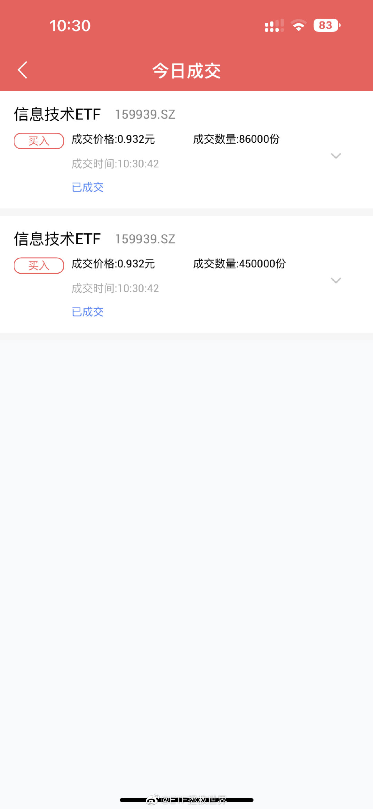

## 2022-10-10 10:46

继续周到。现在又开始把银行的钱往证券账户转了。未来收割完了再转回去的时候，还会再说。

## 2022-10-10 10:52

看了一下，近期应该没有什么可以致敬的品种了。

当然，如果医疗有机会到位，那么还会把之前说的另一大部分致敬执行完毕。从此医药再也不看。

信息会看情况是否有机会再买一部分。然后也是再也不看。

其他品种基本上距离致敬点位太远了，暂时应该没机会买。

长线的150和S不要急，会根据情况加。因为这两个计划要考虑的东西更多。

## 2022-10-10 11:02

其实你也应该发现了，我的水平和智商都很一般。

但有一点，

定好的计划，定好的操作，我就一定会干。如果说世界上没有100%的事情，那么99%我都要按计划干。

什么风言风语，什么草木皆兵，什么这次不一样，

对我来说，都是扯淡。

在我的交易世界里，没有人性。我只是个执行程序并且会不断修复程序中bug的野生AI。

## 2022-10-10 14:18

ETF拯救世界的微博投票

## 2022-10-10 14:38

再说一次权益投资的几个关键点

第一，闲钱。至少6个月，最好三五年的家庭支出以类现金形式拿好。

第二，买不死的品种。

第三，买之前做好最坏打算。就是我说的压力测试。

第四，制定交易计划。然后执行。

第五，尽量保持正向现金流，尽量不要让资本市场成为你的唯一收入来源。

第六，活着是最重要的，第二位才是赚钱。现金不是辣鸡，关键时候你才会知道它与氧气一样重要。

## 2022-10-10 15:29

医生：哪里不好。

我：您看我这儿长了个斑。

医生：老年斑。

我：？！还有救吗。

医生：幸亏你早来了10分钟，再晚一会就没救了。（这句是我脑补的，删掉）

医生：激光打掉，很快。

我：医生，您的皮肤是怎么保持的。又白又嫩看着就光滑一点皱纹都没有，您都教授级别了，怎么皮肤那么好！有什么秘诀吗？

医生娇羞：少吃辛辣食品，不要熬夜，保持运动，最重要的是防晒……

我：皮肤保养品有用吗。

医生：有用。根据国外化妆品公司的研究，用十年，会比同龄人年轻很多。要打激光吗。

我：不打了，我怕疼。医生再见……

## 2022-10-10 15:39

今日数据：

全市场估值依然没有跌到4月低点。

虽然50和300已经跌破前期低点，但由于中小股票没有回去，所以全市场没有回到低点。

慢慢跌吧。 ​​​

## 2022-10-10 17:59

中证红利的成分股最新股息率已经5%+了。

没有任何投资建议，只是陈述事实。 ​​​

## 2022-10-10 22:48

家人们，遵医嘱，23点前必须睡觉，拒绝熬夜。

美股看不看也就那么回事了。

晚安。 ​​​

## 2022-10-11 09:51

一年半，B站从1000跌到了100。

话说，股票这玩意儿的价格是不是一帮疯子乱定的啊。 ​​​

## 2022-10-11 10:06

历史这个东西，不能深入研究，也不能细琢磨。

很多事情越琢磨越觉得蹊跷，最终得出的结论也与大家的说法相去甚远。

本来吧，难得糊涂也就算了，反正也是过去的事。但问题在于，历史不仅能解释现在，也昭示未来。

历史的东西不弄清楚，我们怎么知道哪些路是光明的，哪些路是死胡同呢。

还是希望有思维能力的朋友，多看看历史。多思考一下所有事情的前因后果，多看事实，少看结论。结论应该是由自己思考得出，就像看研报一样。

## 2022-10-11 11:32

拥抱让人感到幸福。 ​​​

## 2022-10-12 10:08

昨天有朋友把我十几年前写的东西给我发过来。

我看了看，就两个字：

特么青涩！ ​​​

## 2022-10-12 10:14

说真的，一直到现在，我依然不敢相信真的会回到这里说的价位…… ​​​
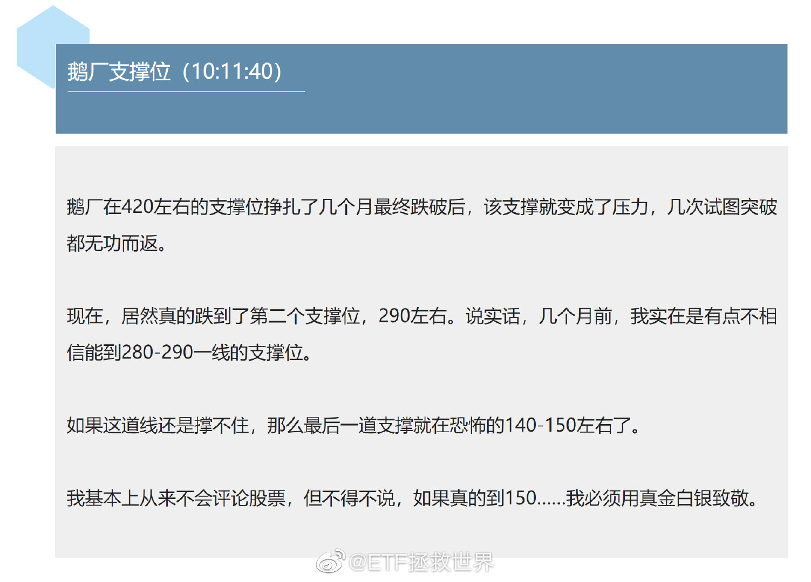

## 2022-10-12 10:38

该说不说，昨天虽然吐槽A股不涨，但其实大多数指数，整体上还是不断向上的。

有些优秀的指数涨幅还不错。

下面是红利、医药、消费、500、万德全A、深综指的走势。

最主要的特点是波动大。但如果你拉长了看，整体还是向上的。

所以结合A股这样的走势，我的体系主要解决的问题是如何在波动中实现收益。大波动用长期计划，小波动用波段操作。

其实每次低谷的时候，都有很多很多利空因素。但几年后再看，你连当时为什么跌都差不多忘干净了。

总而言之，整体看，还是向上的。

但有一说一，目前近5000只股票，买错了股票，恐怕一辈子回不去高点是极有可能的。所以炒股一定要小心。
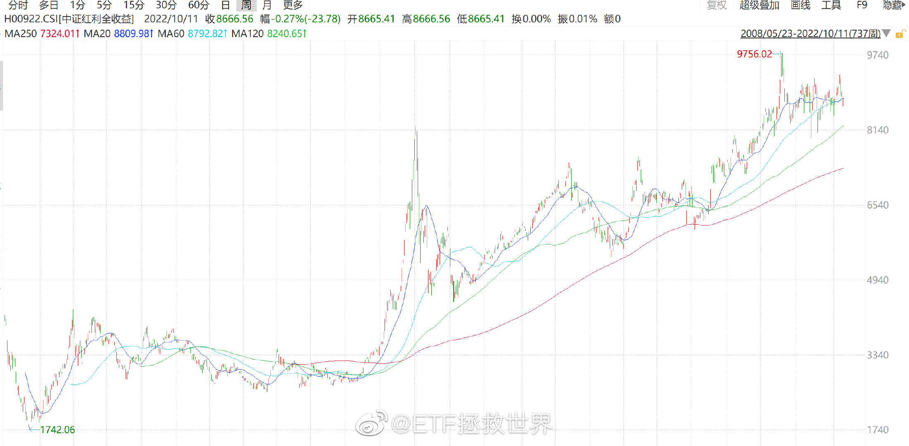 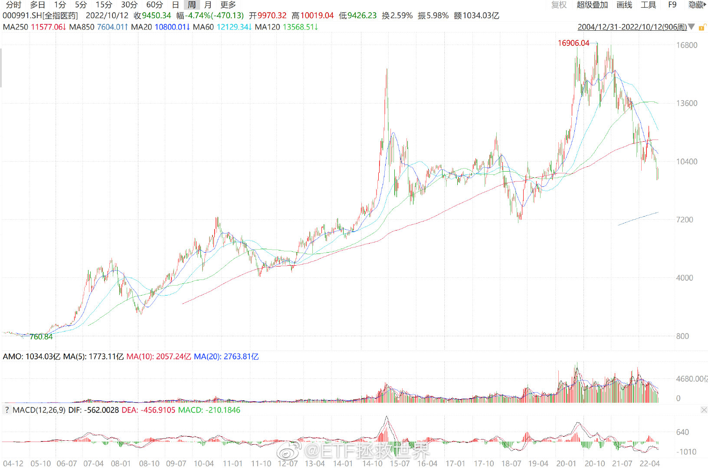 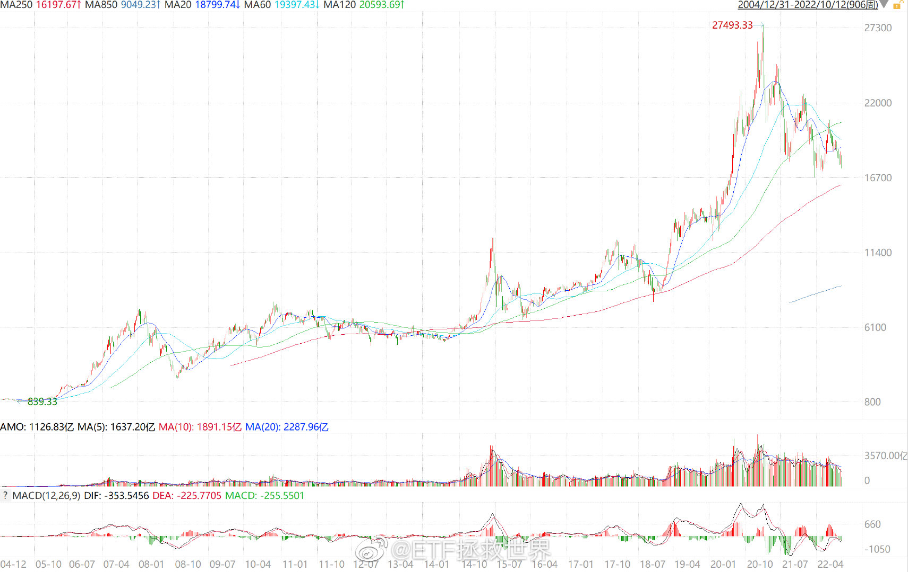 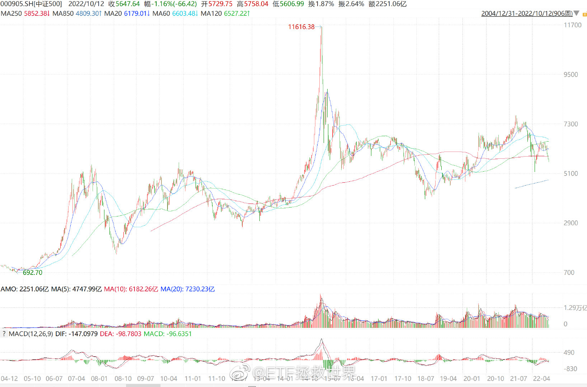 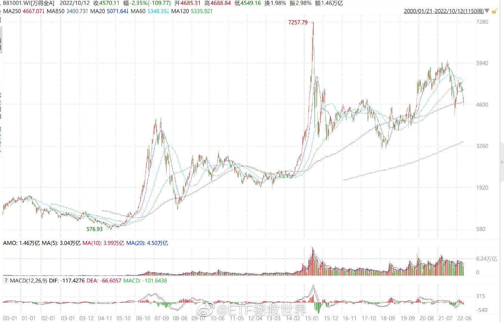 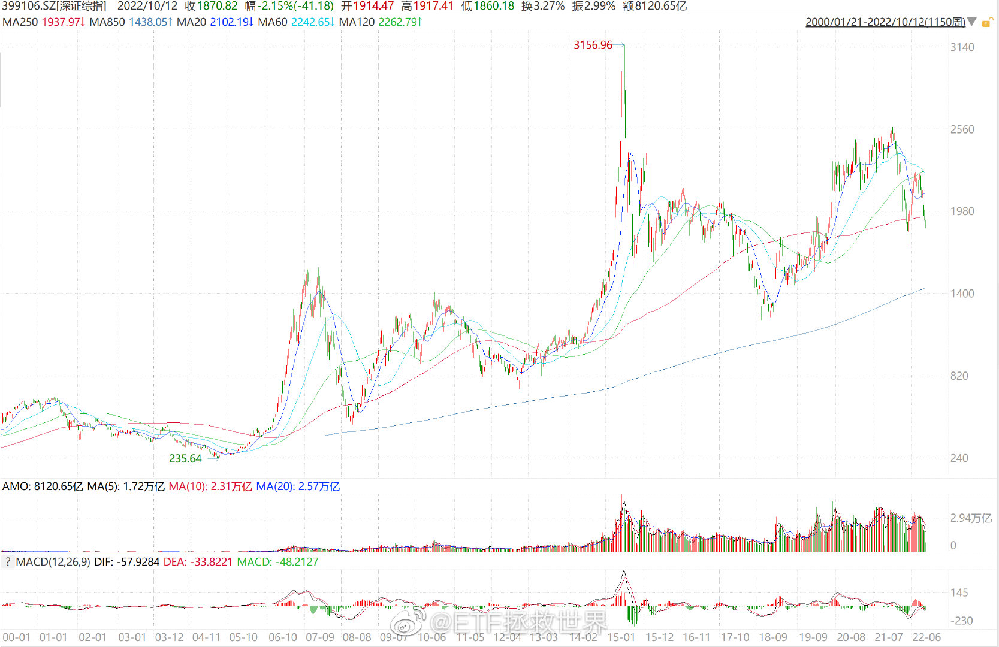

## 2022-10-12 10:59

目前A股全市场市净率大致上已经低于2倍了。

基本上来说，上市公司，尤其是前1000-2000家上市公司的质量，整体看，是中国最好的一千多家公司。

如果这些公司大规模出现问题，那么，其他质量不好的几千万家公司和企业能好到哪里呢。

继续推理，如果这些公司不好了，那么各位每个人的收入不会受到影响吗。无论TZ内外。

继续推，如果所有人都受到影响，那么房价不会跌吗，货币不会贬值吗。你留着现金的意义说实话，也不是很大了。

所以，回到最初，就是看你如何看待这1000多家质量相对最好的公司了。你觉得不会大面积出问题，和你觉得从此没戏了，当然就会有不同的做法。

如果你觉得没戏了，无论是去买房，还是拿着现金，都是不能根本解决问题的。

当然，最后还是要再次强调，去看我前几天说的权益类投资最重要的几个点。一定要保证几年能活下去，再做投资。

## 2022-10-12 11:08

我的意思不是赶紧抄底，加仓。而是说当你害怕得要卖出已经很便宜的持仓时，要想一想拿回的钱要去干嘛。或者什么时候买回来。总而言之，我相信仓位控制得当的朋友，目前并不太慌。一些重仓满仓的朋友就比较被动。每个人情况不同，还是要根据自己的情况认真思考。

## 2022-10-12 13:47

如果我们不讨论成长性以及大环境的变化，只以估值来看，

目前全市场相对较贵的，只剩新能源、消费，还有科创50。

这几个也不是说贵到离谱，是相对于其它已经被干到脚下摩擦的品种，还是较贵。

没错，就是这几年机构抱团的这些品种。

回想20年来，机构抱团猛冲的芯片、食品饮料，现在也是一地鸡毛。结论应该是，大家抱团冲的时候可以非常好看，但无论怎么抱，该走还是要走。

但是，走这个字，说得简单，做起来并不容易。当年我的消费根据历史状况卖掉，谁能想到又拉了几十个点。20-21的消费，完全就是无厘头式的上涨，完全跳脱历史规律。

环保走得还可以，算是卖在高位区域。

这些品种我都有兴趣配置，消费也已经开始配了。但真要大量买，我还是会等。

## 2022-10-12 13:52

如果未来有一天，那些你在极度悲观情况下，执行了自己的交易计划买入的品种赚钱了。

一定要对自己说一句瑞思拜。

你值得拥有。 ​​​

## 2022-10-12 14:40

信息致敬仓位跟医药一样，是第三天挣钱。

恒生是第二天。

长期不说，短期蒙的还是可以的，至少都有一波反弹。 ​​​

## 2022-10-12 21:43

不瞒你说，我现在对世界的认识有时候自己都会感到有点…怎么说，是不是瞎想的时间太多了。

比如，我有时候会想，如果我们不观察股市，股市是不是一种量子叠加态。如果我们不观察，它就是有可能涨有可能跌的不确定波态。一旦观察，涨跌即现。

比如，我认为金融投资是一种经验行为。也就是说，并没有什么科学依据证明某件事的发生必然是由另一件决定的。人们根据a的发生判断b，基本上是根据经验得出的结论。

所以，金融投资本质上是个概率加经验的游戏。所以，孤注一掷有可能取胜，但也有可能失败。因为历史经验太过自信，而总是孤注一掷下大的赌注，最终的结果恐怕很不妙。

因为这不是科学，这不是必然的因果游戏，你怎么知道这一把不会违背经验。

举个例子，一个外国人来学汉字的数字书写。开一个赌局，他从一 二 三的写法中，认定汉字的4是四个横，然后赌上所有，结果，4是四。

经验可以帮我们判断概率大小，但不能让我们掌握圣杯。

因为金融投资只是一个总结规律的游戏，到目前为止，还没有人能够找出关于投资的任何公理和定理。

所以，不要孤注一掷，不要赌命。人生只需要富一次。积累经验，计算概率，永远保证活下去。

## 2022-10-13 09:49

在资本市场，没有人是神，不要用后视镜去苛刻的评价别人的交易。

你打开k线可以评论江山，但未来没有k线，未来是模糊混沌的。

只要能够逻辑自洽，只要能够大周期持续增长，只要能够一直活着，只要大多数交易动作是正确的，只要能够不被环境的疯狂和恶劣所影响，

那就是很出色的投资者了。 ​​​

## 2022-10-13 11:44

之前感觉危险临近所以在一个超市补充了大量物资。

今天突然听说那个超市有确诊了。

机关算尽太聪明。你以为你超前了一步，结果命运在两步前等着你… ​​​

## 2022-10-13 16:15

恒生指数技术上没什么好说了，已经跌破最后的支撑。

估值上看，即将到达2008年金融危机的位置。

与目前近似的估值，出现在2011-9；2016-2。

两年前恒生指数到达历史最高区域将近30倍，目前只有10倍出头。

没有任何投资建议，只是客观陈述事实。 ​​​

## 2022-10-13 16:21

高位的时候，我在计划里卖出了部分恒生指数。网格也将近清仓了。但是，为什么计划里没有多卖一些，我只能说，当时我脑残了。其实那个时候，技术、估值，都是应该大量卖出的。因为我没有相信数据和模型，自己乱加了很多高估合理的解释。为什么我要有自己的思想，不能只是简单依从模型呢。深深反思。

## 2022-10-13 16:29

我要永远记住这张图，价值仓位最高位卖出了一点，右侧仓位居然一点都没卖。

当时在想什么？

相信数据，相信系统，不要相信自己！ ​​​
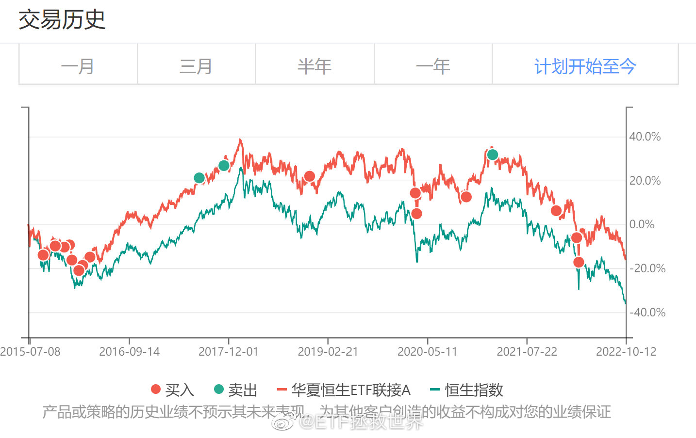

## 2022-10-13 16:45

继续反思。

其实高位估值、技术双达标的品种很多。比如当年的消费。当年消费执行了卖出，结果是又被抱团的机构们拉高了几十个点。

但这并不能掩盖错误或者把恒生双高卖少了的事情敷衍过去。毕竟当时持有了十几份，最低最低，卖出3-5份都算合格了。

一定要在体系中，交易系统中，把这个部分的缺陷弥补起来。

卖出很难，但不是说不能做得更好。

在我看来，反思自己的错误并不是什么丢人的事情。连反思都不能的人，怎么可能进步。

我公开出来，就不怕任何人的质疑。是希望大家一起认识这个问题，一起进步，下次做得更好。

## 2022-10-13 16:56

回复@esau2:在这个区域。 查看图片 //@esau2:那按照这张图，右侧应该在哪里卖呢

## 2022-10-13 17:21

前几天接到电话说让我注销京东白条金条。对于一般的骗子电话我都是直接挂，但这个让我很有兴趣，听她说完了全程才挂。

但我一直想不通，我注销了白条，她能得到什么利益呢。但实在是没时间继续探究，第二天她再打电话我直接挂了。

谁能说说，我注销后，她会怎么骗我的钱。

但有一点挺可怕的，身份证号、手机号都被她知道了。

## 2022-10-13 17:28

但是有一点朋友们，我的想法：只要是说自己是大平台客服，但是说话口音又很严重，普通话不标准的，基本就是骗子了。当然，骗子可能是故意找一些普通话不标准的来打电话，会第一时间筛掉一大批警惕心强的人。连这个都听不出来的，继续骗下去效率就高了。

## 2022-10-14 09:24

今天心情怎么样 ​​​

## 2022-10-14 09:33

美股的涨跌，可以影响先于它开盘的欧洲盘，也可以影响晚于它开盘的亚洲盘。

A股是独立于整个外盘涨跌之外的。无论外盘涨跌，都无法影响我们。

很有意思。值得琢磨。 ​​​

## 2022-10-14 09:37

医药致敬后新高。

前两天说因为买了致敬仓位导致现金过少心里发慌的朋友，建议你考虑一下该如何平衡。 ​​​

## 2022-10-14 09:48

围观我微博6个月以上的朋友，请你们客观的评论一下，

技术到底有没有用。

技术一定是要结合价值才能发挥最大作用，但我想知道现在在你们的意识中，技术有没有用。

技术在判断高低点位置，压力支撑等问题时，不能说100%，我是说大多数时候，有没有用。 ​​​

## 2022-10-14 09:56

技术一定是有用的。

其内在意义，在于证券价格是围绕价值上下波动。这是经典的价值投资理论的延伸。

而技术，无非是找到价格围绕价值上下波动的那两个上下的边界。

比如我经常说，低于某个价格我就不理解，或者高于某个价格我也不懂了。就是价格已经离散到我所理解的上下边界之外。

离散可能有两个原因，

第一，由于情绪资金等问题，出现了比极端更极端的情况。后续将修复。

第二，由于某些原因，该品种过去十几年，几十年的经验和趋势已经不存在。

如果是因为第一个原因，即使技术点位未能支撑或者打压价格，那么，早晚也会回到正常区间。

当然，投资完全没必要一定要找出“致敬点位”。我只是为了证明技术是有效的，以及，我要在我所理解的点位用真金白银向体系表达敬意。

真正的投资，只要能够模糊识别便宜和贵，在便宜区域布局，在贵的区域卖出，就足够了。

过度追求致敬点位的精准，有可能会发生还没买到就飞升，还没卖出就跌落的尴尬。

## 2022-10-14 10:09

医疗就这么飞了吗？

我意难平。 ​​​

## 2022-10-14 10:50

信息： ​​​
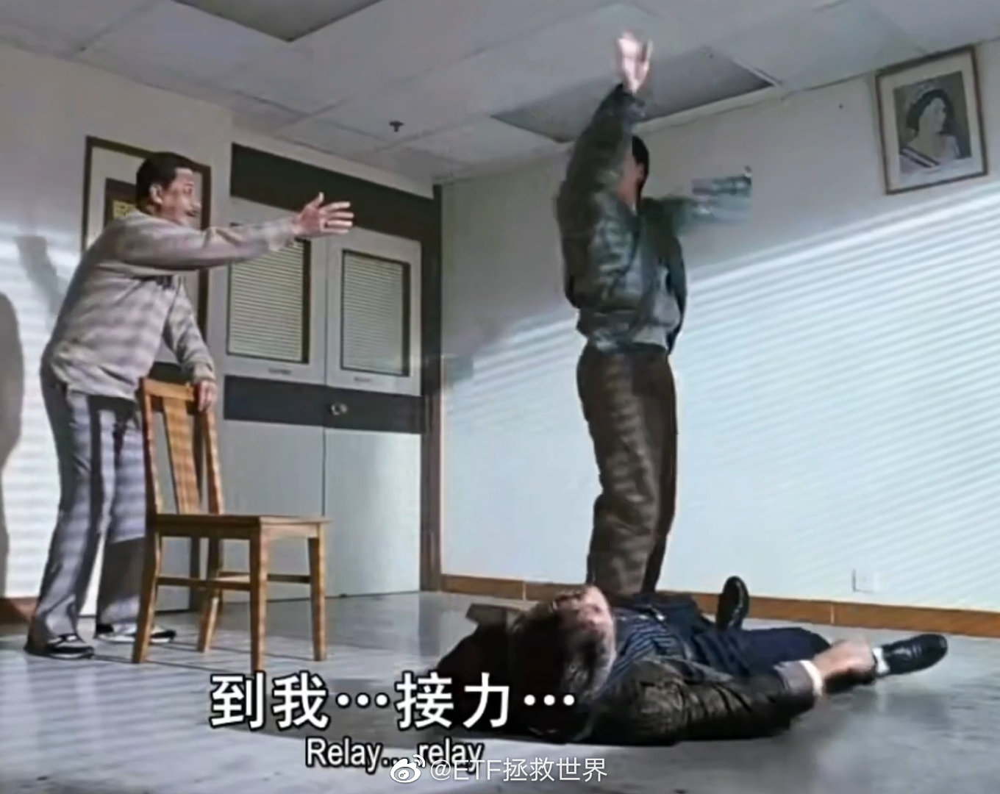

## 2022-10-14 11:11

各位静下来体验一下自己的情绪，然后记录一下。

是不是连续暴跌的时候会很沮丧，甚至绝望。觉得希望渺茫。

是不是一个大涨就觉得希望回来了，三个大涨就前途光明一切都会非常美好。

好好体验一下，这就是人性。

金融投资，要摒弃的就是这种感觉。如果自己掌控不了，就要去寻求一个交易系统帮助自己做交易。自己只是一个执行系统命令的输出工具。

## 2022-10-14 13:18

转发微博

## 2022-10-14 13:42

我现在只有一个愿望，希望大家能在反弹中提一两次款。

让这些日子压抑的心情多一些快乐。

希望大家顺利提款，希望大家快乐。 ​​​

## 2022-10-14 13:58

有时候我常会想，到底什么能带给我们持久的快乐。

很多朋友肯定会说：钱啊。有钱了就快乐。

其实不是。

钱首先会带给我们安全感。当然安全感的阈值每个人也不同。有人很多钱也不安全，有人一点钱就安全了。有人没钱也安全。总之，钱能带给我们安全感。

但钱本身不能给我们快乐。比如你突然有了第一个100万，你会快乐6-24小时。有了第一个1000万，会快乐3-12小时。以此类推。

如果你的钱不是飞来横财，而是一点点积累的，那么时间会更短。甚至到了整数关口也没有快乐的感觉。

时间长了，你会觉得生活和以往毫无差别。然后你以为是不够多，然后追求更多。最后你发现，还是一样的感觉。

能带给你很多中短期快乐的，其实是钱能买到的东西。东西本身其实也不能给你快乐。但其中一部分，是真的能带给你使用或者过程的乐趣。比如你喜欢开车，那么一辆好车开起来你就会非常快乐。不过注意，很多东西你以为自己拥有了会快乐，其实并不会。

所以快乐其实是来自于“事情”。是某件让你很快乐的事情。而有时候恰恰需要钱去帮助你实现这件事。比如做自己喜欢的工作，比如去一个地方旅游等等。

所以第一个结论，钱本身不会让你长久的快乐。但钱可以帮助你完成一些需要钱才能做的事情，这些事情才会让你快乐。

如果你只是在追逐金钱，不知道金钱可以帮你做什么让你喜欢的事，那最后也并不会快乐。

不过啊，很多朋友其实没想过，太多太多可以让你快乐的事情，并不需要钱，或者不需要那么多钱才能做。这个很重要。

第二个让我们持续快乐的，其实是人际关系。

好了，以后有空再展开说吧。

## 2022-10-14 15:00

港股大抵是真的辣鸡，横竖涨不起来。

昨晚睡不着，挣扎着爬起来点开k线一看，每一根上下翻飞却都写着下跌。再点开年线看个仔细，眼前一黑就倒了下去：长长的两根年线，一根是绿的，另一根也是绿的。

恒生的事诸君未来不必再提。若是今日卖出，不免有些割肉的意思。倘若再买，也并不合我的脾气。思来想去，终究是贪恋钱财罢了。

今日不知怎的，伊竟涨了一些。但想到既然下蹲才能跳得更高，想必爬起来才能摔得更惨，我于是开始疑心明天会更惨一些。

同乡唤我一同去刺猹补贴家用，先写到这里，下周再见罢。

## 2022-10-16 13:16

遵医嘱的健康生活。 ​​​
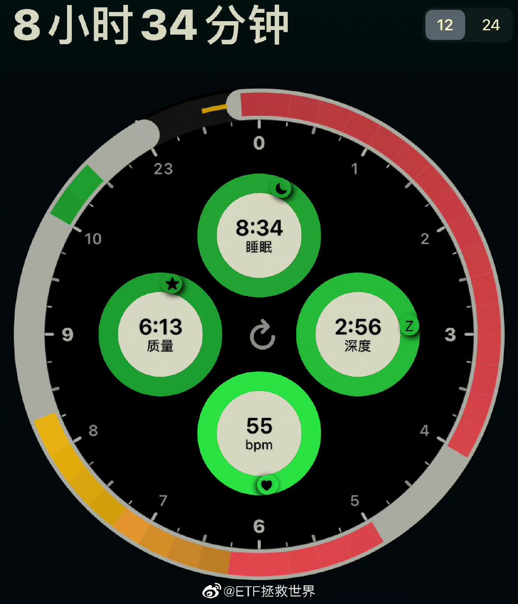

## 2022-10-17 09:42

能不能收割，平常心。

割了固然好，割不了也正常。

淡定。 ​​​

## 2022-10-17 09:50

信息： ​​​
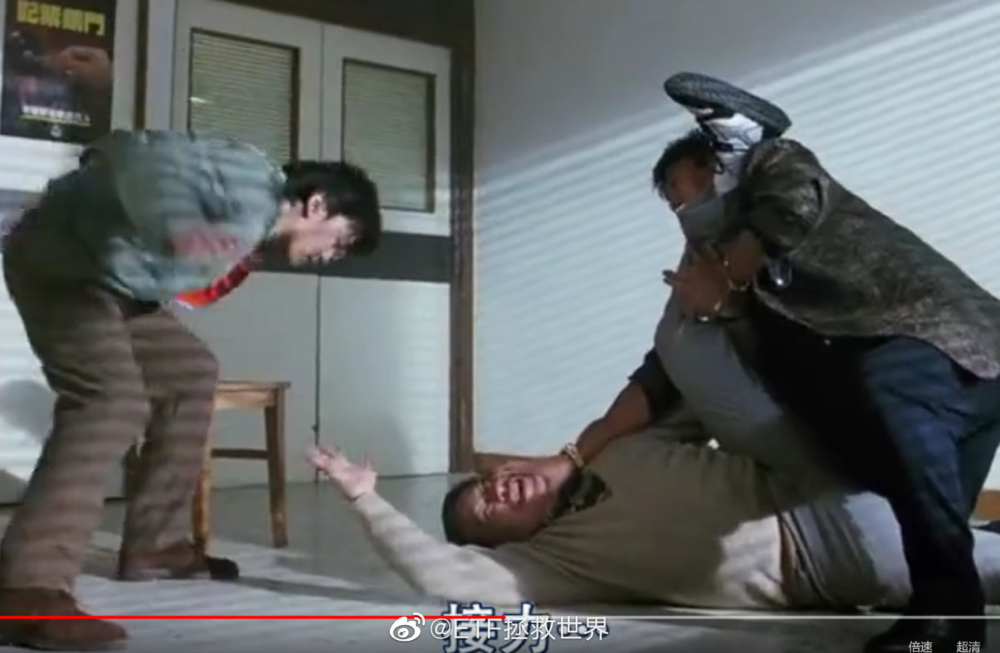

## 2022-10-17 10:25

很多朋友做价投，这没有问题。问题在于价值不是投资世界的全部。

比如一个特好的股票下跌，经过缜密计算，你震惊于它的价格相对于价值如此低估。然后给出一个价格，基于价值，这个价格你认为绝对不会跌破。

然后满仓，然后加杠杆。

然后呢，然后金融危机，然后大幅跌破，然后没有然后了。

这是基于你的计算是正确的。如果是错误的呢？还有，你这次押对了，如果下次错了或者下次金融危机了呢？

所以最佳策略，就是经过你的计算，发现价格大幅低估。然后买入。但买入的量能够保证出现意料之外的情况时，你依然不会死。

少赚点不是问题。积少成多，只要你有水平，一次次的小胜会积累成大胜。但用命赌，就不好说有没有下次了。

让时间成为你的朋友，而不是敌人。

省流版：

价投没错。没有所谓铁底。金融市场并不时刻理性。不要搏命。

## 2022-10-17 10:47

这波美股下跌，不仅指数跌幅较大，很多牛股也惨遭毒手。反正你知道的那些公司，你自己去看看吧。别说动辄腰斩的科技公司，甚至消费行业的麦当劳可乐宝洁也跌了不少。

但是，有些公司却纹丝不动。

比如下图分别是默沙东、礼来、艾伯维、联合健康。

都是大医药公司。

值得思考。

我现在的希望，就是这些品种也崩一下，我们好买入相关品种。
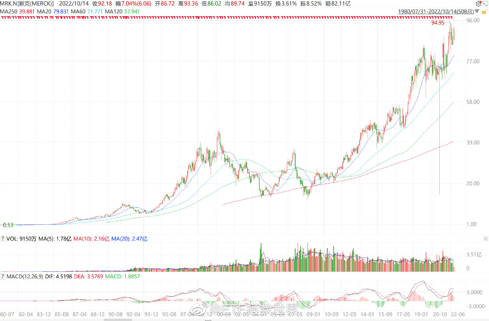 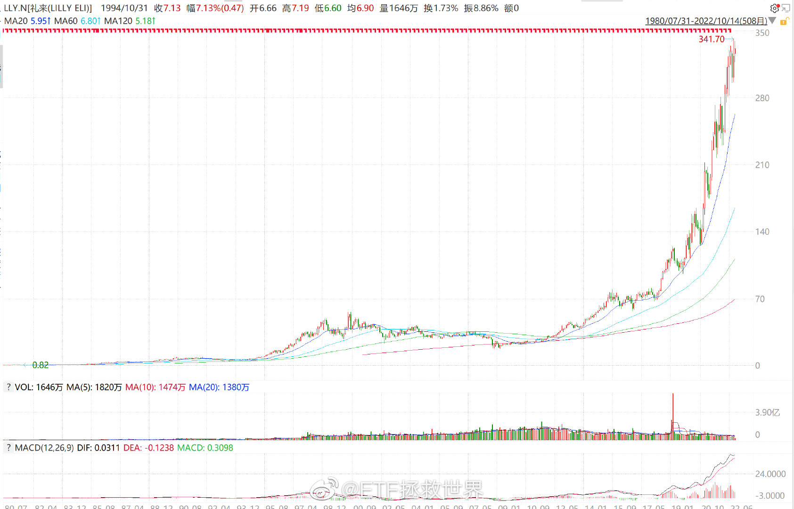 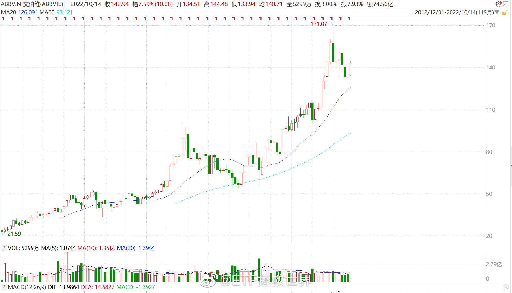 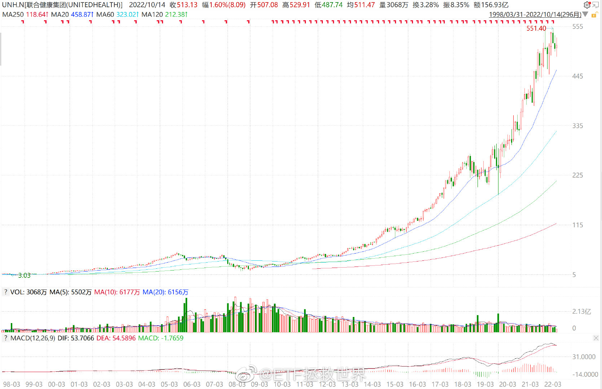

## 2022-10-17 13:48

有朋友问致敬仓位的卖出点位。

不会是一笔卖出。中间的点位过多我就不说了，总之最后一笔卖出的点位：

恒生：32400左右

医药：17200左右

信息：7500左右

那位朋友问了：一定到吗？

不一定。

又有朋友问了：到不了怎么办？

到不了我就等着。反正我不急，你很急吗。你急你先走。 ​​​

## 2022-10-17 14:00

我今天想起来之前说的回归微博就要送杯子。然后问了一下且慢还有多少个。

现在正在核实还有多少，我估计不多了。

有朋友说让卖，我觉得不合适。不管卖多少钱，就算1块钱，也会有人说收割粉丝，卖杯子挣钱。

何必呢，没必要惹麻烦。我看年底或者什么时候，自费做一批再慢慢送。

我掏钱，白送，该不会有什么人说什么了吧。

## 2022-10-17 14:09

【送杯子】

这次不凭运气抽，凭实力送。

按照粉丝等级送。从钻粉开始、金粉铁粉依次。在每一个档次里，等级高的优先。

钻粉2&gt;钻粉1，以此类推。

在等级高的朋友都拿到了后，等级低的按评论时间排列，先评论的先得。

比如钻粉2有15位朋友，都拿到了，先评论的15个钻粉1拿礼物。

一共就30个，到今天15点为止。谁得奖了我会回复你的评论，然后你去找@且慢管家 报地址要东西就行了。

## 2022-10-17 14:34

前几天评论说有装修的朋友。我再推荐个东西吧。

其实也不算一个东西，一个系统吧，智能家居。

对我来说，最有用的是窗帘和电子门锁。

窗帘每天定时开、关感受最好。也可以语音指挥全屋的电器包括灯、窗帘，省得到处找遥控器。也可以设置很多智能场景，比如晚上回家开门自动开灯什么的，很方便。

也可以通过智能系统实时看到门锁的状态，有人按门铃，谁进屋了，很实用。

应该也有很多解决方案，只是提个方向，没有具体品牌建议。有感兴趣的研究研究就行了。

家里的东西，我的思路，就是越能解放劳动力越好。人做的动作，干的活，越少越好。

## 2022-10-17 15:28

翻了好久好久，终于翻到了第一页。每位得到礼物的朋友我都回复了数字，拿截图去找@且慢管家 即可。实际上得奖需要钻粉1同时2分钟内回复……很难，得不到也很正常，希望大家下次好运。明儿见！

## 2022-10-17 21:27

u1s1，融通是今年最顶的医药基金 ​​​
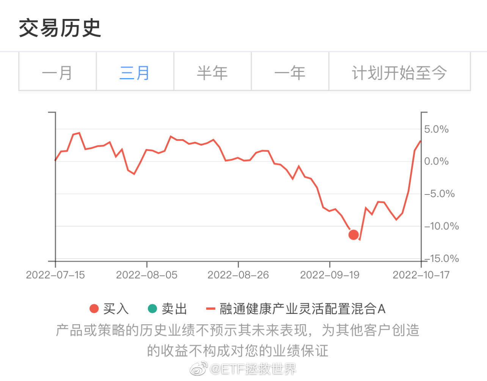

## 2022-10-18 09:11

今天涨还是跌。

有机会提款吗。

股市的不确定让我快乐。 ​​​

## 2022-10-18 09:27

再说一次，我水平一般，判断总是不准，准的那些都是蒙的。

就是这么回事。 ​​​

## 2022-10-18 09:32

本地帮派不讲规矩。 ​​​

## 2022-10-18 10:43

沟通方式有多重要。

前一段时间有位朋友在公众号私信我，“E大我有一位朋友，不知怎么回事被您拉黑了。她很不开心，您能不能把她放出来啊。”

人家都这么说了，我还能怎么做啊，当然是从小黑屋放出来啊。

因为我的小黑屋里不一定都是喷子，还有很多因为各种莫名其妙理由被我拉黑的。我也记不得每个人是什么原因了，那人家朋友这么有礼貌，她本人也不会太差吧，可能就是个误会。就放出来了。

昨天又看到一个私信，因为拉黑对我破口大骂。你骂呗……问题解决了吗，没解决啊。

人和人交往，肯定会有机会产生误会。积极阳光的尝试接触，尝试解决问题，要比发泄情绪有用得多吧。我是这么想的。

## 2022-10-18 11:04

这么多年，关于说话，我有两个体会：

第一，尽量不要说假话。

真话如果你不想说，不一定非要说。但假话最好不要讲。因为一个是假话需要你的记忆力极佳，保证永远说出来的都一样，这个需要你的存储空间极大。还需要你的圆谎能力非常好，一个谎言需要8个来圆，这就需要你极强的运算能力。

如果你是超级计算机，那就说吧……反正我的建议是尽量不说，尽量少说。否则早晚出事。

第二，尽量不要说别人的坏话。

所谓“天知地知你知我知”这种事，绝不存在。所谓“我就告诉你一个人，你别跟别人说啊”，第二天就尽人皆知了。

你不想让人知道的秘密，就一个人也不要告诉。（同理，别人只告诉你一个人的秘密，最好也不要听。其中的道理你自己想）你不想让一个人知道你说了他的坏话，你就别背地里说他的坏话。

世界上没有不透风的墙。你说一个人的坏话，他早晚会知道。同理，你背地里说一个人的好话，他也很有机会知道。所以该怎么做，聪明的你还需要我说吗。

上面两条，我说的都是“尽量”。没人能保证一辈子不说假话，你要真不在乎别人报复你也可以随便说别人的坏话。

但当你经历过一些事情后，你才会发现，这两条经验有多么重要。

## 2022-10-18 11:52

今年医药已经提款4次了。

第五次还需要多久？

安静，攒人品。

这次该给山里的孩子捐款了。 ​​​

## 2022-10-18 14:12

这大抵就是人生罢。 ​​​

## 2022-10-18 15:33

本来想骂几句本地帮派胸无大志涨一点就卖，

后来想起自己被挂起的条件单，

发现天下兴亡匹夫有责。

算了不骂了…… ​​​

## 2022-10-18 15:42

今天看了两条新闻，

一个是手工耿上了日综月曜から夜ふかし。

一个是日本半导体教父加入了深圳国资委的昇维旭公司。 ​​​

## 2022-10-18 18:48

有时候逛B站特别喜欢看的几个类别，

一个是全球各地的风土人情，民众生活状态，物价，工作的。

一个是各种新奇玩意儿测评的。

一个是看起来很舒服的吃播。

一个是电影电视剧介绍。

一个是roomtour。

财经类的从不看。 ​​​

## 2022-10-19 09:00

谁知道猫的撒娇是跟谁学的。

猛男一整个被拿捏了！ ​​​

## 2022-10-19 09:18

连涨5个交易日了，今天再涨可能性小了很多。

能不能提款全靠天意了。 ​​​

## 2022-10-19 10:58

消费继续下跌，特别好。所有版块的水分挤干净了，也就到底了。未来，把仓位配置在海内外消费医疗科技，红利债券，叠加动态平衡，这辈子的资产配置就大差不差了。

## 2022-10-19 11:16

最近在看苏世民的《我的经验与教训》

想起黑石与我们关系最密切的事情，就是2007年中T在黑石上市前大举投资的事情。

黑石07年上市，08年股价暴跌95%。中T的这笔投资，被时代评为2007年十大最差商业交易……

然而中T并未放弃。在2008年10月最风雨飘摇的时候大量增持，一定程度上摊低了成本。

2013年后，中T开始慢慢减持。最终应该是在2018年清仓。

据我估算，中T这笔投资大致上收益率是40%-50%左右。

谁能想到，黑石的股价，从2018年30涨到了去年底的144。

从08年最低点看，涨幅100倍。从入股的价格看，涨幅也超过10倍。

所以，一项投资正确与否，到底应该如何看呢。

一年浮亏95%；抄到大底补仓；10年盈利50%清仓；错失后面的4倍涨幅。

我们总是用短期的眼光审视一个机构的对错，总是用后视镜去判断成败。

这合理吗。

如果持仓不动，哪怕中间下跌过95%，也有十年十倍的收益，这样的投资，从最初的投资角度看，是好投资吗。那么中间的流言蜚语，会出来道歉吗。

往事全都如烟，没有如果。

## 2022-10-19 14:55

继续跟踪。目前已经从最疯狂的超过70倍，回归到了历史平均。股价下跌56%。股市就是轮回。 查看图片

## 2022-10-20 00:09

博主我啊，可是还没睡呢。 ​​​

## 2022-10-20 08:05

昨天晚上睡不着，想了几件事，与大家分享。

第一个是年底前我会写一篇长一点的文章，把恒生投资的得失认真总结，发布。

我相信你很少会看到有投资人深入剖析自己的投资案例，我会做。不断反思成败，自己才能进步。不怕嘲笑质疑发布出来，与大家分享，相信会对很多朋友有一些帮助。

挺好。

第二个，我在考虑找一个，或者创建一个纯投资的交流方式。不会是群之类聊天的地方，一定是可以深度输出的。

在这个地方，不允许攻击他人，不允许发泄情绪，不允许讨论与投资无关的事情。

希望能聚集一些愿意深入思考投资，也有一定水平的朋友互相提高，互相成就。

你问我为什么不去现有的知名投资网站和论坛？

你自己去看看，到处乌烟瘴气，一地鸡毛。哪里有讨论投资的一片净土？

第三，考虑提前结束这个账号。

随着关注的人越来越多，大家交流的越来越开心，很多人的嫉妒和恨意越来越强烈。我想来想去，人性使然，被人背后捅刀子也很正常。

你的微博为什么可以成为互联网清流，没有仇恨谩骂每天投资生活小确幸？你的博友为什么一个个无论涨跌都心情平静享受岁月静好？不捅你捅谁？

嫉妒使人变成魔鬼。我不喜欢魔鬼，我闭嘴。

各位放心，我不会消失。我会再开一个号，从0开始。之前说100万，现在考虑95，或者90。或者在某个时间节点。

总之我受够了。

那事儿真那么重要吗？流量啊，粉丝数什么的。滚滚红尘，人间走一圈，看不破的人还是太多。

很多人的焦点不是怎么把事情做好，而是怎么跟人斗。自己有没有不重要，别人没有就行了。可悲。

## 2022-10-20 08:50

关于上面说的，投资交流平台的一点想法。

首先我说，在这个地方不能攻击别人。

是什么意思呢，意思不是不可以讨论别人。但攻击和讨论，完全不同。我举个栗子。

某重仓食品饮料的明星基金，或者某重仓医药的女神基金从最高点下来跌了很多。在高位，公司大力宣传，规模迅速扩大，所以一波下跌，很多投资者损失不少。

这是事实。

但情绪化的攻击，是漫骂，嘲笑，挖苦基金经理本人。这也许能宣泄情绪，但对于投资者，对于围观的人，毫无益处，只添茶余饭后的谈资而已。

什么是理性的讨论分析。

我希望在这个讨论投资的地方，能有人把基金经理之前净值大幅上涨的归因分析做好。他的重仓品种，他的投资风格，他的持仓切换。到底是什么造成了他前半段的表现好。

然后，继续做分析。在相关板块明显热度过高的时候，基金经理是否做了调整。如果没有做，那么内在原因有可能是什么。如果我们投资这类基金，该如何在基金经理没有调整的时候，自行调整投资配置，尽量规避显而易见的风险。

再继续，分析基金公司的行为。基金公司在市场或者基金经理热度极高的时候，做了哪些事情，容易导致投资者犯错。如何识别基金公司的类似行为，如何规避类似风险。基金公司类似的行为，与该基金或者市场见顶有无相关性，相关性的数据分析。

也就是说，在一个基金经理成功或者失败的时候，我们要从根本，一点一滴，一层一层把整件事还原，然后把其中的经验教训为我所用。而不是情绪化的发泄。发泄完了呢，进步了吗？下次会做得更好吗。

这就是我说的，可以分析人，但不能攻击人。我希望与很多有分析能力，有独到见解的朋友一起做这些有趣的事情。

当然，我也考虑了，这件事其实很难做。

为什么，因为有能力的朋友要发表看法，一定是有诉求。你去球球看看，是不是有水平的最后都发了私募。就我所见，除了公公，无一例外。球球之所以已经没法看了，就是因为已经从一个讨论投资的地方，变成了一个交织着利益的平台。平台的流量，流量的变现，商业的考量，都是类似平台的终点。

所以这就是一个悖论，有水平的人有利益诉求，要么写书，要么发产品。总之需要有所回馈。这特别合理，也很正常。看不惯骂骂咧咧的人，只是因为自己没有机会做。自己有了机会，变本加厉。

如何让有水平的人能持续在这样的平台发声，难度确实很大。但我想，对于一些还是默默无闻的，水平高人品好的朋友，这是一个很好的地方。只要你是金子，大家就一定会认识你。大家都能够认识你，你的价值就一定能够得到实现。

总而言之，我特别希望类似的平台出现。大家能讨论投资策略，投资品种（尤其是很少人关注的冷门品种），深入分析人、产品，发现投资机会，实现所有人的共赢。

至于那些蝇营狗苟，鸡毛蒜皮，尔虞我诈，就让它们滚蛋吧。

## 2022-10-20 09:19

经常看到有朋友说，为什么要左侧买啊，右侧起来了再买不行吗？何必损失时间成本呢。

今天看了一个新闻，说3月空仓的一位投资人，右侧进场，结果买在了反弹高位，上涨没赚到，下跌又吃了。一个产品一天跌了14%。

这些朋友啊，其实你们有没有想过，如果右侧那么容易抓，那为什么大家不都去抓呢。你又怎么判断一个下跌中的上涨是反弹还是反转呢。

当然，未来我的体系也确实会增加右侧的比例。因为对很多朋友来说，除了长期的收益，短期的投资体验也非常重要。不是说照顾谁的心情，而是情绪会影响投资本身，这也是一种反身性。

## 2022-10-20 09:26

建议大家不要催着发车，着急买入。

多拿一些，多攒一些现金，未必是错。

大多数朋友还有现金，还能着急抄底，在这个市场中，你可能没意识到，已经是非常非常幸福的人了。既然如此，就让幸福继续保持下去吧。

该买的时候我会买，不要急。现金不烫手。 ​​​

## 2022-10-20 09:29

“新低不买，新高不卖”，意思是在一个品种不断新低或者不断新高的情况下，你不要毫无节制的，不停的买入或卖出。

因为你的资本和筹码是有限的。

但是，在关键点位，关键支撑或者压力，或者根据策略，比如动态平衡，当然可以适当调仓。因为你根据的是客观体系，而不是主观情绪。

这八个字主要是限制你的操作频率。

你好好理解一下，如果不理解，收藏，以后一定会恍然大悟。

## 2022-10-20 10:05

为什么我说，永远不要对人类整体有什么希望。因为这个群体中让人作呕的人真的太多了。

我之前分享了我的7080理论。这是我偶尔看到江户时代日本米商对于底部的判断方法，结合世界各国几十年的指数波动历史，总结出的一条用于自己投资的理论。

我不仅详细写文章介绍了我的心得，还不停的持续的将我是如何运用这个理论，如果能支撑住，如果撑不住，都会有什么后续动作，事无巨细，言无不尽的分享给大家。

一分钱收费都没有。

就这样，我依然看到了因为这个骂我的人。

这样的东西，对，还是不对。有用，还是没用，都是我的思考结果，都是我免费分享给大家的。你可以觉得好，也可以觉得不好，你为什么骂我？

就是这样的人多了，愿意分享的人才会越来越少！

真的恶心，真的。

不要对人类整体抱希望，永远不要。

## 2022-10-20 12:25

最近持仓的债券基金都在分红。

选现金。 ​​​

## 2022-10-20 18:43

万能的博友，请教一下，

北京儿童牙齿正畸哪家强。 ​​​

## 2022-10-21 07:53

有美股账户的朋友可以关注这几个品种。

目前美国债收益率在4%左右，未来还有可能进一步上升。随着收益率上升，这些品种价格会继续下降，投资价值会越来越高。

美债收益率迟早会见顶下降，这些品种也会随之大涨。

下面是短 中 长期国债品种，久期越长，波动越大。

可以先加自选关注，右侧买入。 ​​​
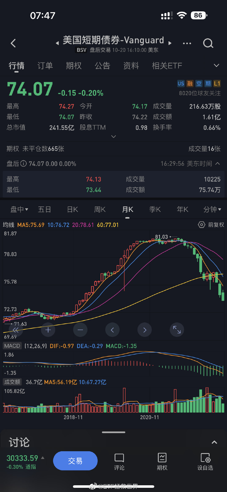 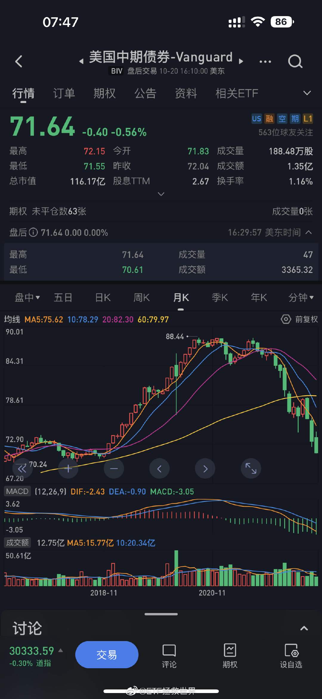 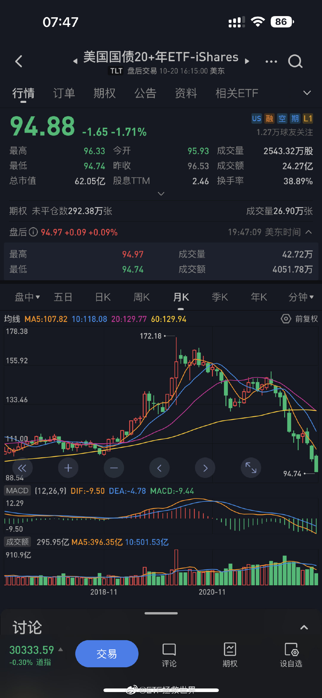 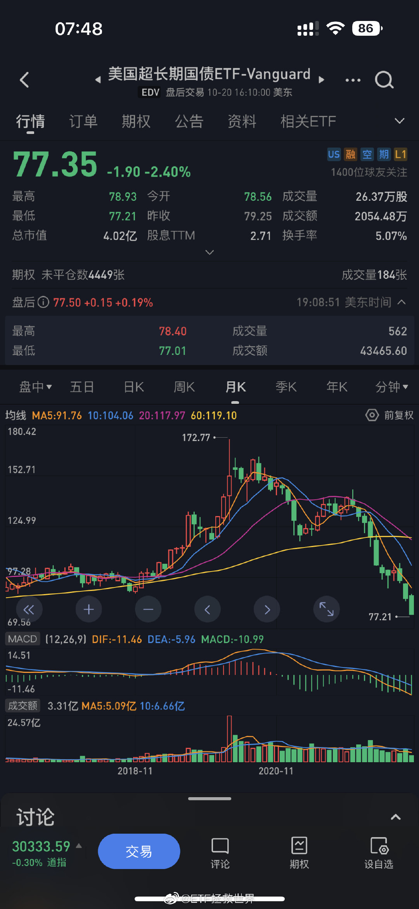

## 2022-10-21 08:05

回复@NEXUS-37:国债和股票完全不同。如果股票真有那么好赚，国债那么没有价值，为什么外管买万亿美国债而不是标普500。我喜欢荤素搭配//@NEXUS-37:这些见底，股票也大概率见底了

## 2022-10-21 08:14

回复@bruce小李:你买在某个收益率，不是说你就能赚那么多。很少有人买债券是为了拿账面收益率，而是吃与收益率走势负相关的波动。认真看图，观察债券波动//@bruce小李:回复@ETF拯救世界:收益率是这样，如果美元掉头向下，贬值个5%很轻松吧，就亏了吧

## 2022-10-21 11:09

第n次说，提款的时候站开一点比较好，没必要挤在一个位置，多挤的慌啊。

站舒服点，你好他也好。 ​​​

## 2022-10-21 11:45

Put your money where your mouth is. ​​​

## 2022-10-21 13:41

做客服阅读能力挺重要的 ​​​
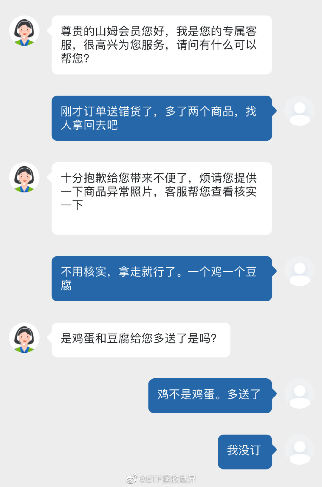

## 2022-10-21 16:16

主要得益于大中华区的强劲反弹和消费者持续的需求。

## 2022-10-21 16:48

回复@圆粒九九:没有，帮你盯着呢，放心。//@圆粒九九:对了老大，说到这了上次说的全球消费是不是还没买呢//@ETF拯救世界:主要得益于大中华区的强劲反弹和消费者持续的需求。

## 2022-10-21 17:41

这是两个基金持仓的品种，低位买入基金，不敢说赚多少，拿几十年养老问题不是很大。 ​​​
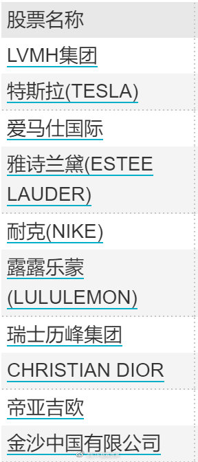 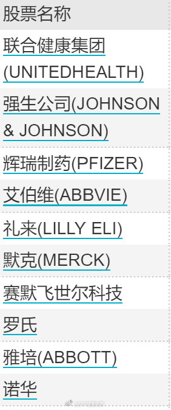

## 2022-10-22 16:20

在中心区域，根据Numbeo数据，2022年5月中国香港以218388元/平方米位居第一，首尔以150948元/平方米位居第二，伦敦以113551元/平方米位居第八，纽约以99640元/平方米位居第十四，北京、深圳、上海分别以134796元/平方米、124458元/平方米、124113元/平方米位居全球第四、第五、第六，广州以92699元/平方米位居第十七。

换算为使用面积后，北京、深圳和上海中心区实际房价分别为192566元/平方米、177795元/平方米和177305元/平方米，超过首尔，仅次于中国香港，广州为132428元/平方米，位居第八。

## 2022-10-22 17:10

刚才的摘录是任博士在财新的文章，《1000万元全球能买什么房子｜全球一线城市房价比较》节选。

这篇文章整体上算是很客观。从几大城市的房子位置，单价，换算为统一口径的单价，租售比，收入房价比，房产税物业费等持有成本，全面进行了对比。

我个人认为，数据比较客观，角度也比较全面。

还是老规矩，只看数据，不看最后的结论就好。结论自己思考后得出。

有免费全文地址的朋友可以帮忙在评论里贴出。

## 2022-10-23 12:40

其实如果没有生活压力，当然没必要挤去996，但也有不少其它事情可以做。不愿意动脑子的话网约车送外卖，愿意动脑子文字或者视频自媒体做一做，总比内心焦虑但是什么都不做玩游戏强。即使玩游戏也可以好好玩开个游戏直播。人总是要做点事情才能开心。

## 2022-10-23 12:49

昨天说的原文在这里有。感兴趣的朋友可以认真看看。数据比较客观，视角比较全面。

 ​​​

## 2022-10-24 09:50

吃了吗 ​​​
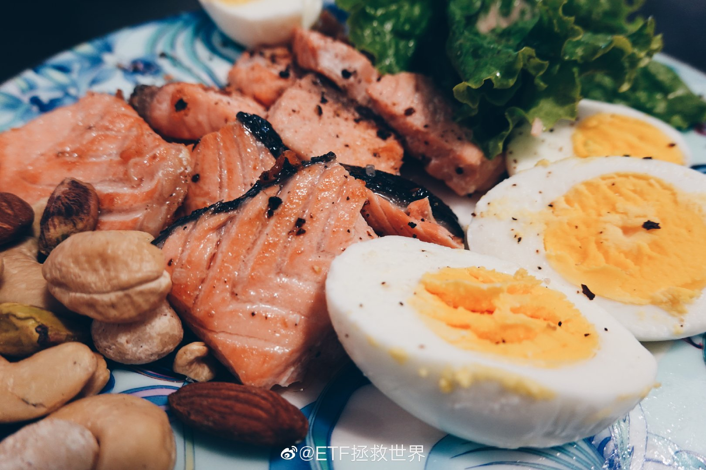

## 2022-10-24 09:54

前三季度，全国居民人均可支配收入27650元，比上年同期名义增长5.3%，扣除价格因素，实际增长3.2%。分城乡看，城镇居民人均可支配收入37482元，增长(以下如无特别说明，均为同比名义增长)4.3%，扣除价格因素，实际增长2.3%；农村居民人均可支配收入14600元，增长6.4%，扣除价格因素，实际增长4.3%。

----------------------------------

城镇居民人均可支配收入37482，等于每个月人均收入4164。依然以三口之家计算，家庭月收入12492，两个成年人均收入大致6246。

你的可支配收入达到6246了吗，如果你已婚，你的家庭可支配收入达到12492了吗。

如果没有，要努力呀。

## 2022-10-24 10:09

说实话国内这些大型互联网企业跌得跟科网泡沫的亚马逊比还是差了点。

图为后复权。

95%。

然后的亚马逊是图二的走势。 ​​​
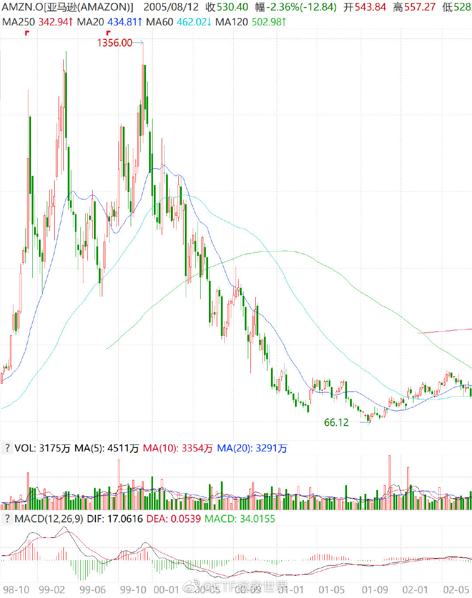 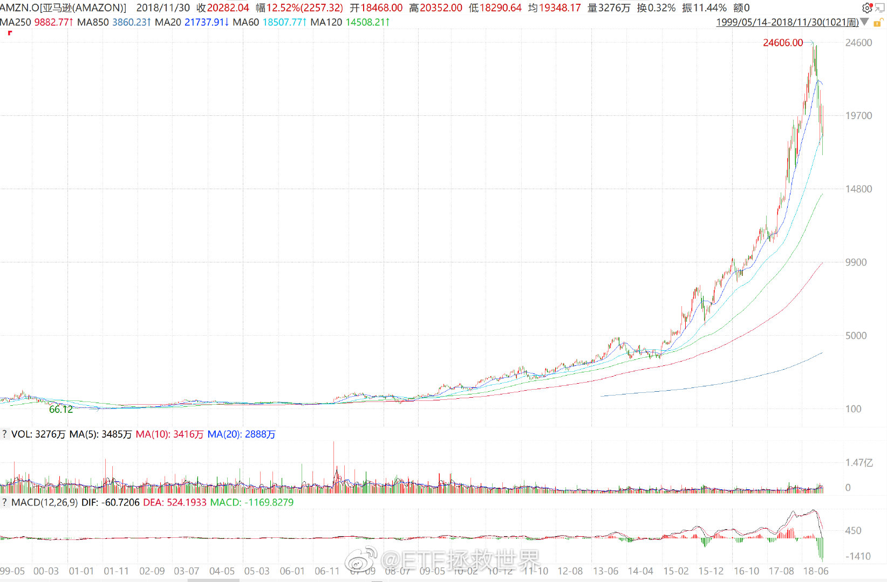

## 2022-10-24 10:20

非常有意思，我给你讲一讲哪里有意思。

现在的市场上，一定有未来的10倍，百倍股票。

但很少有人去买。

为什么？

因为，有胆子的早就买满了，没钱了。没胆子的有钱，但现在胆子更小了。

如果你又有钱，也敢买，那已经赢了大多数人了。当然，你之所以有钱，是因为你一路在忍着买。所以，你现在也不会all in。

慢慢来，不急。

现金不是辣鸡。再说一次。

## 2022-10-24 10:42

再贴一次。

另外增加一个内地消费的大支撑，在7700-7800左右（刚才写错了）。

我是把自己的研究成果免费分享给大家。未来对了你不用夸我，不对你也别骂我。这个时代，愿意旗帜鲜明说出自己想法的人不多了。

另外，如果像恒生那样，三十四十年的支撑都破掉，那么这些点位也撑不住。因为这些点位都是根据过去十几年的历史叠加基本面判断的。

如果撑不住我会怎么做，公众号最新一篇文章已经说的很清楚。
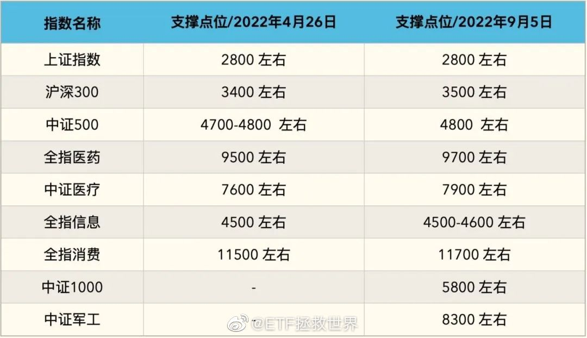

## 2022-10-24 10:56

消费与其它板块都不同。

这个板块，从2020年5月起，就完全脱离了十几年的历史轨迹，飞到了外太空。然后在这个月，也就是2022年10月，终于回到了正常区间。

这两年的疯狂，得益于年轻基金经理们的抱团拉升，结果就是在顶部区域吸引了比底部多十倍以上的资金。这些资金心里想着白酒永远涨，嘴里念着XX永远爱你，最终在顶部集结完毕。

好在，消费终于回到了正常区间。我们的正式布局也将在正常区间的后半段开始。

## 2022-10-24 11:10

成者王侯败者寇。

2007年最高点附近，你买入五粮液。一直到十年后的2017年才能回本。这十年你最多的时候浮亏70%多。

所有人，包括你的家人，你的朋友，网友，都会嘲笑你挖苦你。甚至可能包括你自己。

3年后，你赚了10倍。当你贴出持仓图，所有人都在跪拜你，你成了大神。你在家庭中的地位扶摇直上。

你变了吗，股票变了吗。都没变。但你在别人眼里却变了。

其实股市就是人生，场内场外，满满全是人性。

## 2022-10-24 11:24

体会越来越深的，是卖出非常非常重要。虽然卖出要比买入难5.39倍，但依然要努力做好。

没有完美的卖出策略。以我目前所能把握的，所能认知的最好卖出方式，应该是以基本面为基础，以技术面的右侧为主要卖出手段的策略。

如果未来我对于卖出的思考有了进一步提升，会继续分享。

目前为止，就是这样。 ​​​

## 2022-10-24 11:45

关于港股“长期下跌”

下图恒生自1979年至今的走势。

2018年创了历史新高，2021年，也就是去年，差点再创历史新高。

到现在，只跌了一年而已。

不知道长期下跌之说从何而来。

可以看到，恒生的历史特点就是波动极大，非常大，特别大。97金融危机，00科网泡沫，07次贷危机、11欧债、15股灾、20股灾，每次出事它都会暴跌。然后起来，然后新高。

（注意，恒生指数不含股息。加上股息涨幅会大很多）

很多人说的“长期”，短则三个月，长则一年。再长就不会看了。

当然，这次与以往不同的是，技术上已经完全没有支撑。看看会发生什么。

我依然按照各个策略操作，该买就买，该卖就卖。主动加仓不会了。最后一次主动加仓就是大支撑的致敬买入。
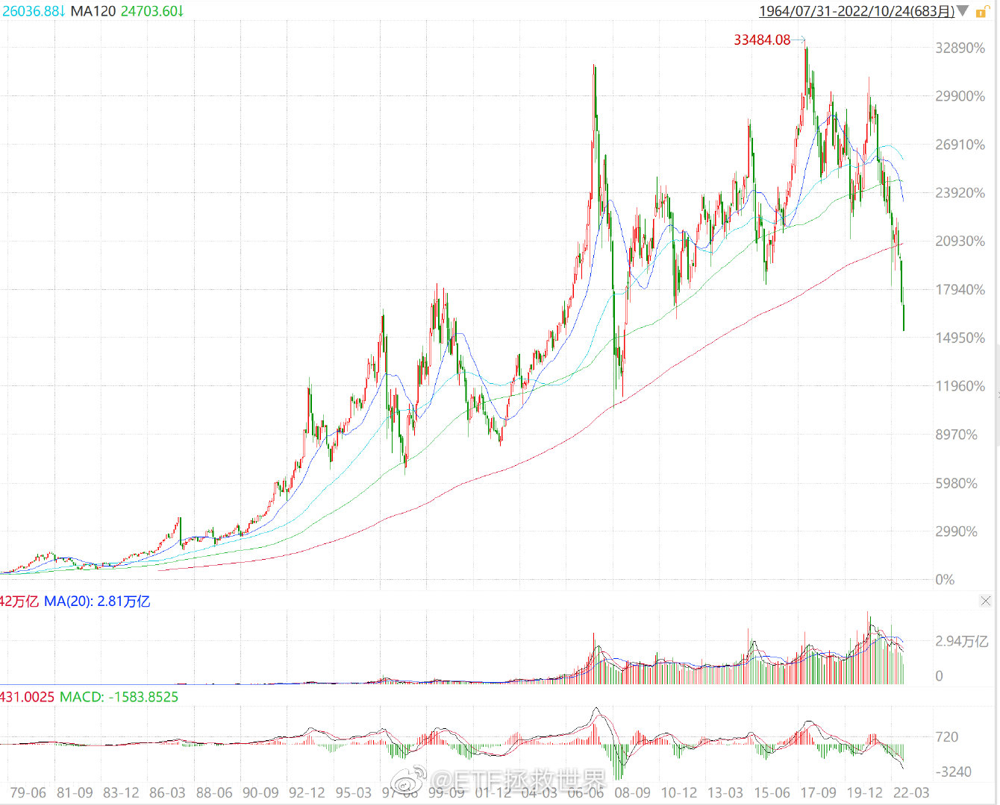

## 2022-10-24 12:04

印度今年还涨了2%。

我气笑了。

不是都说印度不行吗…… ​​​

## 2022-10-24 12:25

回复@等着老费来上海_love_pear:今年没跌的还有印尼、沙特、阿联酋、尼日利亚、挪威。主要是资源导向。还有通胀导向的委内瑞la、土耳Q、阿根廷、巴西、智利等都在名义上涨。日经、新加坡、澳大利亚、泰国、马来西亚跌幅不到10%。

## 2022-10-24 12:37

今年恒指成分股的涨跌幅前20： ​​​
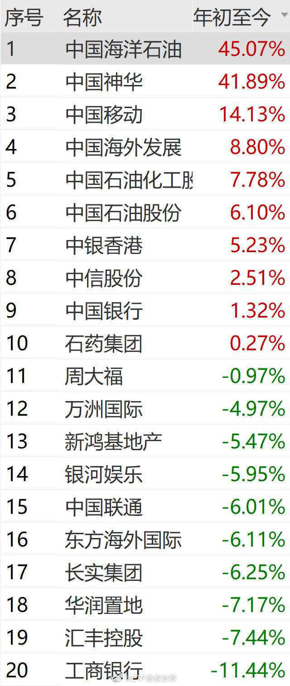 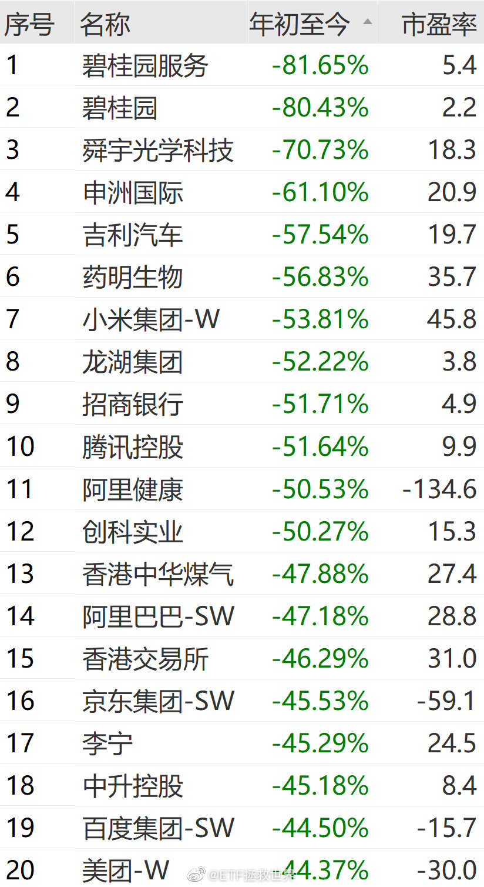

## 2022-10-24 12:47

截至今日，两市212家公司披露三季报，单季利润增速在35%+。

但是请注意，一般都是业绩好的先披露，不行的都会耗到最后一天。还有5天，就要全部披露完毕了。 ​​​

## 2022-10-24 13:11

如果医药有分散开然后已经提款的朋友，再挂跟上次一样的买入价接回即可。 ​​​

## 2022-10-24 14:27

这周有没有一点可能出现一个大奇迹日。

甭管反弹还是反转吧。 ​​​

## 2022-10-24 14:52

哈哈哈哈，今天又赔了好多。

MD，什么玩意儿。 ​​​

## 2022-10-24 15:04

上眼药是吧。 ​​​
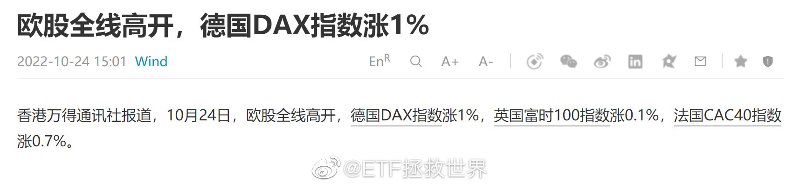

## 2022-10-24 15:44

今日数据：好消息，食品饮料市净率已经即将跌破4倍了！去年初最高9倍，历史最低3倍左右。

## 2022-10-24 19:16

朋友，我有几句话不知当讲不当讲。

第一，对未来80%的焦虑都是没有意义的。我相信经历事情越多的朋友，越能体会。

第二，身体健康，一家人整整齐齐最重要。

第三，有稳定的收入，有足够温饱的一日三餐，有稳定的住所，已经非常幸福。

第四，剩下的财富当然要尽力争取，但不要让波动太过影响心情。你买的品种不会死，你没有单吊一只股票，你没有加杠杆券商没有打电话给你要求补充保证金，你还有足够几个月几年生活的现金，股市你就让它波动吧。

说完了，要骂我出气的就骂吧。我不拉黑。

## 2022-10-24 20:04

你有没有考虑过一个问题，为什么我们这样的泱泱大国，没有体育产业。

我不是说奥运会成绩，而是说体育作为一个产业，能带动工作机会，带动消费的一个产业。

美国的体育产业不用说了。棒球、篮球、橄榄球，每一个都形成巨大的产业链，同时塑造文化影响力。

欧洲不太了解，但各个国家尤其是英国德国意大利西班牙等国的足球联赛和足球体系带来的工作机会，消费，关注度都极高。

我们国家有足球和篮球联赛，但始终不成气候。明明都是群众喜欢的项目，但不仅没有成体系的低等级联赛和深入社区的低等级球队，连最顶级的联赛都半死不活。即使是最兴旺的那几年，从转播到周边产品可以说聊胜于无。

制造业当然重要，但不能所有人都去干制造吧。体育、影视、娱乐这些产业也很重要啊。总不能所有人都去搞芯片和新能源吧。

所以，为什么我们国家的体育产业发展不起来？

## 2022-10-24 21:59

现在的情况，跟价值，跟技术已经没有关系了。 ​​​

## 2022-10-25 07:28

刚才我看有个评论，说实体经济不行，都是互联网公司搞的。跌的好。

谁不想跟爱人朋友家人一起其乐融融一边逛街一边买？但你看看普通商场里的东西，那是你能买得起的吗？更不要说同一件东西这家卖十块那家卖一百，你耗的起时间精力吗。一个东西标价100，你可以从10块开始砍价，对于不喜欢砍价的人来说，是不是就应该做冤大头？

你是否去过没有JD时候的中关村买3C？我直接告诉你，那就是奸商的天堂，消费者的噩梦。

实体消费上不去怪谁，怪猫怪狗怪多多吗？你不如先问问房东收了店家多少房租再说吧。

没有了电商平台，实体消费可能会起来点，但消费总额一定会下降。很多人买的东西一定会少很多。你信不信？没有消费，你生产的东西卖给谁？一鲸落万物生？直播没了李&amp;wei，那段时间谁起来了？很多妹子们直接不看直播不买了。

更不要提平台员工，快递行业从业者等一系列上下游相关人员的生计问题了。

互联网平台不是罪恶，企业家也不应该成为敌人。说完了。

## 2022-10-25 08:04

我一般发言都非常谨慎，正常情况下不会出什么问题。

只是希望各位在评论的时候，也能稍微注意点。如果因为您的评论我消失了，那也是挺遗憾的一件事您说是吗。

活着比什么都重要，因为只有活着才能做事情，才能完成理想。

大家互相支撑着活下去。 ​​​

## 2022-10-25 09:03

最近两三年开始投资的朋友，怎么说呢，

你们对市场的见多识广超过我之前十年的积累。

瑞思拜。 ​​​

## 2022-10-25 09:24

之前我说过某股我会在某价位致敬。

现在快到了，我就会买。

但我不会贴出来，因为股票和基金不同，太敏感了。风险也高，不想误导别人。

那你说我就是嘴炮，没买，就是扯淡，也行。嘴炮就嘴炮吧。 ​​​

## 2022-10-25 09:32

红利条件单由于分红导致价格变化已经全部强制作废。

新的价格之后会更新。

做事情就要负责到底。 ​​​

## 2022-10-25 09:41

除了机械执行或者到了极为关键点位的品种，我不会没完没了的主动加仓。

因为我家没矿，我的资源有限。

能够继续执行策略就足够了。 ​​​

## 2022-10-25 09:46

红利场内基金每年提款2-3次，每年分红3.5%-4%左右。

如果每年都能保持这个节奏，非常舒服啊。 ​​​

## 2022-10-25 10:48

每天上新股，现在排队的还有几百家。

不是说这几百家上完了就完了，而是永远有几百家。

今年A股融资额已经世界第一了。只要股票能发出来，可能明年后年也是第一。

服务实体经济，A股说到做到。

希望重要股东们减持股票改善生活的同时，能好好经营企业，让中小股东也喝口汤。 ​​​

## 2022-10-25 11:07

消费在14500以上都会按照右侧模式买。

14500以下可以考虑左侧适当买入。 ​​​

## 2022-10-25 11:19

Dead cat bounce. ​​​

## 2022-10-25 11:22

今年本来想买点美元（港币联系）币种资产对冲本币下跌风险，

结果被冲了。 ​​​

## 2022-10-25 11:28

红利条件单已经更新。

可以在历史记录，有异常终止标记的单子里重新创建重新设定价格。

一定要重新设定价格。切切。 ​​​

## 2022-10-25 11:59

有朋友说，分红没意义啊，左手倒右手啊，分红除权啊，市值不变啊。

不是这样的。

对，分红当天除权，价格会跌。但是，这个股票，或者这个基金持仓的股票价值基本是不变的。假以时日它会涨回除权前的价格。

我给你看一张图吧。

下图是中证红利指数，和中证红利全收益的对比。后者（紫色）包含分红，前者不含。

分红，是股票收益中非常非常重要的一个组成部分。（包括现金分红、回购股票等）
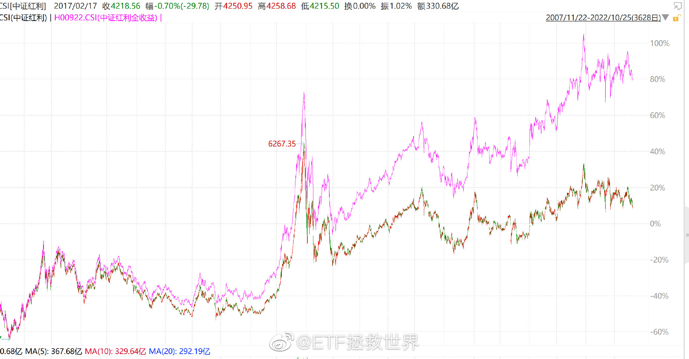

## 2022-10-25 14:10

虽然现在还在下跌阶段，但我说几句近期的心得。

无论不死的品种怎么跌，最终都会见底。也就是说跌起来是有底的。鹅厂跌的多不多？其实也只是跌回了2017年而已。

所以只要不犯大错，只要不低位割肉，只要不上杠杆，只要用各种策略吃进低位品种，最终的持仓状态大差不差。

但最关键的就在于卖出。这几天已经说了几次这个问题，我觉得还得再说。因为这几天一直在思考这个问题。

卖出确实非常难。它不是说啊我赚钱了我止盈就行了。不是这个概念。

为什么，因为也许你买了个十倍品种，你赚了20%，30%，啊，赚钱了，止盈。结果眼睁睁看着十倍。这种痛苦或者说机会的丧失可能一辈子都无法弥补。

所以不能随便卖。但你不卖又有可能坐过山车。

决定卖，卖多少也是问题。

你经常会在网上看到人吹，啊，我高位跑啦。他不会说他买了多少，跑了多少。也不会说跑了以后买了什么又掉坑里了。

没那么简单的。

## 2022-10-25 14:40

为什么和平时代很难诞生文学和思想大师。

因为不够痛苦。

只有痛苦和挫折，才会让人思考，才会逼迫自己的才华迸发。 ​​​

## 2022-10-25 14:49

2006年至今，年化收益率在10%以上的指数有两个：消费（16）、医药（12）。

7-10%的有4个：500、1000、红利全收益、养老。

5-7%的有：信息、800等权、200、深100。

剩下的要么时间短，要么收益率是真不行。

注意，以上收益率都是在如此低位统计的。如果在高位，每个品种年化收益率+4%-6%。 ​​​

## 2022-10-25 16:21

最近别给我发私信了。这一段时间不打算看。

博主我啊，也是个面对指责内心脆弱的猛男宝宝呢。

情感类生活类博主要失业一段时间了。

4点多了，一直在摸鱼的稍微去干点活儿，一直在卷的去饮茶啦！工作是为了活着，活着不是为了工作！

明！天！见！ ​​​

## 2022-10-26 09:53

中药又大涨了，医药基金也跟着喝点汤。

突然想到一个话题，这个话题是热门话题，但我从来不碰。

就是关于中医中药的问题。

我今天依然不碰，但我想从更高的层面说两句这个问题。

如果我们抛开中医药是否有效的问题，去观察网络上的中西医之争，你在更高处看，往更深处挖掘，其实双方表达的东西是：

一方希望保护民族自己的传统，不希望全盘xh。作为一个有着悠久历史，也曾辉煌过的民族，有着强烈的民族自豪感。在这件事上，一方面希望传统延续，一方面体现民族自豪感。当然，同样重要的是相信老祖宗传下来的这些东西是有效的。

而另一方则更倾向于科学。用xf的研究方法、体系、化学、物理去论证，实际上体现的是一部分人希望融入更加文明世界的理念。

实际上，在我的认知中，在这一层次，以及更高的层次中观察以及推理，与大部分朋友所想的不同，这两种理念都没有错。全面放弃自己的东西，没有传统，在世界民族之林中完全变成一个追随者，那这个民族绝对没有任何希望可言。同样，固步自封，唯我独尊，不接受科学，也必将永远落后。

其实问题的本质，并非中医中药本身，而是对传统的态度。

## 2022-10-26 10:07

YY条件单真的很渣。

你满怀希望的时候即将成功的时候它扭头就走。

你即将放弃的时候它给你打电话撩你让你觉得还有希望。

什么玩意儿。 ​​​

## 2022-10-26 10:17

月底横竖都要买点什么了。 ​​​

## 2022-10-26 10:52

对不起，这不是我想象中的大奇迹日。大奇迹日指数至少波动在8%以上吧。废柴市场。

## 2022-10-26 11:36

有朋友希望我拉黑某个账号，但这个其实很难决定。

为什么，虽然你知道他在引流，我知道他在引流，大家都知道他在引流，但他毕竟也没骂人，也没违反社区规则，也没有证据做了非法的事情，也没散播恐惧影响大家的交易情绪。

那你说，客观上说，他只是在频繁评论。如果因为频繁评论拉黑，那么别说钻粉了，金粉等级高的也有很多朋友跑不掉吧。

我拉黑一个人很简单，但是拉黑这个功能怎么才能做到公平、有理有据、不随心所欲，是挺难的。

当然了，如果继续下去，引起大多数朋友不适，或者有迹象表明在骗钱骗色，那该拉就拉。

我欢迎朋友们来我这里玩，但做事情讲究一个度，过度就不好了，是吧。

## 2022-10-26 11:46

从刚才说的拉黑，我又想到更深层次的问题。

我觉得恐惧这个东西其实非常有意思。

为什么我们在晚上，黑夜的时候会感到恐惧，因为黑夜里看不见东西，充满未知。恐惧其实来源于未知。

什么东西不会让大家感到恐惧，是明确。明确的规则，明确的奖惩，明确的准入和禁止，是能看得见摸得着的规矩。

如果模模糊糊，也许行也许不行，今天行明天不行后天又行了，行或者不行全看心情，那就有点让人恐惧。因为充满未知。

一点思考，不一定对。

## 2022-10-26 14:07

不便宜的东西，不断的阶段新低，没必要接飞刀。

新低不买适用。 ​​​

## 2022-10-26 14:10

这一网怎么回事，

让大家爽一下不行吗？

服了。 ​​​

## 2022-10-26 14:51

看多了B站上介绍灯塔房子的视频，

最让人羡慕的不是价格问题。

而是几百万人民币的房，房子本身不说了，社区环境整洁幽静的同时又不荒凉。

努力建设祖国，我们也要过好日子。 ​​​

## 2022-10-26 19:57

爱各位。

但不会爱的很用力。

因为越极端的爱，越容易变成最极端的恨。

有在淡淡的爱。 ​​​

## 2022-10-26 22:34

该说不说，大部分主动行业基金还是有点东西的 ​​​
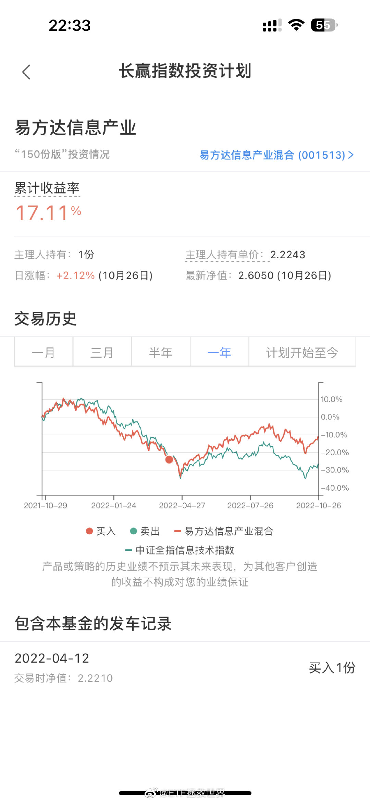 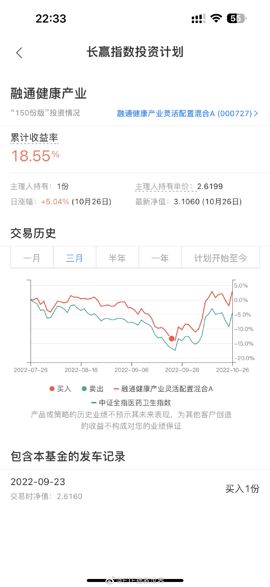

## 2022-10-26 22:46

主动行业基金不等于主动基金。

主动基金并不好选，很多朋友投资没几年，觉得掌握了选主动基金的圣杯。但时间久了你会发现，之前好不代表未来好。更别提经理们动不动就辞职走人了。

另外，现在有上万只基金，真有那么容易吗。

行业就不同了。记得我昨天那个名单吗。你需要关注的指数，不超过十个。超过五年投资经验的主动行业基金，每个行业不超过十个。是不是觉得好分析多了。

一个系统中，变量越多，越容易出错。

所以说过好多次了，再说一次，我会适当买一些主动行业基金，以及增强指数基金，但不会买主动基金。 

注意我说的，我不是说主动基金经理都不行。我说的是，不容易选。

## 2022-10-27 08:30

第一，任何人都不是完美的。

只要你愿意，努力找，你就能找到任何一个人的错误。一句话说错了，一个点位判断错了，一个玩笑开得不合时宜。

如果实在找不到，你还可以扭曲事实，编造谎言。总之你想搞臭一个人，终究是有办法的。而且你说，就会有人信。

总之，没有人经得起显微镜的透视。

第二，就事论事。

争论事情就争论事情，扣帽子没必要。网络风气如此差，难道与随便扣帽子没有关系吗。这样下去谁敢再说自己的观点。

一件小事随便上升到阶级，上升到敌我这种斗争方式，深深的植根于很多人的意识深处了。

第三，断人财路如杀人父母。人为财死，鸟为食亡。

人总有自己最在乎的东西。有人在乎钱，有人在乎名，有人在乎权，有人在乎命，有人在乎感情。一定要夺走别人最在乎的东西，那别人拼命也就不奇怪了。

特殊时期，还是不要搞事情吧。踏踏实实做好手里的工作。否则走到无法收拾那一步，亲者痛仇者快，只有吃瓜群众笑哈哈，没必要。

## 2022-10-27 09:05

经济是什么，经济是社会科学。

社会科学的一个特征是什么，就是不精确。

社会科学包括的几个大类：经济、历史、zz等等，就没有一个是可以像数学、物理、化学等自然科学那样有定理，有公理，有精确体系的东西。

何况自然科学还经常修正前人以为绝对正确的观点。

历史不用说了，很多时候就是史官几个字，事实的真相就永远湮没在浩瀚的历史长河中。而且，所谓的真相，谁又能说得清。昨天、上个月发生的历史，真的作为见证者的我们，就能知道真相吗。比如，想想这些年你看到过有名的大案子，真相是什么？历史又会如何记录？

ZZ更是不精确。这个我就不深说了。

经济，很多人觉得商学院的学生，用马科维茨的模型，用让人眼花缭乱的高等数学公式算出来的资产定价一定是科学了吧。呵呵。

很多朋友总是问，今天为什么跌啊，今天为什么涨啊。

这话一出口，你就知道两点。第一，他是个小白。第二，他依然信仰市场是科学的。

你别看资本市场这么不科学，相对来说它还算是比较科学的了。再往上的微观经济、中观经济、宏观经济，是越来越模糊。

为什么，因为变量太多。股市的波动有货币、价值、情绪因素来干扰，还比较容易解释。再往上的那些，变量越来越多，很多时候根本无法解释无法弄清楚。

所以宏观的事，说不清，道不明。能掌握一些基础的知识，能看清货币政策走向，能看懂基本的数据意味着什么，能大致分析出所处的周期阶段，就行了。

这个问题没有绝对的对错，多看过程，少看结论。

因为这是一门社会科学。

## 2022-10-27 10:23

贪财好色。

正是本人。 ​​​

## 2022-10-27 10:40

继续新低，继续新低不买。所以新低不买，新高不卖，是有适用范围的。参考前几天的解释微博。

## 2022-10-27 11:45

无数广西李姓老公开始接受连夜审问。

## 2022-10-27 13:07

这是我2021年初做的新闻收藏。

大家有什么感想。 ​​​
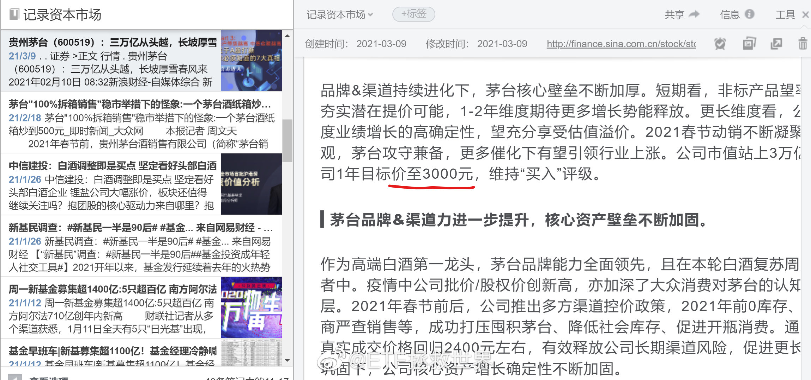

## 2022-10-27 14:02

致敬后新高，新高不卖适用。 ​​​

## 2022-10-27 15:00

再看一篇对于基民来说更重要的：明星的价值毁灭。

## 2022-10-27 15:05

回复@董二啦:他们弄的那个热门排行榜，引导大家买热门，只有两个可能：第一，是根本不懂投资的人设计的。第二，不说了。//@董二啦:支付宝上面，啥涨的好推荐啥//@ETF拯救世界:再看一篇对于基民来说更重要的：明星的价值毁灭。

## 2022-10-27 15:14

刚才有朋友说，微博可以禁止新关注。哪位卧龙宝宝知道在哪里设置？ ​​​

## 2022-10-27 15:18

根本就没有这回事，群众中有骗子。 查看图片

## 2022-10-27 15:25

我反思过去，不是像有些人说的，我显摆自己说对了。

对了错了，有屁用？不要用你的低等级思维来想我。

我的笔记里有一个分类叫做“记录资本市场”。我会把我认为在关键节点的一些，我看来不正常的新闻记录在里面。过一段时间，结合市场走势，再回头不断分析历史，这样，下一次再有类似的情况，就大致有了判断方向。

我分享给大家，与大家一起不断的回顾，不断的提高。在喷子眼里，就是在不断的炫耀。

怎么说呢，有些人这辈子也就只能当个喷子了吧。

## 2022-10-27 15:30

回复@翻滚的炸猪排:我一直说，我最大的作用，是为很多朋友节省了十几年的有效投资时间，能提供一些通过大量时间交易和思考才能得出的经验。能有多少人受益就随缘了。

## 2022-10-27 22:15

是不是软件出问题了 ​​​
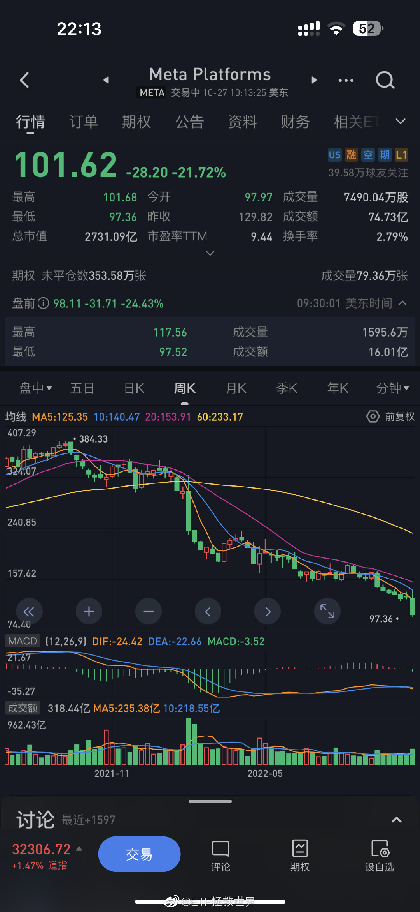

## 2022-10-28 09:01

看到一个帖子，说建议买房买车不要在朋友圈群里晒。

有很多人评论，就要晒，他们以前看不起我，现在就是要让他们难受。

其实要我说，没必要真的。

做一件事始终要衡量利弊。非要晒，得到了什么，大部分人的嫉妒，怨恨。弄不好让某些小人不舒服了，以后有机会就会捅你一刀给你小鞋穿最不济也有可能嚼舌根造你的谣。

要知道，一般人是不会嫉妒杰克和波尼的。但如果有一个之前跟自己一样，但突然变有钱的朋友，大多数人心里会不舒服。当然，要变得特别有钱，像杰克一样，那又无所谓了。

我希望你变好，但不要比我好，是大多数人的心态。

还有，你那么有钱了，借我一点好吗。你借不借呢。借了，可能打水漂，不借，又是一地鸡毛。何必给自己找麻烦。

晒这晒那，也并没有达到自己的预期，没有打谁的脸，反而可能为未来的危机埋下了伏笔。

另外，你有没有想过，为什么你TZ内的朋友，几乎从来不发朋友圈？

## 2022-10-28 09:33

消费也回归了。先是酱油，然后白酒，然后牛奶。回来了，全都回来了。

## 2022-10-28 09:55

我话先说到这儿，各位以后不要来质疑我。

比如消费，如果未来反弹，我16000买，你不要问我为什么15500不买，16000买。

我说了，某个点位上会右侧，某个点位下会适当左侧。

懂就懂，不懂就算了。烦死了。 ​​​

## 2022-10-28 10:09

尤瓦尔赫拉利的《人类简史》中说，人类就是因为会讲故事，所以能有共同的愿景和信心，最后才能做成其他动物做不了的事情。

金融就是一个故事。只有我们相信银行会把钱连本带利还给我们，相信股票能越涨越高，我们才会去存款和投资。

股市上也有很多故事。你会听到媒体、机构、网友，不断的给你讲各种故事。公司的故事，行业的故事。

你信过，伤得很深。你不信，赚不到钱。

这里，又要搬出那段经典：世界经济史是一部基于假象和谎言的连续剧。要获得财富，做法就是认清其假象，投入其中，然后在假象被公众认识之前退出游戏。

在这里，可以把“经济”改成“公司”或者“行业”或者“风口”。

跟着热点跑追逐利润没有错。但你要深刻认识到，什么是故事，什么是讲故事的人，什么是真相。

## 2022-10-28 10:21

但是我要说一句，各位，我觉得很重要的。

好公司，在这个市场上，不超过30%，或者20%。换言之，剩下的70%-80%都是辣鸡。

好公司波动后会涨回去然后新高，辣鸡会一辈子没有希望。

不知道为什么，买了那些好公司好行业，我心里会特别开心。跟它们涨跌都没有关系。

就觉得那么好的东西我也有一份，真好啊。

## 2022-10-28 13:17

有钱不要急。你有钱就是因为不急，不要随便放弃优势。 ​​​

## 2022-10-28 13:35

消费最终我希望配到10%+仓位。

你怎么说。 ​​​

## 2022-10-28 13:44

有些品种只能机构之间互相玩。

涨起来大家都不卖然后不停买拉到外太空。跌起来看谁跑得快。

小散户是不会接盘的。一手十几万，怎么玩。 ​​​

## 2022-10-28 14:44

长期价值投资者们已经开始抛售了。 ​​​

## 2022-10-28 14:54

消费从17400开始，已经回归了正常的价格区间。

从2020年5月到2022年10月的一波抱团炒作闹剧，终以一地鸡毛收场。

记录一下，留念。 ​​​

## 2022-10-28 15:34

2018年3月，深综指与现在一致，但全市场PB下降了29%。

再往前是2016年4月，全市场PB下降了44%。

这是什么意思呢，

意思就是，看起来点位没变，但你能买到的东西越来越便宜了。

至于买便宜东西到底比买贵的东西好在哪里，以后你就懂。 ​​​

## 2022-10-28 20:14

其实人和人的差距就是从如何打理手里的钱拉开的。

你可以去买个LV的包，也可以去买基金理财。不用多久你就会发现，

买LV的升值了10%，买基金的赔了一半。 ​​​

## 2022-10-28 22:22

我们有可能出现自己的麦当劳宝洁和可乐吗。 ​​​
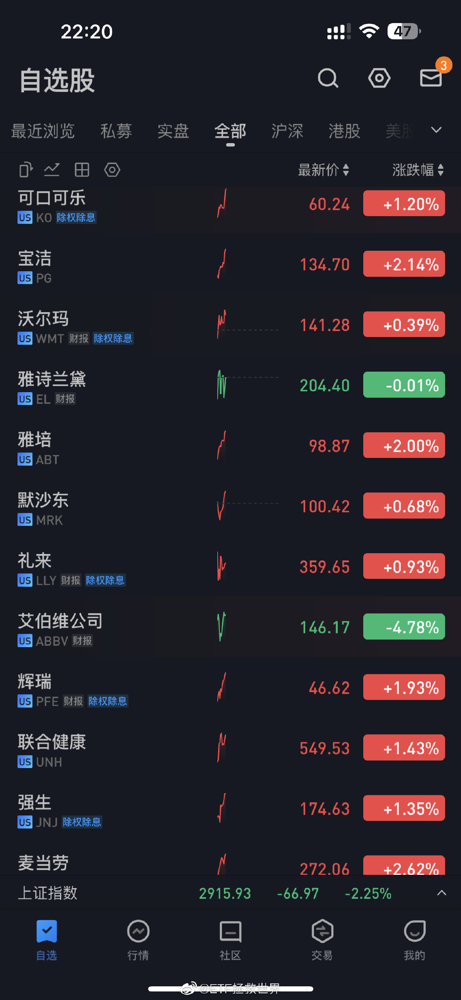

## 2022-10-28 22:46

冷知识：

今年中概跌幅超过俄罗斯。 

更冷的知识：

去年俄罗斯涨了15%，中概跌了51%。 ​​​

## 2022-10-29 10:53

一本书不可能每句话都是正确的，就像没有一个人是完美的。

但无论是书还是人，能让你了解你不知道的事情，让你想到没想过的东西，让你有了一些进步和收获，那就够了。

岂止是够了，简直是要非常开心，非常值得感谢。

你想想，你看了很多书，认识很多人，真正帮你成长的，又有多少。大多数书和人，只会让你觉得聒噪和荒废时间。

## 2022-10-29 19:28

斯人，是人。

吵了好几天了。

实在忍不住了，是不是都吃饱了撑的，真的没有更重要的事情了吗？

疯了。 ​​​

## 2022-10-30 17:32

感觉自己越来越没有心情操心别的国家那些破事儿了。

先想办法过好自己的日子吧。 ​​​

## 2022-10-30 21:54

拼尽全力去改变能改变的，

躺平接受所有不能改变的。 ​​​

## 2022-10-31 09:27

目前这种情况，我不会左侧买入。 ​​​

## 2022-10-31 09:44

虽然我吐槽了两年消费，

但说句心里话，

如果消费、医药这些行业没戏，再加上相对来说最有活力最具创新的数字经济没戏，那A股剩下的公司就几乎没有任何长期投资价值了。

有的，只是阶段性的炒作价值。

注意，我的前提是，如果那三个行业没戏。如果它们还有能撑得住，说明股市还有点长期投资的希望。

## 2022-10-31 10:16

再说一次，如果家里没矿，管住想要抄底的手。

如果有交易计划，按照计划做。如果没有，不要随意接货。

很多情况要多维度思考。 ​​​

## 2022-10-31 10:36

今日买入的波段品种一会儿更新表格。

这次我们给它多一点利润空间。10%如何。

你这边怎么说。

记得改历史卖出单。 ​​​

## 2022-10-31 11:32

我坚定认为未来永远是不确定的。不像很多人坚定的认为这样，或者坚定的认为那样。

未来也许会这样或者那样，赌对的人当然大获全胜，但赌错的人呢？

我考虑的不仅是这样与那样的概率，还有极端情况出现后的应对之策。

好在人类的历史够长，也不用看更远，过去100年就已经有无数极端情况做例子了。

既然已经有了例子，就想办法应对这些风险，保证自己活下去。

那句座右铭永远有效：

尽力改变能改变的，躺平接受不能改变的。

躺平之前，其实还有很多可以做的事情。

## 2022-10-31 13:43

一个Dead cat bounce不容易改变什么。

解铃还须系铃人。 ​​​

## 2022-10-31 14:54

我的父辈这一代，在我这个年龄的时候，赚的钱没我多，享受过的好东西也只有很少。

曾经我以为是自己比他们聪明，能力强。

后来才发现，那不过是时代的馈赠而已。 ​​​

## 2022-10-31 21:55

跟车人数减少了10%。

有内味儿了。 ​​​

## 2022-10-31 22:42

同一只股票的日线 周线 月线。

大家可以考虑一下，出现什么样的形态可以考虑跑路。 ​​​
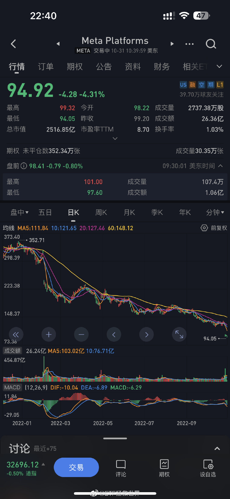 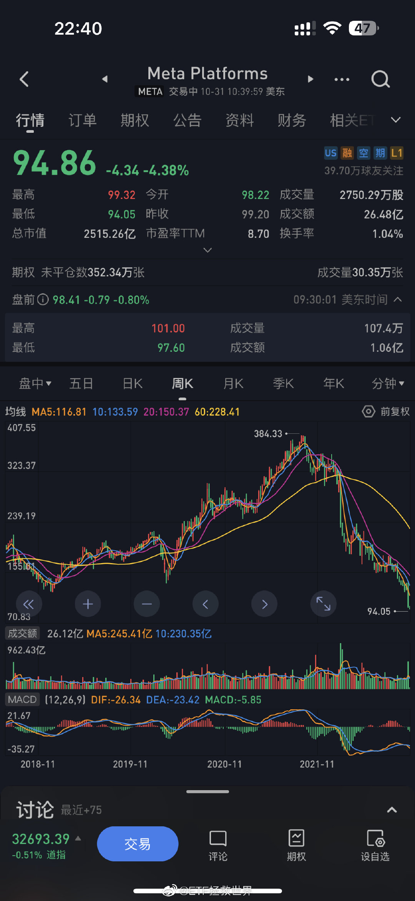 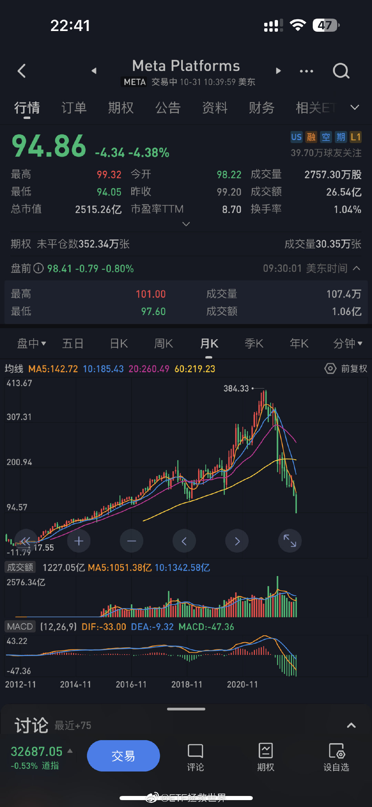

