## 2022-11-01 10:06

右侧会损失底部的几个点，甚至十几个点收益。

但是会规避下跌几十个点的风险，同时也能拿到筹码。

那位朋友问了，那如果短期暴涨几十个点，没来得及右侧进场就跌了怎么办。

所以我们左侧买一部分啊。

总是追求最完美的，反而得到的是最坏的结果。次优的结果，或者说不坏的结果，就已经很好了。

你体会一下。

## 2022-11-01 10:26

今年最大的收获就是破除了心魔——涨了不想买。

既然到过2块钱，为什么2.2再买？

这就是我以前的心魔。

总认为抓住最低点的2块是应该的。

现在完全不同。只要符合买入标准，应买尽买，不会再考虑之前的低位价格。当然，也不可能涨太离谱进去接盘。 ​​​

## 2022-11-01 10:31

破除了心魔后，就会有几个好处：

第一，不会因为好东西涨了一点就放弃，不买。

第二，不会没完没了的下跌补仓，想要抓住最低位。（抓最低更多使用关键点位）

一切源于想清楚了一个点：

如果下跌过程中的2.2买入，跌到2见底可以接受，为什么2见底，上涨过程中的2.2买入不能接受？

当然，这个心魔的破除，还与网格条件单不停的已经在进行机械左侧有很大关系。

## 2022-11-01 10:34

昨天的沪深300最低3495.95，与支撑差4个点。但目前我对这个品种兴趣不大。

## 2022-11-01 10:56

看过我十年前博客的朋友都知道，我很在乎三个维度：估值、情绪、资金。

估值和资金不用说了。

情绪方面，2015年开始，中证登公布的各种数据大幅减少，之前建立的一整套观察体系全部作废。

不过这些年，我又渐渐的摸索出了一些门道。目前的生态，数据不太容易获取，但情绪性的信息还是很多的。

比如，昨天说的跟车人数下降。上次下降发生在3月。（7月跟车人数创了历史新高。还好那次买的纳指生科目前盈利十几个点。但那又是市场高点）

比如，投资论坛互相吹捧、攻击的频率和力度。

比如，投资者对于基金经理或者大V的态度。（非常重要。结合基金经理的风格、持仓，有实质性的操作指导价值）。当一个基金经理或者大V的人气到达顶点的时候，他的持仓就岌岌可危甚至会发生灾难。反之亦然。

比如，基金的销售状态。

还有很多，不一一列举。观察这些不是看热闹，而是切切实实对交易有着极其重要的指导价值。

## 2022-11-01 11:10

成熟市场的品种艰难的加到了3个多点。当配置超过5%，就可以开始影响整体收益。

目前想配未配的，有纳斯达克，全球医药、全球消费。标普科技也可以酌情配置。

当然，主要肯定依然是标普500。够稳。

唯一的希望，我们配置的时候各公司依然有外汇额度。 ​​​​
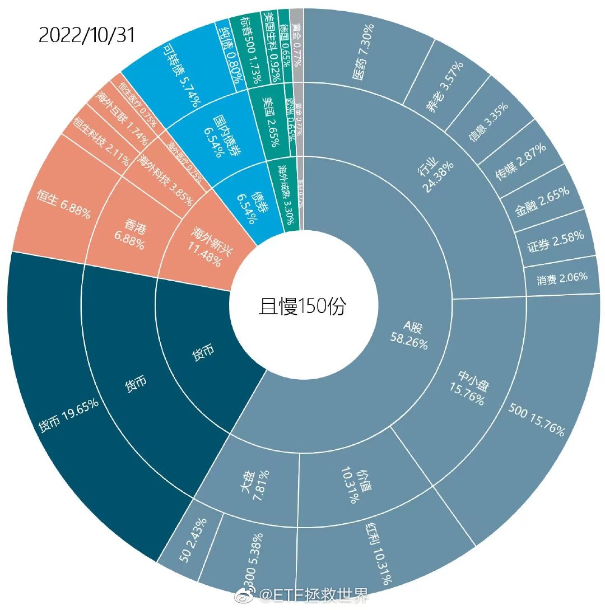

## 2022-11-01 11:20

回复@提桶跑:是。较强压力5900-6300。终极压力7500左右。//@提桶跑:E大 信息又到了五千了，5900还是压力点吗

## 2022-11-01 12:49

低调保平安。 ​​​

## 2022-11-01 13:14

我说句可能很多朋友不同意，甚至可能生气的看法。

有多套住房的，或者人均套内面积40平米以上的家庭，超过部分收房产税也未尝不可。

只是自己的一点不成熟的想法，不喜勿喷。

但最重要的是公平。不能有人收有人可以不收。 ​​​

## 2022-11-01 13:43

就是喜欢这几个行业。谁喷也不好使。这几个行业才是长期的中流砥柱。

## 2022-11-01 13:47

嘴里说着ZY，心里都是生意的典型例子：

嘴里：医药长期YYDS！

心里：再涨点让兄弟们提一网。 ​​​

## 2022-11-01 14:31

今天收盘后，

全年新买入的医药品种：

恒指生科跌幅28%，我们浮亏大概2.5%。

纳指生科跌幅3%，我们盈利13%。

全指医药下跌22%，我们融通健康盈利17%，大摩浮亏5%。

如果你在美国、香港、A股买医药，都能取得很好的成绩，只能说明一个问题：

我们跟医药有缘。有缘就要珍惜，就得继续对它们好。 ​​​

## 2022-11-01 14:38

纳指生科成分股： ​​​
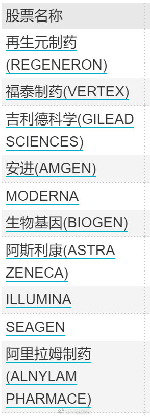

## 2022-11-01 14:50

虽然晚了两天，但指数涨停才像点样子。//@ETF拯救世界:对不起，这不是我想象中的大奇迹日。大奇迹日指数至少波动在8%以上吧。废柴市场。

## 2022-11-01 14:58

有些朋友现在就慌了，不用慌。

牛市多暴跌，熊市多暴涨。涨一天两天说明不了什么。

你有没有制定好的投资计划。有，执行就行了。涨了你收割，跌了你拿筹码。

涨涨跌跌多大点事儿。

那位朋友说了，我没交易计划啊，我就是看心情操作的。

你出去。 ​​​

## 2022-11-01 16:37

如果今晚美股大涨，就是完美的一天了。 ​​​

## 2022-11-02 07:05

元气满满，准备与生活战斗。 ​​​
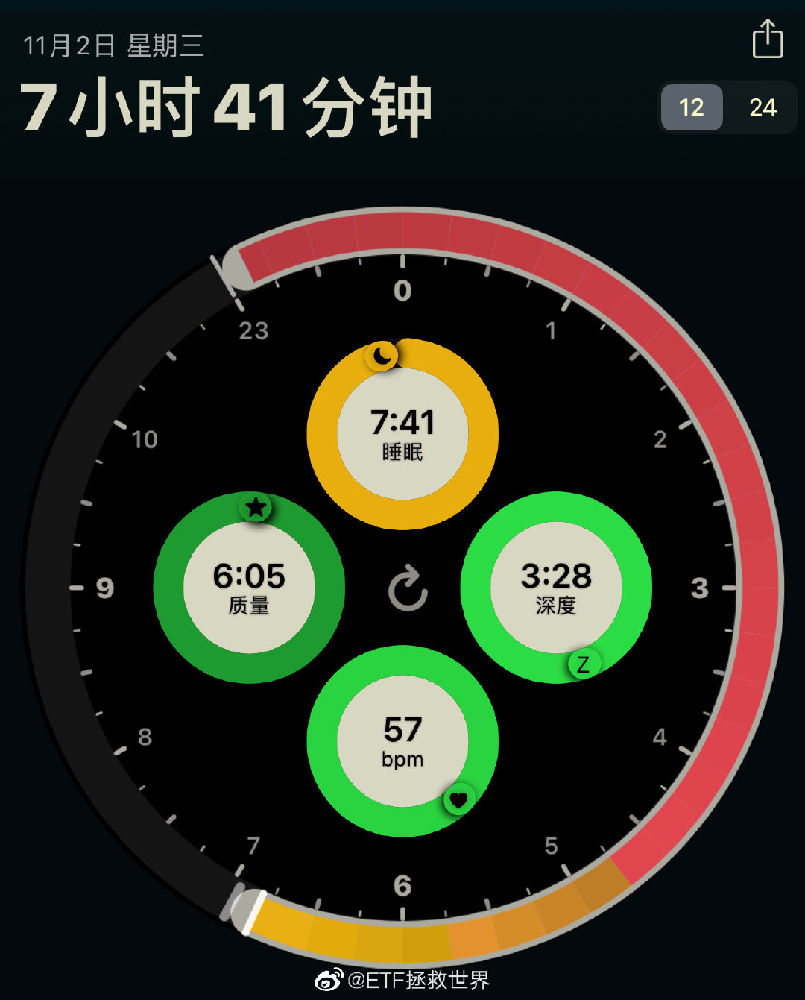 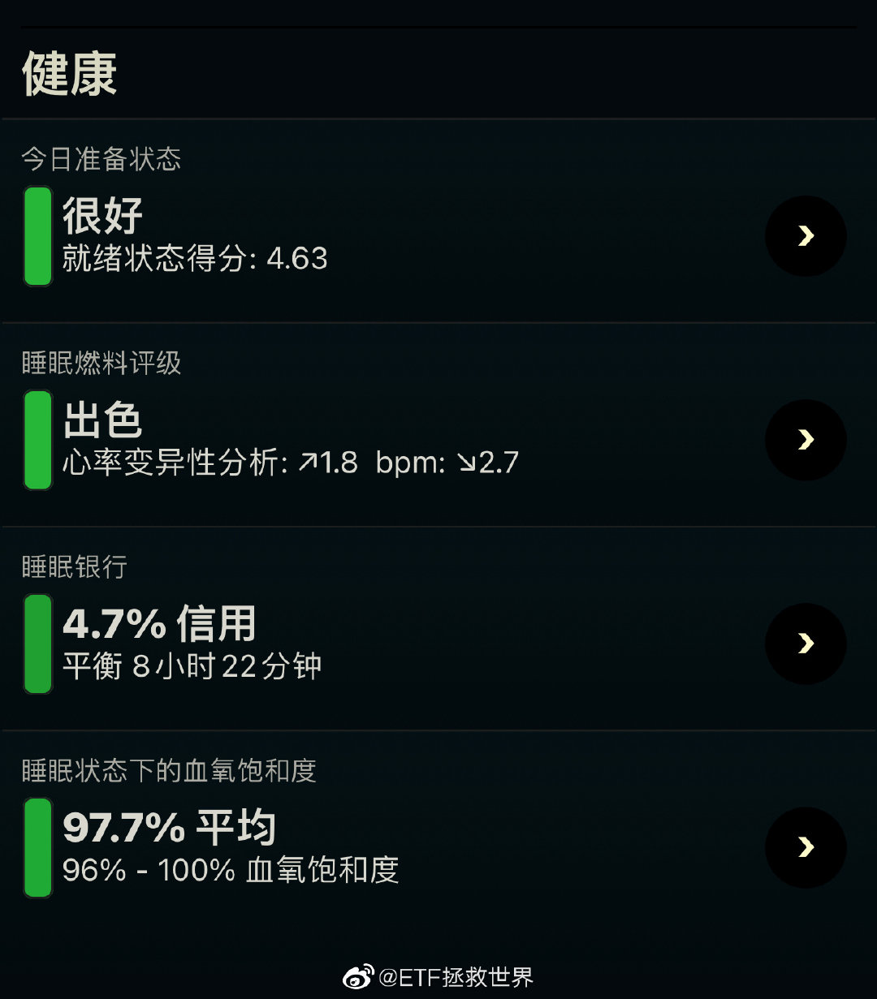

## 2022-11-02 08:47

昨天有朋友问，为什么从来不买房地产指数基金。

其实我们的金融行业里面就有一部分房地产。

至于为什么不单独买这个行业，我只能说，太复杂，水太深，我不懂。

有些公司做酱油白酒牛奶火腿肠然后卖掉，有些公司做药做医疗器械然后卖掉，有些公司做游戏做社交软件做电商，非常容易理解。

但是房地产公司的资金，杠杆，以及背后的水有多深，以及我们的整个房地产的状态，我本人是真的看不懂。

不懂就不做。

## 2022-11-02 09:00

这话说的。就好像中年人老年人不精致似的。大家都一样，谁也别说谁。

## 2022-11-02 09:35

信息致敬后不断新高。

那又怎么样呢。

恒生致敬后赚了二十多个点，最后还不是赔钱？

好笑。瞎嘚瑟什么。 ​​​

## 2022-11-02 09:40

很多东西是讲土壤的。

中国足球就是好不了。为什么，就没有这个土壤。怎么可能好？不可能的。

不是球员的问题，也不是教练的问题，是土壤的问题。

还有很多事情也一样。

土壤是什么，是氛围，是传统，是观念，是民族性，是每一个人。

是每一个人！ ​​​

## 2022-11-02 09:49

别的地方我管不了，在我这里，我请大家能不能不要二极管，能不能打开封闭的思维。不要因为某件事看法不同就上升到可笑又可怕的层次。

能不能不要说我爱这个国家就是小FH，能不能不要我们还有问题就是牧羊犬。

这世界不是这样的，你这样除了对立，除了极端，除了灾难，不会有任何益处。

这个世界上的好人和坏人都很少，绝大多数人都是灰色的。这个世界上也没有完美的东西，谢谢大家。

## 2022-11-02 10:11

今年的第十五次提款。

这次资助一位河南的初中女生。

赚钱很重要，让这个世界因为我们赚到的钱更好一点也很重要。

PS：量力而为。让自己，家人，亲人先过上幸福的生活，是最大的善事。其他的，满足这些以后再说。 ​​​
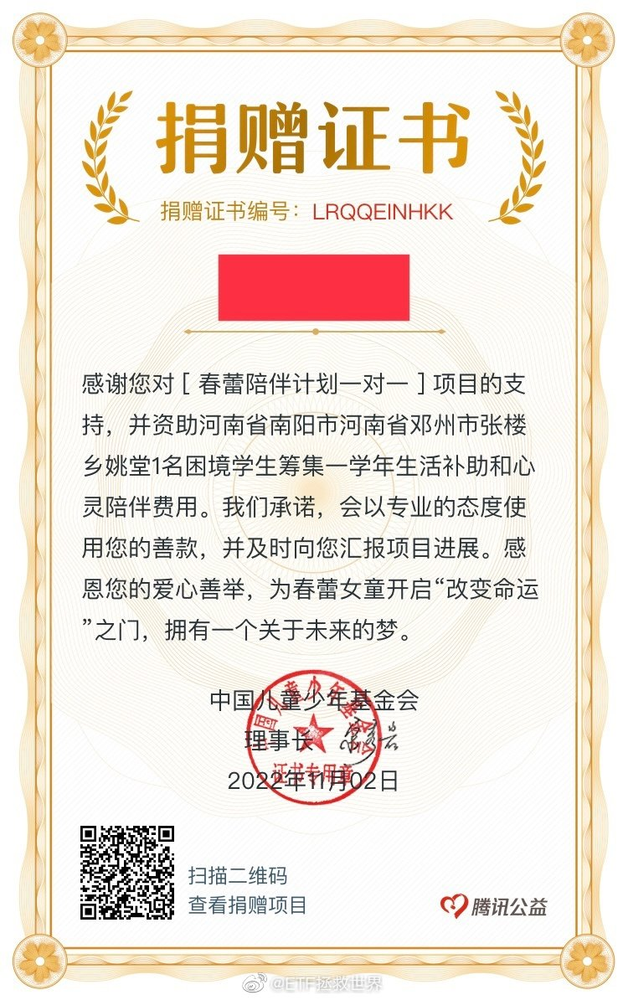 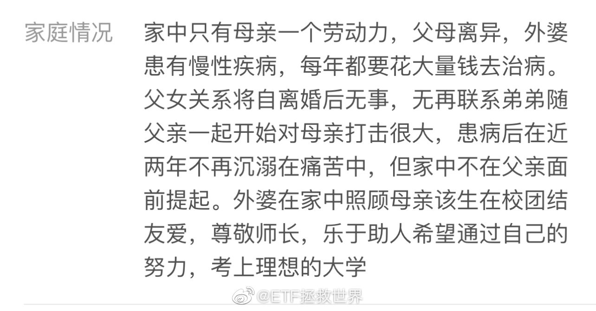

## 2022-11-02 10:19

医药致敬后不断新高。

那又怎么样呢。

恒生致敬后赚了二十多个点，最后还不是赔钱？

好笑。瞎嘚瑟什么。 ​​​​

## 2022-11-02 10:37

该说不说，

这一网一个半月，收益率10.37%。

这是该品种今年第5次提款。前四次收益率分别是5.88%，7.14%，12%，7.14%。

信不信由你，

看到大家的卖单被吃掉的那一刻，我比你们谁都高兴。

大家能在这样的市场中赚钱，我最开心了。

一起期待下次提款吧。不知道是哪个小乖乖啊。 ​​​

## 2022-11-02 11:11

各位看着我们提款的品种在一个区间里不断上下波动让我们赚钱的时候，

请一定记住它们现在的功劳。

未来有一天，品种走牛，你的波段仓位已经出了大部分的时候，

你不要抱怨它们没有帮你在牛市中赚大钱。

它们付出过，让你开心过，当你在迷茫的时候给过你信心和希望，不仅如此，还带给你真金白银的利润和极低成本的长期筹码。

一定要记住它们此刻的好。才不会在未来它们失意的时候埋怨它们。

## 2022-11-02 11:31

谁还记得YY上方第一个压力位。 ​​​

## 2022-11-02 12:01

回复@脚踩七彩祥云去娶你:更好的消息是，只买指数的150跑赢同期沪深300接近50%，跑赢中证500接近65%了。最好的消息是，这种市况下，85%跟车的人都在赚钱。//@脚踩七彩祥云去娶你:好消息，150年化快5个点了

## 2022-11-02 12:12

有些人总拿计划目前年化不高说事。

首先我承认，目前第三轮年化不高是客观事实。

但这个客观事实是建立在什么前提下？

是建立在：

第一，我们的第二轮ETF计划在2015年大牛市中清仓后，在最顶峰开始第三轮。也就是说，第三轮的所有收益，都是在之前最高利润之上建立的。

第二，我们的第三轮计划，无论在多么恶劣的状态下，包括15年gu zai，16年r断，18年暴跌中，都从未整体亏损过。也就是说，从未把前两轮的利润赔回去。

第三，同期沪深300跌15%，中证500跌30%，计划跑赢前者50%，跑赢后者65%。这是一个买指数的计划，买指数本身跑赢指数50%、65%，我尽力了。

第四，150设计了极其苛刻的补仓条件：如果一个品种整体亏损，以及该品种的某份投入亏损了，才会提示补该份。这就保证了绝大多数后来加入的朋友，绝不会高位追涨，绝不会出现高位规模扩大而导致价值毁灭的事情发生。这种做法，我放眼国内的基金、组合，没有任何第二个人会这么做。这是绝对以跟车人利益为唯一考量的做法。

这几年确实做得不能说好，也犯了一些错误。但评判一个组合的成败，不能从单一角度去论证。

## 2022-11-02 12:24

再从另一个角度看：

第三轮计划开始以来，沪深300的涨幅是-15%，而我们持仓的两个沪深300品种收益率分别是：

富国300:20%，跑赢35%。

沪深300：41%，跑赢56%。

同期中证500涨幅是-30%。我们持仓的500品种收益率是：

建信500：19%，跑赢49%

中证500：20%，跑赢50%

富国500：50%，跑赢80%。

你回头看，所有的品种，绝大多数都是低位买入，所有品种，没有涨起来后高位追涨接盘过，甚至高位还有减仓。

对于买指数来说，应该已经是极致了。当然，高位如果能多卖点就更好了。

下次高位吧，下次会做得更好。
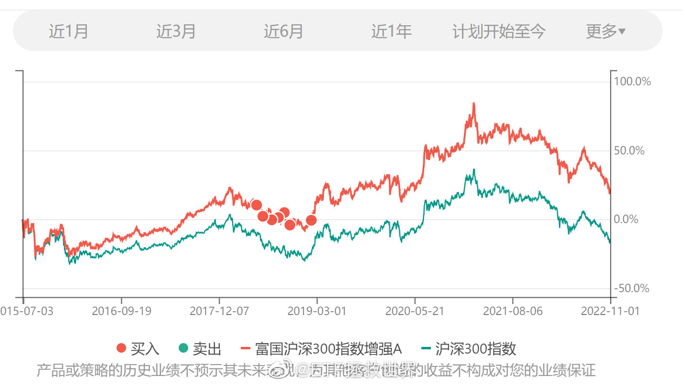 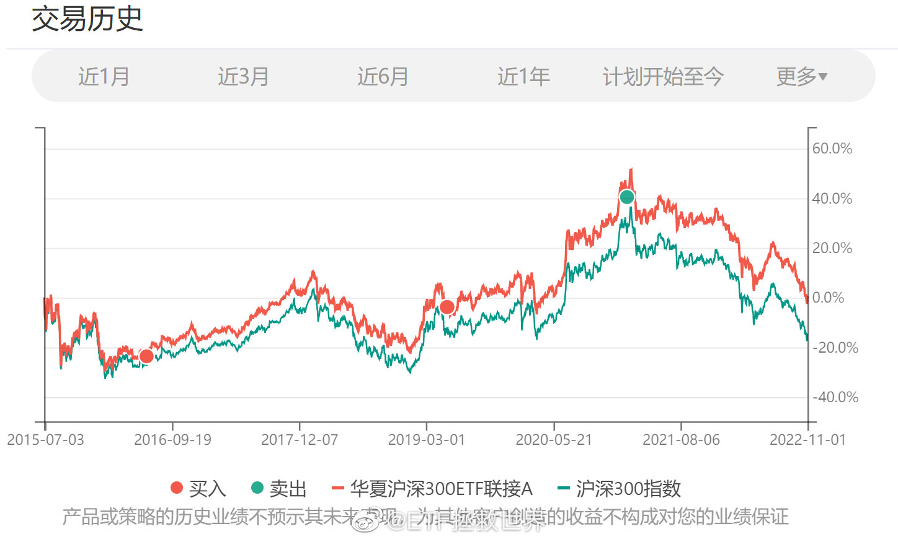 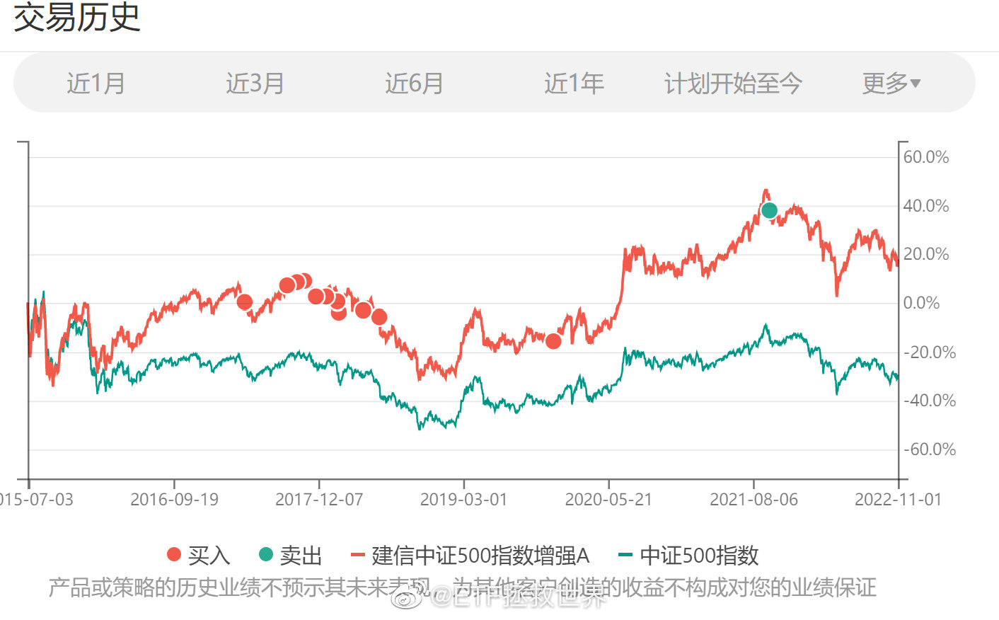 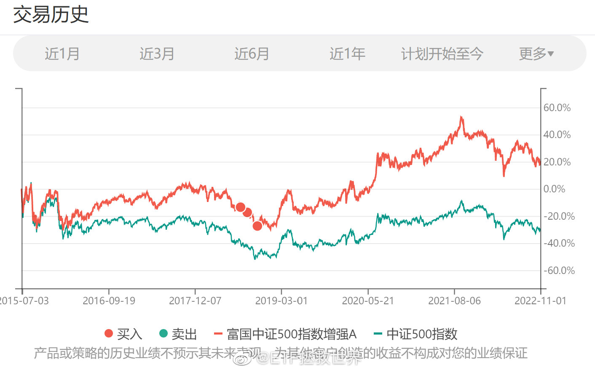 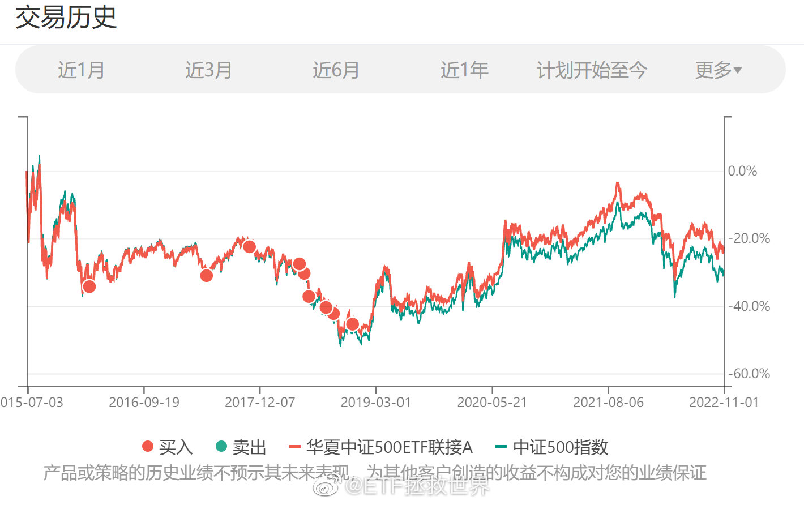

## 2022-11-02 12:47

维多利亚3有人玩了吗，怎么样 ​​​

## 2022-11-02 13:24

今天收盘后这个又开始挣钱了。

太难了…… ​​​
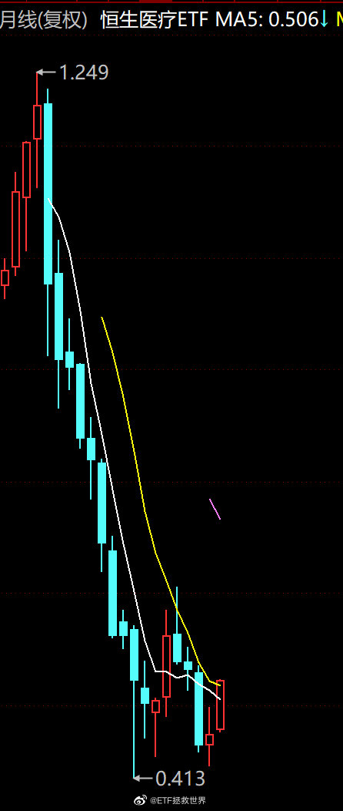

## 2022-11-02 13:45

友情提示，目前医药从中短期估值视角看，已经不便宜了。

从别的视角看不论。 ​​​

## 2022-11-02 16:34

2018年6月与目前的全市场估值大致差不多，期间中证500涨了15%左右。

但是，当时上市的3000多家公司中，有1007家，也就是将近1/3的跌幅大于19%。

有675家跌幅大于30%，有457家跌幅大于40%，有275家跌幅大于50%。

如果是分散投资还好，如果是单压一只股票，很多股民大概一辈子，至少几十年也很难赚钱了。

这还说的是持仓不动。但大多数人持仓不动是不可能的，高买低卖，不断操作，亏损会更多。

炒股非常难，一定要谨慎。

更加值得注意的是，四年过去，股票数量增加到了5000只。以后再也不可能出现所有股票一起上涨的局面了。上次出现这种局面是2014年底开始的疯牛，然而那时候股票数量是2500只。

几年后，股票数量会到6000、7000也未可知。

所以，千万不要买错股票，买错了一辈子难回本。

## 2022-11-02 17:06

再给你一个让你震惊的数据吧。

2015年7月1日，也就是第三轮计划开始那天至今，在当时上市的2589只股票中，有2001只股票下跌，也就是7年过去，77%的股票依然没有赚钱。

其中，1783只跌幅超过20%，占比69%。

1613只跌幅超过30%，占比62.3%。

1393只跌幅超过40%，占比53.8%。

腰斩以上的有1100只，占比42.49%。

7年过去，上涨的股票只有23%。

涨幅30%以上的，有373只，占比14.4%。

触目惊心啊，朋友们。

炒股太难了。

## 2022-11-02 17:24

回复@天疯基团:2007年10月15日至今，有690只股票依然是下跌，占当时所有股票49%。15年过去，一半股票跌，意不意外，开不开心。//@天疯基团:回复@ETF拯救世界:07 08那一拨还有没解套的吗？

## 2022-11-02 21:11

该说不说，今天复盘，最惊险的是这个。 ​​​
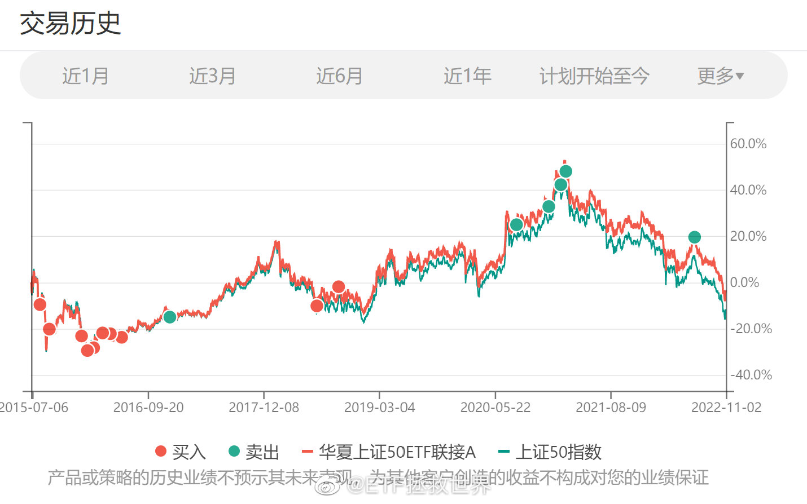

## 2022-11-02 23:18

这本书TZ外的朋友可以读一读，可以帮助你理解很多事情。 ​​​
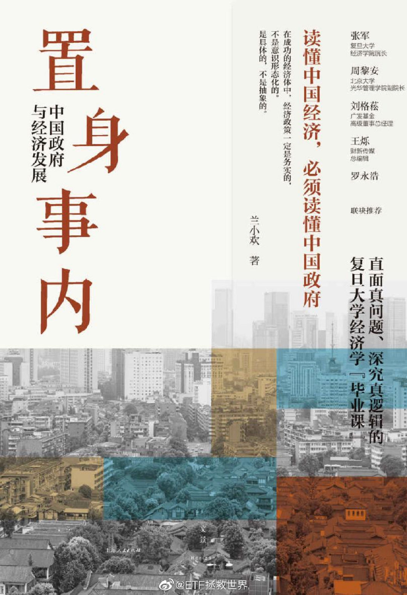

## 2022-11-03 09:23

吃一口就跑是对目前市场状态最大的尊重。 （仅指波段提款） ​​​

## 2022-11-03 09:47

如果有机会的话，信息致敬仓位会分三步减仓，收回我的敬意。 ​​​

## 2022-11-03 11:36

记录数据：

2022年至今，美股上市419家公司，退市339家。

2013-2022年，不完全统计，共退市3016家公司。 ​​​

## 2022-11-03 11:49

继续记录数据：

目前美股几大市场共有6826只股票在交易。

如果以A股日成交量下限的股票200万人民币，即大概70万美元计算，大致有2600多只不到这个标准。

也就是说，大量股票根本无人或只有很少人交易。

我相信几年后A股的股票也会达到6000-7000家，到时候，几千只股票全天只成交几万几十万的状态是可以预见的。

## 2022-11-03 14:17

儿子说在学校跟大家讨论零花钱的问题。

同学们大多数是十几几十块一个月，问他，他说睡觉前收拾好自己的东西每天10块，网课回答一个问题10块，每个月200、300多吧（有时候会不收拾就睡觉了）。

同学们惊讶：这么多！

听到这儿，我觉得确实可能给多了。

同学问他都买什么，他说会存一半。同学说干嘛存钱？他说以后得病了啊，有想买的贵的东西啊，存的钱就有用了。

听到这儿，我觉得给的不算多。

让他从小掌控钱，懂得怎么分配，怎么压制一半欲望，满足一半需求，长大了把家败光的概率就小很多了。

其实这几个月，他把那一半能花的钱都花光了。也买了很多我看起来浪费的玩具。有时候他也会后悔，为什么我花那么多钱买那些。

他买的时候我从不阻止他，一个是因为那是他自己的钱，一个是因为让他自己多一点感受，感受买了没用东西后悔的感觉。从小钱开始打怪升级，总比长大了用大钱交学费好。

## 2022-11-03 15:37

喜欢买充电头和充电宝的男性进来打卡。 ​​​

## 2022-11-03 22:58

刚才看有人评论说，科创板最近涨得最好。

？？？

想表达什么，我不理解。

是因为我说科创板贵，50多倍估值我不买，然后来打脸吗？

我不买，它涨了，说明什么？

举个例子吧。

我说我不能为发财做突破底线的事情。然后有人突破做人底线发财了，所以我就应该被嘲笑吗。

不好意思，我非常自豪。对，我没发财，但我守住了自己的底线。

我依然不是那个为了挣钱什么都干，为了在股市上赚钱什么都买的，没有底线的人。

而且我就没懂，我说它贵，我不买，从来也没说过它不可能涨啊。我在资本市场十几年了，我会不知道贵的可能更贵，50倍到70倍，100倍都不稀奇吗。只是这个钱我不赚，可以吗？

不可以吗？你们疯，也要逼着我跟着疯吗。

服了。

## 2022-11-03 23:07

股票50多倍估值非常正常。但是一个板块，大多数股票都50多倍估值，这个估值这个板块的指数基金我这辈子也不会买。

我宁愿全放银行存着也不会买。你告诉我会翻番我也不会买。

随便你怎么嘲笑我，这就是我的原则，谢谢。 ​​​

## 2022-11-04 10:43

小红红是不是又买在最低了。 ​​​

## 2022-11-04 10:54

我是个赔钱货，赶紧取关我吧。

买的标普500已经连跌三天了。

 ​​​

## 2022-11-04 10:57

说起标普500啊，真的水平太次了。记得第一次买入，买了就跌，赔了多少！

这样的辣鸡博主，还有人关注，真是老天不长眼啊。 ​​​
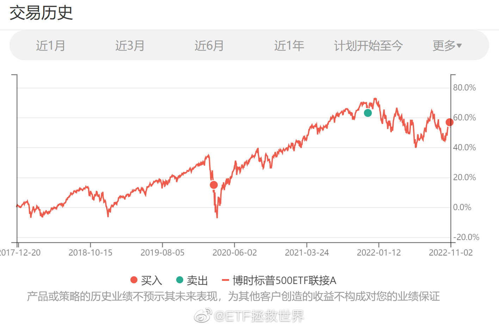

## 2022-11-04 11:04

再说一件让黑粉狂喜的事情：

如果这个月恒科保持强势，月底我还要高位接盘呢。

我给你准备素材，你抓紧调研，下个月上会，讨论一下怎么喷。 ​​​

## 2022-11-04 11:15

未来，美股至高会给到20-25%。目前除了1-2份标普500，1份纳指生科，两手空空。仓位不到3%。

纳斯达克，全球医药全球消费一点都没买，你猜我是希望它跌，还是希望它涨？ ​​​

## 2022-11-04 11:37

早起到现在只喝了一杯黑咖啡，你吃什么了？

中午打算吃什么。

我打算吃咖喱海鲜饭再加一个香煎三文鱼。

今天挣钱了，吃薛微好点的。 ​​​
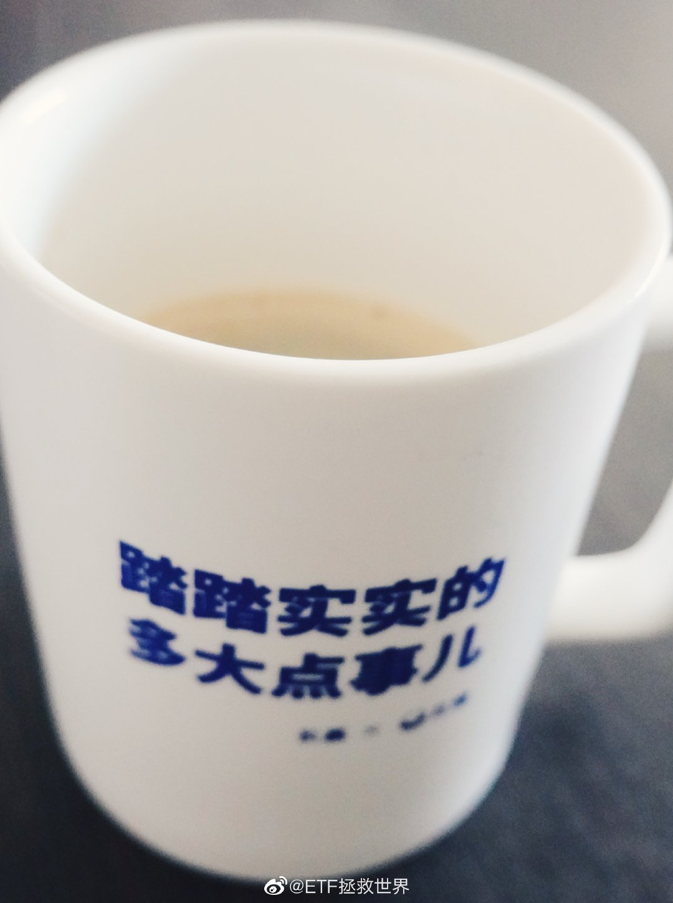

## 2022-11-04 12:04

刚才看评论，发现很多朋友还是对杯子有怨念。

我刚才和且慢商量了一下，准备开启这样一个长期送杯子的活动：

每个月从最早开始跟车，同时到现在还在持续跟车的500位朋友里面，抽50位，每人送一个杯子。

抽中后从库里面去掉，后面的朋友递补。

如果中奖通知后没有反馈收货信息，那么名额加到下个月的总数上。比如这个月有20位没有反馈收货信息，那么把这20个杯子加到下个月，下个月就是70个杯子。同时这二十位从抽奖库里面删除。

大家觉得这样可以吗。

## 2022-11-04 13:13

利润5%改成8%是不是正确的，用不了多久见分晓了 ​​​

## 2022-11-04 15:29

再这样涨两天，计划可能会减仓A股。

勿谓言之不预也。 ​​​

## 2022-11-04 15:57

工作是老板的，身体是自己的。

下午4点，请适度摸鱼。

一直在摸鱼的，请适度工作。 ​​​

## 2022-11-04 15:59

回复@Gkar:如果，我说如果啊，我们卖一个买了一个月就涨了30%的品种，阁下又有何意见呢。涨上去了，我把低位加仓的品种减一减，有什么不合理呢？//@Gkar:这就不懂了，年初都没减，刚出坑反而要减了期待文章

## 2022-11-05 11:34

今次双11买的最满意的东西是一套回音壁和一双国货运动鞋。 ​​​

## 2022-11-05 12:27

很多朋友可能有点错觉，觉得关注的人多一点的所谓“大v”会有什么真的影响力。

影响力不能说一点都没有，但这是建立在极其脆弱的基础上。是沙滩上的城堡，说塌就塌。

一条微博的消失，可能只是管理员动动手指头。一个账号的消失，可能就是几个人商量一下或者一个电话。

消失了就是消失了，什么都没了。

一切都是虚幻。

## 2022-11-05 20:18

每天都有新情况新消息。有什么传言暴涨啦，谁说什么又要跌啦。

基本上还是要有自己的节奏。昨天我说再涨就适当减仓，把低位买的获利了结一些。有朋友觉得涨得好好的干嘛减。结果新消息一出，又担心要跌，又觉得卖出是对的。

自己总应该有一些标准，一些原则，一些策略。总是被消息推着漂来漂去，难免做错事情。

## 2022-11-07 10:19

相信我，人类作为一个整体来说，不值得期待。

你的期待越高，失望就会越大。

如果能遇到不负期待的人，一定要珍惜。无论ta是你的亲人、朋友还是爱人。

绝大多数人都是灰色的。不会很伟大，也不会很邪恶。

遇到坏的人不要惊讶，不要感到匪夷所思。因为坏的人坏起来是没有底线的。没 有 底 线。

绝大多数人首先考虑的都是自己的利益，不要要求每个人都舍己为人，那是自寻烦恼。

绝大多数人的思维都有局限性。根据每个人所处的阶层、环境、成长过程被区分为不同群体。人类的悲喜并不相通。

## 2022-11-07 10:44

千万不要因为你“帮过”一个人，就期待他会报答你。事实上，甚至可能连感恩都不存在。

这里面的问题很复杂，一两句说不清。总而言之，你付出了，就去期待回报，那简直可笑。

懂得感恩的人非常稀少。你碰到的概率也不大。所以，你伸手帮忙了，付出了，就不要期待后续。付出这件事本身能带给你快乐、愉悦、心安理得，就够了。如果后续有回报和感恩，那是惊喜。如果没有，那是正常。

如果你希望一直得到回报，那就要去帮助那些懂得感恩和有机会就回报的人。一般来说，江山易改本性难移。如果这个人懂得感恩，那么大概率会一直懂下去。那么你帮助他，他记得你的好，未来你有需要帮助的地方，他大概率会伸把手。

明白了吧。关键在于个体。这个人会回报你，就大概率会一直回报。这个人不懂感恩，就大概率一直不懂。就像借了钱准时还钱的人，下次大概率还会准时还。借了钱一次不还的，你借多少次他也不还。

想明白了这个，你的很多烦恼就没了。

## 2022-11-07 11:07

小红如果是5%区间，已经离提款不远了，不到10个交易日。

但我们改成了8%。

其实5%还是8%看各位自己吧。不一定非要与我完全一致。

我自己选8%。 ​​​

## 2022-11-07 15:58

昨天发现了自己教育孩子第一个比较重大的失败：

因为一直以来照顾得太好，导致儿子连泡面的热水在哪里，什么样温度的水能把面泡开都没有概念。

9岁了。不能再继续下去了。

从今天开始，放手让他去独立完成事情。

温室中长大的花朵，长不成大树，也禁不起风雨。 ​​​

## 2022-11-07 19:09

无论是政府、企业，还是个人，发生经济方面的危机最大导火索就是债务。

不是说不能有债务，但从个人来讲，各位一定要控制好自己的债务水平。不要因为各种原因借贷自身无法负担的债务，也不要把当前的高收入当作是永远的高收入，更不要自然而然地认为自己的收入会越来越高，多借一点钱没关系。

只要没有过分的债务，即使宏观方面有什么，自己也不会出大问题。反之就非常脆弱。

## 2022-11-08 09:55

转发微博

## 2022-11-08 14:36

今天一直在忙，抽空打个招呼。

怎么样你忙不忙，摸鱼了没。

不用挂念我。 ​​​

## 2022-11-08 16:29

虽然根本没去过广东，但莫名的就是很喜欢广东。

不知道为什么。

总感觉广东人很务实，相对来说虚头巴脑的东西少一点。

不知道这感觉对不对。 ​​​

## 2022-11-08 17:13

回复@果乐PP:不是，这个是传统。为什么是传统，红事白事其实都一样，因为以前穷。一家要结婚或者有人去世，没钱办。所以村里面大家一起凑一下，把事情办了。至于为什么这样的传统到现在还有，我就不知道了。

## 2022-11-08 17:18

回复@belleone:平常过日子可能勉强能过下去，但遇到大事真没钱。所以大家凑。其实包括养老问题也是这样。为什么要有彩礼，因为女儿嫁出去，没人给养老了，所以要彩礼养老。儿子一般跟老人生活，负责养老。但这些传统在现代社会根本就不应该存在，结果还是一直在延续。

## 2022-11-08 21:26

成人礼这件事，各位能学到什么。 ​​​

## 2022-11-09 09:33

小红不要掉链子。

现在已经超过5%了，各位可以看情况自己减。5以上都是成功的。

祝贺你！ ​​​

## 2022-11-09 09:38

发现一个秘密。

虽说涨跌都开心，但现阶段我本人是涨了比跌了更开心。

说明仓位够了。

但是消费、美股涨了不开心，说明这两个品种仓位不够。 ​​​

## 2022-11-09 09:41

对有些国家来说，房地产价格的涨跌非常重要。

对有些国家来说，股市的涨跌非常重要。

至少到现在为止，还没有变化。 ​​​

## 2022-11-09 09:50

有些国家的股市，由于波动巨大，所以长期来看，其实是把钱慢慢从大多数人的口袋中，转移到一小部分人、税收、上市公司重要股东以及券商手中的。

各位可以想一想。您一年十几二十次不断从市场波动中提款，提的都是谁的款。您低位买入，就一定有人低位卖出。您高位卖出，就一定有人高位买入。

包括致敬仓位。您在最低点买入，就一定有人在最低点卖出。包括高抛低吸的计划也是如此。

一年、两年，十年八年。财富不断聚集在有策略，有纪律的人手中。

如果要是平稳上涨，其实大家都能挣钱。但问题不是。问题是有些国家的股市每年换手700%，也就是说所有筹码换7遍。大多数人，都是在不断交易中越亏越多。

所以如何在波动巨大的市场中赚钱，是您第一个应该解决的问题。

## 2022-11-09 10:31

我就简单问一下啊。

如果说啊，有那种金融机构，想送你一个特大的那种鼠标垫，想印点东西在上面。比如说一个指数组合里面的所有持仓品种分好类，加上代码。（也可以包括还没买但关注的品种）就是你想买哪个大类一眼看过去就知道买什么。

再比如，可以有针对激进、保守、平衡不同人群的配置建议。一个饼图或者列表，把每个大类的仓位配置显示出来。

或者再印点很重要的交易心得之类的。

那你觉得，印点什么你会觉得有用又会很喜欢呢。

## 2022-11-09 17:10

5岁小孩在幼儿园，把同学后脑勺用气球打气筒划破了。

受伤同学父亲上门一个大嘴巴把伤人的孩子打倒在地，接着把上来还手的小孩爷爷干翻。

并对躺在地上的伤人小孩爷爷说，“我没忍住打了他，你打我干嘛？”

据说，之前伤人小孩一家人已经上门道歉过了。（最新消息，又说是打算上门道歉还没去）

你怎么看。

你认为5岁小孩之间的打闹，家长需要出手教训对方孩子吗。

## 2022-11-09 17:57

我不知道你们还记不记得去年吧，有一个案子。

说一个女生的爸爸，拿刀在学校门口把女生的一个男同学捅死了。我模模糊糊记得应该是四年级的孩子。

然后网上就有很多传言：男孩经常欺负女孩，女孩家长约男生家长谈结果男生家长不出现什么的。

总之当时网上的很多人就是说，该。杀人的父亲没错。

但实际上，最后法院查明：

女生爸爸在微信群发飙后，男生爸爸在群里道歉。然后添加女生爸爸微信，但女生爸爸没通过。然后添加了女生妈妈沟通。班主任得知女生爸爸脾气暴躁后，建议双方家长先不要见面，并告知女生妈妈会调换座位。

然而，第二天早上，女生爸爸还是携带屠宰刀，进入教室捅了十几刀，然后拎起来扔到走廊里。男生当场死亡。

最后女孩爸爸死刑。两个家庭破碎。

（这个案件，法院到最后也没说清楚有没有欺负，怎么欺负的。最后文件里用的是带引号的“欺负”）

这次的事情，更加离奇。是5岁小孩。说实话，如果说15岁，哪怕10岁的坏孩子真的经常欺负你家孩子，你去帮孩子教训对方，我都举双手赞成。因为我知道有些小学初中的孩子会坏到什么地步。

但是，5岁啊。真下得去手吗。还有网上这些脑补前情提要的人，没有事实依据的事情，传来传去，公平吗。

## 2022-11-09 18:11

但是现在各种事情也提醒各位家长，尤其是男生家长，最晚在小学阶段，也一定要不断的教育孩子不要欺负和霸凌同学。否则，学校不管，JC不管，有人会管。付出的代价甚至有可能是生命。

## 2022-11-09 22:06

现在还有一个问题。

就是说小孩子，小学或者幼儿园。双方有了摩擦，打架，互殴。

是不是不管任何原因，都是打赢的一方，或者说造成更大伤害的一方错，要道歉。

如果事情的起因并不是打赢的孩子惹事，而是一开始被欺负被找茬的一方，结果因为武力值高赢了，那么还需要道歉吗。

你怎么看这个问题。 

（这个问题与本次事件无关，只是突然想到这种问题出现怎么办）

## 2022-11-10 07:49

我表妹，就是那个现在在奢侈品行业做高管的那个。小学时候对一个武力值很高，想要欺负她的女同学说，

“我哥是拳击队的，等着明天我带他来揍你”

整句话只有她有个哥是真的，这个哥还住得离她很远，不可能帮她出头。但这句话不仅震慑了同学，还骗到了对方家长。

家长带着那孩子去我妹家道歉，并说：“能不能别让xx的哥哥来了，都是小孩闹着玩”

后来两个人还成为了朋友。

再后来，她从星巴克普通员工做起一路向上，跟嘴皮子利索脱不了干系。

## 2022-11-10 09:22

我说一句可能会让很多朋友讨厌的话，

如果一个成年人打了我几岁的儿子，我绝对绝对绝对不会宽恕他。

一定要让他得到应有的惩罚。 ​​​

## 2022-11-10 12:37

这是上次事件的评论。个人认为，小学开始，是霸凌就严惩，是打闹就不要上纲上线。不要脑补信息，证据，证据！

## 2022-11-10 13:39

年内A股公司定增募资规模超5000亿元 ​​​

## 2022-11-10 13:56

我刚算了一下，从1993年至今，A股IPO+再融资一共是19万亿。

目前A股总市值74万亿。

有没有一种可能，未来的某一天，融资金额超过总市值。 ​​​

## 2022-11-10 14:10

回复@芭提史摩:美国就比不上我们了。三大市场1993-2022IPO+再融资一共21000亿美元。相当于14万亿RMB。美国确实不行了。//@芭提史摩:美国是啥情况，是否可以参考下？

## 2022-11-10 17:56

我准备把一家基金公司暂时列入禁买名单。

倒不是说它家不好。

而是我发现我们不合拍。一个FM，一个AM，大家都不同channel。

买了几次虽然都挣钱了，但总要出点什么问题，如鲠在喉没那么舒服。

气质不合就不勉强在一起。 ​​​

## 2022-11-10 18:01

该说不说，如果鼠标垫上有最近二十年这个数据，低头一看就能随时查到，就问你想不想要。 ​​​
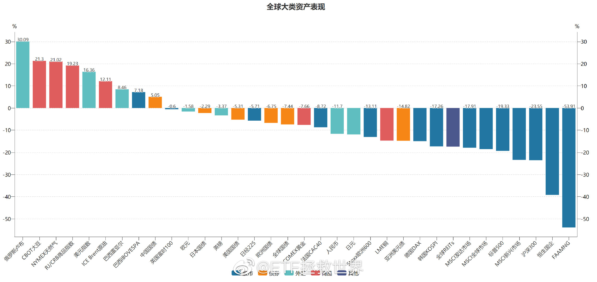

## 2022-11-10 19:00

今天卖出的南方通利，是我们卖出的最后一份通利，也是最后一份纯债基金。

我们最多时曾持仓三份南方通利，分别在3月、9月各卖出一份。9月23日那次卖出，是至今为止的历史净值最高日。

也就是说，卖在了历史最高。

今天卖出的价格，与3月那次卖出的价格差不多。

当然，有一个问题，就是这两天该品种跌幅较大。虽然我们早早的卖出了大部分，离亏损位更是十万八千里，但一个债基几天跌1%也是让人不舒服。

今年上半年清仓另一个纯债基金后，它也是大跌不止。

所以各位，所谓纯债也没有那么保险，投资纯债，也有很多坑要躲。时刻打起十二分精神，总是没错的。

## 2022-11-10 19:07

回复@是三元不是三元食品:以后会继续买纯债。但谨遵祖师爷教诲，大概率只会买国债、类国债属性的利率债//@是三元不是三元食品:后面还会买回来嘛

## 2022-11-10 20:59

刚才偶尔看到这个，我心里一惊。

现在这个号，最后一篇微博将在今年12月31日发出。绝对不能再继续下去了，这样下去会出事。

当然，我会告知各位一个从头开始的新号，不会失联，放心。 ​​​
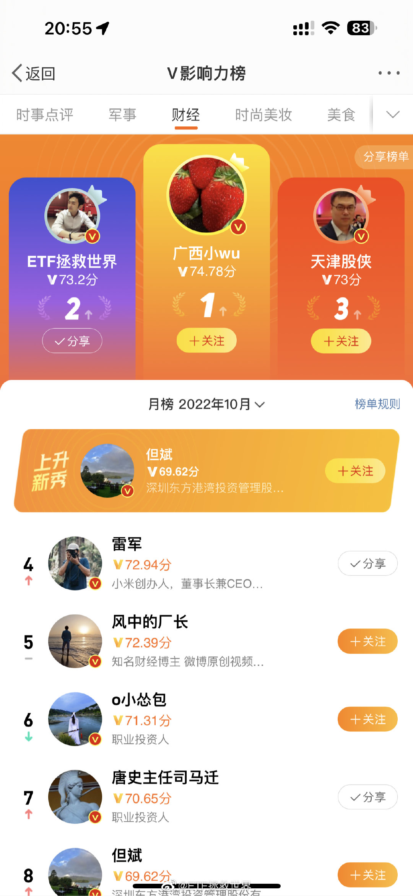

## 2022-11-10 22:32

最后一份黄金持仓横竖要卖个好价钱 ​​​

## 2022-11-10 22:41

现在还不能确定，毕竟还有三周。

但如果月底追高了纳斯达克和恒科，别骂我。

只是因为我破了心魔，你还没破。 ​​​

## 2022-11-11 08:24

昨夜紫微东移，天罡聚北，龙尾向南，今日主大吉。 ​​​

## 2022-11-11 08:39

回复@西西里的小石阶:你很敏锐。我也在关注。同样等月底。我自己横竖要配一些灯塔超长期国债，盯着呢//@西西里的小石阶:E大，请问之前关注的几个美债etf要开始上了吗

## 2022-11-11 08:57

纯债已经彻底消失。目前阶段，我也不会再买入这个品种。

当然，未来还会买回来。我想，大约在某个冬季。 ​​​
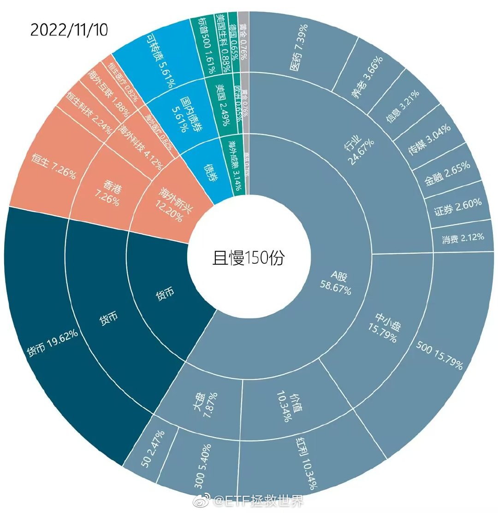

## 2022-11-11 09:19

再说一次，我个人认为，QDII ETF设置涨跌停特别特别不合适，甚至还有点搞笑。

人为做大折溢价，极端情况下不会出问题吗？

如果连指数涨跌都没法跟好，叫什么指数ETF。

连创业板ETF都能20%了，为什么QDII ETF还要10%涨跌停呢。 ​​​

## 2022-11-11 09:39

@二级市场捡辣鸡冠军 

可以先关注一下。否则不到100天无法评论就尴尬了。 ​​​

## 2022-11-11 10:01

埋怨标普500赔钱的朋友，你欠我一个道歉。

（要道赶紧道，下周跌了就道不了啦） ​​​
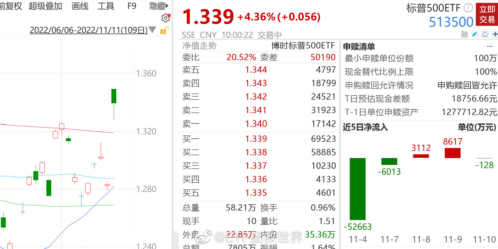

## 2022-11-11 10:07

什么玩意儿，这k线报看。 ​​​

## 2022-11-11 10:15

你有没有发现一个现象，

身边的人好像理智正常的占绝大多数，

但是网上具有相反特质的人至少占一半。

为什么。

是因为接触的群体不同吗，还是面具下真实的人性在网上尽情挥洒。 ​​​

## 2022-11-11 10:27

其实买QDII品种，各位贤达可能觉得只需要关注美股走势，联储货币政策，汇率走势就够了。

问题在于，我们还有个外汇额度问题。

对，也许会跌到很低，汇率也很合适，但是——

你能确定到时候还有额度吗。

你去看看，最近有多少基金公司开始限购了。

很多事情要考虑的东西，要比你想的多很多。

都不容易啊。

## 2022-11-11 10:53

个人养老金这个，收入高的，结余高的朋友确实可以考虑。

反正你的钱也要用来投资，不如享受税收减免的同时进行投资，何乐而不为。

具体的流程细则再等等看看，总之高收入的朋友，扣税多个人所得税税率高的朋友，确实可以关注。 ​​​

## 2022-11-11 10:57

小红继续下网后新高。

还是那句话，5%-8%之间提款都是对的，目前已经6.x%，丰俭由人，祝提款开心。 ​​​

## 2022-11-11 11:29

风继续吹，不忍远离。 ​​​

## 2022-11-11 14:27

今天还有1300只股票下跌。 ​​​

## 2022-11-11 15:28

A股就是那种涨一点就卖，自作聪明做波段的人太多了。

呵呵。 ​​​

## 2022-11-11 15:36

今天跑数据发现全市场估值居然几乎没动。

再回头一看，原来2000家公司是下跌的。

5000只股票，全都走牛的可能性真的很小了。 ​​​

## 2022-11-11 15:56

风向有变化的话，对医药来说，其实是潜在利好。

免责声明：本人持仓相关行业股票、基金。绝非在目前价位推荐医药类投资。相反，再涨就到了本人的减仓区域。

这条微博只是表达一个想法，绝非推荐！不是说利好就一定涨！股市不是这个逻辑！ ​​​

## 2022-11-11 16:17

我之前说我们根本没有足球文化，也没有足球氛围，就没有这个根，有朋友反驳。其实可以看看这个视频。每个球员都是家乡的英雄，各行各业的人热爱足球，而不是足球成绩。很多东西真的是在民族血液中的，人群和人群由于文化，环境的不同，就是不同，你否认也没用。

## 2022-11-11 16:36

回复@esau2:你知道吗，足球产业GDP占英国GDP的0.35%。仅英超就提供了10万个就业岗位。我不信我们这样大的国家，只凭芯片和新能源就能国富民强。体育产业不仅拉动GDP，还能带给民众健康、快乐、希望、凝聚力。//@esau2:足球踢得再好能国富民强么

## 2022-11-11 16:43

回复@kira-言:你知道不知道，日本的足球高中联赛已经100多年了。如果你看过一次日本高中联赛决赛的现场，你就懂为什么日本把世界杯目标定到8强了。//@kira-言:日本和韩国有足球文化，足球的根？

## 2022-11-11 17:01

“有用”还是“没用”，已经是很多很多人评判事情，或者与人交往，或者做事的唯一选择了。

能不能有一些特别纯粹的，就是让自己开心的事情、爱好，让自己的人生变得没那么暗淡，没那么沮丧，没那么抑郁。

就拿足球来说。比如英国，那里的足球队可不止是英超的20只，也不只是那些周薪十万磅的世界级球星。几乎所有村里的球队，社区球队队员都是业余的。就是大家的邻居，到了比赛日，大家一起去场边加油助威，无论输赢，一场球赛就变成了一个大party。一个名不见经传的第五级联赛球队，可能是一家人世世代代支持的。

这样的社区队，各级联赛队，英伦三岛有几千只。

一项体育运动，可以连接社区的邻居，可以延续家族传统，可以是家里聊天的话题，可以让所有人真的开心，就算它不能挣钱，它不值吗。

何况它还能挣钱，还能解决就业。

我的意思不是说中国一定要搞好足球。我的意思是，人生除了“有用”“没用”，除了挣钱，除了从小卷到老，还应该有很多很多其他的东西，能让我们快乐，让我们有个念想。

真的除了挣钱，除了攒了点钱，什么快乐都没有，不悲哀吗。

更何况，很多人钱也没攒下来呢。

## 2022-11-11 17:29

今天在微博互动了很多，但实际上我一直在与研究团队开发一个新的观测指标。

目前有了一些结果，先分享一下。

明年的A股，我很难判断涨还是跌，这与之前几年我很确信的情况不同。

但是，如果明年各指数以今天的点位为基准，不涨，或者很小的涨，或者跌，那么，从后年开始，一波非常有力度的大行情问题不是很大。

如果明年大涨，那之后就要重新分析了。

## 2022-11-11 19:38

你周围有没有不愿意打疫苗的老人。 ​​​

## 2022-11-12 07:39

世人笑我太疯癫 ​​​
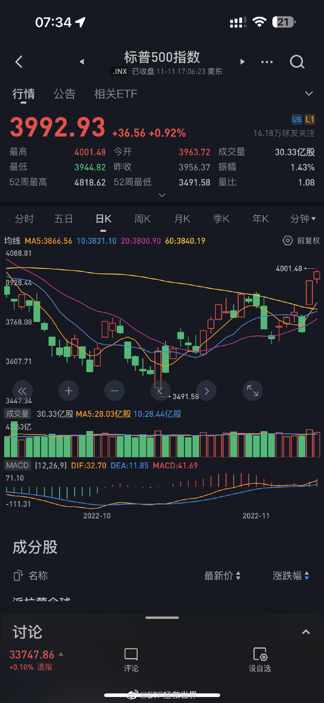

## 2022-11-12 07:57

去年医药跌了7.6%，今年医药跌了20.36%。

现在我们持仓的所有医药品种全都是盈利的。

说明这个品种确实跟我们有缘。 ​​​

## 2022-11-12 10:26

其实很多人吵来吵去就是立场不同。

你担心家里老人，他心痛投了几百万的厂和店无法开工营业；

你担心有后遗症，他被封了几个月精神趋于崩溃；

你担心可能会超额死亡几百万，他失业很久已经坐吃山空；

你担心医疗体系崩溃，df财政可能已经出了问题。

这件事不是60倍估值的指数能不能买的问题，这道题太难，我不会做。怎么都行，随便吧。

## 2022-11-13 13:41

刚看到有人说，“45%最高个人所得税税率太低了，如果我能有300万收入，税率80%我也能接受”

你怎么看这个问题。 ​​​

## 2022-11-13 15:37

时尚的第一条件是：

瘦。 ​​​

## 2022-11-13 21:52

半程冠军不解释。

## 2022-11-13 22:21

友情提示，买银行理财产品一定要弄清楚底层资产，同时匹配好风险等级，还要经常盯一盯净值走势。

买理财保本的时代早就一去不复返了。 ​​​

## 2022-11-14 09:33

不要说话，等着美好的事情发生。 ​​​

## 2022-11-14 09:36

折溢价什么的最讨厌了。 ​​​

## 2022-11-14 09:46

该说不说，所有致敬仓位终于又再次全都挣钱了。 ​​​

## 2022-11-14 09:51

8%，我没有算错，从5%改到8%也是绝对正确的。IOPV已经超了。

但是，做市商不给力，只能再次倒在了折溢价前面。又是两厘。

好在，很多朋友已经分散站位了，已经提款了。

下次我争取算的不要那么精准，多留点折溢价空间。 ​​​

## 2022-11-14 09:59

我觉得逻辑没有错。PS：没有推荐现在买医药的意思！

## 2022-11-14 10:06

我为什么一直强调医药消费是长期的基石。因为只要不是全面的计划JJ，那么，人可以不开电动车，可以不用最先进的芯片，但人每天要吃喝，人生病就会需要药品和医疗器械。当然了，前提是市场经济依然话事。

## 2022-11-14 10:09

十年期国债收益率终于艰难的从最低的2.6x升到了2.8x。

但过去十年平均是3.3x%。

如无意外，不到这个平均数字，我们不会买回纯债。 ​​​

## 2022-11-14 10:21

今天又是1600只股票下跌。

等于是这两天上涨，很多股民可能汤都没喝到。

今时今日真的已经不同以往了。炒股的朋友思路一定要有所转变，未来大概率永远不会出现所有股票一起上涨的情况了。 ​​​

## 2022-11-14 10:44

回复@橙子时间:问题在于，5000只股票，即使是300+500+1000，也才1800只。就算是大部分股票涨的牛市，这些也是很有配置意义的。//@橙子时间:如果一直是结构性行情的话，大指数就不值得持有太多了

## 2022-11-14 11:07

猫趴在高处，

审视着你，

审视生活。

“你为什么还不努力？”

猫说。 ​​​

## 2022-11-14 11:10

该说不说，恒指医疗又回到前期高位了。

涨涨跌跌，意思不大。 ​​​

## 2022-11-14 11:13

喷子：什么行业都买一点，根本不懂资产配置。

我们：每天行业轮动就像电风扇，谁涨我们都开心。 ​​​

## 2022-11-14 11:18

这家伙，每天打开账户，谁看谁迷糊。 ​​​

## 2022-11-14 11:28

继续周到。这几天又开始把证券账户转回银行了。公开的、私有的波段操作提了不少。小钱钱们继续回银行做后备军了。//@ETF拯救世界:继续周到。现在又开始把银行的钱往证券账户转了。未来收割完了再转回去的时候，还会再说。

## 2022-11-14 13:58

回复@我感觉浑身在燃烧:你这话说的亏心不亏心？150我给你分配好，S我帮你计划好，网格我为你做足准备。银行的钱当然是一般情况下不投入股市的，谁家保不齐有点急用？没用的时候，股市有机会就进来赚一波就出去，这些我说了无数次了。出的时候进的时候都在说，怎么就无限子弹了？？？

## 2022-11-14 14:19

来，我随便搜了一下以前的记录。不保证全，但一笔转入一定对应一笔转出。

我绝对不会玩什么“无限子弹”模式。我存在的一部分意义，就是让很多新手朋友明白，有限的资源如何在股市进行合理配置。 ​​​
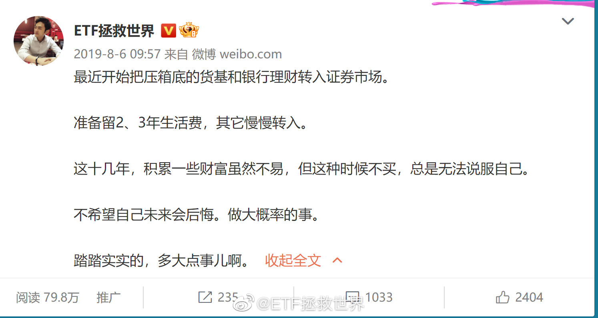 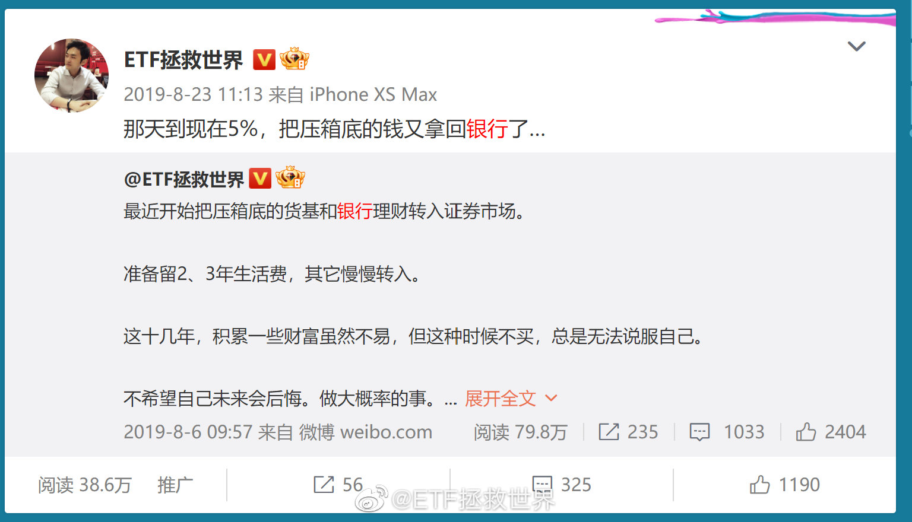 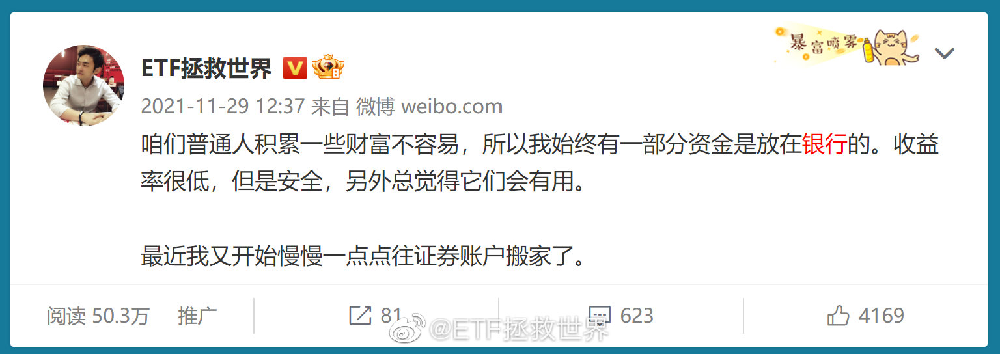 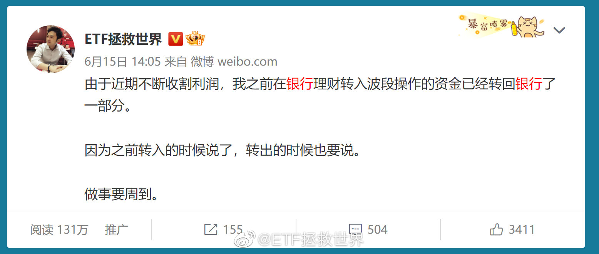 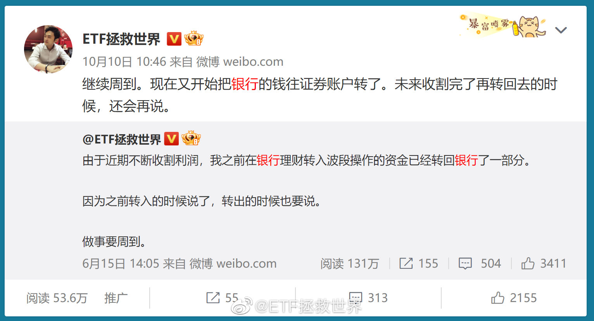 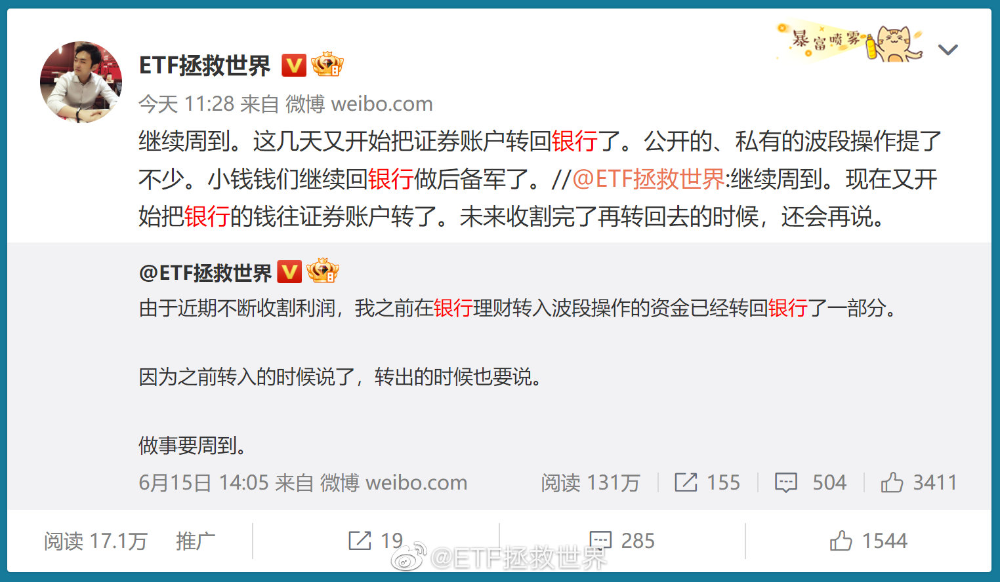

## 2022-11-14 14:27

我从来不会记错，从来不会写错这些转来转去的微博。

你知道为什么吗。

不是因为我的记忆力好，也不是因为我发微博前特意查了。

而是，

我是真的在那样做。

不说假话，生活就会变得很轻松。

（刚看了一下，今天的转出没有显示，因为是余额理财，所以要明天才能到账。不信的说一声，我明天再贴。） ​​​
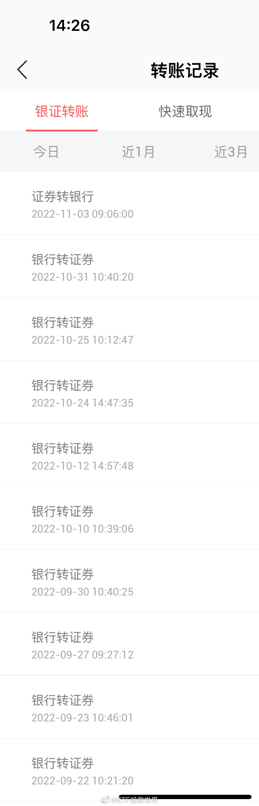 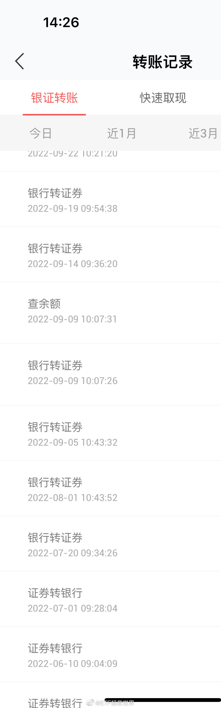 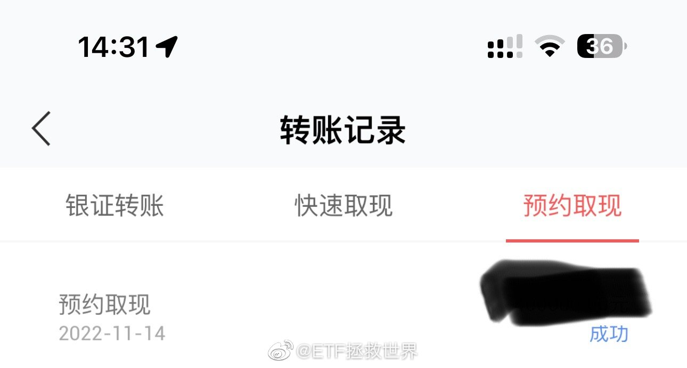

## 2022-11-14 14:59

今天医药非常强势，不出意外的话融通收益率也可以干到28%左右了。

之前我说，买入一个多月，收益率30%卖出一点实现利润不合理吗。

有朋友说，哪个30%啊。

现在你知道了吧。

不止看过去，不止看现在，还要看未来。

知行，知止。 ​​​

## 2022-11-14 16:25

各位巴菲特瞎蒙一下，下一网YY能不能收割。 ​​​

## 2022-11-14 19:56

一周没有看书了，整个人很浮躁。

得找时间补回来。 ​​​
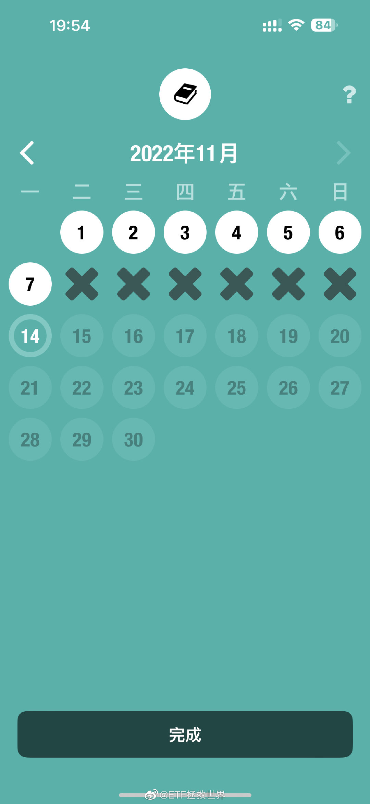 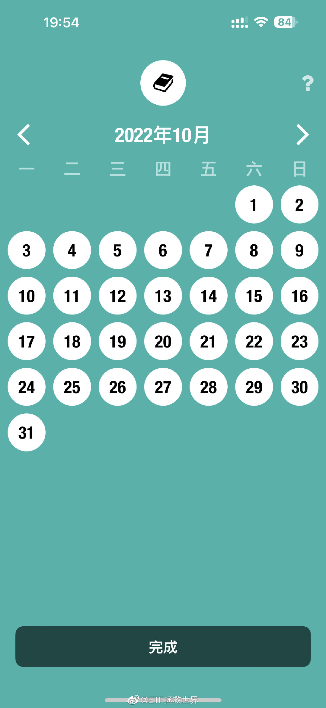

## 2022-11-15 06:49

昨天债基继续大跌，但是没事，上周我们已经清仓纯债了。一点都不剩了。

👏

但是有一件事再次提醒各位，自动跟车的朋友一定去确认是不是成功卖出。因为自动跟车的卖出逻辑非常严格，有可能没有执行。如果没有，就手动操作。 ​​​

## 2022-11-15 08:29

今天地球人口就突破80亿了，未来有一天，会突破100亿。

所以你看，我们担忧中华民族人口问题，担心老龄化，担心这个那个，从人类整体视角看，是不是根本不重要。

从地球视角看，100亿人类算个der，一个冰河期全部灭掉。

从宇宙视角看地球——对不起，比沙子还小，看不到。

很多朋友担心病毒肯定没错，谁不重视健康。但是做好充分准备，应对它的到来就好了，过于恐惧焦虑没有用。

你不戴口罩，不勤洗手，不打疫苗，不准备抗病毒和感冒药，然后躺那一个劲的担心，是不是不太对。

人这一辈子，其实就那么回事。你自己认为自己是世界的中心，是最重要的人，实际上根本就不是。生老病死，谁也躲不过这个轮回。每个人都有自己的命运，努力追求的过程最重要，结果很多时候也就是个添头。

## 2022-11-15 09:03

刚才有朋友质疑：什么叫以人类视角看？如果我们不好，那对我们来说有什么意义？

对了，这位朋友的视角，就是“我们”。

很多问题你从不同的视角看，就有不同结果。

如果你事事从自己的视角看，那么在每一次考试，每一次招工，每一次升迁，每一次竞赛，胜利的都应该是你。

当你格局大了一点，学会从家庭视角出发，那么可能楼道里的公共空间，最优质的教育资源，最好的房子，都应该是你的。

再大一点，一个社区和一个城市的角度，一个民族和一个国家的角度，事情又会有了变化。

当你看事情的层面越来越高，你会发现低层次认为很重要的事情根本不重要。

比如，你从社区角度看，自家占用公共空间就是不对的。你从国家角度看，自己把智商一般的孩子硬塞进重点就是错的。你很珍惜自己的生命，但当国家需要你的时候，你也许会奉献自己。

比如，很多人认为，我们的国家对其他国家来说特别重要，没有我们全世界都活不下去了。

但实际情况可能是，以前你闭关锁国的时候，跟大家没有来往的时候，好像别人也活得不错。从地球角度看，你可能也没你想的那么重要。

我的意思是，每个人都认为自己最重要，自己一定要最幸福，一定要最美身材最好，一定要有钱，一定要住大平层，一定要长命百岁，孩子一定要上重点，一定要有幸福人生。

但实际上咱们都是普通人。一辈子都是一眨眼就过去了，爬山的过程中，多看看沿途的风景。山顶呢，能到就到，到不了也没什么，努力过就行。你到了这座山的山顶，还有下座，什么时候你才满意？

努力做事，看淡结果。所有比赛只有一个冠军，是不是除了冠军其他人都是失败的？不是吧。你不可能什么都是最好的，放不下执念，就要痛苦一辈子。

“我不好，别人好，有什么意义？”

是啊，当你认为你自己是宇宙中心的时候，确实这是个大问题。 但这个问题，说实话，除了你自己，无人关心。

## 2022-11-15 09:53

要的多，想得多，做的少。

正是很多人焦虑的根源。 ​​​

## 2022-11-15 10:15

11月过半，目前看纳指还有希望，恒科这样搞很难符合买入标准呀。

## 2022-11-15 10:18

打开软件一看月收益，

嗷的一声昏古七了。 ​​​

## 2022-11-15 11:26

信息产业致敬后新高，瑞思拜。 ​​​

## 2022-11-15 11:42

每个指数的重要支撑位：我做好表格发布，然后过一段时间更新一次。

在重要支撑位我的致敬价格，致敬金额，致敬日期，交易记录：我贴出来了。

波段交易价格，数量：我列好表格。

长期计划仓位够了，不够，买、卖价位、仓位：公众号推送，且慢自动发车。

长期的、短期的、仓位不够的加仓点位，全都明明白白清清楚楚说一万次。

还不满足。

你的钱是交给我帮你操作你给我管理费了，还是我是你的长辈亲人。我还应该怎么做你才会满意。

长期计划我们的A股仓位够了，当然不加仓。这件事我也说了十几次了。留下的现金，我们是给别的品种准备的。不光不加，还要减呢，减完了继续涨，你蹦跶的更欢，不信咱们等着看。

## 2022-11-15 11:56

再说十月底为什么要加仓A股？10月底A股出现低点了？

我谢谢你不要搞错了好伐。

4月中证500最低5158，10月底中证500点位5807。懂了伐？要加也是4月底加，而不是10月底！中证1000更加明显。

那么我们3、4月加了没有？

10月底，连10月11的低点都没到，你说10月底应该加A股，我都觉得可笑。

哦，难道你只看沪深300？那当我没说。

我们加不加A股，看的是全市场状态，不是某个指数。不像有些人，一叶障目。

目前150计划A股持仓58%，叠加可转债，仓位超过60%。结合目前全市场状态，在我的定义里，已经是“激进”仓位，因为打满了也就80%给A股。

就这60%，觉得行就参考，觉得不行就取关。叽叽歪歪什么都不懂。

## 2022-11-15 12:10

今天债券继续下跌，十年国债收益率升至2.87%

你要说这债券跌也快。

你说你不留点钱，债券、美股，价格合适了你拿什么买。 ​​​

## 2022-11-15 12:59

别太在意别人怎么看你。

其实别人根本没在看你，大家都很忙的。 ​​​

## 2022-11-15 13:09

中午收盘后，去买了个煎饼果子，双蛋双薄脆。

全款。

不要嫉妒我，再努努力，你也行的。 ​​​

## 2022-11-15 15:02

恒生指数准备碰历史最后支撑位了。

是不是很奇怪，涨了那么多，上面碰到的居然是最低的支撑位。

是的，很可笑，30年支撑跌破了一个多月。

你问我为什么不在下面重新设支撑，不好意思，我不知道怎么设置。因为9月底到现在的恒生是无法用历史来解释的。

你又问我，所有的支撑在上方的时候都是压力，那么这个支撑是不是恒指的压力。

我也不知道。因为历史没发生过跌破最后支撑的情况，那么它会不会变成压力，我蒙圈了。

交给市场吧，看它怎么走。

但我可以告诉你正常情况下第一个压力位是哪里，很久之前开始说过好几次了：

22400左右。

就是上次碰到跌回来的那个地方。

## 2022-11-15 15:27

恒指9月底跌破18500最后支撑位后，当然是比较出乎我的意料，但这一个多月，我从未担心过它永远涨不回去，也未担心过我的本金拿不回来。

根源在于我认为股票指数是一个容错性很强的投资品种。除非出现极其特殊的情况，否则它不会死，也有极大概率越来越高。

更何况，我在这个容错概率很高的品种上，再加保护垫。就是我们买的很低。（所以今年医药跌20%多，去年跌7%，我们的所有品种却都是盈利的。无论中、美、港，因为我们买的低）

如果一个不死品种，买的并不高，成本很低，那么当它跌到出乎意料的地方，我个人认为也没有什么太在意的。很多品种赔了，你不知道它会不会死，或者你的成本特别高你也不知道多久才能涨回去，你会很担心。但不死+便宜，我找不出特别担心的理由。

这是因为恒生涨了我又开始嘚瑟吗。如果你看了10月24日，最低位附近我是怎么面对质疑为大家打气的，你就不会这么说。

当然，有些人是瞎的。
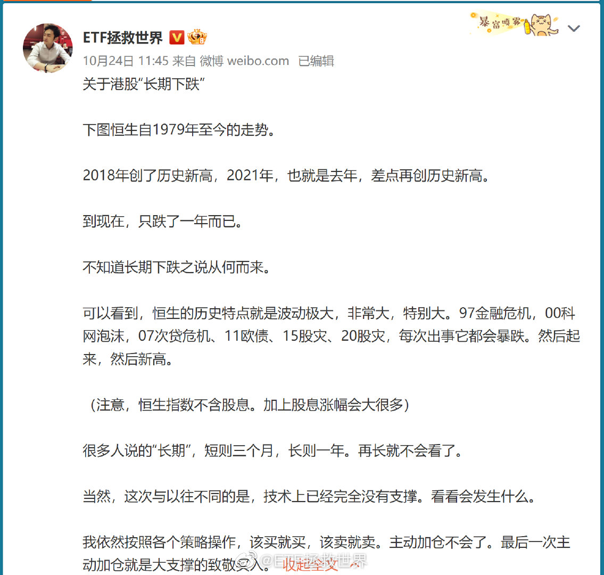

## 2022-11-15 15:36

今日数据：

A股全市场估值，自2017年10月以来，首次突破5年平均（主要因5年平均越来越低）。

机会是跌出来的，风险是涨出来的。随风起舞赚钱的时候，不忘风险就行了。 ​​​

## 2022-11-15 20:41

该说不说，这哥们开挂了 ​​​
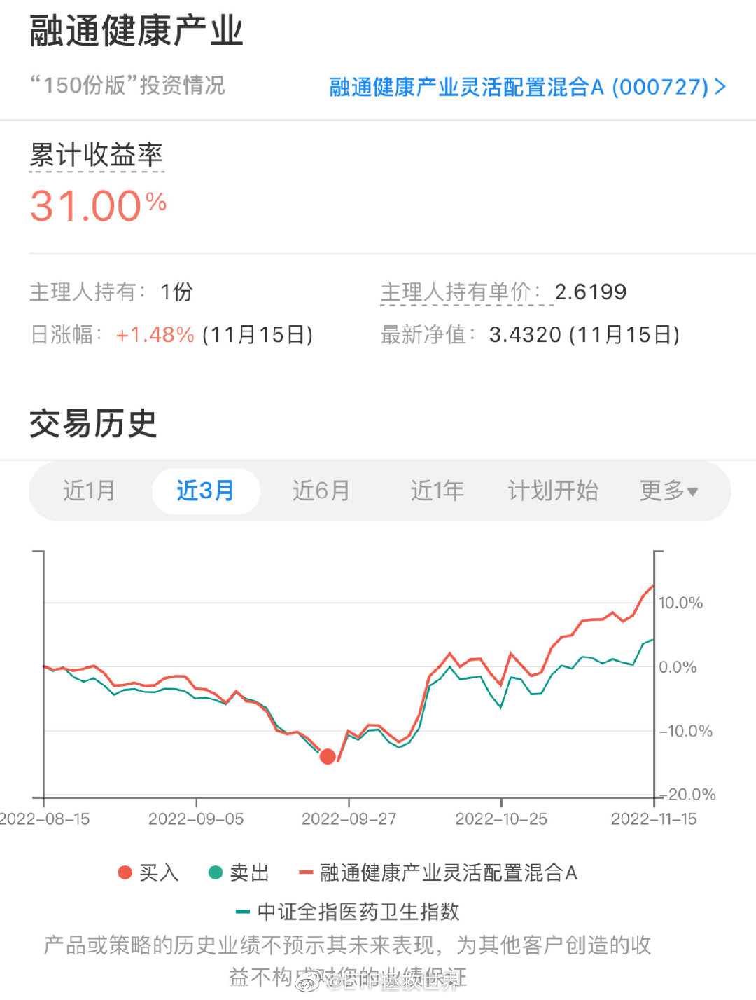

## 2022-11-15 20:56

投资债券也要盯紧了。 ​​​
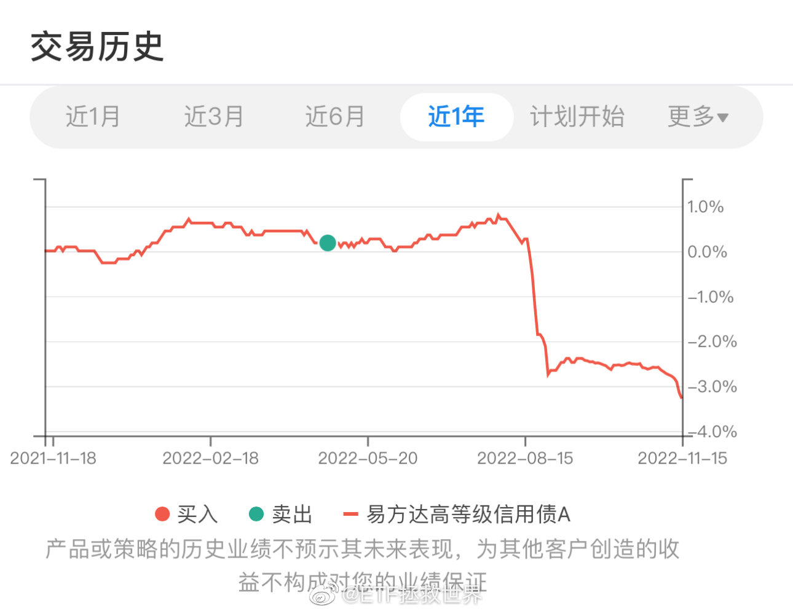 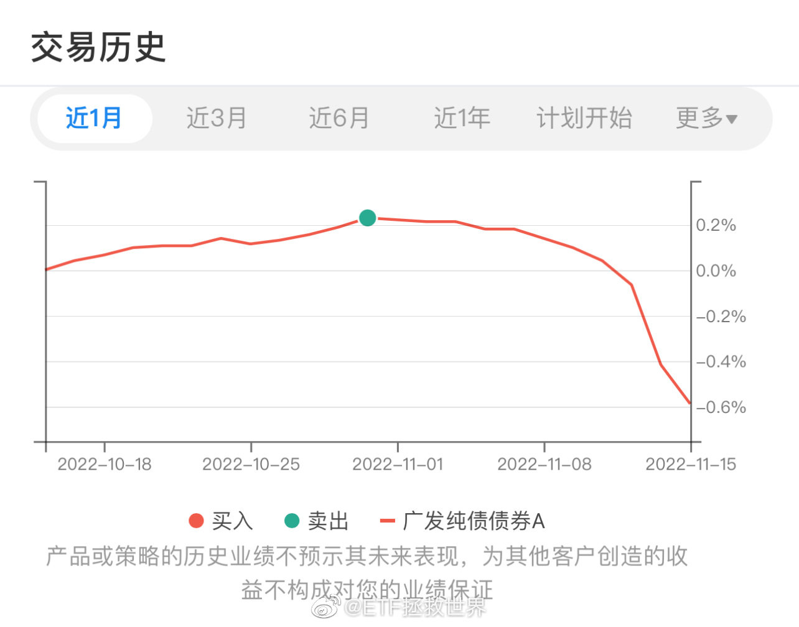 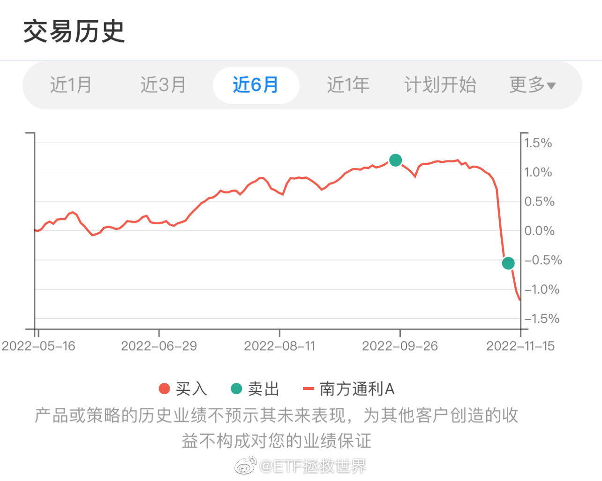

## 2022-11-15 21:39

纳指这个月很有希望买一点。但是涨高了怎么办？

谁能想到，汇率给力了，美元跌了。

这样对冲一下，可能给出一个不错的买点。 ​​​

## 2022-11-16 09:35

注意看，这个男人叫小帅。 ​​​

## 2022-11-16 10:28

你永远可以相信YY。 ​​​

## 2022-11-16 10:42

今天医药/信息，致敬后新高。

什么时候卖出一点呢。

这是个问题。 ​​​

## 2022-11-16 10:47

根据目前的安排，本周A股沪深市场仅有赛恩斯一家新股申购。 ​​​

## 2022-11-16 11:12

经过深思熟虑后，我做出了一个违背祖宗的决定。

车上见。 ​​​

## 2022-11-16 13:52

很多人在讨论，纯债基该不该继续拿着。

其实这个问题很简单，你买不买一个品种，拿不拿一个品种，卖不卖一个品种，最根本的就是，

你能从它身上得到什么，你可能在它身上失去什么。

你可能得到的能不能给可能失去的足够的风险补偿。

纯债基也是如此。

就是一个概率问题而已。 ​​​

## 2022-11-16 13:59

我理想中的投资组合，不是说没有波动，也不是说中短期收益率特别高。

而是在任何市场暴跌的熊市中，都能够不跌或者少跌。也就是说，不被单一市场的巨幅波动影响，能够中长期持续保持向上。

这些年基金业提供了很多很好的品种，不足是很多品种规模太小，禁受不住我们的大量买入持有。这点特别遗憾。

上千亿资金愿意在高位扎堆追高科创之类的热门品种，却只有几亿，几十亿资金愿意买一些值得长期配置的好品种，也是相当无奈。

## 2022-11-16 14:27

国债上午反弹的好好的，下午又跌了…… ​​​

## 2022-11-16 14:45

对债券感兴趣，有债券投资经验的朋友，建议关注超长期国债。

波动特别大，很适合做波段。

具体品种以前说过，看可以自己搜一下。 ​​​
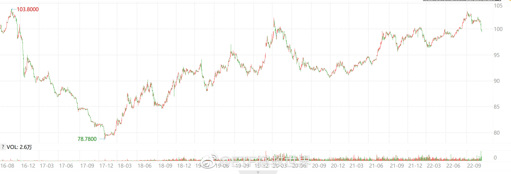

## 2022-11-16 20:39

有没有聪明的同学给我讲讲，为什么有人会讨厌一个人，还要一直关注这个人。

每天看，有新动态就看，然后越看越讨厌，越讨厌越看。

到底为什么呢。因为以我的人生经验来讲，如果讨厌一个人，最好的做法就是离他远远的，不听不看他的任何信息，这样心情不是才会舒畅吗。

难道都是受虐狂吗。

我不懂这些人，你懂吗。

## 2022-11-16 22:44

看了眼汇率，哭了。

看了眼指数，又笑了。 ​​​
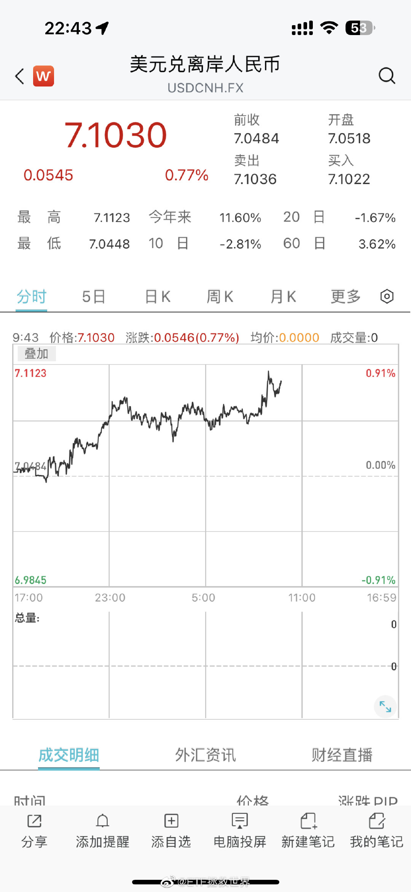 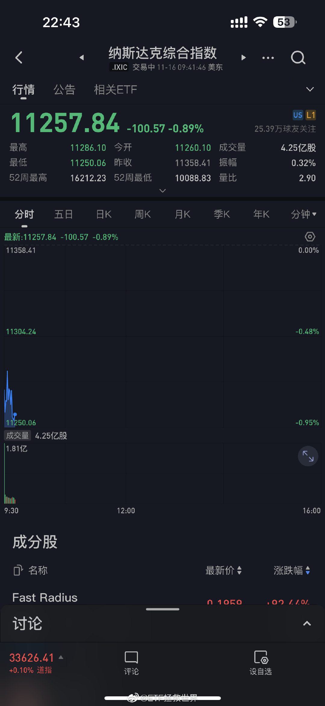

## 2022-11-16 22:58

无论如何，今天都很高兴。美股仓位总算站上3%了。

希望这是一个好的起点，希望有一天能买到10%，20%。 ​​​

## 2022-11-16 23:02

鸟鸟今年第二，说第一也可以。我的眼光没错的。

## 2022-11-17 07:54

以前的老鼠仓大多数是亏的。这个还赚了2万不错了。

## 2022-11-17 08:23

今天有几个我比较感兴趣的悬念：

医药能否继续新高

债券走势

汇率走势 ​​​

## 2022-11-17 08:50

有些人专注做事，有些人专注搞人。 ​​​

## 2022-11-17 08:57

watch ultra 实测，20小时掉电30%，续航能力大幅飙升。

作为智能手表，最后一块短板也快慢慢补齐了。 ​​​

## 2022-11-17 09:45

骗我可以，注意次数 ​​​

## 2022-11-17 09:54

基金行业，最应该解决的，不是某只基金涨的好不好，某个基金经理牛不牛，基金公司管理规模有多大的问题。

而是，

投资人不挣钱的问题。

越猛的基金，最后套的人越多，这才是大问题。 ​​​

## 2022-11-17 10:01

之前埋怨我为什么没有买回环保的人，现在还会埋怨我吗。

也许会吧。

“你完全可以低位买了高位卖了躲过大跌啊”。

骚瑞，我不能。

我的原则不允许我那么干。 ​​​

## 2022-11-17 10:12

每天半饿不饿最舒服。

人吃太饱了不行，容易吃饱了撑着。 ​​​
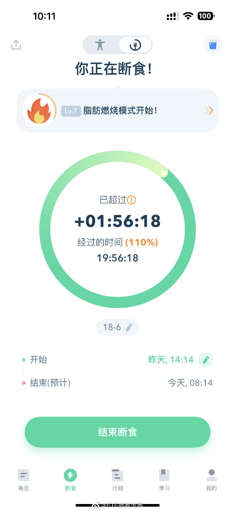

## 2022-11-17 11:07

分享我的表盘布局：

左上：日期 星期

右上：体能训练

左下：倒计时

右下：健身记录

上：数字时间

下：气温

左：streaks七项每日任务，分别是：扔一件东西，一万步，60个俯卧撑，称体重，戒糖，服用维生素，看书半小时

右：电量 ​​​
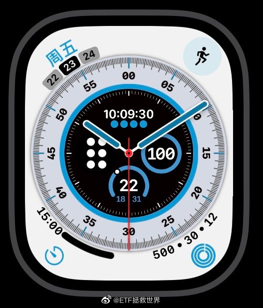

## 2022-11-17 11:26

很小的时候看过布鲁斯南演的那版 环游地球八十天。

觉得福格太帅了，每一件事都极其精确。时间，衣服，甚至水温和步数。

爱了爱了。

从那时候就喜欢精确，整齐，有序，干净。

这也是我为什么特别喜欢不能结婚的男人里面，阿部宽的家的原因。 ​​​

## 2022-11-17 14:34

信息又新高了。

呵呵，瞎嘚瑟，下一个就卖你。 ​​​

## 2022-11-17 18:35

以前美元涨跌跟你没有太大关系。

当你买了标普，纳斯达克，纳指生科，恒生，恒科，恒生医疗后，就不一样了。 ​​​
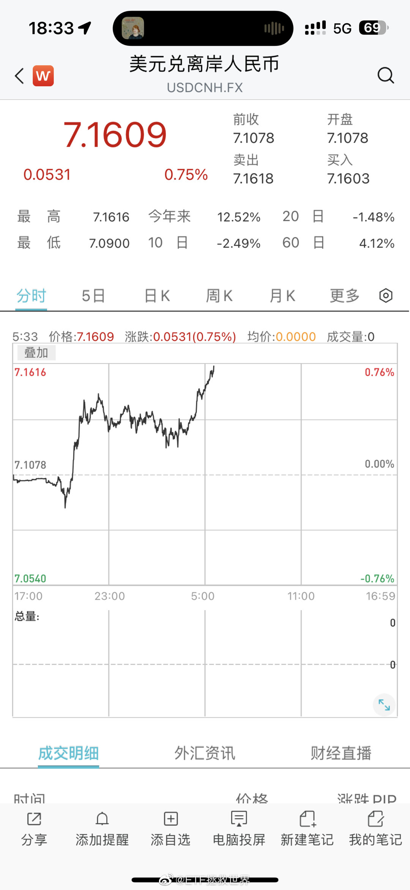

## 2022-11-17 19:35

今天你赚了30%，卖了，很开心。

如果继续涨，就会有人私信或者评论：为什么卖飞了；因为看你卖了我也卖了少赚多少？

即使真的买在最低，卖在最高甚至都是不符合要求的。

要求是：

买在最低，全仓。卖在最高，全部。然后，所有品种，照此执行。

如果是左侧买入，他会问你为什么买了就跌。如果是右侧买入，他会问你为什么之前低位不买？

如果是左侧卖出，他会质问你为什么卖低了，利润少了你怎么负责？如果是右侧卖出，他会问你为什么高位不卖低位再卖？

他以为的投资，是回头看k线：你看，去年k线明明低点在这里，你为什么没买？高点在那里，你怎么不卖？

[微笑]

你以为我在扯淡，其实，所有这些质问，都来源于我的生活。

他们要求的，是一个神。

## 2022-11-18 09:29

6点多起床。

称体重。

喝水。

运动。

看研报。

喝咖啡。

开电脑。

开交易软件。

发微博。

刺激的4小时又要开始了。 ​​​

## 2022-11-18 09:35

医药致敬仓位继续新高。  2个月收益率来到22%。  距离第一笔减持价格越来越近了。  刺激，巴适。 ​​​​

## 2022-11-18 09:41

我的所有操作都是明牌。

将要操作的点位也是几个月甚至几年前就公开的。

到了就买，到了就卖，没有含含糊糊，没有模棱两可，没有瞻前顾后。

我不怕自己会错，不怕展示自己的错，因为所有人都会错。我也不是神，为什么我不能错。

公开出来，大家一起看着我犯错，会更加督促我继续努力弥补缺陷，变得更强。

唯一不会变的，是坚定，坚决，没有任何力量能够阻挡的执行既定操作计划。

人一旦没有了独立、坚定的意志，在资本市场就是随波浮萍，就是任人宰割的羔羊。

## 2022-11-18 10:04

花无百日好，人无百日红。

股市也好，板块也好，基金经理也好，亦是大都如此。 ​​​

## 2022-11-18 10:12

我拉黑一部分人，不是因为他能影响我，那怎么可能。

他们的危害在于，会影响一批意志不坚定，心态容易炸，精神容易崩溃的朋友。

你能想象两军要打仗了，有一批人不停的在将士之间悉悉索索的说一些动摇军心的话。意志坚定的老兵没事，那些小白一害怕一激动卖在最底怎么办？

事后扯淡的人一转身潇洒离去，小白们看着账户欲哭无泪。

我作为这个账号的管理人，有义务，有必要把那些不停扯淡的人清理出去。

望理解。

## 2022-11-18 10:28

信息致敬后新高，一个月收益20.7%。信息的第一个减持点要比医药高不少，等吧。得之我幸，不得我命。

## 2022-11-18 10:38

我觉得投资与做很多事情是一样的。

知道自己要什么，知道自己有什么，知道可能会发生什么，各种情况发生了自己的应对之策是什么。

做足准备，条件触发即行动。一切有备而来，行云流水。

少一点仓促，多一点从容，不仅投资，整个人生也有可能越来越顺利。 ​​​

## 2022-11-18 10:51

我一个上海的好朋友给我打电话，哭了。

她在做癌症手术后的放疗，但因为单元有密接，居委会不让她出门。

本来恢复的好好的，现在做不了放疗，害怕病情反复，整个人崩溃了。

我想问问，这种情况，她该怎么做。

（经朋友提示，原微博写的化疗应该是放疗，已经改了。我不懂这些写错了……） ​​​

## 2022-11-18 12:36

今日食咗乜嘢 ​​​
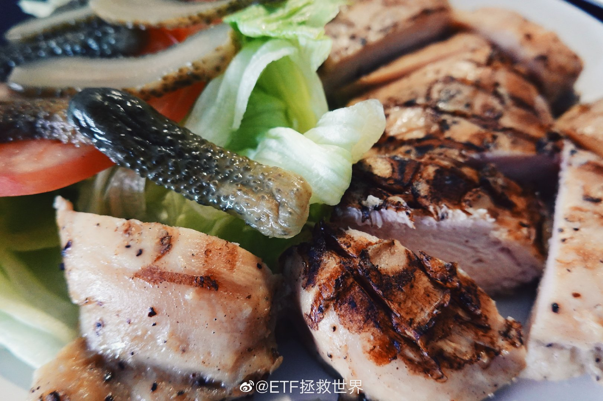

## 2022-11-18 13:16

托大家的福，我朋友已经到医院了。后来居委会叫了车。希望朋友早日恢复健康，希望大家一切顺顺利利。 查看图片

## 2022-11-18 13:55

医药这个行业是真的好。

朋友，相信我。 ​​​

## 2022-11-18 14:25

有些企业，盲目举债盲目扩张，不行的时候所有人被迫来救它。

活过来以后，更加变本加厉的举债扩张，然后越来越有钱。

这公平吗，我觉得不公平。

凭什么越疯狂的人钱越多。

等于是做不好无风险，做好了赚大钱。哪里有这样的好事。 ​​​

## 2022-11-18 16:14

长线部分的计划和致敬仓位，大致会分3-4个主要区域减持医药。

所以不要因为一部分仓位所谓“卖低了”而不开心。

如果你总是想着全部都要卖在高位，也就是说，如果你总是想得到完美的结果，那么，你一定是得到最差的结果。

就像找男朋友女朋友，你总是想着这个不完美，我再等等，可能下一个更好。或者你交往了一个，发现还没前任好，又不甘心。结果，很可能一辈子就蹉跎了。

好在，证券交易不是像结婚一样一锤定音。你的持仓也不是少到必须一把满仓一把清仓。每到一个关键位置就买一点或者卖一点。有什么问题？没有问题。

## 2022-11-18 16:26

回复@复利小卒:怎么想多了呢。那么医疗这次没跌到，当时有没有可能跌到呢？一个后果发生了，就觉得以前准备的其他方案是垃圾？做事情不是这个思路。让自己永远有退路，永远不会死，那才是王者。//@复利小卒:当时想着医疗是不是也要跌到位，想多了

## 2022-11-18 16:53

昨天在那个手表布局的微博里看到这个评论，一整天我都无法忘掉。

想一想，还真的没有人会看到什么好东西会总是惦记着要送我一个。

每个人的人生都是有缺失的。你拥有很多，你也缺失一点什么。你以为你一无所有，但其实最可贵的就在身边。

无论如何，羡慕她的老公。祝你们永远幸福。 ​​​

## 2022-11-18 21:11

喷了，第一次大幅跑输指数是在我们卖出后第一天。 ​​​
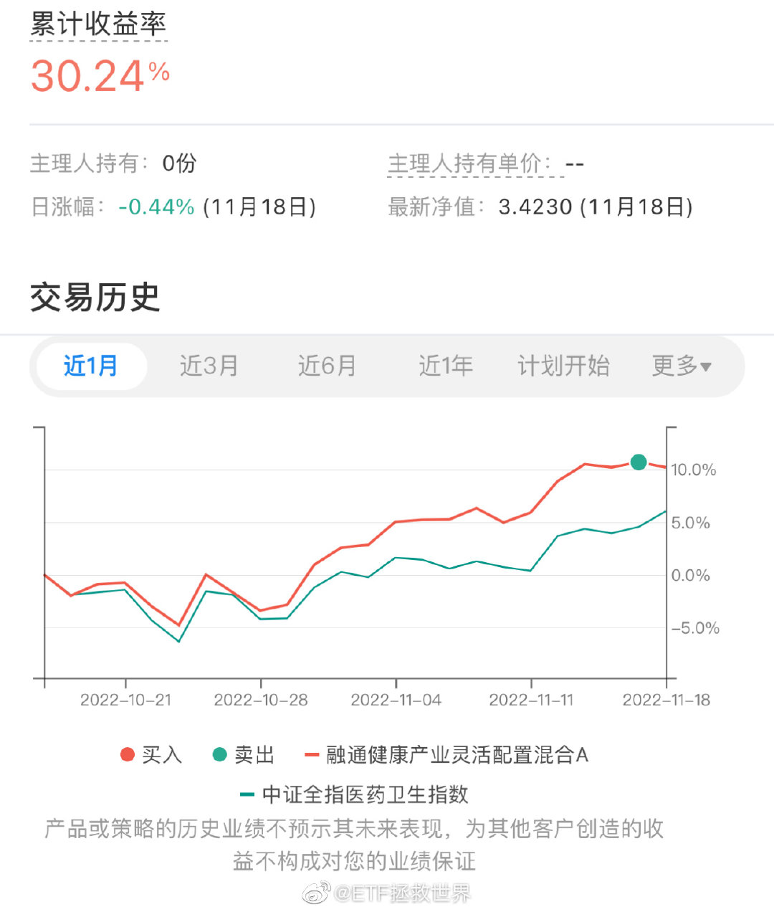 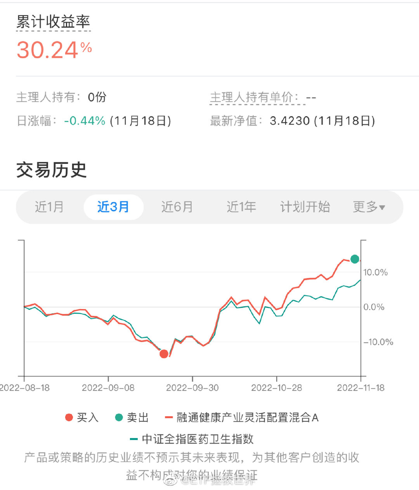

## 2022-11-19 08:45

弗洛伊德说，快乐其实是一种紧张状态的消除。

你琢磨琢磨是不是这么回事。

物质 精神 人际关系。 ​​​

## 2022-11-19 10:00

特别有意思。

甘肃一个县的俱乐部，足协杯把国安淘汰了。

我看了看评论，大都是在嘲笑男足，职业队。

在这些评论里，我看出来两点。

第一，这些人平常根本就不看球。

英国足总杯应该是全球影响力最大的国内杯赛。他们不知道足总杯历史上，有多少次业余队打败职业队，甚至英超强队的历史。

（英国足球联赛分位以下级别：英超、英冠、英甲、英乙、英格兰足协全国联赛、英格兰足协全国南区+北区、各区分区联赛。从足协全国联赛以上，才是全职业队。之下可以是半职业队或者说业余队。）

也就是说，无论在哪个国家，在国内杯赛中，业余队打败职业队太正常了。

结果到了咱们这儿，又变成了大新闻，男足又被嘲笑了。

第二，这些平常不看球的人，有机会就会喷。

你说奇怪不奇怪。他们平常根本也不关心足球，自己也不踢，也不送孩子去踢，别说去现场看，连电视转播都不看，结果男足成绩不好，就一定要喷几句。

我不是说男足不能喷，成绩不好被喷也要认，挨打要立正。问题在于，你平常根本就不关心的一个东西，有事儿没事儿你来喷什么呢。是因为你关心的事儿喷不了所以来泄愤吗。

咱们要真关心足球，能不能想一想为中国足球做点什么？一点一滴去改变它不好吗。

就咱们这个环境，足球要能好，那才是老天不长眼。

## 2022-11-19 10:14

回复@坚决拥护社会主义核心价值观:这种所谓业余队，队员也是各职业梯队下来的。其实职业梯队能不能往上走，除了极其出色的球员，是有一定随机性的。也就是说被淘汰的未必比上去的差很多。当年范戴克都差点被筛掉。

## 2022-11-19 10:39

有人问为什么一定要踢好足球。再说一次，没人说过一定要搞好足球。

但是，先看下面的运动员收入排行榜。

2022年度全球运动收入榜单前十（过去十二个月）（单位：美元）：

1. 勒布朗-詹姆斯，篮球，薪资3690万+赞助费9000万＝1.269亿，去年排名5

2. 莱昂内尔-梅西，足球，薪资7200万+赞助费5000万＝1.22亿，去年排名2

3. 克里斯蒂亚诺-罗纳尔多，足球，薪资6000万+赞助费5500万＝1.15亿，去年排名3

4. 内马尔，足球，薪资6500万+赞助费3800万＝1.03亿，去年排名6

5. 卡内罗-阿瓦雷兹，拳击，薪资8400万+赞助费500万＝8900万，去年排名12

6. 斯蒂芬-库里，篮球，薪资4120万+赞助费4500万＝8620万，去年排名10

7. 凯文-杜兰特，篮球，薪资3790万+赞助费4800万＝8590万，去年排名9

8. 罗杰-费德勒，网球，薪资72.4万+赞助费8500万＝8570万，去年排名7

9. 詹姆斯-哈登，篮球，薪资4000万+赞助费3600万＝7600万，去年排名16

10. 泰格-伍兹，高尔夫，薪资850万+赞助费6500万＝7350万，去年排名13

无论你是否承认，运动和运动是不一样的。足球、篮球、网球、乒乓球、羽毛球、举重、射击……

每一项运动的关注度，凝聚力，商业价值，对经济的拉动，文化传播力都是截然不同的。

无论你是否承认，足球、篮球，就是这个星球上最引人瞩目的运动。所以，很多人希望中国足球能好一点，很奇怪吗？

## 2022-11-19 18:41

人类其实不一定非要结婚，也不一定非要有个孩子。

一个感觉，不一定对。 ​​​

## 2022-11-20 10:13

很有意思，家周围开了几年的核酸点这几天撤了三个，其中一个昨天半夜连夜撤的。还剩一个，到中午就结束。

不测也行对吧。不行，孩子学校要求24小时核酸证明，所有共居者的。

于是，今天我看到了几年来最长的核酸队伍。 ​​​

## 2022-11-20 10:31

知行合一，加油(๑Ő௰Ő๑)！

## 2022-11-20 11:02

你还是不相信人类是最残暴的生物吗。

## 2022-11-20 11:35

好久好久没拉黑人了，今天要干掉三十个以上。 ​​​

## 2022-11-20 11:49

承认人类最残暴没有什么丢脸的。

人类之所以高级，是因为人类可以在残暴的本性上发展出规则，法律，甚至道德。这些都可以压制黑暗的内心，让善良和爱发扬光大。

所以，我们应该竭尽全力维护规则和法律，竭尽全力让社会性的人性战胜生物性的兽性。

承认问题，思考解决方式，解决问题，有什么不好吗。 ​​​

## 2022-11-20 11:54

造谣的人，是世界上最恶心的人。没有之一。

无中生有，颠倒乾坤。

恶心，反胃。 ​​​

## 2022-11-20 12:24

哪天微博上人云亦云，不求证，不证伪，别人说什么就信什么传什么的人少了，

凡事用脑子，讲逻辑，讲证据，看全貌的人多了，

就会让人感到有点希望了。 ​​​

## 2022-11-20 17:22

有一说一，我们也有一份纯债没有卖在最高区域。

但是跌了两天我一看不对立马走人，早早的把组合里的纯债清了个一干二净。

我知道有些朋友想还是观望一下，那如果是持有了这样的，心情就不好了… ​​​
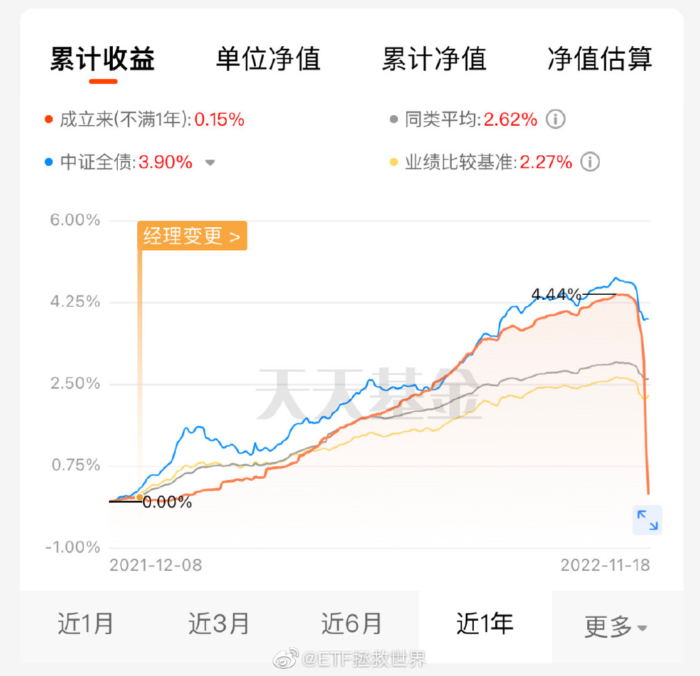

## 2022-11-20 18:22

别想太多。

多睡觉，少吃饭，多锻炼，少久坐。

多做让自己开心的事，少想烦恼的事。要想，也多想解决方法，而不是后悔，怨恨，担心，恐惧。

至于投资的那些烦恼事，交给我去想就行了。 ​​​

## 2022-11-20 21:07

有没有觉得时间过得特别快。 ​​​

## 2022-11-21 09:33

如果不小心卖在了最高，就是蒙的，望周知。 ​​​
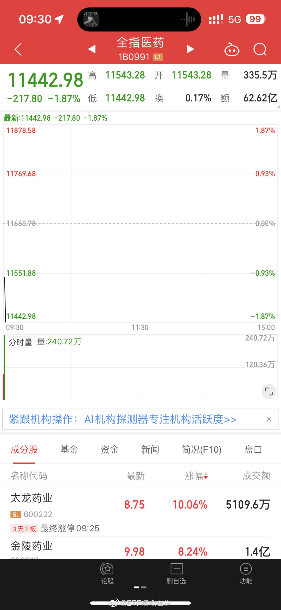

## 2022-11-21 13:40

月底消费还是有可能的。 ​​​

## 2022-11-21 17:52

当我们年华老去，不会想起那些日复一日平庸的日子。

如果我们无法改变生命的长度，我们就改变它的宽度。

多体会，多感知，多去寻找新鲜的东西，多去给自己找点不一样的乐子。

have fun！ ​​​

## 2022-11-22 00:01

WTF 查看图片

## 2022-11-22 09:19

今年大闸蟹是不是还没送呢。

那就送起来。

每份十只，3.0母蟹5只，4.0公蟹5只。

一共送三位朋友。

老规矩，只送钻粉以上。

祝大家好运气，祝每天开心。 ​ 抽奖详情 ​​​

## 2022-11-22 09:41

医药致敬仓位已挂条件单，成交后会说明。

第一，有始有终，买了说，卖了也要说，做事周到负责任。

第二，说到做到，不犹豫，不怀疑，低买高卖，用意志、理性、经验和知识不断提款。 ​​​

## 2022-11-22 10:22

总说这困难那困难，不能把孩子送到国外的人，你们知不知道这次世界杯开幕式有个护旗手，中国孩子，乃博宁林，现在在西班牙甲级劲旅马德里竞技梯队踢球。

哪里的人？四川凉山。家里很有钱吗？这个我不清楚。但凉山多有钱的概率不大吧。

他是怎么去马竞的。万达之星海外培训计划。

我在想啊，如果多一点万达这样的企业，多赞助一些孩子出去，真的就不可能吗？

你知不知道中超的外援一年多少工资。

最高的保利尼奥甚至可以超过1.5亿一年。

你又知不知道那几个规划球员给了多少钱。

这些钱，不够送100-200个孩子去欧洲梯队吗？

真没钱吗？当然有。就是没几个人会为未来十年二十年考虑而已。

## 2022-11-22 10:52

国债又跌了。 ​​​

## 2022-11-22 11:18

目前的A股非常鸡肋，我不会大量加仓，除了被动的操作设定，甚至没有主动操作的欲望。

真的鸡肋，不高不低，鸡肋。 ​​​

## 2022-11-22 11:37

几天都不等我吗

## 2022-11-22 11:52

今晚阿根廷对沙特。

预选赛看，中国队的实力跟沙特也就差一两个球吧。今晚大概也能看出跟世界强队比，中国大概能差多少了。

也挺无语的，想知道差距，只能换算，连碰面的机会都没有…… ​​​

## 2022-11-22 11:59

你拉大盘股就好好拉，拉到小红割一把行不行？ ​​​

## 2022-11-22 12:11

回复@城北捡故事2012:2021年10月12日，世预赛中国2-3沙特；2022年3月24日，世预赛中国1-1沙特。这是数据和事实。你把我太天真的理由说出来，说不出来拉黑。//@城北捡故事2012:中国能跟沙特只差一两个球？太天真

## 2022-11-22 12:47

今天中午准备吃一份番茄虾仁，一块香草鸡胸肉。

还没到点，还有52分钟。

你吃的什么。 ​​​

## 2022-11-22 15:46

榄菜肉末四季豆，我不允许你没吃过的下饭神菜。

网图，侵删， 

图里的油太多了。一定要少放油，炒出来干了吧唧的才好吃。 ​​​
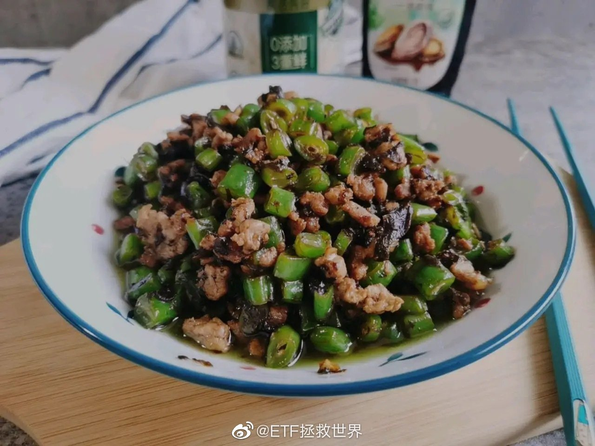

## 2022-11-22 16:24

有时候你从小就认为某样蔬菜特别难吃。

其实不是的。

有可能只是单纯的因为令堂或者令尊做的不好吃罢了。

当你去上大学了，或者上班了参加饭局，偶尔吃了一口那个你十几年都不碰的菜，惊为天人。

这时候你才知道，见识太少，导致你与真实的世界产生了误解。 ​​​

## 2022-11-22 16:58

该说不说，东子在企业家里算是非常靠谱的了。别杠，人无完人，你要追求完人只能碰到骗子。企业家，对顾客，对员工，对社会有责任感，就已经非常非常不错了。

## 2022-11-22 18:21

恭喜@神仙哥哥200003 等3名用户获得【大闸蟹礼盒（每份十只）】。微博官方唯一抽奖工具@微博抽奖平台 对本次抽奖进行监督，结果公正有效。公示链接：网页链接

## 2022-11-22 20:11

真特么励志。 ​​​

## 2022-11-22 20:28

今天我说中国和沙特是一两个球的差距，一位兄弟说我太天真。

我说去年中国沙特2:3，今年1:1，以证明沙特和中国差不多。

今天这场比赛后，我认错。

错了就认，挨打要立正。

沙特这场赢绝对不是纯侥幸。从上半场坚决造越位并且从未失误，就能看出整体防守素养极高。下半场两脚射门展示的射门技术，以及球员的拼搏精神和个人技术，

我错了，确实比中国队强不少。

但无论如何，三场比赛取平均，中国队依然是打平阿根廷。[悲伤]

## 2022-11-22 20:55

有时候我也会怀疑，难道真的是自己有点水平？

但其实真的只是瞎蒙的，我不能骗大家。 ​​​
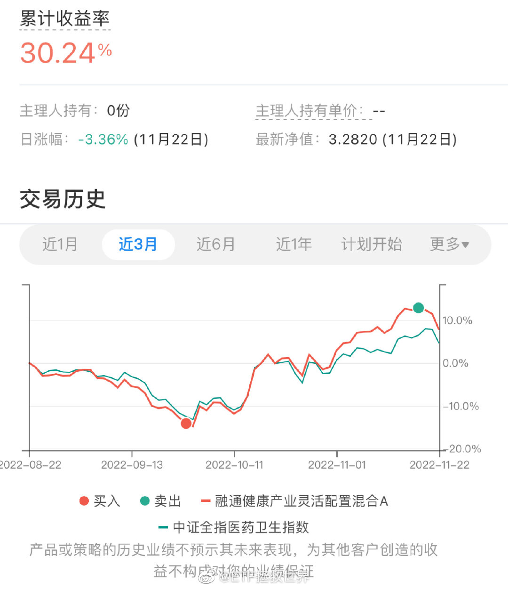

## 2022-11-23 08:22

如果中国队能在世界杯上打败阿根廷，有可能会放3天假（调休）

## 2022-11-23 08:42

回复@MorningHazee:这就是我说的，扣帽子。别说我是不是对调休有意见，就是真的对一些事情有不同意见，就是公知了，就是公敌了？所以一定要所有人思想统一才是爱国吗//@MorningHazee:你现在也转型成阴阳怪气的公知了吗//@ETF拯救世界:如果中国队能在世界杯上打败阿根廷，有可能会放3天假（调休）

## 2022-11-23 08:55

我觉得网上，有两种人对于这个国家危害最大。

第一种是我们什么都好，什么都牛，什么都完美，什么都特别棒，什么都是第一，什么都说不得不能提一点点意见。

第二种是我们什么都不好，这不好那不好没有一样好的。

别看这两种人看法完全不同，但有一点是相同的，就是对我们这个国家都是极大的危害！

没有任何人以及任何组织是完美的，是不会犯错的。最重要的是能及时发现问题，纠正方向，继续走向成功。

扣帽子，打板子，满脑子阶级斗争，动不动就把具体问题上升到阶级矛盾，敌我矛盾，你是不是疯了？

开个调休的玩笑，就变成阴阳怪气的公知了？

你是不是疯了？

## 2022-11-23 09:41

有朋友问，医药一直在跌，等跌到位还会把融通买回来吗。

我说，可能会，也可能不会。

那位朋友说了，你能不能别说废话，大家都很忙的。

我说，不是废话。

绝大多数投资人的一个误区，就是一个基金经理某段时间表现好，就会在接下来的每一段时间表现好。

这个误会，导致了无数惨剧的发生。

别说有很多基金经理是运气好业绩才会突飞猛进，就是那些真正有水平的，也有可能会碰上风格不合这回事。

所以是不是要买回来，买这只还是其它的品种，要根据很多东西做出判断。但永远不应该忘记的是四个字：

均值回归。

没有树能长到天上，基金经理也是一样。

## 2022-11-23 09:55

告诉我，这一波反弹消费最高点位是多少。

## 2022-11-23 10:11

在我的体系中，对于价格的容忍度是根据仓位变化而不同的。

如果一个品种轻仓甚至没有，那么我可能在它并不便宜的地方先买点。

但是如果一个品种已经有很多了，我就会等待极低价格出现，或者走右侧。

所以不要再问：“怎么没到大支撑位就买了”这种蠢问题。 ​​​

## 2022-11-23 10:24

跌了，不要慌。

这一波反弹，你不仅没有高位接盘，甚至还高位出货给了别人。长线波段都出了。

所以你慌什么。

跌下去正好有机会买回，低买高卖它不香吗。 ​​​

## 2022-11-23 11:02

给您一个建议：

不要买管理基金经验低于3年的基金经理的基金，最好是不要低于5年。

真的一两年，两三年的那种基金经理不是说肯定不好，但真的需要时间去考验。

更不要因为年轻基金经理赚得多就买。初生牛犊不怕虎，赚得多是因为没经历过风浪，什么都不怕。

而很多时候，什么都不怕本身是最可怕的。 ​​​

## 2022-11-23 11:39

最近做功课，消费又找了两个备选的品种。

其实消费最佳配置时间是2023年。

如果明年消费不涨甚至下跌，那么就是中长期超棒的加仓时间窗口。

时间，空间，配置，品种。不用急，也不用慌，一切都有预案。

踏踏实实的，多大点事儿。 ​​​

## 2022-11-23 14:08

把冰箱和冰柜塞满，是对它们最起码的尊重。 ​​​

## 2022-11-23 15:34

不走不行啊。

还有一个月。 ​​​

## 2022-11-23 16:02

今天喝了一杯美式，一杯橙汁。

吃了一个苹果，一份生菜沙拉，一小块鸡胸肉。

运动了一会，好饿，但是好爽，感觉自己好变态。 ​​​

## 2022-11-23 16:51

回复@果乐PP:是。牛市中年轻基金经理最猛//@果乐PP:等牛市确定来了的时候，是不是这些基金经理成绩更好？

## 2022-11-23 16:55

记录一下：

各路人马开始吹融通的基金经理了。

看看大家吹之后的表现。 ​​​

## 2022-11-23 17:04

医药倒是也有几只主动在储备库中。

买回的时候再定。

现在融通热度高，业绩好，不是好事。并不是第一选择。 ​​​

## 2022-11-23 17:31

有一说一，哪位小白鼠知道麻六记好吃吗。 ​​​

## 2022-11-23 21:54

标普500，纳斯达克买入后新高。 ​​​

## 2022-11-23 22:40

不抛弃，不放弃。

励志。 ​​​

## 2022-11-23 22:45

？？？！！！

## 2022-11-23 22:52

我真的好嫉妒沙特和日本的球迷。

麻蛋。 ​​​

## 2022-11-24 08:11

制定远期规划，然后认认真真踏踏实实的几十年如一日一步一步向目标努力。

功成不必在我。

不说了，再说又有人喷我崇洋媚外了。 ​​​

## 2022-11-24 09:26

日经今年快翻红了。 ​​​

## 2022-11-24 09:32

我已经没有心魔了。

“追高”在我这里不再是问题了。

我进化了。 ​​​

## 2022-11-24 10:04

你释放流动性，关我A股什么事？ ​​​

## 2022-11-24 10:21

本周五，或者本月30日，有车就开车，没车就看球。 ​​​

## 2022-11-24 10:38

多说两句右侧，希望自己的一点思考能给一些朋友些许启发。

右侧一般来说我会站在周、月的视角去看。因为如果站在天的视野看，很容易被每日的波动干扰。这样错误的概率会大增。

视角时间越长，准确率越高。

但就像万事万物一样，有一利就有一弊。准确性提高的同时，机动性和灵活性也就下降了。

所以，很有可能出现右侧反弹已经很多，才进场的尴尬。

那么，到这一步，就需要思考如何控制成本，如何在多维空间内考虑各种因素综合做出决策。

总而言之，所有的思考方向都是提高胜率。虽然没有100%的事情，但单次胜率越高，多次累加，总胜率也会无限接近100%的。

## 2022-11-24 10:42

回复@时不待我xiang:要不要我注册一个星球，每年899，你来付费我把细节、技术参数都送给你？//@时不待我xiang:好像什么都说了，又好像什么都没说

## 2022-11-24 11:15

比如说，我从巴菲特那里学到的最重要一点，就是他说了7次如果你不知道怎么投资，就去买标普500。

十几年前我听懂了他的话，开始在A股投资指数基金。

谁能想到，

十几年后我才明白，巴菲特说的不是指数基金，而是标普500。 ​​​

## 2022-11-24 11:39

这两个人的身材和形象是怎么保持的。

中国队现在杨晨谢辉李毅身材保持不错。 ​​​

## 2022-11-24 17:01

曾经我以为一两万的床垫就很不错了。

万万没想到还有几百万的。

有钱人的世界，我不懂。 ​​​

## 2022-11-24 17:15

说到床垫，想起又到冬天，南方的朋友其实真的可以考虑试试质量好一点的鹅绒被。（北方有暖气，鹅绒被会太热）

轻，暖，软，谁盖谁迷糊。

一般来说这里应该有个带货链接是不是……

真没有！ ​​​

## 2022-11-24 21:55

孙兴慜的面具对他影响太大了。 ​​​

## 2022-11-25 09:40

单吊一个企业，一个行业，当然有可能成功。A股一亿多股民，怎么可能没有成功的？

但是，正所谓，一将功成万骨枯。我们记得历史上很多名将，但对数十万倍的枯骨却毫不在意。

还是那句话，投资是概率问题。单吊一个企业，你成为名将的概率高，还是枯骨的概率高，每个人的情况都不同，需要仔细掂量。 ​​​

## 2022-11-25 09:57

易方达红利ETF的做市商彻底摆烂了。 ​​​

## 2022-11-25 10:10

你造吗，运气这个东西是没法改变的。

不是说你努力了或者够聪明就一定会成功，因为很多时候需要运气加持。

但是自己的性格、思维逻辑和处理问题的方式可以改变。

当这些有了改变，命运就会变得与之前的既定路线不同。

一个想法，不一定对。 ​​​

## 2022-11-25 10:19

每天摆烂。 ​​​
 

## 2022-11-25 10:44

不是因为寂寞才想你。

只是因为想你才寂寞。 ​​​

## 2022-11-25 11:05

今年红利涨了1.8%，

网格提款4次。分别是5%、5%、5%、8%。

周期分别是：1天、7天、28天、25天。 ​​​

## 2022-11-25 11:39

卧室听歌这个就够了 ​​​

## 2022-11-25 11:44

表格已更新，注意买回价格有变化，重新创建时宜修改。 ​​​

## 2022-11-25 12:04

大妈是不是不知道有多少日本球员在德甲和欧洲踢球。难道是日本球员在欧洲生活在真空中？//@caozenghui:问题日本也都新冠了啊

## 2022-11-25 13:04

红利涨了好。

涨高了平衡掉它，买辣鸡。 ​​​

## 2022-11-25 13:50

回头看150这几年的所有加仓时机，只有一个品种是在高位加仓的。

金融地产。

所以我对自己有个比较客观的认知，那就是，

我不懂银行，不懂地产，以后少碰为妙。

知可以为，知不可为。 ​​​

## 2022-11-25 14:08

小资产阶级充满了软弱性。

通过观察一个最好的朋友，我得出了以上结论。 ​​​

## 2022-11-25 16:32

判了。

那六个字，兄弟们你们说吧。

我不说了，说了挨骂，还要打官司。

 ​​​

## 2022-11-25 16:53

很多大的事情，小一点的事情，背后的根本原因可能很多人没有去思考过。

一件事发生的根本性原因，发生的条件，本质。

这些东西我有自己的思考，但是肯定没法说。甚至连方向性的思考都不能分享。

根源，各位往根上想，很多事情才会恍然大悟。

一定不要浮于表面。 ​​​

## 2022-11-25 17:36

这打扮高低也得是个正处级干部（副局级待遇） ​​​

## 2022-11-25 18:40

老外是真的心大。

威尔士对伊朗的观众席镜头给到一个几个月大的小婴儿。 ​​​

## 2022-11-25 19:50

我有一个梦想，这一波借助降准稳楼和炒作*字头的风，各路炒作资金能把红利带上去。

我们适当减持一部分做个平衡，转头买入低位品种。

接下来，就看这帮机构能不能下决心抱团干一票了。 ​​​

## 2022-11-25 20:03

18年底以来红利的历史交易。（图中价格是未复权价格，实际上卖出盈利超过40%。）

一般来说，建仓后我们不会轻易再动。如图所示，建仓完毕后4年才开始卖出第一笔，下一笔很有可能要23年了。

之前有人写文章喷我，说我为了增加手续费频繁交易。真的，说这些人是造谣的人渣毫不过分。 ​​​

## 2022-11-25 20:10

其实看足球真的一定程度上能看出一个民族的性格。

可能并不全面，但大多数都是如此。

波斯人，从古至今都不是软柿子。 ​​​

## 2022-11-25 20:39

刚才发现我这条微博又被人拿去喷了，而且是几十个人一起喷。对不起，我玩笑开得稍微高级了一点，没能让每个人都会心一笑，反而戳到了很多人的敏感点。以后我不会再开这种玩笑了，对不起。

## 2022-11-25 21:00

另外我去翻了一下评论，在这里对一些质疑做一个回应：

第一，其实说了很多次了，那我就再说一次。

我的指数交易计划从第二轮开始在网上公布，始于2010年，很多朋友有过去的记录，都可以翻阅。

2015年3-5月逐渐清仓第二轮。在股灾中毫发无损。7月，开始第三轮。

第三轮计划从一开始就在公众号完全免费、实时公布一直到今天。再说一次，完全免费分享。您愿意参考，我荣幸。您看不上，也没问题。但我是免费分享，不要造谣。

从2017年开始，也就是公布指数投资计划7年后，同步在且慢会有跟车计划。因为且慢会有自动跟车，会有补仓提示，很方便，所以如果您愿意，在且慢跟车也挺好的。

注意，我说过很多次，再说一次，作为且慢的组合主理人，我会有相应的一些收入。但这不是我一个人，而是所有的投顾平台，所有的主理人都会有。所以另一方面，如果您也愿意让我多一些收入，在且慢跟车算是给我打赏了，也很感谢。如果不愿意，看公众号自己去买也完全没有问题。

如果为了管理费，我不在公众号免费公布，只在投顾平台操作怎么了？谁又能说我什么？但我有这样做吗？

第二，组合中相同指数多只品种的问题。

最大的问题是规模问题。根据监管规定，单个投顾策略占主动基金资产不得超过20%，占指数基金不能超过30%。而我们的计划就出现了很多品种踩线或即将踩线的问题。所以，我们会配置不同的品种，满足监管要求。

第二重要的原因是，某些行业基金明显能跑出超额收益。比如8个月、9个月跑50%的大摩医药和易方达消费。再比如一个月跑30%的融通健康。

说我选基金，所谓“为了高费率”才去选，以取得更高收入的说法完全是扯淡。且不谈我们80%都是标准的指数基金，即使是有个别主动，买入后也明显远远好于基准，怎么能凭空污蔑是为了管理费才选？在网上造谣扯淡真的没有任何成本吗。

我们选基金的标准，指数基金第一重要是跟踪的好，主动行业基金最重要能跑出超额收益。然后再看规模，要满足足够大，主动行业又不能太大的要求。

各位想一下，S计划我有多少次不买，大家手里攒了多少钱了。150计划那么多年了甚至还有几十份没买。如果我为了管理费，让大家多买几份，不比费尽心机去找管理费高的品种容易太多？

人说话做事，要讲良心。我做的不好的，骂我没关系。为了满足不可告人的目的，无中生有，造谣中伤，那就不是人能干出来的事情。

你就根本不配做一个人。

## 2022-11-25 22:16

刚才评论里有一位朋友说，

他觉得我的内心深处还是太柔软了。

我想了想，可能是有道理的。

内心柔软有好的地方，人会比较善良，同理心会强，责任感会多，也不希望任何人因为自己发生不好的事情。

但是缺点也很明显。

所以作为181的猛男，是时候做出一些改变了。

有些时候，要更加强硬一些！ ​​​

## 2022-11-26 08:43

注意保暖，吃点好的，照顾好自己。 ​​​

## 2022-11-26 11:51

下午第一届中国青少年足球联赛u13决赛，山东鲁能对清华附中。清华附中是董路搞的足球小将为班底。可能很多朋友不喜欢董路的很多言论，但是在青训这件事上，他是踏踏实实做事的人。比那些只会坐而论道指点江山的人强1000倍。有兴趣的朋友可以看看直播。足球小将加油，中国青训加油！

## 2022-11-27 19:13

神奇，我买的快递从广东到了北京，然后转了一圈又被送回去了。

这段时间还是不网购不添乱了。 ​​​

## 2022-11-28 08:33

还是关注投资吧。

快开盘了，消息面正负中和，涨跌莫测。 ​​​

## 2022-11-28 09:17

红利几天能接回来。医药什么时候接回来。 ​​​

## 2022-11-28 10:04

还有两天才到月底。

不要急，你让市场走。它会走出形态，然后我们分析它。

是转折了，还是下跌中继，会走出来，不要急，不要急。 ​​​

## 2022-11-28 10:30

一个真敢送，一个真敢吃！应该打开让大家看看里面的黄和膏，馋一馋没吃到的朋友。

## 2022-11-28 11:14

我说一句不知道是不是又会被骂的话，

我觉得，在不增加患者负担的前提下，医生的待遇应该稍微再高一点。

如果有一部分精英不去当gwy，而去做医生，那我觉得可能会更好。

但是具体应该怎么提高，我不知道。 ​​​

## 2022-11-28 16:16

科创50再次跌到1000点以下，但估值依然在50倍以上。

我还是不会买。

我知道，未来科创上涨了，又会有人来骂我。但你知道吗，我不怕你骂。

它贵，但是涨，跟我没关系。有些人做了违法犯罪的事，发财了，我会后悔为什么没有跟他一起做吗？你会吗？

我有自己的原则。我认为错但有可能获益的事我就是不会做。贵的东西我就是不会买。它很有成长性，没错，但50倍太高了，我就是不会买。

反正无论我做什么都有人骂，随便吧。

## 2022-11-28 16:29

该说不说，我有点想买创业板这件事，是不是看起来挺二的。 ​​​

## 2022-11-28 16:34

回复@小李白走天下:创业板大支撑目前在1680左右。如果能到，如果我还有闲钱，就会致敬。//@小李白走天下:创业板有致敬仓位点吗

## 2022-11-28 16:48

我看很多朋友觉得创业板指跌20%多才到大支撑是扯淡，“怎么可能”。

我们不谈技术，只说估值。

下表是创业板100指数自由流通市值前30位的TTM PE。

市值前10的算术平均PE是51倍，前20的算术平均PE是49倍，前30的算术平均是50倍。

那么问题来了，下跌20%，也就是大致从50倍跌到40倍，真的是那么难以接受不可能的一件事吗。

如果说连这样一个指数的这样一个跌幅在你的认知中都那么不可能，那么，我只能说，你对投资这件事的安全垫真的太薄了。

极端事情发生后，你可能会很被动。

我不是说不到大支撑就不能买，这不我也惦记着买呢。但大支撑是我认为一个指数最后一个支撑，是我致敬的位置，和能不能买是完全两回事的一个东西，希望你真的理解。

## 2022-11-28 16:54

回复@偶尔超神:创业板指第三季度有38家公司利润下降，有40家利润增速在26%以上，只有15家利润增速在80%以上。这是不是又是一个“马云和我们99个人平均后，每个人都是亿万富翁”的谬误？//@偶尔超神:创业板指第三季度利润增速80%，要想跌20%还真有点难度

## 2022-11-28 17:04

投资这件事，一定要用最谨慎的角度，给出一个“最差预期”。

给最差预期的原因，不是为了吓唬别人或者吓唬自己，而是只有你真的为最差预期都做好准备了，那么它发生了，你才不会慌乱，你才会有准备，你才会有能力有资本捡“带血的筹码”。

最差预期不是乱蒙的。一定是有一个角度，估值也好，技术也好。

到了就按照计划行动，比如恒生、医药、信息的致敬。

最差预期不一定到。那你当然也不可能不到的话就一点都不买，因为到最差预期的机会，好多年才有一次。所以一定是在比较便宜的时候已经买了一部分。

也许跌破，比如恒生。

那么无论到、不到、跌破，都有相应的预案，这样做起来才会不被动。

你有没有感觉，现在你做投资好像游刃有余，心情舒畅，总是能买到低点，又很难在高点追涨。

这一切都与结合了价值、趋势的一个体系有关。而这个体系中，“最差预期”这个节点，是相当重要的一环。

虽然说了很多，但依然会有人不明白。无论未来到了，不到，还是跌破，依然都会有人骂我。

但我自己觉得把想说的说出来，问心无愧就够了。

## 2022-11-28 18:13

创业板指已经跌破3年均线，意味着整体来看，过去三年买入并持有的人都被套了。

但S之前一波操作的收益率是这个。

月底极有可能S先买回来。

很有可能又要买入就跌了，但没办法，S这样的无限现金流模式，同时已经积累了很多份现金，就激进一点吧。

我对S的目标，就是在绝大多数品种在底部区域，浮亏程度不超过10%-15%，一旦趋势扭转迅速赚钱。

## 2022-11-28 22:22

韩国人的意志力真的可以。 ​​​

## 2022-11-29 09:15

对个人养老金我有两个模模糊糊的思路。

第一个是产品池最需要的是7-10年以上国债国开债指数品种，

第二个是操作方面可以考虑每年操作一次。所以一年期品种不是不能买。但是如何在每年一次再平衡的时候削峰填谷，还需要品种的丰富以及特征的更加明显。

总而言之，现在的产品远远不够配置需要。 ​​​

## 2022-11-29 09:33

小红超勇的有没有。 ​​​

## 2022-11-29 09:41

不少老朋友账面上的小红收益率已经非常高了。

然而即使如此，它依然没到大规模卖出的时候。未来还会赚更多。

你以为我，以及这些好多年的老朋友在小红身上赚到是运气好，又或者舔着脸说，是能力强的原因。

当然不是。

最重要的，不是运气，也不是能力，而是品格。

两年前大多数人都在嘲笑它的时候，是我们不抛弃不放弃。两年前有人拿着“六个月、12个月收益率”来指责小红的时候，是我们坚决持有。这，才有了这两年小红的回报。

投资这件事，说到底，最终体现的是一个人的品质、品格。一个人是不是随波逐流，是不是鼠目寸光，是不是坚守真理，全都能体现在最终的结果上。

与各位共勉。

## 2022-11-29 09:54

说到投资与做人，从本质上讲我认为也是一致的。

你知道很多人见利忘义毫无底线，也有一些人循规蹈矩别人怎么规定就怎么做。

但我认为，其实最好的状态是守正出奇，是七分正气三分邪，是坚持不触碰底线的前提下放飞想象力，不迂腐，想他人不能想，行他人不能行的行为方式。

投资也罢，做其他事也罢，大都如此。

## 2022-11-29 10:14

有人说，小红快回到9月高点了。但这两个月这么波动感觉很浪费啊。

网格那8%忘了吗。

这就是一个体系，互相配合。长有长做，短有短做。无论市场怎么走，我们都要获益。 ​​​

## 2022-11-29 10:15

今天，又是讨厌多多和茅台的一天！ ​​​

## 2022-11-29 10:19

十年国债2.91了，十年国开3.02了。

什么时候买回来。

钱快不够用了呀。 ​​​

## 2022-11-29 10:35

快亲上了。

围观群众目不转睛。 ​​​

## 2022-11-29 11:02

回复@HowRU_:不计算利润增长，预期收益率5.5降到1.5，收益率300%。股票如果永无波动，也就是几个点的收益。但是有了波动呢？//@HowRU_:股票最高才5.5呀

## 2022-11-29 11:12

小红一向以正人君子的形象示人。

然而在呢个moment，它表现得像一个渣男。 ​​​

## 2022-11-29 11:19

我有一种感觉，我们与大部分的小红持仓，可能在这一波就要缘尽了。

四年的缠缠绵绵卿卿我我，终究敌不过一个利字！

对人类绝望了。 ​​​

## 2022-11-29 11:24

第三位也收到了。今年送完，明年再送。等我有钱了，每次送30份~~

## 2022-11-29 11:42

今日地理新知：

巴布亚新几内亚在南太平洋，澳大利亚东北方。 ​​​

## 2022-11-29 11:56

小红是计划单一品种的第一大仓位。150占比11%，S占比14%。

如果能拿到60%以上的最终收益卖出大部分，就已经非常不错。可能有朋友觉得4、5年才能赚60%太少了，但我很满意。

这个品种有它自己的特点。其实每个品种都有自己的特点，这些特点你不亲自操作几年，是绝对无法凭空感受的。

有人喷我什么都买。A股、港股、欧美、石油、黄金、债券、可转债。对啊，我就是要什么都买。不买我怎么知道哪个品种的特性是什么，怎么知道什么时候该配置什么。我都买了，我还都赚钱了（目前暂时除了恒科和中概），你气不气。

我还年轻，为什么我要把自己禁锢在一个特定的范围内？

你愿意做套子里的人，你愿意早早的规定自己只能做什么一定做不了什么。

我，不，愿，意。

## 2022-11-29 12:19

我再多嘴说一句。

如果一定要去方舱，环境还是应该稍微弄得用心一点。至少床位之间有个一人高的隔板，配个小柜子，厕所弄干净。

尽量给每个人一点应有的尊严。 ​​​

## 2022-11-29 13:07

大EE版榄菜肉沫四季豆 ​​​

## 2022-11-29 13:23

分享图片 ​​​

## 2022-11-29 14:08

北冥有鱼，其名为鲲。鲲之大，不知其几千里也；化而为鸟，其名为鹏。鹏之背，不知其几千里也；怒而飞，其翼若垂天之云。

风之积也不厚，则其负大翼也无力。故九万里，则风斯在下矣，而后乃今培风；背负青天，而莫之夭阏者，而后乃今将图南。

蜩与学鸠笑之曰：“我决起而飞，抢榆枋而止，时则不至，而控于地而已矣，奚以之九万里而南为？”适莽苍者，三餐而反，腹犹果然；适百里者，宿舂粮；适千里者，三月聚粮。

之二虫又何知！

## 2022-11-29 14:35

你说为了让开发商保交付，给他们开了融资渠道。

他们会不会拿了钱又去瞎搞乱拍地，然后欠更多的钱。 ​​​

## 2022-11-29 15:21

今天各位账户回血不少，趁着高兴再说一件双喜临门的事情。

之前不是说每个月送50个杯子吗，这就要开始了。

具体抽奖规则过两天@且慢管家 会公布。

感谢@且慢管家 对本次活动的大力支持。

终有一天，每个人手上都要有个辣鸡杯！ ​​​

## 2022-11-29 15:54

芭比Q了。恒科涨7%，非常尴尬了。

明天总应该还有能买的。 ​​​

## 2022-11-29 18:50

咱们的媒体能不能客观透明的公布一些数据统计。

比如今年感染有几十万人了吧，这些人到底有多少重症，多少死亡，多少轻症，多少无症状自己就好了，后遗症的有多少。

每一部分打疫苗不打疫苗的比例。

年龄段统计。

怎么看来看去都是国外的数据。

怎么公开透明就这么费劲。这些数据也是不能说的吗，还是说根本就没统计。

## 2022-11-29 19:23

你有几个知己。

甭管蓝颜红颜吧。 ​​​

## 2022-11-30 09:01

我希望孩子成年以后，能够有能力、有意识为自己的生活负责。

我作为家长，不会什么事情都管着他，我也没有对他的无限责任。

这里说的不管，两层含义。

第一，不为他做决定，在遵纪守法的前提下，他做什么有自己的自由。不会无边界的限制他。

第二，不对他无微不至的照顾。他成年了，就要对自己的事情负责。不能把希望寄托在我的身上。

我希望他成为一个独立的人。经济独立，精神独立，思想独立。

他是一个人，他不是我的附属物品。

## 2022-11-30 09:51

小红即将到达一个中期中级压力位。 ​​​

## 2022-11-30 12:57

山姆极速达的商品少了70%，多点不配送了。

还好家里备货够多，顶得住。 ​​​

## 2022-11-30 13:08

发帖时间，9:51。今日最高价，9:51。你是不是逗我。

## 2022-11-30 13:31

生而为人，苦海无涯。

所以怎么才能在苦中作乐，怎么才能开心，是每一个人应该解决的问题。

三点很重要。

第一，健康的身体。第二，衣食无忧。第三，良好的人际关系。

身体、物质、精神。

各位看这三点，都有一个东西有关系，那就是：

钱。

有了钱，可以吃相对健康的食品，健康的概率大一点。有病挂不上号，也能去挂个特需提前安排。

有了钱，衣食无忧，可以不必为生存烦恼。

有了钱，不再“贫贱夫妻百事哀”，70%的吵闹也就没了。

钱很重要，但钱不会自动解决所有问题。所以你也可以看到很多富豪并不健康，人际关系也一塌糊涂。他们真的快乐吗，我虽然不是富豪，但我认为未必。

很多东西，不必成为富翁也能够拥有。

一个想法，不一定对。

## 2022-11-30 13:51

网上意见不同的人，脑子里一定都会想对方，“他怎么会有那么**的想法？”

非常简单，因为你们受到的教育、过往的经历、听过见过的世界、所处的阶层环境完全不同，你们怎么可能对一件事看法一样？

不要说不同的人，就是你自己看待事物的想法，也会随着年龄的增长，阅历的丰富，经历过很多事后都会不断变化。

网络，又把以前完全不是一个世界的人聚合在了一个空间，于是，冲突不可避免。

每个人的眼中，与自己不同意见的人都是**。但有没有一种可能，是你与他根本就不在一个世界呢。

## 2022-11-30 15:01

什么意思 ​​​

## 2022-11-30 15:30

“财经大V连msci调仓都不知道？”

感情MSCI连恒生也一起调了呗。

瞧把你能的。 ​​​

## 2022-11-30 15:56

有没有干规划或者建筑房地产行业的朋友，有一事不明，请教一下。

为什么我们国家没有发展这种社区。

不是高层，也不是好几层的别墅。就是一层或者两层的独立房屋。这种形态多见于美加澳等。类似于日本的一户建，但比一户建要宽敞，毕竟日本地更少。

如果说一线城市因为用地紧张没有，但实际上无论是一线还是十八线，无论地多地少，都没有这种形态的小区出现。

叠拼，合院的形态可以有，为什么这种没有呢。

## 2022-11-30 16:49

​​​

