## 2022-12-01 07:41

​​​
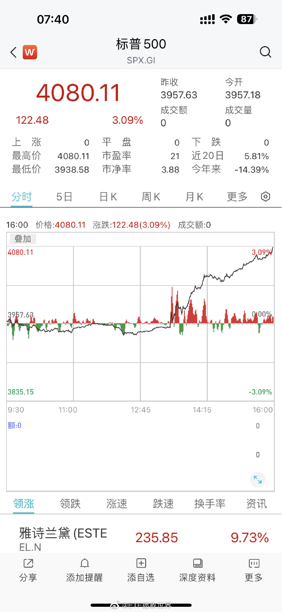 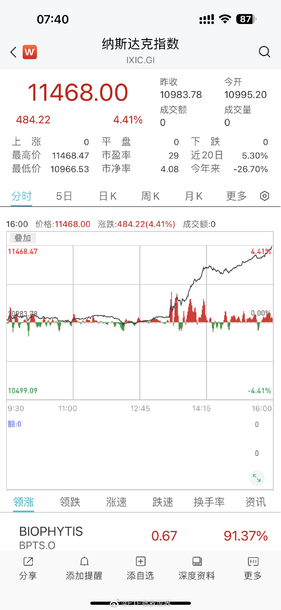

## 2022-12-01 07:48

今天恒生提款。

我说的！

 ​​​

## 2022-12-01 09:15

如果你对别人有什么要求，第一步要做的就是提出来。

你提了，就有可能实现。

你不提，永无实现的可能。 ​​​

## 2022-12-01 09:21

年初至今恒生跌了18%。

但今年计划买的两份恒生都已经赚钱了。

虽然没有买在最低。 ​​​

## 2022-12-01 09:28

回看最低落的时候，依然有人为它摇旗呐喊。它不是个坏孩子，它只是有点淘气。不抛弃不放弃，不因为别人落魄就嫌弃，不因为别人富贵就趋炎附势，说起来容易，做起来很难。

## 2022-12-01 09:42

今年第十七次提款，一个半月11.75%。

继续资助一位河南的贫困女生。

切记，让自己和家人过上好生活，才是最大的慈善。如果还有余力，再去力所能及的帮助他人。 ​​​
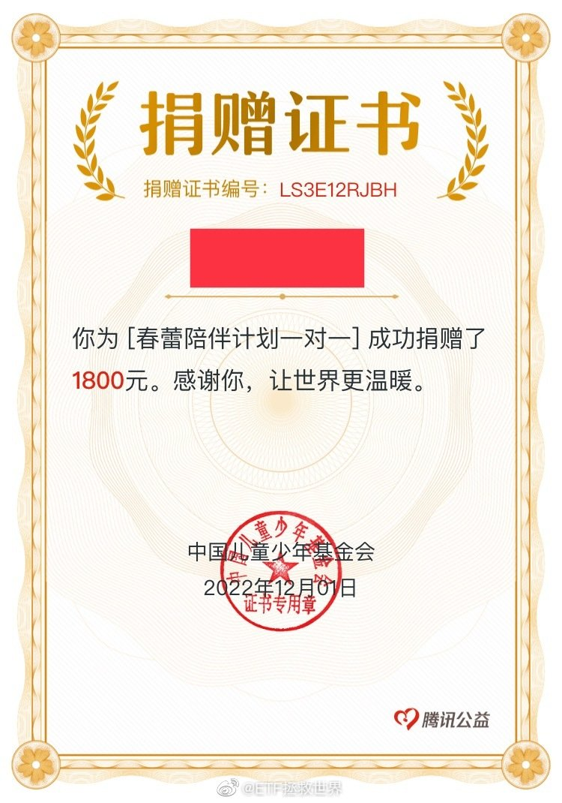 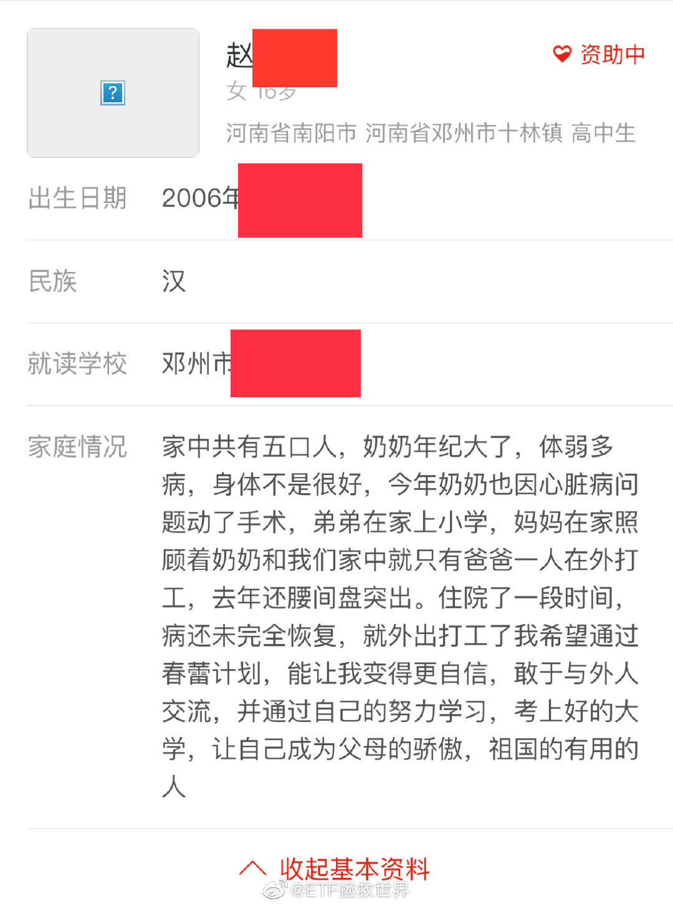

## 2022-12-01 09:52

笑死，创业板跟着凑什么热闹？ ​​​

## 2022-12-01 10:05

以前，是追涨还是杀跌，把你折磨得痛不欲生。

钱没赚到，心也累了。

现在，一切交给策略。买还是卖，让策略去决定。策略不好用就修正，然后让它继续执行。

钱也有了，也舒服了，还有精力上微博跟情感博主互动，简直不知道有多开心。

世界还是那个世界，你却不再是内个你。

因为，你的思维方式有了变化。

## 2022-12-01 10:53

提款是很开心的。

但开心之后就是一阵空虚。 ​​​

## 2022-12-01 11:28

儿子上网课开着摄像头，

我不知道，

班主任同埋全班同学一起全程观摩了我是怎么制作一杯卡布奇诺的，

甚至还拉了个花。 ​​​

## 2022-12-01 12:48

草地上开满鲜花，

牛羊来到这里却只看到饲料。

——《我的微博和喷子》 ​​​

## 2022-12-01 13:57

你有没有内种经历，

就是说，

你没有伤害过别人，

别人却因为你过得比他好就来伤害你。

没别的原因，就是见不得你好。

你过得好，比他过得差还让他难受。 ​​​

## 2022-12-01 14:24

你造吗，恒科的最后一网只差2%就能买到。

然后那一网收益率会是两周30%。

但是朋友，别难过。

真的，命里有时终须有，命里无时莫强求。

人生不能太圆满，月满则亏。

总有一些小遗憾，一些小缺陷，人生反而会更加顺利。 ​​​

## 2022-12-01 19:46

我说句实话朋友们，

如果不是因为有股市切割时间线建立节点，

我几乎想不起哪年发生什么大事了。 ​​​

## 2022-12-01 21:32

纳指生科今年终于由跌转涨了，0.93%。

我们盈利18.14%。 ​​​

## 2022-12-02 07:31

你要说中国队实力是不行，但是运气也是真差。

这届世界杯预选赛三个同组对手日本澳大利亚，小组赛都出线了。日本还干翻了德国西班牙。沙特没出线，但是干翻了阿根廷。

再回想2002年世界杯。当时小组赛的两个出线对手，一个土耳其后来是第三名，一个巴西最后是冠军。 ​​​

## 2022-12-02 09:41

为什么会买纳指生科和恒生医疗这种冷门货。

甚至包括之前的华宝油，华安油，南方油。

再包括黄金。

最主要的原因当然是它们有了投资价值。

其次，是不希望我们的组合被单一市场的暴涨暴跌影响。能够将资产曲线尽可能的拉平，降低波动率。

“定投沪深300不就好了吗，买那么多品种就是**”

你喜欢定投，你就去定投。我喜欢配置不同品种，你为什么要骂我？

我真的不懂了。难道这个世界只允许一种投资方式的存在吗？

（附图是定投沪深300至今结果）
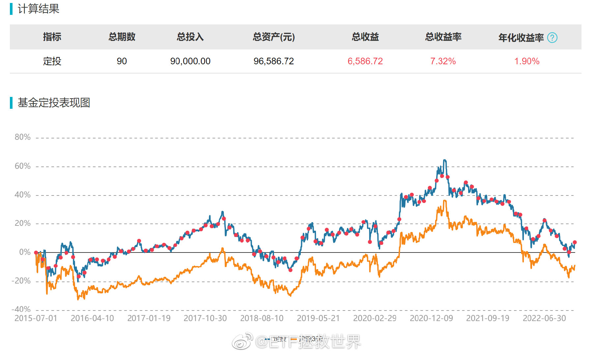

## 2022-12-02 10:02

12月了。

离搬家的时间越来越近了。

在这里，我请各位大明白以后不要在评论里暴露新家坐标，谢谢大家。 ​​​

## 2022-12-02 10:05

创业板这两个交易日的走势我看不懂，但大受震撼。 ​​​

## 2022-12-02 10:15

创业板虽然我们买了也暂时浮盈了，但我心里知道没什么搞头。

第一个中级压力位就在2550左右，你说可笑不可笑。 ​​​

## 2022-12-02 11:38

最近看世界杯，我突然有一个疑问，自己也没有答案，请教一下各位体育好的同学：

我国算不算体育强国。 ​​​

## 2022-12-02 13:56

500个不过瘾。我自费再加500个，每个月抽100个，一共抽1000个。表达一下我对您信任的感谢。朋友，祝您中奖。

## 2022-12-02 19:07

新疫苗在哪里打或者吸。 ​​​

## 2022-12-03 01:14

只要不死，

不放弃，玩命跑，

就有机会翻盘！

不要放弃！即使到了最后一刻！ ​​​

## 2022-12-03 12:03

你们有人注意昨天黄喜灿进球之前，他做了什么吗。

孙兴慜右路拿球开始盘带后，黄喜灿从中后场开始启动，玩命的跑。他跑的时候，根本不知道孙是不是能把球带起来，也不知道能不能传出来，但无所谓，就是跑！

疯狂的跑！一直向前跑！

结果呢，奇迹发生了。孙的球没丢，也穿透了3个防守队员传出来了，还传到位了。然后命运就改变了。

当时90多分钟，比赛马上就要结束了！绝大多数观众都已经放弃了吧？

这就是只要有一丝希望就要竭尽全力的去干。这不能给你什么启发吗？

励志！
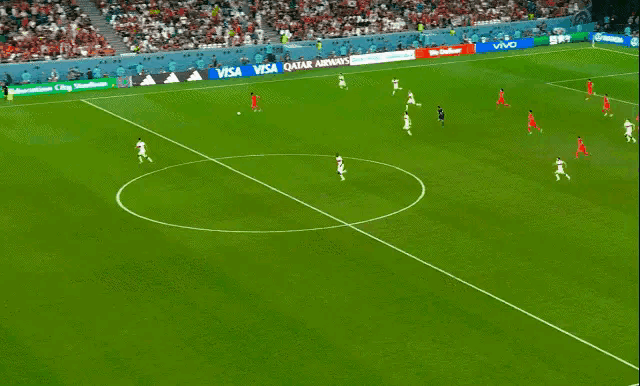

## 2022-12-03 21:24

我一直在思考一个问题，但因为我其实并不真的了解其它文化的人，所以这个问题的答案是不可能靠自己作出解答的。

这个问题就是，我们是不是比其他文化的人更惧怕死亡。

比如我们的传统葬礼就一定要哭，不哭代表不孝，越是传统文化氛围较重的地方，越重视葬礼的哭声大小。以前甚至还有人花钱雇人来葬礼上哭。

有些文明却喜欢在葬礼上讲个笑话，大家会心一笑，一起回忆一下逝者的一生，然后搞个聚会，轻松的聊聊天。

还有很多别的观察。比如疫情。我就不信其他国家的人他就不害怕感染，但与被传染或者死亡的威胁相比，他们好像更不能忍受被管控。大多数人明知道满街病毒，却连个口罩都坚决不戴。戴口罩多的，依然是我们这个文化圈，包括中国、日本、韩国、中国台湾地区、中国香港甚至新加坡。

我们这个文化圈，是比其他文化更惧怕死亡吗？我没有答案。

## 2022-12-05 10:06

你以为很多事情是运筹帷幄，部署周全，其实并不是。

所以核酸点可以一夜之间消失，也可以因为排几个小时引起混乱一夜之间又重开。

所以很多事情乱糟糟没有章法看起来像走一步看一步，也就可以理解了。 ​​​

## 2022-12-05 10:20

如果你发现不管涨还是跌，自己总是拿不住筹码想要卖掉，

不要怀疑，

就是因为你太穷… ​​​

## 2022-12-05 11:09

一个多月过去，又从66涨到了160。股票的价格是疯子乱定的，确认了。

## 2022-12-05 11:16

该说不说，

如果一家公司开了很多人，却没什么变化，

是不是说明之前好多人都是在混日子。

或者说，什么996，007全都是做样子，完全是毫无效率的内耗，正常上下班就能做好工作。 ​​​

## 2022-12-05 11:25

上证开始挑战3250-3270极强压力位。

刺激。 ​​​

## 2022-12-05 14:24

截至目前，网格8个品种有5个盈利，未盈利的还有浮亏只剩1%的恒生和7%的传媒。

另外就是30%的中概。

有波动就能盈利，不怕你跌，就怕你不动。 ​​​

## 2022-12-05 18:20

有没有一种可能，

我们可以慢慢学着长大了。

永远是婴儿状态，永远需要家长照顾所有事情，终究不是个事儿啊。

自己为自己负责，自己的事情自己拿主意。 ​​​

## 2022-12-05 19:41

你有没有某一个时刻会觉得有点寂寞。 ​​​

## 2022-12-05 20:29

我感到有点奇怪的是，现在各地全面放开，但怎么还没有一份国家层面的医疗手册之类的东西发布？

得病了如何护理，吃什么药，如何休息，抗原试剂怎么用，什么情况需要居家什么情况需要就医，什么情况可以开始活动开始锻炼，营养问题，压力焦虑问题，什么情况可以重返工作岗位。

完全没有，还是有了，我没看到？

## 2022-12-06 00:02

日本踢的是真的好。 ​​​

## 2022-12-06 10:54

今天我自己的账户提了三次款，又转了一大笔钱回银行。以后我从银行转回证券账户的时候，不要再喷“无限资金”了//@ETF拯救世界:继续周到。这几天又开始把证券账户转回银行了。公开的、私有的波段操作提了不少。小钱钱们继续回银行做后备军了。

## 2022-12-06 13:20

有些朋友不理解为什么一定要把银行资金转回去，用的时候再转回来。

我再说一次。

我的投资资金与日常生活+备用金是完全分开的。投资资金只要转入投资账户，就绝对不会转出来，除非生死大事。否则，甚至买房买车都不会用。

而银行账户的资金就是日常+备用金。这部分钱可以随便用，在极端的时候也可以短期进股市，但用完了马上走，绝不会乱七八糟掺和在一起。

这样做的目的，是保证资本市场无论如何波动，也不可能影响我的生活。这样，心态就会永远保持平静。对我来说，股市的涨跌一定程度上只是数字，是一个不会影响生活的游戏而已。

股市的长期资金，要么就不进，要进了就不会出来。这就是我的投资资金配置原则之一。

## 2022-12-06 15:18

最近我这里的友友们估计也有不小心中招的吧，有什么可以跟大家简单分享的吗，不妨一起聊聊呀。 ​​​

## 2022-12-06 20:00

还有一个问题，是什么时候日常资金会进入股票账户。一般是股票账户的现金我感觉可能会不够加仓的时候。所以银行资金来了以后，可能买到，也可能没买到，主要是为了股票账户保持一定现金量，防止网格余额不足。当波段做完提款完毕，股票账户现金量又足够的时候，就会把银行日常资金转出。

## 2022-12-07 09:34

昨天那个中招讨论微博评论里，我看有朋友说，“看了评论很担心”。

你看你，又焦虑了是不是。完全没必要焦虑。

我发那条微博的目的，是请经历过的朋友都来聊聊到底是怎么回事。否则你天天看网上这个说“没事啊就是感冒啊“。看那个说”很严重啊后遗症啊要死多少多少人啊“。

咱们请真的经历过的朋友说说，是不是相对来说客观很多？

为的就是让你不要焦虑，也不要掉以轻心，你怎么因为别人说自己的情况反而焦虑了呢。

你焦虑不会改善任何事情。你踏实平静的看看别人的情况，心里有个数，然后该做什么准备就去做，不才是理性的反应吗？

不要恐惧，不要焦虑，因为没有任何意义。反而会因为你的心情状态不好，影响自己的身体健康。没准不焦虑的你即使中招了也毫无症状，结果因为焦虑又发烧又咳嗽呢。

而且我看，评论里绝大多数经历过的朋友都痊愈了啊。难受几天在所难免，问题是好歹得过一次，也有至少几个月的免疫能力了是不是，好歹这几个月你安全了是吧。踏踏实实的，知己知彼，冷静应对，多大点事儿啊。

## 2022-12-07 10:23

你猜富国红利选现金还是再投。 ​​​

## 2022-12-07 13:14

今年第18次提款。

波动让人快乐。 

@华宝智投--上海浦电路营业部 ​​​

## 2022-12-07 13:28

我坚信一点，

资本市场的钱，最终一定是流向理智、坚毅、智慧的人手里。

从哪里流出呢？

应该是情绪化、墙头草、大愚若智的人。 ​​​

## 2022-12-07 13:38

债券再创新低。

我们不买就不停诱惑我们啊。 ​​​

## 2022-12-07 14:10

？？？ ​​​

## 2022-12-07 15:03

有些事情我知道说了会被骂，有可能会被两头的人一起骂，但我还是想说。

首先感谢国家和基层干部过去两三年的努力，让我们至少有几百万生命得到了挽救。

其次是目前的放开我相信也是没有更好办法的结果了。这不是所谓“躺平派”促成的，而是形势比人强。再封下去，可能要发生绝大多数人不想看到的混乱。而且，太多人的生计已经被极大影响，必须放开了。

最后，我想表达的是，至少我自己以及家人，会注意自我保护，自我防范。无论发生什么，尽自己所能争取最大的保障。但是，尽人力，听天命。很多事情也不是人力可以改变的。

人始终要长大，要成熟起来。家长能保护孩子的时候会尽力保护，但有一天保护不了了，孩子就应该想办法在残酷的世界活下去，而且要比在温室里更强大，更有生命力！

## 2022-12-07 15:25

该说不说，提款-现价=7%了。 ​​​

## 2022-12-07 22:37

债券麻了。 ​​​
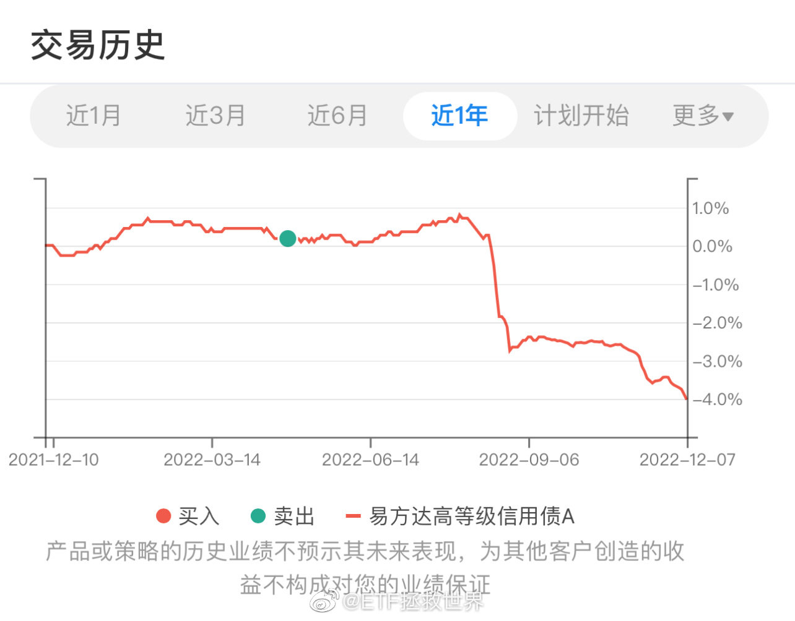 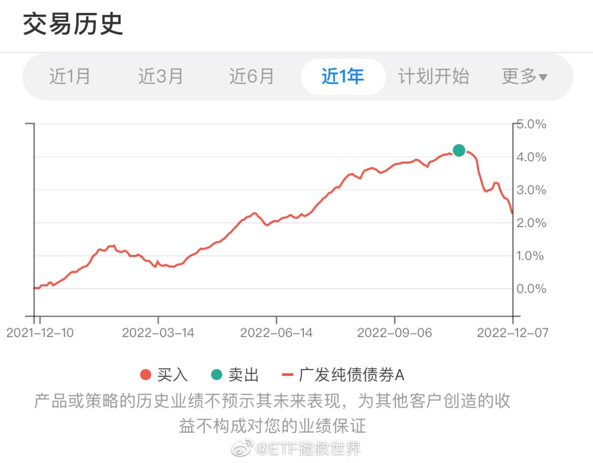 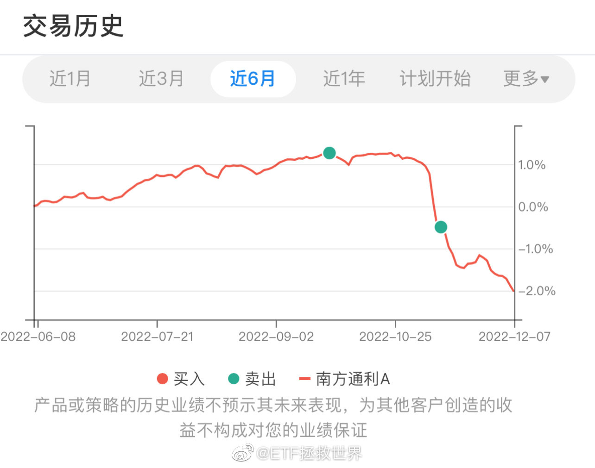

## 2022-12-08 10:09

低位买100万以上，退休以后，靠分红补充养老是非常不错的。 ​​​
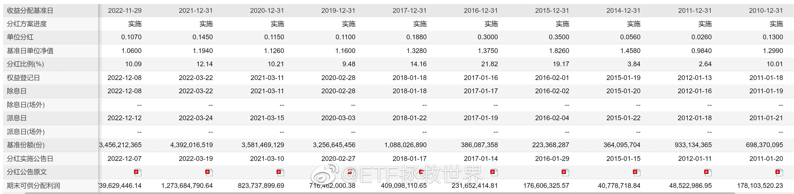

## 2022-12-08 11:26

我个人有个想法，不知道对不对。

如果你足够强大，可以完善、改变整个生态，那就去改变。

如果你不够强大，只是很普通的一个小生命，那就应该去积极的适应生态，想办法在生态中活下去，而且越来越强大。

比如股市。

你改变不了股市的走势。改变不了它的波动，也改变不了它是长期上涨还是不涨，改变不了它是炒作概念还是重视价值，改变不了是抱团还是单打独斗。

既然改变不了，就想办法摸索出它的规律，然后利用规律去生存，去壮大。等你足够强大了，就慢慢的影响一个小的生态，然后更大的生态，最终，没准真的能让你让一个小的生态圈变得健康和谐。

但最初，最重要的，是不要抱怨，不要痛苦，不要漫骂，而是观察研究生态系统，从中找到规律，找到利用规律赢的策略。然后战胜人性，执行策略，然后不断的赢，不断的变强大。

股市如此，万事万物又何尝不是如此。

## 2022-12-08 11:39

今天薛薇买点内个。 ​​​

## 2022-12-08 12:10

英短yyds。

柔软，还没脾气。

吸起来没个够。 ​​​

## 2022-12-08 13:05

虽然之前一段时间网上对放开不放开吵得特别凶，两派对骂也很厉害，

但我觉得，无论吵得有多凶，

也比只有一种声音好一万倍。

只是自己的一点不成熟看法，不喜勿喷。 ​​​

## 2022-12-08 13:39

债券最高可以给到30%-40%仓位。这个品种在极个别时候是非常犀利的。

当然，绝大多数时间就是平平无奇。这个心理预期在买入的一刻就要做好。 ​​​

## 2022-12-08 14:16

有一个小问题，做一个田野调查啊。

无论海内外的朋友，您如果感染过两次以上新冠，那么第一次痊愈后，第二次感染是多久以后。

我想看看到底得过一次后免疫力能持续多久。

什么研究报告啊，听说啊，就不要说了，我只想听第一手的真实案例。 ​​​

## 2022-12-08 14:44

千算万算，什么都囤了，没有囤抗原…

是不是涨价了，涨的那几百块，只好靠医药基金赚回来了… ​​​

## 2022-12-08 21:15

这是富国红利成立以来的所有分红记录。

从2010年开始至今，只有2013、2014和2019没有分红。

但是你要注意，它的每一年分红，都是分的前一年。比如2013年没有分红，是2012年没赚到钱所以不分。

那么你来分析一下，它没赚到钱的三年，分别是2012、2013和2018。

眼熟吗？没错了，2012和2018正是我写过无数次的两个钻石坑。而2013是小盘股暴涨，红利成分股依然没涨，所以2013也上榜了。

有朋友前几天问，我怎么知道什么时候红利不贵啊。

它哪年不分红了，你就知道它前一年没赚钱，应该是个不错的机会，稍微买点问题不大。
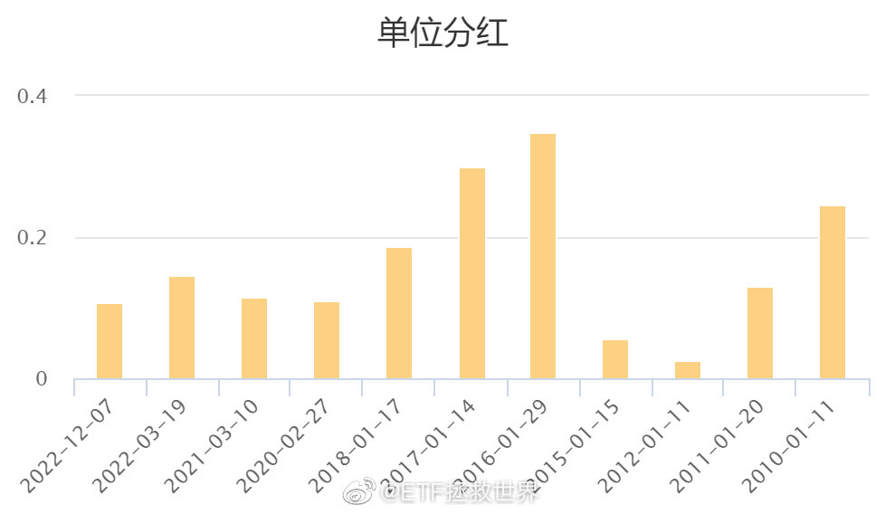

## 2022-12-08 21:53

信用债和主动债基今天还在跌。

果然信用债和利率债确实不是一个东西。 ​​​

## 2022-12-08 21:59

回复@刚饿了:我没懂什么意思。你要相信我就看我怎么买，不信就自己处理，每天这么问到底是什么意思啊，我没懂啊。//@刚饿了:纳斯还需要继续吗

## 2022-12-08 22:02

你说买不买。这些东西说了一万次了。

## 2022-12-09 08:31

你说罗伊斯，卡卡，内斯塔，小贝，巴乔帅我认同，

你吹加维帅我一脸问号。 ​​​

## 2022-12-09 09:28

有时候不是说我要对有些人没完没了问我单个品种问题我发火，你设身处地站在我的角度想想。

如果是善意提问，那我怎么说。我说，可以买。好，你满仓干进去，跌了你来骂我。我说买一点，买一点是多少？你还得跟我要仓位。我说20%，你说什么时候买。多少钱买。买了什么时候卖。我有一个问题答不好你以后就得骂我。

这是一个人，关注我的正常人类少说也有10万吧。10万个人一个个这么说，可能吗。更不要说，这10万人年龄资产性别家庭状态全都不一样！

恶意提问呢。呵呵，你买了，跌了2%，你还买不买呀。这种情况我怎么说，我说咱们还有钱，时间空间出来再补。那他又说，呵呵，无限资金。

我所有能展示的操作，无论长线还是波段，都已经清清楚楚明明白白的展示了，而且是自动推送，还要怎么样啊，真服务不了某个人。没那个精力，有那个精力动力也不够，你懂吧。

## 2022-12-09 11:08

恒科敢不敢让我们再提一网喜迎新年！ ​​​

## 2022-12-09 11:37

我不知道自己算不算一个很冷漠的人。

我就是在想，如果我们已经劝告过很多次一个成年人应该做或者不应该做某事，他还是不听。那么，如果不好的结果发生了，我们是不是应该平静接受。

因为对方是个成年人，他的所有决定都是他自己做出的。我们也尽了自己的力，人家不听劝，那有不好的后果，也只能他自己承担。

无论这个人是谁。

是我太冷漠了吗。

## 2022-12-09 13:10

之前有朋友在评论里问，为什么这几次恒科网格留那么多不卖啊，卖的明显比买入少很多啊。

总有一天你会懂，别急。 ​​​

## 2022-12-09 15:06

今天依然有2900只股票下跌。

相信各位的账户，尤其是网格账户今天大幅回血。

普通人真的别炒股了，真的顶不住。

不普通的那种可以。 ​​​

## 2022-12-09 15:23

跟儿子一起看1942，儿子看到一开始东家一家被抢，很生气。

我跟儿子说，你不用生气。如果你在当时是那些穷人，快饿死了，也会跟着去抢的。

儿子说我不会。

我说好，晚上饭你别吃了，试试饿的感觉。

然后我跟儿子说，

如果以后你有了钱，可别到处嘚瑟。

你要没有保护自己东西的实力，却又到处炫耀，又菜又爱炫，那恐怕就会倒霉了。

前几天看谁说得来的，

邻居囤粮我囤枪，邻家就是我粮仓。

## 2022-12-09 19:09

今天看到一个康复手册，说感染者最好是单独房间，单独卫生间。

我想到，房地产恐怕死不了。至少群众会有改善的需求，至少每个人都有个房间，双卫也是必须的。 ​​​

## 2022-12-09 19:20

银行储蓄资金，极端的时候进来，赚一把就走。

什么时候进来，什么时候出去当时都说的很清楚。我说的都是我做的。 ​​​
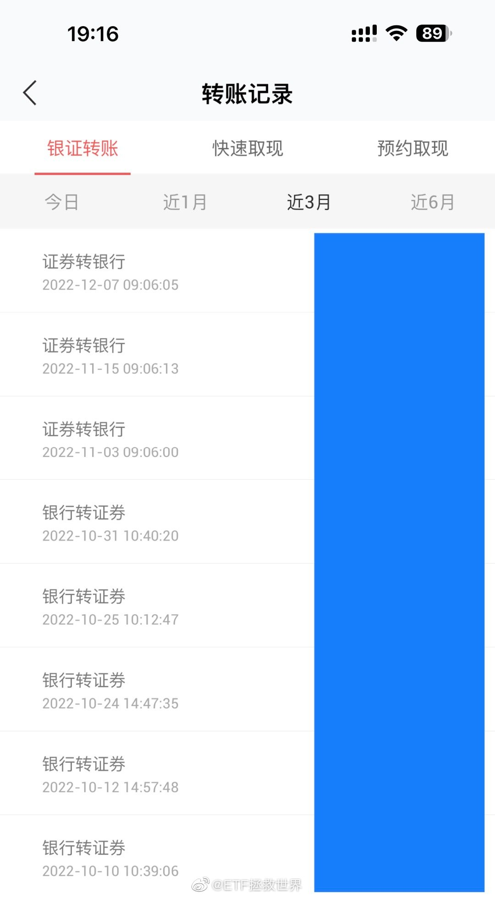

## 2022-12-09 19:37

我有两个建议，

第一，别发布感染人数了，大家都知道是不准的，发布了都挺尴尬的。

第二，核酸点能不能增加一个付费测单管核酸的业务，毕竟还有些时候需要48小时。 ​​​

## 2022-12-10 11:54

当时就感觉情况有点变化，果断囤了一波药。

今天看美团，所有药店都是“休息中”。

两个感想，

第一，囤东西用不上你别急着嘲笑，总有发挥作用的一天。

第二，从新闻消息中见微知著，然后行动起来做好准备，永远不让自己处于被动局面，投资和生活都适用。

这条我后来改成“自己可见”了。我怕那时候有人说我传播恐慌情绪。
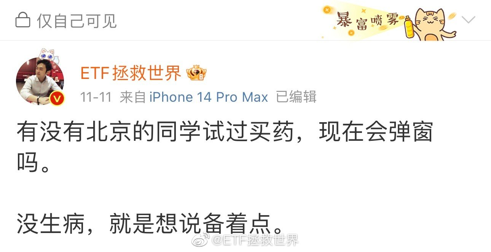

## 2022-12-10 20:50

动画片三体，就完全放弃了没看过书的人吧。

没看过书的人，能看懂前两集到底在讲什么吗。 ​​​

## 2022-12-11 07:07

北京的朋友，截至目前，你🐏了吗。

其它地方的朋友就别瞎选了。  ​​​

## 2022-12-11 07:45

38分钟过去，已经有1012位朋友投票。从一开始，就是以1：2的比例稳定增加。确切的说是🐏在31%-32%之间稳定增加。所以这个数字，至少在关注我的朋友里面，应该是可信的。

## 2022-12-11 08:42

昨天有朋友评论区里说，你肯定没有囤黄桃罐头吧。

这是几个月前的订单。

你对我的储藏室一无所知。 ​​​
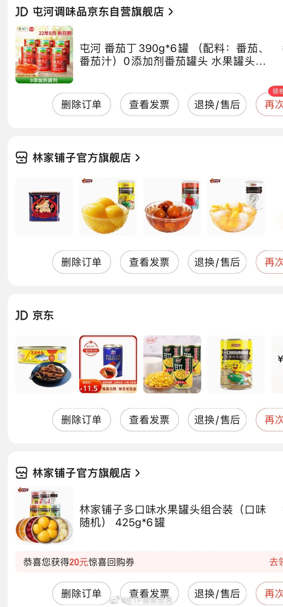

## 2022-12-11 09:08

昨天孩子的一个同学🐏了，发烧，家长外面跑了一大圈只买到点酒精，买不到退烧药。

我们把之前给孩子准备的美林分了一瓶给他们，准备的酒精分了一大瓶给了另一个孩子家。

后来儿子妈妈跟我说，在他们几个孩子妈妈的小群里，之前说我们囤药了，这个发烧孩子的妈妈说不用囤不至于。

未雨绸缪啊朋友们。你不能把希望寄托在别人身上，不能完全指望别人或者什么机构总是能照顾你。人首先还是要靠自己。多做点准备没有错。

## 2022-12-11 10:52

刚才我看有评论说：

“如果大家都不囤，是不是就不会短缺了”

关于这个，我是这么考虑的：

首先，我们囤药，是在社会上药品资源很丰富的时候，那时候随便买。不是短缺的时候抢购和囤积居奇。

第二，所谓“囤”，并不是买一大屋子。一家人退烧药咳嗽药什么的买几盒而已。

第三，重点来了。如果我们这些在物资丰富的时候储备物资的人当时不储备，现在，我们就要跟没有储备的人一起去排队买。你有没有想过，你会更容易买到还是更难买到？更不要说我这种还会把物资分给没有提前准备人的情况了。我不储备，现在我儿子的同学就没有退烧药吃了。

算术题非常简单。物资丰富的时候，一部分人准备了。物资不足的时候，这些人不会再去挤占有限的资源。那么你说，这些人的存在是好还是坏？

我只希望，未来，不会有人把物资不足的原因，归结在提前准备的这些人身上。这个大帽子，我们可是承担不起。

## 2022-12-11 11:44

三体动画，为什么不能做成2d呢。

就像鬼灭之刃那种2d。色彩，画面，简直燃爆了。

三体这种3d效果，总让我想起光头强。 ​​​

## 2022-12-11 21:30

8000多人投票了。现在是28%。大差不差30%左右。没别的意思，好奇宝宝们心里有个数//@ETF拯救世界:38分钟过去，已经有1012位朋友投票。从一开始，就是以1：2的比例稳定增加。确切的说是🐏在31%-32%之间稳定增加。所以这个数字，至少在关注我的朋友里面，应该是可信的。

## 2022-12-11 23:46

北京的数据

微博投票很强大啊。 ​​​
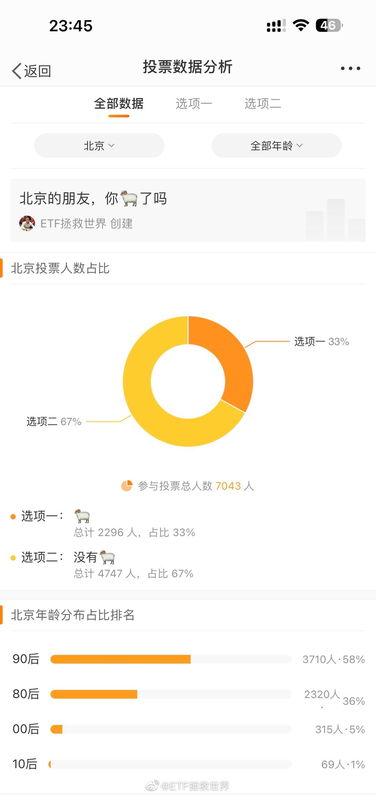

## 2022-12-12 06:37

全国版统计：

投票后可以点击“查看投票报告”，按省份选择查看结果。

另外，如果情况有变化，可以重新点击选项，取消投票后再次投票。  ​​​

## 2022-12-12 09:55

一万人已投票，基本大差不差有结果了。

全国10%。

河北，北京比例较高。而且是比别的省份高不少。

然后是湖北、重庆，二十几个点。

然后是河南四川天津，十几个点。

江浙沪广东非常低，3%以内。这几个省份投票人数很多，数据相对是准确的。

北京的32%与昨天数据非常一致，可信度非常高。 ​​​
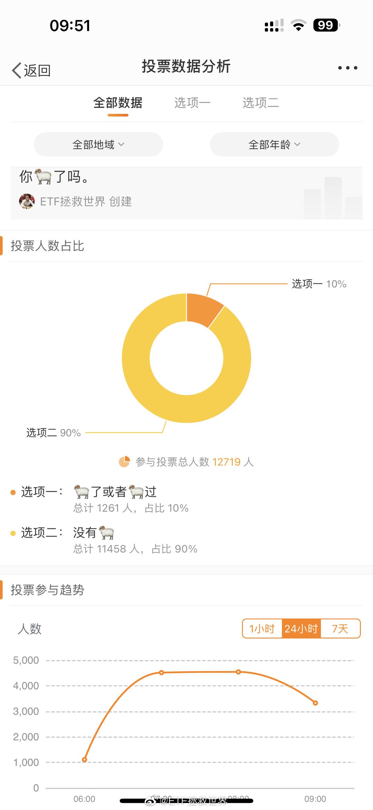 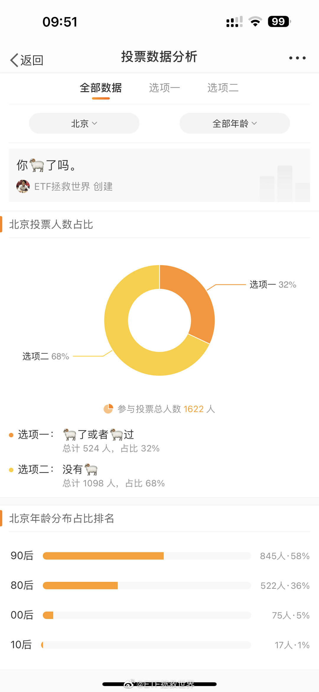  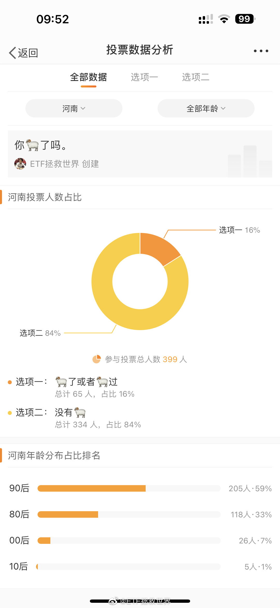 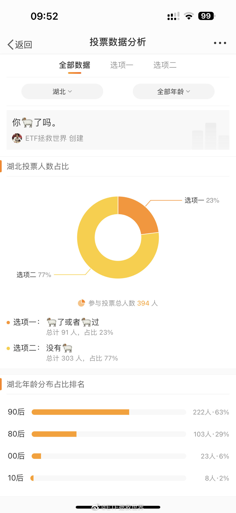 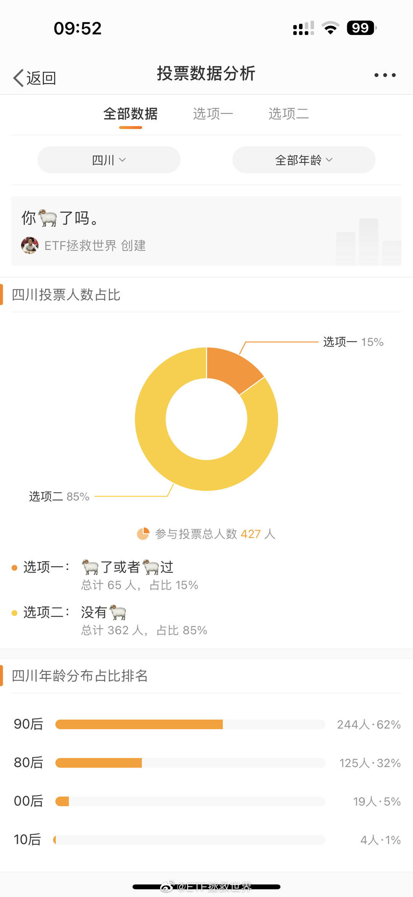

## 2022-12-12 10:12

有些朋友说我的统计样本有偏差，因为老人孩子不上微博，上微博的绝大多数不看我的微博。

这是没有道理的。很简单。

我统计的不是重症和死亡，是感染。而病毒感染并不区别对待老人、孩子还是年轻人。

在一个普遍攻击的情况下，除了高危场所，比如医院之类的以外，是没有样本偏差的。

只有一点可能有点偏差，就是有人感染了，但是毫无症状，也没有测核算抗原，所以没有统计到。但是这部分人我相信极少，所以基本可以忽略。

统计人数上万了，那种故意捣乱或者故意不说实话的，影响也会越来越小了。所以我觉得相对来说，是可信的。

## 2022-12-12 10:32

从这个数据，也能看出哪个省的人比较有钱吧。 ​​​
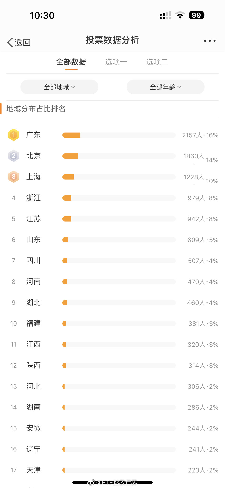

## 2022-12-12 10:48

从刚才的地区排名，我又想到一个问题，为什么我的微博评论相对来说在整个中文互联网算是比较和谐的。

第一，关注我的至少都是有点闲钱的。因为有闲钱才能想着投资。又所谓仓廪实而知礼节，有闲钱了，心浮气躁或者对什么都不满的人比例会少一些。

第二，关注我的不是股民。基民相对于股民来说，更加平和，更加没有那么着急一夜暴富。而且由于大多数品种都在挣钱，以及良好的交易体验，因为投资而气急败坏的人极少。

第三，我本人几乎不会为了所谓流量和话题，说一些极端的话。我不极端，评论里也就没什么可吵的。

第四，设置了100天关注才能评论。这个目的是你看了我100天，就不会因为对我一知半解上来就喷。我的投资体系，我的人生观，你大概都清楚了，大概率都不会喷。比如上次那位私信骂我的，就是因为偶尔看到我的发言，误会了才骂。你长期看，不会骂我。只要你是个正常人。

第五，才是拉黑。我已经很久很久很久没有拉黑人了。即使拉黑也是偶尔一两个，这个我认为不是关键问题。

搬家后，我想做个实验，暂时不拉黑人。看看多久之后自己才会受不了拉黑第一个。

## 2022-12-12 11:00

儿子：小猫为什么老是叫。

我：她想找男朋友了。

儿子：再给她买个男朋友吧。

我：不行。没精力照顾了。

儿子：哎，她真倒霉，到咱们家了，连个男朋友都不能有。

我：是啊。红颜未老恩先断，斜倚薰笼坐到明。 ​​​

## 2022-12-12 11:18

且慢的资产配置展示由于现金分红处置不完善，所以有点问题，稍后会修正。

下面这张图是准确的。

由于红利现金分红，A股仓位已经降至55%。可谓进退皆宜，可攻可守，比较舒服。 ​​​
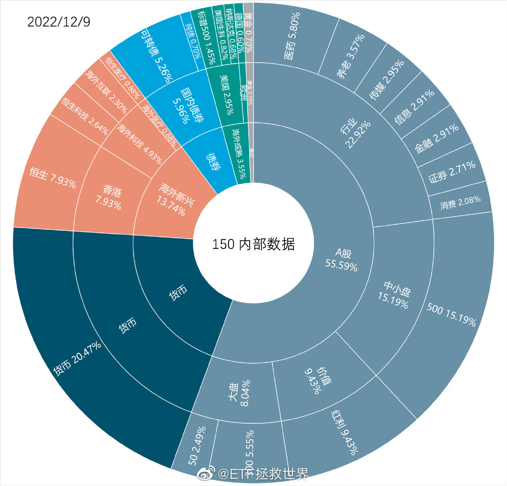

## 2022-12-12 16:20

笑死。

本来红利涨了一波，估值好不容易稍微高了点，

今天成分股调整后，又加了几个辣鸡进来，结果估值一下子再次掉了下去，

股息率接近6%了。

什么玩意儿！ ​​​

## 2022-12-12 17:53

昨天和今天的投票，北京已经从32%升至35%。

非常神奇，两个投票的数据如此一致。上午都是32%，现在都已经变成了35%…… ​​​

## 2022-12-12 18:00

投票在这里，我以后每天转一次，如果有变化的朋友可以取消之前的，重新投票，可以看看各地的变化情况

## 2022-12-12 20:09

大家一定要注意健康，尤其是中年，老年人。

少吃饭，多睡觉。不喝酒，不生气。多跟喜欢的人交流，少去搭理垃圾人。

尽人力听天命。成住坏空，不要过于在意得失。得又如何失又如何。看重过程，看淡结果。

一定要尽量保持心情舒畅，投资的时候也是。涨也舒服跌也舒服，不要情绪波动过于剧烈，对身体不好。

踏踏实实的，多大点事儿。除了生死，都是小事！

## 2022-12-13 08:32

昨天的投票我又仔细看了看，发现一个有意思的情况。

我发现每个省的百分比不是连续的。也就是说，不是说有的3%，有的5%，有的8%，然后10%、12%、14%——43%。

而是一大堆，比如江浙沪和很多省，都是1%-3%。

然后非常有意思，一下子就蹦到了15%左右。比如天津四川之类的。

然后又是大幅增加到25%，比如湖北重庆。

然后又是大幅增加到37%、43%，比如北京河北。

中间态也偶尔有，比如20%的河南。但基本上是这个规律。

我觉得说明什么呢。

我不懂啊，瞎猜。

我觉得说明，要么就是防控工作做得特别好，基本没有感染。一旦大范围开始感染，人数就会几天内迅速增加到十几个点，二十几个点甚至30、40%。

但我观察，好像到了30%、40%就慢下来了。

再说一次，我不懂，只是看数据有这么一种体会。

## 2022-12-13 10:10

我下面这段话，没有任何倾向性，也不代表我是任何一派的。关于站哪队的问题，我之前就说过，所有选择都是基于自己利益的。从我个人来说，哪一边都无所谓，我也能体会两边人的利益感受，所以我不站队。

我想说的是，看到一些人现在会说，你看，听了躺平派的，出了各种问题。躺平派是罪魁祸首。

我倒是有两个想法。

第一个，跟投资有关。有时候我们基于价值，不看好某个板块，比如说70、80PE的板块，说贵了，不买了或者卖了。然后这个板块涨到150的时候，就会被骂。

这是一种短期的视野。今时今日的结果，并不能代表当初的决定是对是错。这个世界不是说短期对了就是对了，短期错了就是错了。当150倍板块崩盘覆灭的时候，70 80卖出的人又成了英雄。看问题不应该这么短视。

放开这件事，不妨也稍微看得远一点。如果几个月后大家生活回到正常，出游旅行餐饮消费全都基本回到2019，那支持放开的是不是又要去打回去？我觉得事情不可以这样简单的非黑即白。

第二个，我相信绝大多数理智的人都不会认为这样一场流行病真的只是感冒又或者毫无影响。谁会傻到这样认为？

只不过人的选择是会权衡利弊的。两害相较，则取其轻。对大多数人，甚至决策者来说，都是在反复权衡利弊，在两个都会导致不好结果的情况下选择了较轻的那个。而不是说选了放开就是万事大吉歌舞升平，应该没人会这么认为，这一点我觉得还是要看清。

依然回到一开始，支持和反对，无非是取决于自己的利益。每个人的处境不同，有自己的诉求非常正常。只是讨论事情就科学的严谨的讨论事情，动不动就上纲上线就很让人烦躁。

## 2022-12-13 10:31

主动债基是钝刀子割肉，每天跌一点啊，杀疯了。

不过没事啊没事，不用慌，我们持仓是0。

刚买了一份国开债，没有跟着主动跌，不用紧张。 ​​​

## 2022-12-13 13:35

今天债券继续下跌，10年期国债收益率来到2.9325%。

过去十年的均值是3.34% ​​​

## 2022-12-13 13:44

冷知识：

当债券价格下跌，债券收益率上涨的时候，

现金类产品，包括货币基金，银行活期理财产品，各种宝宝等，七日年化收益率会越来越高。

反之则相反。 ​​​

## 2022-12-13 14:22

富国这只红利基金成立14年，年化收益率在10.4%。

考虑成立时间段的市场情况，以及目前的情况等各因素，毛估估，红利这种策略，未来超长期视角看，年化在6%-7%以上问题不会太大。毕竟成分股分红就有5个多点，公司好歹也能成长一些吧。 ​​​

## 2022-12-13 15:01

今天有没有需要更新投票的朋友。先取消原来的投票，重新投票即可更新。

## 2022-12-13 19:28

我最近总在想，人生最完美的境界，是不是努力做事，看淡结果。

比如世界杯。每四年一次的世界杯，只有一个冠军。全世界一两百个国家，4年才能有1个最终胜利。那其他队的球员是不是应该痛苦到死，是不是就是失败者。

不是吧。

每一场球，每一脚，都认认真真努力的去拼，结果赢了当然最好，不赢，又能怎么样呢。

好，就算这届你赢了，下一届呢？下一届卫冕了，再下一届呢？

C罗得意的时候，意气风发，光世界足球先生就拿了多少。现在呢，被俱乐部扫地出门，被国家队队友孤立，甚至被国民埋怨。我们不讨论为什么，就说客观现实。那你说，他最终是这个结果，他就是失败的吗？

没有常胜将军，谁都会失败。你从二十年前的福布斯排行榜刷起，看看有多少第一锒铛入狱成为阶下囚，有多少第一远走他国下落不明，有多少公司破产再无起色。

赢了输了，很重要吗。

你这一把赢了，下一把还能赢吗？你这一把输了，下一把一定还会输吗？

更何况塞翁失马焉知非福。这虽然有点玄学，但你怎么知道你赢了就一定是好事呢。

只要过程中努力了、玩命了，想尽办法用尽资源去争取了，我个人觉得，就够了。回头看，不会因为自己没努力而对不起自己，就可以了。最终结果不好，随便难受一下就可以了，不要过于在意。复盘，改进，继续努力，争取下一把翻盘。

我的一点想法，记录一下。

## 2022-12-13 22:47

按照投票数据，北京从昨天的37%，已经增长到最新的42%。

这当然不是好事。

但是从另一个方面想。

前天是32%，今天42%。那么大概4-5天后，就会有30%多，大概7-8天后，就会有总共40%多的人痊愈，并且产生一定抗体。

那么咱们一起看看，一周后的北京是什么样子。基本上也算是给其他城市打个样吧。 ​​​

## 2022-12-14 00:44

刚才在网上看到这样一张各省第一波高峰预测（图一）。

不太清楚他是怎么预测的，但我也根据我们的投票做了一个数据可视化地图（图二），做一个对比。

可以看出，大部分地区算是吻合。但根据投票，有些地区的高峰恐怕比他预测的要早，比如江西、甘肃、湖北和重庆。

但是有一个省还请当地的朋友注意，就是广东。

如果他的预测没错，广东会在12.20达到高峰。然而今天为止，广东感染的投票也只有5%。

如果按照目前北京40%多的高峰值计算，那么广东接下来的一周会有不少感染。当然，注意，这个结论是基于我们的投票准确，以及他的预测准确。

无论如何，大家都注意防护，注意健康。

（经网友提醒，我去看了他原始数据的出处，原来他预测的广东是12.26，而不是图中的12.20。这样的话，广东数据也与投票一致了。也就是说，从5%-40%，还有两周时间，增加的就不会那么猛烈了）
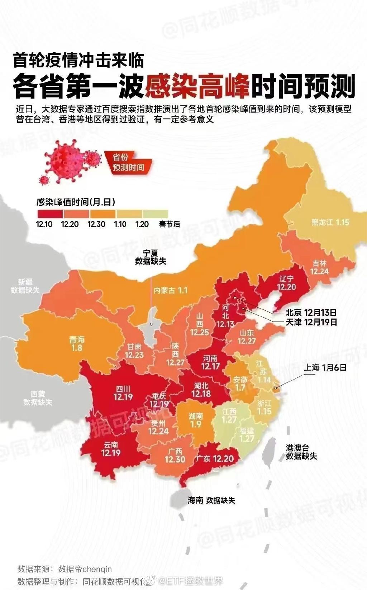 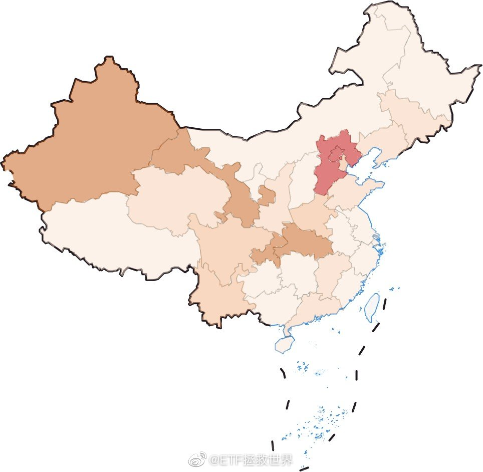

## 2022-12-14 08:34

受昨天那张图的启发，我也做了一个小的预测模型。

我们先用湖北来做个实验，看看模型准确度如何。

我的模型显示，周五，湖北的比例会增加到37%-38%。

所以，这几天还请湖北的朋友一定如实投票和更新，谢谢各位。 ​​​
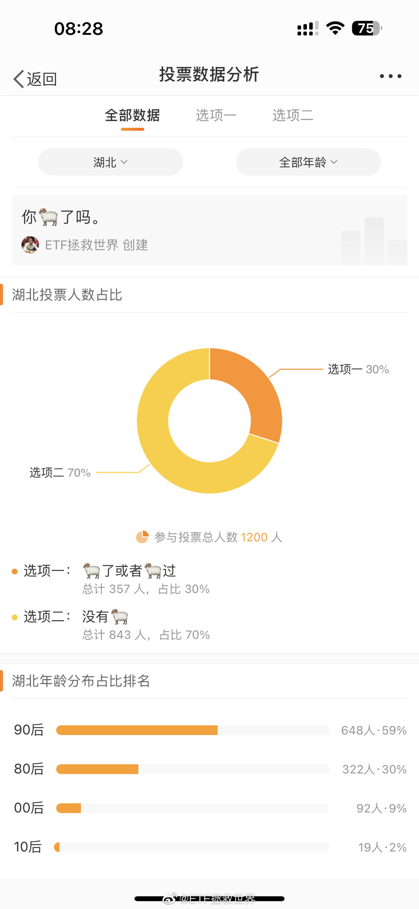

## 2022-12-14 10:53

目前的结果就是，它是全市场唯一创出半年新低的品种。数据的力量，不服不行。

## 2022-12-14 12:23

今日更新。

目前感染比例较大的是：

河北、北京、甘肃、河南、湖北、重庆、四川、新疆。 ​​​
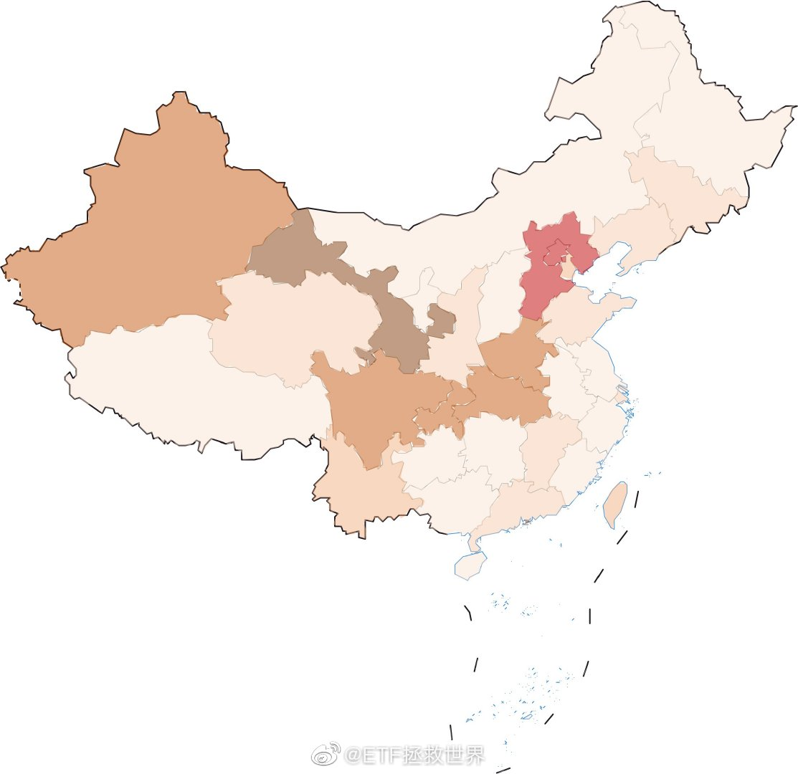

## 2022-12-14 12:31

很多朋友反映广东多，但是数据上看不出来。可能是区域性的。各位越如实更新投票，数据越准确

## 2022-12-14 20:41

最近微博上真假消息乱飞，鱼龙混杂，还是要认真甄别信息真假。

当然，也不仅仅是最近啦。 ​​​

## 2022-12-15 10:44

客观上讲，进行金融投资的中产阶级真的为中国经济做出了很大的贡献，也希望有人能惦记着分给他们一些合理回报。

## 2022-12-15 11:15

我说两句自己心里的想法，再说一次，绝对不是站哪队，就是说自己的想法。

虽然很多人说感染了几天就会好，“跟流感差不多”，但说实话，我心里还是不想中招。说严重点，是有一点点一丢丢恐惧的。也会想说万一真的严重了，会不会去医院没有资源，也会担心自己父母的身体。

但是，这些担心，是能够预计的，最严重的结果也能有预期，有准备，也大致知道各种可能的概率。

相对来说，更令我恐惧的是不能预期的事情。比如平行世界中自己的房子会不会被人入户消杀，比如自己的两个宠物命运会如何，比如自己会被带到什么地方那里是什么环境，比如被物理阻隔在一个空间后各种事情都无法掌控的感觉。

我不是说这些不好，不是说这些对整个社会没有益处，只是从我个人的角度讲，这些不确定让我非常担心，更加恐惧。

我不怕风险，我怕的是不确定，是未知，是被随意支配。

再说一次，什么我都支持，举双手赞成。上面说的，只是我个人的一点感受。

## 2022-12-15 11:48

今日更新。

河北成为第一个超过半数的省份。52%。北京未来24小时也会超，已经48%。 ​​​
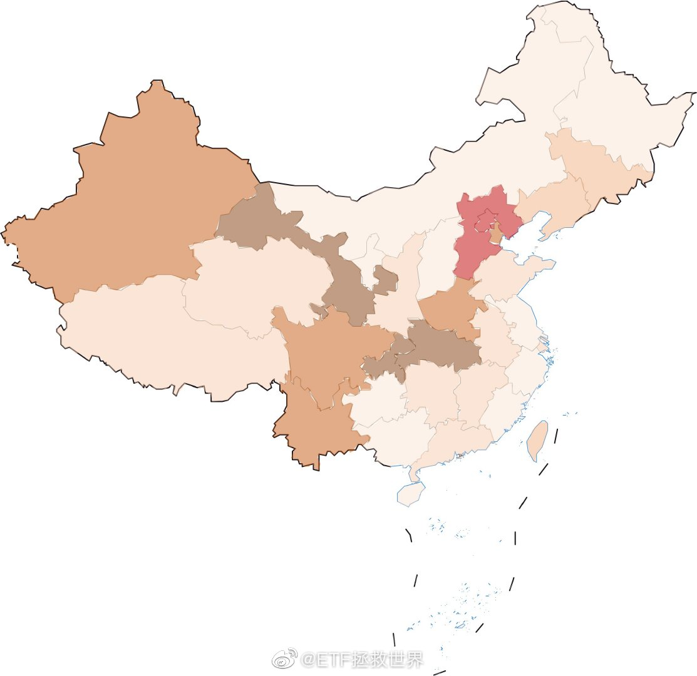

## 2022-12-15 12:04

希望朋友们如实更新自己的情况。主要是在没有信息源的情况下，咱们自己心里知道大概是什么情况。是正在加速，还是已经过峰，还是依然平稳。这些对我们的生活安排还是很有意义的。如果有部门不希望有这样的调查出现，也请联系我，我马上删除。

## 2022-12-15 17:42

各地增速也不一样。三天时间河北增加14个百分点，北京增加19个，河南增加15个，湖北增加18个，四川增加19个百分点。  目前比例低的地方朋友要注意，到十几个百分点的时候会加速比较快。

## 2022-12-16 08:53

今日数据。

样本数据5.8万人。

说明：全国数据不准确。因为看我微博的朋友主要来自于江浙沪京粤，很多人口众多的省份来看我微博的并不多。

但是，我认为各省数据相对来说是准确的（除了中国香港、中国澳门和中国台湾地区）。道理很简单。

有朋友可能会觉得奇怪，我为什么这么有劲头天天统计这个。

您有所不知，一方面是我觉得大家需要看这个，另一方面，

我是真的喜欢统计数据啊。我觉得隐藏在模糊世界背后的真相，都能从数据中体现出来。

这就是一种爱好，侬晓得伐。
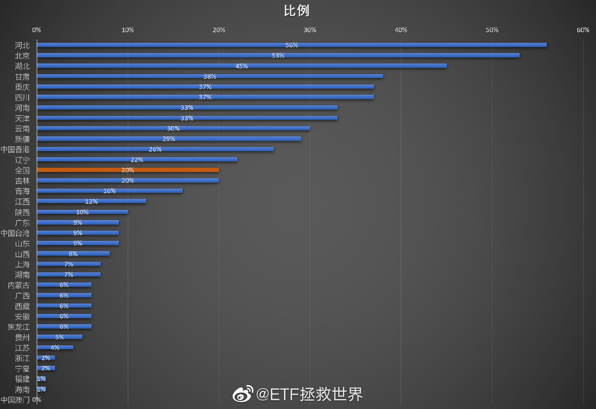 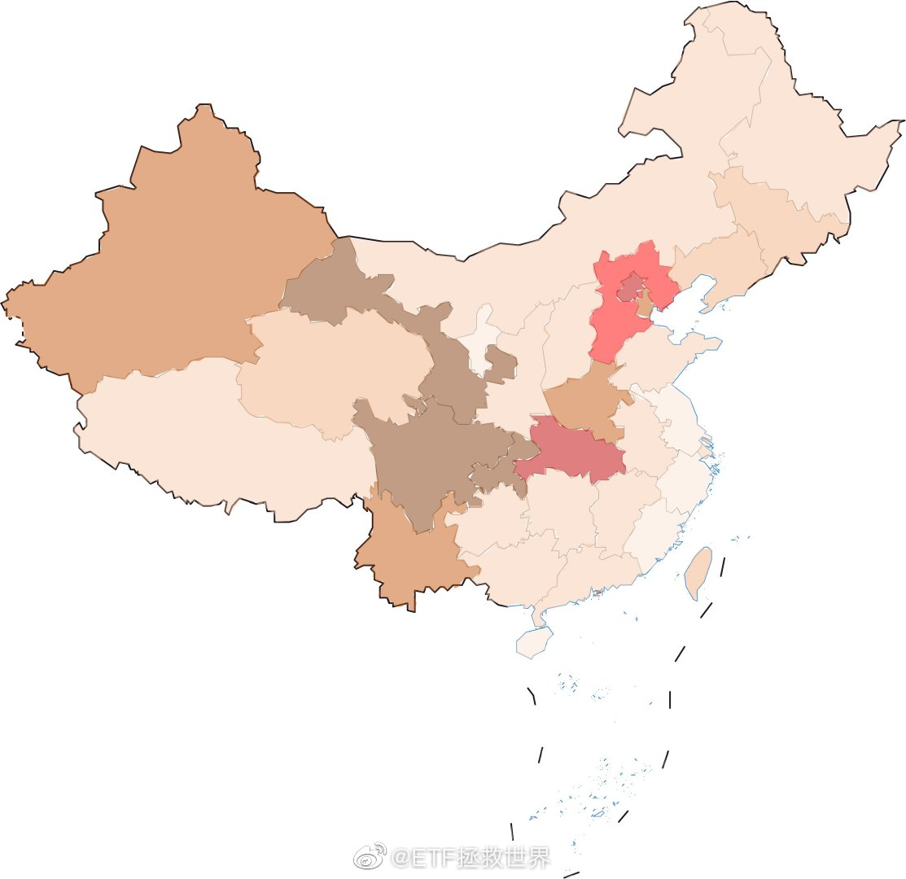

## 2022-12-16 15:16

其实这些药国内厂家也能生产吧，但是基本垄断在欧美厂家手里了。包括布洛芬大家也多是买葛兰素史克的芬必得。是质量有差别还是别的什么原因。

## 2022-12-16 15:28

有变化的朋友别忘了更新投票。还有两天这个投票就结束啦。

## 2022-12-17 08:07

今日数据：

声明：本数据完全基于网友投票整理，未进行任何加工修正，如有不妥，会立即删除。

西藏、宁夏、中国台湾今日出现增长率负值，个人认为是因为这几个地区投票人数过少，数据容易受到干扰导致。

各位看，今天这种表现形式是不是更加直观。研究增长规律也会方便很多。 ​​​
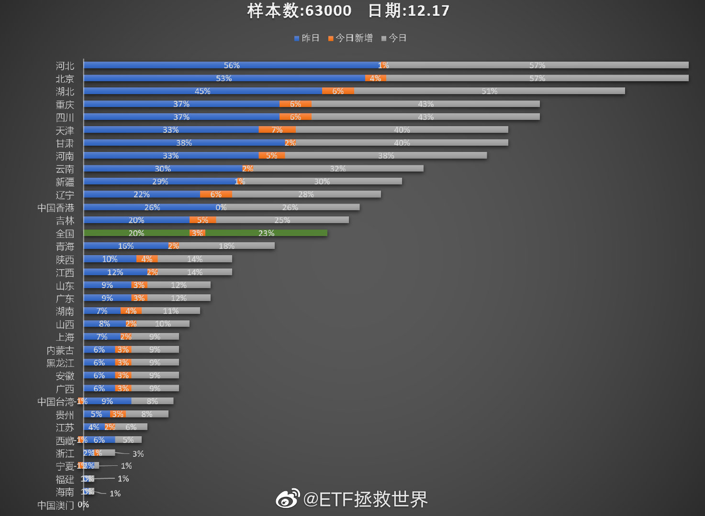 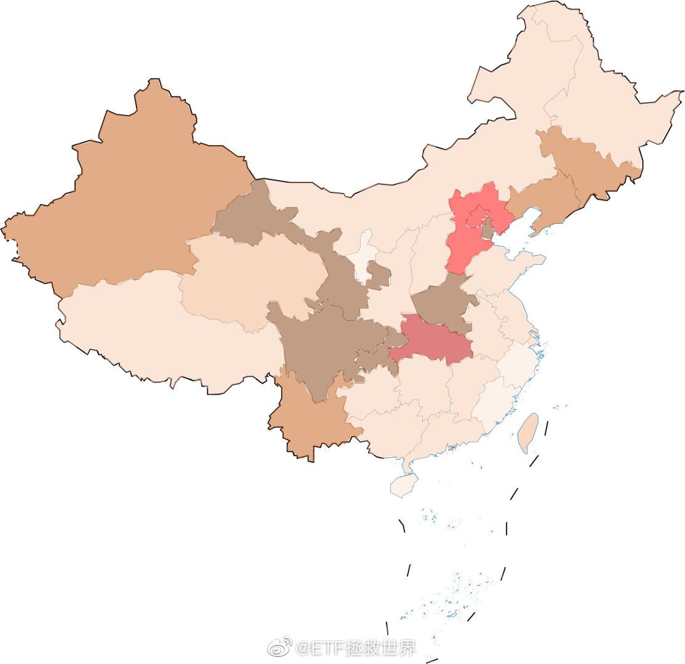

## 2022-12-17 13:57

三体动画片是不是在水时长？ ​​​

## 2022-12-17 15:03

有变化的朋友记得更新选项。您的如实选择会让数据更真实。

## 2022-12-17 18:46

没法出去堂食，就在家吃个煎饺吧。 ​​​
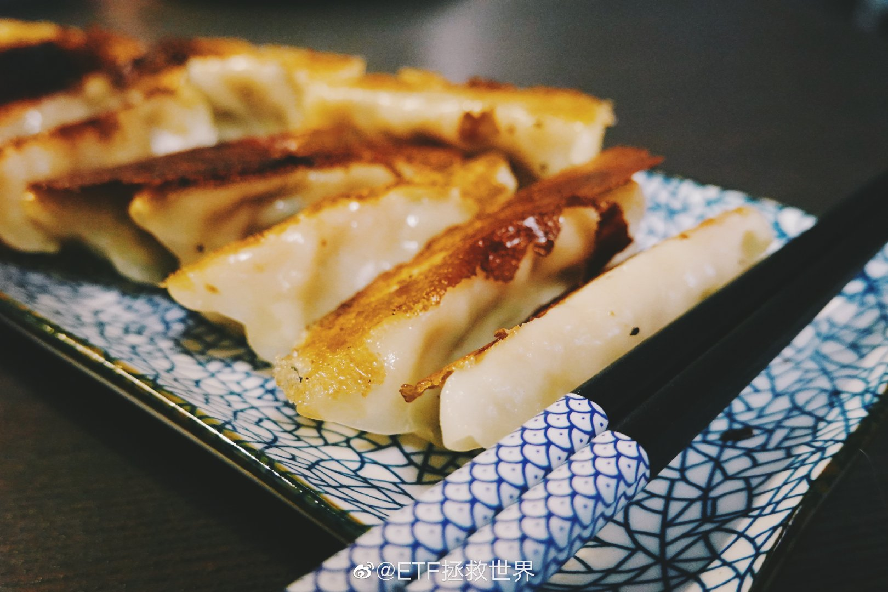

## 2022-12-18 10:06

今日数据：

样本数69,000人。

声明：本数据完全基于网友投票整理，未进行任何加工修正，如有不妥，会立即删除。

今天湖北、四川、天津、辽宁、吉林、陕西等省份增速较高。湖北即将追上河北和北京，照这个趋势，有可能超越京冀。

投票大省上海、江苏、广东、浙江增速也开始加快，接下来有可能加速，这几个地区的朋友要有心理准备。

如果加上未修改投票、无症状以及未测核酸和抗原的朋友，京冀两地的感染率应该已经比60%高不少。毛估估，70%已经有了。接下来的一周，相信增速开始放缓，同时不负责任的说一句，商场超市的人可能会开始多起来。路上的车也会多，但因为天气太冷，行人未必会增加很多。

建议只看数据，不看推测和结论。推测和结论都是瞎蒙的。
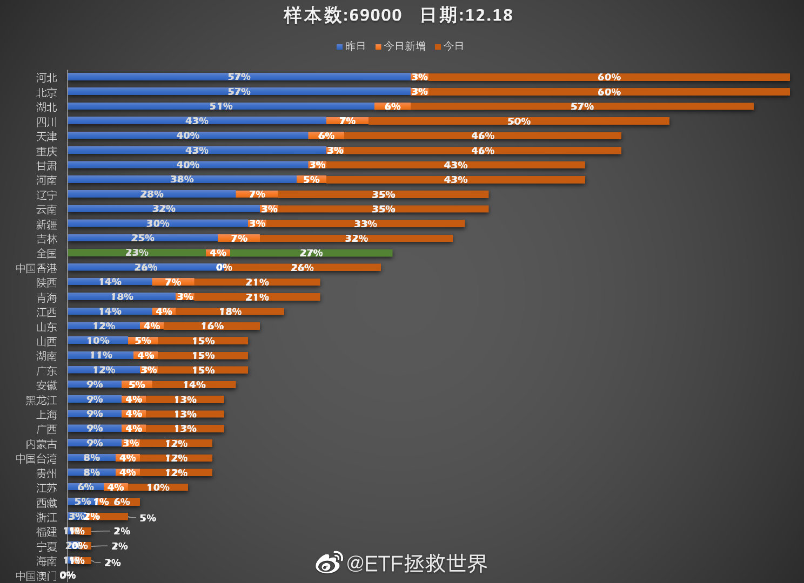 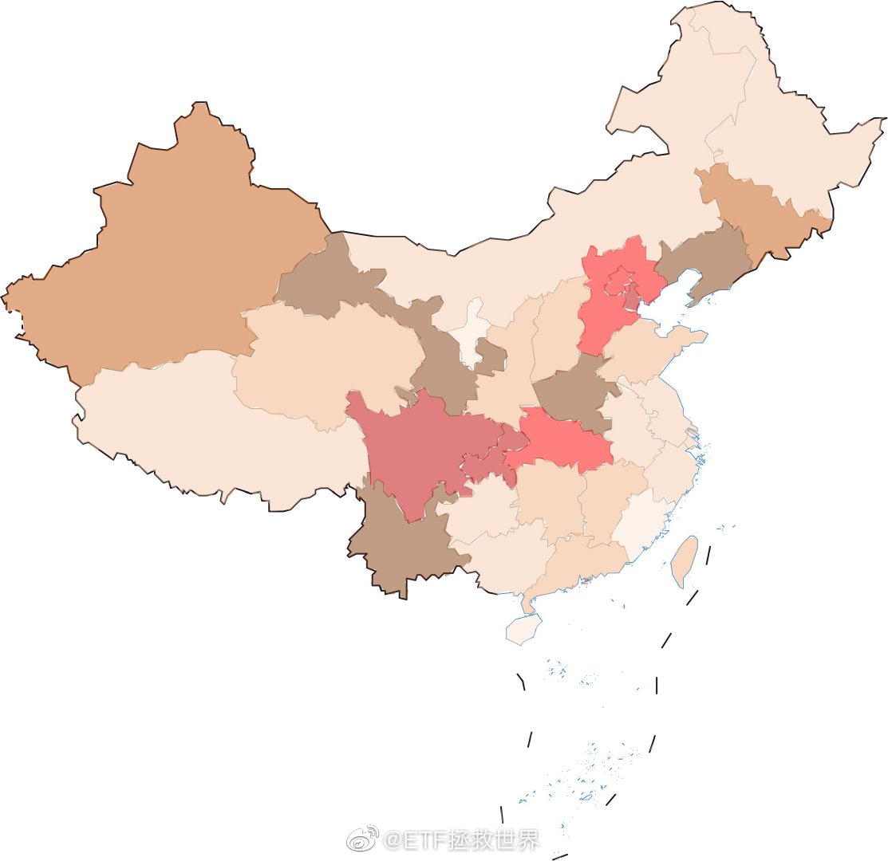

## 2022-12-18 11:09

“这种数据根本不准”

怎么说呢，肯定不是精确的。说实话，也不可能有精确的，除非全民三天一测核酸。

什么是精确，统计数据的意义和目的又是什么呢。

你以为GDP，职工/居民收入，PMI，CPI…这些数据是“准确”的吗。不好意思，按照分毫不差的视角，全都是不准的。这不是因为人为加工导致的不准，而是这些东西根本就不可能完全精确。

一个样本超过7万人的调查数据，如果你用心，你会找到很多很有价值的东西。如果你只会否定一切，那么这样的调查因为“不准”，在你眼里一定是辣鸡。

顺便问一句，现在哪里有关于这个的“准确”数据？

你觉得谁会有比这个更“准”的数据？

## 2022-12-18 12:32

投票最后一天，总人数应该能超过7万，感谢大家投票以及根据实际情况修改选项，让所有朋友对目前的状态有个大致的了解。  还是请有变化的朋友修改选项。您越负责任，我们的投票结果越精确。  您的一票很重要。

## 2022-12-18 13:16

投票今天到期后，我本来想再开一个，再增加选项，让数据更丰富。

但是好像有些博主的投票被夹了，让我意识到现在这种投票可能是不被鼓励的。

所以到期后就暂时不重开新的了。各地的朋友可以根据之前的结果，大致推算一下当地的情况，做好防护和准备。

知进退，才能活得久，才能有机会做想做的事。 ​​​

## 2022-12-18 22:16

希望阿根廷赢。

不是阿粉也不是梅西球迷，

就是希望看到他拿个世界杯冠军，

谁不喜欢大团圆结局呢。 ​​​

## 2022-12-19 01:57

👏👏👏👏👏 ​​​

## 2022-12-19 10:05

前几天我不是出门了吗，现在三天过去，没事。稍微有一点点嗓子疼，测了抗原，阴性。

那天出去口罩戴一层N95外加一层普通的，全程手套。回家后外衣和鞋都没有进家门（出电梯后有单独空间存放），进门后马上洗手，洗脸。手机等物品消毒。

那天见了十几个人，基本都是感染者或者感染过。还在密闭空间里一起呆了一段时间。

今天又要出去啦。

## 2022-12-19 14:21

四年后去美洲看世界杯怎么样。 ​​​

## 2022-12-19 15:36

我不知道你们看球的时候有没有跟我一样的感觉，还是我的错觉：

C罗在葡萄牙队，队友不怎么爱给他传球。好像也感受不到他跟队友关系好。

梅西在阿根廷队有一种王者的感觉，所有球员都给他球，甚至我感觉很多球员不仅是跟他关系好，几乎是崇拜他。

就是感觉阿根廷在梅西的光环下，特别团结，所有人都听他的，围绕他做事。

## 2022-12-20 09:49

破案了。

持仓那么多年，第一次选现金分红的原因找到了。 ​​​

## 2022-12-20 09:52

要买回来吗。

相对表现是真的不错，但可以预期的是表现不错就意味着未来一定有表现不好的时候。

很难办呀。 ​​​
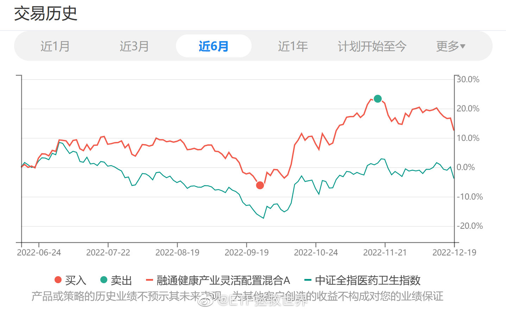

## 2022-12-20 10:08

基金经理自购的话，如果是知名基金经理，管理规模超过100亿的，我个人认为，

自购500万应该是比较有观察价值，自购1000万说明基金经理非常看好，观察价值极高。

100、200万的，不太好评价。 ​​​

## 2022-12-20 10:23

我有一个疑惑。

大家身边都应该有那种非常相信自媒体文章的老人吧。微信群里各种转发。

有些是一眼假，有些是需要研究才能发现是哗众取宠，但这些老人全面接受，自媒体说什么信什么。

我的疑惑是，

很大一部分老人经历了几十年的社会毒打，又经历了波澜壮阔的社会变革，人生经验应该极其丰富，

为什么基本的辨别能力都不具备？

## 2022-12-20 10:45

跟各位分享一个经验。

就是有时候你会看到一些新闻或自己也有经历，什么自己的车位被人占了打电话让他来挪车他不来还骂人啊，什么在楼上唱跳rap跑步跳绳你上去找他还被他骂啊，什么楼道里摆满了自家的杂物你建议他收一收结果又被骂啊……

你可能觉得，怎么他做错了结果他还特别蛮横？做错了不应该赶紧道歉然后改正吗？

这你就错了。你进入了误区了。

你想一想，不守规矩的人，大概率是知道自己做得不对，还是认为自己不守规矩没问题，有便宜不占WBD，做人没必要考虑别人。

是的，大部分不守规矩的人是后者。知道做人要守规矩要为别人着想的人，根本就不会去做那些事。

好了，你去找自私自利的人讨说法，你想想，大概率是什么结果？

故意做错的事，与蛮横无理，根本就是在同一种人身上体现的不同特质，所以，你去讨说法，大概率反过来会被骂，奇怪吗？不奇怪啊。

他就是那种人啊。

你用正常人的思维去想，肯定想不明白的呀。

## 2022-12-20 15:30

纳指生科这样的品种很不容易判断交易时机，

如果卖了后涨很多你别骂我。 ​​​

## 2022-12-20 17:44

好想开个投票看看北京还有多少人一起苟向决赛圈啊。 ​​​

## 2022-12-20 18:05

儿子终于不再相信圣诞老人的存在了。

他的童年结束了。 ​​​

## 2022-12-20 18:12

好奇宝宝终于还是忍不住开了新一轮投票。

再次提示，投票可以修改，你的状态改变后来修改投票，结果就会更精准。

投票后点击“查看投票报告”，可以看详细报告。如果没有这个选项，那么你的app需要升级。

  ​​​

## 2022-12-20 19:23

一个小时北京已经有1000位以上投票。

40%已经痊愈。这样看，月底前70%以上都会痊愈。

就北京来说，这一波最艰难的日子可能即将过去。 ​​​

## 2022-12-20 19:26

回头看，这条7天前发的微博还是很准的。“大概7-8天后，就会有总共40%多的人痊愈”。现在7天过去，正好40%的人痊愈。这就是数据统计的用处。没有数据，没有统计，怎么掌控现在和预测未来呢。经历过一段时间的艰难，相信各地都会好起来的。

## 2022-12-21 08:10

结合昨天40%康复的数据，可以判断未来一周地铁客流会越来越大，再过一两周会基本恢复到放开前的状态。

## 2022-12-21 09:46

如果“专家”不能只从专业角度讲本专业的事，就不要说。

如果我发现哪个“专家”说话是从专业以外的角度出发，那么我就不会再信任他。 ​​​

## 2022-12-21 10:07

距离第二次去密集场所又是三天了，暂时没事，谢谢大家念力加持。另外说一下，两层口罩不是为了更多保护，而是我从一个密集场所出来后就会把外层普通口罩扔掉换个新的…里面的N95是进家门之前扔。

## 2022-12-21 10:29

我对病毒的态度是这样的：

首先肯定是能不中招就别中招。我是不相信什么普通流感什么无症状的。极低概率重症或者更严重，那也是有概率对吧。更别说还有概率后遗症之类的。当然概率也是很低，但也是有概率。

所以尽量做好各种防护。

其次是你看看昨天投票北京的数据，已经75%的人感染了。那你说要自己感染了很奇怪吗，很不能接受吗，当然不是吧。所以自己心里也有预期，早晚的事。真的中招了，坦然接受，安心躺平养病，该吃药吃药，该难受难受，心态平和，尽量让身体机能平稳。

要是真的重症或者内什么了，我也没话说。因为这个事情怪不得任何人，是天灾。全世界所有国家都控制不住，所以会认命，不会埋怨谁。我自己生活无忧，不想出门就可以不出，所以按理说封控对我来说利大于弊，但我也不会去怪那些对封控不满的人，每个人都有自己的诉求，也有自己的利益，所谓屁股决定脑袋，我理解。总之一句话，无论怎样都认命。

努力改变能改变的，躺平接受不能改变的。这就是我的世界观。

人这一生，开心最重要，对不对。

尤其对我们这个快乐开心相对来说比较难的民族来说，尽量开心一点吧，人就这一辈子，每一天都是以后日子最年轻的一天，别太较劲。

## 2022-12-21 10:53

做决定前认真考虑，缜密计划。

做了决定就坚决执行。如果错了，不用懊恼悔恨。反思哪里出问题了，下次修正。

最怕的就是做之前不想清楚，做错了怨天尤人每天在悔恨中以泪洗面。有意义吗？没有任何意义。

我们能改变的，是现在和未来，而非过去。

无论是投资还是其他事，都是如此。 ​​​

## 2022-12-21 13:12

不出去吃，随便在家吃个鳗鱼饭吧。 ​​​
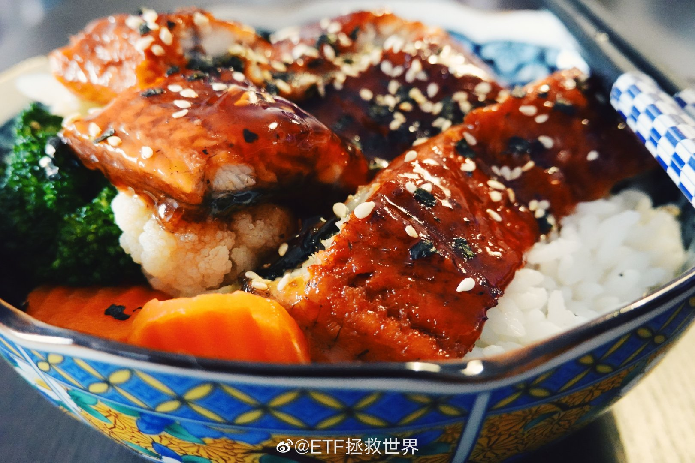

## 2022-12-21 13:27

A股，我叫你一声辣鸡你敢不敢答应？ ​​​

## 2022-12-21 14:24

各位友友们别忘了根据自己情况更新投票~

## 2022-12-21 14:39

该说不说，科创50又快跌破900点了，

但估值依然有55+。

我不是说它不可能涨啊。我是说我胆子小不敢买。 ​​​

## 2022-12-21 16:28

以80%为仓位上限，目前中性仓位是53%左右较为合适。

激进、保守各加减20%为上限。 ​​​

## 2022-12-22 10:41

有人嘲笑我卖早了，有人骂我没有抓反弹。

我只是按照自己的原则做事，

贵了就是贵了，贵了我就不买，贵了我就卖。

无论它怎么涨，都不是我能挣的钱，我宁愿放弃。

我没有错。 ​​​
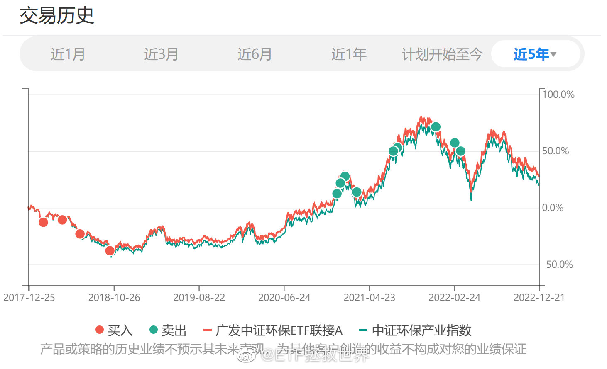

## 2022-12-22 11:15

今日统计数据。

有一点必须说明的，是因为才开了一天投票，有几个省份数据过少，并不能客观反映事实。

这几个省份有：西藏、中国澳门、中国台湾、中国香港、宁夏等。

各位看第一张图，再对比3天前的图，你会发现一大批之前30%、40%甚至20%多的省份，三天后已经基本与之前高感染率的省份处在了同一水平线。

再结合“新增”比例，你就会发现，之前高感染率的地区增速放缓，之前低的地区提速。最终，大家走到了一起。

再看第二张。你会发现之前高感染的地区，比如北京、河北，痊愈率已经有40%以上。而目前最困难的，就是第二张图中排在前列，但橘黄色康复率却很低的地区。这些省份，感染率高，但痊愈率低，说明大量人群正在感染。相信生活以及医疗都有不小的压力。（比如陕西，感染率54%，痊愈率只有10%）

好在再过几天，或者一两周，这些地区的情况也会慢慢好转的。因为那时候，越来越多的人都会康复。当然，医院的压力不会小，因为重症率会有所提升。

感谢大家投票。每个人认真负责根据实际情况投票，也会让所有人都对现实有一个客观的了解。
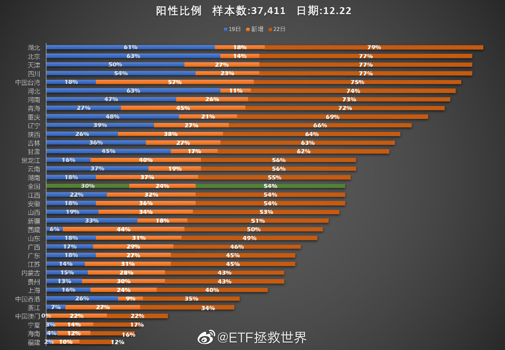 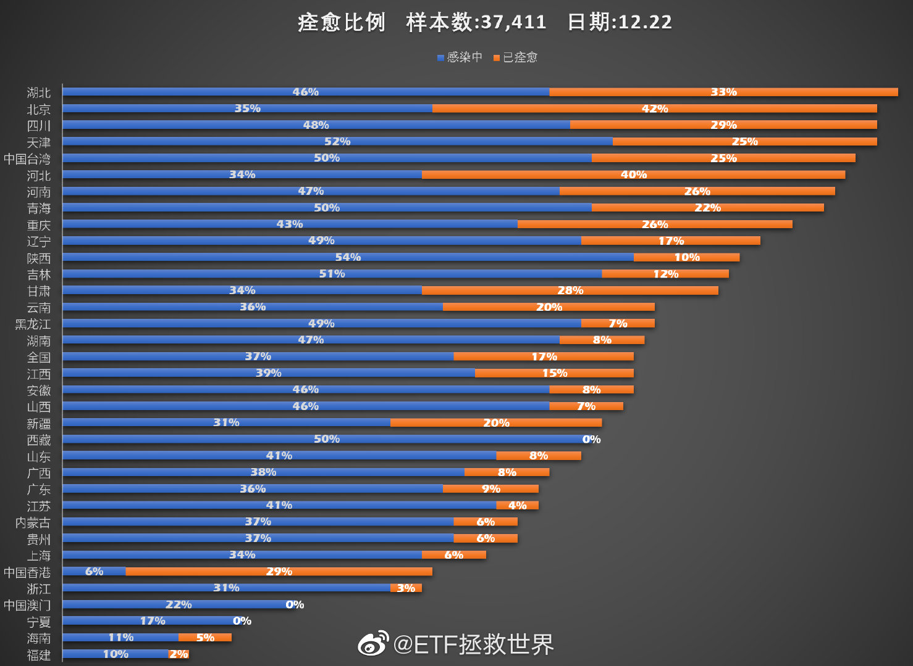

## 2022-12-22 12:01

回复@文驴驴:托您的福，还没有。进入前23%了。继续苟。//@文驴驴:话说E大还没中吗？

## 2022-12-22 13:23

瑞士卷算甜食吗。

如果吃一口瑞士卷，马上喝一口美式咖啡，味道中和，吃不出甜味，应该就不算甜食了。

大概就是这么回事吧。 ​​​

## 2022-12-22 13:56

不同的声音虽然会显得没有那么“和谐”，但会让事情变得柔和很多，会有缓冲区域。而一种声音发生变化时，就会是剧烈的，破坏性更强的。

## 2022-12-22 14:09

讲故事的人早已跑得不知所踪，听故事的人在怀疑人生。

## 2022-12-22 14:43

刚才看新闻，PONY的一条。

我突然想到一个问题，各位贤达有没有知道的：

还有哪个国家会对游戏的发行进行审批？ ​​​

## 2022-12-22 14:58

有变化的朋友别忘了更新自己的情况啊。全靠您认真负责的一票，统计数据才会更加精确。

## 2022-12-22 21:39

感觉国足80位高了。我是这么想的。每个国家队20人，80个队就是1600人。中国队的20个人，怎么也不可能排在世界足球运动员的前1600——光英超球员就400/500人了。还有德甲西甲法甲意甲巴西阿根廷联赛呢。所以，毛估估，中国国家队这些人的真实水平（不考虑国籍），至少应该在100名开外。

## 2022-12-22 22:21

从目前的投票情况看，现在最困难的省份是陕西。有56%的朋友感染有症状，这个比例真的非常高了。陕西的朋友一定要多加保重。

## 2022-12-23 10:32

今日数据：

与各位分享几点心得。

第一个，是数据统计这件事真的有意思。这些天我时刻关注投票和比例，发现一个有趣的现象。当样本数量超过一定时，结果就不会随着样本数量增加有变化了。

就这件事而言，这个数量甚至可能都不需要400、500，只要100、200就够了。

举例来说，某地投票的朋友超过100人后，比如说结果是49:51。那么当投票人数增加到500、1000甚至5000的时候，结果大概率还是49:51。

所以，只要是完全随机的抽样调查，调查数量足够的情况下，是能够相对客观的反映事实的。

第二个，目前感染人数较多的省份，很明显增速已经放缓。同时，与昨天对比，康复人数较快增加。北京目前已康复+未感染的人数比例达到了66%，而有症状的朋友已经回到了一周多前刚开始调查的时候。不出意外的话，如果大家如实投票，这几天北京康复人数应该会超过50%，再过1-2周，80%的人都会康复。

第三个，我比较想知道的是最终到底有多少人会感染。目前最高的是湖北81%。那么最终会到90%、95%吗。因为毕竟有一部分人是真正的无症状，也有超级免疫者的存在。不可能100%全都感染吧。国外三年了，也没有100%。

感谢大家如实更新投票，这样我们心里才会知道相对真相是怎样，才会有的放矢做出准备，安排生活和工作。
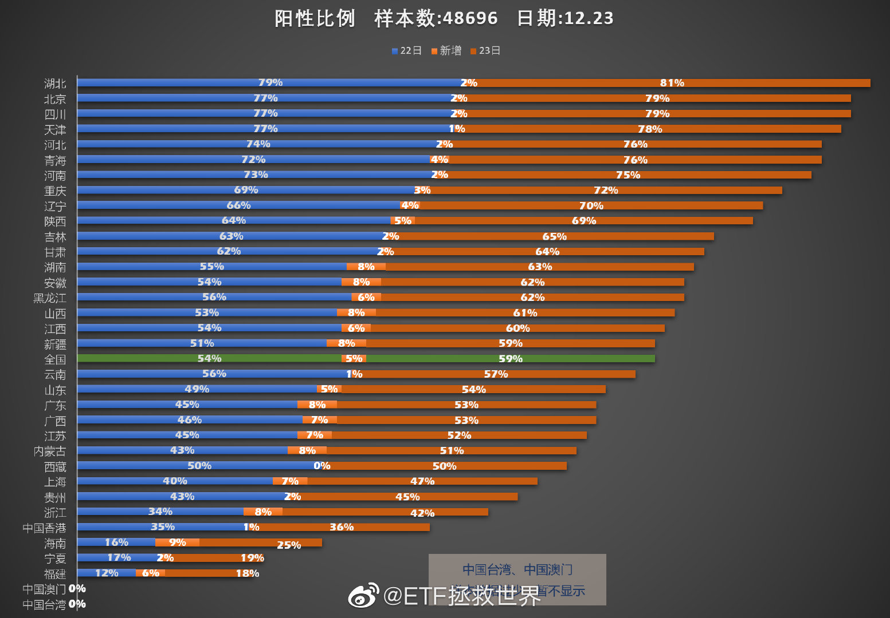 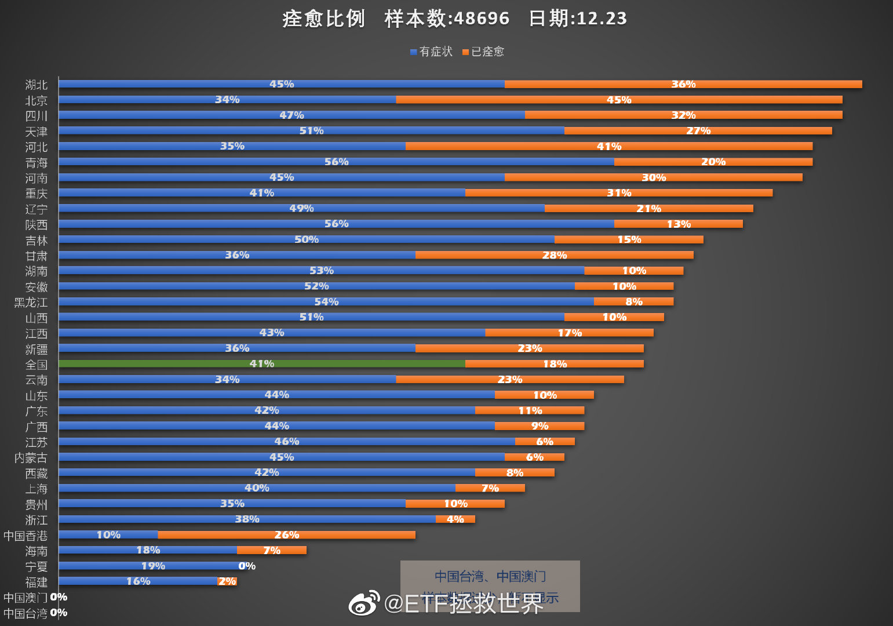

## 2022-12-23 10:43

环保1960-1970左右有个小支撑，能不能撑住不知道。

但因为不符合我的买入价值观，所以我不会买。 ​​​

## 2022-12-23 16:50

xhs上看到的北京超市。

今天痊愈率46%。 ​​​
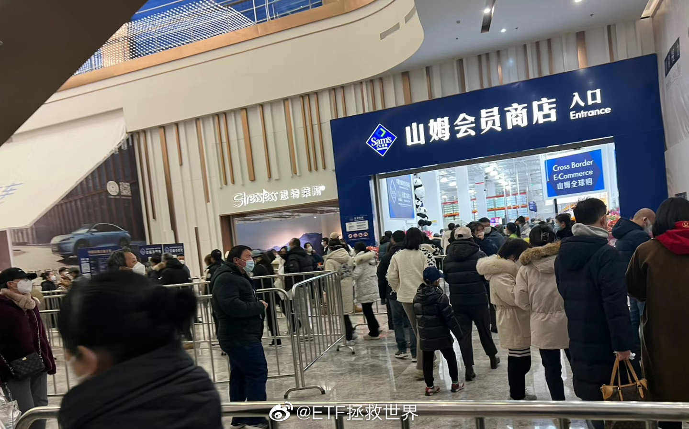 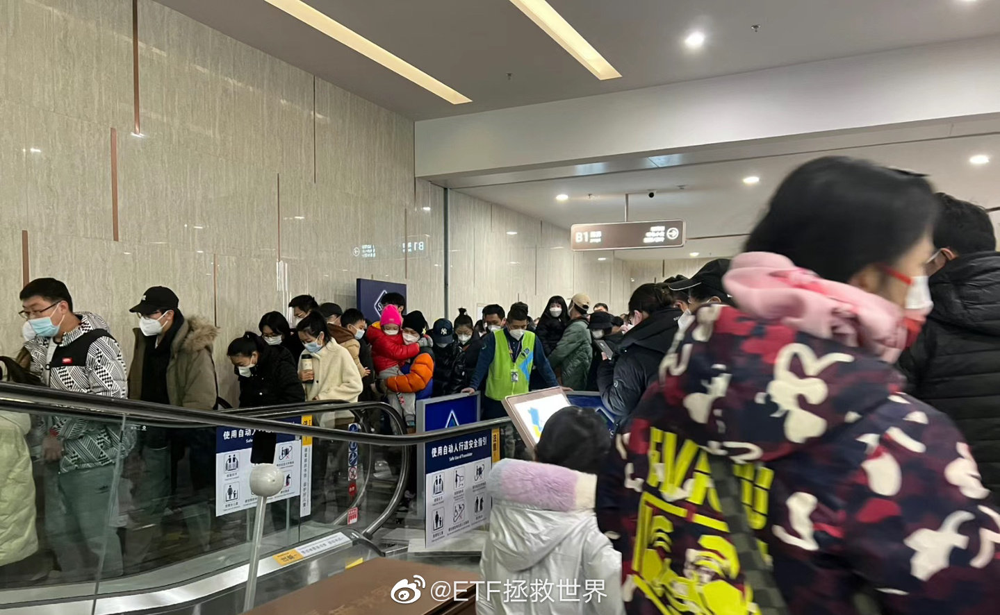 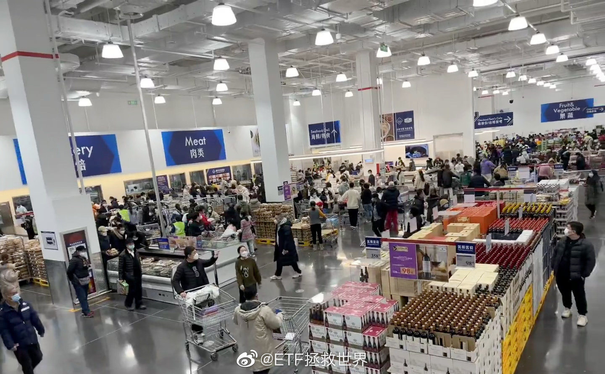

## 2022-12-23 18:16

我跟你们讲，我早就发现了，博友里面藏龙卧虎。

什么百度知乎跟博友比全都玩儿去！

刚才不是替朋友找了个资源吗，

您猜怎么着，15秒搞定了。

内事不决问博友，钦定了！ ​​​

## 2022-12-23 18:31

弥留之国的爱丽丝应该是我极少极少二刷的电视剧。

一个是剧情节奏画面什么的都不错，一个是女演员都是我的菜……

第二季出来了，据说比第一季烂，先看看再说。 ​​​
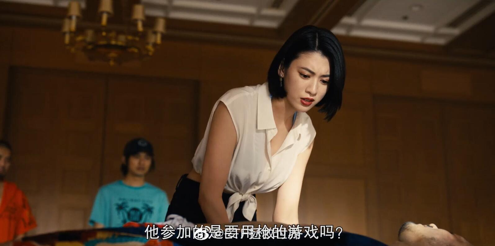  

## 2022-12-24 10:10

爱丽丝2，

男主脸上是不是打针了。

熟悉医美的集美们点评一下。 ​​​

## 2022-12-24 12:56

铁子们记得根据实际情况更新投票

## 2022-12-25 10:04

今日数据：

1、北京在未来24小时内，就会成为首个痊愈率超过50%的地区，以及很有可能成为首个有症状率从高位回落至30%以下的地区（=未阳+痊愈率超过70%）。相信各位在各路媒体上也已经看到了北京这几天商场超市的状态，以及道路堵车的情况。

从数据看，江浙沪、广东等投票大省，目前正在经历着前几天北京的情况。我相信这些地方路上商超里人也会比较少，但不出一周，人流就会多起来。

这就是我之前说的，北京为全国打个样。

2、记得第一次投票一开始，那时候江浙沪广东的感染人数非常少，几个点，十几个点。但当时已经有很多朋友说，“我周围80%、100%都感染了，数据不准”。那你现在看，浙江以两天11个点的速度突飞猛进，这几个地区的感染率也从几个点飙升至60%以上，你的观察又有什么变化，又有何感想呢。

我不是说这些朋友造谣，我只是越来越深刻的认识到，人类的意识是多么容易被局部的现象所欺骗。周围发生的就一定是全部真相吗。你的生活很好，就代表一切很好吗。你的生活很糟，就代表一切都很糟吗。这个问题，值得每一位朋友思考。

如何站在一个更高的地方审视全场，如何跳出一叶障目的思维局限，是我们一直要努力的方向。

投资如此，生活也是如此。
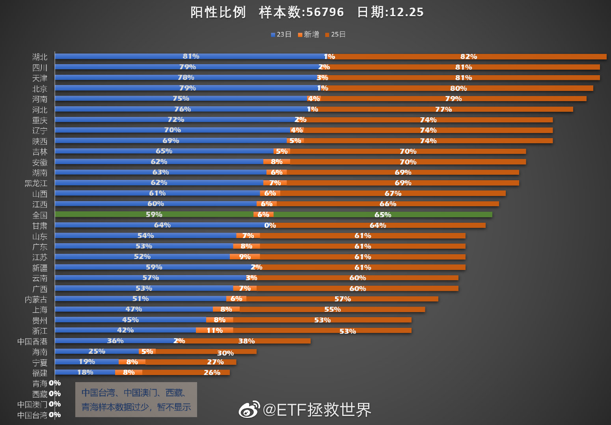 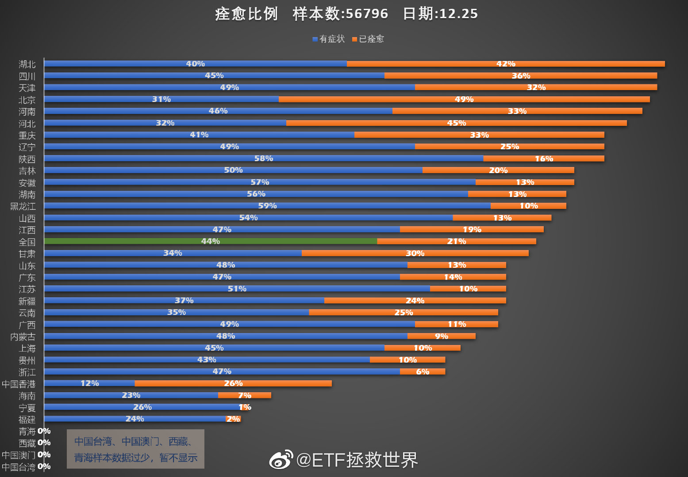

## 2022-12-25 10:29

我看有些朋友好像对放开特别不满意，觉得应该继续封下去，把清0做到底。

但我有一些观察，不知道这些朋友是否考虑过。

一个问题是经济的问题。财政如何长期支撑这样庞大的支出，以及不断的封控对经济发展会造成怎样的持续冲击。有朋友说之前两年也没问题啊。是啊，之前两年的传染率也没这么高啊。一时一事，不能刻舟求剑。

第二，就算不要经济了，各位是否观察过群众的情绪问题。我们的人民已经是最听话的人民了，但即使如此，也有越来越多的人已经不堪忍受动辄被封在家里的状态。这种状态真的可以一直持续下去吗。

很多东西，据我观察，并不是人选择的问题，而是形势比人强。是形势改变了人的行为，而不是人去改变形势。

我一直说，我对封还是放没有任何意见和看法，因为封我不愁生活，放我也理解。

只是说事情已经到目前这样，已经不可能回到过去了，我们不妨就认真积极的做好接下来的事，尽可能降低重症率，降低死亡率，争取早日回归相对正常的生活吧。

## 2022-12-25 16:56

我对新冠研究不多，目前也没感染，但有一句话劝感染或者感染过的朋友：

一定注意休息，不管好没好。增加营养，多休息！

一定不要剧烈运动。 ​​​

## 2022-12-26 09:34

关于食品这件事，在我比较偏颇的印象中，比较重要的国家里面，只有英国、德国，可能还要算上美国（本土饮食），它们的食物算是比较单调。（我发现都是昂撒人，或者说再往上的日耳曼人）

很多别的国家，比如法国、意大利、西班牙，乃至土耳其、中东各国，再到印度、日本、东南亚，其实菜品菜式是非常丰富的。（其他更多的国家我不了解，应该每个地区都有自己特别的美食。）

有些朋友把其他国家的菜品，简单的认知为什么汉堡薯条牛排，可能并不全面。

无论如何，刚看了评论，终于知道我这里比较和谐的另一个原因：

那就是在我这里，大多数朋友，其实真的是比较理性、客观，看问题相对全面，不盲从，不从感觉出发判断事情。

特别好。

## 2022-12-26 10:12

说起美食，我还有一个想法。

就是你知道吧，很多人说北京是美食沙漠。我是北京人，我听到这个从来不生气，更不会去争辩吵架。

一个是我觉得北京虽然也有不少好吃的，但确实跟鱼米之乡的地方比丰富度差很多，再加上口味问题，北京的外地朋友多，他们吃不惯也很正常。

另一个是我觉得这些屁事儿有什么吵的。爱吃就吃，不爱吃就不吃。沙漠就沙漠，绿洲就绿洲，天堂就天堂，自己爱吃，或者自己知道是怎么回事就完了。你跟他吵，他的观念也不会改变，所以别人爱怎么想就怎么想呗。

所以别人说北京没好吃的，我就会说对对对，你说的对。不就完了吗，多大点事儿啊。

大气，大气一点。

## 2022-12-26 10:40

还差30点就反弹了，瞎蒙打脸。

## 2022-12-26 11:09

协和的这个调查，会及时、如实公布调查结果吗？  这个是非常有意思的一个观察窗口。能反映很多东西。

## 2022-12-26 12:03

大家再最后更新一次状态，投票明天就结束了。基本情况也了解差不多了。话说湖北真的猛，还剩17%未感染了…

## 2022-12-26 14:36

大家最近有没有想过，怎么才能不得，或者晚得所谓的基础病呢。

我能想到的就是少吃，多睡，少发火保持情绪平稳心情舒畅，适度锻炼，吃有营养干净的食物，不抽烟不喝酒。

还有什么吗。 ​​​

## 2022-12-26 18:39

今天开始，我要开始消耗家里储存的备货了。

我相信不出意外，很难再因为疫情出现食品、物资短缺了。

什么时候我再开始备，也会在微博向各位汇报。 ​​​

## 2022-12-27 09:44

从我自己来讲，无论它叫什么名字，无论如何管理——

我都秉持同一种态度：

作为自己的第一责任人，善待自己，保护自己。尽可能为自己和家人做好各方面的准备、防护，尽量保持健康。

同时，不恐惧，更不渲染恐惧。不焦虑，更不渲染焦虑。所有事情发生，都有解决的路径，尽自己全力去解决。如果无论如何都解决不了，就接受命运的安排。

如果你一定要问我，就没有什么恐惧焦虑的吗。

有。

相比于天，我更怕人。

天地不仁，以万物为刍狗。

## 2022-12-27 10:37

还有没有人更新状态了？我要去做图啦。

## 2022-12-27 11:46

今日数据。

一

有朋友在刚才那条微博评论说，前几天他根据当地ZF的预测，评论说当地1月中旬达到高峰。而我当时评论他说一两周内就会到。现在当地ZF最新的预测已经修正为元旦达峰。

这就是数据的意义。

因为当地ZF并没有做调查，所以他们当初的预测，不能说是拍脑门，只能说是根据各种情况综合的预测，而他们甚至没有掌握到底有多少人感染，也不知道多少人痊愈。但我们的数据是真实的大数据，预测的准确性肯定会高很多。

顺便再说一下，根据我们的数据，那个省份的高峰（最多同时感染人数）不会是元旦，就在最近2-4天内就会出现。

二

今天投票到期后，暂时就不开了——这次是真的！

因为基本情况已经清楚了。比如感染率高的几个省市，感染率上涨速度已经极其缓慢。

同时，痊愈率迅速增加。比如目前痊愈比例最高的北京已经到了54%，而有症状的人只有27%了。随着感染人数越来越少，一直处于阴性的人感染几率就更低，总感染增速会越来越低，所以统计意义不大了。

有朋友说，不对啊，我们省刚开始加速或者马上达峰，我们怎么办啊。

朋友，没关系。你去翻一翻之前我做的图。你找几个前几天与你们目前情况差不多的省，你去观察他们是怎么变化的，你大概就知道你们省会怎么变。当然不会完全复制，但是大差不差。

三

目前全国整体，以及大部分省份已经过峰了。之前的优等生江浙沪广东也会在未来几天内过峰，接下来就是痊愈的比例逐渐大于正在感染比例，一两周内各地都会热闹起来。

但是像福建、海南这样的省份还是要注意，可能2-3周后状态才会好起来。春节是不是有很多朋友要去海南，还是要注意健康注意防护。

无论如何，即使痊愈了，大家也不要过度放松，该做的保护还是要做好。当然也不要过度焦虑，心情也会影响健康的。

这件事告一段落，我个人认为很有意义，也感谢每一位认真投票的朋友。
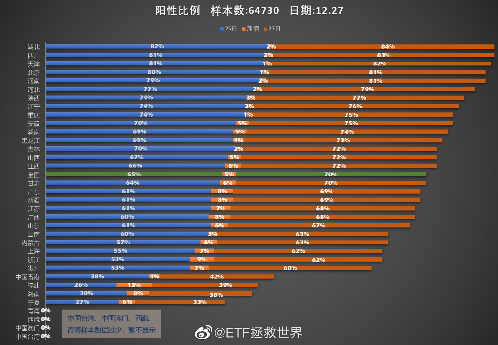 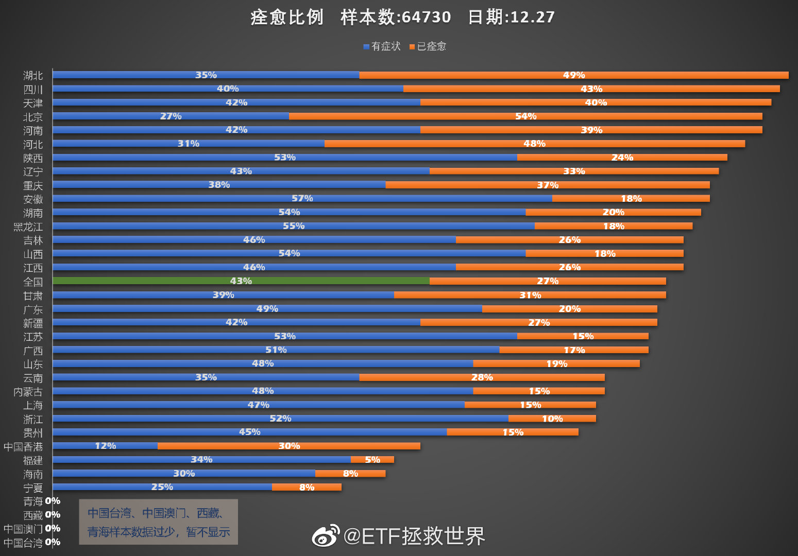

## 2022-12-27 13:56

其实这种程度的病毒，对人类来说就是个渣渣。

人类能成为地球领导者，能把其他物种祸害个遍，战斗力绝对是爆表的。而我个人认为，我们体内的免疫系统，免疫细胞，更不是吃素的。小小病毒，P都不是。

对了，人类前几天不是刚突破80亿吗。100亿也不远了。

但是！

人类牛逼不代表我们每个个体都牛逼！

所以做好防护，保持健康，对个体来说意义重大。

但但是！

人类之所以越来越多没被病毒消灭，就是因为绝大多数人不会被病毒消灭，所以从概率学上来说，绝大多数人都没事，做好防护，不要整天杞人忧天。

这就是我的思路。

## 2022-12-28 09:39

北京现在不是小学生期末考试是网上考试吗。

刚才我看到有些家长说要帮着孩子作弊。

当时我就震惊了。

第一个，你家长帮着孩子作弊，以后还怎么教育他诚实守信，这也开不了口了啊。还是说，根本就没想教育他诚实。对，考试作弊可能大多数人的一生中都难免有几次，但你家长要帮着作弊，这可就不一样了啊。

第二个，本来现在小学就没有什么考试了，也没有排名了。你根本不知道你孩子是什么水平。好不容易一个期末考试，孩子学得怎么样，自己和孩子心里终于有机会清楚一点了，结果还作弊。难道真要中考开盲盒？考得不好，不正可以查漏补缺迎头赶上吗。

第三个，这考试也根本不重要啊。有必要吗？我不是圣母，也不是白莲花。如果要说这考试真的决定命运决定生死，没准我还会想办法帮帮孩子呢。但问题这不是啊。多少分重要吗？为了面子还是为了什么？

总而言之，不理解。

## 2022-12-28 10:17

9个月过去，恒生致敬仓位也只赚了16%。

想起曾经大言不惭的说“没人比我更懂恒生”

真是幼稚可笑，亦可悲！

老老实实做一个金融市场的小学生吧。 ​​​

## 2022-12-28 10:50

今天看了一个热帖，更验证了之前我说的：

第一，普通人——也就是70%-80%的投资者，就不要玩个股了。20%-30%的天选之人可以。

那位朋友问了，我怎么知道我是普通人还是天选？那你不妨玩个三五年个股，大致一个牛熊过去，看看自己的成绩，基本也就能知道了。

第二，如果说玩个股只是会长期亏本，那么加杠杆就是刀头舔血，就是自掘坟墓。想要悲剧发生，尽管加杠杆。当然，5%的精英除外。

那位朋友问了，我怎么知道自己是不是5%的精英？

有个老狐狸曾经说过一句话：

如果你上桌打了几圈牌后，还不知道谁是菜鸟，那你就是那个菜鸟。

第三，普通投资者买不会死的品种最合适。但不要炒热门，无论是热门的基金，基金经理还是行业。从无例外，只要是热门，热过后就是一地鸡毛。所有热门都有美好的故事和童话。你以为讲童话的人都是志同道合的战友，其实最后你会发现，你的战友早早的就跑了，你的手里拿着战友的筹码，回忆着美丽的故事。

第四，尽量做到均衡配置。熊市尽量不亏少亏，牛市尽量跟上就是最大的成功。永远都会有明星和神话，但其兴也勃焉，其亡也忽焉。你只看到了当下的神话，搞得你心态爆炸，却看不到神话背后累累的白骨，以及之前神话中英雄的尸骸。

## 2022-12-28 11:04

明年中超，想买个季票，带儿子去新工体看球。

生活起来！ ​​​

## 2022-12-28 12:03

买恒生不如买它。

8个月50%。 ​​​
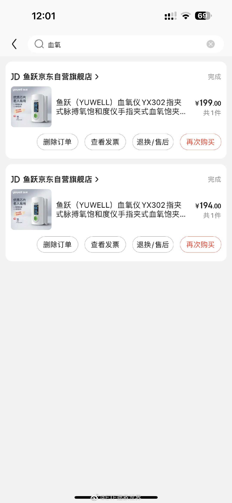 

## 2022-12-28 12:55

家里有人发烧了。

现在我们用这个联络。 ​​​

## 2022-12-28 13:20

有朋友问，为什么不用微信。

呵呵，你不懂男人。

男人最快乐的，难道不是自己乱买的装备和工具终于用上了吗。

啊，终于有个螺丝松了，电动螺丝刀赶紧拿出来用——这简单的快乐谁能懂啊。 ​​​

## 2022-12-28 17:27

刚建了个小模型跑了个小数据，送给各位。

自2007年底至今：

沪深300全收益指数收益率-4.1%，十年国开债收益率102.06%。

如果每年年底，以5:5静态再平衡，则股债组合收益率为91.48%。

组合只在17、20、21年总收益率跑赢十年国开债。

如果每年年底，根据全市场估值，以6:4动态再平衡，则股债组合收益率为130.5%。

组合只在2011年总收益率跑输十年国开债，其他所有时间领先。

如果每年年底，根据全市场估值，以7:3动态再平衡，则股债组合收益率为171.91%。

组合在所有年份领先纯股、纯债。

说明两个问题：

第一，高抛低吸极其有效。

第二，以估值为依据的高抛低吸更加有效。

希望这几个数据能给有缘人一些启发。

## 2022-12-28 21:50

分手了你就希望他过得不好。 ​​​

## 2022-12-29 08:29

有时候真的感觉很奇怪，明明怎么做是对的大家都知道，但就是不去做。青少年全国大赛真的很难组织吗，为什么董路可以组织起上千只球队参加的2034杯，中国足协几十年了组织不起来？

## 2022-12-29 08:37

你知道为什么便利店员工冒充美国医学博士，可以骗到很多大V和无数群众吗。

非常简单，不是他的骗术很高明，

而是因为他说了很多人想听的话。

当你有了鲜明的立场，就已经不可能理性思考了。

想一想，还是我们这样“怎么都行”的人，更有可能理性看待很多事情。 ​​​

## 2022-12-29 11:13

我有一个判断一件东西好不好的角度，说出来供大家批判：

那就是，

看看有钱有权的人，是不是都在想方设法得到它。

如果是，那就说明这个东西应该大差不差挺好的。

不用管更多的人怎么说。

不敢说100%吧，大部分情况下应该是成立的。 ​​​

## 2022-12-29 17:54

年底了，大家辛苦了。

我也做不了什么，省吃俭用攒点钱，发两个小红包吧。

今天先发一个，明天1818开奖。

5000块，评论抽一百位钻粉，平均分。

一点心意，您别嫌少。

希望不管中还是没中的朋友都能开开心心迎接新一年。

 ​ 抽奖详情 ​​​

## 2022-12-30 00:53

现在零下8度。

但是在外面转了一圈，一点点都不冷。 ​​​

## 2022-12-30 09:40

如果有人信任你，你一定要珍惜。因为信任这个东西很宝贵，一旦失去，就很难再有。很多时候，如果不能说真话，可以选择不说。

## 2022-12-30 15:41

网格账户网了一年提款十几次，网了个寂寞，

还没跑赢余额宝，

只是领先了300和500二十几个点有什么用？

明年还做不做了，大家真得好好想想了！ ​​​

## 2022-12-30 18:28

恭喜@芒果兔兔M 等100名用户等额平分【5000元现金】。微博官方唯一抽奖工具@微博抽奖平台 对本次抽奖进行监督，结果公正有效。公示链接：网页链接

## 2022-12-30 19:10

好家伙，我居然中奖了，

这条微博最先评论的钻2朋友把收件信息告诉我，我转送给你 ​​​

## 2022-12-31 09:42

刚才我在C罗加盟沙特联赛新闻下面看见好多人讽刺他的评论。

我不是他的球迷啊，我就是有个疑问，

为什么一个在三个国家三只球队拿过联赛冠军，欧洲赛场轰入700多球，欧冠历史第一射手，

五次世界足球先生，五次金球奖，

一次欧洲杯冠军，很多次欧冠冠军，

有自己的品牌，常年保持运动员收入前五，

汶川地震为中国捐款（好像是唯一的足球运动员，不确定），

最重要的是，被他们嘲笑的加入的亚洲俱乐部，在他37岁高龄的时候，还给他每年一亿多美元（十几亿人民币）年薪，签了两年…

我就是想知道，这样一位足球运动员都要被你嘲笑，那么这个世界上还有你看得上的人吗…

## 2022-12-31 10:08

接着刚才的那条，

有朋友说，C罗人品不行，或者一直只重视自己的荣誉不在乎俱乐部和国家队，或者在媒体公然喷俱乐部都很让人反感。

没错，我也这么认为，因为足球是一个集体运动，不能只为了自己刷数据而失去团队精神。这点我完全同意各位。

但这里关于这个问题，我有几点想法，与各位分享。

第一个想法，是关于这个人的性格问题。

这种对荣誉的极致追求，其实是一把双刃剑。一方面严于律己，用常人无法接受的生活方式把身体状态保持在高水平。另一方面一定是在追求个人成功的时候会损害他人或者集体的利益。

可以说，没有这种性格，就没有现在的他。正反两方面都是。

另一个想法，就是我们对一个人的评判标准到底应该是什么。

从纵向上来说，一个人一辈子作恶多端，后来改了，我们夸他浪子回头金不换。一个人行善一辈子，老了做了错事，我们说他晚节不保。但明明前者只做了很少的好事，后者做了很多，却得到了不同的待遇，为什么？

一个人成功的时候，鲜花掌声围绕身边。一旦失败，所有人忘了他曾经的成功和贡献，都要踩上一脚，这合适吗？

从横向上来说，这个世界上到底存在不存在“完美的人”。

我不知道是我们这个文化，还是所有国家的人都一样。好像总是在要求一个人“完美”。能力、品德、谈吐、形象、家庭、人际关系、性格……都要完美。

但这个世界上有这样的人吗？

有。

骗子。

一旦有一点不“完美”，说错一句话，一个词，一个字，这个人就完全社会性死亡了。这合理吗？

谁是完美的？我看啊，一个人如果能做到82分，8分优点2分缺点就已经是人间极品了。

抓大放小，分清主次，严于律己，宽以待人，做到这些，自己的人生也会越走越好的。

